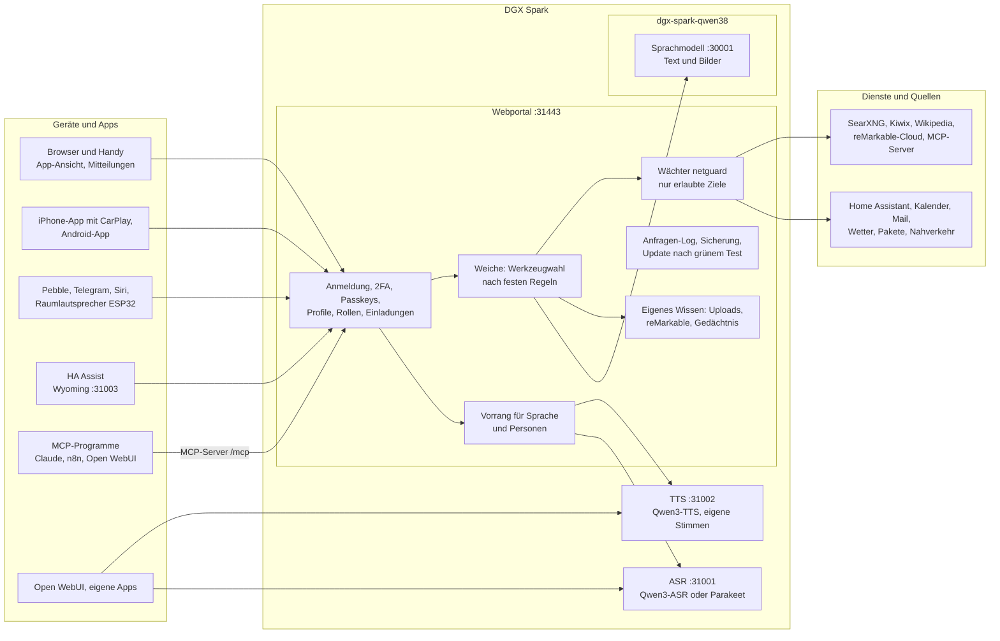

# Speech auf DGX Spark

[English](README.md) | **Deutsch** · Idee: Dominik Bornhäußer

[](https://buymeacoffee.com/zquu1xu570)

Spracherkennung (**Qwen3-ASR**) und Sprachausgabe (**Qwen3-TTS**) als Dienste auf einer NVIDIA DGX Spark (GB10), dazu ein Webportal mit Sprach-Assistent, Profilen und Monitoring. Läuft nativ mit systemd, ohne Docker, neben [dgx-spark-qwen38](https://github.com/hasso5703/dgx-spark-qwen38), das das Sprachmodell liefert.

## Installation

```bash
git clone https://github.com/db9979/speech-on-dgx-spark
cd speech-on-dgx-spark
sudo ./install.sh
```

Das Skript fragt, was installiert werden soll:

- **Komplett**: Modelle, APIs und das Webportal mit dem Assistenten.
- **Nur die Modelle mit ihren APIs**: für Open WebUI, eigene Apps oder Home Assistant, ohne Portal. Verwaltet wird dann mit `sudo speech-spark`.

Am Ende stehen Adresse, Passwort und API-Schlüssel auf dem Bildschirm, danach spricht die Sprachausgabe einen Satz und die Spracherkennung prüft ihn. Das Portal liegt auf `https://SPARK:31443` (https ist nötig, damit der Browser das Mikrofon freigibt).

| Aufgabe | Befehl |
|---|---|
| Aktualisieren | Knopf im Portal unter *Einstellungen → Update und Sicherung* oder `sudo speech-spark update` |
| Adressen und Schlüssel anzeigen | `sudo speech-spark info` |
| Deinstallieren | `sudo ./uninstall.sh` (Konfiguration, Modelle und Stimmen bleiben; `--purge` löscht alles) |

Alle Optionen ohne Rückfragen (`--mode api --asr 1.7b --tts 0.6b --yes` …) stehen in [Installation im Detail](docs/de/installation.md).

## Letzte Änderungen

<!-- New version: add one line at the top here and in CHANGELOG.md, drop the oldest line here (keep 10). Details go to docs/de and docs/en, not into this README. -->

- **V01.0.366** Pebble-Uhr-App: der Bau prüft, dass die App auch auf älterer Uhr-Firmware läuft (SDK 5.94)
- **V01.0.365** Pebble-Uhr-App: GitHub legt die gebaute Datei auf den Zweig pebble-build, damit sie ins Panel übernommen werden kann
- **V01.0.364** Notaus von selbst (Wächter, Schalter unter Sicherheit, aus): Stufe 1 bei 20 falschen Anmeldungen von außen, MCP-Flut oder vielen gesperrten Verbindungen; Notaus-Taste am ESP32-Lautsprecher (5 s, Firmware Build 6) und an der Pebble (SELECT 3 s, Uhr-App 1.6.0)
- **V01.0.363** Eigene MCP-Dienste pro Profil (Admin-Unterschalter + Ich → Meine MCP-Dienste, alles aus): jedes Werkzeug einzeln frei, Lesen als fremder Text, Handeln nach „Ja“, OAuth-Anmeldung, Hintergrundaufträge nur lesend, Admin sperrt sofort, Live zeigt jeden Aufruf ohne Inhalte
- **V01.0.362** Eindeutiges direkt abrufen: Wetter und Termine auch für morgen und übermorgen
- **V01.0.361** Erst lokal suchen: ein langer Kiwix-Artikel bremst die Antwort nicht mehr (nur der Anfang wird gelesen), Logs → Anfragen zeigt Treffer je Quelle
- **V01.0.360** Notaus auf mehr Wegen: Telegram /notaus und /meinnotaus, fester Satz „Spark, Mein Notaus“ / „Spark, Notaus“ (großer nur für Admins), Home-Assistant-Schlüssel, der nur auslöst (mit fertiger Vorlage), Android-Kachel (App 1.1.0)
- **V01.0.359** Kopf unten rechts: ein Tipp startet den Assistenten auf jeder Seite, über Ich und am Handy (das Fenster ging sofort wieder zu), Doppeltipp markiert keinen Text mehr, Frage tippen geht immer
- **V01.0.358** Eindeutiges direkt abrufen: „Welche Termine habe ich heute?“ holt das Panel selbst
- **V01.0.357** Passkeys in der iPhone-App: „Mit Passkey“ beim Bestätigen, Spark-Update und Admin-Anmeldung (Face ID mit dem in Safari angelegten Passkey, über iCloud-Schlüsselbund); der Spark liefert Apple dafür /.well-known/apple-app-site-association (nur die App-ID, aus den Push-Angaben)

Alle Versionen: [CHANGELOG.md](CHANGELOG.md)

## So funktioniert es



1. Du sprichst ins Handy, in den Browser, in eine der Apps oder einen Lautsprecher. Das Portal meldet dich an, schickt den Ton an die **Spracherkennung** und bekommt Text zurück.
2. Die **Weiche** wählt nach festen Regeln, welche Werkzeuge die Frage braucht. Das Portal gibt den Text mit Gedächtnis, Gesprächsverlauf, eigenem Wissen und genau diesen Werkzeugen an das **Sprachmodell** von qwen38.
3. Braucht die Antwort Kalender, Mail, Wetter, Home Assistant, Websuche, Kiwix oder Wikipedia, holt das Portal die Daten selbst; schalten und eintragen geht nur nach Bestätigung.
4. Die Antwort geht Satz für Satz an die **Sprachausgabe** und wird gestreamt abgespielt, während das Modell noch schreibt. Der Vorrang sorgt dafür, dass gesprochene Antworten und wichtige Personen zuerst drankommen.
5. Andere Apps nutzen ASR und TTS direkt über die OpenAI-ähnlichen APIs mit API-Schlüssel, MCP-Programme den Spark als MCP-Server mit eigenem Zugang.

Jede Funktion ist pro Profil einzeln schaltbar und ab Werk aus. Updates laufen erst nach grünem Selbsttest und lassen sich zurücknehmen.

## Weiterlesen

- [Installation im Detail](docs/de/installation.md): Installationsarten, Befehl `speech-spark`, alle Optionen, Update, Deinstallieren
- [Assistent und Oberfläche](docs/de/assistent.md): Sprach-Chat, Handy, Funktionen, Menü
- [APIs und Einbinden](docs/de/apis-und-einbinden.md): Transkription, Sprachausgabe, Streaming, Open WebUI, Siri, Pebble
- [Sicherheit und Betrieb](docs/de/sicherheit-und-betrieb.md): Anmeldung, Sperren, Sicherungen, Wächter, Selbsttest, Logs
- [Technik und Fehlersuche](docs/de/technik.md): Dienste und Ports, Leistung messen, neben qwen38, Fehlersuche

Im Portal steht zu jeder Funktion eine eigene Anleitung unter *Funktionen → Anleitungen*.

## Unterstützen

Das Projekt ist kostenlos. Wenn es dir gefällt, kannst du es über [buymeacoffee.com/zquu1xu570](https://buymeacoffee.com/zquu1xu570) unterstützen.

## Lizenz

MIT, siehe [LICENSE](LICENSE). Die Modelle (Qwen3-ASR, Qwen3-TTS) und Pakete (vLLM, vllm-omni, PyTorch) werden bei der Installation geladen und stehen unter ihren eigenen Lizenzen. Dieses Projekt steht in keiner Verbindung zu NVIDIA oder dem Qwen-Team.
