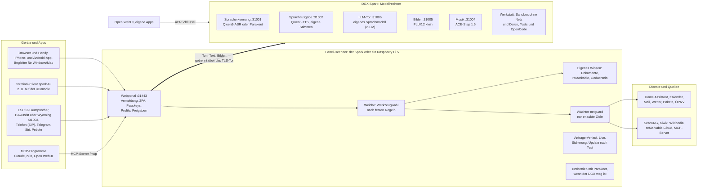

# Speech auf DGX Spark

[English](README.md) | **Deutsch** · Idee: Dominik Bornhäußer

[](https://buymeacoffee.com/zquu1xu570)

Spracherkennung (**Qwen3-ASR**), Sprachausgabe (**Qwen3-TTS**), Bilder (**FLUX.2 klein**) und ein eigenes Sprachmodell (**vLLM**) als Dienste auf einer NVIDIA DGX Spark (GB10), dazu ein Webportal mit Sprach-Assistent, Profilen und Monitoring. Läuft nativ mit systemd, ohne Docker. Das Portal läuft auf dem Spark selbst oder auf einem kleinen eigenen Rechner wie einem Raspberry Pi 5. Statt des eigenen Sprachmodells kann weiterhin [dgx-spark-qwen38](https://github.com/hasso5703/dgx-spark-qwen38) es liefern.

| Assistent | Zustand | Technik |
|---|---|---|
| [](docs/bilder/de-chat.png) | [](docs/bilder/de-zustand.png) | [](docs/bilder/de-technik.png) |

## Installation

```bash
git clone https://github.com/db9979/speech-on-dgx-spark
cd speech-on-dgx-spark
sudo ./install.sh
```

Das Skript fragt, was installiert werden soll:

- **Komplett**: Modelle, APIs und das Webportal mit dem Assistenten.
- **Nur die Modelle mit ihren APIs**: für Open WebUI, eigene Apps oder Home Assistant, ohne Portal. Verwaltet wird dann mit `sudo speech-spark`.
- **Geteilt** (Spark teilen): das Panel auf einem eigenen Rechner wie einem Raspberry Pi 5, der DGX liefert nur die Modelle. Anleitung, auch zum Umziehen: [Spark teilen](docs/de/spark-teilen.md).

Am Ende stehen Adresse, Passwort und API-Schlüssel auf dem Bildschirm, danach spricht die Sprachausgabe einen Satz und die Spracherkennung prüft ihn. Das Portal liegt auf `https://SPARK:31443` (https ist nötig, damit der Browser das Mikrofon freigibt).

| Aufgabe | Befehl |
|---|---|
| Aktualisieren | Knopf im Portal unter *Einstellungen → Update* oder `sudo speech-spark update` |
| Adressen und Schlüssel anzeigen | `sudo speech-spark info` |
| Eigenes Sprachmodell | `sudo ./install.sh --llm`, danach `sudo speech-spark modelle llm uebernehmen` (zurück: `… zurueck`) |
| Werkstatt (Testlauf, Code-Messung, Diagnose, Reparatur) | auf dem Modell-Rechner `sudo ./install.sh --werkstatt`, dann *Funktionen → Werkstatt* |
| Portal auf einen anderen Rechner umziehen | `sudo speech-spark umziehen --code`, siehe [Spark teilen](docs/de/spark-teilen.md) |
| Deinstallieren | `sudo ./uninstall.sh` (Konfiguration, Modelle und Stimmen bleiben; `--purge` löscht alles) |

Alle Optionen ohne Rückfragen (`--mode api --asr 1.7b --tts 0.6b --yes` …) stehen in [Installation im Detail](docs/de/installation.md).

## Letzte Änderungen

<!-- New version: add one line at the top here and in CHANGELOG.md, drop the oldest line here (keep 10). Details go to docs/de and docs/en, not into this README. -->

- **V01.1.161** KI-Dungeon-Master: Berufe in männlicher und weiblicher Form, keine Bord-KI als Beruf, Aussehen nur noch Äußeres (NSC-Tabellen)
- **V01.1.160** Einstellungen: Text neben einem Feld wird nie mehr schmal gedrückt, „Zeitserver im Heimnetz“ unter Betrieb stand Wort für Wort untereinander, jetzt rückt ein Feld unter den Text, wenn daneben weniger als etwa 180 px blieben, auch bei 820 px Fensterbreite neben beiden Menüs (Sprachausgabe, Sprachmodell, Vorgaben, Stimmen), und kein Auswahlfeld ragt mehr aus seinem Kasten
- **V01.1.159** KI-Dungeon-Master: „gehe zur alten Bibliothek“ führt wirklich dorthin (keine Probe, der Erzähler muss den Weg nehmen, sonst geht das Panel), „vage“ verlangt einen Ansatzpunkt aus den Daten der Szene, kein „W-2“ mehr auf der Würfelkarte, die Geschichte blendet oben weich aus
- **V01.1.158** KI-Dungeon-Master: die Karte sagt schon vor der Erzählung, wen eine Aktion zum Mitkommen fragt, damit das Panel die Charisma-Probe vorher würfeln kann (LlamaTale 4)
- **V01.1.157** KI-Dungeon-Master: Heldenbuch kommt auch auf langsamer Leitung an (ReadTimeout beim Senden), Bilder als JPEG und je Buch nur einmal gebaut (mit 60 Bildern unter 2 MB statt einige MB), Hochladen aufs reMarkable mit Wartezeit nach Dateigröße und einem zweiten Versuch, „Jetzt schicken“ arbeitet im Hintergrund mit Status, Log nennt den Schritt; Buch und Notizen liegen im eigenen Ordner „Dungeon-Master“
- **V01.1.156** KI-Dungeon-Master: Wandernde Personen und kleine Gesten (zwei Schalter, aus), bei langer Rast ziehen Personen der Karte nach festen Regeln zu ihrem Ziel oder dem Ort ihres Berufs weiter und man hört es als Gerücht, beim Warten zeigt eine Person der Szene eine feste Geste nach ihrem Wesen (LlamaTale-Ideen 6 und 7)
- **V01.1.155** KI-Dungeon-Master: Aufträge von Personen (Schalter, aus), wer eine Person nach Arbeit fragt, bekommt vom Panel einen Auftrag (bringen, reden, besiegen) mit Lohn, Erfahrung und zwei Spuren, erfüllt nur durch Übergabe, Gespräch oder Sieg, der Erzähler erzählt nur Grund und Dank (LlamaTale-Idee 2)
- **V01.1.154** KI-Dungeon-Master: Gedanken lesen (Schalter, aus), mit dem Zauber oder dem Trank würfelt das Panel eine Intelligenz-Probe, nur der lesende Spieler sieht Wunsch, Geheimnis und Haltung der Person, der Erzähler erzählt nur das Lauschen (LlamaTale-Idee 5)
- **V01.1.153** KI-Dungeon-Master: Runen-Katalog mit 13 Runen und 7 Runenwörtern, geprüft nach festen Regeln (Runen und Sockel, Teil Daten)
- **V01.1.152** KI-Dungeon-Master: Zeugen-Regel (Schalter, aus), was ein Held vor Leuten der Szene tut, ändert ihre Haltung nach fester Tabelle, Angriff und Diebstahl Ziel −2 und alle Anwesenden −1, Geschenk und Hilfe Ziel +1, ein gelungener Diebstahl bleibt unbemerkt, der Erzähler zeigt nur die Reaktion (LlamaTale-Idee 3)


Alle Versionen: [CHANGELOG.md](CHANGELOG.md)

## So funktioniert es



1. Du sprichst ins Handy, in den Browser, in eine der Apps, den Terminal-Client, einen Lautsprecher oder ins Telefon. Das Portal meldet dich an, schickt den Ton an die **Spracherkennung** und bekommt Text zurück.
2. Die **Weiche** wählt nach festen Regeln, welche Werkzeuge die Frage braucht. Das Portal gibt den Text mit Gedächtnis, Gesprächsverlauf, eigenem Wissen und genau diesen Werkzeugen an das **Sprachmodell** hinter dem LLM-Tor (oder an qwen38, wenn du es behältst).
3. Braucht die Antwort Kalender, Mail, Wetter, Home Assistant, Websuche, Kiwix oder Wikipedia, holt das Portal die Daten selbst; schalten und eintragen geht nur nach Bestätigung. Bilder malt und ändert FLUX.2 klein auf dem Spark; Musik macht ACE-Step 1.5 (zuerst nur „Musik testen“ für den Admin unter Zustand → Prüfen).
4. Die Antwort geht Satz für Satz an die **Sprachausgabe** und wird gestreamt abgespielt, während das Modell noch schreibt. Der Vorrang sorgt dafür, dass gesprochene Antworten und wichtige Personen zuerst drankommen.
5. Mit **Spark teilen** liegen Portal, Profile, Chats und Anrufe auf dem kleinen Rechner und erreichen die Modelle nur über das TLS-Tor. Startet der DGX neu oder ist er aus, laufen Chats, Erinnerungen und Anrufe weiter, und der Notbetrieb versteht ein paar feste Befehle ohne Sprachmodell.
6. Andere Apps nutzen ASR und TTS direkt über die OpenAI-ähnlichen APIs mit API-Schlüssel, MCP-Programme den Spark als MCP-Server mit eigenem Zugang.

Jede neue Funktion ist ab Werk aus. Gibt der Admin sie frei, gilt sie sofort für jedes Profil; nur der Admin kann einzelne Profile sperren. Gäste bekommen nur Frage und Antwort, nie ein Werkzeug. Updates laufen erst nach grünem Selbsttest und lassen sich zurücknehmen.

## Weiterlesen

- [Installation im Detail](docs/de/installation.md): Installationsarten, Befehl `speech-spark`, alle Optionen, Update, Deinstallieren
- [Spark teilen](docs/de/spark-teilen.md): das Portal auf einem eigenen Rechner wie einem Raspberry Pi 5, Umziehen, Notbetrieb
- [Assistent und Oberfläche](docs/de/assistent.md): Sprach-Chat, Handy, Funktionen, Menü
- [APIs und Einbinden](docs/de/apis-und-einbinden.md): Transkription, Sprachausgabe, Streaming, Open WebUI, Siri, Pebble, Terminal-Client
- [iPhone-App](docs/de/iphone-app.md) und [Android-App](docs/de/android-app.md): Chat, Anrufe, Panel-Bereiche auf dem Handy
- [Sicherheit und Betrieb](docs/de/sicherheit-und-betrieb.md): Anmeldung, Sperren, Sicherungen, Wächter, Selbsttest, Logs
- [Architektur](docs/de/architektur.md): Bausteine, Weg einer Anfrage, alle Speicherorte (auch im Panel unter Zustand → Technik)
- [Technik und Fehlersuche](docs/de/technik.md): Dienste und Ports, Leistung messen, eigenes Sprachmodell oder qwen38, Fehlersuche
- [Coding-Richtlinie](docs/de/richtlinien.md) und [Sicherheits-Checkliste](docs/de/sicherheits-checkliste.md): Regeln für jede Änderung, Pflichtliste für neue Funktionen

Im Portal steht zu jeder Funktion eine eigene Anleitung unter *Funktionen → Anleitungen*.

## Unterstützen

Das Projekt ist kostenlos. Wenn es dir gefällt, kannst du es über [buymeacoffee.com/zquu1xu570](https://buymeacoffee.com/zquu1xu570) unterstützen.

## Lizenz

FSL-1.1-MIT (Functional Source License), siehe [LICENSE](LICENSE). Du darfst den Spark nutzen, lesen, ändern und weitergeben, für dich, deine Familie und Freunde, in Lehre und Forschung; nicht erlaubt ist nur, ihn als kommerzielles Konkurrenzangebot zu vertreiben. Jede Version wird zwei Jahre nach ihrer Veröffentlichung von selbst MIT. Versionen bis V01.0.542 stehen weiter unter MIT. Eingebundene fremde Teile (z. B. XiaoZhi-Firmware, Lucide-Symbole) behalten ihre eigene Lizenz. Die Modelle (Qwen3-ASR, Qwen3-TTS) und Pakete (vLLM, vllm-omni, PyTorch) werden bei der Installation geladen und stehen unter ihren eigenen Lizenzen. Dieses Projekt steht in keiner Verbindung zu NVIDIA oder dem Qwen-Team.
