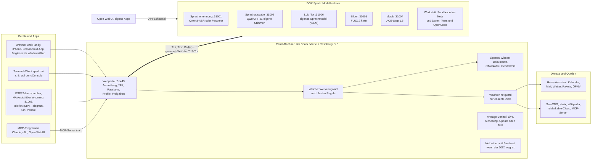

# Speech auf DGX Spark

[English](README.md) | **Deutsch** · Idee: Dominik Bornhäußer

[](https://buymeacoffee.com/zquu1xu570)

Spracherkennung (**Qwen3-ASR**), Sprachausgabe (**Qwen3-TTS**), Bilder (**FLUX.2 klein**) und ein eigenes Sprachmodell (**vLLM**) als Dienste auf einer NVIDIA DGX Spark (GB10), dazu ein Webportal mit Sprach-Assistent, Profilen und Monitoring. Läuft nativ mit systemd, ohne Docker. Das Portal läuft auf dem Spark selbst oder auf einem kleinen eigenen Rechner wie einem Raspberry Pi 5. Statt des eigenen Sprachmodells kann weiterhin [dgx-spark-qwen38](https://github.com/hasso5703/dgx-spark-qwen38) es liefern.

| Assistent | Zustand | Technik |
|---|---|---|
| [](docs/bilder/de-chat.png) | [](docs/bilder/de-zustand.png) | [](docs/bilder/de-technik.png) |

## Installation

```bash
git clone https://github.com/db9979/speech-on-dgx-spark
cd speech-on-dgx-spark
sudo ./install.sh
```

Das Skript fragt, was installiert werden soll:

- **Komplett**: Modelle, APIs und das Webportal mit dem Assistenten.
- **Nur die Modelle mit ihren APIs**: für Open WebUI, eigene Apps oder Home Assistant, ohne Portal. Verwaltet wird dann mit `sudo speech-spark`.
- **Geteilt** (Spark teilen): das Panel auf einem eigenen Rechner wie einem Raspberry Pi 5, der DGX liefert nur die Modelle. Anleitung, auch zum Umziehen: [Spark teilen](docs/de/spark-teilen.md).

Am Ende stehen Adresse, Passwort und API-Schlüssel auf dem Bildschirm, danach spricht die Sprachausgabe einen Satz und die Spracherkennung prüft ihn. Das Portal liegt auf `https://SPARK:31443` (https ist nötig, damit der Browser das Mikrofon freigibt).

| Aufgabe | Befehl |
|---|---|
| Aktualisieren | Knopf im Portal unter *Einstellungen → Update* oder `sudo speech-spark update` |
| Adressen und Schlüssel anzeigen | `sudo speech-spark info` |
| Eigenes Sprachmodell | `sudo ./install.sh --llm`, danach `sudo speech-spark modelle llm uebernehmen` (zurück: `… zurueck`) |
| Werkstatt (Testlauf, Code-Messung, Diagnose, Reparatur) | auf dem Modell-Rechner `sudo ./install.sh --werkstatt`, dann *Funktionen → Werkstatt* |
| Portal auf einen anderen Rechner umziehen | `sudo speech-spark umziehen --code`, siehe [Spark teilen](docs/de/spark-teilen.md) |
| Deinstallieren | `sudo ./uninstall.sh` (Konfiguration, Modelle und Stimmen bleiben; `--purge` löscht alles) |

Alle Optionen ohne Rückfragen (`--mode api --asr 1.7b --tts 0.6b --yes` …) stehen in [Installation im Detail](docs/de/installation.md).

## Letzte Änderungen

<!-- New version: add one line at the top here and in CHANGELOG.md, drop the oldest line here (keep 10). Details go to docs/de and docs/en, not into this README. -->

- **V01.1.218** Fernzugang: Terminal im Layout A (Assistent als Spalte rechts, ziehbar und zuklappbar, Vorschläge als eine Zeile, Sitzungsangaben im ⓘ der roten Zeile, Symbolleiste, Menü klappt weg, Seite scrollt nie; Handy mit Blatt von unten); eine endende Sitzung ließ eine spätere Verbindung hängen
- **V01.1.217** Fernzugang: „Herauslösen“ zeigt im eigenen Fenster wieder das Terminal (statt der Startseite); „Alle Tasten“ füllt den Bildschirm nur mit dem Terminal, Vorschläge und Assistent in einer Schublade (Strg+Umschalt+Leertaste); Vorschläge für screen und tmux statt uptime und df -h; der Anker auf dem Mac: Zertifizierungsstellen des Systems, wenn Python keine mitbringt, Code direkt vom Terminal (auch unter curl | sudo), eigene Zeile mit /usr/bin/python3
- **V01.1.216** Fernzugang Stufe 6: der Anker richtet sich auch auf dem Mac ein (dieselbe Zeile, ab macOS 13): versteckter Benutzer spark, launchd-Dienst, Entfernte Anmeldung nur für den Anker eingeschaltet und beim Entfernen wieder so wie vorher
- **V01.1.215** Fernzugang: die laufende Sitzung zeigt sich als schmale rote Zeile oben im Inhalt auf jeder Seite (Punkt, „Fernsitzung aktiv · Server · Minuten“, „Trennen“; „Notaus trennt sofort“ als Hinweis), unter der Kopfleiste und am Handy unter der oberen Leiste, auch im eigenen Fenster; der Anker hört auf macOS und Windows mit einem festen Satz auf und richtet nichts halb ein, fehlt auf Linux der Host-Schlüssel, nennt er `sudo ssh-keygen -A`
- **V01.1.214** Fernzugang Stufe 2b: Assistent im Terminal (eigener Schalter, aus): „Frag den Assistenten“ neben der Shell und Folgebefehle nach jedem Enter, nur vom eigenen Sprachmodell, ohne Werkzeug; er tippt nie, jeder Befehl wird ein Vorschlag zum Einfügen, gefährliche Befehle stehen rot und brauchen zwei Tipps; der Bildschirm geht nur mit „Bildschirm mitschicken“ mit, als Datenblock; im Protokoll nur Wörter und Zahlen
- **V01.1.213** Fernzugang Stufe 2: eigener Menüpunkt Fernzugang (nur Admins, solange der Schalter an ist); die Shell lässt sich in ein eigenes Fenster herauslösen (eigenes Einmal-Ticket, nie in der Adresse) und zurückholen; Tastenkürzel des Browsers gehen an die Shell, „Alle Tasten“ im Vollbild auch Strg+W und Esc; Vorschläge passen sich nach festen Regeln an den letzten Befehl an, nichts verlässt den Browser; „Gerade verbunden“ und Live zeigen wer, von wo (Zuhause/Internet) und wie lange, Verlauf 30 Tage ohne Inhalt, Mitteilung an die Admins bei einer Sitzung aus dem Internet; die iPhone-App zeigt unter Spark verwalten → Fernzugang die Fern-Server mit Trennen, Darf sich verbinden und Entfernen, Android unter Verwalten; die ersten Bytes des Servers gehen beim Öffnen nicht mehr verloren
- **V01.1.212** KI-Dungeon-Master: englische Gegnernamen wie im SRD
- **V01.1.211** KI-Dungeon-Master: die Prüfung erkennt Gegner auch gebeugt und in anderer Wortfolge („giant, red-eyed rats“, „Wölfe“, „jungen roten Drachen“), der Erzähler-Prüfstand zeigt, welcher Gegner fehlt
- **V01.1.210** KI-Dungeon-Master: jedes Haus der Siedlung (Gasthaus, Schmiede, Heiler, Lehrmeister) hat je Welt ein eigenes Bild
- **V01.1.209** KI-Dungeon-Master: die Siedlung ist übersichtlich: links die Häuser Gasthaus, Schmiede, Heiler und Lehrmeister, rechts das gewählte Haus mit einer Zeile je Angebot, am Handy erst die Häuser, dann das Haus


Alle Versionen: [CHANGELOG.md](CHANGELOG.md)

## So funktioniert es



1. Du sprichst ins Handy, in den Browser, in eine der Apps, den Terminal-Client, einen Lautsprecher oder ins Telefon. Das Portal meldet dich an, schickt den Ton an die **Spracherkennung** und bekommt Text zurück.
2. Die **Weiche** wählt nach festen Regeln, welche Werkzeuge die Frage braucht. Das Portal gibt den Text mit Gedächtnis, Gesprächsverlauf, eigenem Wissen und genau diesen Werkzeugen an das **Sprachmodell** hinter dem LLM-Tor (oder an qwen38, wenn du es behältst).
3. Braucht die Antwort Kalender, Mail, Wetter, Home Assistant, Websuche, Kiwix oder Wikipedia, holt das Portal die Daten selbst; schalten und eintragen geht nur nach Bestätigung. Bilder malt und ändert FLUX.2 klein auf dem Spark; Musik macht ACE-Step 1.5 (zuerst nur „Musik testen“ für den Admin unter Zustand → Prüfen).
4. Die Antwort geht Satz für Satz an die **Sprachausgabe** und wird gestreamt abgespielt, während das Modell noch schreibt. Der Vorrang sorgt dafür, dass gesprochene Antworten und wichtige Personen zuerst drankommen.
5. Mit **Spark teilen** liegen Portal, Profile, Chats und Anrufe auf dem kleinen Rechner und erreichen die Modelle nur über das TLS-Tor. Startet der DGX neu oder ist er aus, laufen Chats, Erinnerungen und Anrufe weiter, und der Notbetrieb versteht ein paar feste Befehle ohne Sprachmodell.
6. Andere Apps nutzen ASR und TTS direkt über die OpenAI-ähnlichen APIs mit API-Schlüssel, MCP-Programme den Spark als MCP-Server mit eigenem Zugang.

Jede neue Funktion ist ab Werk aus. Gibt der Admin sie frei, gilt sie sofort für jedes Profil; nur der Admin kann einzelne Profile sperren. Gäste bekommen nur Frage und Antwort, nie ein Werkzeug. Updates laufen erst nach grünem Selbsttest und lassen sich zurücknehmen.

## Weiterlesen

- [Installation im Detail](docs/de/installation.md): Installationsarten, Befehl `speech-spark`, alle Optionen, Update, Deinstallieren
- [Spark teilen](docs/de/spark-teilen.md): das Portal auf einem eigenen Rechner wie einem Raspberry Pi 5, Umziehen, Notbetrieb
- [Assistent und Oberfläche](docs/de/assistent.md): Sprach-Chat, Handy, Funktionen, Menü
- [APIs und Einbinden](docs/de/apis-und-einbinden.md): Transkription, Sprachausgabe, Streaming, Open WebUI, Siri, Pebble, Terminal-Client
- [iPhone-App](docs/de/iphone-app.md) und [Android-App](docs/de/android-app.md): Chat, Anrufe, Panel-Bereiche auf dem Handy
- [Sicherheit und Betrieb](docs/de/sicherheit-und-betrieb.md): Anmeldung, Sperren, Sicherungen, Wächter, Selbsttest, Logs
- [Architektur](docs/de/architektur.md): Bausteine, Weg einer Anfrage, alle Speicherorte (auch im Panel unter Zustand → Technik)
- [Technik und Fehlersuche](docs/de/technik.md): Dienste und Ports, Leistung messen, eigenes Sprachmodell oder qwen38, Fehlersuche
- [Coding-Richtlinie](docs/de/richtlinien.md) und [Sicherheits-Checkliste](docs/de/sicherheits-checkliste.md): Regeln für jede Änderung, Pflichtliste für neue Funktionen

Im Portal steht zu jeder Funktion eine eigene Anleitung unter *Funktionen → Anleitungen*.

## Unterstützen

Das Projekt ist kostenlos. Wenn es dir gefällt, kannst du es über [buymeacoffee.com/zquu1xu570](https://buymeacoffee.com/zquu1xu570) unterstützen.

## Lizenz

FSL-1.1-MIT (Functional Source License), siehe [LICENSE](LICENSE). Du darfst den Spark nutzen, lesen, ändern und weitergeben, für dich, deine Familie und Freunde, in Lehre und Forschung; nicht erlaubt ist nur, ihn als kommerzielles Konkurrenzangebot zu vertreiben. Jede Version wird zwei Jahre nach ihrer Veröffentlichung von selbst MIT. Versionen bis V01.0.542 stehen weiter unter MIT. Eingebundene fremde Teile (z. B. XiaoZhi-Firmware, Lucide-Symbole) behalten ihre eigene Lizenz. Die Modelle (Qwen3-ASR, Qwen3-TTS) und Pakete (vLLM, vllm-omni, PyTorch) werden bei der Installation geladen und stehen unter ihren eigenen Lizenzen. Dieses Projekt steht in keiner Verbindung zu NVIDIA oder dem Qwen-Team.
