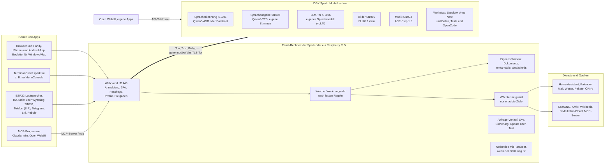

# Speech auf DGX Spark

[English](README.md) | **Deutsch** · Idee: Dominik Bornhäußer

[](https://buymeacoffee.com/zquu1xu570)

Spracherkennung (**Qwen3-ASR**), Sprachausgabe (**Qwen3-TTS**), Bilder (**FLUX.2 klein**) und ein eigenes Sprachmodell (**vLLM**) als Dienste auf einer NVIDIA DGX Spark (GB10), dazu ein Webportal mit Sprach-Assistent, Profilen und Monitoring. Läuft nativ mit systemd, ohne Docker. Das Portal läuft auf dem Spark selbst oder auf einem kleinen eigenen Rechner wie einem Raspberry Pi 5. Statt des eigenen Sprachmodells kann weiterhin [dgx-spark-qwen38](https://github.com/hasso5703/dgx-spark-qwen38) es liefern.

| Assistent | Zustand | Technik |
|---|---|---|
| [](docs/bilder/de-chat.png) | [](docs/bilder/de-zustand.png) | [](docs/bilder/de-technik.png) |

## Installation

```bash
git clone https://github.com/db9979/speech-on-dgx-spark
cd speech-on-dgx-spark
sudo ./install.sh
```

Das Skript fragt, was installiert werden soll:

- **Komplett**: Modelle, APIs und das Webportal mit dem Assistenten.
- **Nur die Modelle mit ihren APIs**: für Open WebUI, eigene Apps oder Home Assistant, ohne Portal. Verwaltet wird dann mit `sudo speech-spark`.
- **Geteilt** (Spark teilen): das Panel auf einem eigenen Rechner wie einem Raspberry Pi 5, der DGX liefert nur die Modelle. Anleitung, auch zum Umziehen: [Spark teilen](docs/de/spark-teilen.md).

Am Ende stehen Adresse, Passwort und API-Schlüssel auf dem Bildschirm, danach spricht die Sprachausgabe einen Satz und die Spracherkennung prüft ihn. Das Portal liegt auf `https://SPARK:31443` (https ist nötig, damit der Browser das Mikrofon freigibt).

| Aufgabe | Befehl |
|---|---|
| Aktualisieren | Knopf im Portal unter *Einstellungen → Update und Sicherung* oder `sudo speech-spark update` |
| Adressen und Schlüssel anzeigen | `sudo speech-spark info` |
| Eigenes Sprachmodell | `sudo ./install.sh --llm`, danach `sudo speech-spark modelle llm uebernehmen` (zurück: `… zurueck`) |
| Werkstatt (Testlauf, Code-Messung, Diagnose, Reparatur) | auf dem Modell-Rechner `sudo ./install.sh --werkstatt`, dann *Funktionen → Werkstatt* |
| Portal auf einen anderen Rechner umziehen | `sudo speech-spark umziehen --code`, siehe [Spark teilen](docs/de/spark-teilen.md) |
| Deinstallieren | `sudo ./uninstall.sh` (Konfiguration, Modelle und Stimmen bleiben; `--purge` löscht alles) |

Alle Optionen ohne Rückfragen (`--mode api --asr 1.7b --tts 0.6b --yes` …) stehen in [Installation im Detail](docs/de/installation.md).

## Letzte Änderungen

<!-- New version: add one line at the top here and in CHANGELOG.md, drop the oldest line here (keep 10). Details go to docs/de and docs/en, not into this README. -->

- **V01.0.885** Musik bearbeiten auf eigener Seite über die ganze Breite: große Welle, Werkzeuge links, Einstellungen in der Mitte, Fassungen rechts, Knopf in einer festen Leiste unten; auf dem Handy und in der iPhone-App dieselbe Ordnung
- **V01.0.884** Fix iPhone-App: der Inhalt einer formatierten Mail blieb leer (die Sperrregel der Web-Ansicht wurde nicht übersetzt); im Dunkelmodus erscheint eine schlichte Mail hell auf dunklem Grund wie bei Apple Mail, eine Mail mit eigenen Farben bleibt auf Weiß
- **V01.0.883** Der Begleiter am PC und Mac zeigt das Spark-Update: „Spark-Update läuft: 40 % · Schritt“ im Zustand, beim Neustart „Spark startet für das Update neu …“
- **V01.0.882** Besprechungs-Aufgaben unter Offen: jede Aufgabe, die der Spark-Begleiter aus einer Besprechung auf eine Liste legt, wird auch eine Karte „Aus Besprechung“ unter Offen (nicht im Gespräch); „Erledigt“ hakt den Eintrag ab, abgehakt, zurückgeholt oder gelöscht auf der Liste folgt die Karte, überfällig bleibt sie offen
- **V01.0.881** Tests des Update-Fensters wackeln nicht mehr: sie schalten ihre Schritte selbst weiter
- **V01.0.880** Kalender wie Apple Kalender (Stufe 2): Seitenleiste mit Monat und Kalendern zum Ein- und Ausblenden, Jahresansicht; in freie Zeit ziehen oder doppelklicken legt an, Inspektor mit Ort, Wiederholen, Erinnerung, Personen, Notiz und Link, Schließen speichert, untere Kante ändert die Dauer, zwei Minuten „Rückgängig“; wiederholte Termine ändern, verschieben und löschen mit „Nur dieser Termin“ oder „Alle künftigen“; Personen nur als Liste ohne Einladung; Handy mit Wochenstreifen; iPhone-App mit Formular in Gruppen und Rückgängig
- **V01.0.879** Vorrat je Profil: der Assistent nimmt Kalender, Mail, Wetter und Pakete aus dem Speicher, solange frisch genug, bei langsamem Dienst nach höchstens 2 s den älteren Stand mit Uhrzeit, „schau nochmal nach“ fragt neu; eine Runde je Minute hält aktive Profile frisch, Tagesbriefing 10 min vorher geschrieben, Wetter und Pakete versiegelt auf der Platte, Home Assistant live über WebSocket; Zustand → Prüfen je Dienst; ohne Schalter
- **V01.0.878** Update sperrt sofort beim Klick: Sicherung, Laden, Prüfen, Modell-Rechner und Neustart als Schritte im selben Fenster auf allen Geräten; jedes frühe Ende löst die Sperre und nennt den Grund
- **V01.0.877** Für dich aus dem Vorrat: die letzte Lesung je Postfach bleibt versiegelt im Profil, nach einem Neustart sofort da; antwortet ein Postfach nicht, kommen seine Einträge mit „Stand hh:mm“ im Tab, beim Vorlesen und unter Heute
- **V01.0.876** Alles Offene im Assistenten (Stufe 2): Vorschläge des Assistenten (neuer Termin, verschieben, löschen, Mail per Sprache, Aufräumen, Entwurf) als Karte „Wartet auf dein Ja“ unter der Antwort und unter Offen, mit „Eintragen“/„Senden“ (dasselbe wie ein getipptes Ja), „Ändern …“ (Formular oder Schreibfenster, ausgefüllt) und „Abbrechen“; auch vom Lautsprecher am Handy bestätigen; iPhone


Alle Versionen: [CHANGELOG.md](CHANGELOG.md)

## So funktioniert es



1. Du sprichst ins Handy, in den Browser, in eine der Apps, den Terminal-Client, einen Lautsprecher oder ins Telefon. Das Portal meldet dich an, schickt den Ton an die **Spracherkennung** und bekommt Text zurück.
2. Die **Weiche** wählt nach festen Regeln, welche Werkzeuge die Frage braucht. Das Portal gibt den Text mit Gedächtnis, Gesprächsverlauf, eigenem Wissen und genau diesen Werkzeugen an das **Sprachmodell** hinter dem LLM-Tor (oder an qwen38, wenn du es behältst).
3. Braucht die Antwort Kalender, Mail, Wetter, Home Assistant, Websuche, Kiwix oder Wikipedia, holt das Portal die Daten selbst; schalten und eintragen geht nur nach Bestätigung. Bilder malt und ändert FLUX.2 klein auf dem Spark; Musik macht ACE-Step 1.5 (zuerst nur „Musik testen“ für den Admin unter Zustand → Prüfen).
4. Die Antwort geht Satz für Satz an die **Sprachausgabe** und wird gestreamt abgespielt, während das Modell noch schreibt. Der Vorrang sorgt dafür, dass gesprochene Antworten und wichtige Personen zuerst drankommen.
5. Mit **Spark teilen** liegen Portal, Profile, Chats und Anrufe auf dem kleinen Rechner und erreichen die Modelle nur über das TLS-Tor. Startet der DGX neu oder ist er aus, laufen Chats, Erinnerungen und Anrufe weiter, und der Notbetrieb versteht ein paar feste Befehle ohne Sprachmodell.
6. Andere Apps nutzen ASR und TTS direkt über die OpenAI-ähnlichen APIs mit API-Schlüssel, MCP-Programme den Spark als MCP-Server mit eigenem Zugang.

Jede neue Funktion ist ab Werk aus. Gibt der Admin sie frei, gilt sie sofort für jedes Profil; nur der Admin kann einzelne Profile sperren. Gäste bekommen nur Frage und Antwort, nie ein Werkzeug. Updates laufen erst nach grünem Selbsttest und lassen sich zurücknehmen.

## Weiterlesen

- [Installation im Detail](docs/de/installation.md): Installationsarten, Befehl `speech-spark`, alle Optionen, Update, Deinstallieren
- [Spark teilen](docs/de/spark-teilen.md): das Portal auf einem eigenen Rechner wie einem Raspberry Pi 5, Umziehen, Notbetrieb
- [Assistent und Oberfläche](docs/de/assistent.md): Sprach-Chat, Handy, Funktionen, Menü
- [APIs und Einbinden](docs/de/apis-und-einbinden.md): Transkription, Sprachausgabe, Streaming, Open WebUI, Siri, Pebble, Terminal-Client
- [iPhone-App](docs/de/iphone-app.md) und [Android-App](docs/de/android-app.md): Chat, Anrufe, Panel-Bereiche auf dem Handy
- [Sicherheit und Betrieb](docs/de/sicherheit-und-betrieb.md): Anmeldung, Sperren, Sicherungen, Wächter, Selbsttest, Logs
- [Architektur](docs/de/architektur.md): Bausteine, Weg einer Anfrage, alle Speicherorte (auch im Panel unter Zustand → Technik)
- [Technik und Fehlersuche](docs/de/technik.md): Dienste und Ports, Leistung messen, eigenes Sprachmodell oder qwen38, Fehlersuche
- [Coding-Richtlinie](docs/de/richtlinien.md) und [Sicherheits-Checkliste](docs/de/sicherheits-checkliste.md): Regeln für jede Änderung, Pflichtliste für neue Funktionen

Im Portal steht zu jeder Funktion eine eigene Anleitung unter *Funktionen → Anleitungen*.

## Unterstützen

Das Projekt ist kostenlos. Wenn es dir gefällt, kannst du es über [buymeacoffee.com/zquu1xu570](https://buymeacoffee.com/zquu1xu570) unterstützen.

## Lizenz

FSL-1.1-MIT (Functional Source License), siehe [LICENSE](LICENSE). Du darfst den Spark nutzen, lesen, ändern und weitergeben, für dich, deine Familie und Freunde, in Lehre und Forschung; nicht erlaubt ist nur, ihn als kommerzielles Konkurrenzangebot zu vertreiben. Jede Version wird zwei Jahre nach ihrer Veröffentlichung von selbst MIT. Versionen bis V01.0.542 stehen weiter unter MIT. Eingebundene fremde Teile (z. B. XiaoZhi-Firmware, Lucide-Symbole) behalten ihre eigene Lizenz. Die Modelle (Qwen3-ASR, Qwen3-TTS) und Pakete (vLLM, vllm-omni, PyTorch) werden bei der Installation geladen und stehen unter ihren eigenen Lizenzen. Dieses Projekt steht in keiner Verbindung zu NVIDIA oder dem Qwen-Team.
