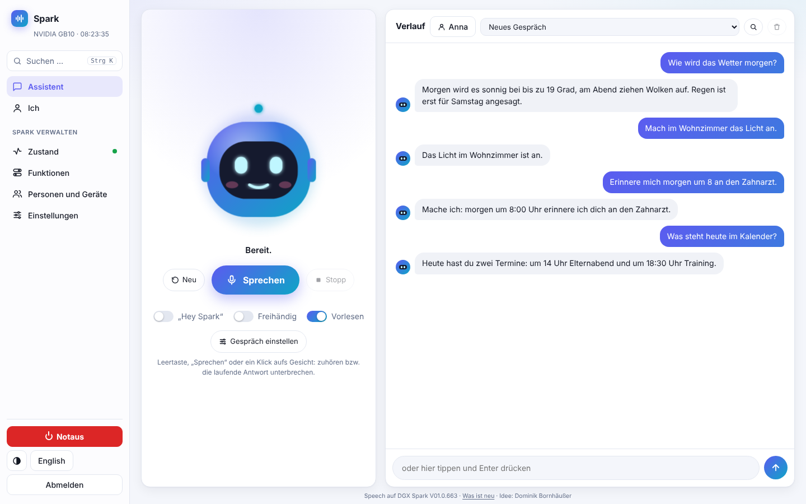
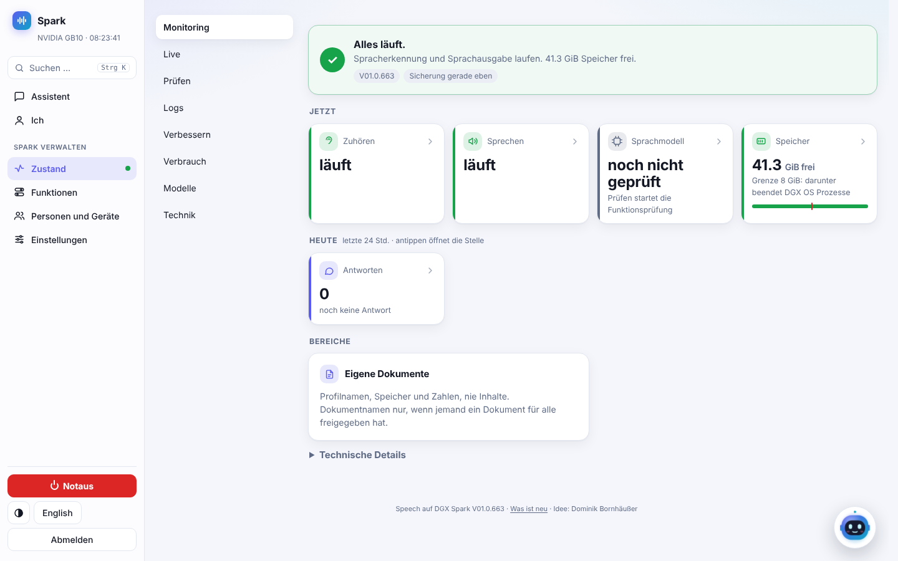
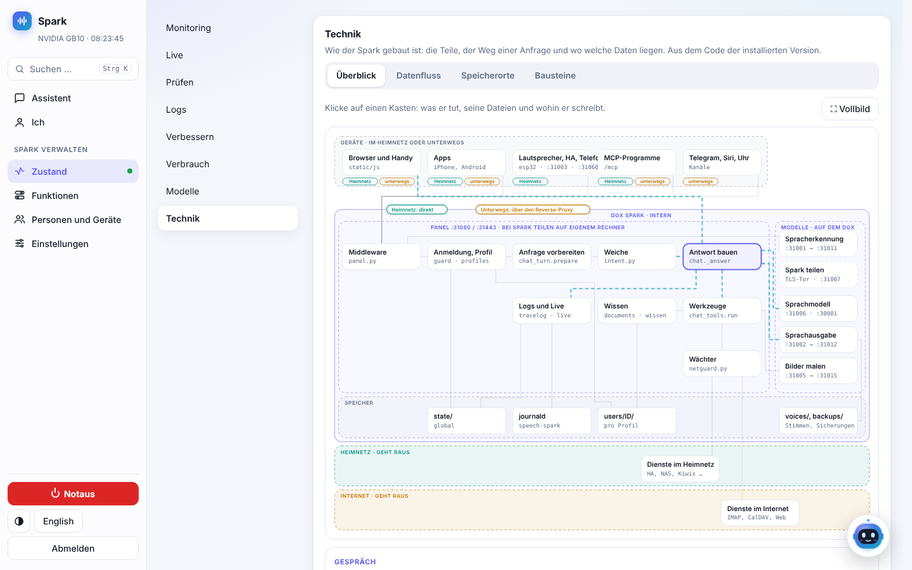
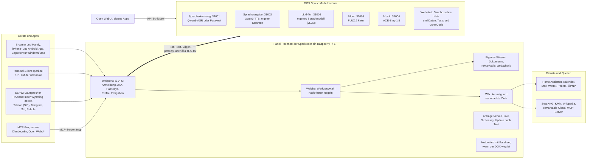

# Speech auf DGX Spark

[English](README.md) | **Deutsch** · Idee: Dominik Bornhäußer

[](https://buymeacoffee.com/zquu1xu570)

Spracherkennung (**Qwen3-ASR**), Sprachausgabe (**Qwen3-TTS**), Bilder (**FLUX.2 klein**) und ein eigenes Sprachmodell (**vLLM**) als Dienste auf einer NVIDIA DGX Spark (GB10), dazu ein Webportal mit Sprach-Assistent, Profilen und Monitoring. Läuft nativ mit systemd, ohne Docker. Das Portal läuft auf dem Spark selbst oder auf einem kleinen eigenen Rechner wie einem Raspberry Pi 5. Statt des eigenen Sprachmodells kann weiterhin [dgx-spark-qwen38](https://github.com/hasso5703/dgx-spark-qwen38) es liefern.

| Assistent | Zustand | Technik |
|---|---|---|
| [](docs/bilder/de-chat.png) | [](docs/bilder/de-zustand.png) | [](docs/bilder/de-technik.png) |

## Installation

```bash
git clone https://github.com/db9979/speech-on-dgx-spark
cd speech-on-dgx-spark
sudo ./install.sh
```

Das Skript fragt, was installiert werden soll:

- **Komplett**: Modelle, APIs und das Webportal mit dem Assistenten.
- **Nur die Modelle mit ihren APIs**: für Open WebUI, eigene Apps oder Home Assistant, ohne Portal. Verwaltet wird dann mit `sudo speech-spark`.
- **Geteilt** (Spark teilen): das Panel auf einem eigenen Rechner wie einem Raspberry Pi 5, der DGX liefert nur die Modelle. Anleitung, auch zum Umziehen: [Spark teilen](docs/de/spark-teilen.md).

Am Ende stehen Adresse, Passwort und API-Schlüssel auf dem Bildschirm, danach spricht die Sprachausgabe einen Satz und die Spracherkennung prüft ihn. Das Portal liegt auf `https://SPARK:31443` (https ist nötig, damit der Browser das Mikrofon freigibt).

| Aufgabe | Befehl |
|---|---|
| Aktualisieren | Knopf im Portal unter *Einstellungen → Update* oder `sudo speech-spark update` |
| Adressen und Schlüssel anzeigen | `sudo speech-spark info` |
| Eigenes Sprachmodell | `sudo ./install.sh --llm`, danach `sudo speech-spark modelle llm uebernehmen` (zurück: `… zurueck`) |
| Werkstatt (Testlauf, Code-Messung, Diagnose, Reparatur) | auf dem Modell-Rechner `sudo ./install.sh --werkstatt`, dann *Funktionen → Werkstatt* |
| Portal auf einen anderen Rechner umziehen | `sudo speech-spark umziehen --code`, siehe [Spark teilen](docs/de/spark-teilen.md) |
| Deinstallieren | `sudo ./uninstall.sh` (Konfiguration, Modelle und Stimmen bleiben; `--purge` löscht alles) |

Alle Optionen ohne Rückfragen (`--mode api --asr 1.7b --tts 0.6b --yes` …) stehen in [Installation im Detail](docs/de/installation.md).

## Letzte Änderungen

<!-- New version: add one line at the top here and in CHANGELOG.md, drop the oldest line here (keep 10). Details go to docs/de and docs/en, not into this README. -->

- **V01.1.082** KI-Dungeon-Master: nennt die Erzählung den neuen Ort nicht, bleibt die Gruppe am alten Ort (Fahne und Erzählung stimmen überein); die Karte zählt Wege in Etappen und den Weg zur nächsten Siedlung; besetzte Orte tragen das Wappen ihrer Fraktion
- **V01.1.081** Hilfsmodell für einfache Einordnungen, Funktionen → Hilfsmodell
- **V01.1.080** KI-Dungeon-Master: echte Würfel am Tisch (Zahl tippen oder sagen, nach 30 s würfelt der Spark, nie im Auto), Fanfare bei Ehrungen, Krit-Karte dreht sich um, Musik „Lagerfeuer“
- **V01.1.079** KI-Dungeon-Master: Wappen für Gruppe und Fraktionen: das Panel zeichnet jedes Wappen selbst als geprüfte SVG aus Schild, Teilung, Tinkturen und 16 eigenen Zeichen, der Gastgeber wählt Farbe und Zeichen, jede Fraktion trägt ein eigenes
- **V01.1.078** KI-Dungeon-Master: der Tisch am Handy mit Kopf in einer Zeile und „⋯“, einem Kampfkasten, dem Feld zum Handeln in jedem Teil, der Gruppe als Liste, schnellen Aktionen beim Helden und einer kurzen Hilfe; eine misslungene Untersuchung verrät nichts, Gehen braucht keine Probe, eine wiederholte Szene kürzt das Panel
- **V01.1.077** KI-Dungeon-Master: die Karte zieht nur weiter, wenn eine Aktion gehen will (Fahne und Erzählung bleiben gleich); Ortsbilder prüfen nur die eigene Runde
- **V01.1.076** Test-Fix: der Seitentest „Mails löschen und verschieben“ wartet unter Last bis zu einer Minute auf den Regel-Hinweis und das Postfach, statt nach 10 oder 20 Sekunden aufzugeben; geprüft wird dasselbe
- **V01.1.075** KI-Dungeon-Master: jede Runde lässt sich in der Liste beenden oder löschen, mit Nachfrage „Wirklich?“
- **V01.1.074** KI-Dungeon-Master: Spielleiter-Pult als großes Fenster mit drei Spalten, die rechte Spalte zeigt nur noch Held, Jetzt weiter und Karte und lässt sich breiter ziehen
- **V01.1.073** KI-Dungeon-Master: schneller auf dem Pi: eine Datei je Runde mit Zwischenspeicher, das Nachfragen bekommt „nichts neu“, solange sich nichts geändert hat, die Spiel-Skripte laden erst beim ersten Öffnen


Alle Versionen: [CHANGELOG.md](CHANGELOG.md)

## So funktioniert es



1. Du sprichst ins Handy, in den Browser, in eine der Apps, den Terminal-Client, einen Lautsprecher oder ins Telefon. Das Portal meldet dich an, schickt den Ton an die **Spracherkennung** und bekommt Text zurück.
2. Die **Weiche** wählt nach festen Regeln, welche Werkzeuge die Frage braucht. Das Portal gibt den Text mit Gedächtnis, Gesprächsverlauf, eigenem Wissen und genau diesen Werkzeugen an das **Sprachmodell** hinter dem LLM-Tor (oder an qwen38, wenn du es behältst).
3. Braucht die Antwort Kalender, Mail, Wetter, Home Assistant, Websuche, Kiwix oder Wikipedia, holt das Portal die Daten selbst; schalten und eintragen geht nur nach Bestätigung. Bilder malt und ändert FLUX.2 klein auf dem Spark; Musik macht ACE-Step 1.5 (zuerst nur „Musik testen“ für den Admin unter Zustand → Prüfen).
4. Die Antwort geht Satz für Satz an die **Sprachausgabe** und wird gestreamt abgespielt, während das Modell noch schreibt. Der Vorrang sorgt dafür, dass gesprochene Antworten und wichtige Personen zuerst drankommen.
5. Mit **Spark teilen** liegen Portal, Profile, Chats und Anrufe auf dem kleinen Rechner und erreichen die Modelle nur über das TLS-Tor. Startet der DGX neu oder ist er aus, laufen Chats, Erinnerungen und Anrufe weiter, und der Notbetrieb versteht ein paar feste Befehle ohne Sprachmodell.
6. Andere Apps nutzen ASR und TTS direkt über die OpenAI-ähnlichen APIs mit API-Schlüssel, MCP-Programme den Spark als MCP-Server mit eigenem Zugang.

Jede neue Funktion ist ab Werk aus. Gibt der Admin sie frei, gilt sie sofort für jedes Profil; nur der Admin kann einzelne Profile sperren. Gäste bekommen nur Frage und Antwort, nie ein Werkzeug. Updates laufen erst nach grünem Selbsttest und lassen sich zurücknehmen.

## Weiterlesen

- [Installation im Detail](docs/de/installation.md): Installationsarten, Befehl `speech-spark`, alle Optionen, Update, Deinstallieren
- [Spark teilen](docs/de/spark-teilen.md): das Portal auf einem eigenen Rechner wie einem Raspberry Pi 5, Umziehen, Notbetrieb
- [Assistent und Oberfläche](docs/de/assistent.md): Sprach-Chat, Handy, Funktionen, Menü
- [APIs und Einbinden](docs/de/apis-und-einbinden.md): Transkription, Sprachausgabe, Streaming, Open WebUI, Siri, Pebble, Terminal-Client
- [iPhone-App](docs/de/iphone-app.md) und [Android-App](docs/de/android-app.md): Chat, Anrufe, Panel-Bereiche auf dem Handy
- [Sicherheit und Betrieb](docs/de/sicherheit-und-betrieb.md): Anmeldung, Sperren, Sicherungen, Wächter, Selbsttest, Logs
- [Architektur](docs/de/architektur.md): Bausteine, Weg einer Anfrage, alle Speicherorte (auch im Panel unter Zustand → Technik)
- [Technik und Fehlersuche](docs/de/technik.md): Dienste und Ports, Leistung messen, eigenes Sprachmodell oder qwen38, Fehlersuche
- [Coding-Richtlinie](docs/de/richtlinien.md) und [Sicherheits-Checkliste](docs/de/sicherheits-checkliste.md): Regeln für jede Änderung, Pflichtliste für neue Funktionen

Im Portal steht zu jeder Funktion eine eigene Anleitung unter *Funktionen → Anleitungen*.

## Unterstützen

Das Projekt ist kostenlos. Wenn es dir gefällt, kannst du es über [buymeacoffee.com/zquu1xu570](https://buymeacoffee.com/zquu1xu570) unterstützen.

## Lizenz

FSL-1.1-MIT (Functional Source License), siehe [LICENSE](LICENSE). Du darfst den Spark nutzen, lesen, ändern und weitergeben, für dich, deine Familie und Freunde, in Lehre und Forschung; nicht erlaubt ist nur, ihn als kommerzielles Konkurrenzangebot zu vertreiben. Jede Version wird zwei Jahre nach ihrer Veröffentlichung von selbst MIT. Versionen bis V01.0.542 stehen weiter unter MIT. Eingebundene fremde Teile (z. B. XiaoZhi-Firmware, Lucide-Symbole) behalten ihre eigene Lizenz. Die Modelle (Qwen3-ASR, Qwen3-TTS) und Pakete (vLLM, vllm-omni, PyTorch) werden bei der Installation geladen und stehen unter ihren eigenen Lizenzen. Dieses Projekt steht in keiner Verbindung zu NVIDIA oder dem Qwen-Team.
