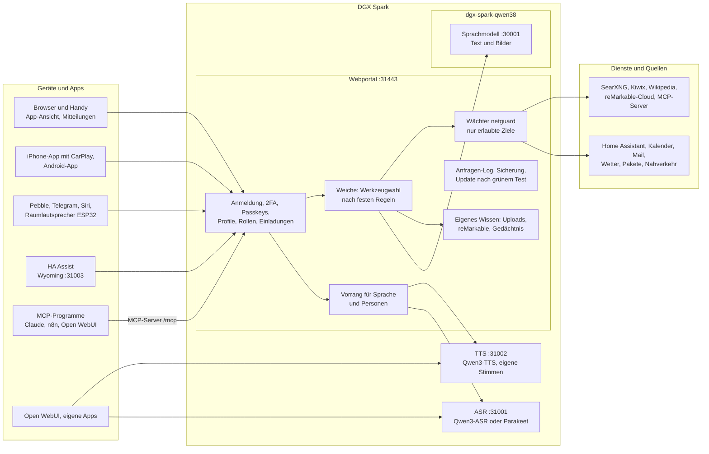

# Speech auf DGX Spark

[English](README.md) | **Deutsch** · Idee: Dominik Bornhäußer

[](https://buymeacoffee.com/zquu1xu570)

Spracherkennung (**Qwen3-ASR**) und Sprachausgabe (**Qwen3-TTS**) als Dienste auf einer NVIDIA DGX Spark (GB10), dazu ein Webportal mit Sprach-Assistent, Profilen und Monitoring. Läuft nativ mit systemd, ohne Docker, neben [dgx-spark-qwen38](https://github.com/hasso5703/dgx-spark-qwen38), das das Sprachmodell liefert.

## Installation

```bash
git clone https://github.com/db9979/speech-on-dgx-spark
cd speech-on-dgx-spark
sudo ./install.sh
```

Das Skript fragt, was installiert werden soll:

- **Komplett**: Modelle, APIs und das Webportal mit dem Assistenten.
- **Nur die Modelle mit ihren APIs**: für Open WebUI, eigene Apps oder Home Assistant, ohne Portal. Verwaltet wird dann mit `sudo speech-spark`.

Am Ende stehen Adresse, Passwort und API-Schlüssel auf dem Bildschirm, danach spricht die Sprachausgabe einen Satz und die Spracherkennung prüft ihn. Das Portal liegt auf `https://SPARK:31443` (https ist nötig, damit der Browser das Mikrofon freigibt).

| Aufgabe | Befehl |
|---|---|
| Aktualisieren | Knopf im Portal unter *Einstellungen → Update und Sicherung* oder `sudo speech-spark update` |
| Adressen und Schlüssel anzeigen | `sudo speech-spark info` |
| Deinstallieren | `sudo ./uninstall.sh` (Konfiguration, Modelle und Stimmen bleiben; `--purge` löscht alles) |

Alle Optionen ohne Rückfragen (`--mode api --asr 1.7b --tts 0.6b --yes` …) stehen in [Installation im Detail](docs/de/installation.md).

## Letzte Änderungen

<!-- New version: add one line at the top here and in CHANGELOG.md, drop the oldest line here (keep 10). Details go to docs/de and docs/en, not into this README. -->

- **V01.0.349** Schneller Antwortbeginn: Züge ohne Werkzeug (Plaudern) bekommen wieder die kurze Anfrage ohne Werkzeugliste
- **V01.0.348** Morgenbegrüßung nennt Termine nur frisch aus dem Kalender: „Guten Morgen“ liest immer das Briefing, vorbei markierte Termine gelten nicht als anstehend, und die Antwort-Prüfung lässt keine Termine aus früheren Antworten als heutige durch
- **V01.0.347** Spark-Begleiter im Spark-Look (Gesicht als Symbol, Fenster wie das Panel, hell und dunkel), zeigt neue Versionen an und aktualisiert sich nach einem Klick (der Spark holt und prüft sie), Link „☕ Spark unterstützen“
- **V01.0.346** reMarkable @Spark: Frage aus Handschrift ohne „Bild:“-Zeile und [unleserlich], Modell antwortet auch mit eigenem Wissen statt nur „keine Antwort“, Diagnose-Zeile „remarkable: @Spark answer …“ (Längen, Treffer, Websuche)
- **V01.0.344** Mehr mit dem reMarkable (Admin-Unterschalter + je Funktion unter Ich → reMarkable, alles aus): Morgenblatt als PDF mit Notizlinien, „@Spark“-Fragen auf Papier bekommen eine Antwort daneben, Aufgaben aus der Handschrift (Erinnerung erst nach Klick), Besprechungen zusammengefasst, Wochenrückblick freitags, Webseiten und Mail-Anhänge aufs reMarkable, Eingang pro Tag, Spark-Anleitung zu den reMarkable-Funktionen und dem Dienst, die sich selbst aktuell hält
- **V01.0.343** Hilfe zum Spark antwortet besser: die Weiche erkennt Hilfe-Fragen mit festen Regeln, die Hilfe kennt jede Seite und häufige Fragen, ein „?“ an jedem Schalter, und sie merkt, woher gefragt wird (Lautsprecher, App, Telegram)
- **V01.0.342** Spark-Begleiter am PC und Mac (aus): Programm in Taskleiste und Menüleiste mit Schreibhilfe, Frag Spark, Diktieren, Meldungen, Zustand und Notaus-Knopf, je eigenes Tastenkürzel; pro Gerät im Panel eingestellt
- **V01.0.341** Ich → Von selbst: Schalter und Knöpfe bei den Smart-Home-Regeln stehen wieder sauber untereinander (Rechner und Handy)
- **V01.0.340** Einordnung mit Wahrscheinlichkeit (aus): qwen38 /v1/systemone für Werkzeugwahl (ab 80 %), Postfach aufräumen (ab 90 %), wichtige Mails nach Absender und Betreff und eine zweite Meinung im Qualitätstest
- **V01.0.339** Schreibhilfe in anderen Programmen (aus): Mac-Schnellaktion, Windows-Programm (x64 und ARM, Strg+Alt+S), Add-in für Outlook, Word und Excel, Browser-Erweiterung und iPhone-Teilen, jedes mit eigenem Schlüssel gekoppelt

Alle Versionen: [CHANGELOG.md](CHANGELOG.md)

## So funktioniert es



1. Du sprichst ins Handy, in den Browser, in eine der Apps oder einen Lautsprecher. Das Portal meldet dich an, schickt den Ton an die **Spracherkennung** und bekommt Text zurück.
2. Die **Weiche** wählt nach festen Regeln, welche Werkzeuge die Frage braucht. Das Portal gibt den Text mit Gedächtnis, Gesprächsverlauf, eigenem Wissen und genau diesen Werkzeugen an das **Sprachmodell** von qwen38.
3. Braucht die Antwort Kalender, Mail, Wetter, Home Assistant, Websuche, Kiwix oder Wikipedia, holt das Portal die Daten selbst; schalten und eintragen geht nur nach Bestätigung.
4. Die Antwort geht Satz für Satz an die **Sprachausgabe** und wird gestreamt abgespielt, während das Modell noch schreibt. Der Vorrang sorgt dafür, dass gesprochene Antworten und wichtige Personen zuerst drankommen.
5. Andere Apps nutzen ASR und TTS direkt über die OpenAI-ähnlichen APIs mit API-Schlüssel, MCP-Programme den Spark als MCP-Server mit eigenem Zugang.

Jede Funktion ist pro Profil einzeln schaltbar und ab Werk aus. Updates laufen erst nach grünem Selbsttest und lassen sich zurücknehmen.

## Weiterlesen

- [Installation im Detail](docs/de/installation.md): Installationsarten, Befehl `speech-spark`, alle Optionen, Update, Deinstallieren
- [Assistent und Oberfläche](docs/de/assistent.md): Sprach-Chat, Handy, Funktionen, Menü
- [APIs und Einbinden](docs/de/apis-und-einbinden.md): Transkription, Sprachausgabe, Streaming, Open WebUI, Siri, Pebble
- [Sicherheit und Betrieb](docs/de/sicherheit-und-betrieb.md): Anmeldung, Sperren, Sicherungen, Wächter, Selbsttest, Logs
- [Technik und Fehlersuche](docs/de/technik.md): Dienste und Ports, Leistung messen, neben qwen38, Fehlersuche

Im Portal steht zu jeder Funktion eine eigene Anleitung unter *Funktionen → Anleitungen*.

## Unterstützen

Das Projekt ist kostenlos. Wenn es dir gefällt, kannst du es über [buymeacoffee.com/zquu1xu570](https://buymeacoffee.com/zquu1xu570) unterstützen.

## Lizenz

MIT, siehe [LICENSE](LICENSE). Die Modelle (Qwen3-ASR, Qwen3-TTS) und Pakete (vLLM, vllm-omni, PyTorch) werden bei der Installation geladen und stehen unter ihren eigenen Lizenzen. Dieses Projekt steht in keiner Verbindung zu NVIDIA oder dem Qwen-Team.
