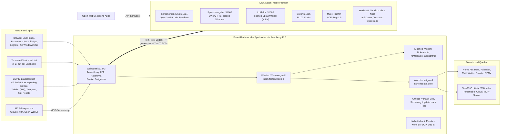

# Speech auf DGX Spark

[English](README.md) | **Deutsch** · Idee: Dominik Bornhäußer

[](https://buymeacoffee.com/zquu1xu570)

Spracherkennung (**Qwen3-ASR**), Sprachausgabe (**Qwen3-TTS**), Bilder (**FLUX.2 klein**) und ein eigenes Sprachmodell (**vLLM**) als Dienste auf einer NVIDIA DGX Spark (GB10), dazu ein Webportal mit Sprach-Assistent, Profilen und Monitoring. Läuft nativ mit systemd, ohne Docker. Das Portal läuft auf dem Spark selbst oder auf einem kleinen eigenen Rechner wie einem Raspberry Pi 5. Statt des eigenen Sprachmodells kann weiterhin [dgx-spark-qwen38](https://github.com/hasso5703/dgx-spark-qwen38) es liefern.

| Assistent | Zustand | Technik |
|---|---|---|
| [](docs/bilder/de-chat.png) | [](docs/bilder/de-zustand.png) | [](docs/bilder/de-technik.png) |

## Installation

```bash
git clone https://github.com/db9979/speech-on-dgx-spark
cd speech-on-dgx-spark
sudo ./install.sh
```

Das Skript fragt, was installiert werden soll:

- **Komplett**: Modelle, APIs und das Webportal mit dem Assistenten.
- **Nur die Modelle mit ihren APIs**: für Open WebUI, eigene Apps oder Home Assistant, ohne Portal. Verwaltet wird dann mit `sudo speech-spark`.
- **Geteilt** (Spark teilen): das Panel auf einem eigenen Rechner wie einem Raspberry Pi 5, der DGX liefert nur die Modelle. Anleitung, auch zum Umziehen: [Spark teilen](docs/de/spark-teilen.md).

Am Ende stehen Adresse, Passwort und API-Schlüssel auf dem Bildschirm, danach spricht die Sprachausgabe einen Satz und die Spracherkennung prüft ihn. Das Portal liegt auf `https://SPARK:31443` (https ist nötig, damit der Browser das Mikrofon freigibt).

| Aufgabe | Befehl |
|---|---|
| Aktualisieren | Knopf im Portal unter *Einstellungen → Update* oder `sudo speech-spark update` |
| Adressen und Schlüssel anzeigen | `sudo speech-spark info` |
| Eigenes Sprachmodell | `sudo ./install.sh --llm`, danach `sudo speech-spark modelle llm uebernehmen` (zurück: `… zurueck`) |
| Werkstatt (Testlauf, Code-Messung, Diagnose, Reparatur) | auf dem Modell-Rechner `sudo ./install.sh --werkstatt`, dann *Funktionen → Werkstatt* |
| Bildschirm im Fernzugang (guacd) | auf dem Rechner mit dem Panel `sudo ./install.sh --fernbild`, dann *Funktionen → Fernzugang zu Servern → Bildschirm* |
| Portal auf einen anderen Rechner umziehen | `sudo speech-spark umziehen --code`, siehe [Spark teilen](docs/de/spark-teilen.md) |
| Deinstallieren | `sudo ./uninstall.sh` (Konfiguration, Modelle und Stimmen bleiben; `--purge` löscht alles) |

Alle Optionen ohne Rückfragen (`--mode api --asr 1.7b --tts 0.6b --yes` …) stehen in [Installation im Detail](docs/de/installation.md).

## Letzte Änderungen

<!-- New version: add one line at the top here and in CHANGELOG.md, drop the oldest line here (keep 10). Details go to docs/de and docs/en, not into this README. -->

- **V01.1.258** Finden Stufe D: Schlagworte vom Modell (eigener Unterschalter, aus), nur nach festen Regeln geprüft und als „vom Modell“ gezeigt, entfernte kommen nie wieder; Personen, Firmen und Orte als Punkte der Wissenskarte; eine Rangfolge über alle Listen; Sofort-Karte bei klarem Treffer mit festem Satz und „Original öffnen“
- **V01.1.257** Finden Stufe C: Termine und Kontakte versiegelt, frühere Gespräche (nur Datum und Kanal), Listen, Erinnerungen, Bilder und Lieder im Suchindex; Zeiträume nach festen Regeln, „vom OP“ über den eigenen Kalender; fünf Unterschalter, ab Werk aus
- **V01.1.256** Finden Stufe B: alle Mails und Anhänge in den Suchindex (Posteingang, Archiv, Gesendet, nie Spam und Papierkorb), die neuesten zuerst, ältere in ruhigen Minuten und nachts in Häppchen, nur versiegelt (AES-GCM, Wörter als HMAC-Marken), Anhang-Text und Felder nach festen Regeln, Treffer öffnet die Mail; Unterschalter „Mails und Anhänge finden“, ab Werk aus
- **V01.1.255** Alle meine Daten herunterladen: unter Ich → Sicherheit → Meine Daten eine ZIP mit allem vom eigenen Profil (versiegelte Dateien geöffnet, Einstellungen ohne Geheimnisse, aus Chats nur die eigenen Nachrichten, LIESMICH de+en mit dem, was draußen bleibt und warum), jedes Mal nach frischem Code oder Passkey, 3 je Stunde, höchstens 2 GB, Abhol-Link 10 Minuten und einmal; kein Schalter (Auskunftsrecht), auch in der iPhone- und Android-App
- **V01.1.254** Fernzugang: die iPhone-App ist wie die Seite erst gesperrt und wird mit Code oder Passkey entsperrt (Verlängern, Sperren); das Koppeln-Blatt zeigt einen Einmal-Link mit Kopieren, Teilen, E-Mail und QR-Code, der auf dem neuen System nur die eine Zeile zeigt, nie den Code
- **V01.1.253** Personen, Firmen und Fristen als Punkte der Wissenskarte (Stufe 2 von 4, eigener Schalter unter Wissenskarte, aus): das Sprachmodell schlägt je Stelle nur Namen vor, das Panel prüft nach festen Regeln (Art aus fester Liste, Name steht in der Stelle, Frist nur mit Datum, Konto nur als IBAN oder Nummer, Grenzen je Dokument, Profil und Tag); Farben und Filter nach Art auf der Karte, Umbenennen, Zusammenführen und Löschen nur per Klick mit Code, Ereignis GEAENDERT und Lesefunktionen finde_knoten/knoten_liste für andere Teile; iPhone zeigt und löscht
- **V01.1.252** Auch das Gelernte versiegelt: Lesemarken des Lernens, gemerkte Zuordnungen, offene Gedächtnis-Frage, Interessen („Was ich über dich weiß“) und Spark-Tagebuch liegen jetzt ebenso versiegelt, einmal nach einer Sicherung „vor-siegel“; jede Datei aus Gedächtnis und Gesprächen muss versiegelt sein (Plan nutzerwissen, Stufe 4c; test_siegel)
- **V01.1.251** Gedächtnis und Gespräche versiegelt: memory.json, convos.json, toollog.json und room-history.json liegen ganz versiegelt im Profil (AES-256-GCM, Schlüssel je Zweck aus secret.key, Profil und Dateiname als Zusatzdaten), einmalig nach einer Sicherung „vor-siegel“ und mit Probe je Datei; mit fremdem Schlüssel beiseite statt überschrieben, Hinweis an den Admin, „Wieder einlesen“ unter Ich → Gedächtnis (Plan nutzerwissen, Stufe 4b; test_siegel)
- **V01.1.250** Ein Weg zu den eigenen Daten: Gedächtnis, Gespräche, Werkzeug-Log, Raummodus-Verlauf, Lesemarken, Zuordnungen, Interessen, Spark-Tagebuch und die offene Gedächtnis-Frage liest und schreibt das Panel nur noch über profiles.read_own/write_own/drop_own (Vorbereitung zum Versiegeln, für die Person ändert sich nichts)
- **V01.1.249** Gemerkt-Hinweis: unter der Antwort „✓ Gemerkt: …“ mit „Rückgängig“; von selbst Gelerntes kommt als Karte mit „Stimmt“ und „Rückgängig“, Mitteilung und Telegram nennen nur die Zahl


Alle Versionen: [CHANGELOG.md](CHANGELOG.md)

## So funktioniert es



1. Du sprichst ins Handy, in den Browser, in eine der Apps, den Terminal-Client, einen Lautsprecher oder ins Telefon. Das Portal meldet dich an, schickt den Ton an die **Spracherkennung** und bekommt Text zurück.
2. Die **Weiche** wählt nach festen Regeln, welche Werkzeuge die Frage braucht. Das Portal gibt den Text mit Gedächtnis, Gesprächsverlauf, eigenem Wissen und genau diesen Werkzeugen an das **Sprachmodell** hinter dem LLM-Tor (oder an qwen38, wenn du es behältst).
3. Braucht die Antwort Kalender, Mail, Wetter, Home Assistant, Websuche, Kiwix oder Wikipedia, holt das Portal die Daten selbst; schalten und eintragen geht nur nach Bestätigung. Bilder malt und ändert FLUX.2 klein auf dem Spark; Musik macht ACE-Step 1.5 (zuerst nur „Musik testen“ für den Admin unter Zustand → Prüfen).
4. Die Antwort geht Satz für Satz an die **Sprachausgabe** und wird gestreamt abgespielt, während das Modell noch schreibt. Der Vorrang sorgt dafür, dass gesprochene Antworten und wichtige Personen zuerst drankommen.
5. Mit **Spark teilen** liegen Portal, Profile, Chats und Anrufe auf dem kleinen Rechner und erreichen die Modelle nur über das TLS-Tor. Startet der DGX neu oder ist er aus, laufen Chats, Erinnerungen und Anrufe weiter, und der Notbetrieb versteht ein paar feste Befehle ohne Sprachmodell.
6. Andere Apps nutzen ASR und TTS direkt über die OpenAI-ähnlichen APIs mit API-Schlüssel, MCP-Programme den Spark als MCP-Server mit eigenem Zugang.

Jede neue Funktion ist ab Werk aus. Gibt der Admin sie frei, gilt sie sofort für jedes Profil; nur der Admin kann einzelne Profile sperren. Gäste bekommen nur Frage und Antwort, nie ein Werkzeug. Updates laufen erst nach grünem Selbsttest und lassen sich zurücknehmen.

## Weiterlesen

- [Installation im Detail](docs/de/installation.md): Installationsarten, Befehl `speech-spark`, alle Optionen, Update, Deinstallieren
- [Spark teilen](docs/de/spark-teilen.md): das Portal auf einem eigenen Rechner wie einem Raspberry Pi 5, Umziehen, Notbetrieb
- [Assistent und Oberfläche](docs/de/assistent.md): Sprach-Chat, Handy, Funktionen, Menü
- [APIs und Einbinden](docs/de/apis-und-einbinden.md): Transkription, Sprachausgabe, Streaming, Open WebUI, Siri, Pebble, Terminal-Client
- [iPhone-App](docs/de/iphone-app.md) und [Android-App](docs/de/android-app.md): Chat, Anrufe, Panel-Bereiche auf dem Handy
- [Sicherheit und Betrieb](docs/de/sicherheit-und-betrieb.md): Anmeldung, Sperren, Sicherungen, Wächter, Selbsttest, Logs
- [Architektur](docs/de/architektur.md): Bausteine, Weg einer Anfrage, alle Speicherorte (auch im Panel unter Zustand → Technik)
- [Technik und Fehlersuche](docs/de/technik.md): Dienste und Ports, Leistung messen, eigenes Sprachmodell oder qwen38, Fehlersuche
- [Coding-Richtlinie](docs/de/richtlinien.md) und [Sicherheits-Checkliste](docs/de/sicherheits-checkliste.md): Regeln für jede Änderung, Pflichtliste für neue Funktionen

Im Portal steht zu jeder Funktion eine eigene Anleitung unter *Funktionen → Anleitungen*.

## Unterstützen

Das Projekt ist kostenlos. Wenn es dir gefällt, kannst du es über [buymeacoffee.com/zquu1xu570](https://buymeacoffee.com/zquu1xu570) unterstützen.

## Lizenz

FSL-1.1-MIT (Functional Source License), siehe [LICENSE](LICENSE). Du darfst den Spark nutzen, lesen, ändern und weitergeben, für dich, deine Familie und Freunde, in Lehre und Forschung; nicht erlaubt ist nur, ihn als kommerzielles Konkurrenzangebot zu vertreiben. Jede Version wird zwei Jahre nach ihrer Veröffentlichung von selbst MIT. Versionen bis V01.0.542 stehen weiter unter MIT. Eingebundene fremde Teile (z. B. XiaoZhi-Firmware, Lucide-Symbole) behalten ihre eigene Lizenz. Die Modelle (Qwen3-ASR, Qwen3-TTS) und Pakete (vLLM, vllm-omni, PyTorch) werden bei der Installation geladen und stehen unter ihren eigenen Lizenzen. Dieses Projekt steht in keiner Verbindung zu NVIDIA oder dem Qwen-Team.
