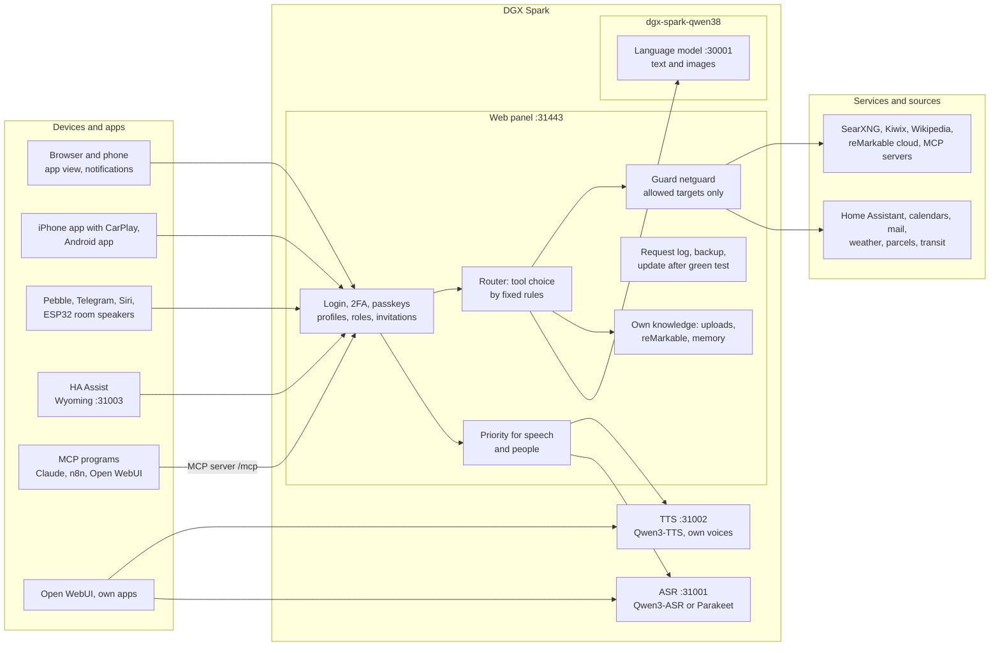

# Speech on DGX Spark

**English** | [Deutsch](README.de.md) · Idea: Dominik Bornhäußer

[](https://buymeacoffee.com/zquu1xu570)

Speech recognition (**Qwen3-ASR**) and text to speech (**Qwen3-TTS**) as services on an NVIDIA DGX Spark (GB10), plus a web panel with a voice assistant, profiles and monitoring. Runs natively with systemd, without Docker, next to [dgx-spark-qwen38](https://github.com/hasso5703/dgx-spark-qwen38), which provides the language model.

## Installation

```bash
git clone https://github.com/db9979/speech-on-dgx-spark
cd speech-on-dgx-spark
sudo ./install.sh
```

The script asks what to install:

- **Complete**: models, APIs and the web panel with the assistant.
- **Only the models with their APIs**: for Open WebUI, your own apps or Home Assistant, without the panel. Managed with `sudo speech-spark`.

At the end it prints the address, password and API key, then TTS speaks a sentence and ASR checks it. The panel is at `https://SPARK:31443` (https is needed so the browser allows the microphone).

| Task | Command |
|---|---|
| Update | button in the panel under *Settings → Update and backup*, or `sudo speech-spark update` |
| Show addresses and keys | `sudo speech-spark info` |
| Uninstall | `sudo ./uninstall.sh` (config, models and voices stay; `--purge` removes everything) |

All options for running without questions (`--mode api --asr 1.7b --tts 0.6b --yes` …) are in [Installation in detail](docs/en/installation.md).

## Latest changes

<!-- New version: add one line at the top here and in CHANGELOG.md, drop the oldest line here (keep 10). Details go to docs/de and docs/en, not into this README. -->

- **V01.0.360** Emergency stop on more ways: Telegram /notaus and /meinnotaus, fixed sentence "Spark, Mein Notaus" / "Spark, Notaus" (the big one admins only), a Home Assistant key that can only trigger (with a ready snippet), Android quick settings tile (app 1.1.0)
- **V01.0.359** Face at the bottom right: one tap starts the assistant on every page, over Me and on a phone (its window closed at once), a double tap no longer marks text, typing a question always works
- **V01.0.358** Fetch clear questions directly: "Which appointments do I have today?" is fetched by the panel itself
- **V01.0.357** Passkeys in the iPhone app: „With passkey“ when confirming, for the Spark update and the admin sign-in (Face ID with the passkey made in Safari, via iCloud Keychain); for that the Spark serves Apple /.well-known/apple-app-site-association (only the app ID, from the push settings)
- **V01.0.356** Logs → Requests shows the request number from the journal in list and detail, search finds it
- **V01.0.355** What's new: view the changelog in the panel, from "Was ist neu" at the bottom next to the version or Settings → Update und Sicherung, with search
- **V01.0.354** Quieter log: a companion release without update file is no error any more (retry after 1 hour), an unreadable recording leaves no "Task exception was never retrieved"
- **V01.0.353** Spark companion deeper in the computer (per device, all off): right-click on files, ask about the screen, know the app, draft a reply in Outlook and Apple Mail, "Spark-Wissen" folder, buttons in notes, Spark acts on the PC with a question first, wake word on the PC
- **V01.0.352** Live overview full review: update check, NAS backup, reMarkable sheets, Spark-Begleiter, room mode, logins, speaker recognition and more in the picture
- **V01.0.351** reMarkable in the Live monitor: @Spark answer, guide, morning sheet, weekly review, meeting and page check show as background work with a done event, sync as event, web page/attachment as tools

All versions: [CHANGELOG.md](CHANGELOG.md)

## How it works



1. You speak into your phone, browser, one of the apps or a speaker. The panel signs you in, sends the audio to **speech recognition** and gets text back.
2. The **router** picks by fixed rules which tools the question needs. The panel passes the text, with memory, conversation history, your own knowledge and exactly those tools, to the **language model** from qwen38.
3. When the answer needs calendars, mail, weather, Home Assistant, web search, Kiwix or Wikipedia, the panel fetches the data itself; switching and adding entries only happen after you confirm.
4. The answer goes sentence by sentence to **text to speech** and is played as a stream while the model is still writing. Priority makes sure spoken answers and important people go first.
5. Other apps use ASR and TTS directly through the OpenAI-style APIs with an API key, MCP programs use the Spark as an MCP server with their own access.

Every feature can be switched on per profile and is off by default. Updates only go live after a green self-test and can be rolled back.

## Read more

- [Installation in detail](docs/en/installation.md): install modes, the `speech-spark` command, all options, update, uninstall
- [Assistant and panel](docs/en/assistant.md): voice chat, phone, features, menu
- [APIs and integration](docs/en/apis-and-integration.md): transcription, speech, streaming, Open WebUI, Siri, Pebble
- [Security and operation](docs/en/security-and-operation.md): login, lockouts, backups, watchdog, self-test, logs
- [Technical details and troubleshooting](docs/en/technical.md): services and ports, benchmarks, next to qwen38, troubleshooting

The panel has its own guide for every feature under *Funktionen → Anleitungen* (Features → Guides).

## Support

The project is free. If you like it, you can support it at [buymeacoffee.com/zquu1xu570](https://buymeacoffee.com/zquu1xu570).

## License

MIT, see [LICENSE](LICENSE). The models (Qwen3-ASR, Qwen3-TTS) and packages (vLLM, vllm-omni, PyTorch) are downloaded during installation and come under their own licenses. This project is not affiliated with NVIDIA or the Qwen team.
