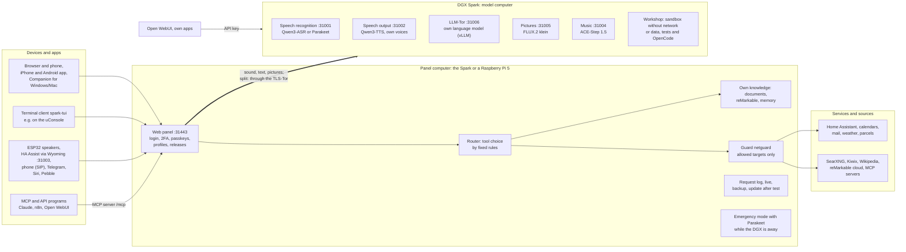

# Speech on DGX Spark

**English** | [Deutsch](README.de.md) · Idea: Dominik Bornhäußer

[](https://buymeacoffee.com/zquu1xu570)

Speech recognition (**Qwen3-ASR**), text to speech (**Qwen3-TTS**), pictures (**FLUX.2 klein**) and an own language model (**vLLM**) as services on an NVIDIA DGX Spark (GB10), plus a web panel with a voice assistant, profiles and monitoring. Runs natively with systemd, without Docker. The panel runs on the Spark itself or on a small computer of its own such as a Raspberry Pi 5.

| Assistant | Status | Architecture |
|---|---|---|
| [](docs/bilder/en-chat.png) | [](docs/bilder/en-zustand.png) | [](docs/bilder/en-technik.png) |

## Installation

```bash
git clone https://github.com/db9979/speech-on-dgx-spark
cd speech-on-dgx-spark
sudo ./install.sh
```

The script asks what to install:

- **Complete**: models, APIs and the web panel with the assistant.
- **Only the models with their APIs**: for Open WebUI, your own apps or Home Assistant, without the panel. Managed with `sudo speech-spark`.
- **Split** (Spark split): the panel on a computer of its own such as a Raspberry Pi 5, the DGX only serves the models. Guide, also for moving: [Spark split](docs/en/spark-split.md).

At the end it prints the address, password and API key, then TTS speaks a sentence and ASR checks it. The panel is at `https://SPARK:31443` (https is needed so the browser allows the microphone).

| Task | Command |
|---|---|
| Update | button in the panel under *Settings → Update*, or `sudo speech-spark update` |
| Show addresses and keys | `sudo speech-spark info` |
| Own language model | `sudo ./install.sh --llm` (switches the chat to it) |
| Workshop (test run, code measurement, diagnosis, repair) | on the model computer `sudo ./install.sh --werkstatt`, then *Features → Workshop* |
| Develop on the Pi (OpenCode with the own language model, install locally) | on the panel computer `sudo ./install.sh --entwickeln`, then *Features → Develop on the Pi*; used under *Status → Workshop → Develop* (overview, terminal in the browser, code orders from the chat); guide with pictures in [Installation](docs/en/installation.md#developing-on-the-pi-with-opencode) |
| Screen in remote access (guacd) | on the computer with the panel `sudo ./install.sh --fernbild`, then *Features → Remote access to servers → Screen* |
| Move the panel to another computer | `sudo speech-spark umziehen --code`, see [Spark split](docs/en/spark-split.md) |
| Uninstall | `sudo ./uninstall.sh` (config, models and voices stay; `--purge` removes everything) |

All options for running without questions (`--mode api --asr 1.7b --tts 0.6b --yes` …) are in [Installation in detail](docs/en/installation.md).

## Latest changes

<!-- New version: add one line at the top here and in CHANGELOG.md, drop the oldest line here (keep 10). Details go to docs/de and docs/en, not into this README. -->

- **V01.1.444** Reading tools at the same time: several reading tools of one step (weather, calendar, web search …) run together, the answer comes faster; Summarize long conversations: the start of a long conversation no longer simply drops away (both off)
- **V01.1.443** RED-FIX: iPhone conversation rows without a new import inside a function
- **V01.1.442** iPhone app: the whole conversation page and own voices right in the app
- **V01.1.441** Spark clients, priority on the Spark (E3): a client of class "Hintergrund" never moves up at the gates and waits while somebody speaks on the Spark, at most 60 seconds
- **V01.1.440** ROT-FIX: a browser test now switches Telegram off itself before it checks the switch
- **V01.1.439** Thinner: one Pebble watch switch for everything on the watch (steps, pulse and sleep keep their own); bus and train, Reddit and feeds, the Spark watchface and the XiaoZhi version note are gone
- **V01.1.438** Natural conversation, package B: after a spoken answer about the weather the assistant offers the appointments and the other way round; "What's new?" gets a fixed short overview without the model and "What shall I tell you more about?"
- **V01.1.437** Spark clients (decouple Spark and assistant, E1+E2): Features → Spark clients opens the model computer's services to other programs in the home network, each client with its own key, rights, priority class and limits; /v1/spark/faehigkeiten with the Spark API version; the TLS door no longer counts as "this machine"
- **V01.1.436** Fix: no empty white bar under the mail search any more
- **V01.1.435** iPhone app: own speakers right in the app, settings and checks


All versions: [CHANGELOG.md](CHANGELOG.md)

## How it works



1. You speak into your phone, browser, one of the apps, the terminal client, a speaker or the phone. The panel signs you in, sends the audio to **speech recognition** and gets text back.
2. The **router** picks by fixed rules which tools the question needs. The panel passes the text, with memory, conversation history, your own knowledge and exactly those tools, to the **language model** behind the LLM-Tor.
3. When the answer needs calendars, mail, weather, Home Assistant, web search, Kiwix or Wikipedia, the panel fetches the data itself; switching and adding entries only happen after you confirm. Pictures are painted and edited by FLUX.2 klein on the Spark; music is made by ACE-Step 1.5 (at first only “Test music” for the admin under State → Checks).
4. The answer goes sentence by sentence to **text to speech** and is played as a stream while the model is still writing. Priority makes sure spoken answers and important people go first.
5. With the **Spark split** the panel, profiles, chats and calls live on the small computer and reach the models only through the TLS-Tor. If the DGX restarts or is switched off, chats, reminders and calls keep running, and emergency mode understands a few fixed commands without a language model.
6. Other apps use ASR and TTS directly through the OpenAI-style APIs with an API key, MCP programs use the Spark as an MCP server with their own access, and own programs the language model at `/v1` with a key of their profile (Language model by API).

Every new feature is off by default. Once the admin releases it, it applies to every profile at once; only the admin can block single profiles. Guests get questions and answers only, never a tool. Updates only go live after a green self-test and can be rolled back.

## Read more

- [Installation in detail](docs/en/installation.md): install modes, the `speech-spark` command, all options, update, uninstall
- [Spark split](docs/en/spark-split.md): the panel on a computer of its own such as a Raspberry Pi 5, moving, emergency mode
- [Assistant and panel](docs/en/assistant.md): voice chat, phone, features, menu
- [APIs and integration](docs/en/apis-and-integration.md): transcription, speech, streaming, Open WebUI, Siri, Pebble, terminal client
- [iPhone app](docs/en/iphone-app.md) and [Android app](docs/en/android-app.md): chat, calls, panel areas on the phone
- [Security and operation](docs/en/security-and-operation.md): login, lockouts, backups, watchdog, self-test, logs
- [Architecture](docs/en/architecture.md): parts, the way of a request, every storage place (also in the panel under Status → Architecture)
- [Technical details and troubleshooting](docs/en/technical.md): services and ports, benchmarks, own language model, troubleshooting
- [Coding guideline](docs/en/guidelines.md) and [security checklist](docs/en/security-checklist.md): rules for every change, checklist for new features

The panel has its own guide for every feature next to its switch under *Funktionen* (Features); the search (Ctrl K) finds each one.

## Support

The project is free. If you like it, you can support it at [buymeacoffee.com/zquu1xu570](https://buymeacoffee.com/zquu1xu570).

## License

FSL-1.1-MIT (Functional Source License), see [LICENSE](LICENSE). You may use, read, change and share the Spark for yourself, your family and friends, for teaching and research; the only thing not allowed is offering it as a competing commercial product. Every version turns MIT on its own two years after its release. Versions up to V01.0.542 remain under MIT. Third-party parts included (e.g. XiaoZhi firmware, Lucide icons) keep their own license. The models (Qwen3-ASR, Qwen3-TTS) and packages (vLLM, vllm-omni, PyTorch) are downloaded during installation and come under their own licenses. This project is not affiliated with NVIDIA or the Qwen team.
