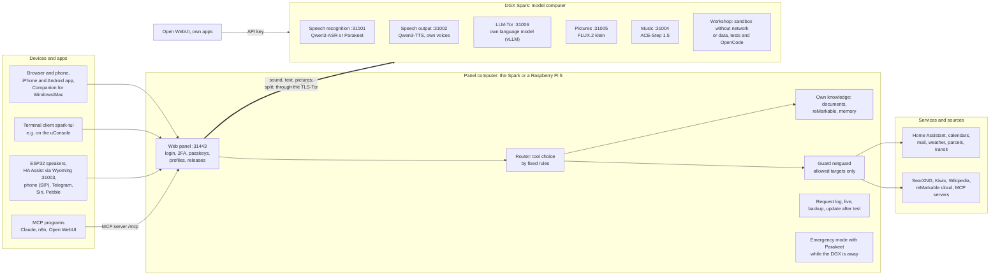

# Speech on DGX Spark

**English** | [Deutsch](README.de.md) · Idea: Dominik Bornhäußer

[](https://buymeacoffee.com/zquu1xu570)

Speech recognition (**Qwen3-ASR**), text to speech (**Qwen3-TTS**), pictures (**FLUX.2 klein**) and an own language model (**vLLM**) as services on an NVIDIA DGX Spark (GB10), plus a web panel with a voice assistant, profiles and monitoring. Runs natively with systemd, without Docker. The panel runs on the Spark itself or on a small computer of its own such as a Raspberry Pi 5. Instead of the own language model, [dgx-spark-qwen38](https://github.com/hasso5703/dgx-spark-qwen38) can still provide it.

| Assistant | Status | Architecture |
|---|---|---|
| [](docs/bilder/en-chat.png) | [](docs/bilder/en-zustand.png) | [](docs/bilder/en-technik.png) |

## Installation

```bash
git clone https://github.com/db9979/speech-on-dgx-spark
cd speech-on-dgx-spark
sudo ./install.sh
```

The script asks what to install:

- **Complete**: models, APIs and the web panel with the assistant.
- **Only the models with their APIs**: for Open WebUI, your own apps or Home Assistant, without the panel. Managed with `sudo speech-spark`.
- **Split** (Spark split): the panel on a computer of its own such as a Raspberry Pi 5, the DGX only serves the models. Guide, also for moving: [Spark split](docs/en/spark-split.md).

At the end it prints the address, password and API key, then TTS speaks a sentence and ASR checks it. The panel is at `https://SPARK:31443` (https is needed so the browser allows the microphone).

| Task | Command |
|---|---|
| Update | button in the panel under *Settings → Update and backup*, or `sudo speech-spark update` |
| Show addresses and keys | `sudo speech-spark info` |
| Own language model | `sudo ./install.sh --llm`, then `sudo speech-spark modelle llm uebernehmen` (back: `… zurueck`) |
| Workshop (test run, code measurement, diagnosis, repair) | on the model computer `sudo ./install.sh --werkstatt`, then *Features → Workshop* |
| Move the panel to another computer | `sudo speech-spark umziehen --code`, see [Spark split](docs/en/spark-split.md) |
| Uninstall | `sudo ./uninstall.sh` (config, models and voices stay; `--purge` removes everything) |

All options for running without questions (`--mode api --asr 1.7b --tts 0.6b --yes` …) are in [Installation in detail](docs/en/installation.md).

## Latest changes

<!-- New version: add one line at the top here and in CHANGELOG.md, drop the oldest line here (keep 10). Details go to docs/de and docs/en, not into this README. -->

- **V01.0.880** Calendar like Apple Calendar (stage 2): a sidebar with the month and calendars to show and hide, a year view; drag in free time or double-click to create, an inspector with place, repeat, alert, people, note and link, closing saves, the lower edge changes the length, two minutes "Undo"; repeating appointments changed, moved and deleted with "Only this appointment" or "All future ones"; people only as a list without invitation; phone with a week strip; iPhone app with a grouped form and undo
- **V01.0.879** Per-profile store: the assistant takes calendar, mail, weather and parcels from memory while fresh enough, with a slow service after at most 2 s the older reading with its time, "look again" asks anew; one round a minute keeps active profiles fresh, daily briefing written 10 min ahead, weather and parcels sealed on disk, Home Assistant live over WebSocket; Status → Check per service; no switch
- **V01.0.878** The update locks right at the click: backup, fetch, check, model computer and restart as steps in the same window on every device; every early end releases the lock and names the reason
- **V01.0.877** For you from the supply: the last reading per mailbox stays sealed in the profile, there at once after a restart; when a mailbox does not answer its entries come with "Stand hh:mm" in the tab, when read aloud and under Today
- **V01.0.876** Everything open in the assistant (stage 2): the assistant's proposals (new appointment, move, delete, mail by voice, tidy-up, draft) as a card "Waiting for your yes" under the answer and under Open, with "Add"/"Send" (the same as a typed yes), "Change …" (form or writing window, filled in) and "Cancel"; also confirm a speaker's proposal on the phone; iPhone
- **V01.0.875** Write link (lists stage 4): a link with QR code for people without a profile who only put something on one list (optionally see the open entries), expiring after 7 days to 1 year, revocable at any time, only the hash kept, wrong codes lock like a PIN; in the panel and on the iPhone, its own admin switch, off at first
- **V01.0.874** Mail like Apple Mail (stage 1): mailboxes on the left with Unread, Flagged and With attachment, a list with the time, a head like Apple Mail; mails with HTML formatted, cleaned by the Spark in a frame without script, pictures from outside only after "Load pictures" through the Spark, links only after the question with the real address; reply and new mail in a window of their own, "Send" with 10 s "Undo" (text of the Spark still with the preview); on a phone the mail bar stands at the bottom instead of over the subject; iPhone app formatted and with undo
- **V01.0.873** Notes to the device in use stage 2 (same switch): a note nobody saw at the computer or on a page comes once to the phone after 5 minutes (reminders after 2 minutes), never a third time; open a note about something open and it leaves the other devices; Live shows followed-up and waiting as numbers
- **V01.0.872** Mail: mail supply, the Spark keeps the newest headers and mail texts sealed in the profile; after a restart the listing is there at once, and when a mailbox does not answer the assistant answers with the kept state and its time instead of "not reachable"; a listing up to 10 minutes old is taken as it is, otherwise it waits at most 2 seconds
- **V01.0.871** CarPlay stable: the voice window opens and closes one step at a time, every row does something or says „Spark not reachable“, after a conversation radio and music are back at normal volume, „Danke“ ends it, „repeat the last answer“, no wake word in the car, CarPlay steps in the app's sound log


All versions: [CHANGELOG.md](CHANGELOG.md)

## How it works



1. You speak into your phone, browser, one of the apps, the terminal client, a speaker or the phone. The panel signs you in, sends the audio to **speech recognition** and gets text back.
2. The **router** picks by fixed rules which tools the question needs. The panel passes the text, with memory, conversation history, your own knowledge and exactly those tools, to the **language model** behind the LLM-Tor (or to qwen38 if you keep it).
3. When the answer needs calendars, mail, weather, Home Assistant, web search, Kiwix or Wikipedia, the panel fetches the data itself; switching and adding entries only happen after you confirm. Pictures are painted and edited by FLUX.2 klein on the Spark; music is made by ACE-Step 1.5 (at first only “Test music” for the admin under State → Checks).
4. The answer goes sentence by sentence to **text to speech** and is played as a stream while the model is still writing. Priority makes sure spoken answers and important people go first.
5. With the **Spark split** the panel, profiles, chats and calls live on the small computer and reach the models only through the TLS-Tor. If the DGX restarts or is switched off, chats, reminders and calls keep running, and emergency mode understands a few fixed commands without a language model.
6. Other apps use ASR and TTS directly through the OpenAI-style APIs with an API key, MCP programs use the Spark as an MCP server with their own access.

Every new feature is off by default. Once the admin releases it, it applies to every profile at once; only the admin can block single profiles. Guests get questions and answers only, never a tool. Updates only go live after a green self-test and can be rolled back.

## Read more

- [Installation in detail](docs/en/installation.md): install modes, the `speech-spark` command, all options, update, uninstall
- [Spark split](docs/en/spark-split.md): the panel on a computer of its own such as a Raspberry Pi 5, moving, emergency mode
- [Assistant and panel](docs/en/assistant.md): voice chat, phone, features, menu
- [APIs and integration](docs/en/apis-and-integration.md): transcription, speech, streaming, Open WebUI, Siri, Pebble, terminal client
- [iPhone app](docs/en/iphone-app.md) and [Android app](docs/en/android-app.md): chat, calls, panel areas on the phone
- [Security and operation](docs/en/security-and-operation.md): login, lockouts, backups, watchdog, self-test, logs
- [Architecture](docs/en/architecture.md): parts, the way of a request, every storage place (also in the panel under Status → Architecture)
- [Technical details and troubleshooting](docs/en/technical.md): services and ports, benchmarks, own language model or qwen38, troubleshooting
- [Coding guideline](docs/en/guidelines.md) and [security checklist](docs/en/security-checklist.md): rules for every change, checklist for new features

The panel has its own guide for every feature under *Funktionen → Anleitungen* (Features → Guides).

## Support

The project is free. If you like it, you can support it at [buymeacoffee.com/zquu1xu570](https://buymeacoffee.com/zquu1xu570).

## License

FSL-1.1-MIT (Functional Source License), see [LICENSE](LICENSE). You may use, read, change and share the Spark for yourself, your family and friends, for teaching and research; the only thing not allowed is offering it as a competing commercial product. Every version turns MIT on its own two years after its release. Versions up to V01.0.542 remain under MIT. Third-party parts included (e.g. XiaoZhi firmware, Lucide icons) keep their own license. The models (Qwen3-ASR, Qwen3-TTS) and packages (vLLM, vllm-omni, PyTorch) are downloaded during installation and come under their own licenses. This project is not affiliated with NVIDIA or the Qwen team.
