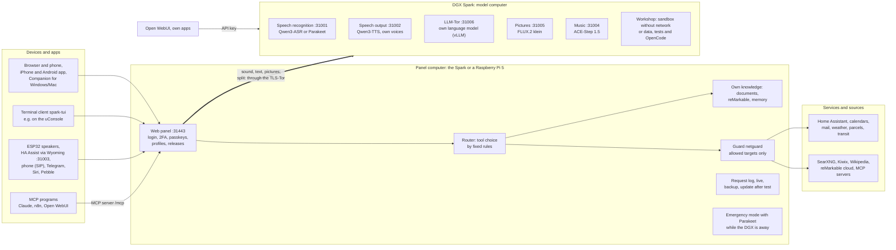

# Speech on DGX Spark

**English** | [Deutsch](README.de.md) · Idea: Dominik Bornhäußer

[](https://buymeacoffee.com/zquu1xu570)

Speech recognition (**Qwen3-ASR**), text to speech (**Qwen3-TTS**), pictures (**FLUX.2 klein**) and an own language model (**vLLM**) as services on an NVIDIA DGX Spark (GB10), plus a web panel with a voice assistant, profiles and monitoring. Runs natively with systemd, without Docker. The panel runs on the Spark itself or on a small computer of its own such as a Raspberry Pi 5. Instead of the own language model, [dgx-spark-qwen38](https://github.com/hasso5703/dgx-spark-qwen38) can still provide it.

| Assistant | Status | Architecture |
|---|---|---|
| [](docs/bilder/en-chat.png) | [](docs/bilder/en-zustand.png) | [](docs/bilder/en-technik.png) |

## Installation

```bash
git clone https://github.com/db9979/speech-on-dgx-spark
cd speech-on-dgx-spark
sudo ./install.sh
```

The script asks what to install:

- **Complete**: models, APIs and the web panel with the assistant.
- **Only the models with their APIs**: for Open WebUI, your own apps or Home Assistant, without the panel. Managed with `sudo speech-spark`.
- **Split** (Spark split): the panel on a computer of its own such as a Raspberry Pi 5, the DGX only serves the models. Guide, also for moving: [Spark split](docs/en/spark-split.md).

At the end it prints the address, password and API key, then TTS speaks a sentence and ASR checks it. The panel is at `https://SPARK:31443` (https is needed so the browser allows the microphone).

| Task | Command |
|---|---|
| Update | button in the panel under *Settings → Update*, or `sudo speech-spark update` |
| Show addresses and keys | `sudo speech-spark info` |
| Own language model | `sudo ./install.sh --llm`, then `sudo speech-spark modelle llm uebernehmen` (back: `… zurueck`) |
| Workshop (test run, code measurement, diagnosis, repair) | on the model computer `sudo ./install.sh --werkstatt`, then *Features → Workshop* |
| Develop on the Pi (OpenCode with the own language model, install locally) | on the panel computer `sudo ./install.sh --entwickeln`, then *Features → Develop on the Pi*; used under *Status → Workshop → Develop* (overview, terminal in the browser, code orders from the chat); guide with pictures in [Installation](docs/en/installation.md#developing-on-the-pi-with-opencode) |
| Screen in remote access (guacd) | on the computer with the panel `sudo ./install.sh --fernbild`, then *Features → Remote access to servers → Screen* |
| Move the panel to another computer | `sudo speech-spark umziehen --code`, see [Spark split](docs/en/spark-split.md) |
| Uninstall | `sudo ./uninstall.sh` (config, models and voices stay; `--purge` removes everything) |

All options for running without questions (`--mode api --asr 1.7b --tts 0.6b --yes` …) are in [Installation in detail](docs/en/installation.md).

## Latest changes

<!-- New version: add one line at the top here and in CHANGELOG.md, drop the oldest line here (keep 10). Details go to docs/de and docs/en, not into this README. -->

- **V01.1.313** Redesign stage 8: iPhone and Android app in the system style like the panel (one theme from the tokens light and dark, blue accent, state as a dot with its word, SF Symbols instead of emoji in buttons and lists, My things without coloured tiles, Today calm while loading; Android page and hull without a palette of their own, app 1.4.5)
- **V01.1.312** Analyses per document (plan open-notebook, push 2a, switch off): summary and key points in quiet minutes, questions, contents, deadlines and people per click; every point with its place, checked by the panel (every number stands at the place), contents and deadlines without the model; the quiet chain as the list `wissen.KETTE`
- **V01.1.311** Redesign stage 7: the Dungeon Master with a calm table tone of its own (warm surfaces and gold from the tokens, light and dark, serif only for the narration, no parchment or small caps), line icons on the table's buttons, tabs and phone bar, "Your rounds" and the game's other lists as a list pattern (no more vertical letters on the phone); guard Klar7
- **V01.1.310** Spontaneous help control, part S2d: SparkHilfe for Linux X11 through the same line as the one-time shell (anchor 1.8.0, never as root); the command without a secret, the person pastes the one-time key in the terminal without it being shown; under Wayland a clear "only viewing"; question 1/2/3 in the terminal, red frame and bar as X11 windows, picture as PNG, inputs through XTest checked against the fixed lists
- **V01.1.309** Develop on the Pi, package 3 (own sub-switches, admin only, off): the page Status → Workshop → Develop, a terminal as spark-dev in the browser and the code order in the chat; the model only proposes, you decide on installing
- **V01.1.308** Develop on the Pi, package 2 (own sub-switch, admin only, off): Hand to GitHub pushes spark-dev's branch as opencode/<topic> with root's deploy key (never main, never forced), GitHub tests it, a Claude thread reviews it; updates still only count main
- **V01.1.307** Spontaneous help control, part S2b: the program SparkHilfe for Windows (x64 and ARM64, one file, no installation or admin rights) reads address and one-time key only from its file name, connects only there (wss, normal TLS checks), shows the helper only after the key was taken and asks "Decline / View only / Allow"; picture, inputs, red frame, bar and question from one core shared with the Begleiter (Sicht.cs), inputs checked in the program too against the fixed lists; only GitHub builds it (own workflow, pinned actions), the Spark fetches it daily with signature, size and SHA-256 checked, service watch "Program SparkHilfe"
- **V01.1.306** RED FIX iPhone build: the index size in Find → Settings read the language through FindenModel.de on the main actor from a nonisolated function (Xcode error); `de` is now `nonisolated` and only reads the device language
- **V01.1.305** Tests on GitHub faster: six parts instead of four by freshly measured durations (vorpush enters missing modules in dauer.json, a self-test wants every one, "Ergebnis" warns about stale ones), the balance bench computes its tables in four processes with the same result and spreads test by test, Chromium from the cache and one per test class, seven flaky tests and order leaks fixed at their cause
- **V01.1.304** Terminal program (uConsole): F5 calendar crashed with newer Textual versions (the own week counter had Textual's name offset), now spark-tui 1.0.4; guard against own names Textual already uses


All versions: [CHANGELOG.md](CHANGELOG.md)

## How it works



1. You speak into your phone, browser, one of the apps, the terminal client, a speaker or the phone. The panel signs you in, sends the audio to **speech recognition** and gets text back.
2. The **router** picks by fixed rules which tools the question needs. The panel passes the text, with memory, conversation history, your own knowledge and exactly those tools, to the **language model** behind the LLM-Tor (or to qwen38 if you keep it).
3. When the answer needs calendars, mail, weather, Home Assistant, web search, Kiwix or Wikipedia, the panel fetches the data itself; switching and adding entries only happen after you confirm. Pictures are painted and edited by FLUX.2 klein on the Spark; music is made by ACE-Step 1.5 (at first only “Test music” for the admin under State → Checks).
4. The answer goes sentence by sentence to **text to speech** and is played as a stream while the model is still writing. Priority makes sure spoken answers and important people go first.
5. With the **Spark split** the panel, profiles, chats and calls live on the small computer and reach the models only through the TLS-Tor. If the DGX restarts or is switched off, chats, reminders and calls keep running, and emergency mode understands a few fixed commands without a language model.
6. Other apps use ASR and TTS directly through the OpenAI-style APIs with an API key, MCP programs use the Spark as an MCP server with their own access.

Every new feature is off by default. Once the admin releases it, it applies to every profile at once; only the admin can block single profiles. Guests get questions and answers only, never a tool. Updates only go live after a green self-test and can be rolled back.

## Read more

- [Installation in detail](docs/en/installation.md): install modes, the `speech-spark` command, all options, update, uninstall
- [Spark split](docs/en/spark-split.md): the panel on a computer of its own such as a Raspberry Pi 5, moving, emergency mode
- [Assistant and panel](docs/en/assistant.md): voice chat, phone, features, menu
- [APIs and integration](docs/en/apis-and-integration.md): transcription, speech, streaming, Open WebUI, Siri, Pebble, terminal client
- [iPhone app](docs/en/iphone-app.md) and [Android app](docs/en/android-app.md): chat, calls, panel areas on the phone
- [Security and operation](docs/en/security-and-operation.md): login, lockouts, backups, watchdog, self-test, logs
- [Architecture](docs/en/architecture.md): parts, the way of a request, every storage place (also in the panel under Status → Architecture)
- [Technical details and troubleshooting](docs/en/technical.md): services and ports, benchmarks, own language model or qwen38, troubleshooting
- [Coding guideline](docs/en/guidelines.md) and [security checklist](docs/en/security-checklist.md): rules for every change, checklist for new features

The panel has its own guide for every feature under *Funktionen → Anleitungen* (Features → Guides).

## Support

The project is free. If you like it, you can support it at [buymeacoffee.com/zquu1xu570](https://buymeacoffee.com/zquu1xu570).

## License

FSL-1.1-MIT (Functional Source License), see [LICENSE](LICENSE). You may use, read, change and share the Spark for yourself, your family and friends, for teaching and research; the only thing not allowed is offering it as a competing commercial product. Every version turns MIT on its own two years after its release. Versions up to V01.0.542 remain under MIT. Third-party parts included (e.g. XiaoZhi firmware, Lucide icons) keep their own license. The models (Qwen3-ASR, Qwen3-TTS) and packages (vLLM, vllm-omni, PyTorch) are downloaded during installation and come under their own licenses. This project is not affiliated with NVIDIA or the Qwen team.
