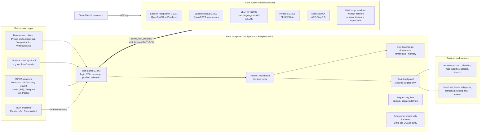

# Speech on DGX Spark

**English** | [Deutsch](README.de.md) · Idea: Dominik Bornhäußer

[](https://buymeacoffee.com/zquu1xu570)

Speech recognition (**Qwen3-ASR**), text to speech (**Qwen3-TTS**), pictures (**FLUX.2 klein**) and an own language model (**vLLM**) as services on an NVIDIA DGX Spark (GB10), plus a web panel with a voice assistant, profiles and monitoring. Runs natively with systemd, without Docker. The panel runs on the Spark itself or on a small computer of its own such as a Raspberry Pi 5. Instead of the own language model, [dgx-spark-qwen38](https://github.com/hasso5703/dgx-spark-qwen38) can still provide it.

| Assistant | Status | Architecture |
|---|---|---|
| [](docs/bilder/en-chat.png) | [](docs/bilder/en-zustand.png) | [](docs/bilder/en-technik.png) |

## Installation

```bash
git clone https://github.com/db9979/speech-on-dgx-spark
cd speech-on-dgx-spark
sudo ./install.sh
```

The script asks what to install:

- **Complete**: models, APIs and the web panel with the assistant.
- **Only the models with their APIs**: for Open WebUI, your own apps or Home Assistant, without the panel. Managed with `sudo speech-spark`.
- **Split** (Spark split): the panel on a computer of its own such as a Raspberry Pi 5, the DGX only serves the models. Guide, also for moving: [Spark split](docs/en/spark-split.md).

At the end it prints the address, password and API key, then TTS speaks a sentence and ASR checks it. The panel is at `https://SPARK:31443` (https is needed so the browser allows the microphone).

| Task | Command |
|---|---|
| Update | button in the panel under *Settings → Update*, or `sudo speech-spark update` |
| Show addresses and keys | `sudo speech-spark info` |
| Own language model | `sudo ./install.sh --llm`, then `sudo speech-spark modelle llm uebernehmen` (back: `… zurueck`) |
| Workshop (test run, code measurement, diagnosis, repair) | on the model computer `sudo ./install.sh --werkstatt`, then *Features → Workshop* |
| Move the panel to another computer | `sudo speech-spark umziehen --code`, see [Spark split](docs/en/spark-split.md) |
| Uninstall | `sudo ./uninstall.sh` (config, models and voices stay; `--purge` removes everything) |

All options for running without questions (`--mode api --asr 1.7b --tts 0.6b --yes` …) are in [Installation in detail](docs/en/installation.md).

## Latest changes

<!-- New version: add one line at the top here and in CHANGELOG.md, drop the oldest line here (keep 10). Details go to docs/de and docs/en, not into this README. -->

- **V01.1.058** AI Dungeon Master: lines and veils per seat, anonymous for the whole table, and the X-card that tells the last scene again more calmly; fixed word lists of the panel, the model gets them only as data; a view filter with a leak self-test per secret; the scribe check notes by fixed limits what the narration changed
- **V01.1.057** AI Dungeon Master: five oils in the SRD catalogue (thunder, lightning, fire, frost, blessed) for 25 gold, so in every world each weakness to thunder, lightning, fire and cold can be hit
- **V01.1.056** AI Dungeon Master at the table: foes with several attacks, bosses at least two; a foe's life as a word (bruised, badly hurt, nearly beaten), states with "N turns left"; speech recognition knows the round's names; every roll with a dice receipt, the narration names only numbers on a receipt; reading aloud marks the sentence being spoken
- **V01.1.055** AI Dungeon Master: a settlement with life: head with picture, time of day and gold, cards with picture and line, calculation and verb per service, what is too dear grey with "N gold short", the lesson as six values before → after
- **V01.1.054** AI Dungeon Master: economy part 3: the bench measures income against spending per level, inn 10 gold times the level per hero, the smith improves weapons and armour by one rarity, oils on the weapon for 3 hits, effects thundering, corroding and withering
- **V01.1.053** AI Dungeon Master: economy part 2: more coins from foes, merchants with a kind and a purse (half the price only for their own kind), rarity by a fixed find table per level, legendary things only from bosses
- **V01.1.052** AI Dungeon Master: economy part 1: one price rule with price bands per rarity, legendary things not for sale, treasures by class and level, healing potions 2 gold per life, spell scrolls by grade, start gold 25; plus 12 new weapons and 19 protection things in the SRD catalog
- **V01.1.051** AI Dungeon Master: the vault as a hand-drawn plan (ink walls, crosshatch, grid, furniture per room, numbers and a key), 🔥 switches to torchlight
- **V01.1.050** Qwen3.6 without refusals can be measured: modelle messen qwen36frei
- **V01.1.049** AI Dungeon Master: damage kinds: spells hit with their own kind, magic weapons go through resistance, rings and potions with resistance, weak spots shown only after a hit; time of day for the stage; hero sheet and right column no longer jump


All versions: [CHANGELOG.md](CHANGELOG.md)

## How it works



1. You speak into your phone, browser, one of the apps, the terminal client, a speaker or the phone. The panel signs you in, sends the audio to **speech recognition** and gets text back.
2. The **router** picks by fixed rules which tools the question needs. The panel passes the text, with memory, conversation history, your own knowledge and exactly those tools, to the **language model** behind the LLM-Tor (or to qwen38 if you keep it).
3. When the answer needs calendars, mail, weather, Home Assistant, web search, Kiwix or Wikipedia, the panel fetches the data itself; switching and adding entries only happen after you confirm. Pictures are painted and edited by FLUX.2 klein on the Spark; music is made by ACE-Step 1.5 (at first only “Test music” for the admin under State → Checks).
4. The answer goes sentence by sentence to **text to speech** and is played as a stream while the model is still writing. Priority makes sure spoken answers and important people go first.
5. With the **Spark split** the panel, profiles, chats and calls live on the small computer and reach the models only through the TLS-Tor. If the DGX restarts or is switched off, chats, reminders and calls keep running, and emergency mode understands a few fixed commands without a language model.
6. Other apps use ASR and TTS directly through the OpenAI-style APIs with an API key, MCP programs use the Spark as an MCP server with their own access.

Every new feature is off by default. Once the admin releases it, it applies to every profile at once; only the admin can block single profiles. Guests get questions and answers only, never a tool. Updates only go live after a green self-test and can be rolled back.

## Read more

- [Installation in detail](docs/en/installation.md): install modes, the `speech-spark` command, all options, update, uninstall
- [Spark split](docs/en/spark-split.md): the panel on a computer of its own such as a Raspberry Pi 5, moving, emergency mode
- [Assistant and panel](docs/en/assistant.md): voice chat, phone, features, menu
- [APIs and integration](docs/en/apis-and-integration.md): transcription, speech, streaming, Open WebUI, Siri, Pebble, terminal client
- [iPhone app](docs/en/iphone-app.md) and [Android app](docs/en/android-app.md): chat, calls, panel areas on the phone
- [Security and operation](docs/en/security-and-operation.md): login, lockouts, backups, watchdog, self-test, logs
- [Architecture](docs/en/architecture.md): parts, the way of a request, every storage place (also in the panel under Status → Architecture)
- [Technical details and troubleshooting](docs/en/technical.md): services and ports, benchmarks, own language model or qwen38, troubleshooting
- [Coding guideline](docs/en/guidelines.md) and [security checklist](docs/en/security-checklist.md): rules for every change, checklist for new features

The panel has its own guide for every feature under *Funktionen → Anleitungen* (Features → Guides).

## Support

The project is free. If you like it, you can support it at [buymeacoffee.com/zquu1xu570](https://buymeacoffee.com/zquu1xu570).

## License

FSL-1.1-MIT (Functional Source License), see [LICENSE](LICENSE). You may use, read, change and share the Spark for yourself, your family and friends, for teaching and research; the only thing not allowed is offering it as a competing commercial product. Every version turns MIT on its own two years after its release. Versions up to V01.0.542 remain under MIT. Third-party parts included (e.g. XiaoZhi firmware, Lucide icons) keep their own license. The models (Qwen3-ASR, Qwen3-TTS) and packages (vLLM, vllm-omni, PyTorch) are downloaded during installation and come under their own licenses. This project is not affiliated with NVIDIA or the Qwen team.
