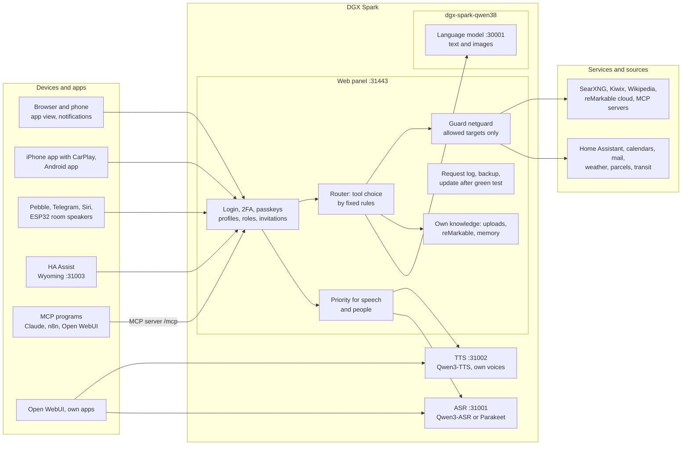

# Speech on DGX Spark

**English** | [Deutsch](README.de.md) · Idea: Dominik Bornhäußer

[](https://buymeacoffee.com/zquu1xu570)

Speech recognition (**Qwen3-ASR**) and text to speech (**Qwen3-TTS**) as services on an NVIDIA DGX Spark (GB10), plus a web panel with a voice assistant, profiles and monitoring. Runs natively with systemd, without Docker, next to [dgx-spark-qwen38](https://github.com/hasso5703/dgx-spark-qwen38), which provides the language model.

## Installation

```bash
git clone https://github.com/db9979/speech-on-dgx-spark
cd speech-on-dgx-spark
sudo ./install.sh
```

The script asks what to install:

- **Complete**: models, APIs and the web panel with the assistant.
- **Only the models with their APIs**: for Open WebUI, your own apps or Home Assistant, without the panel. Managed with `sudo speech-spark`.

At the end it prints the address, password and API key, then TTS speaks a sentence and ASR checks it. The panel is at `https://SPARK:31443` (https is needed so the browser allows the microphone).

| Task | Command |
|---|---|
| Update | button in the panel under *Settings → Update and backup*, or `sudo speech-spark update` |
| Show addresses and keys | `sudo speech-spark info` |
| Uninstall | `sudo ./uninstall.sh` (config, models and voices stay; `--purge` removes everything) |

All options for running without questions (`--mode api --asr 1.7b --tts 0.6b --yes` …) are in [Installation in detail](docs/en/installation.md).

## Latest changes

<!-- New version: add one line at the top here and in CHANGELOG.md, drop the oldest line here (keep 10). Details go to docs/de and docs/en, not into this README. -->

- **V01.0.374** Reporting problems (off): anonymized report as a GitHub issue from the panel, apps, companion, Telegram and by voice, with a preview; admins see all with answers and hear of new ones through the assistant
- **V01.0.373** Instant acknowledgement (off): right after the question a pre-recorded sentence of what the Spark is doing, measured apart from the answer's first sound
- **V01.0.372** Emergency stop docs: every way in one place (Telegram, sentence, Home Assistant, Android, iPhone, speakers, Pebble, guard)
- **V01.0.371** Releases on GitHub tidy: after every new release only the newest of each series stays, older ones are deleted
- **V01.0.370** iPhone app: emergency stop button and Siri "Spark Notaus" (always with a question; lifting only in the browser)
- **V01.0.369** reMarkable comparison quieter: the Spark's own writes no longer start a comparison ("account changed"), a cloud 502/503/504 gets one more try, page reader hints as one counted line per comparison
- **V01.0.368** Requests the Spark starts itself (update check, backup, rules) are called "Spark" instead of "Gast" in Logs → Requests and on the live page; the panel fetches the voice list with the key again (before ~900 refused calls a day, list only from cache); speech output no longer writes a statistics table per sentence to the journal
- **V01.0.367** Pebble watch app 1.6.0 in the panel: holding SELECT 3 s triggers the emergency stop (the big one admin profiles only)
- **V01.0.366** Pebble watch app: the build checks that the app also runs on older watch firmware (SDK 5.94)
- **V01.0.365** Pebble watch app: GitHub puts the built file on the branch pebble-build so it can be taken into the panel

All versions: [CHANGELOG.md](CHANGELOG.md)

## How it works



1. You speak into your phone, browser, one of the apps or a speaker. The panel signs you in, sends the audio to **speech recognition** and gets text back.
2. The **router** picks by fixed rules which tools the question needs. The panel passes the text, with memory, conversation history, your own knowledge and exactly those tools, to the **language model** from qwen38.
3. When the answer needs calendars, mail, weather, Home Assistant, web search, Kiwix or Wikipedia, the panel fetches the data itself; switching and adding entries only happen after you confirm.
4. The answer goes sentence by sentence to **text to speech** and is played as a stream while the model is still writing. Priority makes sure spoken answers and important people go first.
5. Other apps use ASR and TTS directly through the OpenAI-style APIs with an API key, MCP programs use the Spark as an MCP server with their own access.

Every feature can be switched on per profile and is off by default. Updates only go live after a green self-test and can be rolled back.

## Read more

- [Installation in detail](docs/en/installation.md): install modes, the `speech-spark` command, all options, update, uninstall
- [Assistant and panel](docs/en/assistant.md): voice chat, phone, features, menu
- [APIs and integration](docs/en/apis-and-integration.md): transcription, speech, streaming, Open WebUI, Siri, Pebble
- [Security and operation](docs/en/security-and-operation.md): login, lockouts, backups, watchdog, self-test, logs
- [Technical details and troubleshooting](docs/en/technical.md): services and ports, benchmarks, next to qwen38, troubleshooting

The panel has its own guide for every feature under *Funktionen → Anleitungen* (Features → Guides).

## Support

The project is free. If you like it, you can support it at [buymeacoffee.com/zquu1xu570](https://buymeacoffee.com/zquu1xu570).

## License

MIT, see [LICENSE](LICENSE). The models (Qwen3-ASR, Qwen3-TTS) and packages (vLLM, vllm-omni, PyTorch) are downloaded during installation and come under their own licenses. This project is not affiliated with NVIDIA or the Qwen team.
