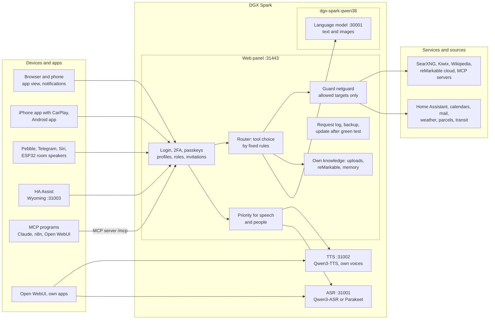

# Speech on DGX Spark

**English** | [Deutsch](README.de.md) · Idea: Dominik Bornhäußer

[](https://buymeacoffee.com/zquu1xu570)

Speech recognition (**Qwen3-ASR**) and text to speech (**Qwen3-TTS**) as services on an NVIDIA DGX Spark (GB10), plus a web panel with a voice assistant, profiles and monitoring. Runs natively with systemd, without Docker, next to [dgx-spark-qwen38](https://github.com/hasso5703/dgx-spark-qwen38), which provides the language model.

## Installation

```bash
git clone https://github.com/db9979/speech-on-dgx-spark
cd speech-on-dgx-spark
sudo ./install.sh
```

The script asks what to install:

- **Complete**: models, APIs and the web panel with the assistant.
- **Only the models with their APIs**: for Open WebUI, your own apps or Home Assistant, without the panel. Managed with `sudo speech-spark`.

At the end it prints the address, password and API key, then TTS speaks a sentence and ASR checks it. The panel is at `https://SPARK:31443` (https is needed so the browser allows the microphone).

| Task | Command |
|---|---|
| Update | button in the panel under *Settings → Update and backup*, or `sudo speech-spark update` |
| Show addresses and keys | `sudo speech-spark info` |
| Uninstall | `sudo ./uninstall.sh` (config, models and voices stay; `--purge` removes everything) |

All options for running without questions (`--mode api --asr 1.7b --tts 0.6b --yes` …) are in [Installation in detail](docs/en/installation.md).

## Latest changes

<!-- New version: add one line at the top here and in CHANGELOG.md, drop the oldest line here (keep 10). Details go to docs/de and docs/en, not into this README. -->

- **V01.0.412** Me → Documents clear with many files: compact rows, search, filters, details, select several
- **V01.0.411** Live page you can use: events with area chips, search and pause, a click shows the place in the picture; a box opens numbers of the last hour, ⚠ with explanation and the way to fix it; rewind the last 15 minutes; copy the way or open it in Requests; self emergency stop counters; Begleiter jobs and the instant sentence as ways in the picture; the monitor holds on a tap
- **V01.0.410** Companion: "open Safari with Google" at the Mac is now really done (with a question there), not only announced
- **V01.0.409** Speech output can be switched off: "Read answers aloud" per profile and "Vorlesen" per device, off = text only (speakers and CarPlay keep speaking)
- **V01.0.408** Independent review, package 5: more complete English UI, plain error sentences, "?" only where help exists, current page names, labels for screen readers, quiet Live-off state, no 429 on quick jumps
- **V01.0.407** Independent review, package 4: signed device updates prepared, https-only companion updates with Mac team check, pinned CI tools, root reads config only as the service user, ffmpeg/Parakeet limits, safer iPhone pairing and Telegram voice download
- **V01.0.406** Independent review, package 6: compressed page files cached a day, atomic JSON writes, faster self-tests, dead code removed
- **V01.0.405** Independent review, package 3: faster connections, nothing slow on the panel's event loop, speech output retried during a restart, a silent language model ends the turn after 90 s, no lost messages from parallel turns
- **V01.0.404** Answer no longer comes twice with "</think>" between: the thinking is never shown or read aloud
- **V01.0.403** Independent review, package 2: access gaps closed (off-site backup codes, unrecognised speaker voices count as outside text, restore keeps the admin password, API docs off, guest limits, codes for device removal in the iPhone app, MCP limits)

All versions: [CHANGELOG.md](CHANGELOG.md)

## How it works



1. You speak into your phone, browser, one of the apps or a speaker. The panel signs you in, sends the audio to **speech recognition** and gets text back.
2. The **router** picks by fixed rules which tools the question needs. The panel passes the text, with memory, conversation history, your own knowledge and exactly those tools, to the **language model** from qwen38.
3. When the answer needs calendars, mail, weather, Home Assistant, web search, Kiwix or Wikipedia, the panel fetches the data itself; switching and adding entries only happen after you confirm.
4. The answer goes sentence by sentence to **text to speech** and is played as a stream while the model is still writing. Priority makes sure spoken answers and important people go first.
5. Other apps use ASR and TTS directly through the OpenAI-style APIs with an API key, MCP programs use the Spark as an MCP server with their own access.

Every feature can be switched on per profile and is off by default. Updates only go live after a green self-test and can be rolled back.

## Read more

- [Installation in detail](docs/en/installation.md): install modes, the `speech-spark` command, all options, update, uninstall
- [Assistant and panel](docs/en/assistant.md): voice chat, phone, features, menu
- [APIs and integration](docs/en/apis-and-integration.md): transcription, speech, streaming, Open WebUI, Siri, Pebble
- [Security and operation](docs/en/security-and-operation.md): login, lockouts, backups, watchdog, self-test, logs
- [Technical details and troubleshooting](docs/en/technical.md): services and ports, benchmarks, next to qwen38, troubleshooting

The panel has its own guide for every feature under *Funktionen → Anleitungen* (Features → Guides).

## Support

The project is free. If you like it, you can support it at [buymeacoffee.com/zquu1xu570](https://buymeacoffee.com/zquu1xu570).

## License

MIT, see [LICENSE](LICENSE). The models (Qwen3-ASR, Qwen3-TTS) and packages (vLLM, vllm-omni, PyTorch) are downloaded during installation and come under their own licenses. This project is not affiliated with NVIDIA or the Qwen team.
