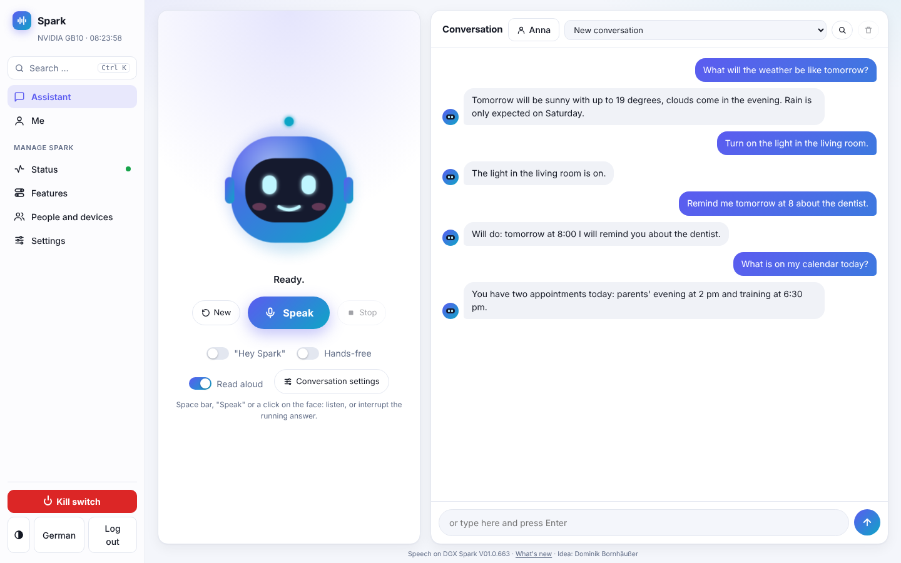
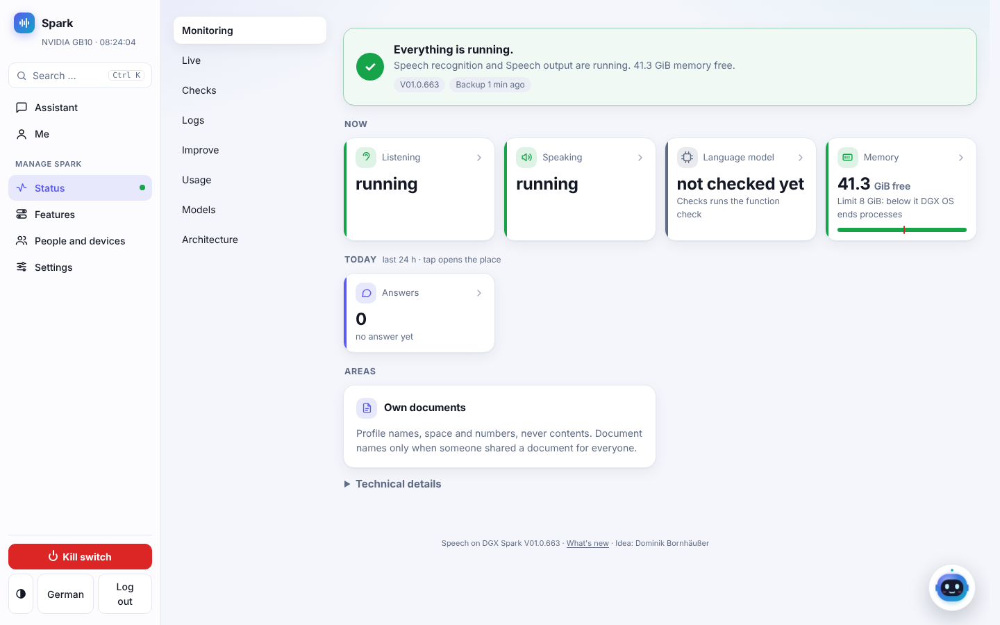
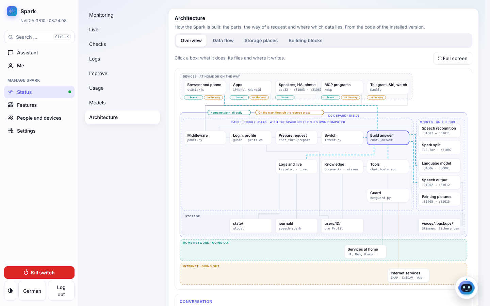
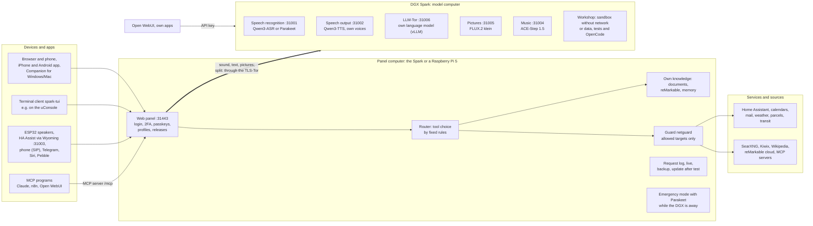

# Speech on DGX Spark

**English** | [Deutsch](README.de.md) · Idea: Dominik Bornhäußer

[](https://buymeacoffee.com/zquu1xu570)

Speech recognition (**Qwen3-ASR**), text to speech (**Qwen3-TTS**), pictures (**FLUX.2 klein**) and an own language model (**vLLM**) as services on an NVIDIA DGX Spark (GB10), plus a web panel with a voice assistant, profiles and monitoring. Runs natively with systemd, without Docker. The panel runs on the Spark itself or on a small computer of its own such as a Raspberry Pi 5. Instead of the own language model, [dgx-spark-qwen38](https://github.com/hasso5703/dgx-spark-qwen38) can still provide it.

| Assistant | Status | Architecture |
|---|---|---|
| [](docs/bilder/en-chat.png) | [](docs/bilder/en-zustand.png) | [](docs/bilder/en-technik.png) |

## Installation

```bash
git clone https://github.com/db9979/speech-on-dgx-spark
cd speech-on-dgx-spark
sudo ./install.sh
```

The script asks what to install:

- **Complete**: models, APIs and the web panel with the assistant.
- **Only the models with their APIs**: for Open WebUI, your own apps or Home Assistant, without the panel. Managed with `sudo speech-spark`.
- **Split** (Spark split): the panel on a computer of its own such as a Raspberry Pi 5, the DGX only serves the models. Guide, also for moving: [Spark split](docs/en/spark-split.md).

At the end it prints the address, password and API key, then TTS speaks a sentence and ASR checks it. The panel is at `https://SPARK:31443` (https is needed so the browser allows the microphone).

| Task | Command |
|---|---|
| Update | button in the panel under *Settings → Update*, or `sudo speech-spark update` |
| Show addresses and keys | `sudo speech-spark info` |
| Own language model | `sudo ./install.sh --llm`, then `sudo speech-spark modelle llm uebernehmen` (back: `… zurueck`) |
| Workshop (test run, code measurement, diagnosis, repair) | on the model computer `sudo ./install.sh --werkstatt`, then *Features → Workshop* |
| Develop on the Pi (OpenCode with the own language model, install locally) | on the panel computer `sudo ./install.sh --entwickeln`, then *Features → Develop on the Pi*; used under *Status → Workshop → Develop* (overview, terminal in the browser, code orders from the chat); guide with pictures in [Installation](docs/en/installation.md#developing-on-the-pi-with-opencode) |
| Screen in remote access (guacd) | on the computer with the panel `sudo ./install.sh --fernbild`, then *Features → Remote access to servers → Screen* |
| Move the panel to another computer | `sudo speech-spark umziehen --code`, see [Spark split](docs/en/spark-split.md) |
| Uninstall | `sudo ./uninstall.sh` (config, models and voices stay; `--purge` removes everything) |

All options for running without questions (`--mode api --asr 1.7b --tts 0.6b --yes` …) are in [Installation in detail](docs/en/installation.md).

## Latest changes

<!-- New version: add one line at the top here and in CHANGELOG.md, drop the oldest line here (keep 10). Details go to docs/de and docs/en, not into this README. -->

- **V01.1.330** Find everything fast, steps 3 and 4: the source switch decides by fixed rules and a short hit probe in the own index whether a question belongs to the own data, the web or both (bench 66 of 66); „Look locally first“ then asks every released source including mails and appointments, and for „both“ the panel searches the web itself with the own words before any mail is read
- **V01.1.329** Find everything fast, steps 1 and 2: source bench (66 sentences, internal/external/both, before 57.6 %, after 83.3 %) and quick fixes: own mails are a normal source, Find stays when narrowing, „according to the offer“ and reading questions like „Did the plumber get back to me?“ stay with the own data
- **V01.1.328** Develop: the terminal in the browser is compact (one bar with the notes and the code as buttons, terminal to the window's edge, full screen, a row of keys on the phone) and starts OpenCode at once; then the shell stays, `opencode` starts it again.
- **V01.1.327** Spontaneous help control, part S2c: SparkHilfe for the Mac (Apple chips and Intel, macOS 13+), built only by GitHub, signed with the Developer ID, notarized and ticket stapled, nothing published without these keys; the Spark keeps the zip only without parts outside the app and with the ticket and packs it anew in memory per help with address and one-time key in the app's name; the program first leads to the permissions Screen Recording and Accessibility, connects only to its own address (wss, no Origin, no cookies), shows the helper only after the key was taken, Decline preselected and after 60 s; picture, keys, inputs, frame, bar and question from a core shared with the Begleiter (Sicht.swift)
- **V01.1.326** Files in remote access: "Refresh" beside the path (also F5/Ctrl+R) and quietly every 15 s without anything jumping; when permissions are missing a hint with the folder and two ways (as root or `setfacl` to copy); the Files page with the same one red bar as the remote session.
- **V01.1.325** Fix e-mail: the folders in the "Mailboxes" column sit close again like the side menu and Apple Mail; under Open "Where does this mail belong?" shows the mail itself, "Show in the conversation" opens the right conversation
- **V01.1.324** Fix repeated name list in the voice chat: when the speech recognition reads its own name list (Names for listening) back out of noise, that text no longer goes to the assistant as a question
- **V01.1.323** Analyses 2c: the sheet Analyses in the iPhone app too (make, "Not right" by swiping, remind for deadlines, page per point), English in the app
- **V01.1.322** System updates (switch off, admin only): Status → System updates shows per computer the operating system updates with security and a package list, installs them with a fresh code as a fixed root run only in a pause in speech, a restart only on your word; OpenCode and OSV warnings with a check request, firmware only by hand, at night 03–05 per computer.
- **V01.1.321** Fixes from the Pi log: the Home Assistant live connection reconnects soon after a good connection instead of waiting 900 s for good, with ping and keepalive; suggested answers no longer queue behind background work and say "busy, try again" instead of an error; the daily briefing reads its parts at the same time and gives a short version instead of failing after 200 s; the phone's NAT hint names the second router.


All versions: [CHANGELOG.md](CHANGELOG.md)

## How it works



1. You speak into your phone, browser, one of the apps, the terminal client, a speaker or the phone. The panel signs you in, sends the audio to **speech recognition** and gets text back.
2. The **router** picks by fixed rules which tools the question needs. The panel passes the text, with memory, conversation history, your own knowledge and exactly those tools, to the **language model** behind the LLM-Tor (or to qwen38 if you keep it).
3. When the answer needs calendars, mail, weather, Home Assistant, web search, Kiwix or Wikipedia, the panel fetches the data itself; switching and adding entries only happen after you confirm. Pictures are painted and edited by FLUX.2 klein on the Spark; music is made by ACE-Step 1.5 (at first only “Test music” for the admin under State → Checks).
4. The answer goes sentence by sentence to **text to speech** and is played as a stream while the model is still writing. Priority makes sure spoken answers and important people go first.
5. With the **Spark split** the panel, profiles, chats and calls live on the small computer and reach the models only through the TLS-Tor. If the DGX restarts or is switched off, chats, reminders and calls keep running, and emergency mode understands a few fixed commands without a language model.
6. Other apps use ASR and TTS directly through the OpenAI-style APIs with an API key, MCP programs use the Spark as an MCP server with their own access.

Every new feature is off by default. Once the admin releases it, it applies to every profile at once; only the admin can block single profiles. Guests get questions and answers only, never a tool. Updates only go live after a green self-test and can be rolled back.

## Read more

- [Installation in detail](docs/en/installation.md): install modes, the `speech-spark` command, all options, update, uninstall
- [Spark split](docs/en/spark-split.md): the panel on a computer of its own such as a Raspberry Pi 5, moving, emergency mode
- [Assistant and panel](docs/en/assistant.md): voice chat, phone, features, menu
- [APIs and integration](docs/en/apis-and-integration.md): transcription, speech, streaming, Open WebUI, Siri, Pebble, terminal client
- [iPhone app](docs/en/iphone-app.md) and [Android app](docs/en/android-app.md): chat, calls, panel areas on the phone
- [Security and operation](docs/en/security-and-operation.md): login, lockouts, backups, watchdog, self-test, logs
- [Architecture](docs/en/architecture.md): parts, the way of a request, every storage place (also in the panel under Status → Architecture)
- [Technical details and troubleshooting](docs/en/technical.md): services and ports, benchmarks, own language model or qwen38, troubleshooting
- [Coding guideline](docs/en/guidelines.md) and [security checklist](docs/en/security-checklist.md): rules for every change, checklist for new features

The panel has its own guide for every feature under *Funktionen → Anleitungen* (Features → Guides).

## Support

The project is free. If you like it, you can support it at [buymeacoffee.com/zquu1xu570](https://buymeacoffee.com/zquu1xu570).

## License

FSL-1.1-MIT (Functional Source License), see [LICENSE](LICENSE). You may use, read, change and share the Spark for yourself, your family and friends, for teaching and research; the only thing not allowed is offering it as a competing commercial product. Every version turns MIT on its own two years after its release. Versions up to V01.0.542 remain under MIT. Third-party parts included (e.g. XiaoZhi firmware, Lucide icons) keep their own license. The models (Qwen3-ASR, Qwen3-TTS) and packages (vLLM, vllm-omni, PyTorch) are downloaded during installation and come under their own licenses. This project is not affiliated with NVIDIA or the Qwen team.
