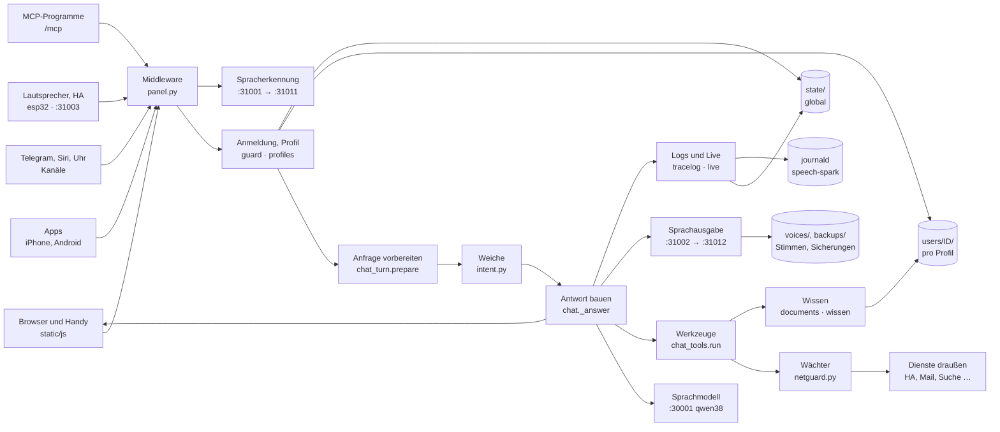

# Architektur und Datenfluss

← [README](../../README.de.md) · [Technik und Fehlersuche](technik.md) · [Sicherheit und Betrieb](sicherheit-und-betrieb.md)

Diese Seite beschreibt, wie der Spark gebaut ist: welche Teile es gibt, welchen Weg eine Anfrage nimmt und wo welche Daten liegen. Im Panel steht dasselbe zum Anklicken unter **Zustand → Technik** (nur für Admins). Das Bild nutzt dort die ganze Breite, das Detail steht darunter; „⛶ Vollbild“ legt Überblick oder Datenfluss über den ganzen Bildschirm, mit ＋/− zum Vergrößern und Escape zum Schließen. Wie gebaut wird, regelt die [Coding-Richtlinie](richtlinien.md).

Die Abschnitte zwischen den Markierungen `<!-- technik:… -->` entstehen aus dem Code (`app/panel/technik.py`, dazu `speicher.AREAS`/`LOCAL` und `backup.STATE_FILES`/`STATE_LOCAL`). `python3 app/panel/hilfe.py --docs` schreibt sie neu. Ein Selbsttest (`test_technik`) wird rot, wenn ein Modul, eine Datei oder ein Schritt fehlt oder die Doku nicht neu geschrieben wurde. Nur die Texte außerhalb der Markierungen werden von Hand gepflegt.

## Überblick

Geräte und Programme sprechen nur mit dem Panel. Das Panel prüft jede Anfrage, fragt das Sprachmodell, ruft Werkzeuge über den Wächter auf und schreibt in die Ordner unter `/var/lib/speech-spark`. Spracherkennung und Sprachausgabe sind eigene Dienste. Das Sprachmodell gehört zu `dgx-spark-qwen38` und ist nicht Teil dieses Repos.

<!-- technik:bild -->

<!-- /technik:bild -->

## Prozesse und Ports

| Dienst | Port | Aufgabe |
|---|---|---|
| `speech-spark-panel` | 31080, HTTPS 31443 | Webportal, alle Endpunkte, Hintergrundaufgaben |
| `speech-spark-asr` → `speech-spark-asr-engine` | 31001 → 31011 (nur lokal) | Spracherkennung |
| `speech-spark-tts` → `speech-spark-tts-engine` | 31002 → 31012 (nur lokal) | Sprachausgabe; optional VoiceDesign auf 31013 |
| Wyoming im Panel | 31003 | Home Assistant Assist |
| `dgx-spark-qwen38` (fremdes Projekt) | 30001 | Sprachmodell; Ports 30000–30099 gehören ihm |
| `speech-spark-watch` | – | Wächter, nur ohne Panel |
| `speech-spark-update` | – | Update, nur auf Knopfdruck |

Alle Dienste laufen als Systembenutzer `speech` und loggen in den journald-Namespace `speech-spark`. Das Panel startet seine Hintergrundaufgaben selbst (`panel.py`: Messwerte, Stabilität, Posteingang aufräumen, Dokumente lesen, reMarkable-Abgleich, Lernen aus Gesprächen). Hintergrundarbeit wartet, solange gesprochen wird (`vorrang.py`).

## Datenfluss einer Anfrage

Der Weg einer gesprochenen Frage im Browser, von der Eingabe bis zur Speicherung:

<!-- technik:datenfluss -->
1. **Eingabe**: Das Mikrofon nimmt auf, das Panel reicht den Ton an die Spracherkennung weiter. Im Code: `POST /api/test/asr`
2. **Zugang**: Größe, Herkunft und Notaus, dann Rate-Limit, Anmeldung und Profil. Im Code: `POST /api/chat · guard.limit · profiles.current`
3. **Vorbereiten**: Sprache zuerst (vorrang), andere Geräte sehen „antwortet gerade“, dann Rechte, Sperren, Systemprompt. Im Code: `chat_turn.prepare()`
4. **Weiche**: Feste Regeln grenzen die Werkzeuge ein; ein klarer Lesewunsch läuft direkt. Im Code: `intent.classify_cfg() · intent.narrow()`
5. **Modell**: Sofort-Satz, Anfrage-Verlauf, dann Runden mit dem Sprachmodell, gestreamt. Im Code: `chat._answer()`
6. **Werkzeuge**: Werkzeugaufruf, Wächter, Dienst draußen oder eigenes Wissen; das Ergebnis geht als Daten zurück. Im Code: `chat_tools.run() · netguard`
7. **Antwort**: Sätze gehen an die Sprachausgabe; Text und Ton kommen als ein Strom zum Gerät. Im Code: `SSE · /v1/audio/speech`
8. **Speichern**: Das Gerät legt den Verlauf ab, das Panel Werkzeug-Log, Gedächtnis, Tagebuch, Anfrage-Verlauf und Journal. Im Code: `PUT /api/profile/convos · tracelog.finish`
<!-- /technik:datenfluss -->

Abzweige:

- **Telegram, Siri und Uhr** schicken Text (oder eine Sprachnachricht) an ihren eigenen Endpunkt. Den Verlauf legt das Panel selbst ab (`verlauf.keep`), nicht das Gerät.
- **ESP32-Lautsprecher und Home Assistant Assist** sprechen mit `esp32.py` und `wyoming.py`. Eine fremde Stimme am geteilten Lautsprecher bekommt nur Gastrechte.
- **MCP-Programme** fragen über `/mcp` (`mcpserver.py`) mit eigenem Token, das nur als Hash gespeichert ist.
- **Gäste** bekommen nur Frage und Antwort vom Sprachmodell, ohne Werkzeuge, ohne persönliche Daten und ohne Verlauf auf dem Spark.

An jeder Stelle gilt: Alles von außen (Web, Mail, Dokumente, Werkzeugergebnisse, Modellausgaben) ist Daten, nie ein Befehl. Entscheidungen trifft das Panel mit festen Regeln.

## Bausteine

Jedes Modul unter `app/panel/` und `app/` gehört zu genau einer Gruppe. Ein neues Modul ohne Eintrag in `technik.MODULE` macht `test_technik` rot.

<!-- technik:bausteine -->
### Zugang und Rechte

Jede Anfrage geht zuerst hier durch: Größe, Herkunft, Notaus, Anmeldung, Profil und Freigaben.

| Modul | Aufgabe |
|---|---|
| `app/panel/account.py` | Was ein Gerät für sich selbst darf: Anmelden und eigene Daten |
| `app/panel/coadmin.py` | Profile als Admins: Haupt-Admin, Mit-Admin, Verwalter |
| `app/panel/core.py` | Admin-Passwort, Sitzungen, gemeinsame Pfade und Helfer |
| `app/panel/features.py` | Alle Funktionen mit Namen und Freigaben an einer Stelle |
| `app/panel/guard.py` | Rate-Limits, Sperren nach falschen Versuchen, fremde Seiten, audit.log |
| `app/panel/join.py` | Neue Personen per Einladung |
| `app/panel/mfa.py` | Zweiter Anmeldeschritt mit Code (TOTP) und Wiederherstellungscodes |
| `app/panel/netguard.py` | Wächter: wohin eine Verbindung nach außen darf |
| `app/panel/notaus.py` | Notaus in drei Stufen, von außen nach innen |
| `app/panel/notzugang.py` | Wieder hinein nach einem Aussperren (nur per sudo am Spark) |
| `app/panel/panel.py` | Startet das Panel, Middleware (Größe, Herkunft, Notaus), liefert die Seite aus |
| `app/panel/passkey.py` | Passkeys statt Code (Face ID, Touch ID, Windows Hello) |
| `app/panel/profiles.py` | Profile, Geräte, Sitzungen, Gespräche und Gedächtnis pro Profil |
| `app/panel/signatur.py` | Prüft signierte Update-Manifeste (Ed25519) |
| `app/panel/stufen.py` | Liste, welche Änderung den Code verlangt |
| `app/panel/vault.py` | Versiegelt Passwörter und Tokens mit state/secret.key |
| `app/panel/zertpin.py` | Zertifikat eines Geräts im Heimnetz festpinnen |

### Gespräch

Bereitet eine Anfrage vor, fragt das Sprachmodell in Runden und prüft, was gesagt wird.

| Modul | Aufgabe |
|---|---|
| `app/panel/ack.py` | Sofortige Rückmeldung aus aufgenommenen Sätzen |
| `app/panel/answercheck.py` | Antwort-Prüfung: das Panel entscheidet, ob ein Satz gesagt werden darf |
| `app/panel/chat.py` | Der Assistent: /api/chat, Runden mit dem Modell, Text und Ton als Strom |
| `app/panel/chat_tools.py` | Führt die Werkzeugaufrufe des Modells aus und prüft die Sperren erneut |
| `app/panel/chat_turn.py` | Bereitet eine Anfrage vor: Rechte, Sperren, Systemprompt, Werkzeuge |
| `app/panel/echo.py` | Der Assistent antwortet nicht auf seine eigene Stimme |
| `app/panel/fixes.py` | Lernt aus Korrekturen der Person |
| `app/panel/fremdstimme.py` | Fernseher und fremde Stimmen im von selbst geöffneten Mikrofon werden keine Frage |
| `app/panel/images.py` | Bilder in der Frage: das Sprachmodell sieht sie selbst |
| `app/panel/klaeren.py` | Rückfrage, Korrektur und Merken von Zuordnungen |
| `app/panel/roles.py` | Rollen: wie der Assistent antworten soll |
| `app/panel/schreib.py` | Schreibhilfe: korrigieren, kürzen, übersetzen, entwerfen |
| `app/panel/stille.py` | Aus Stille werden nie Wörter |
| `app/panel/stufe.py` | Vorrang für Personen in der Warteschlange der Sprachausgabe |
| `app/panel/systemone.py` | Einordnung mit Wahrscheinlichkeit über qwen38 |
| `app/panel/taten.py` | Handlungs-Prüfung: hat ein Werkzeug wirklich getan, was der Satz sagt |
| `app/panel/tipps.py` | Schlägt passende Funktionen vor, die noch aus sind |
| `app/panel/vorab.py` | Holt bei einer Rückfrage die Antwort schon vorab |

### Weiche und Werkzeugnamen

Feste Regeln, welche Werkzeuge das Modell für eine Frage sieht. Gibt nie mehr frei als die Rechte.

| Modul | Aufgabe |
|---|---|
| `app/panel/intent.py` | Die Weiche: feste Regeln für die eigene letzte Nachricht |
| `app/panel/intent_alltag.py` | Alltagssätze der Weiche: nur zum Messen |
| `app/panel/intent_bench.py` | Testsätze der Weiche |
| `app/panel/weiche.py` | Seite Funktionen → Weiche und ihre Statistik |
| `app/panel/werkzeug_abdeckung.py` | Welche Funktion das Modell mit welchem Werkzeug erreicht (Regel 29) |
| `app/panel/werkzeuge.py` | Verständliche Namen aller Werkzeuge |

### Wissen und Dokumente

Eigene Dokumente, Gedächtnis, frühere Gespräche, Kiwix und Wikipedia, erstellte Dokumente.

| Modul | Aufgabe |
|---|---|
| `app/panel/docembed.py` | Bedeutungsvektoren für die Dokumentsuche |
| `app/panel/doclingdienst.py` | Docling-Server im Heimnetz: Dokumente und Scans besser lesen |
| `app/panel/docmake.py` | Dokumente erstellen: Aufträge, Vorlagen, Ablage |
| `app/panel/docrender.py` | Baut die Dateien (Word, PDF, PowerPoint, Excel) mit festem Code |
| `app/panel/documents.py` | Dokumente pro Profil in wissen.db: Text, Abschnitte mit Kontextzeile, Suche |
| `app/panel/embed_worker.py` | Das Vektormodell im eigenen Prozess |
| `app/panel/folien.py` | Folientypen und feste Regeln für erstellte Dokumente |
| `app/panel/gedaechtnis.py` | Gedächtnis mit Beleg und Prüfung |
| `app/panel/kiwix.py` | Eigenes Kiwix als Wissensquelle ohne Internet |
| `app/panel/lokal.py` | Erst lokal suchen, bevor etwas nach außen geht |
| `app/panel/memtidy.py` | Wöchentliches Aufräumen des Gedächtnisses |
| `app/panel/nachsortieren.py` | Treffer nachsortieren: ein Cross-Encoder auf dem Prozessor ordnet die Kandidaten |
| `app/panel/recall.py` | Suche in früheren Gesprächen, gelernte Fakten |
| `app/panel/suchpruefung.py` | Suchprüfung: Prüffragen messen, wie gut die Dokumentensuche trifft |
| `app/panel/symbole.py` | Feste Symbole für Folien und Dokumente |
| `app/panel/tagebuch.py` | Spark-Tagebuch: was der Spark selbst getan hat |
| `app/panel/wiki.py` | Wikipedia für „Was ist …?“ |
| `app/panel/wissen.py` | Wissen aus eigenen Uploads: Schalter und Kontingent |

### Anbindungen

Home Assistant, Mail, Kalender, Aufgaben, Wetter, reMarkable, MCP und was der Spark von selbst tut.

| Modul | Aufgabe |
|---|---|
| `app/panel/aendern.py` | Ändern per Sprache: Lautstärke, Termine und anderes nach „Ja“ |
| `app/panel/agent.py` | Aufträge im Hintergrund, Zeitpläne, Routinen |
| `app/panel/beobachten.py` | Beobachten: Funde prüfen, nur Neues melden (Eigene Aufgaben) |
| `app/panel/calendars.py` | Kalender und Tagesbriefing |
| `app/panel/contacts.py` | Kontakte per CardDAV, nur lesen |
| `app/panel/extras.py` | Kleine Zusatzdienste mit ihren Werkzeugen |
| `app/panel/hamelden.py` | Home Assistant meldet Ereignisse an den Spark |
| `app/panel/homeassistant.py` | Home Assistant pro Profil |
| `app/panel/mail.py` | Mail lesen per IMAP |
| `app/panel/mcp.py` | Werkzeuge von MCP-Servern, die der Admin einträgt |
| `app/panel/mcpserver.py` | Der Spark als MCP-Server für andere Programme |
| `app/panel/meinmcp.py` | Eigene MCP-Dienste pro Profil |
| `app/panel/parcels.py` | Pakete aus Versand-Mails |
| `app/panel/proactive.py` | Meldet sich von selbst, wenn etwas Echtes passiert |
| `app/panel/remarkable.py` | reMarkable-Notizbücher als Wissen |
| `app/panel/rmaufgaben.py` | Aufgabenblatt zum Ankreuzen aufs reMarkable |
| `app/panel/rmliste.py` | Werkzeug: was auf dem reMarkable liegt und welche Aufgaben dort stehen |
| `app/panel/rmpapier.py` | Gestaltete Blätter fürs reMarkable |
| `app/panel/rmplus.py` | Mehr mit dem reMarkable: Senden, Ordner, Abgleich |
| `app/panel/tasks.py` | Aufgaben und Einkaufsliste |
| `app/panel/tidy.py` | Posteingang aufräumen |
| `app/panel/transit.py` | Bus und Bahn |
| `app/panel/weather.py` | Wetter von Open-Meteo als feste Sätze |
| `app/panel/zustand_wz.py` | Werkzeug: Zustand des Spark per Sprache („Läuft alles?“) |

### Geräte und Kanäle

Apps, Telegram, Uhr, Lautsprecher, Raummodus, Chats und der Verlauf auf allen Geräten.

| Modul | Aufgabe |
|---|---|
| `app/panel/android.py` | Android-App: Download und Kopplung |
| `app/panel/apns.py` | Mitteilungen an die iPhone-App |
| `app/panel/appupdate.py` | Spark-Update aus der iPhone-App |
| `app/panel/begleiter.py` | Spark-Begleiter für Windows und Mac |
| `app/panel/chats.py` | Chats zwischen den Profilen, verschlüsselt |
| `app/panel/chatsec.py` | Private Chats mit Ende-zu-Ende-Verschlüsselung |
| `app/panel/esp32.py` | Eigene ESP32-Lautsprecher und ihre Firmware |
| `app/panel/geraeteupdate.py` | Übersicht und Hinweise zu Geräte-Updates |
| `app/panel/hintergrund.py` | Ich → Mein Zustand |
| `app/panel/iphone.py` | iPhone-App: Kopplung und Rechte |
| `app/panel/messages.py` | Der Weg des Assistenten in die Chats |
| `app/panel/onboard.py` | Einrichten an der Hand |
| `app/panel/pebblewatch.py` | Kopplung der Pebble-Uhr |
| `app/panel/push.py` | Web-Push für Erinnerungen |
| `app/panel/room.py` | Raummodus: hört zu und hilft in einer Pause |
| `app/panel/roomfar.py` | Raummodus auf einem anderen Gerät schalten |
| `app/panel/roomlive.py` | Wo der Raummodus gerade zuhört |
| `app/panel/speakers.py` | Sprechererkennung pro Profil |
| `app/panel/spkcode.py` | Codewort am geteilten Lautsprecher |
| `app/panel/telegram.py` | Telegram-Bot für Text und Sprachnachrichten |
| `app/panel/today.py` | Die Karte „Heute“ oben in Ich |
| `app/panel/verbund.py` | Spark-Verbund: Chats mit Menschen auf anderen Sparks, signiert |
| `app/panel/verlauf.py` | Verlauf auf allen Geräten gleich |
| `app/panel/watch.py` | Antworten für die Uhr |
| `app/panel/wyoming.py` | Home Assistant Assist über Wyoming |

### Betrieb

Live-Übersicht, Logs, Wächter, Sicherung, Update, Hilfe und die Admin-Seiten.

| Modul | Aufgabe |
|---|---|
| `app/panel/admin.py` | Admin-Seiten: Zustand, Einstellungen, Dienste, Stimmen |
| `app/panel/backup.py` | Sicherungen und Wiederherstellen |
| `app/panel/befund.py` | Befund: die Ursache eines Falls |
| `app/panel/berater.py` | Einstellungs-Assistent: Vorschläge aus Fällen |
| `app/panel/berater_katalog.py` | Was der Einstellungs-Assistent vorschlagen darf |
| `app/panel/dienstwacht.py` | Dienst-Wächter: meldet, wenn ein Dienst fehlt |
| `app/panel/faelle.py` | Fälle: jedes Problem wird festgehalten |
| `app/panel/ghtoken.py` | Lese-Token für GitHub |
| `app/panel/health.py` | Stabilität: Wächter für hängende Dienste, Echtprüfung |
| `app/panel/hilfe.py` | Spark-Hilfe und Index der Doku |
| `app/panel/latency.py` | Wartezeit bis zum ersten Ton |
| `app/panel/live.py` | Live-Übersicht: was der Spark gerade tut |
| `app/panel/logfilter.py` | Diagnose-Filter und Hinweise für die Logs |
| `app/panel/meldung.py` | Probleme melden als GitHub-Issue |
| `app/panel/monitor.py` | Messwerte: GPU, Speicher, CPU |
| `app/panel/nas.py` | Speicher und NAS: Speicherorte (NAS, Cloud), eine Anmeldung pro Ort für Kopie und Sicherung |
| `app/panel/nasablage.py` | Ablage-Ordner: spark_ablage im Heimnetz, der einzige Ordner, in den der Spark schreibt; Eingang wird zu Dokumenten |
| `app/panel/nashilfe.py` | NAS im Heimnetz finden (nur mDNS) und Rechte am Ort zeigen, mit Warnung bei Admin-Konto |
| `app/panel/nasquelle.py` | Wissensordner: Ordner an einem Speicherort nur lesen und in die Dokumentensuche bringen |
| `app/panel/offsite.py` | Sicherung nach außen, verschlüsselt |
| `app/panel/quality.py` | Qualitätstest gegen das echte Sprachmodell |
| `app/panel/speicher.py` | Kopie meiner Daten pro Profil an einem Speicherort, verschlüsselt |
| `app/panel/system.py` | Sicherung, Echtprüfung der Dienste, Hinweise oben |
| `app/panel/technik.py` | Diese Seite: Zustand → Technik und die Architektur-Doku |
| `app/panel/tracelog.py` | Logs → Anfragen: der Weg jeder Anfrage |
| `app/panel/undo.py` | Rückgängig im Admin-Protokoll |
| `app/panel/update.py` | Updates von GitHub, nur nach grünem Test |
| `app/panel/wege.py` | Sprung-Links in Texten außerhalb des Panels |

### Sprachdienste

Spracherkennung und Sprachausgabe als eigene Dienste, mit Vorrang vor allem anderen.

| Modul | Aufgabe |
|---|---|
| `app/api_watchdog.py` | Wächter ohne Panel (Installationsart „api“) |
| `app/asr_proxy.py` | Spracherkennung: nimmt an und reicht an die Engine durch |
| `app/asr_server.py` | Spracherkennung als eigener kleiner Dienst |
| `app/bench.py` | Leistung messen |
| `app/common.py` | Gemeinsame Helfer für die Dienste: Einstellungen, Zustand |
| `app/parakeet.py` | Zweite Spracherkennung (Parakeet) auf der CPU |
| `app/tempo.py` | Sprechtempo für gestreamte Sprache |
| `app/textnorm.py` | Text aufräumen vor der Sprachausgabe |
| `app/tts_proxy.py` | Sprachausgabe: nimmt an und reicht an die Engine durch |
| `app/tts_server.py` | Sprachausgabe als eigener kleiner Dienst |
| `app/panel/vorrang.py` | Sprache zuerst: Hintergrundarbeit wartet |
<!-- /technik:bausteine -->

## Datenspeicherung

Alle Dateien gehören dem Benutzer `speech` (Ordner 0700, Dateien 0600) und werden atomar geschrieben (`.tmp`, dann umbenennen). „Sicherung“ heißt: Die Datei steckt in der Sicherung unter Zustand → System → Sicherung. „Eigener Speicher“ heißt: Ein Profil kann die Datei verschlüsselt auf seinen eigenen Speicher kopieren.

<!-- technik:speicher -->
### System

| Pfad | Inhalt | Schutz | Sicherung |
|---|---|---|---|
| `/etc/speech-spark/config.json` | Alle Einstellungen (Geheimnisse versiegelt) | teils | ja |
| `/etc/speech-spark/panel.env, mode, connection.txt` | Start-Passwort, Installationsart, API-Zugang | – | nein |
| `/etc/speech-spark/tls/` | HTTPS-Zertifikat des Panels | – | nein |
| `/opt/speech-spark/` | Code, venvs, installierte Version | – | nein |
| `/var/lib/speech-spark/hf/` | Modell-Cache (HuggingFace) | – | nein |
| `/var/lib/speech-spark/firmware/` | ESP32-Firmware | signiert | nein |
| `/var/lib/speech-spark/voices/` | Geklonte Stimmen (WAV und Text) | – | ja |
| `/var/lib/speech-spark/backups/` | Sicherungen: 7 neueste plus 5 Ereignis-Sicherungen | – | – |
| `journald (Namespace speech-spark)` | Logs aller Dienste, 14 Tage, höchstens 500 MB | – | nein |

### users/ (alle Profile)

| Pfad | Inhalt | Schutz | Sicherung |
|---|---|---|---|
| `users/profiles.json` | Profile und Geräte | – | ja |
| `users/sessions.json` | Anmeldungen | – | ja |
| `users/seen.json` | Zuletzt gesehen | – | ja |
| `users/secret` | Schlüssel der Profil-Anmeldung | ist ein Schlüssel | nein |
| `users/_chats/` | Chats zwischen Profilen | AES-256-GCM | ja |
| `users/_verbund/` | Spark-Verbund: andere Sparks, Kontakte, Warteschlange | – | ja |
| `users/begleiter.json` | Begleiter-Geräte | – | ja |

### users/ID/ (pro Profil)

| Pfad | Inhalt | Art | Schutz | Sicherung | Kopie meiner Daten |
|---|---|---|---|---|---|
| `users/ID/convos.json` | Gespräche |  | – | ja | Gespräche |
| `users/ID/toollog.json` | Werkzeug-Log |  | – | ja | Gespräche |
| `users/ID/room-history.json` | Raummodus-Verlauf |  | – | ja | Gespräche |
| `users/ID/memory.json` | Gedächtnis |  | – | ja | Gedächtnis |
| `users/ID/learned.json` | Gelernte Fakten |  | – | ja | Gedächtnis |
| `users/ID/zuordnungen.json` | Gemerkte Zuordnungen |  | – | ja | Gedächtnis |
| `users/ID/tasks.json` | Aufgaben |  | – | ja | Aufgaben und Erinnerungen |
| `users/ID/reminders.json` | Erinnerungen |  | – | ja | Aufgaben und Erinnerungen |
| `users/ID/wissen.db` | Dokumente: Text, Abschnitte mit Kontextzeile, Suche, Vektoren (SQLite) |  | – | ja | Dokumente (Text, Suche, Originale) |
| `users/ID/docs/files/` | Originale der Uploads |  | – | ja | Dokumente (Text, Suche, Originale) |
| `users/ID/suchpruefung.json` | Prüffragen und Läufe der Suchprüfung |  | – | ja | Dokumente (Text, Suche, Originale) |
| `users/ID/erstellt/` | Erstellte Dokumente |  | – | ja | Erstellte Dokumente |
| `users/ID/settings.json` | Einstellungen | Einstellungen | – | ja | – |
| `users/ID/setup.json` | Einrichtung | Einstellungen | – | ja | – |
| `users/ID/speicher.json` | Ziele des eigenen Speichers | Einstellungen | Schlüssel versiegelt | ja | – |
| `users/ID/speicher-stand.json` | Stand des Abgleichs | Zustand | – | ja | – |
| `users/ID/transit.json` | Haltestelle | Einstellungen | – | ja | – |
| `users/ID/weather.json` | Wetter-Ort | Einstellungen | – | ja | – |
| `users/ID/proactive.json` | Von selbst melden | Einstellungen | – | ja | – |
| `users/ID/proactive-rules.json` | Eigene Melde-Regeln | Einstellungen | – | ja | – |
| `users/ID/hintergrund.json` | Mein Zustand | Einstellungen | – | ja | – |
| `users/ID/mail.json` | Mail-Zugang | Login | Passwort versiegelt | ja | – |
| `users/ID/nas.json` | Speicherorte des Profils (NAS, Cloud) | Login | Passwort versiegelt | ja | – |
| `users/ID/nasquelle.json` | Wissensordner des Profils | Einstellungen | – | ja | – |
| `users/ID/nasquelle-stand.json` | Was aus den Wissensordnern gelesen ist | Zustand | – | ja | – |
| `users/ID/nasablage.json` | Ablage-Ordner des Profils | Einstellungen | – | ja | – |
| `users/ID/speicher.vor-nas.json` | Kopie meiner Daten vor dem Umzug auf Speicherorte | Login | – | ja | – |
| `users/ID/mail-tidy.json` | Posteingang aufräumen | Einstellungen | – | ja | – |
| `users/ID/calendar.json` | Kalender-Zugang | Login | Passwort versiegelt | ja | – |
| `users/ID/homeassistant.json` | Home-Assistant-Zugang | Login | Token versiegelt | ja | – |
| `users/ID/telegram.json` | Telegram-Kopplung | Login | – | ja | – |
| `users/ID/push.json` | Push-Abos der Browser | Gerät | – | ja | – |
| `users/ID/remarkable.json` | reMarkable-Zugang | Login | Token versiegelt | ja | – |
| `users/ID/remarkable-lib.json` | reMarkable-Bibliothek | Zustand | – | ja | – |
| `users/ID/mcp-dienste.json` | Eigene MCP-Dienste | Login | Tokens versiegelt | ja | – |
| `users/ID/mcp-actions.json` | MCP-Aktionen | Zustand | – | ja | – |
| `users/ID/agent.json` | Aufträge und Routinen | Einstellungen | – | ja | – |
| `users/ID/voice.json` | Stimmabdruck | Stimmabdruck | versiegelt | ja | – |
| `users/ID/speaker-code.json` | Codewort am Lautsprecher | Schlüssel | versiegelt | ja | – |
| `users/ID/chatkeys.json` | Öffentliche Schlüssel der Geräte | Schlüssel | – | ja | – |
| `users/ID/contacts.json` | Kontakte-Zugang | noch nicht angeboten | Passwort versiegelt | ja | – |
| `users/ID/ha-events.json` | Home-Assistant-Ereignisse | Zustand | – | ja | – |
| `users/ID/briefing-sent` | Briefing gesendet | Zustand | – | ja | – |
| `users/ID/messages.json` | Nachrichten-Einstellungen | Einstellungen | teils versiegelt | ja | – |
| `users/ID/messages/` | Alte Sprachnachrichten | alte Sprachnachrichten (bis zur Übernahme in die Chats) | – | nein | – |
| `users/ID/agent-pending.json` | Wartet auf Ja | Warteschlange | – | ja | – |
| `users/ID/calendar-pending.json` | Wartet auf Ja | Warteschlange | – | ja | – |
| `users/ID/fix-pending.json` | Wartet auf Ja | Warteschlange | – | ja | – |
| `users/ID/memory-ask.json` | Offene Frage zum Gedächtnis | Warteschlange | – | ja | – |
| `users/ID/mail-pending.json` | Wartet auf Ja | Warteschlange | – | ja | – |
| `users/ID/mcp-dienste-pending.json` | Wartet auf Ja | Warteschlange | – | ja | – |
| `users/ID/messages-pending.json` | Wartet auf Ja | Warteschlange | – | nein | – |
| `users/ID/tasks-pending.json` | Wartet auf Ja | Warteschlange | – | ja | – |
| `users/ID/tagebuch.json` | Spark-Tagebuch | Zustand | – | ja | – |
| `users/ID/docling-wait` | Dateien, bis Docling sie gelesen hat | Warteschlange | – | ja | – |
| `users/ID/mfa.json` | Zweiter Schritt des Profils | Schlüssel | versiegelt | ja | – |
| `users/ID/memory-tidy.json` | Aufräum-Vorschlag | Warteschlange | – | ja | – |
| `users/ID/memory-tidy-checked` | Letzte Aufräum-Prüfung | Zustand | – | ja | – |

### state/ (global)

| Pfad | Inhalt | Schutz | Sicherung |
|---|---|---|---|
| `state/ack` | Sofort-Sätze als Ton | – | nein |
| `state/admin-session.key` | Schlüssel der Admin-Sitzung | ist ein Schlüssel | nein |
| `state/admins.json` | Profile als Admins | – | ja |
| `state/agent.json` | Agent-Stufen, MCP-Dienste | Tokens versiegelt | ja |
| `state/android` | Android-App zum Download | – | nein |
| `state/apns-tokens.json` | iPhone-Geräte für Push | – | ja |
| `state/apns.json` | Apple-Push-Schlüssel | Schlüssel versiegelt | ja |
| `state/audit.log` | Admin-Protokoll, 1 MB | – | nein |
| `state/begleiter` | Begleiter-Updates | – | nein |
| `state/begleiter-inbox` | Vom Handy auf den PC, 24 h | – | nein |
| `state/bench-history.json` | Messungen | – | nein |
| `state/bench-latest.json` | Letzte Messung | – | nein |
| `state/berater.json` | Vorschläge des Assistenten | – | ja |
| `state/bewertungen.json` | Bewertungen pro Tag | – | nein |
| `state/config-undo.json` | Rückgängig (ohne Geheimnisse) | ohne Geheimnisse | nein |
| `state/dienste-zustand.json` | Hintergrund-Dienste | – | nein |
| `state/dienstwacht.json` | Dienst-Wächter | – | ja |
| `state/doc-embed.json` | Vektormodell | – | nein |
| `state/doc-quotas.json` | Dokument-Kontingente | – | ja |
| `state/doc-rank.json` | Nachsortier-Modell | – | nein |
| `state/docling.json` | Docling-Server: Adresse, Zertifikat, Zahlen | Schlüssel versiegelt | ja |
| `state/esp32.json` | Lautsprecher und Firmware | teils versiegelt | ja |
| `state/faelle.json` | Fälle | – | ja |
| `state/features-seen.json` | Wann Funktionen frei wurden | – | ja |
| `state/geraete-updates.json` | Geräte-Updates | – | ja |
| `state/github-token.json` | GitHub-Lese-Token | versiegelt | ja |
| `state/guard-xff-hinted.json` | Proxy-Hinweis gezeigt | – | nein |
| `state/guard.json` | Sperren nach Fehlversuchen | – | nein |
| `state/gut-saetze.json` | Mit 👍 bestätigte Fragen | – | ja |
| `state/iphone-update.json` | Update aus der iPhone-App | – | nein |
| `state/join.json` | Einladungen (Hashes) | nur Hashes | ja |
| `state/latency.json` | Wartezeiten | – | nein |
| `state/live-monitors.json` | Wandmonitore | – | nein |
| `state/livecheck.json` | Echtprüfung | – | nein |
| `state/mcp-dienste-admin.json` | Erlaubte MCP-Ziele | – | ja |
| `state/mcp-server.json` | MCP-Programme (Token-Hashes) | nur Hashes | ja |
| `state/meldung-token.json` | Token für Meldungen | versiegelt | nein |
| `state/meldungen` | Meldungs-Entwürfe | – | nein |
| `state/mfa-admin.json` | Zweiter Schritt des Admins | versiegelt | ja |
| `state/migrated-chunk10` | Einmalige Umstellung erledigt | – | nein |
| `state/nas-admin.json` | NAS-Verbindung des Spark | Passwort versiegelt | ja |
| `state/nasquelle-tmp` | Zwischendateien der Wissensordner, Sekunden | – | nein |
| `state/notaus-keys.json` | Notaus-Auslöser | – | nein |
| `state/notaus-mine.json` | Mein Notaus | – | nein |
| `state/notaus.json` | Notaus | – | nein |
| `state/offsite.json` | Sicherung nach außen | versiegelt | ja |
| `state/panel-password` | Admin-Passwort (Hash) | Hash | ja |
| `state/personen-vorrang.json` | Vorrang pro Profil | – | ja |
| `state/quality-cases.json` | Eigene Testfragen | – | ja |
| `state/quality-history.json` | Verlauf der Qualitätstests | – | ja |
| `state/quality.json` | Letzter Qualitätstest | – | nein |
| `state/regel-versionen.json` | Regel-Versionen | – | ja |
| `state/revoked.json` | Widerrufene Sitzungen | – | nein |
| `state/secret.key` | Schlüssel für alles Versiegelte | ist der Schlüssel | nein |
| `state/setup.json` | Einrichtungs-Assistent erledigt | – | ja |
| `state/speech-active` | Zeitpunkt der letzten Sprache | – | nein |
| `state/speech-spark-asr-engine.json` | Zustand der ASR-Engine | – | nein |
| `state/speech-spark-tts-*.json` | Zustand der TTS-Engines | – | nein |
| `state/speicher-tmp` | Zwischenablage des eigenen Speichers | AES-256-GCM | nein |
| `state/telegram.json` | Telegram-Bot | Token versiegelt | ja |
| `state/tipps.json` | Gezeigte Tipps | – | nein |
| `state/traces.jsonl` | Logs → Anfragen, 48 h | – | nein |
| `state/update-night.json` | Nacht-Update | – | nein |
| `state/update-progress.json` | Update-Fortschritt | – | nein |
| `state/update-target` | Gewünschter Update-Stand | – | nein |
| `state/vapid.pem` | Web-Push-Schlüssel | ist ein Schlüssel | ja |
| `state/vision.json` | Bildfragen, 10 min | – | nein |
| `state/vorrang-key` | Schlüssel Panel ↔ Sprachdienste | ist ein Schlüssel | nein |
| `state/weiche-history.json` | Weiche-Änderungen | – | nein |
| `state/weiche-stats.json` | Weiche-Statistik | – | nein |
<!-- /technik:speicher -->

### Schlüssel und Verschlüsselung

- `state/secret.key` versiegelt alle Passwörter und Tokens (Fernet, `vault.py`). Aus ihm wird auch der Schlüssel der Chats abgeleitet (HKDF, AES-256-GCM). Er kommt nur in die **Umzugs-Sicherung**, versiegelt mit dem Passwort des Admins (`state/move-keys.json`, scrypt). Eine normale Sicherung auf einem anderen Spark verliert deshalb Chats und alle versiegelten Zugänge.
- `users/secret` und `state/admin-session.key` unterschreiben Anmeldungen und kommen nie in eine Sicherung. Nach einem Umzug melden sich alle neu an.
- Der Stimmabdruck `users/ID/voice.json` ist versiegelt wie ein Passwort (`speakers.py`), auch in der Sicherung. Eine ältere, offene Datei wird beim ersten Lesen versiegelt. Nach einer Sicherung auf einem anderen Spark nimmt das Profil seine Stimme neu auf.
- Die Sicherung nach außen (`offsite.py`) und der eigene Speicher (`speicher.py`) sind als Ganzes verschlüsselt (scrypt + AES-GCM, AES-256-GCM in Stücken von 1 MiB).

### Caches im Arbeitsspeicher

Diese Caches gehen bei einem Neustart verloren und enthalten nichts, was nicht neu geholt werden kann: Kalender 300 s, Mail 120 s, Bus und Bahn 60 s, Wetter 900 s, Pakete 600 s, Wikipedia und Kiwix 24 h, Bildfragen 600 s (Ergebnisse auch in `state/vision.json`), Antworten für die Uhr 600 s, die Vektoren der Dokumentsuche pro Profil, die Stimmen der Sprachausgabe.

### Logs

Alle Dienste schreiben in den journald-Namespace `speech-spark` (persistent, höchstens `logs.max_mb` = 500 MB, `logs.keep_days` = 14 Tage). In die Zeilen kommen nur feste Wörter und Zahlen, ein Profil nur über `profiles.log_name`. Der Anfrage-Verlauf (`state/traces.jsonl`, 48 h) läuft nur, solange der Admin-Schalter `logs.trace` an ist.

## So bleibt die Doku aktuell

Bei jeder Änderung gilt (Richtlinie Teil 1, Punkt „Technik-Doku“):

1. Ein neues Modul bekommt seine Gruppe und eine Zeile in `technik.MODULE`.
2. Eine neue Datei unter `state/` kommt in `backup.STATE_FILES` (gesichert) oder `backup.STATE_LOCAL` (mit Grund, warum nicht), dazu ihre Zeile in `technik.INHALT`. Eine neue Datei unter `users/ID/` kommt in `speicher.AREAS` oder `speicher.LOCAL` und in `technik.INHALT`. Ist sie versiegelt, kommt sie in `technik.VERSCHLUESSELT`.
3. Ändert sich der Weg einer Anfrage, werden `technik.KNOTEN`, `KANTEN` und `SCHRITTE` angepasst.
4. Danach `python3 app/panel/hilfe.py --docs` ausführen. Das schreibt diese Seite, die englische Fassung und den Hilfe-Index neu.

`test_technik` prüft alle vier Punkte.
