# Architektur und Datenfluss

← [README](../../README.de.md) · [Technik und Fehlersuche](technik.md) · [Sicherheit und Betrieb](sicherheit-und-betrieb.md)

Diese Seite beschreibt, wie der Spark gebaut ist: welche Teile es gibt, welchen Weg eine Anfrage nimmt und wo welche Daten liegen. Im Panel steht dasselbe zum Anklicken unter **Zustand → Technik** (nur für Admins). Das Bild nutzt dort die ganze Breite, das Detail steht darunter; „⛶ Vollbild“ legt Überblick oder Datenfluss über den ganzen Bildschirm, mit ＋/− zum Vergrößern und Escape zum Schließen. Wie gebaut wird, regelt die [Coding-Richtlinie](richtlinien.md).

Die Abschnitte zwischen den Markierungen `<!-- technik:… -->` entstehen aus dem Code (`app/panel/technik.py`, dazu `speicher.AREAS`/`LOCAL` und `backup.STATE_FILES`/`STATE_LOCAL`). `python3 app/panel/hilfe.py --docs` schreibt sie neu. Ein Selbsttest (`test_technik`) wird rot, wenn ein Modul, eine Datei oder ein Schritt fehlt oder die Doku nicht neu geschrieben wurde. Nur die Texte außerhalb der Markierungen werden von Hand gepflegt.

## Überblick

Geräte und Programme sprechen nur mit dem Panel. Das Panel prüft jede Anfrage, fragt das Sprachmodell, ruft Werkzeuge über den Wächter auf und schreibt in die Ordner unter `/var/lib/speech-spark`. Spracherkennung, Sprachausgabe, Bilder und das Sprachmodell sind eigene Dienste.

Das Bild ist in Zonen geteilt, damit man sieht, wo etwas liegt: oben die Geräte, die im Heimnetz oder unterwegs sein können (kleine Marken „Heimnetz“ und „unterwegs“; sie kommen direkt an :31080/:31443 oder über den Reverse-Proxy herein), in der Mitte der DGX Spark mit Panel, Modellen und Speicher, unten was hinausgeht, getrennt nach Heimnetz und Internet und nur über den Wächter oder feste Wege. Bei [Spark teilen](spark-teilen.md) läuft die Zone Panel mit dem Speicher auf einem eigenen Rechner, die Modelle bleiben auf dem DGX und werden über das TLS-Tor erreicht (Kasten „Spark teilen“). Im Panel sind die Linien blass, bis man einen Kasten anklickt; dann leuchten nur seine Wege. Lage, Zonen und Linien stehen in `technik.py` (`ZONEN`, `LINIEN`); `test_technik` prüft, dass kein Kasten einen anderen überdeckt, jeder in seiner Zone liegt und jede Linie rechtwinklig von Kasten zu Kasten läuft.

<!-- technik:bild -->
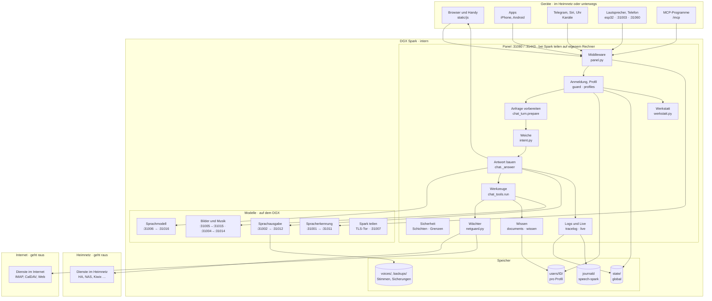
<!-- /technik:bild -->

## Prozesse und Ports

| Dienst | Port | Aufgabe |
|---|---|---|
| `speech-spark-panel` | 31080, HTTPS 31443 | Webportal, alle Endpunkte, Hintergrundaufgaben |
| `speech-spark-asr` → `speech-spark-asr-engine` | 31001 → 31011 (nur lokal) | Spracherkennung |
| `speech-spark-tts` → `speech-spark-tts-engine` | 31002 → 31012 (nur lokal) | Sprachausgabe; optional VoiceDesign auf 31013 |
| Wyoming im Panel | 31003 | Home Assistant Assist |
| Telefon im Panel | UDP 31060, Ton UDP 31062–31068 | Den Spark anrufen (SIP und RTP nur mit der Telefonanlage im Heimnetz) |
| `speech-spark-turn` | 3478, Relais 49160–49200 | Vermittler für Anrufe von unterwegs (coturn), nur mit dem Schalter an |
| `speech-spark-llmtor` → `speech-spark-llm` | 31006 → 31016 (nur lokal) | Eigenes Sprachmodell (vLLM) hinter dem LLM-Tor; Bildverständnis `speech-spark-sehen` auf 31017 bei Bedarf |
| `speech-spark-bild` | 31005 → 31015 (nur lokal) | Bilder malen und ändern (FLUX.2 klein) |
| `speech-spark-musik` | 31004 → 31014 (nur lokal) | Musik machen (ACE-Step 1.5), die Engine nur während eines Lieds |
| `speech-spark-waerter` | 127.0.0.1:31007 | Wärter: feste Befehle vom Panel-Rechner (nur bei Spark teilen, hinter dem TLS-Tor) |
| `speech-spark-tlstor` | dieselben Ports mit TLS | TLS-Tor des Modell-Rechners (nur bei Spark teilen), dazu `speech-spark-teilen-fw` |
| `speech-spark-notasr` | 127.0.0.1:31009 | Notbetrieb mit Parakeet auf dem Panel-Rechner, wenn der Modell-Rechner weg ist |
| `dgx-spark-qwen38` (fremdes Projekt, wahlweise) | 30001 | Sprachmodell, solange das eigene nicht übernommen ist; Ports 30000–30099 gehören ihm |
| `speech-spark-watch` | – | Wächter, nur ohne Panel |
| `speech-spark-update` | – | Update, nur auf Knopfdruck |
| `speech-spark-wechsel` | – | Ein Modell wechseln (Zustand → Modelle), nur auf Knopfdruck |
| `speech-spark-messen-wunsch` | – | Ein Modell messen (Zustand → Modelle „Messen“), nur auf Knopfdruck |
| `speech-spark-gehaeuse` | – | Gehäuse des Panel-Rechners einrichten (Pironman 5: Lüfter, OLED), nur mit `--gehaeuse` |
| `speech-spark-werkstatt` | – (die Sandbox fragt nur 127.0.0.1:31006) | Ein Auftrag der Werkstatt (Funktionen → Werkstatt): Testlauf, Code-Messung, Diagnose, Reparatur in der Sandbox `speech-spark-werkstatt-lauf`, nur mit `--werkstatt`; dazu `speech-spark-werkstatt-fw` (die Sandbox erreicht auf 127.0.0.1 nur das LLM-Tor) |
| `speech-spark-schirm` | – (fragt nur 127.0.0.1:31080) | Steuerzentrale als Text auf dem Bildschirm des Panel-Rechners (tty1), nur mit dem Schalter an |

**Modell-Rechner (V01.0.606, Plan „Spark teilen“ Stufe B1):** Das Panel spricht Spracherkennung, Sprachausgabe, Bilder und das LLM-Tor nur über eine Adresse an: `common.model_url(art, pfad)` mit der Einstellung `models.host`. Standard ist `127.0.0.1`, dann läuft alles wie bisher auf einem Spark über `http://127.0.0.1:<port>`. Steht dort ein anderer Rechner (Name oder IP, nie ein Pfad oder `http://`), geht jede Anfrage über `https` und der API-Schlüssel ist Pflicht (`admin.validate`); eine kaputte Angabe bleibt auf dem Spark. Das LLM-Tor auf dem Modell-Rechner bekommt den Schlüssel wie das eigene (`llm.own_tor`), und der Wächter (`netguard.model_addresses`) behandelt die Ports 30000–31099 des Modell-Rechners wie die eigenen: keine MCP-, Kalender- oder Home-Assistant-Adresse kann auf sie zeigen. Eingestellt wird der Modell-Rechner erst mit der geteilten Installation (Stufe B6); das Zertifikat pinnt die Kopplung (B3). Selbsttest `test_modell_rechner`.

**TLS-Tor (V01.0.607, Stufe B2):** Läuft das Panel auf einem anderen Rechner, hören die Dienste auf dem DGX nur auf 127.0.0.1, und `app/tlstor.py` öffnet dieselben Ports auf `api.tls_listen` mit TLS 1.3 und dem Zertifikat aus `/etc/speech-spark/tls`, nur für die Adressen in `api.tls_from`. Das Panel vertraut genau dem gepinnten Zertifikat (`models.cert`); `common._pin_models` gibt es jeder httpx-Verbindung zum Modell-Rechner mit, die keinen eigenen Transport mitbringt. Selbsttest `test_teilen`.

**Wärter (V01.0.609, Stufe B4a):** Auf dem Modell-Rechner führt `app/tarswart.py` (127.0.0.1:31007, hinter dem TLS-Tor) eine feste Befehlsliste aus: `status` und `einheit start|stop|restart <teil>`. Das Panel spricht ihn über `steuer.py` an (`unit_state`, `active_seconds`, `systemctl`, `gpu`); bei der Komplett-Installation ruft `steuer.py` wie bisher `systemctl` und `nvidia-smi` selbst. Unterschrift HMAC-SHA256 mit dem Wärter-Schlüssel aus der Kopplung. Selbsttest `test_waerter`. Seit V01.0.610 auch `einstellen` (Spracheinstellungen vom Panel, `common.model_settings`) und `logs <teil> <n>`. Seit V01.0.612 meldet der Status die Modellwahl (`common.MODEL_CHOICE`), die das Panel übernimmt; dazu `modelle`, `wechseln <art> <id|zurueck>`, `eigen_dazu` und `eigen_weg` für Zustand → Modelle (`modelle.wechsel_anfragen` ist die eine Quelle für beide Wege). Die qwen38-Spuren (`common.qwen38_lanes`) liegen jetzt in `common`. Dazu meldet der Status die Wartungspause des Modell-Rechners (`common.WARTUNG_FILE`, nur Teile und Zeiten) und je Einheit den Startzeitpunkt (`eintritt`, für die Automatik); `weiter` beendet sie. `wartung.state` legt sie mit der eigenen Pause zusammen (`steuer.cached`, nie eine Anfrage im Fragepfad); Live-Kasten „Modell-Rechner“ aus `steuer.for_live`. Seit V01.0.614 startet `update` das eigene Update des Modell-Rechners; der Status trägt `commit` und `update`, `update.sh` des Panel-Rechners wartet über `speech-spark teilen modelle-update` darauf. `PREFIX` und `installed_version` liegen jetzt in `common`. Notbetrieb: `steuer.weg` (30 s ohne Antwort) macht `wartung.paused` für alle Teile wahr, `wartung.quiet` nicht; eigener Satz `wartung.NOTBETRIEB` und Lautsprecher-Dateien `notbetrieb-satz-*.pcm`. Kopplung (V01.0.616, B6a): `teilen.py warten|koppeln` auf Port 31008 nur während ein Code gezeigt wird; Schlüssel scrypt(Code, SHA-256 des Zertifikats), Beweis und Antwort mit HMAC-SHA256; `speech-spark teilen code|koppeln` schreibt Ergebnis mit `cfg_put` (die eine Stelle, die die Konfiguration in der Shell ändert) und `STATE/waerter.key`. Installation (V01.0.617, B6b): `install.sh --mode api --teilen` (Marke `$ETC/teilen`, Dienste auf 127.0.0.1, Tür-Zertifikat `common.TOR_CERT`, Einheiten `speech-spark-tlstor`, `-waerter`, `-teilen-fw`, beide in `restart-map`) und `--mode panel --modelle` (`PANEL_ONLY`: kein Modell, keine Engine, Kopplung vor den Einheiten); `steuer.rundlauf` prüft danach den Weg. Umziehen (V01.0.618, B6c): `panel/umziehen.py packen|auspacken` (Umzugs-Sicherung über stdin/stdout, `system._check_config`), `teilen.warten(umzug=…)`/`koppeln(umzug_ordner, einspielen)` mit unterschriebenem „fertig“; `speech-spark umziehen --code|--von`, `zurueckholen --von`; das Tür-Zertifikat macht nur `speech-spark teilen zertifikat`. Notbetrieb mit Parakeet (V01.0.620, B5c): `panel/notbetrieb.py` mit `chat.notbetrieb_asr`; `common.model_url("asr")` geht im Notbetrieb an `speech-spark-notasr` (`asr_proxy.py` mit `SPEECH_SPARK_NOTASR=1`, 127.0.0.1:`common.NOTASR_PORT`, lädt bei Bedarf, entlädt nach `common.NOTASR_IDLE`); `chat.py` fragt vor dem festen Satz `notbetrieb.antwort` (Home Assistant über `chat._ha_panel`, Uhrzeit, `reminder_list`); `esp32.pause_clip(en, text)` spielt dazu Dateien aus `STATE/notbetrieb-saetze/` (`notbetrieb.ton`, gemacht von `notbetrieb.make_clips` in `wartung.clips_tick`).

Alle Dienste laufen als Systembenutzer `speech` und loggen in den journald-Namespace `speech-spark`. Das Panel startet seine Hintergrundaufgaben selbst (`panel.py`: Messwerte, Stabilität, Posteingang aufräumen, Dokumente lesen, reMarkable-Abgleich, Lernen aus Gesprächen). Hintergrundarbeit wartet, solange gesprochen wird (`vorrang.py`).

## Datenfluss einer Anfrage

Der Weg einer gesprochenen Frage im Browser, von der Eingabe bis zur Speicherung:

<!-- technik:datenfluss -->
1. **Eingabe**: Das Mikrofon nimmt auf, das Panel reicht den Ton an die Spracherkennung weiter. Im Code: `POST /api/test/asr`
2. **Zugang**: Notaus, Herkunft und Größe, dann Rate-Limit, Anmeldung und Profil. Im Code: `POST /api/chat · guard.limit · profiles.current`
3. **Vorbereiten**: Sprache zuerst (vorrang), andere Geräte sehen „antwortet gerade“, dann Rechte, Sperren, Systemprompt. Im Code: `chat_turn.prepare()`
4. **Weiche**: Feste Regeln grenzen die Werkzeuge ein; ein klarer Lesewunsch läuft direkt. Im Code: `intent.classify_cfg() · intent.narrow()`
5. **Modell**: Sofort-Satz, Anfrage-Verlauf, dann Runden mit dem Sprachmodell, gestreamt. Im Code: `chat._answer()`
6. **Werkzeuge**: Werkzeugaufruf, Wächter, Dienst im Heimnetz oder im Internet oder eigenes Wissen; das Ergebnis geht als Daten zurück. Im Code: `chat_tools.run() · netguard`
7. **Antwort**: Sätze gehen an die Sprachausgabe; Text und Ton kommen als ein Strom zum Gerät. Im Code: `SSE · /v1/audio/speech`
8. **Speichern**: Das Gerät legt den Verlauf ab, das Panel Werkzeug-Log, Gedächtnis, Tagebuch, Anfrage-Verlauf und Journal. Im Code: `PUT /api/profile/convos · tracelog.finish`
<!-- /technik:datenfluss -->

Abzweige:

- **Telegram, Siri und Uhr** schicken Text (oder eine Sprachnachricht) an ihren eigenen Endpunkt. Den Verlauf legt das Panel selbst ab (`verlauf.keep`), nicht das Gerät.
- **ESP32-Lautsprecher und Home Assistant Assist** sprechen mit `esp32.py` und `wyoming.py`. Eine fremde Stimme am geteilten Lautsprecher bekommt nur Gastrechte.
- **MCP-Programme** fragen über `/mcp` (`mcpserver.py`) mit eigenem Token, das nur als Hash gespeichert ist.
- **Gäste** bekommen nur Frage und Antwort vom Sprachmodell, ohne Werkzeuge, ohne persönliche Daten und ohne Verlauf auf dem Spark.

An jeder Stelle gilt: Alles von außen (Web, Mail, Dokumente, Werkzeugergebnisse, Modellausgaben) ist Daten, nie ein Befehl. Entscheidungen trifft das Panel mit festen Regeln.

## Bausteine

Jedes Modul unter `app/panel/` und `app/` gehört zu genau einer Gruppe. Ein neues Modul ohne Eintrag in `technik.MODULE` macht `test_technik` rot.

<!-- technik:bausteine -->
### Zugang und Rechte

Jede Anfrage geht zuerst hier durch: Größe, Herkunft, Notaus, Anmeldung, Profil und Freigaben.

| Modul | Aufgabe |
|---|---|
| `app/panel/account.py` | Was ein Gerät für sich selbst darf: Anmelden und eigene Daten |
| `app/panel/coadmin.py` | Profile als Admins: Admin und Verwalter, ohne zweite Stufe |
| `app/panel/core.py` | Admin-Passwort, Sitzungen, gemeinsame Pfade und Helfer |
| `app/panel/features.py` | Alle Funktionen mit Namen und Freigaben an einer Stelle |
| `app/panel/guard.py` | Rate-Limits, Sperren nach falschen Versuchen, fremde Seiten, audit.log mit Prüfkette |
| `app/panel/join.py` | Neue Personen per Einladung |
| `app/panel/mfa.py` | Zweiter Anmeldeschritt mit Code (TOTP) und Wiederherstellungscodes |
| `app/panel/netguard.py` | Wächter: wohin eine Verbindung nach außen darf |
| `app/panel/notaus.py` | Notaus in drei Stufen, von außen nach innen |
| `app/panel/notzugang.py` | Wieder hinein nach einem Aussperren (nur per sudo am Spark) |
| `app/panel/panel.py` | Startet das Panel, Middleware (Notaus, Herkunft, Größe), liefert die Seite aus |
| `app/panel/passkey.py` | Passkeys statt Code (Face ID, Touch ID, Windows Hello) |
| `app/panel/profiles.py` | Profile, Geräte, Sitzungen, Gespräche und Gedächtnis pro Profil |
| `app/panel/signatur.py` | Prüft signierte Update-Manifeste (Ed25519) |
| `app/panel/stufen.py` | Liste, welche Änderung den Code verlangt |
| `app/panel/vault.py` | Versiegelt Passwörter und Tokens mit state/secret.key |
| `app/panel/wachposten.py` | Wachposten: feste Regeln auf dem Änderungsprotokoll melden den Admins Sperren, neue Zugänge, geänderten Schutz |
| `app/panel/zertpin.py` | Zertifikat eines Geräts im Heimnetz festpinnen |

### Gespräch

Bereitet eine Anfrage vor, fragt das Sprachmodell in Runden und prüft, was gesagt wird.

| Modul | Aufgabe |
|---|---|
| `app/panel/ablauf.py` | Zeigt unter der Antwort die benutzten Werkzeuge und einen wartenden Vorschlag als Karte mit Ja und Nein |
| `app/panel/ack.py` | Sofortige Rückmeldung aus aufgenommenen Sätzen |
| `app/panel/answercheck.py` | Antwort-Prüfung: das Panel entscheidet, ob ein Satz gesagt werden darf |
| `app/panel/chat.py` | Der Assistent: /api/chat, Runden mit dem Modell, Text und Ton als Strom |
| `app/panel/chat_modell.py` | Die Modellseite einer Antwort: fragt das Sprachmodell, ruft Werkzeuge, schreibt Sätze |
| `app/panel/chat_ton.py` | Die Sprachausgabe einer Antwort: Satz für Satz an die Sprachausgabe, Ton als Strom |
| `app/panel/chat_tools.py` | Führt die Werkzeugaufrufe des Modells aus und prüft die Sperren erneut |
| `app/panel/chat_turn.py` | Bereitet eine Anfrage vor: Rechte, Sperren, Systemprompt, Werkzeuge |
| `app/panel/echo.py` | Der Assistent antwortet nicht auf seine eigene Stimme |
| `app/panel/fixes.py` | Lernt aus Korrekturen der Person |
| `app/panel/fremdstimme.py` | Fernseher und fremde Stimmen im von selbst geöffneten Mikrofon werden keine Frage |
| `app/panel/hoerwoerter.py` | Namen fürs Hören: Räume, Geräte und Personen als Kontext für die Spracherkennung |
| `app/panel/images.py` | Bilder in der Frage: das Sprachmodell sieht sie selbst |
| `app/panel/klaeren.py` | Rückfrage, Korrektur und Merken von Zuordnungen |
| `app/panel/llm.py` | Der eine Weg zum Sprachmodell: Adresse, Schlüssel, Modellname, Aufruf |
| `app/panel/roles.py` | Rollen: wie der Assistent antworten soll |
| `app/panel/saetze.py` | Zeigt Sätze für Funktionen, die an sind und noch nie benutzt wurden |
| `app/panel/schreib.py` | Schreibhilfe: korrigieren, kürzen, übersetzen, entwerfen |
| `app/panel/sofort.py` | Einfaches sofort beantworten: Uhrzeit, Datum, Rechnen und Einheiten als fester Satz ohne Modell |
| `app/panel/spickzettel.py` | Spickzettel zum Ausdrucken: was das Profil sagen kann, aus den Regeln der Weiche erzeugt |
| `app/panel/stille.py` | Aus Stille werden nie Wörter |
| `app/panel/stufe.py` | Vorrang für Personen in der Warteschlange der Sprachausgabe |
| `app/panel/systemone.py` | Einordnung mit Wahrscheinlichkeit über das Sprachmodell (LLM-Tor oder qwen38) |
| `app/panel/taten.py` | Handlungs-Prüfung: hat ein Werkzeug wirklich getan, was der Satz sagt |
| `app/panel/tipps.py` | Schlägt passende Funktionen vor, die noch aus sind |
| `app/panel/vorab.py` | Holt bei einer Rückfrage die Antwort schon vorab |

### Weiche und Werkzeugnamen

Feste Regeln, welche Werkzeuge das Modell für eine Frage sieht. Gibt nie mehr frei als die Rechte.

| Modul | Aufgabe |
|---|---|
| `app/panel/intent.py` | Die Weiche: feste Regeln für die eigene letzte Nachricht |
| `app/panel/intent_alltag.py` | Alltagssätze der Weiche: nur zum Messen |
| `app/panel/intent_bench.py` | Testsätze der Weiche |
| `app/panel/weiche.py` | Seite Funktionen → Weiche und ihre Statistik |
| `app/panel/weiche_abstimmen.py` | Weiche abstimmen: Wortvorschläge des Sprachmodells, mit festen Regeln an den Alltagssätzen gemessen |
| `app/panel/werkzeug_abdeckung.py` | Welche Funktion das Modell mit welchem Werkzeug erreicht (Regel 29) |
| `app/panel/werkzeuge.py` | Verständliche Namen aller Werkzeuge |

### Wissen und Dokumente

Eigene Dokumente, Gedächtnis, frühere Gespräche, Kiwix und Wikipedia, erstellte Dokumente.

| Modul | Aufgabe |
|---|---|
| `app/panel/bilder.py` | Bilder malen: Wunsch prüfen, Auftrag, Ablage, Bildkarte |
| `app/panel/docembed.py` | Bedeutungsvektoren für die Dokumentsuche |
| `app/panel/doclingdienst.py` | Docling-Server im Heimnetz: Dokumente und Scans besser lesen |
| `app/panel/docmake.py` | Dokumente erstellen: Aufträge, Vorlagen, Ablage |
| `app/panel/docrender.py` | Baut die Dateien (Word, PDF, PowerPoint, Excel) mit festem Code |
| `app/panel/documents.py` | Dokumente pro Profil in wissen.db: Text, Abschnitte mit Kontextzeile, Suche |
| `app/panel/embed_worker.py` | Das Vektormodell im eigenen Prozess |
| `app/panel/folien.py` | Folientypen und feste Regeln für erstellte Dokumente |
| `app/panel/gedaechtnis.py` | Gedächtnis mit Beleg und Prüfung |
| `app/panel/kiwix.py` | Eigenes Kiwix als Wissensquelle ohne Internet |
| `app/panel/lokal.py` | Erst lokal suchen, bevor etwas nach außen geht |
| `app/panel/memtidy.py` | Wöchentliches Aufräumen des Gedächtnisses |
| `app/panel/musik.py` | Musik machen: Wunsch prüfen, Modell wählen, Auftrag, Ablage, Liedkarte, Musik testen je Modell |
| `app/panel/nachsortieren.py` | Treffer nachsortieren: ein Cross-Encoder auf dem Prozessor ordnet die Kandidaten |
| `app/panel/recall.py` | Suche in früheren Gesprächen, gelernte Fakten |
| `app/panel/schwer.py` | Schwere Aufträge: eine Warteschlange für Bild und Musik, immer nur ein Modell, Platz und Wartezeit |
| `app/panel/suchpruefung.py` | Suchprüfung: Prüffragen messen, wie gut die Dokumentensuche trifft |
| `app/panel/symbole.py` | Feste Symbole für Folien und Dokumente |
| `app/panel/tagebuch.py` | Spark-Tagebuch: was der Spark selbst getan hat |
| `app/panel/wiki.py` | Wikipedia für „Was ist …?“ |
| `app/panel/wissen.py` | Wissen aus eigenen Uploads: Schalter und Kontingent |
| `app/panel/wissensbuch.py` | Wissensbuch: Seiten aus den eigenen Dokumenten, jeder Satz mit Quelle |

### Anbindungen

Home Assistant, Mail, Kalender, Aufgaben, Wetter, reMarkable, MCP und was der Spark von selbst tut.

| Modul | Aufgabe |
|---|---|
| `app/panel/aendern.py` | Ändern per Sprache: Lautstärke, Termine und anderes nach „Ja“ |
| `app/panel/agent.py` | Aufträge im Hintergrund, Zeitpläne, Routinen |
| `app/panel/antwortvorschlag.py` | Antwortvorschläge beim Antworten auf eine Mail: drei Richtungen, umformen, nur im Speicher |
| `app/panel/auftragsplan.py` | Aufträge mit Plan, Rückfrage, Vorschlag mit Ja und Nachschieben |
| `app/panel/beobachten.py` | Beobachten: Funde prüfen, nur Neues melden (Eigene Aufgaben) |
| `app/panel/calendars.py` | Kalender und Tagesbriefing, einzelne Kalender mit anderen Profilen geteilt |
| `app/panel/contacts.py` | Kontakte per CardDAV, nur lesen |
| `app/panel/extras.py` | Kleine Zusatzdienste mit ihren Werkzeugen |
| `app/panel/feeds.py` | Reddit und Feeds: eigener Reddit-Posteingang, Subreddits und RSS, nur lesen |
| `app/panel/fuerdich.py` | Für dich: findet Rechnungen, Verträge, Bestellungen, Angebote, offene Antworten und Phishing in den eigenen Mails |
| `app/panel/geteilt.py` | Teilen mit Profilen: Dokumente an einzelne Profile, Ich → Geteilt, zurückziehen sofort |
| `app/panel/hamelden.py` | Home Assistant meldet Ereignisse an den Spark |
| `app/panel/homeassistant.py` | Home Assistant pro Profil |
| `app/panel/ichweiss.py` | Was ich über dich weiß: Interessen mit Beleg, Wiederkehrendes, Woche, Monat und ein Netz-Tipp am Tag |
| `app/panel/kalenderserver.py` | Kalender-Server: die Spark-Kalender eines Profils für Kalender-Apps (CalDAV unter /caldav/, App-Passwort) |
| `app/panel/kalenderspiegel.py` | Spark-Kalender: verschlüsselte Kopie jedes CalDAV-Kalenders, holt nur Änderungen, Änderungen der Seite sofort |
| `app/panel/listendav.py` | Listen in Erinnerungen: die Spark-Listen eines Profils als Aufgabenlisten (VTODO) des Kalender-Servers |
| `app/panel/mail.py` | Mail lesen per IMAP |
| `app/panel/mailansicht.py` | Mail formatiert (Seite E-Mail, iPhone): HTML bereinigt, Rahmen ohne Skript, Bilder von außen nur per Klick |
| `app/panel/mailidle.py` | Neue Mails sofort: IMAP IDLE für Profile, die ihre Mails gerade lesen, höchstens 4 Verbindungen |
| `app/panel/mailregeln.py` | Mail-Regeln der Seite E-Mail: wenn Absender/Betreff, dann Ordner, gelesen, markieren; nie löschen; Regel-Vorschlag |
| `app/panel/mailstil.py` | Mailstil: lernt aus gesendeten Mails, wie das Profil schreibt, für Mail-Entwürfe |
| `app/panel/mailvorrat.py` | Mail-Vorrat: neueste Kopfzeilen und Texte versiegelt im Profil, Antwort mit Stand bei Ausfall |
| `app/panel/mcp.py` | Werkzeuge von MCP-Servern, die der Admin einträgt |
| `app/panel/mcpserver.py` | Der Spark als MCP-Server für andere Programme |
| `app/panel/meinmcp.py` | Eigene MCP-Dienste pro Profil |
| `app/panel/parcels.py` | Pakete aus Versand-Mails |
| `app/panel/postfach.py` | Mails ordnen auf der Seite E-Mail: gelesen, markieren, Archiv, Ordner, Mehrfachauswahl, Löschen in den Papierkorb |
| `app/panel/proactive.py` | Meldet sich von selbst, wenn etwas Echtes passiert |
| `app/panel/remarkable.py` | reMarkable-Notizbücher als Wissen |
| `app/panel/rmaufgaben.py` | Aufgabenblatt zum Ankreuzen aufs reMarkable |
| `app/panel/rmliste.py` | Werkzeug: was auf dem reMarkable liegt und welche Aufgaben dort stehen |
| `app/panel/rmpapier.py` | Gestaltete Blätter fürs reMarkable |
| `app/panel/rmplus.py` | Mehr mit dem reMarkable: Senden, Ordner, Abgleich |
| `app/panel/senden.py` | Mails senden auf der Seite E-Mail: Vorschau-Blatt, SMTP über TLS, Kopie in Gesendet |
| `app/panel/sparkkalender.py` | Spark-Kalender ohne Konto: Termine nur auf dem Spark, verschlüsselt im Profil, beantwortet CalDAV im Panel selbst |
| `app/panel/tasks.py` | Listen für Einkauf und Aufgaben |
| `app/panel/tidy.py` | Posteingang aufräumen |
| `app/panel/transit.py` | Bus und Bahn |
| `app/panel/vorgaenge.py` | Alles Offene im Assistenten: Karten mit Knöpfen im Gespräch, Später, Seite Offen (eine Ablage je Profil) |
| `app/panel/vorrat.py` | Vorrat: versiegelter Vorrat eines Profils auf der Platte, die eine Bauweise für alle Dienste |
| `app/panel/vorwaermen.py` | Vorwärmen: liest beim Anmelden Kalender, Mails, Für dich und Kontakte vorab in den Speicher |
| `app/panel/weather.py` | Wetter von Open-Meteo als feste Sätze |
| `app/panel/zustand_wz.py` | Werkzeug: Zustand des Spark per Sprache („Läuft alles?“) |

### Geräte und Kanäle

Apps, Telegram, Uhr, Lautsprecher, Raummodus, Chats und der Verlauf auf allen Geräten.

| Modul | Aufgabe |
|---|---|
| `app/panel/android.py` | Android-App: Download, Mitteilungen, Update, Assistent und Fingerabdruck |
| `app/panel/anrufe.py` | Anrufe mit Sprache und Video in Chats zu zweit, Vermittler (TURN) für unterwegs |
| `app/panel/apns.py` | Mitteilungen an die iPhone-App |
| `app/panel/appmerken.py` | Apps merken sich den letzten Stand: ob eine App ihn behalten darf, langsame Seiten ins Log |
| `app/panel/appupdate.py` | Spark-Update aus der iPhone-App |
| `app/panel/bedienen.py` | Spark bedient den Rechner: ein Schritt nach dem anderen, jeder am Rechner bestätigt |
| `app/panel/begleiter.py` | Spark-Begleiter für Windows und Mac |
| `app/panel/chats.py` | Chats zwischen den Profilen, verschlüsselt |
| `app/panel/chatsec.py` | Private Chats mit Ende-zu-Ende-Verschlüsselung |
| `app/panel/esp32.py` | Eigene ESP32-Lautsprecher und ihre Firmware |
| `app/panel/fernsicht.py` | Bildschirm zeigen und bedienen: Bilder vom Begleiter ins Panel, Eingaben zurück |
| `app/panel/geraeteupdate.py` | Übersicht und Hinweise zu Geräte-Updates |
| `app/panel/hintergrund.py` | Ich → Mein Zustand |
| `app/panel/iphone.py` | iPhone-App: Kopplung und Rechte |
| `app/panel/kopplung.py` | Einmal-Codes zum Koppeln: iPhone, Pebble, Schreibhilfe, Begleiter, Terminal |
| `app/panel/messages.py` | Der Weg des Assistenten in die Chats |
| `app/panel/onboard.py` | Einrichten an der Hand |
| `app/panel/pebblewatch.py` | Kopplung der Pebble-Uhr |
| `app/panel/pruefzugang.py` | Prüfzugang für die iPhone-App: Code für Apples Prüfung, was er sperrt, Löschen mit den iPhones |
| `app/panel/push.py` | Web-Push für Erinnerungen |
| `app/panel/room.py` | Raummodus: hört zu und hilft in einer Pause |
| `app/panel/roomfar.py` | Raummodus auf einem anderen Gerät schalten |
| `app/panel/roomlive.py` | Wo der Raummodus gerade zuhört |
| `app/panel/rufen.py` | Anrufe per Assistent: „Ruf Sabine an“ nach festen Regeln, erst nach Ja; Android auch übers Telefon |
| `app/panel/speakers.py` | Sprechererkennung pro Profil |
| `app/panel/spkcode.py` | Codewort am geteilten Lautsprecher |
| `app/panel/sse.py` | Sofort-Ereignisse an offene Seiten und Apps (Chats, Verlauf): ein Strom pro Seite |
| `app/panel/telefon.py` | Den Spark anrufen: SIP mit der Telefonanlage, Gespräch wie am Lautsprecher |
| `app/panel/telefon_anruf.py` | Der Spark ruft an: Weckruf, Erinnerung, Rückruf, Alarm bei Dienstausfall |
| `app/panel/telefon_ich.py` | Ich → Telefon: eigene Rufnummern mit Code, Telefon-PIN, Telefonate |
| `app/panel/telefon_ton.py` | Ton am Telefon: G.722, G.711 und Umrechnen der Abtastrate |
| `app/panel/telegram.py` | Telegram-Bot für Text und Sprachnachrichten |
| `app/panel/terminal.py` | Terminal-Client spark-tui: Kopplung mit gepinntem Zertifikat, Schlüssel nur für Chat, Heute, Aufträge |
| `app/panel/today.py` | Die Karte „Heute“ oben in Ich |
| `app/panel/verbund.py` | Spark-Verbund: Chats mit Menschen auf anderen Sparks, signiert, mit Fotos und Dateien |
| `app/panel/verbundgruppe.py` | Gruppen mit anderen Sparks: die Gruppe gehört ihrem Spark, der sie an die anderen weiterreicht |
| `app/panel/verlauf.py` | Verlauf auf allen Geräten gleich |
| `app/panel/watch.py` | Antworten für die Uhr |
| `app/panel/wyoming.py` | Home Assistant Assist über Wyoming |
| `app/panel/zustellung.py` | Mitteilung ans genutzte Gerät: Geräte sagen „gerade benutzt“, sonst die Handy-App |

### Betrieb

Live-Übersicht, Logs, Wächter, Sicherung, Update, Hilfe und die Admin-Seiten.

| Modul | Aufgabe |
|---|---|
| `app/panel/admin.py` | Admin-Seiten: Zustand, Einstellungen, Dienste, Stimmen |
| `app/panel/aktiv.py` | Aktiv in den letzten 10 Minuten: Profile und Gäste als Zahl, nur im Speicher (OLED, Monitoring, Live) |
| `app/panel/auslassen.py` | Ordner auslassen: Liste je Profil mit Ordnern und Namen, die der Spark nie liest; schon Gelesenes verlässt die Suche |
| `app/panel/backup.py` | Sicherungen und Wiederherstellen |
| `app/panel/befund.py` | Befund: die Ursache eines Falls |
| `app/panel/berater.py` | Einstellungs-Assistent: Vorschläge aus Fällen |
| `app/panel/berater_katalog.py` | Was der Einstellungs-Assistent vorschlagen darf |
| `app/panel/dateien.py` | Datei-Register: jede Datei des Panels einmal, mit Inhalt, Sicherung und Kopie |
| `app/panel/dienstwacht.py` | Dienst-Wächter: meldet, wenn ein Dienst fehlt |
| `app/panel/faelle.py` | Fälle: jedes Problem wird festgehalten |
| `app/panel/ghtoken.py` | Lese-Token für GitHub |
| `app/panel/health.py` | Stabilität: Wächter für hängende Dienste, Echtprüfung |
| `app/panel/hilfe.py` | Spark-Hilfe und Index der Doku |
| `app/panel/klartext.py` | Klartext eines Falls: was, woher, warum, was hilft; Fehlercodes in Worten |
| `app/panel/latency.py` | Wartezeit bis zum ersten Ton |
| `app/panel/live.py` | Live-Übersicht: was der Spark gerade tut |
| `app/panel/logfilter.py` | Diagnose-Filter und Hinweise für die Logs |
| `app/panel/loopwacht.py` | Hänge-Wächter: Logzeile mit der Stelle, wenn das Panel hängt; systemd startet es neu |
| `app/panel/meldung.py` | Probleme melden als GitHub-Issue |
| `app/panel/modellseite.py` | Zustand → Modelle: Katalog, Speicher-Budget, Messen, Wechseln und Zurückholen, eigene Modelle hinzufügen und löschen |
| `app/panel/monitor.py` | Messwerte: GPU, Speicher, CPU |
| `app/panel/nas.py` | Speicher und NAS: Speicherorte (NAS, Cloud), eine Anmeldung pro Ort für Kopie und Sicherung |
| `app/panel/nasablage.py` | Ablage-Ordner: spark_ablage im Heimnetz, der einzige Ordner, in den der Spark schreibt; Eingang wird zu Dokumenten |
| `app/panel/nashilfe.py` | NAS im Heimnetz finden (nur mDNS) und Rechte am Ort zeigen, mit Warnung bei Admin-Konto |
| `app/panel/nasquelle.py` | Wissensordner und Haushaltsordner: Ordner an einem Speicherort nur lesen und in die Dokumentensuche bringen |
| `app/panel/naszustand.py` | Zustand der NAS: Belegung, RAID, Festplatten und Temperatur über SNMPv3 (nur lesen, nur Admin) |
| `app/panel/offsite.py` | Sicherung nach außen, verschlüsselt |
| `app/panel/praxistest.py` | Zustand → Praxistest: die Prüfpunkte aus praxistest.json, je Punkt klappt, Problem oder später (nur Admins) |
| `app/panel/quality.py` | Qualitätstest gegen das echte Sprachmodell |
| `app/panel/rundlauf.py` | Rundlauf-Wächter: alle paar Minuten ein Probelauf durch Sprechen, Hören, Sprachmodell; meldet über den Dienst-Wächter |
| `app/panel/speicher.py` | Kopie meiner Daten pro Profil an einem Speicherort, verschlüsselt |
| `app/panel/system.py` | Sicherung, Echtprüfung der Dienste, Hinweise oben |
| `app/panel/technik.py` | Diese Seite: Zustand → Technik und die Architektur-Doku |
| `app/panel/technik_knoten.py` | Knoten-Seiten: jeder Kasten ganz genau, mit Ablauf, Regeln, Zahlen und Code |
| `app/panel/technik_seiten.py` | Knoten-Seiten: der Baustein S für einen Schritt |
| `app/panel/technik_seiten_anfrage.py` | Knoten-Seiten Vorbereiten, Weiche, Antwort und Werkzeuge, Zahlen als Platzhalter aus dem Code |
| `app/panel/technik_seiten_daten.py` | Knoten-Seiten Zustand, Nutzerdaten, Ablage und Logs, Zahlen als Platzhalter aus dem Code |
| `app/panel/technik_seiten_geraete.py` | Knoten-Seiten Geräte, Apps, Kanäle, Lautsprecher und MCP, Zahlen als Platzhalter aus dem Code |
| `app/panel/technik_seiten_kern.py` | Knoten-Seiten Sprachmodell, eigenes Wissen und Betrieb, Zahlen als Platzhalter aus dem Code |
| `app/panel/technik_seiten_modelle.py` | Knoten-Seiten Spracherkennung, Sprachausgabe und Bilder, Zahlen als Platzhalter aus dem Code |
| `app/panel/technik_seiten_netz.py` | Knoten-Seiten Dienste außen, Internet, Spark teilen und Werkstatt, Zahlen als Platzhalter aus dem Code |
| `app/panel/technik_seiten_zugang.py` | Knoten-Seiten Wächter, Middleware und Zugang, Zahlen als Platzhalter aus dem Code |
| `app/panel/tracelog.py` | Logs → Anfragen: der Weg jeder Anfrage |
| `app/panel/undo.py` | Rückgängig im Admin-Protokoll |
| `app/panel/update.py` | Updates von GitHub, nur nach grünem Test |
| `app/panel/verbrauch.py` | Verbrauchszähler je Modell, Aufgabe und Profil, Kontingent für Tag, Woche und Monat |
| `app/panel/wartung.py` | Wartungspause: Spark hält an, während ein Modell neu eingespielt wird |
| `app/panel/wege.py` | Sprung-Links in Texten außerhalb des Panels |
| `app/werkstatt.py` | Werkstatt: feste Regeln für Aufträge, Sandbox ohne Netz und Daten, OpenCode, Code-Messung mit 10 Reparaturen |
| `app/panel/werkstattseite.py` | Funktionen → Werkstatt: Testlauf, Code-Messung, Diagnose und Reparatur anfragen, Ergebnisse zeigen, feste Nachtregel |

### Sprachdienste

Spracherkennung und Sprachausgabe als eigene Dienste, mit Vorrang vor allem anderen.

| Modul | Aufgabe |
|---|---|
| `app/api_watchdog.py` | Wächter ohne Panel (Installationsart „api“) |
| `app/asr_proxy.py` | Spracherkennung: nimmt an und reicht an die Engine durch |
| `app/asr_server.py` | Spracherkennung als eigener kleiner Dienst |
| `app/bedarf.py` | Engine nur bei Bedarf: Kindprozess starten, nach Ruhe beenden, nur eine zur Zeit (bedarf.lock) |
| `app/bench.py` | Leistung messen |
| `app/bild_server.py` | Bild-Dienst: startet FLUX.2 klein bei Bedarf, prüft und kennzeichnet jedes Bild |
| `app/bildmodell.py` | Bildmodelle: Varianten, Dateien mit festen Prüfsummen, Laden bei der Installation |
| `app/common.py` | Gemeinsame Helfer für die Dienste: Einstellungen, Zustand |
| `app/dockertor.py` | Docker-Tor: legt den Socket einer Engine in Docker (ohne Netz) auf 127.0.0.1, nur beim Messen |
| `app/einordnung.py` | Regeln für System-One-Fragen, gemeinsam für Panel und LLM-Tor |
| `app/kurzref.py` | Kürzere Referenz einer geklonten Stimme: schneidet an einer Pause, behält die Wörter des eigenen Textes |
| `app/llm_tor.py` | LLM-Tor: Tür zum eigenen Sprachmodell mit Schlüssel, Feldgrenzen, System One und Lebensprobe |
| `app/llmstart.py` | Was das eigene Sprachmodell beim Wechseln und Starten tut: feste Schritte, Zeiten, Phase der Engine, Satz für den Chat |
| `app/modelle.py` | Modell-Katalog (modelle.json): Regeln je Eintrag, Prüfung der Dateien, Messen, Regeln für Wechsel und eigene Modelle |
| `app/musik_server.py` | Musik-Dienst: startet ACE-Step 1.5 bei Bedarf, prüft und kennzeichnet jedes Lied |
| `app/musikmodell.py` | Musikmodelle: Varianten, Dateien mit festen Prüfsummen, Laden bei der Installation |
| `app/parakeet.py` | Zweite Spracherkennung (Parakeet) auf der CPU |
| `app/tempo.py` | Sprechtempo für gestreamte Sprache |
| `app/textnorm.py` | Text aufräumen vor der Sprachausgabe |
| `app/tts_proxy.py` | Sprachausgabe: nimmt an und reicht an die Engine durch |
| `app/tts_server.py` | Sprachausgabe als eigener kleiner Dienst |
| `app/panel/vorrang.py` | Sprache zuerst: Hintergrundarbeit wartet |

### Spark teilen

Panel auf einem eigenen Rechner, Modelle auf dem DGX: Kopplung, TLS-Tor, Wärter und Umzug.

| Modul | Aufgabe |
|---|---|
| `app/panel/gehaeuse.py` | Gehäuse des Panel-Rechners (Pironman 5): OLED-Seiten für den Admin, Status-LEDs, Lüftergrenzen |
| `app/panel/notbetrieb.py` | Notbetrieb mit Parakeet: feste Befehle ohne Sprachmodell, wenn der Modell-Rechner fehlt |
| `app/panel/rechenteile.py` | Wer rechnet gerade: CPU je Teil des Panels aus seinen Threads und Hilfsprozessen |
| `app/rechner.py` | Werte eines Rechners: CPU (auch je Dienst), Speicher, Platte, Netz, Temperatur, Strom (für beide Rechner gleich) |
| `app/panel/rechnerblick.py` | Zustand → Überblick → Rechner: beide Rechner nebeneinander, Kurven, Hinweise nach festen Regeln |
| `app/panel/schirm.py` | Steuerzentrale am Bildschirm: was die Textanzeige zeigt, nur lokal mit Schlüssel; der Dienst folgt dem Schalter |
| `app/panel/steuer.py` | Einheiten der Modelle und GPU: hier oder über den Wärter des Modell-Rechners |
| `app/steuerzentrale.py` | Textanzeige auf tty1: zeichnet die Steuerzentrale, Schrift nach Auflösung, dunkel nach Zeitplan |
| `app/tarswart.py` | Wärter: feste Handgriffe auf dem Modell-Rechner (Zustand, Einheiten starten, GPU) für ein Panel anderswo |
| `app/teilen.py` | Spark teilen: Firewall-Regeln für die Tür des Modell-Rechners, Fingerabdruck des Zertifikats |
| `app/tlstor.py` | TLS-Tor: Tür des Modell-Rechners für ein Panel auf einem anderen Rechner (TLS 1.3, nur vom Panel-Rechner) |
| `app/panel/umziehen.py` | Spark teilen: Umzugs-Sicherung packen und einspielen, wenn das Panel den Rechner wechselt |
<!-- /technik:bausteine -->

## Datenspeicherung

Alle Dateien gehören dem Benutzer `speech` (Ordner 0700, Dateien 0600) und werden atomar geschrieben (`.tmp`, dann umbenennen). „Sicherung“ heißt: Die Datei steckt in der Sicherung unter Zustand → System → Sicherung. „Eigener Speicher“ heißt: Ein Profil kann die Datei verschlüsselt auf seinen eigenen Speicher kopieren.

<!-- technik:speicher -->
### System

| Pfad | Inhalt | Schutz | Sicherung |
|---|---|---|---|
| `/etc/speech-spark/config.json` | Alle Einstellungen (Geheimnisse versiegelt) | teils | ja |
| `/etc/speech-spark/panel.env, mode, connection.txt` | Start-Passwort, Installationsart, API-Zugang | – | nein |
| `/etc/speech-spark/tls/` | HTTPS-Zertifikat des Panels | – | nein |
| `/opt/speech-spark/` | Code, venvs, installierte Version | – | nein |
| `/var/lib/speech-spark/hf/` | Modell-Cache (HuggingFace) | – | nein |
| `/var/lib/speech-spark/firmware/` | ESP32-Firmware | signiert | nein |
| `/var/lib/speech-spark/voices/` | Geklonte Stimmen (WAV und Text), in kurz/ gekürzte Referenzen | – | ja |
| `/var/lib/speech-spark/backups/` | Sicherungen: 7 neueste plus 5 Ereignis-Sicherungen | – | – |
| `journald (Namespace speech-spark)` | Logs aller Dienste, Dauer und Größe nach Einstellung | – | nein |

### users/ (alle Profile)

| Pfad | Inhalt | Schutz | Sicherung |
|---|---|---|---|
| `users/profiles.json` | Profile und Geräte | – | ja |
| `users/sessions.json` | Anmeldungen | – | ja |
| `users/seen.json` | Zuletzt gesehen | – | ja |
| `users/secret` | Schlüssel der Profil-Anmeldung | ist ein Schlüssel | nein |
| `users/_chats/` | Chats zwischen Profilen | AES-256-GCM | ja |
| `users/_verbund/` | Spark-Verbund: andere Sparks, Kontakte, Warteschlange | – | ja |
| `users/begleiter.json` | Begleiter-Geräte | – | ja |

### users/ID/ (pro Profil)

| Pfad | Inhalt | Art | Schutz | Sicherung | Kopie meiner Daten |
|---|---|---|---|---|---|
| `users/ID/convos.json` | Gespräche |  | – | ja | Gespräche |
| `users/ID/toollog.json` | Werkzeug-Log |  | – | ja | Gespräche |
| `users/ID/room-history.json` | Raummodus-Verlauf |  | – | ja | Gespräche |
| `users/ID/memory.json` | Gedächtnis |  | – | ja | Gedächtnis |
| `users/ID/learned.json` | Lesemarken des Lernens aus Gesprächen |  | – | ja | Gedächtnis |
| `users/ID/zuordnungen.json` | Gemerkte Zuordnungen |  | – | ja | Gedächtnis |
| `users/ID/tasks.json` | Aufgaben |  | – | ja | Aufgaben und Erinnerungen |
| `users/ID/reminders.json` | Erinnerungen |  | – | ja | Aufgaben und Erinnerungen |
| `users/ID/wissen.db` | Dokumente: Text, Abschnitte mit Kontextzeile, Suche, Vektoren (SQLite) |  | – | ja | Dokumente (Text, Suche, Originale) |
| `users/ID/docs/files/` | Originale der Uploads |  | – | ja | Dokumente (Text, Suche, Originale) |
| `users/ID/suchpruefung.json` | Prüffragen und Läufe der Suchprüfung |  | – | ja | Dokumente (Text, Suche, Originale) |
| `users/ID/erstellt/` | Erstellte Dokumente |  | – | ja | Erstellte Dokumente |
| `users/ID/bilder/` | Gemalte Bilder und ihr Verzeichnis (Prompt, Wunsch, Größe) |  | – | ja | Gemalte Bilder |
| `users/ID/musik/` | Eigene Lieder und ihr Verzeichnis (Wunsch, Beschreibung, Liedtext, Länge) |  | – | ja | Eigene Lieder |
| `users/ID/geteilt.json` | Geteilt: welche Dokumente mit welchen Profilen, seit wann; wann Ich → Geteilt zuletzt offen war | Einstellungen | – | ja | – |
| `users/ID/settings.json` | Einstellungen | Einstellungen | – | ja | – |
| `users/ID/setup.json` | Einrichtung | Einstellungen | – | ja | – |
| `users/ID/speicher.json` | Ziele des eigenen Speichers | Einstellungen | Schlüssel versiegelt | ja | – |
| `users/ID/speicher-stand.json` | Stand des Abgleichs | Zustand | – | ja | – |
| `users/ID/transit.json` | Haltestelle | Einstellungen | – | ja | – |
| `users/ID/feeds.json` | Reddit und Feeds: Quellen, Stichwörter, zuletzt gekommene Titel | Login | Feed-Adressen versiegelt | ja | – |
| `users/ID/weather.json` | Wetter-Ort | Einstellungen | – | ja | – |
| `users/ID/proactive.json` | Von selbst melden | Einstellungen | – | ja | – |
| `users/ID/proactive-rules.json` | Eigene Melde-Regeln | Einstellungen | – | ja | – |
| `users/ID/hintergrund.json` | Mein Zustand | Einstellungen | – | ja | – |
| `users/ID/mail.json` | Mail-Zugang | Login | Passwort versiegelt | ja | – |
| `users/ID/nas.json` | Speicherorte des Profils (NAS, Cloud) | Login | Passwort versiegelt | ja | – |
| `users/ID/nasquelle.json` | Wissensordner des Profils | Einstellungen | – | ja | – |
| `users/ID/nasquelle-stand.json` | Was aus den Wissensordnern gelesen ist | Zustand | – | ja | – |
| `users/ID/auslassen.json` | Ausgelassene Ordner und Namensregeln des Profils | Einstellungen | – | ja | – |
| `users/ID/nasablage.json` | Ablage-Ordner des Profils | Einstellungen | – | ja | – |
| `users/ID/speicher.vor-nas.json` | Kopie meiner Daten vor dem Umzug auf Speicherorte | Login | – | ja | – |
| `users/ID/mail-vorrat.bin` | Mail-Vorrat: die neuesten Kopfzeilen (300 je Postfach, 30 Tage) und bis zu 40 Mailtexte ohne Anhänge | Mails | versiegelt | ja | – |
| `users/ID/mail-tidy.json` | Posteingang aufräumen | Einstellungen | – | ja | – |
| `users/ID/fuerdich.json` | Für dich: was du als erledigt oder uninteressant markiert hast (nur Prüfsummen) | Einstellungen | – | ja | – |
| `users/ID/vorgaenge.json` | Offen: was dich braucht, was du auf später gelegt hast und was erledigt ist (Titel und Zustand der Karten) | Warteschlange | – | ja | – |
| `users/ID/interessen.json` | Was ich über dich weiß: bestätigte und abgelehnte Interessen und der letzte Netz-Tipp (keine Mail) | Einstellungen | – | ja | – |
| `users/ID/mailstil.json` | Mailstil (nur die Zusammenfassung, keine Mail) | Einstellungen | – | ja | – |
| `users/ID/mail-regeln.json` | Mail-Regeln der Seite E-Mail (Absender, Wörter, Ordner; keine Mail) | Einstellungen | – | ja | – |
| `users/ID/spark-kalender.json` | Spark-Kalender: Termine der Kalender ohne Konto (nur hier) | Termine | versiegelt | ja | – |
| `users/ID/kalender-server.json` | Kalender-Server: Prüfwert des App-Passworts für Kalender-Apps | Login | nur der Hash | ja | – |
| `users/ID/calendar.json` | Kalender-Zugang und Freigaben an andere Profile | Login | Passwort versiegelt | ja | – |
| `users/ID/homeassistant.json` | Home-Assistant-Zugang | Login | Token versiegelt | ja | – |
| `users/ID/telegram.json` | Telegram-Kopplung | Login | – | ja | – |
| `users/ID/push.json` | Push-Abos der Browser | Gerät | – | ja | – |
| `users/ID/remarkable.json` | reMarkable-Zugang | Login | Token versiegelt | ja | – |
| `users/ID/remarkable-lib.json` | reMarkable-Bibliothek | Zustand | – | ja | – |
| `users/ID/mcp-dienste.json` | Eigene MCP-Dienste | Login | Tokens versiegelt | ja | – |
| `users/ID/mcp-actions.json` | MCP-Aktionen | Zustand | – | ja | – |
| `users/ID/agent.json` | Aufträge und Routinen | Einstellungen | – | ja | – |
| `users/ID/voice.json` | Stimmabdruck | Stimmabdruck | versiegelt | ja | – |
| `users/ID/speaker-code.json` | Codewort am Lautsprecher | Schlüssel | versiegelt | ja | – |
| `users/ID/telefon.json` | Rufnummern, Telefon-PIN und Telefonate | Einstellungen | Nummern und PIN versiegelt | ja | – |
| `users/ID/chatkeys.json` | Öffentliche Schlüssel der Geräte | Schlüssel | – | ja | – |
| `users/ID/contacts.json` | Kontakte-Zugang | noch nicht angeboten | Passwort versiegelt | ja | – |
| `users/ID/ha-events.json` | Home-Assistant-Ereignisse | Zustand | – | ja | – |
| `users/ID/briefing-sent` | Briefing gesendet | Zustand | – | ja | – |
| `users/ID/messages.json` | Nachrichten-Einstellungen | Einstellungen | teils versiegelt | ja | – |
| `users/ID/messages/` | Alte Sprachnachrichten | alte Sprachnachrichten (bis zur Übernahme in die Chats) | – | nein | – |
| `users/ID/agent-pending.json` | Wartet auf Ja | Warteschlange | – | ja | – |
| `users/ID/calendar-pending.json` | Wartet auf Ja | Warteschlange | – | ja | – |
| `users/ID/fix-pending.json` | Wartet auf Ja | Warteschlange | – | ja | – |
| `users/ID/memory-ask.json` | Offene Frage zum Gedächtnis | Warteschlange | – | ja | – |
| `users/ID/mail-pending.json` | Wartet auf Ja | Warteschlange | – | ja | – |
| `users/ID/mcp-dienste-pending.json` | Wartet auf Ja | Warteschlange | – | ja | – |
| `users/ID/messages-pending.json` | Wartet auf Ja | Warteschlange | – | nein | – |
| `users/ID/rufen-pending.json` | Anruf wartet auf Ja | Warteschlange | – | ja | – |
| `users/ID/senden-pending.json` | Mail per Sprache wartet auf Ja | Warteschlange | – | ja | – |
| `users/ID/tasks-pending.json` | Wartet auf Ja | Warteschlange | – | ja | – |
| `users/ID/remarkable-pending.json` | Wartet auf Ja | Warteschlange | – | ja | – |
| `users/ID/rueckfrage-pending.json` | Letzte Rückfrage des Assistenten (10 Minuten, nur ihre Knöpfe) | Warteschlange | – | ja | – |
| `users/ID/tagebuch.json` | Spark-Tagebuch | Zustand | – | ja | – |
| `users/ID/gesundheit.json` | Schritte, Puls und Schlaf von der Pebble-Uhr (30 Tage) | Gesundheit | versiegelt | ja | – |
| `users/ID/docling-wait` | Dateien, bis Docling sie gelesen hat | Warteschlange | – | ja | – |
| `users/ID/mfa.json` | Zweiter Schritt des Profils | Schlüssel | versiegelt | ja | – |
| `users/ID/memory-tidy.json` | Aufräum-Vorschlag | Warteschlange | – | ja | – |
| `users/ID/memory-tidy-checked` | Letzte Aufräum-Prüfung | Zustand | – | ja | – |

### state/ (global)

| Pfad | Inhalt | Schutz | Sicherung |
|---|---|---|---|
| `state/ack` | Sofort-Sätze als Ton | – | nein |
| `state/admin-session.key` | Schlüssel der Admin-Sitzung | ist ein Schlüssel | nein |
| `state/admins.json` | Profile als Admins | – | ja |
| `state/agent.json` | Agent-Stufen, MCP-Dienste | Tokens versiegelt | ja |
| `state/android` | Android-App zum Download | – | nein |
| `state/apns-tokens.json` | iPhone-Geräte für Push | – | ja |
| `state/apns.json` | Apple-Push-Schlüssel | Schlüssel versiegelt | ja |
| `state/audit.log` | Änderungsprotokoll mit Prüfkette, je Datei 1 MB, ein Jahr (audit.log.1 …) | Prüfkette (SHA-256) | nein |
| `state/audit.log.lock` | Schreibsperre des Änderungsprotokolls (leer) | – | nein |
| `state/bedarf.lock` | Sperre: nur ein Modell bei Bedarf zur Zeit (Bild oder Musik) | – | nein |
| `state/begleiter` | Begleiter-Updates | – | nein |
| `state/begleiter-inbox` | Vom Handy auf den PC, 24 h | – | nein |
| `state/bench-history.json` | Messungen | – | nein |
| `state/bench-latest.json` | Letzte Messung | – | nein |
| `state/berater.json` | Vorschläge des Assistenten | – | ja |
| `state/bewertungen.json` | Bewertungen pro Tag | – | nein |
| `state/bild-test.json` | Letztes Probebild (Bild testen) | – | nein |
| `state/config-undo.json` | Rückgängig (ohne Geheimnisse) | ohne Geheimnisse | nein |
| `state/dienste-zustand.json` | Hintergrund-Dienste | – | nein |
| `state/dienstwacht.json` | Dienst-Wächter | – | ja |
| `state/doc-embed.json` | Vektormodell | – | nein |
| `state/doc-quotas.json` | Dokument-Kontingente | – | ja |
| `state/doc-rank.json` | Nachsortier-Modell | – | nein |
| `state/docker-modelle` | Modelle in Docker: Zwischenspeicher der Engine (Kernel) und ihr Socket, je Modell | – | nein |
| `state/docling.json` | Docling-Server: Adresse, Zertifikat, Zahlen | Schlüssel versiegelt | ja |
| `state/esp32.json` | Lautsprecher und Firmware | teils versiegelt | ja |
| `state/faelle.json` | Fälle | – | ja |
| `state/features-seen.json` | Wann Funktionen frei wurden | – | ja |
| `state/gehaeuse-wunsch.json` | Wunsch des Panels für das Gehäuse (einrichten, entfernen, neu starten), Sekunden | – | nein |
| `state/geraete-updates.json` | Geräte-Updates | – | ja |
| `state/github-token.json` | GitHub-Lese-Token | versiegelt | ja |
| `state/guard-xff-hinted.json` | Proxy-Hinweis gezeigt | – | nein |
| `state/guard.json` | Sperren nach Fehlversuchen | – | nein |
| `state/gut-saetze.json` | Mit 👍 bestätigte Fragen | – | ja |
| `state/iphone-pruef.json` | Prüfzugänge für die iPhone-App (Hashes) | nur Hashes | ja |
| `state/iphone-update.json` | Update aus der iPhone-App | – | nein |
| `state/join.json` | Einladungen (Hashes) | nur Hashes | ja |
| `state/kalender-spiegel` | Spark-Kalender: Kopie jedes CalDAV-Kalenders (je Kalender-Eintrag eine Datei) | versiegelt | nein |
| `state/latency.json` | Wartezeiten | – | nein |
| `state/live-monitors.json` | Wandmonitore | – | nein |
| `state/livecheck.json` | Echtprüfung | – | nein |
| `state/llm-start.json` | Was das eigene Sprachmodell beim Wechseln oder Starten gerade tut: Schritt, Sekunden, feste Wörter | – | nein |
| `state/llm-startzeiten.json` | Je Modell die Sekunden seines letzten Starts (für die erwartete Zeit) | – | nein |
| `state/mail-gesendet.json` | Mails senden: heute gesendete Mails je Profil (nur Zahlen) | – | ja |
| `state/mcp-dienste-admin.json` | Erlaubte MCP-Ziele | – | ja |
| `state/mcp-server.json` | MCP-Programme (Token-Hashes) | nur Hashes | ja |
| `state/meldung-token.json` | Token für Meldungen | versiegelt | nein |
| `state/meldungen` | Meldungs-Entwürfe | – | nein |
| `state/mfa-admin.json` | Zweiter Schritt des Admins | versiegelt | ja |
| `state/migrated-chunk10` | Einmalige Umstellung erledigt | – | nein |
| `state/modelle-eigene.json` | Eigene Modelle des Admins (Hugging-Face-Name, fester Commit, Speicherbedarf) | – | nein |
| `state/modelle-messen-wunsch.json` | Wunsch des Panels für die nächste Messung (Zustand → Modelle „Messen“), Sekunden | – | nein |
| `state/modelle-messung.json` | Messung der Modelle (nur Zahlen) | – | nein |
| `state/modelle-probe.json` | Welches Modell gerade ausprobiert wird (Zustand → Modelle „Ausprobieren“), Sekunden | – | nein |
| `state/modelle-wechsel.json` | Je Art das Modell vor dem letzten Wechsel (7 Tage zurückholbar) | – | nein |
| `state/modelle-wunsch.json` | Wunsch des Panels für den nächsten Modellwechsel oder „Lange Gespräche“, Sekunden | – | nein |
| `state/musik-test-2b-1.mp3` | Probestück 1 mit 2B (Musik testen) | – | nein |
| `state/musik-test-2b-2.mp3` | Probestück 2 mit 2B (Musik testen) | – | nein |
| `state/musik-test-2b-klein-1.mp3` | Probestück 1 mit 2B klein (Musik testen) | – | nein |
| `state/musik-test-2b-klein-2.mp3` | Probestück 2 mit 2B klein (Musik testen) | – | nein |
| `state/musik-test-xl-1.mp3` | Probestück 1 mit XL (Musik testen) | – | nein |
| `state/musik-test-xl-2.mp3` | Probestück 2 mit XL (Musik testen) | – | nein |
| `state/musik-test.json` | Letzte Messung (Musik testen) | – | nein |
| `state/nas-admin.json` | NAS-Verbindung des Spark | Passwort versiegelt | ja |
| `state/nasquelle-tmp` | Zwischendateien der Wissensordner, Sekunden | – | nein |
| `state/naszustand.json` | Zustand der NAS: Adresse, SNMP-Benutzer, letzte Werte | Passwörter versiegelt | ja |
| `state/notaus-keys.json` | Notaus-Auslöser | – | nein |
| `state/notaus-mine.json` | Mein Notaus | – | nein |
| `state/notaus.json` | Notaus | – | nein |
| `state/notbetrieb-saetze` | Feste Sätze und Bausteine für den Notbetrieb als Ton | – | nein |
| `state/notbetrieb-satz-de.pcm` | Notbetrieb-Satz als Ton | – | nein |
| `state/notbetrieb-satz-en.pcm` | Notbetrieb-Satz als Ton (Englisch) | – | nein |
| `state/offsite-protokoll.enc.part` | Versiegelte Kopie des Änderungsprotokolls auf dem Weg zum NAS | – | nein |
| `state/offsite.json` | Sicherung nach außen | versiegelt | ja |
| `state/panel-password` | Admin-Passwort (Hash) | Hash | ja |
| `state/personen-vorrang.json` | Vorrang pro Profil | – | ja |
| `state/praxistest-stand.json` | Praxistest: je Prüfpunkt die Markierung (klappt, Problem, später) und die Zeit | – | ja |
| `state/quality-cases.json` | Eigene Testfragen | – | ja |
| `state/quality-history.json` | Verlauf der Qualitätstests | – | ja |
| `state/quality.json` | Letzter Qualitätstest | – | nein |
| `state/qwen38-vorher.json` | Vor dem Umzug: laufende qwen38-Dienste und alte Adresse des Sprachmodells | – | nein |
| `state/qwen38-vorher.json.alt` | Die Notiz des letzten Umzugs nach dem Weg zurück | – | nein |
| `state/regel-versionen.json` | Regel-Versionen | – | ja |
| `state/revoked.json` | Widerrufene Sitzungen | – | nein |
| `state/rundlauf.json` | Probeläufe des Rundlauf-Wächters (Zeiten in ms, feste Wörter) | – | nein |
| `state/schirm.key` | Schlüssel der Steuerzentrale am Bildschirm (nur der Dienstnutzer liest ihn) | nur Dienstnutzer | nein |
| `state/secret.key` | Schlüssel für alles Versiegelte | ist der Schlüssel | nein |
| `state/setup.json` | Einrichtungs-Assistent erledigt | – | ja |
| `state/speech-active` | Zeitpunkt der letzten Sprache | – | nein |
| `state/speech-spark-asr-engine.json` | Zustand der ASR-Engine | – | nein |
| `state/speech-spark-llm.json` | Zustand der Engine des eigenen Sprachmodells | – | nein |
| `state/speech-spark-tts-*.json` | Zustand der TTS-Engines | – | nein |
| `state/speicher-tmp` | Zwischenablage des eigenen Speichers | AES-256-GCM | nein |
| `state/telefon.json` | Telefon: Zugang zur Anlage, Mobilteile | Kennwort versiegelt | ja |
| `state/telegram.json` | Telegram-Bot | Token versiegelt | ja |
| `state/tipps.json` | Gezeigte Tipps | – | nein |
| `state/traces.jsonl` | Logs → Anfragen, 48 h | – | nein |
| `state/umzug-hinweis.json` | Hinweis nach dem Umzug (nur die Zeit) | – | nein |
| `state/update-night.json` | Nacht-Update | – | nein |
| `state/update-progress.json` | Update-Fortschritt | – | nein |
| `state/update-target` | Gewünschter Update-Stand | – | nein |
| `state/vapid.pem` | Web-Push-Schlüssel | ist ein Schlüssel | ja |
| `state/verbrauch-kontingent.json` | eigene Kontingente und Nachschlag | – | ja |
| `state/verbrauch-stand.json` | Stand der Kontingente (Tag, Woche, Monat; nur Zahlen) | – | nein |
| `state/verbrauch.json` | Verbrauch je Modell, Aufgabe und Profil (nur Zahlen) | – | nein |
| `state/vision.json` | Bildfragen, 10 min | – | nein |
| `state/vorrang-key` | Schlüssel Panel ↔ Sprachdienste | ist ein Schlüssel | nein |
| `state/wachposten.json` | Wachposten: wartende Meldungen (Regel, feste Wörter, Zeit) und Zeiten der gesendeten | – | ja |
| `state/waerter.key` | Schlüssel für den Wärter des Modell-Rechners | ist ein Schlüssel | nein |
| `state/wartung-satz-de.pcm` | Wartungssatz als Ton | – | nein |
| `state/wartung-satz-en.pcm` | Wartungssatz als Ton (Englisch) | – | nein |
| `state/wartung.json` | Wartungspause | – | nein |
| `state/weiche-history.json` | Weiche-Änderungen | – | nein |
| `state/weiche-stats.json` | Weiche-Statistik | – | nein |
| `state/werkstatt-wunsch.json` | Wunsch des Panels für den nächsten Auftrag der Werkstatt (Art, Text des Admins), Sekunden | – | nein |
| `state/werkstatt.json` | Ergebnisse der Werkstatt: letzte 20 Aufträge mit Antwort und Patch, Code-Messung je Sprachmodell, letzter Testlauf | – | nein |
<!-- /technik:speicher -->

### Schlüssel und Verschlüsselung

- `state/secret.key` versiegelt alle Passwörter und Tokens (Fernet, `vault.py`). Aus ihm wird auch der Schlüssel der Chats abgeleitet (HKDF, AES-256-GCM). Er kommt nur in die **Umzugs-Sicherung**, versiegelt mit dem Passwort des Admins (`state/move-keys.json`, scrypt). Eine normale Sicherung auf einem anderen Spark verliert deshalb Chats und alle versiegelten Zugänge.
- `users/secret` und `state/admin-session.key` unterschreiben Anmeldungen und kommen nie in eine Sicherung. Nach einem Umzug melden sich alle neu an.
- Der Stimmabdruck `users/ID/voice.json` ist versiegelt wie ein Passwort (`speakers.py`), auch in der Sicherung. Eine ältere, offene Datei wird beim ersten Lesen versiegelt. Nach einer Sicherung auf einem anderen Spark nimmt das Profil seine Stimme neu auf.
- Die Sicherung nach außen (`offsite.py`) und der eigene Speicher (`speicher.py`) sind als Ganzes verschlüsselt (scrypt + AES-GCM, AES-256-GCM in Stücken von 1 MiB).

### Caches im Arbeitsspeicher

Diese Caches gehen bei einem Neustart verloren und enthalten nichts, was nicht neu geholt werden kann: Kalender 300 s, Mail 120 s, Bus und Bahn 60 s, Wetter 900 s, Pakete 600 s, Wikipedia und Kiwix 24 h, Bildfragen 600 s (Ergebnisse auch in `state/vision.json`), Antworten für die Uhr 600 s, die Vektoren der Dokumentsuche pro Profil, die Stimmen der Sprachausgabe.

### Logs

Alle Dienste schreiben in den journald-Namespace `speech-spark` (persistent, höchstens `logs.max_mb` = 500 MB, `logs.keep_days` = 14 Tage). In die Zeilen kommen nur feste Wörter und Zahlen, ein Profil nur über `profiles.log_name`. Der Anfrage-Verlauf (`state/traces.jsonl`, 48 h) läuft nur, solange der Admin-Schalter `logs.trace` an ist.

## Die Kästen im Einzelnen

Jeder Kasten im Bild hat eine eigene Seite (Zustand → Technik, Kasten anklicken, dann „Ganz genau“): was er macht und warum, sein Ablauf als Schaubild mit nummerierten Schritten, Regeln, Zahlen, wo man ihn einstellt und sieht, und sein Code. Die Texte stehen in `app/panel/technik_knoten.py`; Zahlen und Listen von Aufrufern werden aus dem Code gelesen. Ein Klick auf eine Blase umrandet ihren Text und lässt beide kurz aufblinken (auf dem Handy öffnet er sich als Karte unter der Blase), mit der Maus reicht Darüberfahren. Ein Klick auf den Text, eine Regel, eine Zahl oder eine Code-Zeile markiert umgekehrt die Blase; liegt sie außer Sicht, erscheint sie klein unter der angeklickten Zeile, mit „Im Ablauf zeigen“, und die Seite bleibt stehen. Beim Durchspielen liest die Liste rechts mit. Hier in der Datei führen „(Schritt N)“-Links zum Schritt. Im Datenfluss wählt ein angeklickter Kasten seinen Schritt im Weg einer Frage.

<!-- technik:knoten -->
### Browser und Handy

Die Seite im Browser (static/js/chat.js) ist das Gerät: sie nimmt die Frage auf, schickt den Ton zur Spracherkennung, schickt den Text an /api/chat und spielt Text und Ton aus einem einzigen Strom ab. Die Gespräche eines Profils liegen auf dem Spark, jede offene Seite gleicht sie ab.

**Warum:** Gerechnet wird nur auf dem Spark; die Seite bleibt dünn. Browser, Handy-Browser und die Android-App (eine WebView) nehmen denselben Weg, deshalb gelten Anmeldung, Grenzen und Regeln an genau einer Stelle, und ein Gespräch sieht auf jedem Gerät gleich aus. Die Seite bleibt ruhig: Speichern lädt sie nie neu, muss sie doch neu laden (neue Version, Update fertig), kommt sie an dieselbe Stelle zurück, und beim Update zeigt nur ein Fenster den Fortschritt.

#### Ablauf

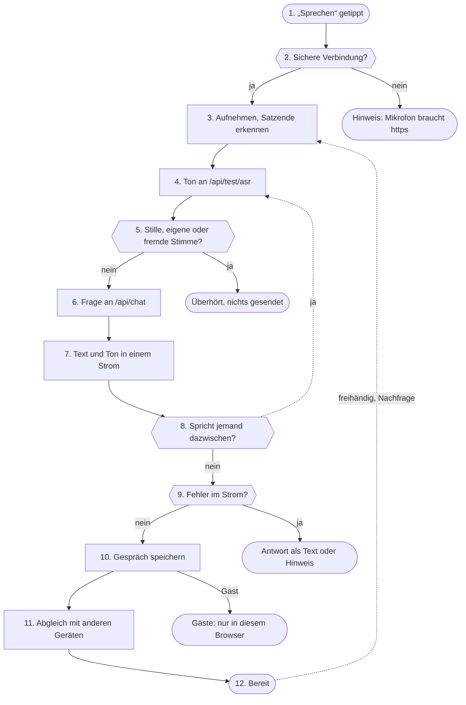

1. <a id="kn-geraet-s1"></a>**„Sprechen“ getippt**: startListening holt das Mikrofon und merkt sich, wie es aufging: von Hand, nach einer Antwort (Nachfrage), freihändig oder durch Dazwischenreden. Ein Mikrofon, das die Seite selbst geöffnet hat, nimmt später nur eine bekannte Stimme an.
2. <a id="kn-geraet-s2"></a>**Sichere Verbindung?**: Browser geben das Mikrofon nur auf einer sicheren Seite frei. Ohne https zeigt die Seite einen Hinweis mit der https-Adresse des Panels und nimmt nichts auf.
3. <a id="kn-geraet-s3"></a>**Aufnehmen, Satzende erkennen**: MediaRecorder nimmt auf, ein Pegelmesser hört auf Stille. Etwa jede Sekunde geht die Aufnahme bis jetzt zur Spracherkennung und erscheint als blasse Blase. Endet der Satz mit Punkt, Frage- oder Ausrufezeichen, ist die Frage sofort fertig; endet er auf „und“, „weil“, „ähm“ oder einem Komma, wartet die Seite etwas länger.
4. <a id="kn-geraet-s4"></a>**Ton an /api/test/asr**: Die Seite wandelt die Aufnahme in ein einfaches WAV in Mono (sonst geht das Original). Der Spark prüft das Rate-Limit (240 pro Minute für ein Profil, Gäste höchstens 3 gleichzeitig), liest höchstens 50 MB und schickt den Ton an die Spracherkennung. Nebenher misst er auf der CPU, wie viel davon Stimme ist und wessen Stimme es ist.
5. <a id="kn-geraet-s5"></a>**Stille, eigene oder fremde Stimme?**: Feste Regeln, kein Modell: ein „Ja“ aus Stille oder einem Klick (stille.check), die eigene Stimme des Spark von einem anderen Gerät (echo.check) und bei selbst geöffnetem Mikrofon eine fremde Stimme, etwa vom Fernseher (fremdstimme.check), sind keine Frage. Die Antwort ist dann leerer Text mit dem Grund.
6. <a id="kn-geraet-s6"></a>**Frage an /api/chat**: Die Seite schickt die letzten Nachrichten des offenen Gesprächs, seine Kennung, Stimme, Tempo und, wenn die Stimme erkannt wurde, ein signiertes Einmal-Token. Der Spark prüft das Rate-Limit (120 pro Minute für ein Profil, Gäste höchstens 4 gleichzeitig), lässt Hintergrundarbeit warten (vorrang) und sagt den anderen offenen Seiten des Profils „antwortet gerade“ (nur die Art des Geräts).
7. <a id="kn-geraet-s7"></a>**Text und Ton in einem Strom**: Die Antwort kommt als Ereignisse: Textstücke, Tonstücke, Suche, Quellen, Rückfragen, Fehler. Der Text wird höchstens einmal pro Bild neu gezeichnet. Der Ton läuft in einem eigenen Audio-Kontext mit der Rate der Sprachausgabe; jedes Stück endet mit einer kurzen Blende, damit die Nähte nicht knacken.
8. <a id="kn-geraet-s8"></a>**Spricht jemand dazwischen?**: Während die Antwort spielt, hört das Mikrofon weiter. Ist der Pegel eine Weile deutlich über der eigenen Ausgabe und dem Raum (Fernseher), bricht die Antwort ab, und die schon laufende Aufnahme wird die nächste Frage.
9. <a id="kn-geraet-s9"></a>**Fehler im Strom?**: Ein Fehler erscheint unter der Antwort in einfachen Worten; der Admin sieht zusätzlich die technische Angabe, Gäste nur die Art des Fehlers. Fehlt nur die Sprachausgabe, bleibt die Antwort als Text.
10. <a id="kn-geraet-s10"></a>**Gespräch speichern**: Bei einem Profil schickt die Seite nur die neuen Nachrichten (PUT /api/profile/convos mit „add“). Der Spark hängt sie unter einer Sperre an seine Kopie an, damit ein anderes Gerät nichts überschreibt, und behält höchstens 50 Gespräche mit je 60 Nachrichten.
11. <a id="kn-geraet-s11"></a>**Abgleich mit anderen Geräten**: Kommt die Seite wieder nach vorn und regelmäßig dazwischen, fragt sie, was sich seit dem letzten Mal geändert hat; ein anderswo gelöschtes Gespräch schließt sich. Mit dem Sofort-Abgleich hält jede sichtbare Seite einen Ereignis-Strom offen, der nur „Gespräch geändert“ und „antwortet gerade“ meldet, nie Inhalte (höchstens 8 pro Profil, je 30 Minuten); eine verdeckte Seite schließt ihn, um den Akku zu schonen, und fragt beim Zurückkommen nach.
12. <a id="kn-geraet-s12"></a>**Bereit**: Die Seite wartet, bis die Antwort ausgesprochen ist. Freihändig oder nach einer gesprochenen Frage mit Nachfrage-Fenster öffnet sie das Mikrofon wieder.

**Beispiele:** Gesprochene Frage eines Profils: Antwort gehört, auf dem Spark gespeichert, auf den anderen Geräten sichtbar. · Panel über http geöffnet: Kein Mikrofon: die Seite zeigt die https-Adresse. · Fernseher im Nachfrage-Fenster: Überhört: fremde Stimme, es geht keine Frage raus. · Dazwischenreden: Die Antwort bricht ab, das Gesagte wird die nächste Frage.

#### Regeln

Gilt bei: [Schritt 6](#kn-geraet-s6), [Schritt 10](#kn-geraet-s10)

| Wer | Gespräche liegen | Fragen pro Minute | gleichzeitig |
|---|---|---|---|
| Profil | auf dem Spark, gleich auf jedem Gerät | 120 | ohne feste Grenze |
| Gast | nur in diesem Browser | 30 | 4 Gäste zusammen |

#### Zahlen (aus dem Code)

- **50 MB** größte Aufnahme ([Schritt 4](#kn-geraet-s4))
- **120** Fragen pro Minute und Profil ([Schritt 4](#kn-geraet-s4), [Schritt 6](#kn-geraet-s6))
- **4** Gäste gleichzeitig im Chat ([Schritt 4](#kn-geraet-s4), [Schritt 6](#kn-geraet-s6))
- **50** Gespräche pro Profil ([Schritt 10](#kn-geraet-s10))
- **4 MB** größtes Gespräch beim Speichern ([Schritt 10](#kn-geraet-s10))
- **8** offene Seiten mit Sofort-Abgleich pro Profil ([Schritt 11](#kn-geraet-s11))

#### Einstellen

- Ich → Gespräch: die Gesprächs-Einstellungen des Profils, etwa Freihändig und Unterbrechen.
- Funktionen → Verlauf sofort abgleichen: der Ereignis-Strom zwischen den offenen Seiten (Standard aus).

#### Was du siehst

- Unter jeder Antwort: Zeiten für Spracherkennung, erstes Wort, ersten Ton und Aussetzer der Sprachausgabe.
- Logs → Anfragen: jede Frage mit Eingang „Browser“ und ihren Schritten, ohne Inhalt.
- Zustand → Live: die laufende Anfrage im Bild.

#### Im Code

- `app/panel/admin.py` `test_asr`: Rate-Limit, Gast-Plätze, dann die Erkennung ([Schritt 4](#kn-geraet-s4))
- `app/panel/admin.py` `_test_asr`: Spracherkennung mit Stille-, Echo- und Fremdstimmen-Prüfung ([Schritt 4](#kn-geraet-s4), [Schritt 5](#kn-geraet-s5))
- `app/panel/admin.py` `read_audio`: liest die Aufnahme mit Größengrenze ([Schritt 4](#kn-geraet-s4))
- `app/panel/stille.py` `check`: Stille wird nie zu Worten ([Schritt 5](#kn-geraet-s5))
- `app/panel/echo.py` `check`: die eigene Stimme des Spark ist keine Frage ([Schritt 5](#kn-geraet-s5))
- `app/panel/chat.py` `chat`: Grenzen, Vorrang, „antwortet gerade“, dann der Strom ([Schritt 6](#kn-geraet-s6), [Schritt 7](#kn-geraet-s7))
- `app/panel/account.py` `profile_save_convo`: speichert nur die neuen Nachrichten ([Schritt 10](#kn-geraet-s10))
- `app/panel/account.py` `profile_convos`: Liste und Änderungen seit ?since= ([Schritt 11](#kn-geraet-s11))
- `app/panel/profiles.py` `append_convo`: hängt unter Sperre an ([Schritt 10](#kn-geraet-s10))
- `app/panel/profiles.py` `_clean_convo`: prüft und kürzt ein Gespräch; eine Beschreibung des Bildschirms (bedienen.look) wird nur als Hinweis gespeichert ([Schritt 10](#kn-geraet-s10))
- `app/panel/verlauf.py` `stream`: der Sofort-Abgleich je offener Seite ([Schritt 11](#kn-geraet-s11))
- `app/panel/sse.py` `Hub.stream`: ein Strom je Seite: Warteschlange, Lebenszeichen, Aufräumen ([Schritt 11](#kn-geraet-s11))
- `app/panel/verlauf.py` `begin`: „antwortet gerade“ für die anderen Seiten ([Schritt 6](#kn-geraet-s6), [Schritt 11](#kn-geraet-s11))

Selbsttests: `test_verlauf_sync`, `test_stille`, `test_echo`, `test_fremdstimme`, `test_follow_up`

### Apps

Die iPhone-App bekommt beim Koppeln einen eigenen Geräteschlüssel des Profils und spricht damit dieselben Endpunkte an wie der Browser. Der Schlüssel öffnet nur eine feste Liste von Pfaden. Die Android-App hat keinen eigenen Schlüssel: sie zeigt das Panel in einer WebView und meldet sich an wie ein Browser.

**Warum:** Ein Handy geht verloren oder wird weitergegeben. Deshalb kann ein App-Schlüssel nur fragen und zuhören, nie Konto, Geräte oder Sicherheit ändern, und er hört sofort auf zu gelten, wenn das Gerät im Panel entfernt oder die App ausgeschaltet wird.

#### Ablauf

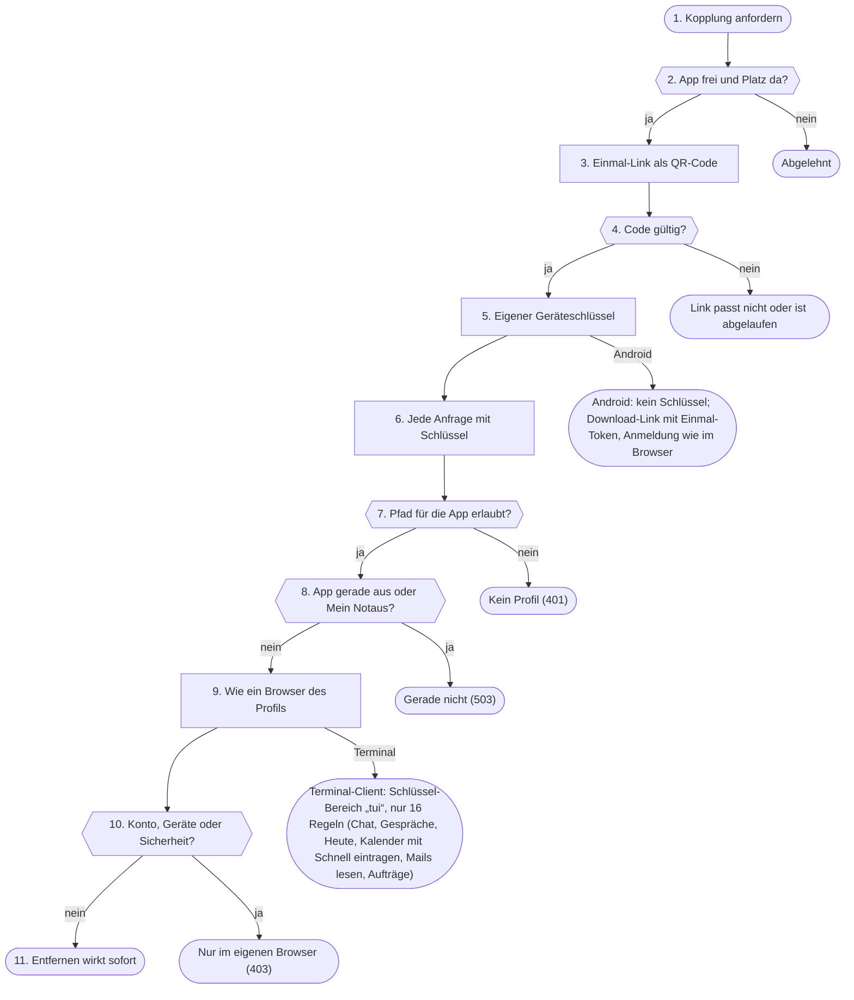

1. <a id="kn-apps-s1"></a>**Kopplung anfordern**: Nur die eigene Browser-Anmeldung des Profils darf koppeln, nie ein Geräteschlüssel. Hat das Profil einen zweiten Anmeldeschritt, braucht es dafür einen Code, denn ein neuer Weg ins Profil entsteht.
2. <a id="kn-apps-s2"></a>**App frei und Platz da?**: Die App muss vom Admin eingeschaltet und für das Profil nicht gesperrt sein, und das Profil darf höchstens 5 iPhones haben. Die Panel-Adresse muss mit https beginnen und ohne Pfad sein.
3. <a id="kn-apps-s3"></a>**Einmal-Link als QR-Code**: kopplung.py macht einen zufälligen Code (144 Bit); im Speicher liegt nur sein Hash. Ein Profil hat höchstens 3 offene Codes, der Spark höchstens 20. Der Link spark-app://pair öffnet die App mit Adresse und Code.
4. <a id="kn-apps-s4"></a>**Code gültig?**: Die App schickt den Code. Der Spark prüft das Rate-Limit (10 pro Minute und Adresse), vergleicht den Hash zeitkonstant und löscht den Code beim ersten Treffer. Ein abgelaufener oder schon benutzter Code passt nie. Ist es kein Link-Code, prüft pruefzugang.py einen getippten Prüf-Code für Apples Prüfung (12 Zeichen, 14 Tage, höchstens 5 iPhones, nur bei eingeschaltetem Prüfzugang); falsche Prüf-Codes sperren die Adresse wie falsche PINs.
5. <a id="kn-apps-s5"></a>**Eigener Geräteschlüssel**: profiles.add_device erzeugt den Schlüssel und speichert nur seinen SHA-256-Hash in profiles.json. Die App bekommt ihn genau einmal und legt ihn im Schlüsselbund ab.
6. <a id="kn-apps-s6"></a>**Jede Anfrage mit Schlüssel**: profiles.current sucht den Hash des Schlüssels in der Geräteliste. Ein Geräteschlüssel geht vor dem Cookie; das Profil kommt so immer aus dem Schlüssel, nie aus dem, was die App schreibt.
7. <a id="kn-apps-s7"></a>**Pfad für die App erlaubt?**: Ein App-Schlüssel gilt nur für die 70 Pfade in profiles.APP_PATHS (Chat, Spracherkennung, Gespräche, Erinnerungen, Chats, Anrufe …), ein paar Lese-Muster, die Panel-Bereiche (Admin-Schalter iPhone-App mit Panel) und „Meine Sachen“ (iphone.THINGS, je Teil nur mit der Freigabe seiner eigenen Funktion). Alles andere sieht er ohne Profil.
8. <a id="kn-apps-s8"></a>**App gerade aus oder Mein Notaus?**: Ist die App vom Admin aus- oder für das Profil gesperrt, oder hat das Profil Mein Notaus an, gibt es für diese Anfrage kein Profil. Die App bekommt „gerade nicht“ (503), behält ihre Kopplung und geht wieder, sobald der Schalter zurück ist.
9. <a id="kn-apps-s9"></a>**Wie ein Browser des Profils**: Die App fragt über dieselben Endpunkte wie die Seite, mit denselben Grenzen. Was sie zusätzlich darf (Smart Home, CarPlay, Zuhören, Dokumente, Bilder), sagt ihr der Spark in /api/iphone/hello; die App zeigt es nur an und hält sich daran. Anrufe zwischen Profilen klingeln über einen VoIP-Push von Apple, der nur die zufällige Nummer des Anrufs trägt; wer anruft, fragt die App beim Spark nach. Für private Chats macht die App ihren eigenen Schlüssel im Secure Enclave; der Spark bekommt nur die öffentliche Hälfte. Das Blatt der Android-App über anderen Apps fragt als Gerät „android“, nur solange „Android: Spark als Assistent“ freigegeben ist (android.assist_gate). Ob die App den letzten Stand der Seiten behalten darf, sagt hello mit „keep“ (appmerken.keep); bei Nein löscht sie ihn. Mit „Mitteilung ans genutzte Gerät“ sagen App und Seiten jede Minute nur, ob sie gerade benutzt werden (POST /api/zustellung/da, der Begleiter mit seiner Leerlaufzeit); zustellung.pick schickt eine Mitteilung dann an das Gerät mit der letzten Eingabe der letzten 120 Sekunden, sonst gleich an die Handy-App. Hat niemand sie gesehen, schickt zustellung.follow sie nach 5 Minuten einmal aufs Handy; ein angetippter Hinweis meldet „gesehen“, und mit der Antwort „zu“ räumen Seiten und iPhone Erledigtes weg.
10. <a id="kn-apps-s10"></a>**Konto, Geräte oder Sicherheit?**: Endpunkte, die Verbindungen, Geräte oder Sicherheit des Profils ändern, nehmen nur die eigene Browser-Anmeldung (core.browser_profile). Einen Geräteschlüssel lehnen sie ab, außer in einem Bereich, den das Profil der App freigegeben hat; Geheimnisse brauchen dort zusätzlich einen frischen Code.
11. <a id="kn-apps-s11"></a>**Entfernen wirkt sofort**: Wird das iPhone im Panel entfernt, verschwindet der Hash aus der Geräteliste. Die nächste Anfrage der App findet kein Profil mehr.

**Beispiele:** iPhone koppeln und fragen: Die App hat ihren Schlüssel und fragt wie der Browser. · Alter QR-Code: Abgelehnt: der Code war schon benutzt oder abgelaufen. · App will die PIN ändern: Abgelehnt: das geht nur im eigenen Browser. · Admin schaltet die App aus: Gerade nicht: die Kopplung bleibt für später.

#### Regeln

Gilt bei: [Schritt 6](#kn-apps-s6), [Schritt 7](#kn-apps-s7)

| Schlüssel-Bereich | Wer ihn hat | Was er öffnet |
|---|---|---|
| app | iPhone-App | profiles.APP_PATHS und freigegebene Bereiche |
| watch | Pebble-Uhr | nur /api/watch/… |
| tui | Terminal-Client spark-tui | terminal.TUI_RULES: Chat, Gespräche, Heute, Kalender, Aufträge |
| desk, write | Spark-Begleiter, Schreibhilfe | nur ihre eigenen Pfade |
| ohne | Lautsprecher, Siri-Kurzbefehl, eigene Skripte | fragen wie das Profil, nie Konto oder Sicherheit |
| kein Schlüssel | Android-App | Anmeldung wie ein Browser |

#### Zahlen (aus dem Code)

- **10** Minuten gilt ein Kopplungs-Code ([Schritt 3](#kn-apps-s3))
- **5** iPhones pro Profil ([Schritt 2](#kn-apps-s2))
- **70** feste Pfade für den App-Schlüssel ([Schritt 7](#kn-apps-s7))
- **30** Minuten gilt ein Android-Download-Link ([Schritt 3](#kn-apps-s3))
- **5** Downloads pro Android-Link ([Schritt 3](#kn-apps-s3))
- **10** Minuten gilt eine Kopplungszeile fürs Terminal ([Schritt 3](#kn-apps-s3))
- **5** Terminals pro Profil ([Schritt 2](#kn-apps-s2))
- **120** Sekunden nach der letzten Eingabe gilt ein Gerät als benutzt ([Schritt 9](#kn-apps-s9))
- **5** Minuten bis eine ungesehene Mitteilung aufs Handy nachkommt ([Schritt 9](#kn-apps-s9))

#### Einstellen

- Funktionen → iPhone-App und Funktionen → Android-App: die Apps für alle Profile (Standard aus).
- Personen und Geräte → Gesperrte Funktionen: die App für einzelne Profile sperren.
- Ich → iPhone und Ich → Android: koppeln, Rechte der App, Geräte entfernen.
- Funktionen → Terminal-Client und Ich → Terminal: Programm holen, koppeln (zu Hause gepinnt, extern wie im Browser geprüft), entfernen.

#### Was du siehst

- Zustand → Live: eine Zeile unter Ereignisse, wenn ein iPhone gekoppelt oder entfernt wird.
- Logs → Anfragen: Fragen der App mit Eingang „iPhone-App“ oder „CarPlay“, vom Android-Blatt „Android-App“.
- iPhone → Einstellungen → Ton-Protokoll kopieren: die letzten 150 Schritte von Ton und CarPlay (Sprechfenster, Knöpfe, Tonweg, Unterbrechungen, App-Start), nur feste Wörter, bleibt auf dem iPhone.
- Zustand → Live: offene Terminals als Anzahl unter Verbindungen. Zustand → Logs: im Bereich „Apps“ die „terminal:“-Zeilen.

#### Im Code

- `app/panel/iphone.py` `profile_pair`: Kopplungslink nur aus dem eigenen Browser ([Schritt 1](#kn-apps-s1), [Schritt 2](#kn-apps-s2))
- `app/panel/kopplung.py` `Codes.new`: zufälliger Einmal-Code, nur der Hash (auch Pebble, Schreibhilfe, Begleiter) ([Schritt 3](#kn-apps-s3))
- `app/panel/kopplung.py` `Codes.take`: Code einmal einlösen, zeitkonstant verglichen ([Schritt 4](#kn-apps-s4))
- `app/panel/iphone.py` `app_pair`: der erste Kontakt der App ([Schritt 4](#kn-apps-s4), [Schritt 5](#kn-apps-s5))
- `app/panel/iphone.py` `app_hello`: was die App darf, entscheidet der Spark ([Schritt 9](#kn-apps-s9))
- `app/panel/profiles.py` `add_device`: Schlüssel erzeugen, Hash speichern ([Schritt 5](#kn-apps-s5))
- `app/panel/profiles.py` `current`: Profil aus Schlüssel oder Cookie, Bereiche, Schalter, Notaus ([Schritt 6](#kn-apps-s6))
- `app/panel/profiles.py` `_app_path`: die feste Pfadliste der App ([Schritt 7](#kn-apps-s7))
- `app/panel/core.py` `browser_profile`: nur die eigene Browser-Anmeldung ([Schritt 10](#kn-apps-s10))
- `app/panel/account.py` `profile_remove_device`: Gerät entfernen ([Schritt 11](#kn-apps-s11))
- `app/panel/android.py` `apk_response`: App-Datei nur mit gültigem Link ([Schritt 3](#kn-apps-s3))
- `app/panel/android.py` `flags`: was die Android-App selbst einschaltet: Assistent, Fingerabdruck ([Schritt 9](#kn-apps-s9))
- `app/panel/android.py` `assist_gate`: Fragen des Android-Blatts nur mit Freigabe, nie Gäste ([Schritt 9](#kn-apps-s9))
- `app/panel/zustellung.py` `pick`: Mitteilung ans benutzte Gerät, sonst an die Handy-App ([Schritt 9](#kn-apps-s9))
- `app/panel/zustellung.py` `api_da`: nur „gerade benutzt“ oder „weg“, nur Seiten und Apps ([Schritt 9](#kn-apps-s9))
- `app/panel/zustellung.py` `follow`: einmal aufs Handy nachfassen, nie ein drittes Mal ([Schritt 9](#kn-apps-s9))
- `app/panel/terminal.py` `profile_pair`: Kopplungszeile fürs Terminal nur aus dem eigenen Browser ([Schritt 1](#kn-apps-s1), [Schritt 2](#kn-apps-s2))
- `app/panel/terminal.py` `setup_base`: zu Hause gepinnt, extern nur https ([Schritt 3](#kn-apps-s3))
- `app/panel/terminal.py` `program_pair`: der erste Kontakt des Terminals ([Schritt 4](#kn-apps-s4), [Schritt 5](#kn-apps-s5))
- `app/panel/terminal.py` `reaches`: die feste Regelliste des Terminals ([Schritt 7](#kn-apps-s7))

Selbsttests: `test_iphone`, `test_iphone_panel`, `test_android`, `test_app_notaus`, `test_kopplung`, `test_terminal`, `test_zustellung`

### Telegram, Siri, Uhr

Telegram, der Siri-Kurzbefehl und die Pebble-Uhr stellen kurze Fragen ohne Browser. Jeder Kanal baut daraus eine Anfrage an /api/chat wie ein Gerät, sammelt die Antwort aus dem Strom ein und gibt sie in seiner Form zurück. Den Verlauf speichert das Panel selbst im Profil.

**Warum:** Die Kanäle sollen nichts eigenes entscheiden: dieselben Rechte, Sperren und Grenzen wie im Browser gelten, weil alles durch denselben Chat läuft. Was ein Kanal zusätzlich mitbringt (fremde weitergeleitete Texte, Telegrams Server), wird vorher fest geregelt.

#### Ablauf

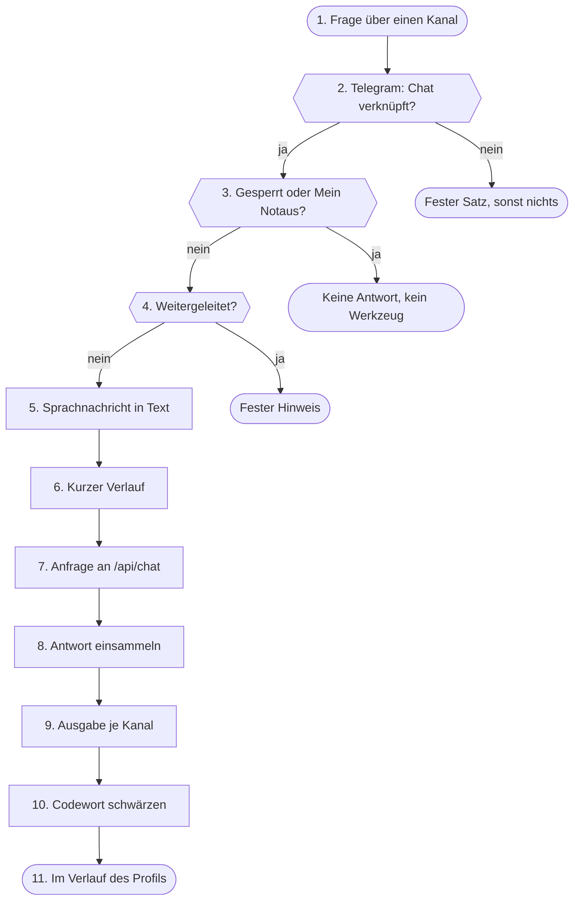

1. <a id="kn-kanaele-s1"></a>**Frage über einen Kanal**: Telegram: das Panel fragt Telegram selbst nach neuen Nachrichten (Long Polling), es braucht keinen offenen Port. Siri: ein Kurzbefehl schickt den diktierten Text mit einem Geräteschlüssel an /api/siri/ask. Uhr: das Handy schickt die Frage mit dem Uhr-Schlüssel an /api/watch/ask.
2. <a id="kn-kanaele-s2"></a>**Telegram: Chat verknüpft?**: Gruppen und Kanäle werden nie beantwortet. Ein Chat gehört zu einem Profil, wenn er „/start CODE“ mit einem Code aus Ich → Telegram geschickt hat (gilt 10 Minuten, höchstens 5 falsche Codes pro Chat und Stunde). Ein fremder Chat bekommt höchstens einmal am Tag einen festen Satz.
3. <a id="kn-kanaele-s3"></a>**Gesperrt oder Mein Notaus?**: Mein Notaus des Profils, eine Sperre durch den Admin oder ein ausgeschalteter Kanal beenden die Frage. Telegram antwortet dann mit einem festen Satz; Siri und die Uhr finden zu ihrem Schlüssel kein Profil.
4. <a id="kn-kanaele-s4"></a>**Weitergeleitet?**: Eine in Telegram weitergeleitete Nachricht stammt von jemand anderem. Sie wird nie als Auftrag genommen und schaltet auch keine Befehle wie /notaus.
5. <a id="kn-kanaele-s5"></a>**Sprachnachricht in Text**: Eine Telegram-Sprachnachricht wird mit Größengrenze geladen, mit ffmpeg zu WAV gewandelt (Länge begrenzt) und von der Spracherkennung des Spark gelesen. Bei Siri diktiert das iPhone, bei der Uhr das Handy.
6. <a id="kn-kanaele-s6"></a>**Kurzer Verlauf**: Für Nachfragen gehen die letzten acht Nachrichten mit, solange die letzte Frage nicht länger her ist als 30 Minuten (Telegram) oder 10 Minuten (Siri). Die Uhr schickt ihren Verlauf selbst; Antworten aus fremdem Text erkennt das Panel daran wieder (watch.mark_of).
7. <a id="kn-kanaele-s7"></a>**Anfrage an /api/chat**: Der Kanal ruft den Chat im Panel selbst auf. Bei Telegram setzt das Panel das Profil in die Anfrage, was keine Anfrage von außen kann; Siri und die Uhr tragen ihren Schlüssel. Rechte, Weiche, Grenzen und Anfrage-Verlauf sind dieselben wie im Browser.
8. <a id="kn-kanaele-s8"></a>**Antwort einsammeln**: Aus dem Strom zählen Textstücke und Rücknahmen. Kam die Antwort aus Mail oder fremdem Text, wird sie so markiert, damit die nächste Frage gesperrt beginnt. Eine Rückfrage des Panels wird in Telegram zu Knöpfen, die wie eine getippte Antwort zurückkommen; ohne Rückfrage werden die Beispielsätze von „Das kannst du auch sagen“ zu Antworttasten.
9. <a id="kn-kanaele-s9"></a>**Ausgabe je Kanal**: Telegram bekommt reinen Text und, wenn das Profil es will, eine Sprachnachricht in seiner Stimme. Siri bekommt vorlesbaren Text ohne Passwörter und Codes. Die Uhr holt Text und Ton (auf 6000 Bytes je Abruf, für ihren kleinen Lautsprecher gepackt) über /api/watch/poll, nur das Profil, das gefragt hat (fremde Auftrags-Nummern geben 404); höchstens 8 Uhr-Antworten laufen gleichzeitig. Der Begleiter bekommt Text ohne Markdown und zusätzlich die Antwort mit Markdown (höchstens 60000 Zeichen), wenn darin nicht weniger Geheimnisse verdeckt sind. Mit ihren Schaltern bekommt die Uhr außerdem bis zu 3 Nachfragen zum Antippen (das Modell schlägt nur vor, watch.follow_clean lässt nur kurze Fragen ohne Ja, Nein, Links oder Zahlen durch; nie nach Mail, Web oder einem Vorschlag; endet die Antwort mit einer Frage, sind deren Knöpfe aus ablauf.asks die Nachfragen), einen Vorschlag als ✓ und ✕ und über /api/watch/sync die Schnellbefehle und die nächsten 8 Erinnerungen, die sie selbst als Wecker klingeln lässt; Push wartet zuerst auf sie. Das Spark-Zifferblatt holt alle 15 Minuten über /api/watch/blick den nächsten Termin, die nächste Erinnerung, das Wetter, einen Tipp und für Admins einen Ausfall; /api/watch/brief baut Mein Tag und Meine Woche aus festen Sätzen, /api/watch/merken legt einen diktierten Satz ins Gedächtnis (mit Ort auf etwa 100 m nur mit eigenem Schalter). /api/watch/chats und /api/watch/chat zeigen die letzten Chats (ohne private) und schicken eine angetippte oder diktierte Antwort über chats.send; bis zu 3 Vorschläge des Modells prüft pebblewatch.reply_clean fest. /api/watch/fern schaltet nur Geräte der eigenen Liste mit festen Tasten (nie mit Smart-Home-Codewort), /api/watch/gesundheit legt Schritte, Puls und Schlaf versiegelt ins Profil, nie für das Modell.
10. <a id="kn-kanaele-s10"></a>**Codewort schwärzen**: Vor dem Speichern wird das Smart-Home-Codewort durch [Codewort] ersetzt. In Telegram löscht der Bot die Nachricht mit dem Codewort oder bittet darum, sie zu löschen.
11. <a id="kn-kanaele-s11"></a>**Im Verlauf des Profils**: verlauf.keep legt Frage und Antwort in das Tagesgespräch des Kanals („Telegram“, „Siri“, „Uhr“ mit Datum). Mit „Ein Gespräch für alle Kanäle“ landen sie im Hauptgespräch des Tages, markiert mit ihrem Kanal.

**Beispiele:** Telegram-Sprachnachricht: Beantwortet und im Gespräch „Telegram“ des Tages gespeichert. · Fremder schreibt dem Bot: Ein fester Satz, sonst nichts. · Weitergeleitete Mail mit Auftrag: Nicht ausgeführt: fremde Worte sind kein Auftrag. · Siri bei Mein Notaus: Keine Antwort: der Schlüssel findet kein Profil.

#### Regeln

Gilt bei: [Schritt 1](#kn-kanaele-s1), [Schritt 9](#kn-kanaele-s9), [Schritt 11](#kn-kanaele-s11)

| Kanal | Wie er sich ausweist | Verlauf | Ausgabe |
|---|---|---|---|
| Telegram | verknüpfter privater Chat | „Telegram“ und Datum | Text, auf Wunsch Sprachnachricht |
| Siri | Geräteschlüssel des Profils | „Siri“ und Datum | vorlesbarer Text ohne Geheimnisse |
| Uhr | Uhr-Schlüssel, nur /api/watch/… | „Uhr“ und Datum | Text ohne Markdown und Ton |

#### Zahlen (aus dem Code)

- **10** Minuten gilt ein Telegram-Code ([Schritt 2](#kn-kanaele-s2))
- **5** falsche Codes pro Chat und Stunde ([Schritt 2](#kn-kanaele-s2))
- **5 MB** größte Sprachnachricht ([Schritt 5](#kn-kanaele-s5))
- **10** Minuten zählen bei Siri frühere Fragen ([Schritt 6](#kn-kanaele-s6))
- **8** Uhr-Antworten gleichzeitig ([Schritt 9](#kn-kanaele-s9))
- **10** Minuten bleibt eine Uhr-Antwort abrufbar ([Schritt 9](#kn-kanaele-s9))
- **3** Nachfragen zum Antippen auf der Uhr ([Schritt 9](#kn-kanaele-s9))
- **8** Erinnerungen und Timer auf der Uhr ([Schritt 9](#kn-kanaele-s9))

#### Einstellen

- Funktionen → Telegram: Bot-Token und Schalter (Standard aus).
- Ich → Telegram: den eigenen Chat verknüpfen; Sprachnachrichten, private Daten, Smart Home und Mitteilungen einzeln erlauben.
- Ich → Pebble-Uhr: die Uhr koppeln, die Adresse unterwegs (nur https), die Schnellbefehle, die Geräte der Fernbedienung und die eigenen Schritte, Puls und Schlaf (ansehen, löschen).
- Funktionen → Pebble-Uhr: Nachfragen, Schnellbefehle, Erinnerungen am Handgelenk, Spark-Zifferblatt, Mein Tag und meine Woche, Meldungen für Admins, Schnell merken und Ort beim Merken, Nachrichten, Antwortvorschläge, Fernbedienung, Schritte, Puls und Schlaf, je ein Schalter (Standard aus).
- Funktionen → Ein Gespräch für alle Kanäle: alle Kanäle schreiben ins Hauptgespräch des Tages.

#### Was du siehst

- Logs → Anfragen: Eingang „Telegram“, „Siri“ oder „Uhr“, ohne Inhalt.
- Zustand → Live: die laufende Anfrage im Bild.
- Zustand → Logs: die Zeilen „watch: sync“, „watch: reminder …“ und „watch: Nachfragen“, ohne Inhalt.

#### Im Code

- `app/panel/telegram.py` `loop`: fragt Telegram, ruht bei Notaus ([Schritt 1](#kn-kanaele-s1))
- `app/panel/telegram.py` `handle`: eine Nachricht: Verknüpfung, Sperren, Befehle, Sprache ([Schritt 2](#kn-kanaele-s2), [Schritt 3](#kn-kanaele-s3), [Schritt 4](#kn-kanaele-s4))
- `app/panel/telegram.py` `ask`: Frage an den Chat, Antwort einsammeln, speichern ([Schritt 7](#kn-kanaele-s7), [Schritt 8](#kn-kanaele-s8), [Schritt 11](#kn-kanaele-s11))
- `app/panel/telegram.py` `transcribe`: Sprachnachricht über ffmpeg zur Spracherkennung ([Schritt 5](#kn-kanaele-s5))
- `app/panel/chat.py` `siri_ask`: Siri: Profil aus dem Schlüssel ([Schritt 1](#kn-kanaele-s1), [Schritt 3](#kn-kanaele-s3))
- `app/panel/chat.py` `text_ask`: Siri und Begleiter: Frage, Antwort, Verlauf, beim Begleiter dazu die Karten (desk_cards) ([Schritt 6](#kn-kanaele-s6), [Schritt 7](#kn-kanaele-s7), [Schritt 11](#kn-kanaele-s11))
- `app/panel/chat.py` `watch_ask`: Uhr: Antwort als Auftrag starten ([Schritt 1](#kn-kanaele-s1), [Schritt 7](#kn-kanaele-s7))
- `app/panel/chat.py` `_watch_run`: Uhr: Antwort in den Verlauf ([Schritt 11](#kn-kanaele-s11))
- `app/panel/watch.py` `run`: liest den Strom in den Uhr-Auftrag ([Schritt 8](#kn-kanaele-s8))
- `app/panel/watch.py` `poll`: Text und Ton stückweise ([Schritt 9](#kn-kanaele-s9))
- `app/panel/watch.py` `follow_ups`: Nachfragen vom Modell, mit Zeitgrenze ([Schritt 9](#kn-kanaele-s9))
- `app/panel/watch.py` `follow_clean`: feste Prüfung der Nachfragen ([Schritt 9](#kn-kanaele-s9))
- `app/panel/pebblewatch.py` `watch_sync`: Schnellbefehle und Erinnerungen für die Uhr ([Schritt 9](#kn-kanaele-s9))
- `app/panel/pebblewatch.py` `watch_reminder`: Erinnerung auf der Uhr: gespielt, später, beenden, +1, Stopp ([Schritt 9](#kn-kanaele-s9))
- `app/panel/pebblewatch.py` `watch_blick`: was das Spark-Zifferblatt zeigt ([Schritt 9](#kn-kanaele-s9))
- `app/panel/pebblewatch.py` `watch_brief`: Mein Tag und Meine Woche, feste Sätze ([Schritt 9](#kn-kanaele-s9))
- `app/panel/pebblewatch.py` `watch_note`: Schnell merken ins Gedächtnis ([Schritt 9](#kn-kanaele-s9))
- `app/panel/pebblewatch.py` `watch_chat`: ein Chat auf der Uhr, mit Antworten ([Schritt 9](#kn-kanaele-s9))
- `app/panel/pebblewatch.py` `watch_chat_send`: Antwort von der Uhr in den Chat ([Schritt 9](#kn-kanaele-s9))
- `app/panel/pebblewatch.py` `reply_clean`: feste Prüfung der Antwortvorschläge ([Schritt 9](#kn-kanaele-s9))
- `app/panel/pebblewatch.py` `watch_remote_act`: Fernbedienung: eigene Liste, feste Tasten ([Schritt 9](#kn-kanaele-s9))
- `app/panel/pebblewatch.py` `watch_health`: Schritte, Puls, Schlaf versiegelt ins Profil ([Schritt 9](#kn-kanaele-s9))
- `app/panel/verlauf.py` `keep`: Tagesgespräch des Kanals oder Hauptgespräch ([Schritt 11](#kn-kanaele-s11))

Selbsttests: `test_telegram_tasks`, `test_pebble`, `test_verlauf_sync`, `test_notaus`

### Lautsprecher, Telefon

Eigene Lautsprecher sind ESP32-Boards mit der offenen XiaoZhi-Firmware. Sie hören auf ihr Weckwort, schicken den Ton über eine WebSocket-Verbindung an den Spark und spielen die Antwort ab. Jeder Lautsprecher ist ein Geräteschlüssel seines Profils. Home Assistant Assist nutzt über Wyoming nur Spracherkennung und Stimme des Spark.

**Warum:** Ein Lautsprecher steht im Raum, jeder kann mit ihm reden. Deshalb bekommt Persönliches nur die Stimme, die sicher als die des Profils erkannt ist (oder das Codewort sagt), und ein Board bekommt seinen Schlüssel nur einmal und nur an die Adresse, die den Code gezeigt hat.

#### Ablauf

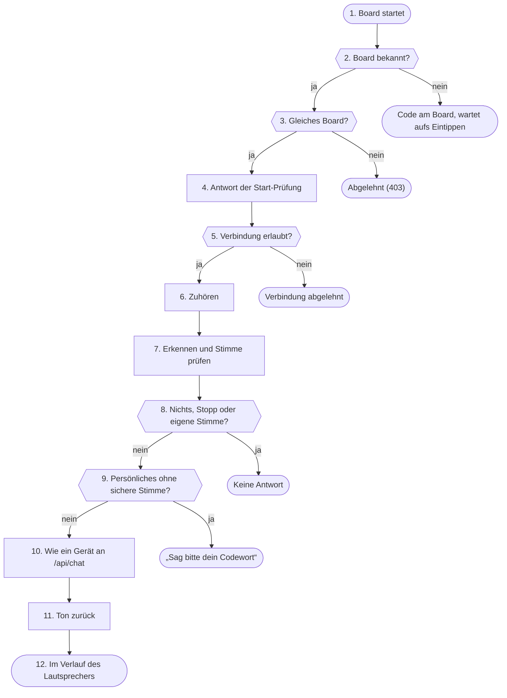

1. <a id="kn-lautsprecher-s1"></a>**Board startet**: Bei jedem Start fragt das Board mit seiner Kennung, MAC-Adresse und Firmware-Version, welchen Server und welche Firmware es nehmen soll. Sind die Lautsprecher in Funktionen aus, gibt es nichts (403).
2. <a id="kn-lautsprecher-s2"></a>**Board bekannt?**: Ein unbekanntes Board bekommt einen sechsstelligen Code für sein Display (gilt 10 Minuten, höchstens 3 pro Adresse und 30 insgesamt). Das Profil tippt ihn unter Ich → Lautsprecher ein.
3. <a id="kn-lautsprecher-s3"></a>**Gleiches Board?**: Ist zu einer Board-Kennung schon eine MAC-Adresse bekannt, muss sie passen. Eine kopierte Kennung von einem anderen Board bekommt keinen Schlüssel und keine Firmware.
4. <a id="kn-lautsprecher-s4"></a>**Antwort der Start-Prüfung**: Das Board bekommt Uhrzeit und WebSocket-Adresse. Den Schlüssel gibt es genau einmal, direkt nach dem Eintippen, und nur an die Adresse, die den Code gezeigt hat. Eine neuere Firmware wird nur über https angeboten, über http nur mit dem Schalter des Admins.
5. <a id="kn-lautsprecher-s5"></a>**Verbindung erlaubt?**: Beim Aufbau prüft der Spark: Notaus Stufe 3 aus, der Schlüssel gehört einem Lautsprecher (nicht einer Uhr oder einem anderen Gerät), Lautsprecher in Funktionen an und für das Profil nicht gesperrt. Danach schaut er alle 2.0 Sekunden wieder nach und beendet die Verbindung, wenn sich etwas geändert hat.
6. <a id="kn-lautsprecher-s6"></a>**Zuhören**: Nach dem Weckwort schickt das Board Opus-Ton. Der Spark erkennt das Satzende selbst (0.7 Sekunden Stille nach Sprache) und nimmt höchstens 30 Sekunden pro Frage.
7. <a id="kn-lautsprecher-s7"></a>**Erkennen und Stimme prüfen**: Die Spracherkennung macht Text daraus. Gleichzeitig prüft speakers.verify, ob es die Stimme des Profils ist, wenn die Sprechererkennung an ist und das Profil seine Stimme angelernt hat.
8. <a id="kn-lautsprecher-s8"></a>**Nichts, Stopp oder eigene Stimme?**: Kein Text, ein Stopp-Wort oder die eigene Stimme des Spark von einem anderen Gerät (echo.check) bekommen keine Antwort. Das Board wartet wieder auf sein Weckwort.
9. <a id="kn-lautsprecher-s9"></a>**Persönliches ohne sichere Stimme?**: Mit Codewort am Lautsprecher: eine unsichere Stimme, die nach Persönlichem fragt, wird nach dem Codewort gefragt, die Frage wartet. Nach 3 falschen Versuchen fragt der Lautsprecher 30 Minuten lang nicht mehr. Ohne sichere Stimme gibt es nur Allgemeines. Eine sichere Stimme in einer kurzen Frage ohne Persönliches bekommt die Rechte des Inhabers wie ohne Codewort.
10. <a id="kn-lautsprecher-s10"></a>**Wie ein Gerät an /api/chat**: Der Spark ruft den Chat mit dem Schlüssel des Lautsprechers auf; Stimme, Gedächtnis und Raum des Profils gelten. Wessen Stimme es war, setzt nur das Panel selbst in die Anfrage; war sie nicht sicher die des Profils, gilt die Frage wie die eines Gastes.
11. <a id="kn-lautsprecher-s11"></a>**Ton zurück**: Die Antwort geht als Opus mit 24000 Hz im Takt der Wiedergabe zum Board, der Text ohne Markdown für ein Display. Andere Geräte im Haus wissen, dass gerade der Spark spricht (echo.said).
12. <a id="kn-lautsprecher-s12"></a>**Im Verlauf des Lautsprechers**: Frage und Antwort kommen in das Tagesgespräch des Lautsprechers, das Codewort geschwärzt. Eine Stimme, die nicht sicher die des Profils war, wird als fremder Text markiert: die nächste Frage beginnt gesperrt, und daraus wird nichts über das Profil gelernt.

**Beispiele:** Inhaber fragt nach seinen Terminen: Stimme erkannt: persönliche Antwort, im Tagesgespräch gespeichert. · Neues Board: Code auf dem Display, bis das Profil ihn eintippt. · Kopierte Board-Kennung: Abgelehnt: die MAC-Adresse passt nicht. · Gast fragt nach Mails: Codewort erfragt; ohne richtiges Codewort nichts Persönliches. · Wartungspause der Sprachausgabe: Antwort auf dem Display, zu hören der kurze Wartungssatz aus einer Datei (sonst ein Ton); bei pausierter Spracherkennung sagt der Lautsprecher den Satz gleich nach dem Weckwort. · Notbetrieb mit Parakeet: Modell-Rechner weg: Parakeet auf dem Panel-Rechner hört, ein fester Befehl („Licht an“, „Wie spät ist es?“) wird ohne Modell ausgeführt; zu hören sind vorher gemachte Sätze und Bausteine (notbetrieb.ton).

#### Regeln

Gilt bei: [Schritt 5](#kn-lautsprecher-s5), [Schritt 9](#kn-lautsprecher-s9)

| Weg | Wer darf | Was geht | Persönliches |
|---|---|---|---|
| ESP32-Lautsprecher | Schlüssel eines Lautsprechers, Profil nicht gesperrt | Fragen wie das Profil | nur bei sicherer Stimme oder Codewort |
| Home Assistant Assist | Adressen in der Erlaubt-Liste des Admins | nur Ton zu Text und Text zu Ton | nie |
| Telefon, Mobilteil eines Profils | interne Nummer, vom Admin zugeordnet | Fragen wie das Profil | nur bei sicherer Stimme |
| Telefon, gemeinsames Mobilteil | interne Nummer als gemeinsam | die Stimme wählt das Profil, sonst Gast | nur bei sicherer Stimme |
| Telefon von außen oder nicht zugeordnet | niemand (Gast nur mit Admin-Schalter) | abgewiesen oder ein Satz | nie |

#### Home Assistant Assist (Wyoming)

- Ein eigener Server lauscht auf dem Wyoming-Port (Standard 31003), solange der Schalter an ist. Wyoming hat kein Passwort; deshalb antwortet er nur Adressen aus der Liste des Admins, mit leerer Liste niemandem.
- Home Assistant bekommt nur „Ton rein, Text raus“ und „Text rein, Ton raus“, kein Sprachmodell, kein Profil, nichts Persönliches. Höchstens 8 Verbindungen gleichzeitig; Längen werden geprüft, bevor gelesen wird; nur Tonformate, die ein Mikrofon schickt. „describe“ antwortet sofort mit der Stimmenliste aus dem Speicher (alle 10 Minuten neu gelesen), weil Home Assistant nur 1 Sekunde wartet.
- Abgewiesene Adressen erscheinen auf Zustand → Live unter Eingang und als Vorschlag für die Liste.

#### Den Spark anrufen (Telefon)

- Der Spark meldet sich an der Telefonanlage im Heimnetz als IP-Telefon an (SIP über UDP, Port 31060, Digest-Anmeldung, alle 10 Minuten erneuert). Nachrichten nimmt er nur von der Adresse der Anlage, höchstens 4096 Bytes und 100 je Sekunde; Ton (RTP) nur von der Adresse aus deren SDP, die im Heimnetz liegen muss. Den Ton hinaus schickt ein eigener Faden im 20-ms-Takt, unabhängig von der Ereignis-Schleife des Panels; Sprache beginnt erst, wenn 10 Pakete bereitliegen oder der Satz fertig ist, nach jeder Lücke wartet er auf mehr (höchstens 40). Die Logzeile am Ende nennt Lücken, verspätete Pakete und die Rechenzeit fürs Kodieren je Sekunde Ton.
- Ein Anruf läuft wie eine Frage am Lautsprecher: Satzende mit derselben Pegelprüfung, Spracherkennung, Stimmprüfung, Chat mit dem Profil (gesetzt nur vom Panel), Antwort in G.722 oder G.711 zurück. Ein Mobilteil eines Profils bekommt Persönliches nur bei sicherer Stimme; am gemeinsamen Telefon wählt die Stimme das Profil. Nach 20 Sekunden Stille „Noch etwas?“, nach weiteren 10 legt er auf; höchstens 15 Minuten. Ein Abschied („Tschüss“, „Danke, das war's“, „Ich lege auf“, auch mitten in der Antwort) und direkt nach „Noch etwas?“ ein „Nein danke“ beenden das Gespräch: „Tschüss!“, dann legt der Spark selbst auf (feste Wortlisten BYE_WORDS und NO_MORE, nie das Modell). Legt das Telefon auf, beendet sein BYE den Anruf sofort; kommt keins an (Router, Leitung), legt der Spark nach 8 Sekunden ohne jedes Tonpaket auf, außer das Telefon hat gehalten.
- Von außen: eine eigene Nummer, die unter Ich → Telefon auf ihren Code wartet, tippt ihn (4 Ziffern, 15 Minuten, 3 Versuche), dann legt er auf. Mit „Anrufe von außen“ wählt eine bestätigte Nummer ihr Profil, Persönliches aber nur bei sicherer Stimme oder PIN, weil sich Nummern fälschen lassen; mit „Gäste“ auch unbekannte Nummern als Gast, höchstens 20 am Tag. Logs und Live nennen nie eine Nummer von außen.
- Die Telefon-PIN (Ziffern, dann #) steht für den Rest des Gesprächs für die Stimme: am Mobilteil für dessen Profil, am gemeinsamen Telefon für das Profil, dem sie gehört. 3 falsche in 15 Minuten sperren sie an diesem Telefon 30 Minuten. Gespeichert als gesalzener Hash im Tresor; nie gesprochen, angezeigt oder im Log.
- Der Spark ruft an (Schalter „Der Spark ruft an“): Weckruf und Erinnerung, die ein Profil selbst bestellt (Werkzeug anruf_planen, nur Zeit, Art und Text, nie eine Nummer), der Rückruf und der Alarm. Er ruft nur das zugeordnete Mobilteil oder, mit „auch bestätigte eigene Nummern“, die bestätigte Nummer des Profils an; höchstens 5 Anrufe je Profil und Tag, nie bei „Nicht stören“; nicht abgehoben einmal nach 5 Minuten, dann eine Mitteilung. Eine Erinnerung liest er erst vor, wenn Stimme oder PIN passen. Rückruf: Wer von außen mit unsicherer Stimme „Ruf mich zurück“ sagt, wird unter der hinterlegten bestätigten Nummer angerufen, eine gefälschte Nummer erreicht so nie den Fälscher.
- Alarm bei Dienstausfall: Ist ein Dienst 10 Minuten oder länger weg, ruft der Spark den Admin an, höchstens einmal in 60 Minuten. Nie zwischen 22 und 7 Uhr (dienstwacht.NIGHT, für Anrufe immer), in den Ruhezeiten des Admins oder bei „Nicht stören“; ist der Dienst danach noch weg, kommt der Anruf dann.

#### Zahlen (aus dem Code)

- **10** Minuten gilt ein Kopplungs-Code ([Schritt 2](#kn-lautsprecher-s2))
- **30** Sekunden Ton pro Frage ([Schritt 6](#kn-lautsprecher-s6))
- **2.0** Sekunden, dann werden die Rechte neu geprüft ([Schritt 5](#kn-lautsprecher-s5))
- **10** Minuten zählen frühere Fragen am Lautsprecher ([Schritt 12](#kn-lautsprecher-s12))
- **3** falsche Codewörter bis zur Sperre ([Schritt 9](#kn-lautsprecher-s9))
- **8** Wyoming-Verbindungen gleichzeitig ([Schritt 5](#kn-lautsprecher-s5))
- **2** Anrufe gleichzeitig höchstens ([Schritt 5](#kn-lautsprecher-s5))
- **15** Minuten dauert ein Anruf höchstens ([Schritt 10](#kn-lautsprecher-s10))
- **3** falsche Telefon-PINs bis zur Sperre ([Schritt 9](#kn-lautsprecher-s9))
- **5** Anrufe vom Spark je Profil und Tag ([Schritt 5](#kn-lautsprecher-s5))
- **10** Minuten Ausfall bis zum Alarm-Anruf ([Schritt 5](#kn-lautsprecher-s5))

#### Einstellen

- Funktionen → Eigene Lautsprecher: Lautsprecher für alle Profile (Standard aus).
- Ich → Lautsprecher: einrichten, Code eintippen, Raum, Lautstärke, Prüfen und das eigene Codewort.
- Funktionen → Home Assistant Assist: Wyoming an und die erlaubten Adressen.
- Funktionen → Telefon: Assistent mit vier Schritten, Mobilteile zuordnen, Testanruf, Anrufe von außen, unbekannte Anrufer als Gast, der Spark ruft an, Anruf bei Dienstausfall.
- Ich → Telefon: eigene Rufnummern mit Code bestätigen, Telefon-PIN, Anrufe vom Spark erlauben und geplante löschen, Telefonate löschen.

#### Was du siehst

- Ich → Lautsprecher → Prüfen: was der Lautsprecher zuletzt getan hat (nur im Speicher, weg nach einem Neustart).
- Zustand → Live: Anfragen vom Lautsprecher und von Home Assistant, abgewiesene Wyoming-Adressen unter Eingang.
- Zustand → Live: die Telefonanlage mit angemeldet ja/nein und den Anrufen von heute in Zahlen.

#### Im Code

- `app/panel/esp32.py` `ota`: Start-Prüfung: Code, Schlüssel einmal, Update ([Schritt 1](#kn-lautsprecher-s1))
- `app/panel/esp32.py` `_activation`: sechsstelliger Code mit Grenzen ([Schritt 2](#kn-lautsprecher-s2))
- `app/panel/esp32.py` `same_board`: MAC muss passen ([Schritt 3](#kn-lautsprecher-s3))
- `app/panel/esp32.py` `speaker_ws`: Verbindung annehmen und laufend prüfen ([Schritt 5](#kn-lautsprecher-s5))
- `app/panel/esp32.py` `still_allowed`: Schalter und Gerät noch gültig ([Schritt 5](#kn-lautsprecher-s5))
- `app/panel/esp32.py` `Session.run_answer`: erkennen, filtern, Codewort, antworten ([Schritt 10](#kn-lautsprecher-s10))
- `app/panel/esp32.py` `Session.code_gate`: Codewort bei unsicherer Stimme ([Schritt 9](#kn-lautsprecher-s9))
- `app/panel/esp32.py` `Session.speak`: Chat mit dem Schlüssel, Ton zurück ([Schritt 11](#kn-lautsprecher-s11))
- `app/panel/esp32.py` `remember`: Tagesgespräch, fremde Stimme markiert ([Schritt 12](#kn-lautsprecher-s12))
- `app/panel/wyoming.py` `settings`: Schalter, Port, erlaubte Adressen ([Schritt 5](#kn-lautsprecher-s5))
- `app/panel/wyoming.py` `handle`: nur erlaubte Adressen, höchstens so viele ([Schritt 5](#kn-lautsprecher-s5))
- `app/panel/wyoming.py` `_session`: Ton zu Text und Text zu Ton ([Schritt 7](#kn-lautsprecher-s7), [Schritt 11](#kn-lautsprecher-s11))
- `app/panel/telefon.py` `Call.start`: wer anruft: intern, Profil, gesperrt, besetzt ([Schritt 5](#kn-lautsprecher-s5))
- `app/panel/telefon.py` `Call.outside`: von außen: Code, bekannte Nummer, Gast ([Schritt 5](#kn-lautsprecher-s5))
- `app/panel/telefon.py` `Call.pin`: Telefon-PIN prüfen, Sperre ([Schritt 9](#kn-lautsprecher-s9))
- `app/panel/telefon_ich.py` `try_code`: Code einer eigenen Nummer ([Schritt 5](#kn-lautsprecher-s5))
- `app/panel/telefon_ich.py` `pin_attempt`: PIN je Telefon zählen und sperren ([Schritt 9](#kn-lautsprecher-s9))
- `app/panel/telefon.py` `Call.voice_result`: Stimme wählt oder bestätigt das Profil ([Schritt 9](#kn-lautsprecher-s9))
- `app/panel/telefon.py` `Call._chat`: Chat mit dem Profil, Ton zurück ([Schritt 10](#kn-lautsprecher-s10), [Schritt 11](#kn-lautsprecher-s11))
- `app/panel/telefon.py` `Call.dial`: der Spark ruft an: INVITE, Digest, Abbruch ([Schritt 5](#kn-lautsprecher-s5))
- `app/panel/telefon_anruf.py` `target`: wen er anruft: Mobilteil oder bestätigte Nummer ([Schritt 5](#kn-lautsprecher-s5))
- `app/panel/telefon_anruf.py` `call_back`: Rückruf nur an die bestätigte Nummer ([Schritt 9](#kn-lautsprecher-s9))
- `app/panel/telefon_anruf.py` `alarm_tick`: Alarm-Anruf mit Ruhezeiten ([Schritt 5](#kn-lautsprecher-s5))

Selbsttests: `test_esp32`, `test_wyoming`, `test_telefon`, `test_notaus`, `test_echo`

### MCP-Programme

Andere Programme (Claude, n8n, Open WebUI, Home Assistant) nutzen den Spark über das Model Context Protocol unter /mcp. Jede Verbindung gehört einem Profil, hat ihren eigenen Schlüssel und ihre eigene Werkzeugliste. Lesen geht direkt, Handeln nur als Vorschlag, den das Profil bestätigt.

**Warum:** Was ein Programm schickt, ist Text von außen und nie ein Befehl. Deshalb entscheidet das Panel mit festen Listen, welches Werkzeug laufen darf, und nichts ändert sich ohne das Ja der Person im eigenen Browser.

#### Ablauf

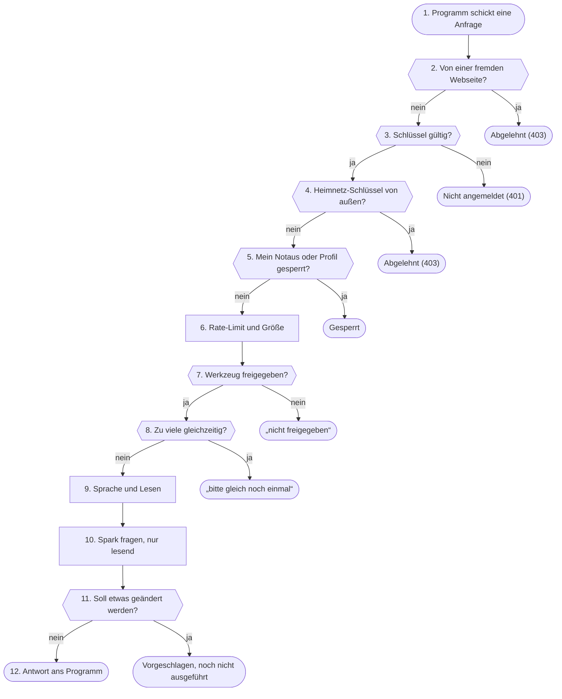

1. <a id="kn-mcpc-s1"></a>**Programm schickt eine Anfrage**: Jede Anfrage ist eine JSON-RPC-Nachricht. Ist der MCP-Server vom Admin aus, gibt es den Endpunkt nicht (404).
2. <a id="kn-mcpc-s2"></a>**Von einer fremden Webseite?**: Schickt ein Browser einen Origin, muss es der des Panels sein. So kann keine fremde Seite den Endpunkt über DNS-Rebinding benutzen.
3. <a id="kn-mcpc-s3"></a>**Schlüssel gültig?**: Der Bearer-Schlüssel ist ein fester Schlüssel oder ein OAuth-Zugangstoken (gilt 60 Minuten). Gespeichert sind nur Hashes. Eine Verbindung endet nach 90 Tagen ohne Nutzung.
4. <a id="kn-mcpc-s4"></a>**Heimnetz-Schlüssel von außen?**: Ein Schlüssel „lokal“ gilt nur, wenn die Gegenstelle eine private Adresse ist, kein Proxy-Kopf in der Anfrage steht und sie keiner der eingetragenen Reverse Proxys ist. „extern“ geht nur mit dem Schalter des Admins.
5. <a id="kn-mcpc-s5"></a>**Mein Notaus oder Profil gesperrt?**: Mein Notaus des Profils sperrt jeden MCP-Zugang (503); hat der Admin den MCP-Server für das Profil gesperrt, gibt es nichts (403).
6. <a id="kn-mcpc-s6"></a>**Rate-Limit und Größe**: Jede Verbindung darf 60 Anfragen pro Minute schicken; eine Anfrage ist höchstens 16 MB groß. Viele abgewiesene Anfragen von außen zählen für „Notaus von selbst“.
7. <a id="kn-mcpc-s7"></a>**Werkzeug freigegeben?**: Nur Werkzeuge aus der festen Liste (15), nur die, die dieser Verbindung gegeben wurden, und nur, wenn das Profil die Funktion gerade nutzen darf, bei jedem Aufruf neu geprüft. Mail, Gedächtnis, frühere Gespräche, Einstellungen und Code sind nie dabei (31 Namen in mcpserver.NEVER).
8. <a id="kn-mcpc-s8"></a>**Zu viele gleichzeitig?**: Höchstens 2 Aufrufe einer Verbindung und 6 aller Verbindungen laufen gleichzeitig.
9. <a id="kn-mcpc-s9"></a>**Sprache und Lesen**: Spracherkennung (höchstens 10 MB) und Sprachausgabe (höchstens 2000 Zeichen) laufen mit der Stufe „hinten“, damit Menschen am Spark immer zuerst dran sind. Die Lese-Werkzeuge lesen nur die Daten dieses Profils.
10. <a id="kn-mcpc-s10"></a>**Spark fragen, nur lesend**: ask_spark (10 pro Minute) läuft als ein Zug des Assistenten für das Profil, aber nur mit den Lese-Werkzeugen dieser Verbindung. Die Frage gilt von Anfang an als fremder Text: nichts wird geschaltet, gespeichert, gelernt oder gesendet, kein Gedächtnis, nichts davon im Verlauf. Passwörter und Codes werden aus der Antwort entfernt.
11. <a id="kn-mcpc-s11"></a>**Soll etwas geändert werden?**: Smart Home, Erinnerung und Termin werden nur vorgeschlagen (höchstens 10 offen). Das Profil bekommt eine Mitteilung und entscheidet unter Ich → Spark als MCP-Server innerhalb von 15 Minuten; erst dann führt das Panel es aus. Bei Notaus oder gesetztem Smart-Home-Codewort schaltet ein MCP-Programm nichts.
12. <a id="kn-mcpc-s12"></a>**Antwort ans Programm**: Die Antwort wird auf 12000 Zeichen gekürzt. Ins Journal kommt nur, welches Programm, welches Werkzeug, ob es ging und wie lange, nie Frage oder Antwort.

**Beispiele:** Claude liest die Termine: Termine des Profils als Text, gekürzt. · Heimnetz-Schlüssel über den Proxy: Abgelehnt: dieser Schlüssel gilt nur im Heimnetz. · n8n will das Licht schalten: Nur vorgeschlagen; es schaltet erst nach dem Ja im Browser. · Programm will Mails lesen: Nicht freigegeben: Mail gibt es über MCP nie.

#### Regeln

Gilt bei: [Schritt 9](#kn-mcpc-s9)

| Gruppe | Werkzeuge | Was passiert |
|---|---|---|
| Sprache | transcribe, speak, voices | Dienste mit Stufe „hinten“ |
| Lesen | wikipedia, archive_search, document_search, calendar_events, reminder_list, today, write_text | liest nur, speichert nichts |
| Spark fragen | ask_spark | ein Zug nur mit Lese-Werkzeugen |
| Handeln mit Bestätigung | home_assistant, reminder_set, calendar_add | nur Vorschlag, das Profil sagt Ja |
| nie | Mail, Gedächtnis, Verlauf, Einstellungen, Code | gibt es unter keinem Namen |

#### Zahlen (aus dem Code)

- **90** Tage ohne Nutzung, dann endet eine Verbindung ([Schritt 3](#kn-mcpc-s3))
- **10** Verbindungen pro Profil ([Schritt 3](#kn-mcpc-s3))
- **60** Anfragen pro Minute je Verbindung ([Schritt 6](#kn-mcpc-s6), [Schritt 10](#kn-mcpc-s10))
- **2** Aufrufe gleichzeitig je Verbindung ([Schritt 8](#kn-mcpc-s8))
- **12000** Zeichen höchstens in einer Antwort ([Schritt 12](#kn-mcpc-s12))
- **15** Minuten wartet ein Vorschlag auf das Ja ([Schritt 11](#kn-mcpc-s11))

#### Einstellen

- Funktionen → Spark als MCP-Server: der Server für alle Profile (Standard aus).
- Funktionen → Spark als MCP-Server → MCP-Server von außen: Verbindungen über den Reverse Proxy und OAuth.
- Funktionen → Spark als MCP-Server → MCP: Handeln mit Bestätigung: die Werkzeuge, die etwas vorschlagen.
- Ich → Spark als MCP-Server: Verbindungen anlegen, Werkzeuge wählen, Vorschläge bestätigen oder ablehnen.

#### Was du siehst

- Zustand → Live: jeder Werkzeug-Aufruf als Anfrage des Programms, von außen unter „Über das Internet“.
- Ich → Spark als MCP-Server: die letzten Vorschläge mit ihrem Stand.

#### Im Code

- `app/panel/mcpserver.py` `mcp_post`: der Endpunkt: Origin, Schlüssel, Limit, Methode ([Schritt 1](#kn-mcpc-s1))
- `app/panel/mcpserver.py` `origin_ok`: keine fremde Webseite ([Schritt 2](#kn-mcpc-s2))
- `app/panel/mcpserver.py` `check_conn`: Schlüssel, Heimnetz, Notaus, Schalter ([Schritt 3](#kn-mcpc-s3))
- `app/panel/mcpserver.py` `is_local`: wirklich aus dem Heimnetz ([Schritt 4](#kn-mcpc-s4))
- `app/panel/mcpserver.py` `find`: Verbindung zum Hash des Schlüssels ([Schritt 3](#kn-mcpc-s3))
- `app/panel/mcpserver.py` `tool_ok`: darf das Profil dieses Werkzeug jetzt ([Schritt 7](#kn-mcpc-s7))
- `app/panel/mcpserver.py` `call`: gleichzeitige Aufrufe, Journal-Zeile ([Schritt 8](#kn-mcpc-s8))
- `app/panel/mcpserver.py` `run`: verteilt auf Sprache, Lesen, Fragen, Handeln ([Schritt 9](#kn-mcpc-s9), [Schritt 10](#kn-mcpc-s10))
- `app/panel/mcpserver.py` `ask`: ein Zug nur mit Lese-Werkzeugen ([Schritt 10](#kn-mcpc-s10))
- `app/panel/mcpserver.py` `propose`: Vorschlag statt Handlung ([Schritt 11](#kn-mcpc-s11))
- `app/panel/mcpserver.py` `decide`: das Ja des Profils, dann ausführen ([Schritt 11](#kn-mcpc-s11))
- `app/panel/mcpserver.py` `carry_out`: führt nur bestätigte Aktionen aus ([Schritt 11](#kn-mcpc-s11))

Selbsttests: `test_mcpserver`, `test_notaus`

### Middleware

Die Middleware ist die Schicht in panel.py, durch die jede HTTP-Anfrage geht, bevor ein Endpunkt sie liest: Notaus, fremde Seiten (CSRF), Größe der Anfrage und Update-Sperre. Auf dem Rückweg setzt sie Schutz-Kopfzeilen, schreibt Änderungen ins Admin-Protokoll und erneuert Anmeldungen.

**Warum:** FastAPI liest Datei-, Formular- und JSON-Teile, bevor die Anmeldung eines Endpunkts geprüft wird. Ohne diese Schicht könnte jeder mit einem riesigen Upload Speicher oder Platte füllen und bekäme sein „nicht angemeldet“ erst danach. Ebenso muss der Notaus greifen, bevor irgendein Endpunkt etwas tut, und eine fremde Webseite darf die Cookies des Browsers nie für Änderungen benutzen.

#### Ablauf

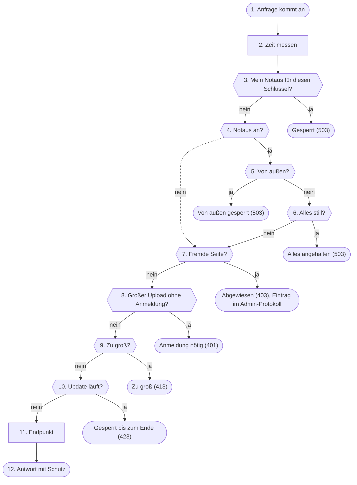

1. <a id="kn-middleware-s1"></a>**Anfrage kommt an**: Jede HTTP-Anfrage an das Panel geht durch diese Schicht, von außen nach innen in der Reihenfolge, in der Starlette die Middleware stapelt (die zuletzt angemeldete liegt außen). Telegram, „Spark fragen“ über MCP und die Lautsprecher bauen ihre Frage im Panel selbst und rufen chat.chat direkt auf; deren äußere Anfrage ist vorher schon hier durchgegangen.
2. <a id="kn-middleware-s2"></a>**Zeit messen**: slow_reads misst die ganze Anfrage. Ein Lesen unter /api/, das länger als 1.5 s braucht, wird eine Zeile im Journal, je Route höchstens alle 60 s; nur das Muster der Route und die Zeit, nie die Abfrage oder Namen.
3. <a id="kn-middleware-s3"></a>**Mein Notaus für diesen Schlüssel?**: Trägt die Anfrage einen Geräteschlüssel und hat dessen Profil seinen eigenen Notaus an, bekommt sie nichts außer dem Stand des Notaus. Sonst merkt sich das Panel, für welches Profil diese Anfrage handelt, damit die letzte Abwehr tiefer unten weiß, wessen Aktion es wäre.
4. <a id="kn-middleware-s4"></a>**Notaus an?**: Ist der Notaus aus, geht die Anfrage gleich weiter zur Herkunftsprüfung. Die Seite selbst und ihre Dateien kommen immer durch, damit man den Notaus sehen und aufheben kann.
5. <a id="kn-middleware-s5"></a>**Von außen?**: Im Heimnetz ist nur, wer eine private Adresse hat und nicht über einen Proxy kommt, oder über einen eingetragenen Proxy, der eine private Adresse meldet. Ab Notaus-Stufe 1 bekommt alles von außen nur noch die Seite und den Notaus-Stand.
6. <a id="kn-middleware-s6"></a>**Alles still?**: In Stufe 3 gehen auch im Heimnetz nur noch Anmelden, das Aufheben des Notaus und das Lesen von Zustand, Logs und Live durch. In den Stufen darunter läuft im Heimnetz alles weiter; Aktionen hält das Panel dann tiefer unten an.
7. <a id="kn-middleware-s7"></a>**Fremde Seite?**: Eine ändernde Anfrage (POST, PUT, PATCH, DELETE), die ein Anmelde-Cookie mitbringt, muss von der eigenen Seite kommen: der Browser sagt es mit Sec-Fetch-Site, sonst wird Origin mit dem Host verglichen. Ein anderer Port auf demselben Rechner gilt als fremd. Ohne beide Kopfzeilen ist es kein Browser (Skripte) und geht durch.
8. <a id="kn-middleware-s8"></a>**Großer Upload ohne Anmeldung?**: Die Pfade für große Uploads (Sicherungen, Stimmen, Ton, Dokumente, Bilder, Musik, MCP) nehmen nur an, wer überhaupt angemeldet sein könnte: Admin-Cookie, Profil oder eine Authorization-Zeile. Die Datei eines anderen Sparks (/api/verbund/blob) nur, wenn Verbund und Dateien an sind und der Absender ein erlaubter Spark mit bekanntem Schlüssel ist. Die echte Prüfung kommt danach im Endpunkt; hier geht es nur darum, dass kein Byte eines fremden Uploads gelesen wird.
9. <a id="kn-middleware-s9"></a>**Zu groß?**: Jeder Pfad hat seine Grenze, sonst gilt eine kleine Standardgrenze von zwei MB. Eine zu große Content-Length wird sofort abgelehnt; beim Lesen zählt BodyLimit zusätzlich mit und bricht ab, sobald mehr kommt als erlaubt.
10. <a id="kn-middleware-s10"></a>**Update läuft?**: Während ein Update läuft, werden Änderungen unter /api/ angehalten. Der Assistent, die Geräte und das Anmelden bleiben offen (update.UNLOCKED).
11. <a id="kn-middleware-s11"></a>**Endpunkt**: Erst jetzt liest der Endpunkt die Anfrage und prüft selbst Anmeldung, Profil und Rate-Limit (die nächste Station, „Anmeldung, Profil“). Ist der Verbrauchszähler an, merkt sich die Anfrage vorher, für welches Profil sie läuft: was sie die Modelle fragt, zählt für dieses Profil.
12. <a id="kn-middleware-s12"></a>**Antwort mit Schutz**: Jede Antwort bekommt die Schutz-Kopfzeilen (keine fremden Rahmen, strenge Content-Security-Policy, auf https auch HSTS), unter /api/ „no-store“. Eine Änderung landet mit wer, Pfad und Status im Admin-Protokoll, außer gewöhnlicher Nutzung aus guard.QUIET_WHY. Benutzte Anmeldungen werden erneuert, auf https immer mit Secure.

**Beispiele:** Einstellung im Browser zu Hause: Durch: der Endpunkt prüft die Anmeldung, die Änderung steht im Admin-Protokoll. · Fremde Webseite schickt ein Formular: Abgewiesen mit 403, bevor ein Endpunkt etwas tut. · Notaus Stufe 1, App unterwegs: Gesperrt mit 503 und der Stufe; die App zeigt den Notaus. · Großer Upload ohne Anmeldung: Abgewiesen mit 401, kein Byte gelesen.

#### Regeln

Gilt bei: [Schritt 4](#kn-middleware-s4), [Schritt 5](#kn-middleware-s5), [Schritt 6](#kn-middleware-s6)

| Notaus-Stufe | Von außen | Im Heimnetz |
|---|---|---|
| aus | alles | alles |
| 1 und 2 | nur die Seite und der Notaus-Stand | alles; Aktionen hält das Panel tiefer unten an |
| 3 | nur die Seite und der Notaus-Stand | Anmelden, Aufheben, Zustand und Logs lesen |

#### Warum diese Reihenfolge

- Der Notaus liegt außen: auch eine fremde Seite oder ein zu großer Upload von außen bekommt bei Notaus nur die Stufe zu hören.
- Die Herkunft kommt vor der Größe: eine fremde Seite wird abgewiesen, ohne dass ihr Inhalt gelesen wird.
- Was der Notaus tief unten anhält (NotausAktiv), wird als klarer Satz mit 503 beantwortet, nie als Serverfehler.

#### Zahlen (aus dem Code)

- **1** Notaus-Stufe, ab der nichts von außen durchkommt ([Schritt 5](#kn-middleware-s5), [Schritt 6](#kn-middleware-s6))
- **3** Notaus-Stufe, in der auch zu Hause fast alles steht ([Schritt 5](#kn-middleware-s5), [Schritt 6](#kn-middleware-s6))
- **1.5 s** ab hier gilt ein Lesen als langsam ([Schritt 2](#kn-middleware-s2))
- **60 s** höchstens eine Zeile je Route ([Schritt 2](#kn-middleware-s2))

#### Einstellen

- Einstellungen → Sicherheit → Reverse Proxy: nur von diesen Adressen zählt X-Forwarded-For. Das entscheidet, wer als „im Heimnetz“ gilt und welche Adresse gesperrt wird.
- Einstellungen → Sicherheit → Notaus von selbst: viele falsche Anmeldungen, MCP-Anfragen oder gesperrte Verbindungen von außen lösen Notaus Stufe 1 aus (Standard aus).

#### Was du siehst

- Zustand → Live: unter Ereignisse steht „fremde Seite abgewiesen“; der Notaus erscheint als Banner.
- Logs → Admin-Protokoll: jede Änderung mit wer, Pfad und Status, auch abgewiesene fremde Seiten.
- Zustand → Logs: langsame Lesezugriffe als Zeile „seite: slow GET …“.

#### Im Code

- `app/panel/panel.py` `slow_reads`: misst jede Anfrage ([Schritt 2](#kn-middleware-s2))
- `app/panel/panel.py` `emergency`: Notaus vor jedem Endpunkt ([Schritt 3](#kn-middleware-s3), [Schritt 4](#kn-middleware-s4))
- `app/panel/notaus.py` `mine_gate`: Mein Notaus für Geräteschlüssel ([Schritt 3](#kn-middleware-s3))
- `app/panel/notaus.py` `gate`: was bei welcher Stufe durchkommt ([Schritt 4](#kn-middleware-s4))
- `app/panel/notaus.py` `at_home`: im Heimnetz oder von außen ([Schritt 5](#kn-middleware-s5))
- `app/panel/panel.py` `sessions`: fremde Seiten, Protokoll, Cookies erneuern ([Schritt 7](#kn-middleware-s7), [Schritt 11](#kn-middleware-s11), [Schritt 12](#kn-middleware-s12))
- `app/panel/guard.py` `same_origin`: die Herkunftsregel ([Schritt 7](#kn-middleware-s7))
- `app/panel/panel.py` `_may_upload`: große Uploads nur mit Anmeldung ([Schritt 8](#kn-middleware-s8))
- `app/common.py` `BodyLimit`: Größengrenze vor dem Lesen ([Schritt 9](#kn-middleware-s9))
- `app/panel/update.py` `update_lock`: Änderungen während eines Updates ([Schritt 10](#kn-middleware-s10))
- `app/panel/panel.py` `protect`: Schutz-Kopfzeilen ([Schritt 12](#kn-middleware-s12))

Selbsttests: `test_hardening`, `test_panel`, `test_notaus`, `test_seiten_laden`

### Sicherheit

Wie die Schutzschichten des Spark zusammenspielen. Der Grundsatz: das Sprachmodell schlägt vor, das Panel entscheidet. Rechte, Sperren, Handlungen und Grenzen regelt das Panel mit festen Regeln im Code; was von außen kommt (Web, Mail, Kalender, Dokumente, Telegram, Home Assistant, Modellausgaben), ist Daten und nie ein Befehl. Diese Seite zeigt den Weg einer Frage durch alle Schichten; die einzelnen Kästen haben ihre eigenen Seiten.

**Warum:** Ein Sprachmodell lässt sich von Text überreden, den es liest. Darum darf es nichts entscheiden, was Rechte, Geld, Geräte oder Daten anderer betrifft. Jede Schicht kann nur einschränken, keine kann freigeben, was eine frühere verboten hat (Reihenfolge Rechte, Sperren, Absicht).

#### Ablauf

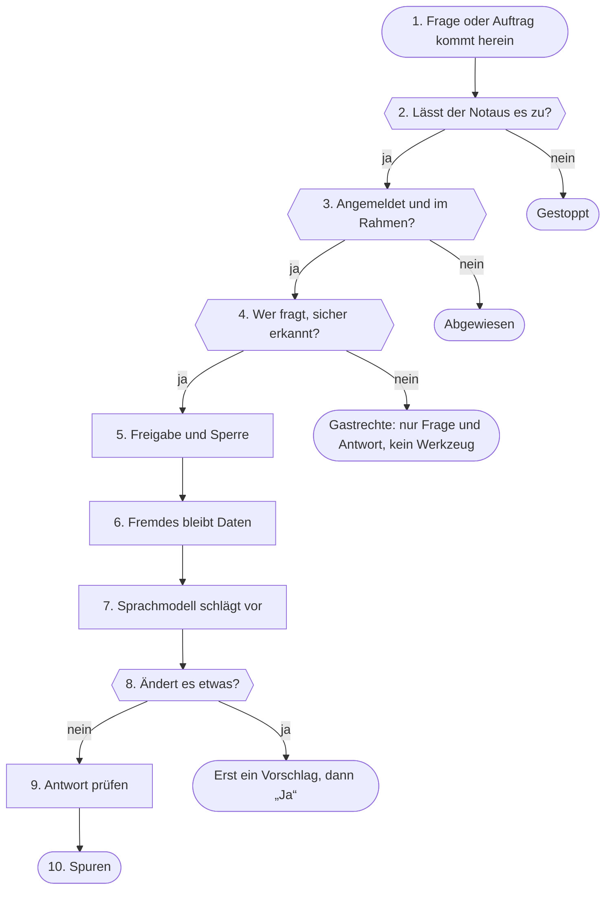

1. <a id="kn-sicherheit-s1"></a>**Frage oder Auftrag kommt herein**: Im Heimnetz direkt, von unterwegs nur über den Reverse-Proxy mit TLS. Jedes Gerät hat seinen eigenen Schlüssel oder meldet sich wie im Browser an.
2. <a id="kn-sicherheit-s2"></a>**Lässt der Notaus es zu?**: Der Notaus hat drei Stufen von außen nach innen: Stufe 1 sperrt das Internet, Stufe 2 jede Handlung, Stufe 3 jedes Gespräch. Kein Modell, keine Mail und kein Dokument kann ihn auslösen oder aufheben.
3. <a id="kn-sicherheit-s3"></a>**Angemeldet und im Rahmen?**: Größenlimit und Herkunftsprüfung (CSRF) vor dem Lesen, dann Rate-Limit pro Adresse und eine Höchstzahl gleichzeitiger Anfragen für Modell, Erkennung und Ausgabe (guard.Slot). Geheimnisse, Rollen und Sicherungen brauchen dazu einen frischen Code oder Passkey (core.confirm_code, 10 Minuten). Zu den Modellen auf tars geht es nur durch das TLS-Tor; Befehle dort prüft der Wärter (tarswart.check: Unterschrift, Zeit, Einmal-Nummer, einer von 16 festen Befehlen).
4. <a id="kn-sicherheit-s4"></a>**Wer fragt, sicher erkannt?**: Das Profil kommt aus Cookie, App-Schlüssel oder verknüpftem Konto. Am geteilten Lautsprecher reicht der Geräteschlüssel nicht: chat_turn.shared_stranger gibt Persönliches nur frei, wenn die Inhaberstimme in derselben Aufnahme sicher erkannt ist.
5. <a id="kn-sicherheit-s5"></a>**Freigabe und Sperre**: Jede Funktion ist aus, bis der Admin sie freigibt; dann gilt sie für jedes Profil, außer der Admin sperrt einzelne (features.blocked). Was nicht erlaubt ist, wird gar nicht erst als Werkzeug angeboten.
6. <a id="kn-sicherheit-s6"></a>**Fremdes bleibt Daten**: Was ein Werkzeug von außen liest, kommt als markierter Datenblock zum Modell. Ab da sind 13 handelnde Werkzeuge gesperrt, auch im nächsten Zug, und nichts davon wird ins Gedächtnis gelernt. Verbindungen nach außen laufen nur über den Wächter (netguard.allowed). Eine Mail mit HTML zeigt die Seite nur so, wie der Spark sie bereinigt hat (mailansicht.clean: feste Liste erlaubter Tags, kein Skript), in einem Rahmen ohne Skript mit eigener CSP; Bilder von außen erst nach eigenem Klick über den Wächter, ein Link erst nach der Frage mit seiner echten Adresse.
7. <a id="kn-sicherheit-s7"></a>**Sprachmodell schlägt vor**: Das Modell formuliert und wählt aus dem, was nach den Schritten davor übrig ist. Ruft es ein Werkzeug, das nicht angeboten war, läuft es nicht.
8. <a id="kn-sicherheit-s8"></a>**Ändert es etwas?**: Lesen geht sofort. Wer etwas ändert (Licht, Mail senden, Termin, Anruf), legt einen Vorschlag ab; er läuft erst nach einem schlichten „Ja“ auf genau diesen Vorschlag, vom selben Gerät. Home Assistant nur aus einer Allowlist. Mail löscht nur die Person selbst (in den Papierkorb, endgültig nur nach Rückfrage), nie das Modell. Knöpfe auf Karten im Gespräch und auf der Seite Offen sind feste Namen (vorgaenge.AKTIONEN); jeden Druck prüft das Panel (Besitzer, Art, Stand, Notaus), und was senden oder eintragen würde, öffnet nur die Seite, auf der die Person es selbst tut.
9. <a id="kn-sicherheit-s9"></a>**Antwort prüfen**: Zeiten, Daten und Beträge, die nirgends in den Quellen stehen, fallen heraus (answercheck.unsupported). Passwörter, Codes und Schlüssel werden nie gesprochen (textnorm.hide_secrets). Die Oberfläche zeigt Modelltext nie als HTML.
10. <a id="kn-sicherheit-s10"></a>**Spuren**: Logs nur mit festen Wörtern und Zahlen. Änderungen an Zugängen und Schutz schreibt guard.log mit einer SHA-256-Kette; der Wachposten meldet Auffälliges an die Admins. Geheimnisse liegen versiegelt im vault (vault.seal).

**Beispiele:** Mail verlangt eine Handlung: Die Mail wird gelesen, aber nichts geschaltet: die Werkzeuge dafür sind gesperrt. · Fremde Stimme am Lautsprecher: Antwort wie für einen Gast, ohne Mails oder Termine. · Licht ausschalten: Erst nach „Ja“ wird geschaltet. · Notaus Stufe 3: Kein Gespräch, nur die Notaus-Seite.

#### Regeln

Gilt bei: [Schritt 4](#kn-sicherheit-s4), [Schritt 5](#kn-sicherheit-s5)

| Wer | bekommt | geprüft durch |
|---|---|---|
| Gast | Frage und Antwort, keine Werkzeuge, keine persönlichen Daten, nur Fehlercodes | Rate-Limit, Höchstzahl gleichzeitig |
| Fremde Stimme | wie ein Gast, früherer Verlauf geht nicht mit | Stimmprüfung in derselben Aufnahme |
| Profil | freigegebene Funktionen auf eigene Daten | Anmeldung; Geheimnisse mit frischem Code |
| Anderes Profil | nur, was der Besitzer einzeln mit ihm teilt (Sehen), solange er teilt; für den Assistenten nur Text | geteilt.put mit frischem Code, Freigabe „Teilen mit Profilen“ |
| Verwalter | Personen betreuen, keine Funktionen schalten, keine Logs | Rolle, auf dem Server geprüft |
| Admin | Freigaben, Sperren, Notaus, Logs, Live | Anmeldung mit zweitem Schritt; „Schutz ändern“ fragt jedes Mal |

#### Die Grenzen

- A, von draußen herein: nur über den Reverse-Proxy mit TLS; jeder Endpunkt prüft Anmeldung, Profil, CSRF, Größe und Rate-Limit.
- B, Geräte im Heimnetz: ein Schlüssel pro Gerät; am geteilten Lautsprecher zählt zusätzlich die Stimme.
- C, der Spark liest Fremdes: nur über den Wächter, kein Heimnetz ohne Erlaubnis, geprüfte Adresse festgehalten; was zurückkommt, ist Daten.
- D, Panel zu den Modellen: TLS 1.3 mit beim Koppeln angeheftetem Zertifikat; die Modelle hören nur auf 127.0.0.1.
- E, Handgriffe auf tars: nur feste Befehle des Wärters, unterschrieben, mit Zeit und Einmal-Nummer.

#### Maßstäbe

- OWASP ASVS 5.0 Stufe 2 (Anmeldung und Admin Stufe 3), OWASP Top 10 für LLM-Anwendungen 2025, BSI TR-02102; die Sicherheits-Checkliste mit ihrem Teil „Stand der Technik“ nennt, was noch fehlt.

#### Zahlen (aus dem Code)

- **13** Werkzeuge nach Text von außen gesperrt ([Schritt 6](#kn-sicherheit-s6))
- **10 min** zählt ein richtiger Code für „Bestätigen“ ([Schritt 3](#kn-sicherheit-s3))
- **16** feste Befehle des Wärters auf tars ([Schritt 3](#kn-sicherheit-s3))
- **3** Notaus-Stufen, die letzte hält jedes Gespräch an ([Schritt 2](#kn-sicherheit-s2))

#### Im Code

- `app/panel/notaus.py` `blocks`: ob eine Notaus-Stufe diese Art Arbeit anhält ([Schritt 2](#kn-sicherheit-s2))
- `app/panel/guard.py` `limit`: Rate-Limit pro Adresse und Profil ([Schritt 3](#kn-sicherheit-s3))
- `app/panel/guard.py` `Slot`: Höchstzahl gleichzeitiger Anfragen ([Schritt 3](#kn-sicherheit-s3))
- `app/panel/core.py` `confirm_code`: frischer Code oder Passkey für heikle Wege ([Schritt 3](#kn-sicherheit-s3), [Schritt 8](#kn-sicherheit-s8))
- `app/tarswart.py` `check`: prüft jeden Befehl an den Wärter ([Schritt 3](#kn-sicherheit-s3))
- `app/panel/chat_turn.py` `shared_stranger`: fremde Stimme am geteilten Lautsprecher ([Schritt 4](#kn-sicherheit-s4))
- `app/panel/features.py` `allowed`: Freigabe des Admins, gilt für jedes Profil ([Schritt 5](#kn-sicherheit-s5))
- `app/panel/features.py` `blocked`: Sperre einzelner Profile ([Schritt 5](#kn-sicherheit-s5))
- `app/panel/geteilt.py` `put`: Teilen mit einem anderen Profil, zurückziehen wirkt sofort ([Schritt 5](#kn-sicherheit-s5))
- `app/panel/chat.py` `wrap_outside`: Text von außen als Datenblock ([Schritt 6](#kn-sicherheit-s6))
- `app/panel/mailansicht.py` `clean`: HTML einer Mail nur bereinigt, ohne Skript und ohne Laden von außen ([Schritt 6](#kn-sicherheit-s6))
- `app/panel/netguard.py` `allowed`: ob eine Verbindung nach außen sein darf ([Schritt 6](#kn-sicherheit-s6))
- `app/panel/answercheck.py` `unsupported`: Zahl ohne Quelle fällt heraus ([Schritt 9](#kn-sicherheit-s9))
- `app/textnorm.py` `hide_secrets`: Geheimnisse werden nie gesprochen ([Schritt 9](#kn-sicherheit-s9))
- `app/panel/guard.py` `log`: Änderungsprotokoll mit Prüfkette ([Schritt 10](#kn-sicherheit-s10))
- `app/panel/vault.py` `seal`: Geheimnisse versiegelt ablegen ([Schritt 10](#kn-sicherheit-s10))

Selbsttests: `test_hardening`, `test_gaeste`, `test_kontext_trennung`, `test_scanner`, `test_stufen`, `test_notaus`, `test_waerter`, `test_protokoll`, `test_wachposten`, `test_markdown`

### Anmeldung, Profil

Hier entscheidet das Panel, wer eine Anfrage stellt und was diese Person darf: Anmeldung mit Passwort oder PIN (mit Sperre nach Fehlversuchen), Cookie oder Geräteschlüssel, Rate-Limit und die Freigaben je Funktion. Das Profil kommt nur aus Cookie, Schlüssel oder dem Panel selbst, nie aus dem Text einer Anfrage oder vom Modell.

**Warum:** Der Spark ist über das Heimnetz und oft über einen Proxy aus dem Internet erreichbar. Ohne Sperre ließe sich eine PIN durchprobieren, ohne Rate-Limit könnte eine Seite oder ein Skript die GPU für sich nehmen, und ohne feste Bindung an ein Profil könnte eine Anfrage sich als jemand anderes ausgeben.

#### Ablauf

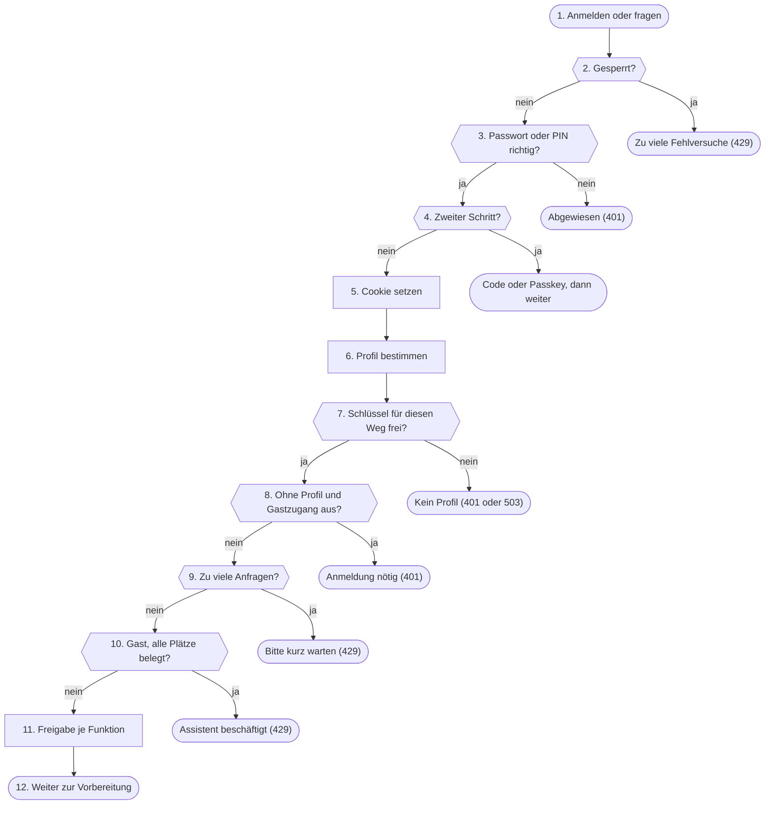

1. <a id="kn-zugang-s1"></a>**Anmelden oder fragen**: Beim Anmelden bekommt der Browser ein Cookie; Apps, Uhr und Lautsprecher haben stattdessen einen Geräteschlüssel, Kalender-Apps (Kalender-Server, kalenderserver.py) ein App-Passwort, das wie eine PIN sperrt. Die Schritte 2 bis 5 laufen einmal beim Anmelden, die Schritte ab 6 bei jeder Anfrage.
2. <a id="kn-zugang-s2"></a>**Gesperrt?**: Gesperrt wird je Adresse und je Name (oder Admin-Passwort). Die Sperre eines Namens gilt nicht für einen Browser, der sich mit diesem Namen schon angemeldet hat (Cookie speech_known, gespeichert wird nur sein Hash). So kann ein Fremder durch Raten den Besitzer nicht aussperren.
3. <a id="kn-zugang-s3"></a>**Passwort oder PIN richtig?**: Geprüft wird in einem eigenen Thread. Ein unbekannter Name kostet dieselbe Arbeit wie eine falsche PIN, die Antwort ist dieselbe. Ein Fehlversuch wartet eine Sekunde, zählt für die Sperre und, wenn er von außen kommt, für „Notaus von selbst“.
4. <a id="kn-zugang-s4"></a>**Zweiter Schritt?**: Hat das Profil (oder der Admin) den zweiten Schritt an und ist der Browser nicht als vertraut eingetragen, kommt als Nächstes der Code aus der App oder ein Passkey. Ein falscher Code zählt wie eine falsche PIN.
5. <a id="kn-zugang-s5"></a>**Cookie setzen**: Der Zähler der Adresse wird gelöscht; Fehlversuche Fremder für den Namen zählen weiter. Das Profil-Cookie ist signiert und steht in der Liste der angemeldeten Browser; es gilt höchstens 90 Tage ohne Nutzung und wird erneuert, solange es benutzt wird. Das Admin-Cookie ist mit Passwort, einem eigenen Schlüssel dieses Spark und dem zweiten Schritt signiert. War der zweite Schritt dabei (Code, Passkey oder vertrauter Browser), trägt die Sitzung sein Zeichen: nur dann zählt eine Admin-Rolle des Profils, ohne eigene Admin-Anmeldung. Danach liest das Panel Kalender und Mails des Profils im Hintergrund vorab (vorwaermen.py, höchstens alle 600 Sekunden), damit seine Seiten sofort aufgehen.
6. <a id="kn-zugang-s6"></a>**Profil bestimmen**: Zuerst, was nur das Panel selbst setzt (Telegram, „Spark fragen“ über MCP), dann der Geräteschlüssel (nur sein Hash ist gespeichert), dann das Cookie: Signatur, Alter, Sitzung noch in der Liste und nicht abgemeldet.
7. <a id="kn-zugang-s7"></a>**Schlüssel für diesen Weg frei?**: Ein Schlüssel mit Bereich (App, Uhr, Raum, Home Assistant, Schreibhilfe, Begleiter, Terminal) reicht nur für seine eigenen Pfade und nur, solange Admin und Profil die Funktion anhaben. Ist sie gerade aus oder hat das Profil seinen eigenen Notaus an, antwortet das Panel mit 503 statt 401, damit die App ihre Kopplung behält.
8. <a id="kn-zugang-s8"></a>**Ohne Profil und Gastzugang aus?**: Ohne Profil kommt nur durch, wer der Admin ist (Cookie oder HTTP Basic, dessen Fehlversuche wie auf der Anmeldeseite zählen), oder wenn der Admin den Assistenten ohne Passwort freigegeben hat. Gäste bekommen dann nur Frage und Antwort.
9. <a id="kn-zugang-s9"></a>**Zu viele Anfragen?**: Je Profil, sonst je Adresse, zählt das Panel die Anfragen der letzten Minute: im Chat 120 für ein Profil oder den Admin, 30 für einen Gast.
10. <a id="kn-zugang-s10"></a>**Gast, alle Plätze belegt?**: Gäste teilen sich 4 gleichzeitige Plätze im Chat. Ein Platz, den niemand freigibt, gilt nach 10 Minuten wieder als frei.
11. <a id="kn-zugang-s11"></a>**Freigabe je Funktion**: Für jede Funktion fragt das Panel in fester Reihenfolge: Schalter des Admins (und der Funktion, auf der sie aufbaut), Gast (bekommt nie eine), vom Admin für das Profil gesperrt, eigener Wunsch des Profils, zweiter Schritt nötig. Gelesen wird bei jeder Anfrage neu, eine Änderung gilt also sofort.
12. <a id="kn-zugang-s12"></a>**Weiter zur Vorbereitung**: Die Anfrage geht mit ihrem Profil (oder als Gast) an chat_turn.prepare. Die Sprache bekommt Vorrang vor Hintergrundarbeit, und die anderen offenen Seiten des Profils sehen „antwortet gerade“.

**Beispiele:** Anmeldung mit PIN: Angemeldet: der Browser hat ein signiertes Cookie. · Admin-Profil meldet sich mit Code an: Angemeldet und gleich Admin: die Sitzung trägt das Zeichen des zweiten Schritts. · Fremder rät eine PIN: Abgewiesen; nach 5 Fehlversuchen ist die Adresse gesperrt. · Frage aus der iPhone-App: Durch: Profil aus dem Geräteschlüssel, Freigaben je Funktion. · Gast, Gastzugang aus: Abgewiesen mit 401: ohne Profil kein Assistent.

#### Regeln

Gilt bei: [Schritt 6](#kn-zugang-s6), [Schritt 7](#kn-zugang-s7)

| Weg hinein | Wie geprüft | Was er erreicht |
|---|---|---|
| Browser mit Profil | signiertes Cookie, Sitzung in der Liste | alles des Profils |
| Admin | Passwort-Cookie oder HTTP Basic | Admin-Seiten; HTTP Basic nur ohne zweiten Schritt |
| Profil mit Admin-Rolle | Cookie mit Zeichen des zweiten Schritts oder App-Schlüssel von danach | Admin-Seiten seiner Rolle; nur „Schutz ändern“ fragt den Code |
| Geräteschlüssel ohne Bereich | Hash des Schlüssels | Assistent des Profils, keine Verbindungen oder Sicherheit ändern |
| Geräteschlüssel mit Bereich | Hash, Pfad, Schalter | nur die Pfade seines Bereichs |
| Gast | nur mit Assistent ohne Passwort | Frage und Antwort, kein Werkzeug |

#### Hinter einem Proxy

- X-Forwarded-For zählt nur von einem eingetragenen Proxy (oder einem auf dem Spark selbst, solange keiner eingetragen ist). Sonst könnte jedes Gerät behaupten, eine andere Adresse zu sein, und die Sperre umgehen.

#### Abmelden

- Ein abgemeldetes Cookie wird auch auf dem Server ungültig, eine Kopie davon geht nicht mehr. Beim Admin gilt das für jede Kopie derselben Anmeldung.

#### Zahlen (aus dem Code)

- **5** Fehlversuche je Adresse in 15 Minuten bis zur Sperre ([Schritt 2](#kn-zugang-s2), [Schritt 3](#kn-zugang-s3))
- **10** Fehlversuche je Name in 15 Minuten bis zur Sperre ([Schritt 2](#kn-zugang-s2), [Schritt 3](#kn-zugang-s3))
- **60 s** erste Sperre, jede weitere doppelt so lang bis 60 Minuten ([Schritt 2](#kn-zugang-s2))
- **30** Fehlversuche je Name in 24 Stunden höchstens ([Schritt 2](#kn-zugang-s2), [Schritt 3](#kn-zugang-s3))
- **120** Chat-Anfragen je Minute für ein Profil ([Schritt 9](#kn-zugang-s9))
- **4** gleichzeitige Plätze für Gäste ([Schritt 10](#kn-zugang-s10))
- **90** Tage höchstens für eine Anmeldung im Browser ([Schritt 5](#kn-zugang-s5))

#### Einstellen

- Einstellungen → Sicherheit → Assistent ohne Passwort: Gäste dürfen fragen (Standard aus).
- Einstellungen → Sicherheit → Anmeldung im Browser: wie viele Tage ohne Nutzung ein Profil angemeldet bleibt.
- Personen und Geräte → Gesperrte Funktionen: eine Funktion für einzelne Profile sperren.
- Ich → Sicherheit: der zweite Schritt eines Profils.

#### Was du siehst

- Zustand → Live: unter Eingang angenommene Zugriffe aus dem Internet und abgewiesene Anmeldungen.
- Logs → Admin-Protokoll: Anmeldungen, Fehlversuche und Sperren.
- Ich → Sicherheit: die letzten Anmeldungen des eigenen Profils.

#### Im Code

- `app/panel/guard.py` `check`: Sperre vor dem Prüfen ([Schritt 2](#kn-zugang-s2))
- `app/panel/guard.py` `failed`: Fehlversuch zählen, sperren ([Schritt 3](#kn-zugang-s3))
- `app/panel/guard.py` `succeeded`: Zähler löschen, Browser merken ([Schritt 5](#kn-zugang-s5))
- `app/panel/account.py` `profile_login`: Anmeldung eines Profils ([Schritt 3](#kn-zugang-s3), [Schritt 5](#kn-zugang-s5))
- `app/panel/account.py` `second_step`: Code oder Passkey ([Schritt 4](#kn-zugang-s4))
- `app/panel/core.py` `is_main_admin`: Admin per Cookie oder HTTP Basic ([Schritt 6](#kn-zugang-s6))
- `app/panel/profiles.py` `current`: das Profil hinter einer Anfrage ([Schritt 6](#kn-zugang-s6))
- `app/panel/profiles.py` `_cookie_user`: Cookie prüfen ([Schritt 6](#kn-zugang-s6))
- `app/panel/core.py` `assistant`: Profil, Gastzugang oder Admin ([Schritt 8](#kn-zugang-s8))
- `app/panel/guard.py` `limit`: Rate-Limit je Minute ([Schritt 9](#kn-zugang-s9))
- `app/panel/guard.py` `Slot`: Plätze für Gäste ([Schritt 10](#kn-zugang-s10))
- `app/panel/features.py` `reason`: warum eine Funktion nicht geht ([Schritt 11](#kn-zugang-s11))

Selbsttests: `test_panel`, `test_features`, `test_rechte_sofort`, `test_passkey`, `test_coadmin`

### Anfrage vorbereiten

chat_turn.prepare macht aus einer Chat-Anfrage einen fertigen Gesprächszug, bevor das Sprachmodell gefragt wird: wer spricht und was diese Person darf, der Systemprompt, Antworten auf Rückfragen und Vorschläge, die Sperren nach fremdem Text und die Liste der angebotenen Werkzeuge.

**Warum:** Das Modell soll nur sehen, was es in diesem Zug wirklich darf. Alles, was entscheidet (Rechte, Sperren, ein „Ja“ zu einem Vorschlag, die Auswahl bei einer Rückfrage), macht das Panel hier mit festen Regeln; das Modell sagt danach nur das Ergebnis.

#### Ablauf

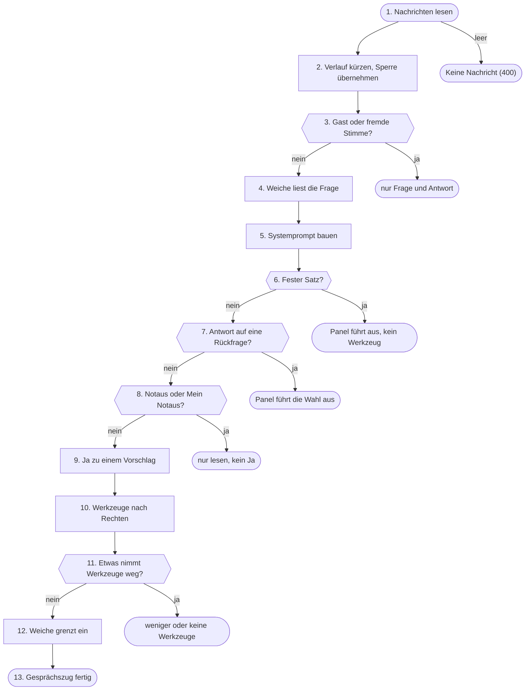

1. <a id="kn-vorbereiten-s1"></a>**Nachrichten lesen**: Übernommen werden nur Textnachrichten von Nutzer und Assistent, jede auf 20000 Zeichen gekürzt. Eine Antwort, die der Browser als aus Mail oder fremdem Text gemacht markiert hat, behält diese Marke. Eine Frage vom Assistenten-Blatt der Android-App kommt nur durch, wenn „Android: Spark als Assistent“ für das Profil freigegeben ist (sonst 403).
2. <a id="kn-vorbereiten-s2"></a>**Verlauf kürzen, Sperre übernehmen**: Der Verlauf wird auf sein Budget gekürzt. Steht eine Antwort aus fremdem Text unter den letzten drei Nachrichten, beginnt dieser Zug gesperrt; ältere werden gar nicht mehr mitgeschickt. Wünscht sich die Person in eigenen Worten ein Lied, bleibt so eine Antwort bis 7 Nachrichten zurück als Daten dabei (Akkorde, Stil). Eine Bildschirm-Beschreibung kommt nur als fester Hinweis mit und sperrt nichts.
3. <a id="kn-vorbereiten-s3"></a>**Gast oder fremde Stimme?**: Ohne Profil, oder am eigenen Lautsprecher oder Telefon, wenn die Spracherkennung nicht klar die Stimme des Profils gehört hat (am Telefon: und keine Telefon-PIN getippt wurde), gibt es nur Frage und Antwort: kein Werkzeug, kein Gedächtnis, kein Verlauf. Wessen Stimme es war, setzt nur das Panel selbst, nie die Anfrage.
4. <a id="kn-vorbereiten-s4"></a>**Weiche liest die Frage**: Feste Regeln ordnen die eigene letzte Nachricht einer Gruppe zu. Eine neue eigene Bitte, die nicht auf die Antwort aus fremdem Text zurückzeigt, lässt diese Antwort und ihre Sperre weg. Erkennt keine Regel die Frage, kann das Modell parallel einmal aus einer festen Liste wählen (wenn der Admin das anhat). Eine Folgefrage wie „Und morgen?“ übernimmt die Gruppe der eigenen Frage davor (intent.follow_up); Hinweiswörter geben ihre Gruppen dazu, auch neben der Wahl des Modells. Ein Foto mit Änderungswunsch (bilder.wants_change) ist die Gruppe Bilder, ohne Wahl des Modells.
5. <a id="kn-vorbereiten-s5"></a>**Systemprompt bauen**: Der Systemprompt des Admins, dazu Länge und Stil des Profils und ein Hinweis je Kanal (Uhr, Siri, Lautsprecher, Telefon, Telegram, App, Browser). Mit „Schneller Antwortbeginn“ geht, was nur für diesen Zug gilt, mit der Frage statt in den Systemprompt, damit der Server ihn aus dem Cache liest. Mit „Großes Gedächtnis kürzen“ stehen bei einem langen Gedächtnis nur die neuesten Fakten fest darin (höchstens 6000 Zeichen), dazu bis zu 5 ältere, die Wörter mit der Frage teilen, nur für diesen Zug (chat.memory_split). Ist das Wissensbuch an und hat Seiten, kommen bis zu 40 Seitentitel dazu, die am besten zur Frage passen, als fremder Text (wissensbuch.hint).
6. <a id="kn-vorbereiten-s6"></a>**Fester Satz?**: Sätze wie „Spark Notaus“, „Problem melden: …“ oder „Das war falsch“ führt das Panel selbst aus, nur aus den eigenen Worten des Profils und nie über MCP. Das Modell sagt nur das Ergebnis und bekommt in diesem Zug kein Werkzeug.
7. <a id="kn-vorbereiten-s7"></a>**Antwort auf eine Rückfrage?**: Hat das Panel gefragt, welches Gerät gemeint ist, gilt als Antwort ein Knopf, eine Zahl oder der Name, nur im selben Gespräch, vom eigenen Profil und innerhalb von 2 Minuten. „Keins davon“ bringt die ganze Liste, „Nein, den anderen“ korrigiert die letzte Wahl. Das Panel führt die Wahl aus und bietet an, sie sich zu merken; ein „Ja“ dazu zählt 15 Minuten.
8. <a id="kn-vorbereiten-s8"></a>**Notaus oder Mein Notaus?**: Ab Notaus-Stufe 2 oder mit dem eigenen Notaus des Profils werden alle wartenden Vorschläge verworfen; kein „Ja“ führt etwas aus. Lesen und Antworten gehen weiter.
9. <a id="kn-vorbereiten-s9"></a>**Ja zu einem Vorschlag**: Wartet ein Vorschlag aus diesem Gespräch (ein Termin, eine Mail-Änderung, ein Listeneintrag, eine Korrektur, ein Anruf, eine Antwort fürs reMarkable), entscheidet das Panel über das „Ja“. Ein Ja bestätigt genau eine Sache; jede Antwort erledigt alle anderen wartenden Vorschläge dieses Gesprächs.
10. <a id="kn-vorbereiten-s10"></a>**Werkzeuge nach Rechten**: Jede Werkzeuggruppe kommt nur mit Schalter des Admins, Freigabe für das Profil und den eigenen Daten dazu: Suche, Gedächtnis, Verlauf, Dokumente, Smart Home, Erinnerungen, Kalender, Mail. Telegram, die iPhone-App und CarPlay können das nur enger machen, nie weiter. Eine fremde erkannte Stimme an diesem Gerät bekommt nichts Persönliches. Eine Nachricht, die nur fragt („Weißt du, wie mein Bruder heißt?“: ein Satz mit Fragezeichen, nichts zum Merken), bekommt kein memory_save (chat.offer_memory), damit kein erfundener Fakt gespeichert wird.
11. <a id="kn-vorbereiten-s11"></a>**Etwas nimmt Werkzeuge weg?**: Der Notaus nimmt Werkzeuge ins Internet oder ändernde weg, „Spark fragen“ über MCP behält nur die Werkzeuge der Verbindung, ein Bild, ein fester Satz oder ein fester Weg des Panels (Anrufe per Assistent, rufen.py) lässt keines übrig. Für einen Gast wird die Liste noch einmal geleert, egal was sie gefüllt hat.
12. <a id="kn-vorbereiten-s12"></a>**Weiche grenzt ein**: Mit „Gezielte Werkzeugwahl“ bleibt nur die Gruppe der Frage übrig. Danach entscheidet das Panel, ob erst lokal gesucht wird (nie bei einem schlichten „Ja“ oder „Nein“ und nie, wenn es in diesem Zug schon etwas bestätigt ausgeführt hat), ob es ein eindeutiges Abrufen selbst macht und welches Werkzeug die erste Runde rufen muss. Mit „Schneller Antwortbeginn“ bekommt eine erkannte Gruppe immer dieselbe Liste in derselben Reihenfolge, so hält der Server je Gruppe einen Anfang im Cache; nur eine unklare Frage sieht die volle Liste.
13. <a id="kn-vorbereiten-s13"></a>**Gesprächszug fertig**: Der Systemprompt steht vorn, dazu die Werkzeuge und die Sperrregel. Der Notaus wird bei jedem Werkzeugaufruf neu gelesen: wird er während einer Antwort ausgelöst, hält er den nächsten Aufruf an.

**Beispiele:** Gast fragt nach dem Wetter: Antwort ohne Werkzeug: Gäste bekommen nur Frage und Antwort. · „Das zweite“ nach einer Rückfrage: Das Panel schaltet das gewählte Gerät; das Modell sagt nur das Ergebnis. · Notaus Stufe 2, Frage nach Terminen: Nur lesende Werkzeuge; Termine eintragen wird nicht angeboten.

#### Regeln

Gilt bei: [Schritt 10](#kn-vorbereiten-s10), [Schritt 11](#kn-vorbereiten-s11)

| Wer spricht | Werkzeuge | Persönliches | Ja zu Vorschlägen |
|---|---|---|---|
| Profil, eigener Login oder Schlüssel | nach Freigaben | ✓ | ✓ |
| andere erkannte Stimme an diesem Gerät | allgemeine | ✕ | ✕ |
| Spark fragen über MCP | nur die der Verbindung | nur lesen, kein Gedächtnis, keine Mail | ✕ |
| Gast oder unbekannte Stimme am Lautsprecher | ✕ | ✕ | ✕ |

#### Zahlen (aus dem Code)

- **20000** Zeichen höchstens je Nachricht ([Schritt 1](#kn-vorbereiten-s1))
- **2** Minuten gilt eine Auswahl bei einer Rückfrage ([Schritt 7](#kn-vorbereiten-s7))
- **15** Minuten wartet „Soll ich mir das merken?“ ([Schritt 7](#kn-vorbereiten-s7))
- **4** Knöpfe höchstens bei einer Rückfrage ([Schritt 7](#kn-vorbereiten-s7))
- **2** Notaus-Stufe ohne Aktionen ([Schritt 8](#kn-vorbereiten-s8))

#### Einstellen

- Personen und Geräte → Gesperrte Funktionen: was ein einzelnes Profil nicht bekommt.
- Funktionen → Rückfrage statt Raten: das Panel fragt nach, statt zu raten (Standard aus).
- Funktionen → Weiche: die festen Regeln, die die Werkzeuge eingrenzen.
- Funktionen → Ablauf und Freigabe zeigen: Werkzeuge unter der Antwort, ein wartender Vorschlag als Karte mit Ja und Nein und eine Frage am Ende der Antwort mit ihren Antworten als Knöpfen (Ja/Nein, A oder B), ein kurzes Ja darauf behält das Thema der Frage davor (nur eigenes Profil und Gerät, Standard aus).

#### Was du siehst

- Logs → Anfragen: je Frage Gruppe, Werkzeuge „x von y“, Pflichtwerkzeug und Sperre, ohne Inhalt.
- Zustand → Logs: Zeilen wie „weiche: Absicht …“, „chat: web search …“, „chat: memory_save not offered …“ oder „notaus: … Werkzeuge nicht angeboten“.

#### Im Code

- `app/panel/chat_turn.py` `prepare`: der ganze Ablauf ([Schritt 1](#kn-vorbereiten-s1), [Schritt 13](#kn-vorbereiten-s13))
- `app/panel/chat_turn.py` `shared_stranger`: fremde Stimme am Lautsprecher ([Schritt 3](#kn-vorbereiten-s3))
- `app/panel/chat.py` `trim_history`: Verlauf kürzen ([Schritt 2](#kn-vorbereiten-s2))
- `app/panel/chat.py` `left_out`: Antworten aus fremdem Text weglassen ([Schritt 2](#kn-vorbereiten-s2), [Schritt 4](#kn-vorbereiten-s4))
- `app/panel/chat.py` `offer_memory`: kein memory_save, wenn die Nachricht nur fragt ([Schritt 10](#kn-vorbereiten-s10))
- `app/panel/intent.py` `classify_cfg`: feste Regeln der Weiche ([Schritt 4](#kn-vorbereiten-s4))
- `app/panel/klaeren.py` `answer`: Antwort auf eine Rückfrage ([Schritt 7](#kn-vorbereiten-s7))
- `app/panel/features.py` `allowed`: Freigabe je Funktion ([Schritt 10](#kn-vorbereiten-s10))
- `app/panel/notaus.py` `locked_tools`: was der Notaus wegnimmt ([Schritt 11](#kn-vorbereiten-s11))
- `app/panel/intent.py` `narrow`: Werkzeuge eingrenzen ([Schritt 12](#kn-vorbereiten-s12))
- `app/panel/chat_turn.py` `notaus_note`: Satz für das Modell bei Notaus ([Schritt 8](#kn-vorbereiten-s8), [Schritt 11](#kn-vorbereiten-s11))

Selbsttests: `test_klaeren`, `test_features`, `test_notaus`, `test_hardening`, `test_weiche`

### Weiche

Die Weiche ordnet die eigene letzte Nachricht einer Gruppe zu (Smart Home, Kalender, Wetter, Mail und so weiter, heute 23 Gruppen) und grenzt damit die Werkzeuge ein, die das Sprachmodell in diesem Zug sieht. Sie arbeitet mit festen Wortlisten; das Modell darf höchstens einmal aus einer festen Liste wählen, wenn keine Regel passt, und auch das kann nur eingrenzen.

**Warum:** Wenige passende Werkzeuge machen das Modell schneller und treffsicherer: es liest weniger und greift seltener daneben. Weil die Weiche nur wegnimmt, was die Rechte und Sperren übrig gelassen haben, kann ein falsch zugeordneter Satz nie mehr erlauben, höchstens ein Werkzeug fehlen lassen.

#### Ablauf

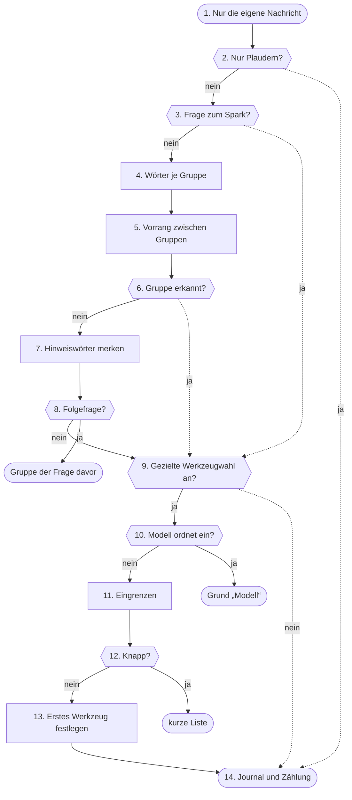

1. <a id="kn-weiche-s1"></a>**Nur die eigene Nachricht**: Gelesen wird nur die letzte Nachricht der Person selbst, nie eine Antwort davor, fremder Text oder was das Modell geschrieben hat. Dazu kommen die Wörter, die der Admin unter Funktionen → Weiche gespeichert hat.
2. <a id="kn-weiche-s2"></a>**Nur Plaudern?**: Ist der ganze Satz ein Gruß oder Dank, heißt die Gruppe „plaudern“. Die Antwort bekommt dann gar kein Werkzeug.
3. <a id="kn-weiche-s3"></a>**Frage zum Spark?**: „Wie verbinde ich Home Assistant?“ oder „Schalte die Websuche ein“ fragen nach dem Spark selbst, nicht nach einem Gerät oder einer Suche: Gruppe „spark“. Eine Frage zu Wörtern oder Sprachen zählt nie dazu. Wurde auf einer Seite des Panels „Frag Spark“ benutzt, gilt dieselbe Gruppe nach fester Regel über den Ort der Frage.
4. <a id="kn-weiche-s4"></a>**Wörter je Gruppe**: Jede Gruppe hat ihre eingebaute Wortliste (Licht, Termin, Postfach, Schirm …). Ein Schaltwort ohne Gerät („Alles aus“) zählt nur als ganzer Befehl. Die Pflicht-Wörter des Admins und seine eigenen Wörter je Gruppe (höchstens 20, nur ganze Wörter) finden eine Gruppe zusätzlich, ersetzen aber nichts.
5. <a id="kn-weiche-s5"></a>**Vorrang zwischen Gruppen**: Treffen mehrere Gruppen, räumen feste Regeln auf: Wetter, Liste, Nachricht, Dokument und „Dokument erstellen“ gehen vor Smart Home, wenn kein Schaltbefehl dabei ist; Pakete vor Mail; „Habe ich neue Nachrichten?“ ist eine Nachricht, „Was gibt es in den Nachrichten?“ die Websuche; ein Auftrag, der regelmäßig wiederkommt oder etwas beobachtet, ist ein Agent; eine Frage zu Sprache oder Natur oder nach einem Unterschied ist nie ein Gerät; ein Preis oder Streik ist die Websuche, nicht iPhone oder Bahn; „Ruf mich an“ ist der Rückruf des Spark, nicht das iPhone; „Liste der …“ in einer Datei ist nicht die eigene Liste. Zuletzt nehmen die „Nicht bei“-Wörter des Admins Gruppen wieder heraus.
6. <a id="kn-weiche-s6"></a>**Gruppe erkannt?**: Eine Gruppe oder höchstens 2 gelten als klar und grenzen ein. Mehr Gruppen auf einmal sind nicht klar genug: dann bleiben alle Werkzeuge.
7. <a id="kn-weiche-s7"></a>**Hinweiswörter merken**: Erkennt keine Regel eine Gruppe sicher, sucht die Weiche schwächere Hinweiswörter: „gießen“ deutet aufs Wetter, „Freitag“ auf den Kalender. Ein Hinweis grenzt nie ein; er sorgt nur dafür, dass die Werkzeuge seiner Gruppe bleiben, wenn später eingegrenzt wird.
8. <a id="kn-weiche-s8"></a>**Folgefrage?**: Ist die Nachricht kurz (höchstens 80 Zeichen), zeigt zurück („und“, „das“, „es“) und hatte die eigene Frage direkt davor eine klare Gruppe, gilt diese Gruppe wieder. Es zählt nur die eigene Frage, nie die Antwort. Im Journal steht „weiche: Folgefrage“. Ebenso ein schlichtes „Ja“/„Nein“ oder ein Knopf der Rückfrage-Karte auf die Frage der Antwort davor (ablauf.was_asked, zehn Minuten, dasselbe Gespräch): „weiche: Antwort auf Rückfrage“.
9. <a id="kn-weiche-s9"></a>**Gezielte Werkzeugwahl an?**: Nur mit diesem Schalter grenzt die Weiche ein, und nicht bei einem Bild oder einem direkten Smart-Home-Befehl. Ohne ihn bleibt die Gruppe nur für Journal und Statistik; das Modell sieht alle Werkzeuge, die die Rechte erlauben.
10. <a id="kn-weiche-s10"></a>**Modell ordnet ein?**: Hat keine Regel eine Gruppe gefunden und steht „Fragen, die keine Regel erkennt“ auf „Modell“, wählt das Sprachmodell einmal eine Gruppe aus der festen Liste (nur JSON, nur die eigene Nachricht). Die Frage läuft schon ab dem Beginn der Vorbereitung nebenher; gewartet wird höchstens 4 Sekunden, mit „Schneller Antwortbeginn“ nur 300 ms nach der Vorbereitung. Mit der Einordnung mit Wahrscheinlichkeit zählt die Wahl erst ab der Schwelle (Standard 80 %). Die Hinweis-Gruppen bleiben neben der Wahl. In einer Wartungspause des Sprachmodells wird es nicht gefragt.
11. <a id="kn-weiche-s11"></a>**Eingrenzen**: Bei einer klaren Gruppe bleiben ihre Werkzeuge, dazu immer 5 feste (sich etwas merken, eigene Dokumente, PC), die Werkzeuge der Hinweise, die zusätzlichen Werkzeuge des Admins für diese Gruppe (höchstens 6) und was die eigenen Worte ausdrücklich nennen („aufs reMarkable“). Alles nur, soweit schon angeboten. Ist von der Gruppe nichts angeboten oder steht die Gruppe auf „nicht eingrenzen“, bleiben alle.
12. <a id="kn-weiche-s12"></a>**Knapp?**: Bleibt die Frage ohne Gruppe, steht die Einstellung auf „Knapp“ und verlangt kein Pflicht-Wort ein Werkzeug, bekommt das Modell nur die kurze Liste: Websuche, Wikipedia, Archiv, frühere Gespräche, die festen Werkzeuge und die Werkzeuge der Hinweis-Gruppen. Es liest weniger und beginnt früher.
13. <a id="kn-weiche-s13"></a>**Erstes Werkzeug festlegen**: Eine einzige klare Gruppe, ein Pflicht-Werkzeug und nur dieses aus der Gruppe angeboten: die erste Runde muss genau dieses rufen („Wie wird das Wetter?“). Ein kurzer, eindeutiger Lesesatz („Wie ist das Wetter heute?“) wird mit „Eindeutiges direkt abrufen“ vom Panel selbst abgerufen, für morgen und übermorgen mit dem Datum, das das Panel ausrechnet.
14. <a id="kn-weiche-s14"></a>**Journal und Zählung**: Jeder Zug schreibt eine Zeile „weiche: Absicht … | Grund … | Hinweis … | Werkzeuge x von y | Pflicht … | gesperrt … | eingrenzen an/aus“; ein Grundwort steht nur da, wenn es noch in der Nachricht steht. Gezählt werden je Tag und Gruppe nur Anzahlen (8 Tage), nie ein Wort der Frage. Dann geht die Liste an die Antwort.

**Beispiele:** „Mach das Licht im Wohnzimmer aus“: Gruppe smarthome (Wort „Licht“): das Modell sieht nur die Smart-Home-Werkzeuge und die festen. · „Und morgen?“ nach einer Wetterfrage: Keine Regel greift, aber die Folgefrage übernimmt „wetter“: nur das Wetter-Werkzeug ist Pflicht. · „Muss ich die Pflanzen gießen?“ mit „Knapp“: Unklar, Hinweis „gießen“ → wetter: kurze Liste plus Wetter-Werkzeug. · „Danke!“: Gruppe plaudern: Antwort ohne Werkzeug.

#### Regeln

Gilt bei: [Schritt 9](#kn-weiche-s9)

| Fragen, die keine Regel erkennt | Was das Modell sieht | Zeit |
|---|---|---|
| Alle Werkzeuge (Standard) | alles, was die Rechte erlauben | keine zusätzliche |
| Modell ordnet ein | die gewählte Gruppe und die Hinweis-Gruppen | eine kurze Modellfrage nebenher |
| Knapp | kurze Liste und Hinweis-Gruppen | keine, beginnt früher |
| Einordnung mit Wahrscheinlichkeit | die Gruppe erst ab der Schwelle | eine kurze Einordnung nebenher |

#### Alltagsquote

- Die Testsätze (168) halten jede gemeldete Fehlzuordnung fest und müssen alle stimmen. Die Alltagssätze (211) wurden nie zum Einstellen benutzt: sie messen, wie viele richtig landen, von einem Hinweis geschützt werden, offen bleiben oder falsch landen. Ein Selbsttest verbietet, dass richtig plus geschützt sinkt oder falsch steigt.

#### Werkzeugnamen

- Überall, wo ein Werkzeug sichtbar wird, steht ein lesbarer Name aus einer Tabelle (90 Werkzeuge), zum Beispiel „Postfach-Überblick“ statt mail_tidy_overview.

#### Zahlen (aus dem Code)

- **23** Gruppen der Weiche ([Schritt 4](#kn-weiche-s4), [Schritt 6](#kn-weiche-s6))
- **2** Gruppen höchstens, die noch eingrenzen ([Schritt 6](#kn-weiche-s6))
- **80** Zeichen höchstens für eine Folgefrage ([Schritt 8](#kn-weiche-s8))
- **4** Sekunden höchstens für die Wahl des Modells ([Schritt 10](#kn-weiche-s10))
- **300 ms** Wartezeit mit „Schneller Antwortbeginn“ ([Schritt 10](#kn-weiche-s10))
- **80 %** Standard-Schwelle der Einordnung ([Schritt 10](#kn-weiche-s10))
- **168** eingebaute Testsätze ([Schritt 4](#kn-weiche-s4), [Schritt 5](#kn-weiche-s5))
- **211** Alltagssätze zum Messen ([Schritt 14](#kn-weiche-s14))
- **20** Versionen für Rückgängig ([Schritt 4](#kn-weiche-s4))

#### Einstellen

- Funktionen → Gezielte Werkzeugwahl: ohne diesen Schalter grenzt die Weiche nichts ein (Standard aus).
- Funktionen → Weiche: eigene Wörter je Gruppe, „Nicht bei“, zusätzliche Werkzeuge, Gruppen ohne Eingrenzen, Pflicht-Wörter, eigene Testsätze und was Fragen bekommen, die keine Regel erkennt. Jede Änderung läuft vorher durch alle Testsätze; ändert sich einer, wird erst nach Bestätigung gespeichert. Rückgängig hält die letzten 20 Fassungen.
- Funktionen → Eindeutiges direkt abrufen: kurze Lesefragen ruft das Panel selbst ab (Standard aus).
- Funktionen → Weiche abstimmen (Standard aus): das Sprachmodell schlägt Wörter je Gruppe vor, das Panel behält ein Wort nur, wenn kein Testsatz kippt, die Übungshälfte besser und die Prüfhälfte nicht schlechter wird; gespeichert wird erst mit „Übernehmen“.

#### Was du siehst

- Funktionen → Weiche: „Satz ausprobieren“ zeigt den ganzen Weg eines Satzes ohne Modell; dazu Testsätze, Alltagsquote und Statistik (7 Tage, nur Anzahlen).
- Zustand → Logs: Zeilen „weiche: Absicht …“, „weiche: Folgefrage“, „weiche: Modell-Zuordnung …“ und „weiche: direkt abgerufen“.
- Logs → Anfragen: je Frage Gruppe, Werkzeuge „x von y“ und was aus der Wahl des Modells wurde.

#### Im Code

- `app/panel/intent.py` `classify`: Gruppen nach festen Wörtern und Vorrang ([Schritt 1](#kn-weiche-s1))
- `app/panel/intent.py` `Route`: Gruppe, Grund, Hinweise; wann klar ([Schritt 6](#kn-weiche-s6))
- `app/panel/intent.py` `hints_of`: Hinweiswörter ([Schritt 7](#kn-weiche-s7))
- `app/panel/intent.py` `follow_up`: Folgefrage ([Schritt 8](#kn-weiche-s8))
- `app/panel/intent.py` `ask_model`: Wahl des Modells aus fester Liste ([Schritt 10](#kn-weiche-s10))
- `app/panel/intent.py` `pick_in_time`: auf die Wahl warten oder abbrechen ([Schritt 10](#kn-weiche-s10))
- `app/panel/intent.py` `narrow`: Werkzeuge eingrenzen ([Schritt 11](#kn-weiche-s11))
- `app/panel/intent.py` `lean`: kurze Liste bei „Knapp“ ([Schritt 12](#kn-weiche-s12))
- `app/panel/intent.py` `forced`: Pflicht für die erste Runde ([Schritt 13](#kn-weiche-s13))
- `app/panel/weiche.py` `count`: Statistik ohne Inhalt ([Schritt 14](#kn-weiche-s14))
- `app/panel/weiche.py` `trace`: Satz ausprobieren ([Schritt 14](#kn-weiche-s14))
- `app/panel/intent_alltag.py` `measure`: Alltagsquote ([Schritt 14](#kn-weiche-s14))

Selbsttests: `test_intent`, `test_intent_alltag`, `test_weiche`, `test_werkzeuge`, `test_systemone`

### Antwort bauen

Hier entsteht die Antwort: Das Panel fragt das Sprachmodell in Runden, lässt angebotene Werkzeuge laufen, prüft jeden fertigen Satz mit festen Regeln und schickt Text und Ton als einen Strom ans Gerät. Die Prüfungen entscheidet das Panel, nie das Modell.

**Warum:** Ein Sprachmodell erfindet gern Uhrzeiten, Beträge oder Taten („Licht ist an“), die nie passiert sind. Gesprochen wirkt das wie eine Tatsache. Deshalb sagt das Panel nur Sätze, die zu dem passen, was wirklich gelesen oder getan wurde, und beginnt trotzdem schnell zu sprechen.

#### Ablauf

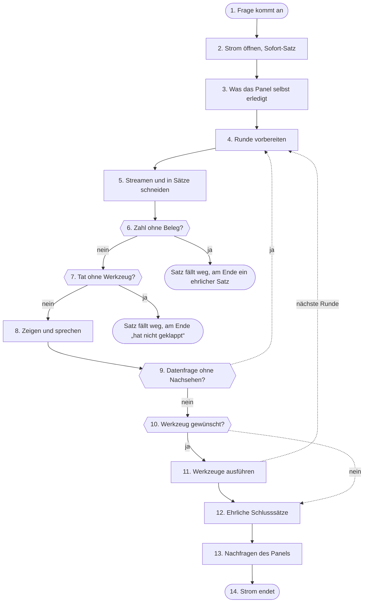

1. <a id="kn-antwort-s1"></a>**Frage kommt an**: chat() prüft das Rate-Limit, setzt die Marke „Sprache läuft“ (Hintergrundarbeit wartet) und zeigt den anderen Geräten des Profils „antwortet gerade“. Dann bereitet chat_turn.prepare Rechte, Sperren, Systemprompt und die angebotenen Werkzeuge vor; _answer übernimmt. Ist das Sprachmodell pausiert (Wartungspause, Notbetrieb), kommt sofort ein fester Satz; im Notbetrieb mit Parakeet vorher die festen Befehle ohne Modell (notbetrieb.antwort: Home Assistant, Uhrzeit, Erinnerungen). Mit „Einfaches sofort beantworten“ bekommen Uhrzeit, Datum, einfache Rechnungen und Einheiten als ganzer kurzer Satz den festen Satz des Panels, ohne Modell und ohne Sofort-Satz davor (sofort.answer, höchstens 80 Zeichen).
2. <a id="kn-antwort-s2"></a>**Strom öffnen, Sofort-Satz**: Zwei Warteschlangen verbinden alles: eine für die Ereignisse ans Gerät, eine für Sätze an die Sprachausgabe. Ist die Sofortige Rückmeldung frei, spielt sofort ein aufgenommener Satz (ohne GPU); bleibt die Antwort danach still, kommt einmal ein Brücken-Satz.
3. <a id="kn-antwort-s3"></a>**Was das Panel selbst erledigt**: Hat die Vorbereitung entschieden, dass das Panel selbst handelt (ein Schaltbefehl, Zustände lesen, „Erst lokal suchen“, ein eindeutiger Lesewunsch), läuft das jetzt. Das Ergebnis geht wie ein Werkzeug-Ergebnis an das Modell, fremder Text eingepackt als Daten.
4. <a id="kn-antwort-s4"></a>**Runde vorbereiten**: Angeboten wird die Liste ohne gesperrte, wegen Fehlern gestoppte oder zu oft genutzte Werkzeuge. Verlangt die Frage ein Werkzeug, muss das Modell eines wählen (tool_choice), mit eigener Temperatur. Die fünfte Runde hat keine Liste mehr: das Modell hört, dass es jetzt antworten soll. Geräte ohne Bildschirm (Lautsprecher, Telefon, Uhr, Siri, Android-Assistent, CarPlay) bekommen höchstens 700 Tokens; eine längere Antwort endet am letzten ganzen Satz.
5. <a id="kn-antwort-s5"></a>**Streamen und in Sätze schneiden**: Die Antwort kommt Stück für Stück. Denktext und als Text geschriebene Werkzeugaufrufe werden nie gezeigt oder gesprochen. split_sentences schneidet fertige Sätze ab („z. B.“ und „5. Oktober“ sind kein Satzende); ein langer erster Satz geht schon am Komma los, damit der erste Ton früh kommt.
6. <a id="kn-antwort-s6"></a>**Zahl ohne Beleg?**: Bei Datenfragen vergleicht answercheck jede Uhrzeit, jedes Datum, jeden Spielstand und Betrag im Satz mit allem, was das Modell bekommen hat. Nach einem Kalender-Abruf zählen nur Angaben aus dieser Antwort, nicht aus früheren; ein zitierter Termin-Titel muss im Ergebnis stehen. Mit „Antwort-Prüfung erweitern“ auch Temperaturen, km und Prozent (gerundet zählt, answercheck.MORE_SLACK) und jeder zitierte Name in jeder Datenantwort.
7. <a id="kn-antwort-s7"></a>**Tat ohne Werkzeug?**: Behauptet ein Satz eine Tat („ist jetzt an“, „habe eingetragen“), muss in dieser Antwort ein Werkzeug dieser Art geklappt haben (taten.check). Ein Satz, der einen Werkzeugaufruf oder eine Tat nur ankündigt („Ich rufe das Timer-Werkzeug auf …“), wird nie gesagt; kommt danach kein Werkzeug, sagt das Panel am Ende seinen festen Satz (taten.announces). Klappt ein Werkzeug der behaupteten Art später in derselben Antwort („Ich mache das Lied.“ vor musik_machen), fällt der Satz still weg. Gilt, wenn ein änderndes Werkzeug oder gar keines angeboten war.
8. <a id="kn-antwort-s8"></a>**Zeigen und sprechen**: Ein geprüfter Satz geht als Text ans Gerät und in die Warteschlange der Sprachausgabe; Codeblöcke werden nur gezeigt. Ein schon gesagter Satz aus einer früheren Runde wird ausgelassen. Die Sprachausgabe fasst nach dem ersten Satz alles Wartende zu einem Stück zusammen, damit die Stimme ruhig bleibt.
9. <a id="kn-antwort-s9"></a>**Datenfrage ohne Nachsehen?**: Braucht die Frage ein Werkzeug und das Modell antwortet ohne eines, wird die ganze Runde nie gesagt. Das Modell wird einmal neu gefragt, mit dem Hinweis, zuerst das Werkzeug zu nutzen.
10. <a id="kn-antwort-s10"></a>**Werkzeug gewünscht?**: Hat das Modell keinen Werkzeugaufruf geschrieben oder ist die Länge erreicht, ist die Antwort fertig. Bei erreichter Länge wird bis zum letzten Satzende gesprochen, der Rest fällt weg.
11. <a id="kn-antwort-s11"></a>**Werkzeuge ausführen**: Halbe Worte vor dem Aufruf werden zurückgenommen, ein fertiger Satz bleibt. Jeder Aufruf geht über chat_tools.run; das Ergebnis kommt als Werkzeug-Nachricht zurück. Scheitert ein Werkzeug zweimal gleich, wird es für diese Antwort gestoppt. Hatte keine Regel die Frage erkannt, zählt die Weiche die Gruppe des ersten Werkzeugs und das feste Hinweiswort (weiche.learn), nie ein Wort der Frage.
12. <a id="kn-antwort-s12"></a>**Ehrliche Schlusssätze**: Fiel ein Satz wegen einer Zahl weg, sagt das Panel „Genauere Angaben dazu habe ich nicht.“; fiel eine Tat weg, einen festen Satz aus taten.sentence. Beide Sätze kommen vom Panel, nie vom Modell. Antwortet das Sprachmodell nicht, weil es gerade wechselt, neu startet oder gemessen wird, sagt das Panel das mit der erwarteten Zeit (llmstart.satz, auch in der Wartungspause eines Wechsels).
13. <a id="kn-antwort-s13"></a>**Nachfragen des Panels**: Nur wenn nichts Fremdes gelesen wurde: eine gelernte Korrektur zum Merken anbieten oder ein Fakt aus dem Gedächtnis nachfragen (nach festen Regeln). Danach legt das Panel die Antwort aufs reMarkable, wenn gewünscht; bietet die Antwort selbst an, sich dort hinzulegen, wartet sie auf ein „Ja“ (remarkable.propose). Es holt bei einer Rückfrage schon vorab. Ist „Das kannst du auch sagen“ an, hängt das Panel feste Beispielsätze an (saetze.row, am Bildschirm als Zeile vor dem Ende; saetze.spoken, beim Sprechen höchstens ein Satz am Tag). Das Werkzeug-Log des Profils wird geschrieben.
14. <a id="kn-antwort-s14"></a>**Strom endet**: Der Anfrage-Verlauf wird abgeschlossen, Fälle und die Prüfung im Hintergrund laufen erst nach dem Sprechen. Bricht das Gerät ab (Unterbrechen), stoppen Modell und Sprachausgabe sofort. Stützt sich die Antwort auf mindestens zwei eigene Dokumente oder Kiwix-Artikel, merkt wissensbuch.keep_offer sie und das Gerät zeigt „Ins Wissensbuch“; nur der Klick des Besitzers legt sie ab.

**Beispiele:** Plaudern ohne Werkzeug: Gesprochen ab dem ersten Satz, keine Prüfung greift. · Termine von morgen: Das Modell ruft den Kalender, die nächste Runde antwortet aus dem Ergebnis. · Erfundene Uhrzeit: Der Satz mit der Uhrzeit wird nie gesagt, dafür ein ehrlicher Satz. · „Licht ist an“, Schalten scheiterte: Statt der Behauptung: „Das hat nicht geklappt: …“.

#### Zahlen (aus dem Code)

- **4** Werkzeugaufrufe pro Runde, mehr laufen nicht ([Schritt 11](#kn-antwort-s11))
- **3** Gedächtnis-Notizen pro Antwort ([Schritt 11](#kn-antwort-s11))
- **2** gleiche Fehler, bis ein Werkzeug stoppt (oder 3 beliebige) ([Schritt 11](#kn-antwort-s11))
- **50** Zeichen, ab denen der erste Satz am Komma losgeht ([Schritt 5](#kn-antwort-s5))

#### Einstellen

- Einstellungen → Sprachmodell: Antwort-Prüfung, Taten prüfen und Fehlerschleife stoppen (alle drei Standard an).
- Einstellungen → Sprachmodell: Länge einer Antwort, Temperatur, Vorher nachdenken; unter Erweitert die Websuchen pro Antwort.

#### Was du siehst

- Zustand → Logs → Anfragen: jede Runde, jedes Werkzeug, „Antwort-Prüfung“ und „Taten-Prüfung“ mit Zahlen, nie mit Text.
- Zustand → Logs → Erweitert → Gespräch: wo die Zeit einer Antwort blieb, bis zum ersten Ton.
- Zustand → Verbessern: wie oft die eingebauten Regeln heute eingegriffen haben.
- Unter der Antwort (Funktionen → Ablauf und Freigabe zeigen): jedes Werkzeug mit ✓/⚠ und Zeit, ein wartender Vorschlag als Karte mit Ja und Nein, sonst eine Rückfrage am Ende mit ihren Antworten als Knöpfen (ablauf.asks); nur Namen und Zahlen, nie Ergebnisse.

#### Im Code

- `app/panel/chat.py` `chat`: Rate-Limit, Sprache zuerst, „antwortet gerade“ ([Schritt 1](#kn-antwort-s1))
- `app/panel/chat.py` `_answer`: führt Modellseite, Sprachausgabe und Ereignisse zu einem Strom zusammen ([Schritt 4](#kn-antwort-s4), [Schritt 5](#kn-antwort-s5), [Schritt 11](#kn-antwort-s11))
- `app/panel/chat_ton.py` `speech_out`: Sätze an die Sprachausgabe, Ton als Strom ([Schritt 8](#kn-antwort-s8))
- `app/panel/chat_modell.py` `model_turn`: Runden mit dem Modell, Werkzeuge, Prüfungen ([Schritt 4](#kn-antwort-s4), [Schritt 11](#kn-antwort-s11))
- `app/panel/chat.py` `split_sentences`: schneidet fertige Sätze ab ([Schritt 5](#kn-antwort-s5))
- `app/panel/chat.py` `said_key`: erkennt einen schon gesagten Satz ([Schritt 8](#kn-antwort-s8))
- `app/panel/chat.py` `no_code`: Codeblöcke nur zeigen, nie sprechen ([Schritt 8](#kn-antwort-s8))
- `app/panel/chat.py` `loop_count`: zählt Fehlschläge für Fehlerschleife stoppen ([Schritt 11](#kn-antwort-s11))
- `app/panel/answercheck.py` `known`: alle Angaben, die das Modell bekommen hat ([Schritt 6](#kn-antwort-s6))
- `app/panel/answercheck.py` `unsupported`: Angaben im Satz ohne Beleg ([Schritt 6](#kn-antwort-s6))
- `app/panel/answercheck.py` `fresh`: nach dem Kalender nur Angaben dieser Antwort ([Schritt 6](#kn-antwort-s6))
- `app/panel/taten.py` `check`: Tat behauptet, aber kein Werkzeug hat es geschafft ([Schritt 7](#kn-antwort-s7))
- `app/panel/taten.py` `announces`: Werkzeugaufruf oder Tat nur angekündigt ([Schritt 7](#kn-antwort-s7), [Schritt 12](#kn-antwort-s12))
- `app/panel/taten.py` `sentence`: der feste ehrliche Satz ([Schritt 12](#kn-antwort-s12))

Selbsttests: `test_panel`, `test_taten`, `test_handlungsregel`, `test_fast_start`, `test_morgen_termine`

### Werkzeuge

Wenn das Modell ein Werkzeug aufruft, führt chat_tools.run es aus, aber nur, wenn es in dieser Runde angeboten war und keine Sperre greift. Das Ergebnis geht als Daten an das Modell zurück, nie als Befehl.

**Warum:** Ein Server-Parser reicht jeden Werkzeugnamen durch, den das Modell schreibt, auch erfundene oder gesperrte. Und eine Webseite oder Mail könnte das Modell bitten, das Licht zu schalten oder Daten wegzuschicken. Darum prüft das Panel bei jedem Aufruf neu, statt dem Modell zu glauben.

#### Ablauf

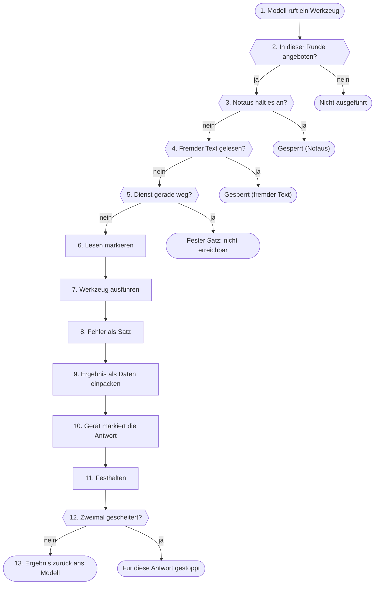

1. <a id="kn-werkzeuge-s1"></a>**Modell ruft ein Werkzeug**: Höchstens 4 Aufrufe pro Runde laufen, und ein wegen Fehlern gestopptes Werkzeug läuft nicht mehr. Gedächtnis-Notizen sind auf 3 pro Antwort begrenzt.
2. <a id="kn-werkzeuge-s2"></a>**In dieser Runde angeboten?**: Nur Werkzeuge aus der Liste dieser Runde laufen. Die Liste ist schon um Sperren gekürzt; alles andere bekommt „nicht verfügbar, nicht noch einmal aufrufen“ oder, nach einer Mail, den Grund der Mail-Sperre.
3. <a id="kn-werkzeuge-s3"></a>**Notaus hält es an?**: Der Notaus wird bei jedem Aufruf gelesen, also greift er auch mitten in einer Antwort. Ab Stufe 1 sind die Werkzeuge gesperrt, die selbst ins Internet gehen; ab Stufe 2 oder mit dem eigenen Notaus des Profils jedes Werkzeug, das etwas ändert.
4. <a id="kn-werkzeuge-s4"></a>**Fremder Text gelesen?**: Hat diese Antwort schon Text von draußen gelesen, darf nichts mehr das Zuhause, das Gedächtnis, Termine oder Erinnerungen ändern. Nach einer Mail ist auch die Websuche zu, nach eigenen Dokumenten ebenfalls (außer bei „Erst lokal suchen“, dann nur mit den eigenen Worten der Frage). Ein Lied, das die Person selbst wünscht, bleibt nach Text von außen offen (own), nach Mail nicht.
5. <a id="kn-werkzeuge-s5"></a>**Dienst gerade weg?**: Sieht der Dienst-Wächter den Dienst dieses Werkzeugs gerade ausgefallen (und der Schalter dafür ist an), kommt sofort ein fester Satz mit der Uhrzeit des Ausfalls statt eines Versuchs. Die Websuche fragt erst unten und kann dann aufs eigene Archiv ausweichen.
6. <a id="kn-werkzeuge-s6"></a>**Lesen markieren**: Werkzeuge, die fremden Text bringen (Websuche, Dokumente, Kalender, frühere Gespräche, Kamera), setzen die Marke schon vor dem Lauf. Ab dann sind die Sperren aus Schritt 4 für den Rest der Antwort aktiv. document_search bringt mit dem Wissensbuch zuerst die passende Seite, dann die Stellen; beides ist fremder Text.
7. <a id="kn-werkzeuge-s7"></a>**Werkzeug ausführen**: Erweiterungen bekommen Profil, Gerät und Herkunft vom Panel, nie vom Modell. Smart-Home-Änderungen brauchen das Codewort in der letzten Nachricht, wenn eines eingestellt ist. Verbindungen zu Diensten draußen gehen über den Wächter.
8. <a id="kn-werkzeuge-s8"></a>**Fehler als Satz**: Ist ein Dienst nicht erreichbar, wird daraus ein kurzer Ergebnis-Text („nicht erreichbar“, „Suche fehlgeschlagen, nicht raten“). Ein angebotenes Werkzeug ohne passende Einrichtung meldet „unbekannt“.
9. <a id="kn-werkzeuge-s9"></a>**Ergebnis als Daten einpacken**: Fremder Text bekommt einen festen Hinweis davor und steht zwischen Markierungen, die er selbst nicht schließen kann. Zustände aus Home Assistant mit freiem Text (Titel, Listen) zählen auch als fremd. Mit „Schnellere Websuche“ steht der lange Hinweis einmal je Antwort, vor jedem weiteren Block ein kurzer mit derselben Regel (chat.OUTSIDE_AGAIN); die Markierungen bleiben immer.
10. <a id="kn-werkzeuge-s10"></a>**Gerät markiert die Antwort**: Das Gerät erfährt, dass die Antwort auf fremdem Text beruht. Solche Antworten gehen später nicht noch einmal ans Modell.
11. <a id="kn-werkzeuge-s11"></a>**Festhalten**: Die Log-Zeile nennt den Namen nur, wenn er angeboten war, sonst „unbekannt“. Was eine Tat war, merkt sich taten für die Handlungs-Prüfung. Menschen sehen die verständlichen Namen aus werkzeuge.py.
12. <a id="kn-werkzeuge-s12"></a>**Zweimal gescheitert?**: Scheitert ein Werkzeug 2 Mal mit denselben Angaben oder 3 Mal überhaupt, wird es für diese Antwort gestoppt und das Modell hört, dass es ehrlich sagen soll, was nicht ging.
13. <a id="kn-werkzeuge-s13"></a>**Ergebnis zurück ans Modell**: Das Modell bekommt das Ergebnis in der nächsten Runde als Daten. Was es daraus sagt, prüft wieder die Antwort (Antwort-Prüfung, Taten prüfen).

**Beispiele:** Termine lesen: Läuft; das Ergebnis geht eingepackt als Daten zurück. · Erfundener Werkzeugname: Nicht ausgeführt: das Werkzeug war nicht angeboten. · Notaus während der Antwort: Gesperrt: der nächste Aufruf liest den Notaus neu. · Websuche und Licht in einer Runde: Gesperrt: nach der Websuche darf nichts mehr schalten.

#### Regeln

Gilt bei: [Schritt 4](#kn-werkzeuge-s4)

| Lage in dieser Antwort | Gesperrt |
|---|---|
| fremder Text gelesen | 13 ändernde Werkzeuge und die der Erweiterungen |
| Mail gelesen | dazu Websuche und neue Termine |
| eigene Dokumente gelesen | Websuche (bei Erst lokal nur eigene Worte) |
| Notaus Stufe 1 | 7 Werkzeuge, die selbst ins Internet gehen |
| Notaus Stufe 2 oder eigener Notaus | jedes Werkzeug, das etwas ändert |

#### Zahlen (aus dem Code)

- **4** Aufrufe pro Runde ([Schritt 1](#kn-werkzeuge-s1))
- **3** Gedächtnis-Notizen pro Antwort ([Schritt 1](#kn-werkzeuge-s1))
- **13** Werkzeuge gesperrt nach fremdem Text ([Schritt 4](#kn-werkzeuge-s4))
- **7** Werkzeuge ohne Internet bei Notaus ([Schritt 3](#kn-werkzeuge-s3))
- **90** Werkzeuge mit verständlichem Namen ([Schritt 11](#kn-werkzeuge-s11))

#### Einstellen

- Einstellungen → Sprachmodell: Fehlerschleife stoppen (Standard an) und unter Erweitert die Websuchen pro Antwort.
- Funktionen → Weiche: welche Werkzeuge das Modell für eine Frage überhaupt sieht.

#### Was du siehst

- Zustand → Logs → Anfragen: jeder Aufruf mit verständlichem Namen, ok oder nicht, Länge und ob gesperrt.
- Zustand → Live: welches Werkzeug gerade läuft und was der Dienst zurückgab (nur die Art).
- Unter der Antwort (Ablauf und Freigabe zeigen): jedes angebotene Werkzeug mit verständlichem Namen, ✓/⚠ und Zeit (ablauf.step), nie seine Angaben oder sein Ergebnis.

#### Im Code

- `app/panel/chat_tools.py` `run`: die Prüfungen und alle eingebauten Werkzeuge ([Schritt 2](#kn-werkzeuge-s2), [Schritt 7](#kn-werkzeuge-s7))
- `app/panel/chat_modell.py` `model_turn`: ruft run_tool, packt Ergebnisse ein, stoppt Schleifen ([Schritt 1](#kn-werkzeuge-s1))
- `app/panel/chat.py` `wrap_outside`: fremder Text als Datenblock ([Schritt 9](#kn-werkzeuge-s9))
- `app/panel/chat.py` `LOCKED_OUTSIDE`: gesperrt nach fremdem Text ([Schritt 4](#kn-werkzeuge-s4))
- `app/panel/chat.py` `LOCKED_MAIL`: gesperrt nach einer Mail ([Schritt 4](#kn-werkzeuge-s4))
- `app/panel/chat.py` `READS_OUTSIDE`: Werkzeuge, die fremden Text bringen ([Schritt 4](#kn-werkzeuge-s4), [Schritt 6](#kn-werkzeuge-s6))
- `app/panel/notaus.py` `locked_tools`: was der Notaus je Stufe sperrt ([Schritt 3](#kn-werkzeuge-s3))
- `app/panel/dienstwacht.py` `tool_down`: fester Satz, wenn ein Dienst weg ist ([Schritt 5](#kn-werkzeuge-s5))
- `app/panel/chat.py` `tool_info`: Zahlen für Logs → Anfragen ([Schritt 11](#kn-werkzeuge-s11))
- `app/panel/werkzeuge.py` `label`: verständlicher Name eines Werkzeugs ([Schritt 11](#kn-werkzeuge-s11))

Selbsttests: `test_fast_start`, `test_dienstwacht`, `test_taten`, `test_notaus`, `test_werkzeuge`, `test_werkzeug_abdeckung`

### Wissen

Wissen ist alles, was der Spark selbst weiß, ohne ins Internet zu gehen: die hochgeladenen Dokumente jedes Profils (eine SQLite-Datei wissen.db pro Profil), das Gedächtnis, frühere Gespräche, das eigene Kiwix-Archiv und erstellte Dokumente. Die Seite zeigt den Weg, auf dem eine Frage passende Stellen in den Dokumenten findet.

**Warum:** Das Sprachmodell kennt die eigenen Unterlagen nicht. Es bekommt nur die wenigen Stellen, die das Panel mit festen Regeln und zwei kleinen Modellen auf dem Prozessor heraussucht, jeweils mit Herkunft. Was in einem Dokument steht, ist Text von außen: Daten, nie ein Befehl.

#### Ablauf

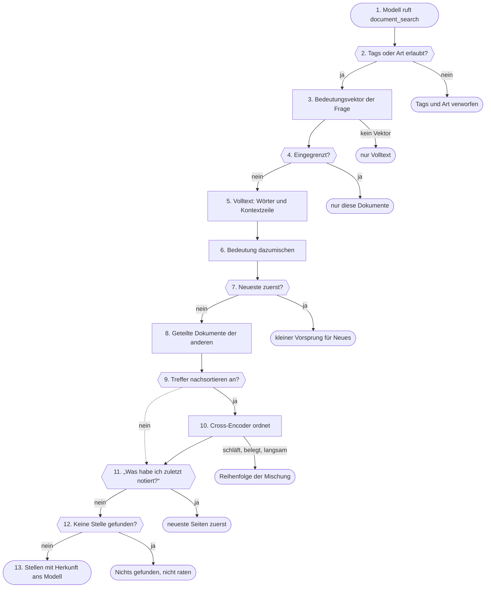

1. <a id="kn-wissen-s1"></a>**Modell ruft document_search**: Das Werkzeug wird nur angeboten, wenn das Profil eigene oder geteilte Dokumente hat, die Funktion für das Profil frei ist und die Stimme erkannt ist. Gäste und fremde Stimmen am geteilten Lautsprecher bekommen es nie. Das Profil kommt aus der Anmeldung, nie vom Modell.
2. <a id="kn-wissen-s2"></a>**Tags oder Art erlaubt?**: Das Modell darf die Suche auf Tags oder eine Dokumentart eingrenzen (höchstens fünf Tags). Ist „Steckbrief und Tags“ für das Profil aus, werden diese Angaben verworfen und alle Dokumente durchsucht.
3. <a id="kn-wissen-s3"></a>**Bedeutungsvektor der Frage**: Mit Bedeutungssuche rechnet ein kleines Vektormodell (eigener Prozess, nur Prozessor) den Vektor der Frage. Es startet nur bei mindestens 8.5 GiB freiem Speicher (auf einem Panel-Rechner 1.5 GiB) und endet nach 10 Minuten ohne Arbeit. Kommt kein Vektor, sucht der Spark nur im Volltext, ohne Fehler.
4. <a id="kn-wissen-s4"></a>**Eingegrenzt?**: Mit Tags oder Art sucht match_docs zuerst die Dokumente, die alle Tags und die Art tragen. Nur deren Stellen kommen weiter in Frage; passt keines, gibt es keine Treffer.
5. <a id="kn-wissen-s5"></a>**Volltext: Wörter und Kontextzeile**: Die Frage wird in Suchwörter zerlegt (Füllwörter weg, Endungen grob gekürzt). Gesucht wird in den Wörtern jeder Stelle und in ihrer Kontextzeile (Titel, Art, Überschriften), die nur mit 0.4 zählt. Die besten 30 bekommen einen Rang.
6. <a id="kn-wissen-s6"></a>**Bedeutung dazumischen**: Hat die Frage einen Vektor, werden die Vektoren aller Stellen verglichen. Unter 0,75 Ähnlichkeit gilt nichts als verwandt; die besten 30 darüber bekommen ebenfalls einen Rang. Beide Ränge werden addiert, so steigt eine Stelle, die in beiden Listen weit oben steht. Die Vektoren liegen als float32 im Speicher und werden nur neu gelesen, wenn sich Stellen oder genutzte Dokumente ändern; solange noch Vektoren fehlen, höchstens alle 30 Sekunden.
7. <a id="kn-wissen-s7"></a>**Neueste zuerst?**: Mit „Neueste zuerst“ bekommt eine kürzlich geänderte Stelle einen kleinen Vorsprung, etwa zwei Plätze, der mit dem Alter kleiner wird. Die Passung bleibt wichtiger; jeder Treffer trägt dann sein Datum.
8. <a id="kn-wissen-s8"></a>**Geteilte Dokumente der anderen**: Mit „Gemeinsame Dokumente“ läuft dieselbe Suche in den Dateien der anderen Profile, aber nur über Dokumente, die dort „Für alle“ sind oder mit „Teilen mit Profilen“ einzeln mit diesem Profil geteilt (documents.Offer). Ist der Haushaltsordner für das Profil frei, läuft sie auch im Bestand des Haushalts (users/haushalt/). Die Treffer tragen den Namen des Besitzers oder „Haushalt“; alles wird nach Rang sortiert.
9. <a id="kn-wissen-s9"></a>**Treffer nachsortieren an?**: Ohne Nachsortieren gehen die ersten fünf der Mischung weiter. Mit Nachsortieren reicht die Mischung ihre besten 30 weiter.
10. <a id="kn-wissen-s10"></a>**Cross-Encoder ordnet**: Ein kleines Modell auf dem Prozessor liest Frage und Stelle zusammen und gibt jeder eine Zahl. Stellen unter -4.0 beantworten die Frage nicht und fallen weg, die besten fünf bleiben. Schläft das Modell, ist es belegt, zu langsam oder kaputt, bleibt die Reihenfolge der Mischung; die Antwort wartet nie länger als eingestellt.
11. <a id="kn-wissen-s11"></a>**„Was habe ich zuletzt notiert?“**: Fragt die Person mit eigenen Worten nach dem, was sie zuletzt, heute oder diese Woche notiert hat, kommen die zuletzt geänderten Seiten zuerst. Ist in der Zeit nichts geändert, sagt das Werkzeug das, statt zu raten.
12. <a id="kn-wissen-s12"></a>**Keine Stelle gefunden?**: Findet die Suche nichts, waren aber Tags oder Art genannt, bekommt das Modell die Steckbrief-Zeilen der passenden Dokumente. Sonst heißt es: nichts gefunden, sag das, rate nicht.
13. <a id="kn-wissen-s13"></a>**Stellen mit Herkunft ans Modell**: Jede Stelle geht mit Dokument, Seite und Abschnitt ans Modell. Ab jetzt gilt die Antwort als eine, die Text von außen gelesen hat: Schalten, Merken und Erinnerungen sind in ihr gesperrt. Das Gerät zeigt die Quellen.

**Beispiele:** Frage nach einer Vertragsklausel: Gefunden: die Klausel und zwei Nachbarstellen, nachsortiert, mit Seite. · Vektormodell schläft noch: Gefunden über den Volltext allein; die Antwort hat nicht gewartet. · Rechnungen mit Tag, Wörter passen nicht: Keine Stelle, aber die Liste der Dokumente mit dem Tag.

#### Regeln

Gilt bei: [Schritt 1](#kn-wissen-s1), [Schritt 8](#kn-wissen-s8)

| Quelle | Wie sie gefunden wird | Wer |
|---|---|---|
| Eigene Dokumente | document_search: Volltext, Bedeutung, Nachsortieren | eigenes Profil |
| Geteilte Dokumente | dieselbe Suche, nur „Für alle“ oder einzeln geteilt | andere Profile, nie Gäste |
| Gedächtnis | wird nicht gesucht: steht in drei Blöcken im Systemprompt | eigenes Profil |
| Frühere Gespräche | history_search über Wörter | eigenes Profil |
| Kiwix | archive_search und wikipedia über das eigene Kiwix im Heimnetz | alle Profile, nie Gäste |
| Erst lokal suchen | Volltext ohne Warten auf Modelle, vor der ersten Runde | wie die Werkzeuge der Anfrage |
| Wissensbuch | document_search: passende Seiten vor den Stellen | eigenes Profil, nur eigene Dokumente |

#### Wissensbuch

- In ruhigen Minuten bekommt das Sprachmodell ein eigenes Dokument in nummerierten Stellen und höchstens 5 bestehende Seiten, die das Panel nach gemeinsamen Wörtern mit Titel, Absender und Tags auswählt. Das Modell schlägt Sätze als JSON vor, jeden mit der Nummer seiner Stelle.
- Das Panel behält einen Satz nur, wenn seine Stelle existiert, jede Zahl und jedes Datum darin in der Stelle steht, er höchstens 400 Zeichen hat und weder Link noch Befehl enthält. Sagt er dasselbe wie ein Satz der Seite mit anderer Zahl, bleiben beide als Widerspruch stehen. Ein Dokument ändert höchstens 5 Seiten.
- Bei einer Frage legt document_search die passendsten Seiten vor die Stellen, jeder Satz mit Quelle. Die Seiten sind Text von außen wie die Dokumente.
- Nachts (im Fenster der Suchprüfung, einmal je Profil) prüft das Panel mit festen Regeln: ein neu gelesenes Dokument wird neu eingearbeitet, Sätze verschwundener Dokumente gehen, gedaechtnis.check markiert vorbeigegangene Daten und alte Zeitwörter als „veraltet?“. Danach beantwortet das Modell für bis zu 50 Sätze nur „steht das so in der Stelle?“; ein Nein entfernt den Satz. Gelöschte oder ausgelassene Dokumente nehmen ihre Sätze sofort mit (documents.on_gone).
- Stützt sich eine Antwort auf mindestens 2 Quellen (Dokumente oder Kiwix-Artikel), merkt sich das Panel sie eine Stunde im Speicher; erst der Klick „Ins Wissensbuch“ legt sie als Seite „Antwort“ ab. Jeder Satz braucht eine Stelle aus diesen Quellen mit allen seinen Zahlen und genug gemeinsamen Wörtern. Export als Obsidian-Ordner (ZIP); nachts eine Kopie in den Ablage-Ordner, wenn das Profil automatisch ablegt und sich das Buch geändert hat.

#### Erst lokal suchen

- Vor der ersten Runde schaut das Panel selbst in Dokumente, Kiwix und frühere Gespräche, gleichzeitig und nur kurz. Die Bedeutungssuche fährt nur mit, wenn ihr Modell schon läuft und frei ist; es wird dafür nicht geweckt.
- Eine Stelle zählt nur, wenn sie mindestens 0.6 der Suchwörter enthält. Was zu spät kommt, wird nicht abgewartet.

#### Gedächtnis

- Das Gedächtnis wird nicht durchsucht. Das Panel sortiert die Fakten mit festen Regeln in drei Blöcke (sicher, gelernt, vielleicht veraltet) und gibt sie dem Modell im Systemprompt.

#### Zahlen (aus dem Code)

- **30** Kandidaten für das Nachsortieren ([Schritt 9](#kn-wissen-s9))
- **-4.0** Untergrenze des Cross-Encoders ([Schritt 10](#kn-wissen-s10))
- **0.4** Gewicht der Kontextzeile ([Schritt 5](#kn-wissen-s5))
- **8 s** längstes Warten auf den Fragevektor ([Schritt 3](#kn-wissen-s3))
- **8.5 GiB** freier Speicher, damit das Vektormodell startet ([Schritt 3](#kn-wissen-s3))
- **1.5 GiB** dasselbe auf einem Panel-Rechner (Spark teilen) ([Schritt 3](#kn-wissen-s3))
- **3** Treffer höchstens bei „Erst lokal suchen“ ([Schritt 5](#kn-wissen-s5))
- **5** Seiten, die ein Dokument im Wissensbuch ändern darf ([Schritt 13](#kn-wissen-s13))
- **300** Seiten im Wissensbuch pro Profil ([Schritt 13](#kn-wissen-s13))
- **50** Sätze, die das Modell nachts gegen ihre Quelle prüft (Standard) ([Schritt 13](#kn-wissen-s13))

#### Einstellen

- Funktionen → Eigene Dokumente und darunter Bedeutungssuche an: Stellen bekommen einen Bedeutungsvektor (Standard aus).
- Funktionen → Eigene Dokumente und darunter Treffer nachsortieren an: dazu Modellgröße und wie lange höchstens gewartet wird.
- Funktionen → Eigene Dokumente und darunter Steckbrief und Tags an: Suche nach Tags und Art.
- Funktionen → Eigene Dokumente und darunter Gemeinsame Dokumente an: Dokumente „Für alle“.
- Funktionen → Eigene Dokumente und darunter Wissensbuch an: Seiten aus den eigenen Dokumenten, dazu wie viele Dokumente am Tag.

#### Was du siehst

- Zustand → Logs → Anfragen: der Schritt „Nachsortieren“ mit Zahl der Kandidaten, behaltenen Stellen und Zustand des Modells.
- Zustand → Logs → Diagnose, Bereich Wissen: Zeilen von wissen, docembed, lokal und kiwix, nur feste Wörter und Zahlen.

#### Im Code

- `app/panel/wissen.py` `search`: eigene und geteilte Dokumente, Mischung, Nachsortieren ([Schritt 1](#kn-wissen-s1), [Schritt 8](#kn-wissen-s8), [Schritt 9](#kn-wissen-s9))
- `app/panel/documents.py` `search`: Volltext und Vektoren, Rangmischung ([Schritt 5](#kn-wissen-s5), [Schritt 6](#kn-wissen-s6))
- `app/panel/documents.py` `_terms`: Suchwörter aus der Frage ([Schritt 5](#kn-wissen-s5))
- `app/panel/documents.py` `match_docs`: Dokumente mit Tags und Art ([Schritt 4](#kn-wissen-s4))
- `app/panel/docembed.py` `query`: Fragevektor oder nichts ([Schritt 3](#kn-wissen-s3))
- `app/panel/docembed.py` `_call`: ein Auftrag an den Modellprozess ([Schritt 3](#kn-wissen-s3))
- `app/panel/nachsortieren.py` `rank`: Cross-Encoder oder Reihenfolge der Mischung ([Schritt 10](#kn-wissen-s10))
- `app/panel/wissen.py` `recent_window`: „zuletzt notiert“ als feste Regel ([Schritt 11](#kn-wissen-s11))
- `app/panel/wissen.py` `where`: Herkunft einer Stelle für das Modell ([Schritt 13](#kn-wissen-s13))
- `app/panel/lokal.py` `look`: der kurze Blick vor der Antwort ([Schritt 5](#kn-wissen-s5))
- `app/panel/wissensbuch.py` `answer_block`: passende Seiten des Wissensbuchs mit Quellen ([Schritt 13](#kn-wissen-s13))
- `app/panel/gedaechtnis.py` `hint_lines`: Fakten in drei Blöcken ([Schritt 13](#kn-wissen-s13))

Selbsttests: `test_wissen`, `test_nachsortieren`, `test_abschnitte`, `test_lokal`, `test_kiwix`, `test_gedaechtnis`, `test_suchpruefung`, `test_wissensbuch`

### Wächter

Der Wächter entscheidet bei jeder Verbindung, die ein Werkzeug nach außen aufbaut, ob sie sein darf: Webseiten aus der Suche, Kalender, Kontakte, Mail, Home Assistant, NAS und MCP-Dienste. Er prüft die Adresse, die wirklich angefragt wird, nach festen Regeln; das Sprachmodell fragt er nie.

**Warum:** Text von draußen (eine Webseite, eine Mail, ein Kalendereintrag) könnte das Sprachmodell dazu bringen, Adressen im Heimnetz, Cloud-Metadaten oder die eigenen Dienste des Spark anzufragen (SSRF). Der Wächter lässt das gar nicht erst zu, egal was im Text steht.

#### Ablauf

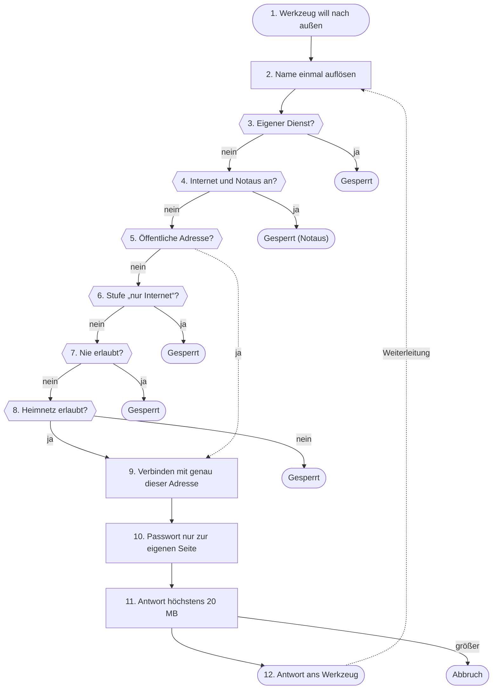

1. <a id="kn-waechter-s1"></a>**Werkzeug will nach außen**: Alles, was eine Adresse aus Einstellungen oder aus fremdem Text ansteuert, holt sich seinen Zugang über netguard.client mit einer Stufe (heute 31 Module). Feste eigene Dienste wie das Sprachmodell laufen direkt; welche das sind und warum, steht in netguard.DIRECT_OK, ein Selbsttest hält die Liste vollständig.
2. <a id="kn-waechter-s2"></a>**Name einmal auflösen**: resolve() fragt den Namen genau einmal ab. Hat er mehrere Adressen, muss jede erlaubt sein, sonst ist Schluss.
3. <a id="kn-waechter-s3"></a>**Eigener Dienst?**: Die Ports der eigenen Dienste sind auf dieser Maschine gesperrt: auf Loopback und auf jeder eigenen Adresse im LAN oder VPN (own_addresses liest sie jede Minute neu). Laufen die Modelle auf einem anderen Rechner (models.host), gelten seine Adressen genauso (model_addresses).
4. <a id="kn-waechter-s4"></a>**Internet und Notaus an?**: Ist die Adresse öffentlich und der Notaus mindestens auf Stufe 1, geht nichts ins Internet, egal welche Stufe das Werkzeug hat. Das Heimnetz bleibt erreichbar, wie die Stufe es erlaubt.
5. <a id="kn-waechter-s5"></a>**Öffentliche Adresse?**: Eine öffentliche Adresse ist auf jeder Stufe erlaubt.
6. <a id="kn-waechter-s6"></a>**Stufe „nur Internet“?**: Was aus Suchergebnissen oder Antworten kommt, darf nie ins Heimnetz (chat, feeds, geraeteupdate, ghtoken, mailansicht, meldung, modellseite, remarkable, verbund).
7. <a id="kn-waechter-s7"></a>**Nie erlaubt?**: Link-lokale Adressen (169.254.x, dort antworten Cloud-Metadaten), Multicast, unbestimmte und reservierte Adressen sind auf keiner Stufe erlaubt.
8. <a id="kn-waechter-s8"></a>**Heimnetz erlaubt?**: Home Assistant und andere Dienste im Heimnetz (doclingdienst, esp32, hamelden, homeassistant, kiwix, offsite) dürfen immer. Kalender, Kontakte, Mail und MCP (calendars, contacts, mail, mcp, meinmcp, tasks) nur, wenn unter Einstellungen → Sicherheit → Heimnetz-Adressen erlauben eingeschaltet ist.
9. <a id="kn-waechter-s9"></a>**Verbinden mit genau dieser Adresse**: Die Verbindung geht an die geprüfte Adresse, nicht noch einmal an den Namen. Ein zweites Nachschlagen könnte anders antworten (DNS-Rebinding). Das Zertifikat wird trotzdem für den Namen geprüft.
10. <a id="kn-waechter-s10"></a>**Passwort nur zur eigenen Seite**: Anmeldedaten gehen nur an die Seite, für die sie eingetragen wurden (gleicher Host oder gleiche Hauptdomain, etwa die CalDAV-Server von icloud.com), nie über http, wenn die Adresse https war.
11. <a id="kn-waechter-s11"></a>**Antwort höchstens 20 MB**: Antworten werden bei 20 MB abgeschnitten, auch nach dem Entpacken von gzip, damit eine riesige oder gepackte Antwort den Speicher nicht füllt.
12. <a id="kn-waechter-s12"></a>**Antwort ans Werkzeug**: Das Werkzeug bekommt die Antwort als Daten. Eine Weiterleitung ist eine neue Verbindung und wird genauso geprüft, ab Schritt 2.

**Beispiele:** Webseite aus der Suche: Erlaubt: verbunden mit der geprüften öffentlichen Adresse. · Home Assistant im Heimnetz: Erlaubt: die Stufe Heimnetz darf ins Heimnetz. · Kalender im Heimnetz, Schalter aus: Gesperrt: Heimnetz-Adressen sind für Nutzer-Dienste aus. · Link auf Cloud-Metadaten: Gesperrt: eine Seite aus der Suche darf nie ins Heimnetz, 169.254 nie. · Notaus an, Wetter abfragen: Gesperrt: bei Notaus geht nichts ins Internet.

#### Regeln

Gilt bei: [Schritt 6](#kn-waechter-s6), [Schritt 8](#kn-waechter-s8)

| Stufe | Wer sie nutzt (aus dem Code) | Internet | Heimnetz |
|---|---|---|---|
| nur Internet | chat, feeds, geraeteupdate, ghtoken, mailansicht, meldung, modellseite, remarkable, verbund | ✓ | ✕ |
| Nutzer | calendars, contacts, mail, mcp, meinmcp, tasks | ✓ | nur mit Schalter |
| Heimnetz | doclingdienst, esp32, hamelden, homeassistant, kiwix, offsite | ✓ | ✓ |
| je nach Ziel | anrufe, dienstwacht, nas, nasquelle, speicher, telefon, zertpin | wie das Ziel eingestellt ist | – |
| immer | alle | ✕ bei Notaus | ✕ eigene Dienste, 169.254, Multicast |

#### Wenn gesperrt

- Das Werkzeug bekommt statt einer Antwort den Fehler Blocked mit dem Grund; es kommt keine Verbindung zustande.
- Die Sperre zählt für „Notaus von selbst“: 15 in 10 Minuten heben den Notaus auf Stufe 1, wenn der Schalter an ist. Sperren durch den Notaus selbst und Proben des Dienst-Wächters zählen nicht.

#### Zahlen (aus dem Code)

- **20 MB** größte Antwort ([Schritt 11](#kn-waechter-s11))
- **30000–31099, 31443** gesperrte eigene Ports ([Schritt 3](#kn-waechter-s3))
- **15** Sperren in 10 Minuten bis Notaus Stufe 1 (wenn an) ([Schritt 4](#kn-waechter-s4))
- **1** Notaus-Stufe ohne Internet ([Schritt 4](#kn-waechter-s4))

#### Einstellen

- Einstellungen → Sicherheit → Heimnetz-Adressen erlauben: Kalender, Kontakte, Mail und MCP dürfen auch ins Heimnetz (Standard aus).
- Einstellungen → Sicherheit → Notaus von selbst: viele gesperrte Verbindungen in kurzer Zeit lösen Notaus Stufe 1 aus (Standard aus).

#### Was du siehst

- Zustand → Live: eine rote Linie endet mit ✕ an der Wand, mit Adresse und Grund; die Kachel „Wächter heute“ zählt die Sperren.
- Ich → Mein Zustand: ob ein eigener Dienst (Kalender, Mail) antwortet oder die Anmeldung abgelehnt hat.

#### Im Code

- `app/panel/netguard.py` `allowed`: die Regel: nichts oder der Grund ([Schritt 3](#kn-waechter-s3), [Schritt 7](#kn-waechter-s7), [Schritt 8](#kn-waechter-s8))
- `app/panel/netguard.py` `resolve`: einmal auflösen, jede Adresse prüfen, Live melden ([Schritt 2](#kn-waechter-s2))
- `app/panel/netguard.py` `client`: der Zugang nach außen für Werkzeuge ([Schritt 1](#kn-waechter-s1))
- `app/panel/netguard.py` `_Transport`: Passwort-Schutz, Größengrenze, Ergebnis für Mein Zustand ([Schritt 10](#kn-waechter-s10), [Schritt 11](#kn-waechter-s11))
- `app/panel/netguard.py` `_Capped`: schneidet die Antwort ab, auch entpackt ([Schritt 11](#kn-waechter-s11))
- `app/panel/netguard.py` `same_site`: gleiche Seite für Anmeldedaten ([Schritt 10](#kn-waechter-s10))
- `app/panel/netguard.py` `own_addresses`: alle Adressen dieser Maschine ([Schritt 3](#kn-waechter-s3))
- `app/panel/netguard.py` `model_addresses`: die Adressen des Modell-Rechners, wenn er ein anderer ist ([Schritt 3](#kn-waechter-s3))
- `app/panel/netguard.py` `IMAP4_SSL`: Mail über die geprüfte Adresse ([Schritt 9](#kn-waechter-s9))
- `app/panel/notaus.py` `watch`: zählt Sperren für Notaus von selbst ([Schritt 2](#kn-waechter-s2))
- `app/panel/live.py` `outgoing`: zeigt jede Entscheidung auf Live ([Schritt 2](#kn-waechter-s2))

Selbsttests: `test_hardening`, `test_notaus`, `test_waechter_umgehung`

### Logs und Live

Betrieb hält fest, was der Spark tut, ohne Inhalte: den Weg jeder Anfrage (Logs → Anfragen), die Live-Übersicht, das Journal mit festen Wörtern, den Dienst-Wächter und die Sicherung. Die Seite zeigt, welche Spuren eine Anfrage hinterlässt.

**Warum:** Wer einen Fehler sucht, muss sehen, welchen Weg eine Anfrage nahm und wie lange jeder Schritt dauerte. Fragen, Antworten und Werkzeugergebnisse gehören aber der Person; deshalb gehen nur feste Wörter, Werkzeugnamen und Zahlen in Log und Verlauf.

#### Ablauf

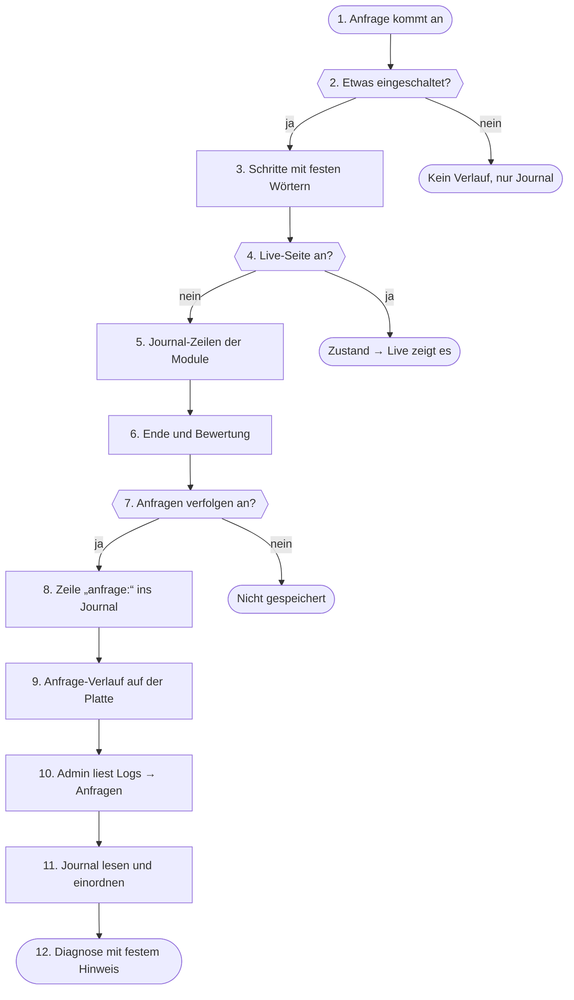

1. <a id="kn-betrieb-s1"></a>**Anfrage kommt an**: Chat, Schreibhilfe, Dokumente erstellen und was der Spark von selbst tut, legen beim Start einen Datensatz an: Kanal, Art (Profil, Gast, Admin, Spark) und Gerät. Vor jedem Schalter zählt aktiv.py die Anfrage für „Aktiv 10 min“ (OLED, Monitoring, Live): ein Profil einmal, ein Gast je Gerät als gekürzter Hash, nichts vom Spark selbst, nur im Speicher.
2. <a id="kn-betrieb-s2"></a>**Etwas eingeschaltet?**: Ist weder „Anfragen verfolgen“ noch die Live-Seite noch der Einstellungs-Assistent an, gibt es keinen Datensatz. Übrig bleiben nur die Journal-Zeilen der Module.
3. <a id="kn-betrieb-s3"></a>**Schritte mit festen Wörtern**: Jeder Schritt (Weiche, Modellrunde, Werkzeug, Prüfung, Sprachausgabe) kommt mit Art, Name und Zeit dazu. Ein Wert geht nur hinein, wenn er eine Zahl oder ein kurzes festes Wort ist; alles andere wird verworfen. Frage, Antwort, Argumente und Ergebnisse kommen nie hinein.
4. <a id="kn-betrieb-s4"></a>**Live-Seite an?**: Bei eingeschalteter Live-Seite sieht live.py jeden Schritt sofort: welcher Dienst gefragt wird, was der Wächter entscheidet, was zurückkommt. Alles bleibt im Speicher und ist nach einem Neustart weg.
5. <a id="kn-betrieb-s5"></a>**Journal-Zeilen der Module**: Unabhängig davon schreibt jedes Modul seine Zeilen ins Journal des Spark. Jede Zeile beginnt mit einem Wort aus logfilter.AREAS (32 Bereiche), Profile nur über profiles.log_name. Ein Selbsttest prüft beides.
6. <a id="kn-betrieb-s6"></a>**Ende und Bewertung**: Am Ende bekommt der Datensatz seinen Zustand: Fehler, wenn ein Fehlerwort gesetzt ist, langsam, wenn der erste Ton später als 5.0 s kam, sonst gut.
7. <a id="kn-betrieb-s7"></a>**Anfragen verfolgen an?**: Ist nur Live oder der Einstellungs-Assistent an, endet der Datensatz hier. Er wird nirgends geschrieben.
8. <a id="kn-betrieb-s8"></a>**Zeile „anfrage:“ ins Journal**: Eine Zeile pro Anfrage: Kennung, Kanal, Einordnung, Werkzeuge mit ok oder nicht ok, Zeit bis zur Rückmeldung, bis zum ersten Ton und bis zum Ende. Ohne Namen.
9. <a id="kn-betrieb-s9"></a>**Anfrage-Verlauf auf der Platte**: Der Datensatz wird angehängt. Wird die Datei zu groß, bleiben nur die letzten 500 Anfragen der letzten 2880 Minuten. Die Datei ist in keiner Sicherung.
10. <a id="kn-betrieb-s10"></a>**Admin liest Logs → Anfragen**: Nur Admin und Mit-Admins lesen den Verlauf, mit Rate-Limit. Name und Gerät eines Profils stehen nur da, wenn das Profil es erlaubt; sonst heißt es „Profil“. Zu einer Anfrage zeigt das Panel die Journal-Zeilen aus ihrer Zeit.
11. <a id="kn-betrieb-s11"></a>**Journal lesen und einordnen**: logfilter liest höchstens 20000 Zeilen; an journalctl gehen nur Zahlen aus festen Listen. Jede Zeile bekommt ihren Bereich aus dem ersten Wort, ihre Stufe aus festen Fehlerwörtern; Tokens, Schlüssel und Passwörter werden geschwärzt, bevor die Zeile das Panel verlässt.
12. <a id="kn-betrieb-s12"></a>**Diagnose mit festem Hinweis**: Die Diagnose zählt Zeilen pro Bereich und zeigt zum neuesten Fehler einen festen Hinweis aus einer Liste, nie einen vom Modell.

**Beispiele:** Alles an, eine Frage mit Werkzeug: Live zeigt den Weg, Logs → Anfragen behält ihn, das Journal hat die Zeile „anfrage:“. · Nur die Live-Seite an: Auf Zustand → Live zu sehen, danach nirgends gespeichert. · Alles aus: Kein Datensatz; nur die Journal-Zeilen der Module.

#### Regeln

Gilt bei: [Schritt 4](#kn-betrieb-s4)

| Spur | Wo | Wie lange | In der Sicherung |
|---|---|---|---|
| Live | Speicher | bis zum Neustart | ✕ |
| Anfrage-Verlauf | state/traces.jsonl | 2880 min | ✕ |
| Journal | journald | wie journald eingestellt ist | ✕ |
| Dienst-Wächter | state/dienstwacht.json | Ausfälle 10080 min | ✓ |
| Sicherungen | backups/ | 7 tägliche, 5 andere | – |

#### Dienst-Wächter

- Eine Schleife prüft Sprachmodell, Hören, Sprechen, Internet, SearXNG, Kiwix, Home Assistant, Mail, Kalender und NAS, je nach Dienst jede Minute oder alle 5 Minuten, ohne Anmeldung: eine HTTP-Antwort unter 500 gilt als „antwortet“. Home Assistant wird unter /manifest.json gefragt, das es ohne Token beantwortet; /api/ ohne Token zählte dort als falsche Anmeldung.
- Weg ist ein Dienst nach 3 Fehlproben über mindestens 3 Minuten, zurück nach 2 guten. Ist das Internet weg, gibt es eine Meldung für alles dahinter. Während Update, Start und Notaus Stufe 2 zählt nichts, ebenso nicht für einen Teil in der Wartungspause, bis deren Zeit um ist.
- Die Proben gehen über den Wächter, zählen aber nicht auf der Live-Liste und lösen nie „Notaus von selbst“ aus.

#### Sicherung

- Einmal am Tag packt das Panel in einer Pause users/, voices/, config.json, das Panel-Passwort und die Dateien aus backup.STATE_FILES. Der Schlüssel state/secret.key und die Anmeldeschlüssel sind nicht dabei; Datenbanken werden als stimmige Kopie gesichert.

#### Zahlen (aus dem Code)

- **500** Anfragen im Verlauf höchstens ([Schritt 9](#kn-betrieb-s9))
- **2880 min** so lange bleibt eine Anfrage ([Schritt 9](#kn-betrieb-s9))
- **5.0 s** ab hier gilt eine Anfrage als langsam ([Schritt 6](#kn-betrieb-s6))
- **3** Fehlproben in Folge, bis ein Dienst als weg gilt ([Schritt 5](#kn-betrieb-s5))
- **30 min** höchstens eine Ausfall-Meldung pro Dienst ([Schritt 5](#kn-betrieb-s5))
- **7** tägliche und eigene Sicherungen, die bleiben ([Schritt 9](#kn-betrieb-s9))

#### Einstellen

- Einstellungen → Spark → Betrieb → Anfragen verfolgen: Logs → Anfragen (Standard aus).
- Einstellungen → Spark → Betrieb → Logs „Live-Seite“: Zustand → Live (Standard aus).
- Funktionen → Dienst-Wächter: Dienste prüfen und Admins bei Ausfall benachrichtigen (Standard aus).
- Funktionen → Wartungspause: vor einem Update Sprachmodell, Spracherkennung oder Sprachausgabe anhalten (Standard aus), dann Zustand → Wartungspause.
- Einstellungen → Sicherung: eine Sicherung von Hand anlegen oder zurückspielen.

#### Was du siehst

- Zustand → Logs → Anfragen: der Weg jeder Anfrage mit Werkzeugen und Zeiten.
- Zustand → Logs → Diagnose: Zeilen nach Bereich, Fehler und Warnungen, mit festem Hinweis.
- Zustand → Live: laufende Anfragen, Wächter-Entscheidungen und Dienste als Bild.
- Zustand → Dienste: was der Dienst-Wächter prüft und die Ausfälle der letzten Tage.

#### Im Code

- `app/panel/tracelog.py` `start`: ein Datensatz, wenn etwas an ist ([Schritt 1](#kn-betrieb-s1))
- `app/panel/tracelog.py` `safe`: nur Zahlen und kurze feste Wörter ([Schritt 3](#kn-betrieb-s3))
- `app/panel/tracelog.py` `Rec`: Schritte, Marken, Zustand ([Schritt 3](#kn-betrieb-s3), [Schritt 6](#kn-betrieb-s6))
- `app/panel/tracelog.py` `finish`: Journal-Zeile und Anfrage-Verlauf ([Schritt 8](#kn-betrieb-s8), [Schritt 9](#kn-betrieb-s9))
- `app/panel/tracelog.py` `shown`: Name nur mit Zustimmung ([Schritt 10](#kn-betrieb-s10))
- `app/panel/live.py` `step`: jeder Schritt auf Zustand → Live ([Schritt 4](#kn-betrieb-s4))
- `app/panel/logfilter.py` `AREAS`: die Bereichswörter des Journals ([Schritt 5](#kn-betrieb-s5))
- `app/panel/logfilter.py` `parse`: Bereich, Stufe, Schwärzen ([Schritt 11](#kn-betrieb-s11))
- `app/panel/logfilter.py` `summary`: Zähler und fester Hinweis ([Schritt 12](#kn-betrieb-s12))
- `app/panel/dienstwacht.py` `round_once`: eine Runde Proben und Meldungen ([Schritt 5](#kn-betrieb-s5))
- `app/panel/backup.py` `create`: eine Sicherung packen ([Schritt 9](#kn-betrieb-s9))

Selbsttests: `test_tracelog`, `test_live`, `test_logfilter`, `test_log_luecken`, `test_dienstwacht`, `test_hardening`, `test_panel`

### Sprachmodell

Das Sprachmodell schreibt die Antworten: das eigene hinter dem LLM-Tor oder qwen38 aus dgx-spark-qwen38 (nicht Teil dieses Repos). Das Panel spricht es an der eingestellten Adresse über die OpenAI-Schnittstelle an, gestreamt, und sorgt dafür, dass Sprache immer vor Hintergrundarbeit kommt. Adresse, Schlüssel und Modellname stehen nur in llm.py; jede Hintergrundaufgabe fragt über llm.complete.

**Warum:** Die GPU teilt sich das Modell mit der Sprachausgabe. Wartet eine Person, darf kein Lernen oder Aufräumen im Hintergrund die Antwort bremsen. Und ein hängendes oder fehlendes Modell soll einen klaren Satz ergeben, keine Minuten Stille.

#### Ablauf

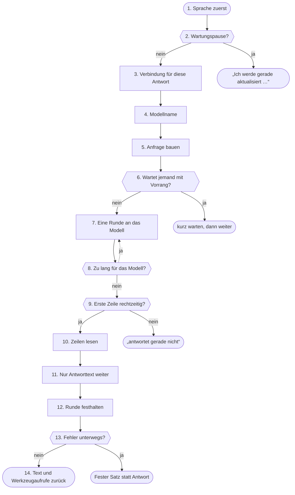

1. <a id="kn-llm-s1"></a>**Sprache zuerst**: Mit dem Start einer Antwort und bei jedem gestreamten Stück setzt das Panel die Marke „Sprache läuft“. Hintergrundarbeit am Modell wartet bis 20 Sekunden danach und wird abgebrochen, sobald jemand spricht; nach 3 Abbrüchen gibt sie für diesmal auf.
2. <a id="kn-llm-s1w"></a>**Wartungspause?**: Hat ein Admin das Sprachmodell für ein Update angehalten, fragt das Panel es gar nicht erst: die Antwort ist sofort ein fester Satz mit der Restzeit, auch die Weiche und System One fragen nicht. Hintergrundarbeit am Modell wartet, bis die Pause endet, und zählt das nicht als Abbruch. Am Ende der Zeit endet die Pause erst, wenn das Modell 2-mal hintereinander antwortet. Mit „Automatisch bei Neustart“ pausiert das Panel selbst, sobald ein Dienst des Sprachmodells (eigenes oder qwen38) neu startet oder umschaltet (höchstens 30 min), und macht weiter, sobald das Modell wieder antwortet. Läuft das Modell auf einem anderen Rechner, der nicht antwortet (Notbetrieb, steuer.weg), gilt dasselbe mit dem Satz „Der Spark macht gerade Pause.“; der Dienst-Wächter meldet den Ausfall trotzdem. Mit Funktionen → Notbetrieb mit Parakeet hört dann Parakeet auf dem Panel-Rechner, und feste Befehle (Home Assistant, Uhrzeit, Erinnerungen) gehen ohne Modell (notbetrieb.antwort).
3. <a id="kn-llm-s2"></a>**Verbindung für diese Antwort**: Jede Antwort hat eine eigene Verbindung mit dem eingestellten Zeitlimit (ein Wert außerhalb gilt nicht) und fünf Sekunden zum Verbinden. Ist ein Schlüssel eingetragen, geht er als Bearer mit. Das Modell ist ein fester eigener Dienst und läuft nicht über den Wächter.
4. <a id="kn-llm-s3"></a>**Modellname**: Ist kein Modell eingestellt, fragt das Panel einmal /models und merkt sich den ersten Namen für diese Adresse.
5. <a id="kn-llm-s4"></a>**Anfrage bauen**: Die Anfrage streamt, mit Länge, Temperatur, top_p, top_k und presence_penalty aus den Einstellungen (0 = Standard des Servers; der Qualitätstest vergleicht mit der Qwen-Empfehlung). Denken ist aus, außer „Vorher nachdenken“ ist an. Während der Werkzeugwahl gilt die eigene Temperatur dafür. Der Server meldet am Ende immer, wie viel er gelesen und geschrieben hat und wie viel aus seinem Zwischenspeicher kam.
6. <a id="kn-llm-s5"></a>**Wartet jemand mit Vorrang?**: Hat eine andere Person Vorrang und ihre Antwort noch keinen ersten Satz, wartet diese Runde höchstens die eingestellte Zeit (bis 5 Sekunden). Eine Antwort mit Vorrang hält andere höchstens 30 Sekunden auf. Davor prüft das Panel das Kontingent (Tag, Woche, Monat): ein Profil darüber bekommt einen festen Satz statt einer Antwort, feste Befehle ohne Modell gehen weiter.
7. <a id="kn-llm-s6"></a>**Eine Runde an das Modell**: Die Runde geht an die eingestellte Adresse. Lehnt der Server die erzwungene Werkzeugwahl ab, geht dieselbe Runde einmal ohne sie.
8. <a id="kn-llm-s7"></a>**Zu lang für das Modell?**: Meldet der Server, dass die Anfrage länger als sein Kontext ist, kürzt das Panel in der ersten Runde den Verlauf auf ein Viertel des Verlaufsbudgets und fragt einmal neu.
9. <a id="kn-llm-s8"></a>**Erste Zeile rechtzeitig?**: Die erste Zeile muss innerhalb von 90 Sekunden kommen (oder des kürzeren Zeitlimits). Ein Modell, das länger schweigt, hängt: die Antwort endet mit einem klaren Satz statt mit Minuten Stille.
10. <a id="kn-llm-s9"></a>**Zeilen lesen**: Jede Zeile ist ein Stück JSON. Werkzeugaufrufe kommen in Teilen und werden nach ihrer Nummer zusammengesetzt; Denktext, den der Server getrennt liefert, wird nur gezählt. Unlesbare Zeilen werden übersprungen.
11. <a id="kn-llm-s10"></a>**Nur Antworttext weiter**: Denktext im Text (<think> … </think>) und Werkzeugaufrufe, die als Text kommen, werden nie gezeigt oder gesprochen. Der Rest geht Stück für Stück an „Antwort bauen“.
12. <a id="kn-llm-s11"></a>**Runde festhalten**: Für den Anfrage-Verlauf zählen nur Zahlen: gelesene Tokens, davon aus dem Zwischenspeicher, Größe von Systemprompt, Werkzeugliste und Verlauf, Zeit bis zum ersten Wort, Wartezeit wegen Vorrang. Der Verbrauchszähler zählt gelesene und geschriebene Tokens je Aufgabe und Profil (ohne Meldung des Servers geschätzt, rund 3.5 Zeichen je Token).
13. <a id="kn-llm-s12"></a>**Fehler unterwegs?**: Ein Fehler wird zu einem festen Kürzel: nicht erreichbar, zu langsam, Schlüssel abgelehnt, Modell fehlt. Bei „nicht erreichbar“ und „zu langsam“ wird ein fester Satz auch gesprochen, wenn noch nichts gesagt war. Gäste sehen nur die Art des Fehlers, nie seinen Text.
14. <a id="kn-llm-s13"></a>**Text und Werkzeugaufrufe zurück**: Die Runde gibt zurück, warum sie endete und welche Werkzeuge das Modell aufrufen will. Was davon läuft, entscheidet das Panel.

**Beispiele:** Normale Antwort: Gestreamt, der erste Satz geht sofort zur Sprachausgabe. · Zwei Personen, eine mit Vorrang: Die Runde wartet kurz, bis die Antwort mit Vorrang ihren ersten Satz hat. · Sehr langes Dokument im Verlauf: Verlauf gekürzt, einmal neu gefragt. · Sprachmodell hängt: „Mein Sprachmodell antwortet gerade nicht.“ statt Stille. · Sprachmodell wird neu eingespielt: „Ich werde gerade aktualisiert und bin in etwa 20 Minuten wieder da.“

#### Zahlen (aus dem Code)

- **90 s** bis zur ersten Zeile des Modells ([Schritt 9](#kn-llm-s8))
- **60 bis 600 s** erlaubtes Zeitlimit ([Schritt 3](#kn-llm-s2))
- **20 s** nach Sprache wartet Hintergrundarbeit noch ([Schritt 1](#kn-llm-s1))
- **3** Abbrüche, bis Hintergrundarbeit aufgibt ([Schritt 1](#kn-llm-s1))
- **5 s** längste Wartezeit für Vorrang ([Schritt 6](#kn-llm-s5))
- **30 s** so lange hält eine Antwort mit Vorrang höchstens auf ([Schritt 6](#kn-llm-s5))
- **5 bis 240 min** Dauer einer Wartungspause ([Schritt 2](#kn-llm-s1w))
- **30 min** längste automatische Pause, bevor sie als Ausfall zählt ([Schritt 2](#kn-llm-s1w))

#### Einstellen

- Einstellungen → Sprachmodell: Adresse, Schlüssel und Modell; dazu Vorher nachdenken, Temperatur und Länge einer Antwort.
- Einstellungen → Sprachmodell, unter Erweitert: Zeitlimit für eine Antwort.
- Funktionen → Vorrang für Personen: ausgewählte Profile bekommen ihre Antwort zuerst.
- Zustand → Wartungspause: das Sprachmodell vor einem Update anhalten (auch sudo speech-spark pause llm 30).
- Funktionen → Verbrauchszähler: zählt Tokens je Modell, Aufgabe und Profil; darunter das Kontingent je Profil für Tag, Woche und Monat.
- Funktionen → Wartungspause → Automatisch bei Neustart: pausiert von selbst, wenn das Sprachmodell neu startet.

#### Was du siehst

- Zustand → Logs → Erweitert → Gespräch: pro Runde gelesene Tokens, davon aus dem Zwischenspeicher, und die Zeit bis zum ersten Wort.
- Zustand → Verbrauch: Tokens je Tag, Modell, Bereich und Profil.
- Unter der Antwort (Ablauf und Freigabe zeigen): die Werkzeuge der Runden mit Name, ✓/⚠ und Zeit.
- Zustand → Prüfen → Vorrang für Sprache: ob die Sprachausgabe flüssig bleibt, während das Modell rechnet.
- Spark teilen: Läuft das Panel auf einem anderen Rechner, stehen Sprachmodell, Spracherkennung, Sprachausgabe und Bilder auf dem Modell-Rechner (Zustand → Live, Kasten „Modell-Rechner“); das Panel erreicht sie nur über das TLS-Tor mit festem Zertifikat und steuert sie über den Wärter.

#### Im Code

- `app/panel/chat.py` `chat`: setzt „Sprache läuft“ bei jedem Stück ([Schritt 1](#kn-llm-s1))
- `app/panel/chat.py` `_answer`: Verbindung, Anfrage, Runden (llm_round), Fehlerfälle ([Schritt 3](#kn-llm-s2), [Schritt 5](#kn-llm-s4), [Schritt 7](#kn-llm-s6))
- `app/panel/llm.py` `model`: Modellname aus Einstellung oder /models ([Schritt 4](#kn-llm-s3))
- `app/panel/llm.py` `url`: die eine Adresse des Sprachmodells ([Schritt 1](#kn-llm-s1))
- `app/panel/llm.py` `complete`: Aufruf jeder Hintergrundaufgabe, wartet in vorrang ([Schritt 1](#kn-llm-s1))
- `app/panel/chat.py` `sampling`: top_p, top_k und presence_penalty ([Schritt 5](#kn-llm-s4))
- `app/panel/chat.py` `first_within`: die erste Zeile muss rechtzeitig kommen ([Schritt 9](#kn-llm-s8))
- `app/panel/chat.py` `ContextFull`: Anfrage länger als der Kontext ([Schritt 8](#kn-llm-s7))
- `app/panel/chat.py` `llm_error_code`: Fehler als festes Kürzel ([Schritt 13](#kn-llm-s12))
- `app/panel/chat.py` `LLM_GONE`: der gesprochene Satz, wenn das Modell fehlt ([Schritt 13](#kn-llm-s12))
- `app/panel/chat.py` `prompt_sizes`: Größe der Teile einer Anfrage ([Schritt 12](#kn-llm-s11))
- `app/panel/stufe.py` `wait_turn`: wartet auf eine Antwort mit Vorrang ([Schritt 6](#kn-llm-s5))
- `app/panel/vorrang.py` `mark`: Marke „Sprache läuft“ ([Schritt 1](#kn-llm-s1))
- `app/panel/vorrang.py` `run`: Hintergrundarbeit weicht der Sprache ([Schritt 1](#kn-llm-s1))
- `app/panel/wartung.py` `paused`: Wartungspause: das Modell wird nicht gefragt ([Schritt 2](#kn-llm-s1w))
- `app/panel/wartung.py` `auto_tick`: Wartungspause von selbst, wenn das Sprachmodell neu startet ([Schritt 2](#kn-llm-s1w))
- `app/panel/wartung.py` `sentence`: der feste Satz mit der Restzeit ([Schritt 2](#kn-llm-s1w))
- `app/panel/verbrauch.py` `llm`: zählt Tokens einer Runde ([Schritt 12](#kn-llm-s11))
- `app/panel/verbrauch.py` `over`: welche Grenze ist voll: Tag, Woche oder Monat? ([Schritt 6](#kn-llm-s5))
- `app/panel/verbrauch.py` `warn`: Vorwarnung unter der Antwort, einmal je Zeitraum ([Schritt 12](#kn-llm-s11))

Selbsttests: `test_panel`, `test_llm_settings`, `test_vorrang`, `test_stufe`, `test_fast_start`, `test_wartung`

### Spracherkennung

Die Spracherkennung macht aus einer Aufnahme Text. Das Panel nimmt die Aufnahme an, prüft sie und reicht sie an den ASR-Dienst weiter. Dieser Proxy prüft Schlüssel, Größe und Abtastrate, lässt Anfragen nach Vorrang warten und gibt sie an die Engine, die nur auf dieser Maschine lauscht.

**Warum:** Eine Aufnahme kommt von draußen: von einem Browser, einer App, einem Lautsprecher. Sie könnte riesig sein, eine erfundene Abtastrate tragen oder nur Stille, ein Klick oder die eigene Stimme des Spark sein. Feste Regeln fangen das ab, bevor die Grafikkarte rechnet und bevor ein Text als Frage zählt.

#### Ablauf

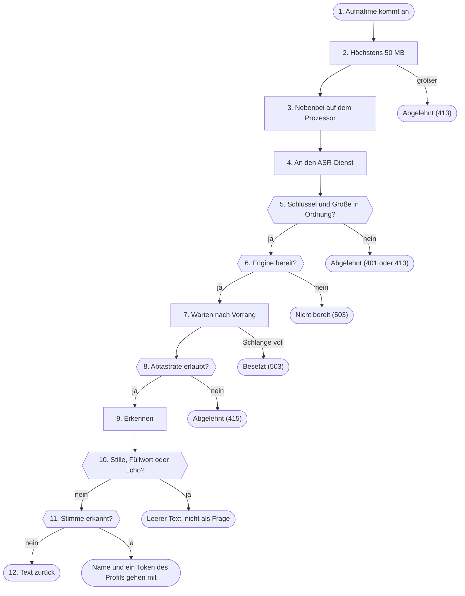

1. <a id="kn-asr-s1"></a>**Aufnahme kommt an**: Der Browser schickt die Aufnahme ans Panel. Jeder Anrufer darf nur so oft pro Minute (Profil 240), Gäste teilen sich 3 Plätze gleichzeitig.
2. <a id="kn-asr-s2"></a>**Höchstens 50 MB**: read_audio liest die Aufnahme in Stücken und bricht bei 50 MB ab. Ein Weckwort darf nur ein angemeldetes Profil mitschicken; es geht dann als Hinweis an das Modell. Mit „Namen fürs Hören“ legt hoerwoerter.prompt die Namen der Profile, Kontakte, Räume und Geräte des Profils bei (höchstens 100, geteilte Lautsprecher nur Profilnamen).
3. <a id="kn-asr-s3"></a>**Nebenbei auf dem Prozessor**: Während die Grafikkarte erkennt, laufen auf dem Prozessor schon die Sprechererkennung (wenn an und ein Profil fragt), die Raum-Stimme, die Prüfung auf eine fremde Stimme und die Messung, wie viel der Aufnahme wirklich Stimme ist.
4. <a id="kn-asr-s4"></a>**An den ASR-Dienst**: Das Panel schickt die Aufnahme mit dem API-Schlüssel an den Proxy. stufe.asr_level legt die Stufe des Profils bei, an einem geteilten Lautsprecher aber nicht. Nur das Panel kann eine Stufe setzen: mit dem Schlüssel aus vorrang-key und nur von dieser Maschine, sonst gilt normal.
5. <a id="kn-asr-s5"></a>**Schlüssel und Größe in Ordnung?**: BodyLimit lehnt zu große Anfragen und solche ohne den richtigen Schlüssel ab, bevor etwas gelesen wird. Ohne eingetragenen Schlüssel darf nur diese Maschine selbst fragen.
6. <a id="kn-asr-s6"></a>**Engine bereit?**: engine_status fragt /health der Engine. Antwortet sie nicht, liest der Proxy ihren Zustand und den der systemd-Einheit und nennt den Grund.
7. <a id="kn-asr-s7"></a>**Warten nach Vorrang**: PrioGate lässt so viele Aufnahmen durch, wie die Engine gleichzeitig nimmt (engine_max_seqs). Die anderen warten nach Stufe, dann nach Ankunft. Wer wartet, rückt alle vier Sekunden eine Stufe auf; eine laufende Anfrage wird nie unterbrochen.
8. <a id="kn-asr-s8"></a>**Abtastrate erlaubt?**: audio_rate_ok liest die Abtastrate aus dem Kopf der Datei (WAV, FLAC, Ogg, WebM) oder fragt ffprobe. Ein Kopf mit erfundener Rate würde beim Umrechnen den Speicher füllen.
9. <a id="kn-asr-s9"></a>**Erkennen**: Mit Qwen3-ASR geht die Aufnahme an die vLLM-Engine, die nur auf dieser Maschine lauscht; nur prompt, temperature und stream reichen durch, dazu die Kontextwörter aus den Einstellungen. Mit Parakeet erkennt der Proxy selbst auf dem Prozessor, in Stücken von höchstens 90 Sekunden, die an einer leisen Stelle geschnitten werden. Im Notbetrieb mit Parakeet (Panel-Rechner, Modell-Rechner weg) führt common.model_url die Aufnahme zu speech-spark-notasr auf Port 31009, nur für den Rechner selbst: derselbe Proxy mit Parakeet, geladen bei der ersten Aufnahme, entladen nach 10 Minuten ohne eine.
10. <a id="kn-asr-s10"></a>**Stille, Füllwort oder Echo?**: stille.check verwirft Text aus fast stummen Aufnahmen und ein einzelnes „Ja“ oder „Okay“ mit zu wenig Stimme. Für Profile prüft echo.check, ob der Text die eigene Stimme des Spark von einem anderen Gerät ist, und fremdstimme, ob ein von selbst geöffnetes Mikrofon eine fremde Stimme hörte.
11. <a id="kn-asr-s11"></a>**Stimme erkannt?**: speakers.identify vergleicht die Aufnahme mit jedem eingelernten Stimmabdruck. Nur ein klarer Treffer (über der Schwelle der gewählten Strenge und deutlich vor dem Zweiten) zählt. Live zeigt nur „Stimme erkannt“, nie wessen.
12. <a id="kn-asr-s12"></a>**Text zurück**: Der Text geht an das Gerät, das daraus die Frage an den Chat macht. Bei einem Fehler bekommt ein Gast nur einen festen Code, nie den Text des Dienstes.

**Beispiele:** Frage im Browser, Profil: Text mit erkannter Stimme zurück. · Klick nach der Antwort: Verworfen: zu wenig Stimme, keine Frage. · Datei mit erfundener Abtastrate: Abgelehnt, bevor die Engine sie sieht. · Engine lädt noch: Abgelehnt mit dem Grund, das Gerät sagt Bescheid.

#### Zahlen (aus dem Code)

- **50 MB** größte Aufnahme am Panel ([Schritt 2](#kn-asr-s2))
- **8000–192000** erlaubte Abtastrate in Hz ([Schritt 8](#kn-asr-s8))
- **240** Aufnahmen pro Minute und Profil ([Schritt 1](#kn-asr-s1))
- **3** Gäste gleichzeitig ([Schritt 1](#kn-asr-s1))
- **0.75** Schwelle der Sprechererkennung bei normaler Strenge ([Schritt 11](#kn-asr-s11))
- **120** Minuten Ton liest Parakeet höchstens ([Schritt 9](#kn-asr-s9))
- **31009** Port von Parakeet im Notbetrieb, nur 127.0.0.1 ([Schritt 9](#kn-asr-s9))
- **10** Minuten ohne Aufnahme, dann entlädt Parakeet im Notbetrieb ([Schritt 9](#kn-asr-s9))

#### Einstellen

- Einstellungen → Spracherkennung: Qwen3-ASR auf der Grafikkarte oder Parakeet auf dem Prozessor, Sprache und Kontextwörter.
- Funktionen → Sprechererkennung: Profile an der Stimme erkennen und wie streng (Standard aus).

#### Was du siehst

- Zustand → Verbrauch: gehörte Sekunden je Tag, Aufgabe und Profil.
- Zustand → Überblick: Zustand der Engine, Anfragen, Fehler, mittlere Dauer und die Warteschlange.
- Zustand → Logs → Anfragen: wie lange eine Aufnahme gewartet hat und wie viele sie überholt hat.

#### Im Code

- `app/panel/admin.py` `test_asr`: Ratenlimit und Plätze für Gäste ([Schritt 1](#kn-asr-s1))
- `app/panel/admin.py` `_test_asr`: der Weg im Panel: lesen, nebenbei prüfen, weiterreichen ([Schritt 2](#kn-asr-s2), [Schritt 4](#kn-asr-s4))
- `app/panel/stufe.py` `asr_level`: Stufe des Profils, nicht am geteilten Lautsprecher ([Schritt 4](#kn-asr-s4))
- `app/common.py` `BodyLimit`: Größe und Schlüssel vor dem Lesen ([Schritt 5](#kn-asr-s5))
- `app/common.py` `PrioGate`: Warten nach Vorrang ([Schritt 7](#kn-asr-s7))
- `app/common.py` `audio_rate_ok`: Abtastrate aus dem Dateikopf ([Schritt 8](#kn-asr-s8))
- `app/asr_proxy.py` `transcriptions`: der Proxy vor der Engine ([Schritt 4](#kn-asr-s4))
- `app/asr_proxy.py` `engine_status`: bereit, lädt, Fehler oder aus ([Schritt 6](#kn-asr-s6))
- `app/parakeet.py` `Recognizer`: Parakeet auf dem Prozessor ([Schritt 9](#kn-asr-s9))
- `app/panel/stille.py` `check`: Stille und Füllwörter ([Schritt 10](#kn-asr-s10))
- `app/panel/echo.py` `check`: die eigene Stimme des Spark ([Schritt 10](#kn-asr-s10))
- `app/panel/speakers.py` `identify`: wessen Stimme, nur bei klarem Treffer ([Schritt 11](#kn-asr-s11))

Selbsttests: `test_units`, `test_hardening`, `test_stufe`, `test_stille`, `test_echo`, `test_stimmabdruck`

### Sprachausgabe

Die Sprachausgabe macht aus Text Ton. Der TTS-Dienst nimmt einen Satz an, räumt ihn auf, verdeckt Geheimnisse, wählt Sprache und Stimme und gibt ihn an die Engine (Qwen3-TTS über vllm-omni), die nur auf dieser Maschine lauscht. Der Ton kommt gestreamt zurück.

**Warum:** Ein Lautsprecher im Raum sagt alles laut, was er bekommt. Passwörter und Codes dürfen dort nie gesprochen werden, und Zeichen wie Sternchen, Links oder Emojis klingen falsch. Deshalb laufen feste Regeln auf jedem Satz, egal woher er kommt: Chat, Lautsprecher, Telegram, Erinnerungen.

#### Ablauf

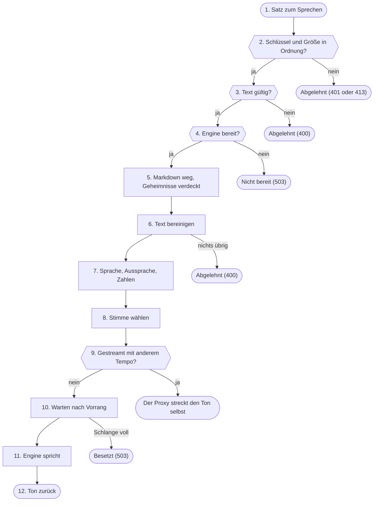

1. <a id="kn-tts-s1"></a>**Satz zum Sprechen**: Das Panel schickt jeden Satz einer Antwort mit dem API-Schlüssel und der Stufe des Profils an den TTS-Dienst. Andere Programme dürfen das mit dem API-Schlüssel auch.
2. <a id="kn-tts-s2"></a>**Schlüssel und Größe in Ordnung?**: BodyLimit lehnt zu große Anfragen und solche ohne den richtigen Schlüssel ab, bevor etwas gelesen wird.
3. <a id="kn-tts-s3"></a>**Text gültig?**: Der Text darf nicht leer sein und höchstens 20000 Zeichen haben. Eine Vorlage-Stimme nimmt check_reference nur als eingebettete data:audio-Adresse an, nie als Link: die Engine würde einen Link sonst selbst aus dem Heimnetz holen.
4. <a id="kn-tts-s4"></a>**Engine bereit?**: Eine VoiceDesign-Anfrage geht an die zweite Engine, wenn sie eingeschaltet ist; alles andere an die Haupt-Engine. engine_status fragt deren /health und nennt sonst den Grund.
5. <a id="kn-tts-s5"></a>**Markdown weg, Geheimnisse verdeckt**: speech_markdown nimmt die Zeichen der Formatierung heraus, dann ersetzt hide_secrets Passwörter, Codewörter, Einmal-Codes und Schlüssel durch „nur schriftlich sichtbar“. Das läuft auf jeder Anfrage, auch wenn „Text bereinigen“ aus ist; die geschriebene Antwort behält den Wert.
6. <a id="kn-tts-s6"></a>**Text bereinigen**: clean_text nimmt Emojis, „haha“, *lacht*, Codeblöcke und Links heraus, beruhigt auf Wunsch Ausrufe und setzt ans Zeilenende einen Punkt, damit die Stimme absetzt. Bleibt nichts übrig, kommt keine Anfrage an die Engine.
7. <a id="kn-tts-s7"></a>**Sprache, Aussprache, Zahlen**: Steht die Sprache auf Auto, rät guess_language an häufigen Wörtern Deutsch oder Englisch, damit ein einzelnes englisches Wort nicht den Ton der ganzen Antwort ändert. Dann gilt die eigene Aussprache-Liste, danach schreibt speak_abbreviations Abkürzungen aus („z. B.“, „ca.“, „€/Monat“) und speak_numbers Datum, Uhrzeit, Geld, Zahlen und Einheiten (km/h, kWh, kg, GB …).
8. <a id="kn-tts-s8"></a>**Stimme wählen**: Temperatur, top_p und ein fester Seed aus den Einstellungen halten die Stimme von Satz zu Satz gleich. Ein Base-Modell spricht mit einer geklonten Stimme aus voices/ (apply_clone); ein unbekannter Name fällt auf die Standardstimme zurück. Mit „Referenz der eigenen Stimme kürzen“ (tts.ref_max_s) nimmt es statt einer langen Aufnahme ein Stück davon: kurzref.cut_at schneidet einmal an der leisesten Stelle vor der Grenze, die Spracherkennung schreibt das Stück auf, kurzref.keep_words behält davon die Wörter des eigenen Textes (mindestens 70 % gleich, sonst bleibt die ganze Aufnahme). Bis das Stück fertig ist, gilt die ganze Aufnahme.
9. <a id="kn-tts-s9"></a>**Gestreamt mit anderem Tempo?**: vllm-omni nimmt beim Streamen kein Tempo an. Dann streckt tempo.Stretcher den Ton Stück für Stück selbst (WSOLA, die Tonhöhe bleibt).
10. <a id="kn-tts-s10"></a>**Warten nach Vorrang**: PrioGate lässt so viele Sätze durch, wie die Engine gleichzeitig nimmt (engine_max_seqs); die anderen warten nach Stufe, dann nach Ankunft.
11. <a id="kn-tts-s11"></a>**Engine spricht**: Die Engine erzeugt den Ton. Gestreamt kommt er als Stücke zurück; das erste Stück ist absichtlich klein (initial_chunk_frames), damit der Ton schnell beginnt, auch wenn mehrere Anfragen laufen. „Mehrere Stimmen gleichzeitig“ (tts.engine_decode_batch) bündelt im Decoder bis zu 2 oder 4 Stimmen mit CUDA-Graphen, „Gleichen Anfang merken“ (tts.engine_prefix_cache) lässt die Engine den gleichen Anfang der Sätze einer Stimme wiederverwenden; beide stehen auf aus (Standard von vllm-omni).
12. <a id="kn-tts-s12"></a>**Ton zurück**: Der Proxy reicht den Ton unverändert weiter und zählt nur Dauer, Länge und Fehler für das Monitoring, nie den Text.

**Beispiele:** Antwortsatz im Chat: Gesprochen, gestreamt, mit fester Stimme. · Passwort in der Antwort: Gesprochen wird „nur schriftlich sichtbar“, geschrieben bleibt der Wert. · Nur ein Emoji: Nichts zu sagen, nichts geht an die Engine. · Schneller sprechen: Der Proxy streckt den gestreamten Ton.

#### Zahlen (aus dem Code)

- **20000** Zeichen pro Anfrage höchstens ([Schritt 3](#kn-tts-s3))
- **„nur schriftlich sichtbar“** sagt die Stimme statt eines Geheimnisses ([Schritt 5](#kn-tts-s5))
- **4** Arten, Zahlen vorzulesen ([Schritt 7](#kn-tts-s7))
- **3.0 s** bleiben von einer gekürzten Referenz mindestens ([Schritt 8](#kn-tts-s8))
- **2.0 s** länger als die Grenze, erst dann wird gekürzt ([Schritt 8](#kn-tts-s8))

#### Einstellen

- Einstellungen → Sprachausgabe: Modell, Standardstimme, Sprache, Text bereinigen, Zahlen vorlesen und die eigene Aussprache-Liste.
- Einstellungen → Stimmen: eigene Stimmen aufnehmen, anhören und sichern (für ein Base-Modell).
- Einstellungen → Sprachausgabe → Erweitert: „Referenz der eigenen Stimme kürzen“, „Mehrere Stimmen gleichzeitig“ und „Gleichen Anfang merken“ (alle aus); vorher und nachher Zustand → Prüfen → Leistung messen.

#### Was du siehst

- Zustand → Verbrauch: gesprochene Sekunden je Tag, Aufgabe und Profil.
- Zustand → Überblick: Zustand der Engines, Anfragen, Fehler, Zeit bis zum ersten Ton und die Warteschlange.

#### Im Code

- `app/tts_proxy.py` `speech`: der Weg eines Satzes durch den Proxy ([Schritt 1](#kn-tts-s1))
- `app/tts_proxy.py` `check_reference`: Vorlage nur eingebettet ([Schritt 8](#kn-tts-s8))
- `app/tts_proxy.py` `engine_status`: bereit, lädt, Fehler oder aus ([Schritt 4](#kn-tts-s4))
- `app/tts_proxy.py` `apply_clone`: geklonte Stimme aus voices/ ([Schritt 8](#kn-tts-s8))
- `app/textnorm.py` `speech_markdown`: Markdown-Zeichen weg ([Schritt 5](#kn-tts-s5))
- `app/textnorm.py` `hide_secrets`: Geheimnisse nie sprechen ([Schritt 5](#kn-tts-s5))
- `app/textnorm.py` `clean_text`: Emojis, Lachen, Links, Code ([Schritt 6](#kn-tts-s6))
- `app/textnorm.py` `guess_language`: Deutsch oder Englisch raten ([Schritt 7](#kn-tts-s7))
- `app/textnorm.py` `speak_numbers`: Zahlen ausschreiben ([Schritt 7](#kn-tts-s7))
- `app/tempo.py` `Stretcher`: Tempo beim Streamen ([Schritt 9](#kn-tts-s9))
- `app/tts_proxy.py` `shorten`: Referenz einmal kürzen ([Schritt 8](#kn-tts-s8))
- `app/kurzref.py` `cut_at`: leiseste Stelle vor der Grenze ([Schritt 8](#kn-tts-s8))
- `app/kurzref.py` `keep_words`: Wörter des eigenen Textes behalten ([Schritt 8](#kn-tts-s8))
- `app/common.py` `PrioGate`: Warten nach Vorrang ([Schritt 10](#kn-tts-s10))

Selbsttests: `test_units`, `test_markdown`, `test_hardening`, `test_stufe`, `test_tempo`, `test_kurzref`

### Bilder und Musik

Bilder malen macht aus einem Wunsch ein Bild, auf dem Spark selbst. Das Panel prüft den Wunsch mit festen Regeln und gibt ihn an den Bild-Dienst, der nur auf dieser Maschine lauscht. Der lädt FLUX.2 klein erst beim ersten Bild, prüft das fertige Bild und gibt den Speicher nach einer Ruhezeit frei.

Musik machen läuft daneben genauso: aus einem Wunsch unter Ich → Musik oder musik_machen im Gespräch wird ein Lied (ohne Angabe instrumental, 2 Minuten). Der Musik-Dienst auf :31004 lädt ACE-Step 1.5 nur für ein Lied, im Modell, das der Admin gewählt hat, und gibt den Speicher nach einer Ruhezeit frei; „Musik testen“ misst jedes installierte Modell. Beide Dienste teilen die Engine bei Bedarf aus bedarf.py. Musik bearbeiten macht aus einem eigenen Lied eine neue Fassung (Abschnitt neu, verlängern, Musikrichtung, Remix, neuer Text) mit demselben Modell; Schneiden, Tempo und Tonart macht der Musik-Dienst sofort mit ffmpeg, ohne Modell. Eigene Dateien nur mit dem Rechte-Haken.

Immer nur eins der beiden Modelle ist geladen (Dominik 2026-10-18): Bilder und Lieder stehen in einer Warteschlange im Panel (schwer.py); wer hinter anderen wartet, hört Platz und ungefähre Dauer.

**Warum:** Ein Bildmodell kann alles malen, auch Nacktes, Gewalt oder echte Menschen. Darüber entscheidet nie das Sprachmodell, sondern feste Regeln vor und nach dem Malen. Und das Modell braucht viel gemeinsamen Speicher: es darf das Sprachmodell und die Stimme nie verdrängen.

#### Ablauf

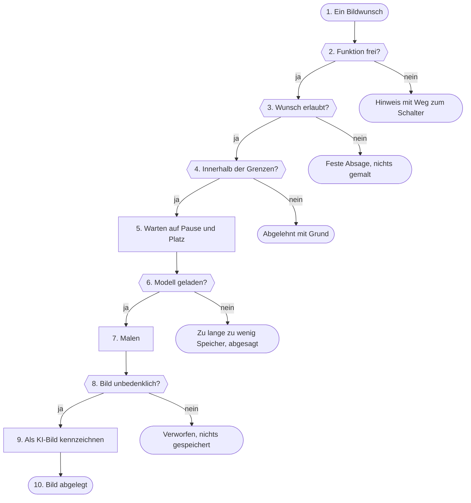

1. <a id="kn-bild-s1"></a>**Ein Bildwunsch**: Ein Profil schreibt einen Wunsch unter Ich → Bilder, oder die Weiche-Gruppe „bild“ bietet im Gespräch das Werkzeug bild_malen an; das Modell schreibt dazu einen englischen Prompt. Bilder ändern startet ohne Werkzeug: bilder.from_turn nimmt nach fester Regel das Foto dieser Nachricht oder das Ergebnis der letzten Änderung, unter Ich → Bilder ein eigenes Bild. Alles landet in bilder.start. Schnellknöpfe (drehen, heller, schwarzweiß …) brauchen kein Modell: bilder.quick_png macht sie sofort im Panel. Ein Liedwunsch kommt genauso über Ich → Musik oder die Gruppe „musik“ mit musik_machen in musik.start; eine Änderung eines eigenen Liedes über Ich → Musik oder musik_bearbeiten in musik.start_edit (das Panel nimmt das Lied, nie das Modell), Schneiden und Tempo ohne Modell in musik.tone, eine eigene Datei mit dem Rechte-Haken in musik.upload.
2. <a id="kn-bild-s2"></a>**Funktion frei?**: features.allowed fragt die Freigabe: der Admin hat Bilder malen eingeschaltet und dieses Profil nicht gesperrt. Gäste bekommen das Werkzeug nie; nach fremdem Text und bei Notaus Stufe 2 ist es gesperrt.
3. <a id="kn-bild-s3"></a>**Wunsch erlaubt?**: bilder.refuse_text prüft Wunsch und Prompt gegen eine feste Wortliste (nichts Sexuelles, keine Gewalt, keine Hasssymbole) und gegen die Namen der Profile und Kontakte. Für Lieder prüft musik.refuse_text Wunsch, Beschreibung und Liedtext gegen die Wortliste und Geheimnisse, Wunsch und Beschreibung auf „im Stil von“ einem Künstler (im Gespräch mit festem Hinweis, die Beschreibung ohne Namen neu zu schicken); Namen gehen. „Text schreiben“ (musik.write_lyrics) lässt das Sprachmodell den Liedtext aus der Beschreibung schreiben und Künstlernamen in Stilwörter setzen; das Panel schneidet „im Stil von …“ heraus und lehnt ab, wenn ein Name bleibt. Das Modell kann das nicht umgehen.
4. <a id="kn-bild-s4"></a>**Innerhalb der Grenzen?**: Pro Profil gelten Bilder pro Tag (gleitend 24 Stunden), Platz und höchstens 300 Bilder; Lieder: Lieder pro Tag, Platz und längstes Lied (musik.start), je Lied höchstens 10 Fassungen, 10 eigene Dateien am Tag; jede Zahl einer Änderung prüft musik.plan_edit. Auf dem ganzen Spark warten höchstens 10 schwere Aufträge, Bilder und Lieder zusammen.
5. <a id="kn-bild-s5"></a>**Warten auf Pause und Platz**: Der Auftrag läuft im Hintergrund (bilder._work, musik._work): er wartet, bis niemand spricht (vorrang), und stellt sich in die eine Warteschlange für Bilder und Lieder (schwer.run). Die feste Regel schwer.pick nimmt den ältesten; solange die geladene Art noch wartet, kommt sie zuerst, aber höchstens 3-mal hintereinander, während die andere Art wartet. Ist eine andere Art dran, beendet das Panel zuerst das geladene Modell. Wer hinter anderen steht, bekommt einen festen Satz mit Platz und ungefährer Dauer (schwer.hint), die Karte zeigt „Wartet · Platz 2 von 3“. Ein Bild darf höchstens 720 Sekunden brauchen.
6. <a id="kn-bild-s6"></a>**Modell geladen?**: bild_server.Engine.start nimmt zuerst den einen Platz (bedarf.OnDemand.claim, Sperre bedarf.lock: hält ihn der Musik-Dienst, antwortet er „belegt“) und startet sd-server als eigenen Prozess auf 127.0.0.1, aber nur, wenn genug gemeinsamer Speicher frei ist; sonst bleibt alles andere ungestört. Zu wenig Speicher beendet den Auftrag nicht: er behält seinen Platz und versucht es alle 30 Sekunden neu, höchstens 600 Sekunden lang.
7. <a id="kn-bild-s7"></a>**Malen**: Die Engine malt das Bild in 4 Schritten in der gewählten Größe; ihre eigene Ausgabe kommt nie ins Journal, weil sie den Prompt nennen würde.
8. <a id="kn-bild-s8"></a>**Bild unbedenklich?**: bild_server.nsfw_share lässt einen Klassifikator auf der CPU das Bild prüfen. Über 0.5 wird es verworfen; fehlt die Prüfung, zeigt das Panel nichts.
9. <a id="kn-bild-s9"></a>**Als KI-Bild kennzeichnen**: bild_server.finish kodiert das Bild neu als PNG und schreibt hinein, dass es KI-erzeugt ist, ein geändertes Bild KI-bearbeitet (auch als IPTC-Angabe).
10. <a id="kn-bild-s10"></a>**Bild abgelegt**: Das Bild kommt mit seinem Auftrag in den Ordner des Profils (bilder.keep), die Karte im Chat und in der iPhone-App zeigt es, auch in einem wieder geöffneten Gespräch; über App oder Telegram kommt ein Push. Nach einer Ruhezeit beendet der Bild-Dienst die Engine und gibt den Speicher frei. Ein Lied liegt als MP3 unter users/ID/musik/ (musik.keep), mit Abspieler im Chat und unter Ich → Musik.

**Beispiele:** Katze auf einem Skateboard: Gemalt, gekennzeichnet, in der Galerie. · Bild vom eigenen Profilnamen: Feste Absage, das Modell wird nicht gefragt. · Zu wenig Speicher frei: Nichts geladen, Sprache läuft weiter.

#### Zahlen (aus dem Code)

- **300** Bilder pro Profil höchstens ([Schritt 4](#kn-bild-s4))
- **10** Bilder und Lieder warten höchstens ([Schritt 4](#kn-bild-s4))
- **3** dieselbe Art höchstens hintereinander ([Schritt 5](#kn-bild-s5))
- **600** Sekunden Warten auf Speicher höchstens ([Schritt 6](#kn-bild-s6))
- **0.5** Anteil der Bildprüfung, ab dem verworfen wird ([Schritt 8](#kn-bild-s8))
- **4** Schritte pro Bild ([Schritt 7](#kn-bild-s7))
- **10** Fassungen je Lied höchstens ([Schritt 4](#kn-bild-s4))
- **10** eigene Musikdateien am Tag höchstens ([Schritt 4](#kn-bild-s4))
- **720** Sekunden pro Auftrag höchstens ([Schritt 5](#kn-bild-s5))

#### Einstellen

- Installation: sudo ./install.sh --bild 4b-q8 (oder 4b-q4, 9b-q8, 9b-q4, none).
- Funktionen → Bilder malen: Schalter, Bilder pro Tag, Platz, längste Seite, Entladen nach Minuten, „Bild testen“.
- Musik: sudo ./install.sh --musik 2b (oder 2b-klein, xl, none; mehrere nacheinander bleiben alle); Funktionen → Musik machen: Schalter, Modell, Lieder pro Tag, Platz, längstes Lied; Zustand → Prüfen → „Musik testen“ misst jedes installierte Modell.
- Funktionen → Musik machen → Musik bearbeiten: Schalter (aus); dann unter Ich → Musik am Lied „Bearbeiten“ und im Menü „⋯“ „Eigene Datei hochladen“.

#### Was du siehst

- Zustand → Live: Ziel „Bilder malen“ nur mit Zahlen; Logs → Diagnose, Bereich „Bild“.
- Zustand → Live: Ziel „Musik machen“ mit Liedern und der letzten Messung in Zahlen; Logs → Diagnose, Bereich „Musik“.
- Zustand → Live: unter „Im Hintergrund“ jedes Bild und Lied mit „wartet auf den Platz“ oder „wartet auf Speicher“, an den Zielen „hat den Platz“; Logs → Diagnose, Bereich „Schwere Aufträge“.

#### Im Code

- `app/panel/bilder.py` `start`: Wunsch annehmen ([Schritt 1](#kn-bild-s1))
- `app/panel/features.py` `allowed`: Freigabe für das Profil ([Schritt 2](#kn-bild-s2))
- `app/panel/bilder.py` `refuse_text`: Wortliste und Personen ([Schritt 3](#kn-bild-s3))
- `app/panel/bilder.py` `_work`: Auftrag im Hintergrund ([Schritt 5](#kn-bild-s5))
- `app/panel/bilder.py` `keep`: Bild ablegen ([Schritt 10](#kn-bild-s10))
- `app/bild_server.py` `Engine.start`: Engine laden ([Schritt 6](#kn-bild-s6))
- `app/bild_server.py` `Engine.paint`: Malen ([Schritt 7](#kn-bild-s7))
- `app/bild_server.py` `nsfw_share`: Bildprüfung ([Schritt 8](#kn-bild-s8))
- `app/bild_server.py` `finish`: Kennzeichnen und neu kodieren ([Schritt 9](#kn-bild-s9))
- `app/bedarf.py` `OnDemand`: Engine bei Bedarf, für Bild und Musik ([Schritt 6](#kn-bild-s6))
- `app/bedarf.py` `OnDemand.claim`: Der eine Platz auf dem Spark ([Schritt 6](#kn-bild-s6))
- `app/panel/schwer.py` `run`: Warteschlange: Platz, Wechsel, Speicher ([Schritt 5](#kn-bild-s5))
- `app/panel/schwer.py` `pick`: Wer als Nächstes dran ist ([Schritt 5](#kn-bild-s5))
- `app/panel/schwer.py` `hint`: Fester Satz mit Platz und Dauer ([Schritt 5](#kn-bild-s5))
- `app/musik_server.py` `Engine.make`: Ein Lied in zwei Schritten ([Schritt 7](#kn-bild-s7))
- `app/musik_server.py` `finish`: MP3 prüfen und als KI-erzeugt kennzeichnen ([Schritt 9](#kn-bild-s9))
- `app/panel/musik.py` `start`: Liedwunsch annehmen ([Schritt 1](#kn-bild-s1), [Schritt 4](#kn-bild-s4))
- `app/panel/musik.py` `refuse_text`: Wortliste, Künstler, Geheimnisse ([Schritt 3](#kn-bild-s3))
- `app/panel/musik.py` `write_lyrics`: Liedtext aus der Beschreibung, Namen zu Stilwörtern ([Schritt 3](#kn-bild-s3))
- `app/panel/musik.py` `_work`: Lied im Hintergrund ([Schritt 5](#kn-bild-s5))
- `app/panel/musik.py` `keep`: Lied ablegen ([Schritt 10](#kn-bild-s10))
- `app/panel/musik.py` `_measure`: Musik testen je Modell ([Schritt 5](#kn-bild-s5))
- `app/panel/musik.py` `start_edit`: Änderung eines Liedes annehmen ([Schritt 1](#kn-bild-s1))
- `app/panel/musik.py` `plan_edit`: Jede Zahl der Änderung prüfen ([Schritt 4](#kn-bild-s4))
- `app/panel/musik.py` `tone`: Schneiden, Tempo, Tonart ohne Modell ([Schritt 1](#kn-bild-s1))
- `app/panel/musik.py` `upload`: Eigene Datei mit Rechte-Haken ([Schritt 1](#kn-bild-s1))
- `app/musik_server.py` `edit_body`: Feste Felder für repaint und cover ([Schritt 7](#kn-bild-s7))

Selbsttests: `test_bilder`, `test_musik`, `test_musik_liedtext`, `test_schwer`

### Dienste im Heimnetz

Dienste im Heimnetz sind, was der Spark im eigenen Netz fragt: Home Assistant, NAS, Kiwix, SearXNG und MCP-Dienste, auf Wunsch auch Kalender, Kontakte und Mail. Adressen aus Einstellungen gehen über den Wächter (netguard) mit einer festen Stufe; feste Dienste wie SearXNG gehen direkt. Der Weg eines Werkzeugaufrufs ist derselbe wie für die Dienste im Internet (eigener Kasten).

**Warum:** Ein Werkzeugaufruf kommt vom Modell, und das Modell kann von fremdem Text gelenkt sein. Deshalb prüft das Panel vor jedem Aufruf mit festen Regeln, ob er sein darf, und behandelt jede Antwort von draußen als Daten.

#### Ablauf

```mermaid
flowchart TD
  s1(["1. Modell ruft ein Werkzeug"])
  s2{{"2. In dieser Runde angeboten?"}}
  s3{{"3. Notaus hält es an?"}}
  s4{{"4. Schon Text von außen gelesen?"}}
  s5{{"5. Dienst als weg bekannt?"}}
  s6{{"6. Fester eigener Weg?"}}
  s7["7. Stufe des Dienstes"]
  s8{{"8. Wächter erlaubt die Adresse?"}}
  s9["9. Anfrage an den Dienst"]
  s10{{"10. Antwort zu groß?"}}
  s11["11. Ergebnis für Mein Zustand und Live"]
  s12(["12. Antwort als Daten ans Modell"])
  s1 --> s2
  s2 -->|ja| s3
  s3 -->|nein| s4
  s4 -->|nein| s5
  s5 -->|nein| s6
  s6 -->|nein| s7
  s7 --> s8
  s8 -->|ja| s9
  s9 --> s10
  s10 -->|nein| s11
  s11 --> s12
  s2x(["Nicht angeboten"])
  s2 -->|nein| s2x
  s3x(["Gesperrt (Notaus)"])
  s3 -->|ja| s3x
  s4x(["Gesperrt nach Text von außen"])
  s4 -->|ja| s4x
  s5x(["Fester Satz: gerade nicht erreichbar"])
  s5 -->|ja| s5x
  s6 -.->|ja| s9
  s8x(["Gesperrt"])
  s8 -->|nein| s8x
  s10x(["Abbruch"])
  s10 -->|ja| s10x
```

1. <a id="kn-aussen-s1"></a>**Modell ruft ein Werkzeug**: Das Modell nennt ein Werkzeug und Angaben dazu. Wer fragt, steht schon fest (Anmeldung); die Zugangsdaten des Dienstes liegen versiegelt beim Profil und gehen nie ans Modell.
2. <a id="kn-aussen-s2"></a>**In dieser Runde angeboten?**: Nur Werkzeuge, die diese Runde angeboten hat, laufen. Ein anderer Name wird nicht ausgeführt.
3. <a id="kn-aussen-s3"></a>**Notaus hält es an?**: Der Notaus wird bei jedem Aufruf neu gelesen. Ab Stufe 1 sind die 7 Werkzeuge gesperrt, die selbst ins Internet gehen (Websuche, Wetter, Fahrplan, Wikipedia, Pakete, Seiten lesen); ab Stufe 2 oder mit „Mein Notaus“ jedes Werkzeug, das etwas ändert.
4. <a id="kn-aussen-s4"></a>**Schon Text von außen gelesen?**: Hat die Antwort schon Mails, Webseiten, Kalender, Dokumente oder ein Archiv gelesen, darf sie nichts mehr schalten, merken oder eintragen. Die Person muss das in einer neuen Nachricht selbst sagen.
5. <a id="kn-aussen-s5"></a>**Dienst als weg bekannt?**: Sieht der Dienst-Wächter den Dienst dieses Werkzeugs als weg (und ist der Hinweis an), antwortet das Werkzeug sofort mit einem festen Satz, statt zu warten. Die Websuche versucht dann das eigene Kiwix.
6. <a id="kn-aussen-s6"></a>**Fester eigener Weg?**: Das Sprachmodell, SearXNG an der eingetragenen Adresse, Wetter, Fahrplan, Wikipedia und feste Dienste wie Apple-Push laufen direkt, ohne Wächter. Welche Module das dürfen und warum, steht in netguard.DIRECT_OK; ein Selbsttest meldet jedes Modul, das direkt verbindet und dort fehlt.
7. <a id="kn-aussen-s7"></a>**Stufe des Dienstes**: Jedes Modul ruft den Wächter mit seiner festen Stufe: Home Assistant und Kiwix mit Heimnetz; Kalender, Kontakte, Aufgaben, Mail und MCP mit Nutzer; reMarkable und Seiten aus der Suche mit nur Internet. Die Stufe steht im Code, nicht in den Einstellungen.
8. <a id="kn-aussen-s8"></a>**Wächter erlaubt die Adresse?**: Der Wächter löst den Namen einmal auf und prüft jede Adresse: keine eigenen Dienste, kein 169.254, Heimnetz nur auf Stufe Heimnetz oder mit Schalter, im Notaus kein Internet. Danach verbindet er genau mit der geprüften Adresse.
9. <a id="kn-aussen-s9"></a>**Anfrage an den Dienst**: Das Panel öffnet den Zugang des Profils (Token, Passwort) erst jetzt und schickt ihn nur an die eingetragene Seite. Mail geht über IMAP mit TLS an die geprüfte Adresse. Mit „Schnellere Websuche“ hat jede Trefferseite höchstens 3 s, bringt die zur Frage passenden Stellen, und dieselbe Suche kommt 10 Minuten lang aus dem Arbeitsspeicher.
10. <a id="kn-aussen-s10"></a>**Antwort zu groß?**: Über den Wächter wird jede Antwort an der Grenze des Moduls abgeschnitten, auch nach dem Entpacken.
11. <a id="kn-aussen-s11"></a>**Ergebnis für Mein Zustand und Live**: Ob der Dienst geantwortet oder die Anmeldung abgelehnt hat, sieht das Profil unter Ich → Mein Zustand; die Live-Seite zählt, was der Wächter erlaubt oder gesperrt hat. Inhalte gehen nirgends hin.
12. <a id="kn-aussen-s12"></a>**Antwort als Daten ans Modell**: Das Werkzeug gibt die Antwort als Daten zurück. Liest es fremden Text (Mail, Kalender, Archiv, Webseite, MCP im Lesemodus), gilt die Antwort ab jetzt als eine mit Text von außen; siehe Schritt 4.

**Beispiele:** Licht im Wohnzimmer an: Home Assistant im Heimnetz über die Stufe Heimnetz; geschaltet. · Websuche: SearXNG direkt; Seiten aus den Treffern gehen danach über den Wächter. · Notaus Stufe 1, Wetter fragen: Gesperrt, bevor irgendetwas hinausgeht. · Licht schalten nach einer Mail: Gesperrt: eine Mail darf nichts schalten.

#### Regeln

Gilt bei: [Schritt 7](#kn-aussen-s7), [Schritt 8](#kn-aussen-s8)

| Dienst | Weg | Stufe |
|---|---|---|
| Home Assistant | netguard.client | Heimnetz |
| Kiwix | netguard.client | Heimnetz |
| Kalender, Kontakte, Aufgaben | netguard.client | Nutzer |
| Mail | netguard.IMAP4_SSL | Nutzer |
| MCP-Dienste | netguard.client | Nutzer |
| reMarkable | netguard.client, nur erlaubte Hosts | nur Internet |
| SearXNG | direkt (netguard.DIRECT_OK) | – |
| Wetter, Fahrplan, Wikipedia | direkt, feste Adresse | – |
| Sprachmodell | direkt (eigener Dienst) | – |

#### Zahlen (aus dem Code)

- **20 MB** größte Antwort über den Wächter ([Schritt 10](#kn-aussen-s10))
- **2 MB** größte Antwort eines MCP-Dienstes ([Schritt 10](#kn-aussen-s10))
- **7** Werkzeuge, die ab Notaus-Stufe 1 ruhen ([Schritt 3](#kn-aussen-s3))
- **5 s** längste Probe des Dienst-Wächters ([Schritt 5](#kn-aussen-s5))

#### Einstellen

- Einstellungen → Sicherheit → Heimnetz-Adressen erlauben: Kalender, Kontakte, Mail und MCP dürfen auch ins Heimnetz (Standard aus).
- Funktionen → Aufträge → Dienste per MCP: welche Server und Werkzeuge angeboten werden.
- Funktionen → Dienst-Wächter: Ausfälle sehen, darunter der Hinweis an Nutzer, wenn ein Dienst fehlt.

#### Was du siehst

- Zustand → Live: jede Verbindung nach außen als Linie, gesperrte mit Grund.
- Ich → Mein Zustand: ob der eigene Kalender, die Mail oder Home Assistant antwortet.
- Zustand → Dienste: was gerade erreichbar ist.

#### Im Code

- `app/panel/chat_tools.py` `run`: angeboten, Notaus, Text von außen, Dienst weg ([Schritt 1](#kn-aussen-s1))
- `app/panel/notaus.py` `locked_tools`: welche Werkzeuge der Notaus sperrt ([Schritt 3](#kn-aussen-s3))
- `app/panel/notaus.py` `INTERNET_TOOLS`: Werkzeuge, die selbst ins Internet gehen ([Schritt 3](#kn-aussen-s3))
- `app/panel/dienstwacht.py` `tool_down`: fester Satz, wenn der Dienst weg ist ([Schritt 5](#kn-aussen-s5))
- `app/panel/netguard.py` `DIRECT_OK`: wer direkt verbinden darf und warum ([Schritt 6](#kn-aussen-s6))
- `app/panel/netguard.py` `client`: der Zugang über den Wächter ([Schritt 8](#kn-aussen-s8), [Schritt 9](#kn-aussen-s9), [Schritt 10](#kn-aussen-s10))
- `app/panel/netguard.py` `IMAP4_SSL`: Mail an die geprüfte Adresse ([Schritt 9](#kn-aussen-s9))
- `app/panel/homeassistant.py` `_client`: Home Assistant mit Stufe Heimnetz ([Schritt 7](#kn-aussen-s7), [Schritt 9](#kn-aussen-s9))
- `app/panel/mcp.py` `_client`: MCP-Server mit Stufe Nutzer ([Schritt 7](#kn-aussen-s7), [Schritt 9](#kn-aussen-s9), [Schritt 10](#kn-aussen-s10))
- `app/panel/chat.py` `web_search`: SearXNG direkt ([Schritt 6](#kn-aussen-s6), [Schritt 9](#kn-aussen-s9))

Selbsttests: `test_waechter_umgehung`, `test_notaus`, `test_sperre_ueberall`, `test_dienstwacht`, `test_kiwix`, `test_meinmcp`, `test_remarkable`

### Dienste im Internet

Dienste im Internet sind alles, was der Spark außerhalb des Hauses fragt: Mail und Kalender beim Anbieter, Seiten aus der Suche, Wetter, Fahrplan, Wikipedia, reMarkable, dazu Telegram, Apple-Push und die Update-Prüfung. Werkzeuge gehen über den Wächter oder eine feste Adresse; der Notaus schaltet sie ab.

**Warum:** Was ins Internet geht, verlässt das Haus. Deshalb nur mit festen Regeln, nur an geprüfte Adressen, mit begrenzter Antwort, und ein Notaus, der alles Internet auf einmal anhält.

#### Ablauf

```mermaid
flowchart TD
  s1(["1. Werkzeug will ins Internet"])
  s2{{"2. Notaus hält das Internet an?"}}
  s3{{"3. Feste Adresse?"}}
  s4["4. Über den Wächter"]
  s5{{"5. Adresse erlaubt?"}}
  s6(["6. Antwort als Daten"])
  s7["7. Was der Spark selbst schickt"]
  s1 --> s2
  s2 -->|nein| s3
  s3 -->|nein| s4
  s4 --> s5
  s5 -->|ja| s6
  s6 --> s7
  s2x(["Gesperrt (Notaus)"])
  s2 -->|ja| s2x
  s3 -.->|ja| s6
  s5x(["Gesperrt"])
  s5 -->|nein| s5x
```

1. <a id="kn-internet-s1"></a>**Werkzeug will ins Internet**: Das Modell hat ein angebotenes Werkzeug gerufen, das einen Dienst im Internet braucht. Welche Werkzeuge überhaupt angeboten werden, haben Rechte und Weiche schon entschieden.
2. <a id="kn-internet-s2"></a>**Notaus hält das Internet an?**: Ab Stufe 1 ruhen die 7 Werkzeuge, die selbst ins Internet gehen (notaus.INTERNET_TOOLS); notaus.locked_tools wird bei jedem Aufruf neu gelesen.
3. <a id="kn-internet-s3"></a>**Feste Adresse?**: Wetter, Fahrplan und Wikipedia fragen eine feste Adresse aus dem Code oder den Admin-Einstellungen, nie eine aus fremdem Text. Welche Module direkt verbinden dürfen und warum, steht in netguard.DIRECT_OK.
4. <a id="kn-internet-s4"></a>**Über den Wächter**: Seiten aus der Suche und reMarkable fragen mit Stufe nur Internet (netguard.PUBLIC), Mail, Kalender und Kontakte mit Stufe Nutzer. Die Stufe steht im Code.
5. <a id="kn-internet-s5"></a>**Adresse erlaubt?**: netguard.allowed prüft jede aufgelöste Adresse: keine eigenen Dienste, kein 169.254, kein Heimnetz auf Stufe nur Internet.
6. <a id="kn-internet-s6"></a>**Antwort als Daten**: Die Antwort wird an der Grenze abgeschnitten und geht als Daten ans Modell, nie als Befehl.
7. <a id="kn-internet-s7"></a>**Was der Spark selbst schickt**: Ohne Werkzeug gehen nur feste Wege hinaus: die Telegram-Bot-API, Apple- und Browser-Push an bekannte Dienste und die Update-Prüfung bei GitHub, jede mit Grund in netguard.DIRECT_OK.

**Beispiele:** Seite aus der Suche lesen: Über den Wächter mit Stufe nur Internet; gelesen. · Wetter fragen: Feste Adresse, ohne Wächter. · Notaus Stufe 1, Websuche: Gesperrt, nichts geht hinaus.

#### Regeln

Gilt bei: [Schritt 4](#kn-internet-s4), [Schritt 5](#kn-internet-s5)

| Dienst | Weg |
|---|---|
| Seiten aus der Suche | Wächter, nur Internet |
| Mail, Kalender, Kontakte | Wächter, Stufe Nutzer |
| reMarkable | Wächter, nur erlaubte Hosts |
| Wetter, Fahrplan, Wikipedia | feste Adresse |
| Telegram | feste Adresse, Bot-API |
| Update-Prüfung | GitHub, fest |
| Apple-Push | fest |

#### Zahlen (aus dem Code)

- **7** Werkzeuge, die selbst ins Internet gehen ([Schritt 2](#kn-internet-s2))
- **20 MB** größte Antwort über den Wächter ([Schritt 6](#kn-internet-s6))

#### Einstellen

- Einstellungen → Sicherheit, Notaus: Stufe 1 hält alles Internet der Werkzeuge an.

#### Was du siehst

- Zustand → Live: jeder Weg ins Internet in Bernstein, gesperrte mit Grund.

#### Im Code

- `app/panel/notaus.py` `INTERNET_TOOLS`: Werkzeuge, die selbst ins Internet gehen ([Schritt 2](#kn-internet-s2))
- `app/panel/notaus.py` `locked_tools`: was der Notaus sperrt ([Schritt 2](#kn-internet-s2))
- `app/panel/netguard.py` `DIRECT_OK`: feste Wege mit Grund ([Schritt 3](#kn-internet-s3), [Schritt 7](#kn-internet-s7))
- `app/panel/netguard.py` `client`: der Weg über den Wächter ([Schritt 4](#kn-internet-s4))
- `app/panel/netguard.py` `allowed`: erlaubte Adresse je Stufe ([Schritt 5](#kn-internet-s5))

Selbsttests: `test_waechter_umgehung`, `test_notaus`

### Spark teilen

Spark teilen stellt das Panel auf einen eigenen Rechner, zum Beispiel einen Raspberry Pi 5; die Modelle bleiben auf dem DGX. Zwischen beiden geht alles durch das TLS-Tor des DGX, und feste Handgriffe wie Dienste starten, Modelle wechseln oder messen und „Lange Gespräche“ einstellen erledigt dort der Wärter. Ohne Spark teilen läuft alles auf dem DGX, und dieser Kasten tut nichts.

**Warum:** Sprache, Text und Bilder gehen dann durch das Heimnetz. Niemand im Netz soll mitlesen, sich als DGX ausgeben oder dem DGX Befehle geben können.

#### Ablauf

```mermaid
flowchart TD
  s1(["1. Installation geteilt"])
  s2["2. Kopplungscode"]
  s3{{"3. Beweis passt zum Zertifikat?"}}
  s4["4. Zertifikat angeheftet, Firewall zu"]
  s5{{"5. Verbindung zum TLS-Tor erlaubt?"}}
  s6["6. Befehl an den Wärter"]
  s7{{"7. Unterschrift, Zeit, Nummer, Befehl gültig?"}}
  s9["8. Werte beider Rechner"]
  s10["9. Steuerzentrale am Bildschirm"]
  s8(["10. Notbetrieb, wenn der DGX fehlt"])
  s1 --> s2
  s2 --> s3
  s3 -->|ja| s4
  s4 --> s5
  s5 -->|ja| s6
  s6 --> s7
  s7 -->|ja| s9
  s9 --> s10
  s10 --> s8
  s3x(["Nicht gekoppelt"])
  s3 -->|nein| s3x
  s5x(["Abgewiesen"])
  s5 -->|nein| s5x
  s7x(["Abgelehnt"])
  s7 -->|nein| s7x
```

1. <a id="kn-teilen-s1"></a>**Installation geteilt**: Der DGX bekommt ein eigenes Zertifikat, das TLS-Tor, den Wärter und die Firewall. Die Dienste hören dann nur noch auf 127.0.0.1.
2. <a id="kn-teilen-s2"></a>**Kopplungscode**: Der DGX zeigt einen Code und wartet auf Port 31008, nur solange der Code gilt; nach 3 falschen Versuchen ist er weg.
3. <a id="kn-teilen-s3"></a>**Beweis passt zum Zertifikat?**: Der Panel-Rechner beweist den Code mit einem Schlüssel aus Code und dem Fingerabdruck des Zertifikats, das er sieht. Wer sich dazwischenstellt, zeigt ein anderes Zertifikat, und der Beweis passt nicht.
4. <a id="kn-teilen-s4"></a>**Zertifikat angeheftet, Firewall zu**: Der Panel-Rechner merkt sich genau dieses Zertifikat und bekommt einen eigenen Wärter-Schlüssel. Die Firewall des DGX (teilen.regeln) lässt die Ports der Tür nur für ihn zu.
5. <a id="kn-teilen-s5"></a>**Verbindung zum TLS-Tor erlaubt?**: Jede Anfrage an Spracherkennung, Sprachausgabe, Sprachmodell, Bilder und Wärter geht durch das Tor. Es spricht nur TLS 1.3 und lässt nur den Panel-Rechner herein; den Inhalt liest es nie.
6. <a id="kn-teilen-s6"></a>**Befehl an den Wärter**: steuer.call schickt einen Befehl mit Zeitstempel und einer Nummer, die nur einmal gilt, unterschrieben mit dem Wärter-Schlüssel.
7. <a id="kn-teilen-s7"></a>**Unterschrift, Zeit, Nummer, Befehl gültig?**: tarswart.check prüft die Unterschrift, eine Zeit höchstens 60 s daneben, die Nummer nur einmal und einen Befehl aus der festen Liste. Keine Shell, keine freien Namen.
8. <a id="kn-teilen-s9"></a>**Werte beider Rechner**: rechner.messen misst CPU, Speicher, Platte, Netz, Temperatur und Strom; der Wärter schickt die Werte des DGX mit seinem Zustand. rechnerblick.warnungen meldet mit festen Regeln: Panel-Rechner ab 80 °C, gedrosselt oder zu wenig Strom, weniger als 0.5 GiB frei; auf jedem Rechner weniger als 10 % Platte frei; der DGX antwortet nicht. „Wer rechnet gerade“: rechner.dienste_cpu nimmt den Anteil jedes Dienstes an der CPU aus den Zählern von systemd, rechenteile.messen die Teile des Panels aus seinen Threads und Hilfsprozessen; rechnerblick.spitze nennt den größten ab 5 %, darunter ist Leerlauf. rechnerblick.wer hält die Liste ruhig: immer 6 Zeilen in fester Reihenfolge, gewählt über 20 Minuten, 0 % statt weg; beide Karten zeigen dieselben Zeilen auf gleicher Höhe (Spiegel-Karten).
9. <a id="kn-teilen-s10"></a>**Steuerzentrale am Bildschirm**: Ist Funktionen → Steuerzentrale am Bildschirm an, startet schirm.abgleich den Dienst und lässt ihn beim Booten von selbst starten, ohne Anmeldung. steuerzentrale.py fragt jede Sekunde schirm.schirm_zustand, nur von 127.0.0.1 und mit dem eigenen Schlüssel, und zeichnet Fluss, beide Rechner, Dienste und Kurven als Text; nur Art, Ort, Zeit und Zahlen. steuerzentrale.schrift wählt die Schrift nach der Auflösung für genug Spalten und Zeilen, schirm.an_jetzt schaltet nach den Zeiten dunkel. Aus geschaltet, startet schirm.anmeldung die Anmeldung auf tty1 wieder; ein Neustart der Anzeige hält ein Update nie an.
10. <a id="kn-teilen-s8"></a>**Notbetrieb, wenn der DGX fehlt**: Antwortet der DGX nicht mehr, laufen Chats, Erinnerungen und Logs auf dem Panel-Rechner weiter, und Sprachfragen bekommen einen festen Satz.

**Beispiele:** Pi koppeln: Gekoppelt, Zertifikat angeheftet. · Falscher Rechner dazwischen: Der Beweis passt nicht, keine Kopplung. · Modell wechseln vom Pi: Der Wärter startet den Wechsel mit seinen eigenen Regeln. · Fremdes Gerät fragt das Tor: Abgewiesen vor dem Handshake.

#### Zahlen (aus dem Code)

- **600 s** lebt ein Kopplungscode ([Schritt 2](#kn-teilen-s2))
- **60 s** darf die Zeit eines Befehls daneben liegen ([Schritt 7](#kn-teilen-s7))
- **16** feste Befehle des Wärters ([Schritt 7](#kn-teilen-s7))
- **30 s** ohne Antwort bis zum Notbetrieb ([Schritt 10](#kn-teilen-s8))
- **80 °C** Hinweis, der Panel-Rechner ist warm ([Schritt 8](#kn-teilen-s9))
- **10 %** Platte frei, darunter ein Hinweis ([Schritt 8](#kn-teilen-s9))
- **0.5 GiB** Arbeitsspeicher frei am Panel-Rechner, darunter ein Hinweis ([Schritt 8](#kn-teilen-s9))
- **5 %** CPU, ab der der größte Dienst als „rechnet gerade“ gilt ([Schritt 8](#kn-teilen-s9))
- **15 s** ohne Frage der Steuerzentrale, dann gilt der Bildschirm als dunkel ([Schritt 9](#kn-teilen-s10))

#### Einstellen

- Auf den Rechnern selbst: sudo speech-spark teilen code, teilen koppeln, umziehen und zurueckholen (Anleitung „Spark teilen“).
- Funktionen → Steuerzentrale am Bildschirm: an und aus, Anzeige an ab und aus ab (Uhr), Schriftgröße.

#### Was du siehst

- Zustand → Live: Kasten „Modell-Rechner“ mit erreichbar, Dienste, Version und Pause.
- Zustand → Überblick → Rechner: beide Rechner nebeneinander mit Kurven der letzten 20 Minuten und „Wer rechnet gerade“ (Dienste und Teile des Panels mit ihrem Anteil an der CPU, Streifen der letzten 20 Minuten); Live zeigt dazu den Kasten „Panel-Rechner“, beide Kästen mit „am meisten …“.
- Der Bildschirm am Panel-Rechner selbst; Zustand → Live zeigt im Kasten „Steuerzentrale“, ob er gerade zeigt.

#### Im Code

- `app/teilen.py` `CODE_SECS`: Lebensdauer des Codes ([Schritt 2](#kn-teilen-s2))
- `app/teilen.py` `schluessel`: Schlüssel aus Code und Fingerabdruck ([Schritt 3](#kn-teilen-s3))
- `app/teilen.py` `regeln`: Firewall nur für den Panel-Rechner ([Schritt 4](#kn-teilen-s4))
- `app/tlstor.py` `server_context`: TLS 1.3 mit eigenem Zertifikat ([Schritt 5](#kn-teilen-s5))
- `app/tlstor.py` `allowed`: nur der Panel-Rechner ([Schritt 5](#kn-teilen-s5))
- `app/panel/steuer.py` `call`: unterschriebener Befehl ([Schritt 6](#kn-teilen-s6))
- `app/tarswart.py` `check`: Unterschrift, Zeit, Nummer, Befehl ([Schritt 7](#kn-teilen-s7))
- `app/tarswart.py` `COMMANDS`: die festen Befehle ([Schritt 7](#kn-teilen-s7))
- `app/panel/steuer.py` `weg`: Notbetrieb erkennen ([Schritt 10](#kn-teilen-s8))
- `app/rechner.py` `messen`: Werte eines Rechners ([Schritt 8](#kn-teilen-s9))
- `app/panel/rechnerblick.py` `warnungen`: Hinweise nach festen Regeln ([Schritt 8](#kn-teilen-s9))
- `app/rechner.py` `dienste_cpu`: CPU je Dienst aus systemd ([Schritt 8](#kn-teilen-s9))
- `app/panel/rechenteile.py` `messen`: CPU je Teil des Panels ([Schritt 8](#kn-teilen-s9))
- `app/panel/rechnerblick.py` `spitze`: wer am meisten rechnet ([Schritt 8](#kn-teilen-s9))
- `app/panel/schirm.py` `schirm_zustand`: nur lokal und mit Schlüssel ([Schritt 9](#kn-teilen-s10))
- `app/panel/schirm.py` `abgleich`: Dienst folgt dem Schalter ([Schritt 9](#kn-teilen-s10))
- `app/panel/schirm.py` `an_jetzt`: dunkel nach den Zeiten ([Schritt 9](#kn-teilen-s10))
- `app/steuerzentrale.py` `schrift`: Schrift nach Auflösung ([Schritt 9](#kn-teilen-s10))

Selbsttests: `test_teilen`, `test_umziehen`, `test_rechner`, `test_steuerzentrale`

### state/

In state/ liegt, was für den ganzen Spark gilt und keinem Profil gehört: Schlüssel, Zugänge des Admins, Telegram-Bot, Push-Schlüssel, Lautsprecher, Zähler, Sperren und Zustände der Dienste. Geheimnisse darin sind mit dem Schlüssel des Spark versiegelt.

**Warum:** Eine Kopie der Dateien (eine Sicherung, ein Blick in den Ordner) soll keine Passwörter verraten. Und was nur auf diesem Gerät Sinn hat (Sperren, Zähler, Caches, Schlüssel), soll nicht mit einer Sicherung auf einen anderen Spark wandern.

#### Ablauf

```mermaid
flowchart TD
  s1(["1. Ein Modul merkt sich etwas"])
  s2{{"2. Ein Geheimnis dabei?"}}
  s3["3. Schlüssel des Spark holen"]
  s4["4. Versiegeln"]
  s5["5. Atomar schreiben"]
  s6["6. Lesen"]
  s7{{"7. Kommt in die Sicherung?"}}
  s8{{"8. Umzugs-Sicherung?"}}
  s9{{"9. Beim Wiederherstellen in Ordnung?"}}
  s10["10. Einsetzen mit Rückweg"]
  s11(["11. Schlüssel neu lesen"])
  s1 --> s2
  s2 -->|ja| s3
  s3 --> s4
  s4 --> s5
  s5 --> s6
  s6 --> s7
  s7 -->|ja| s8
  s8 -->|nein| s9
  s9 -->|ja| s10
  s10 --> s11
  s2 -.->|nein| s5
  s7x(["Bleibt auf diesem Gerät: Schlüssel, Sperren, Zähler, Caches"])
  s7 -->|nein| s7x
  s8x(["Mit dem Passwort öffnet der neue Spark alle Geheimnisse"])
  s8 -->|ja| s8x
  s9x(["Nichts geändert"])
  s9 -->|nein| s9x
```

1. <a id="kn-state-s1"></a>**Ein Modul merkt sich etwas**: Der Ordner state/ gehört dem Dienst-Benutzer; install.sh legt ihn an. Neue Dateien darin kann nur der Dienst lesen.
2. <a id="kn-state-s2"></a>**Ein Geheimnis dabei?**: Passwörter, Tokens und Schlüssel werden versiegelt, bevor sie gespeichert werden. Alles andere geht direkt zum Schreiben.
3. <a id="kn-state-s3"></a>**Schlüssel des Spark holen**: vault._key liest secret.key. Gibt es ihn nicht, entsteht er einmal (nur lesbar für den Dienst, nie überschrieben). Danach bleibt er im Speicher des Panels.
4. <a id="kn-state-s4"></a>**Versiegeln**: vault.seal macht aus dem Wert „enc1:“ und ein Fernet-Token (verschlüsselt und gegen Änderung geschützt). Ein schon versiegelter Wert bleibt, wie er ist.
5. <a id="kn-state-s5"></a>**Atomar schreiben**: common.write_json schreibt in eine frische Zwischendatei daneben, nie durch einen Link, gibt ihr die Rechte der alten Datei (eine neue ist nur für den Dienst lesbar) und tauscht sie dann in einem Schritt aus. Ein Absturz mittendrin lässt die alte Datei ganz.
6. <a id="kn-state-s6"></a>**Lesen**: Ein versiegelter Wert wird mit dem Schlüssel geöffnet. Passt der Schlüssel nicht (Sicherung von einem anderen Spark), kommt ein leerer Wert zurück und der Zugang muss neu eingetragen werden. Ältere unversiegelte Werte werden gelesen und beim nächsten Speichern versiegelt.
7. <a id="kn-state-s7"></a>**Kommt in die Sicherung?**: Jede Datei in state/ hat genau eine Zeile im Datei-Register dateien.py: mit ihrer Art kommt sie in jede Sicherung (dateien.STATE_FILES, 34), sonst steht dort ihr Grund (dateien.STATE_LOCAL, 82). backup.py nimmt beide Listen von dort. test_technik findet jeden Namen, den der Code dort schreibt, und verlangt seine Zeile.
8. <a id="kn-state-s8"></a>**Umzugs-Sicherung?**: secret.key ist in keiner gewöhnlichen Sicherung. Nur eine Umzugs-Sicherung trägt ihn, versiegelt mit einem Passwort des Admins (scrypt und Fernet, move-keys.json). Die Anmelde-Schlüssel des Spark sind in keiner Sicherung.
9. <a id="kn-state-s9"></a>**Beim Wiederherstellen in Ordnung?**: _check_state prüft jede Datei der Sicherung: höchstens 8 MB, gültiges JSON, der Push-Schlüssel ein echter EC-Schlüssel. Ein zweiter Schritt des Admins, dessen Geheimnis sich hier nicht öffnen lässt, wird nicht übernommen; der bisherige bleibt.
10. <a id="kn-state-s10"></a>**Einsetzen mit Rückweg**: _swap schreibt jede Datei über eine Zwischendatei (nie durch einen Link) und merkt sich den alten Inhalt. Geht ein Schritt schief, kommt alles Getauschte zurück.
11. <a id="kn-state-s11"></a>**Schlüssel neu lesen**: _forget_cached lässt die Module, die einen Schlüssel im Speicher halten (vault, push, apns, chats, verbund, anrufe, vorrat), ihn neu lesen.

**Beispiele:** Telegram-Bot-Token eintragen: Versiegelt gespeichert, kommt in jede Sicherung. · Sperre nach Fehlversuchen: Schlicht gespeichert, bleibt auf diesem Gerät. · Umzug auf einen neuen Spark: Alle Geheimnisse öffnen sich wieder, ohne Neueingabe.

#### Zahlen (aus dem Code)

- **34** Dateien in jeder Sicherung ([Schritt 7](#kn-state-s7))
- **82** Dateien und Ordner, die mit Grund draußen bleiben ([Schritt 7](#kn-state-s7))
- **8 MB** größte Datei beim Wiederherstellen ([Schritt 9](#kn-state-s9))
- **12** Zeichen hat das Umzugs-Passwort mindestens ([Schritt 8](#kn-state-s8))

#### Einstellen

- Einstellungen → Sicherung: Sicherung jetzt, Umzugs-Sicherung mit Passwort, Wiederherstellen.

#### Was du siehst

- Zustand → Technik: die Tabelle der Speicherorte nennt jede Datei, ob sie in die Sicherung kommt und ob sie versiegelt ist.

#### Im Code

- `app/common.py` `write_json`: atomar schreiben, Rechte behalten ([Schritt 5](#kn-state-s5))
- `app/panel/vault.py` `_key`: secret.key holen oder einmal anlegen ([Schritt 3](#kn-state-s3))
- `app/panel/vault.py` `seal`: versiegeln ([Schritt 4](#kn-state-s4))
- `app/panel/vault.py` `open_`: öffnen, leer bei fremdem Schlüssel ([Schritt 6](#kn-state-s6))
- `app/panel/dateien.py` `STATE_FILES`: was in die Sicherung kommt (aus dem Datei-Register) ([Schritt 7](#kn-state-s7))
- `app/panel/dateien.py` `STATE_LOCAL`: was mit Grund draußen bleibt ([Schritt 7](#kn-state-s7))
- `app/panel/backup.py` `_seal_keys`: secret.key für den Umzug versiegeln ([Schritt 8](#kn-state-s8))
- `app/panel/backup.py` `_check_state`: Dateien der Sicherung prüfen ([Schritt 9](#kn-state-s9))
- `app/panel/backup.py` `_swap`: einsetzen mit Rückweg ([Schritt 10](#kn-state-s10))
- `app/panel/backup.py` `_forget_cached`: Schlüssel neu lesen ([Schritt 11](#kn-state-s11))

Selbsttests: `test_technik`, `test_hardening`, `test_panel`, `test_tempo`

### users/ID/

Jedes Profil hat seinen eigenen Ordner users/ID/: Gespräche, Gedächtnis, Aufgaben, Dokumente, Einstellungen, Zugänge und den Stimmabdruck. Welcher Ordner gilt, kommt nur aus der Anmeldung. Auf Wunsch geht eine verschlüsselte Kopie davon auf einen eigenen Speicher.

**Warum:** Was einer Person gehört, darf keine andere sehen, auch nicht über das Sprachmodell. Passwörter und der Stimmabdruck sollen auch in einer Kopie der Dateien nicht lesbar sein.

#### Ablauf

```mermaid
flowchart TD
  s1(["1. Anfrage mit Profil"])
  s2["2. Pfad im eigenen Ordner"]
  s3{{"3. Ein Geheimnis dabei?"}}
  s4["4. Schreiben nur für den Dienst"]
  s5["5. Jede Datei einsortiert"]
  s6{{"6. Eigener Speicher eingerichtet?"}}
  s7["7. Nur Geändertes der gewählten Bereiche"]
  s8["8. Verschlüsselt, Namen zufällig"]
  s9["9. Gelöschtes wartet im Papierkorb"]
  s10["10. In der Sicherung"]
  s11{{"11. Profil gelöscht?"}}
  s12(["12. Nur für dieses Profil"])
  s1 --> s2
  s2 --> s3
  s3 -->|nein| s4
  s4 --> s5
  s5 --> s6
  s6 -->|ja| s7
  s7 --> s8
  s8 --> s9
  s9 --> s10
  s10 --> s11
  s11 -->|nein| s12
  s3x(["Versiegelt mit secret.key"])
  s3 -->|ja| s3x
  s6 -.->|nein| s10
  s9x(["Später noch einmal"])
  s9 -->|Ziel weg| s9x
  s11x(["Ordner gelöscht"])
  s11 -->|ja| s11x
```

1. <a id="kn-users-s1"></a>**Anfrage mit Profil**: profiles.current findet das Profil aus dem signierten Anmelde-Cookie oder dem Geräteschlüssel. Was das Sprachmodell sagt, wählt nie ein Profil.
2. <a id="kn-users-s2"></a>**Pfad im eigenen Ordner**: Jede Datei liegt unter users/ID/ mit einem festen Namen aus dem Code. Die ID kommt aus Schritt 1, nie aus einem Text.
3. <a id="kn-users-s3"></a>**Ein Geheimnis dabei?**: Passwörter von Mail, Kalender und Speicherorten, Tokens von Home Assistant und MCP und der Schlüssel des eigenen Speichers werden mit dem Schlüssel des Spark versiegelt. Der Stimmabdruck (voice.json) ist biometrisch und wird ganz versiegelt; eine ältere offene Datei wird beim ersten Lesen versiegelt.
4. <a id="kn-users-s4"></a>**Schreiben nur für den Dienst**: profiles._write legt den Ordner so an, dass nur der Dienst hineinsieht, schreibt eine Zwischendatei, die nur der Dienst lesen kann, und tauscht sie in einem Schritt aus.
5. <a id="kn-users-s5"></a>**Jede Datei einsortiert**: Jeder Dateiname hat genau eine Zeile im Datei-Register dateien.py: mit einem Bereich (dateien.AREAS, darf auf den eigenen Speicher) oder mit seiner Art (dateien.LOCAL, bleibt auf dem Spark: Schlüssel, Zugänge, Einstellungen, Stimmabdruck, Warteschlangen). speicher.py nimmt beide Listen von dort. test_technik prüft jeden Namen, den der Code schreibt.
6. <a id="kn-users-s6"></a>**Eigener Speicher eingerichtet?**: Nur wenn der Admin den eigenen Speicher freigegeben hat und das Profil ein Ziel mit mindestens einem Bereich hat (höchstens 2 Ziele).
7. <a id="kn-users-s7"></a>**Nur Geändertes der gewählten Bereiche**: local_files nimmt nur Dateien der gewählten Bereiche: echte Dateien, keine Links, höchstens 5000 Stück. copy_once schickt nur, was sich seit dem letzten Lauf geändert hat, höchstens 2048 MB pro Lauf; der nächste Lauf macht weiter.
8. <a id="kn-users-s8"></a>**Verschlüsselt, Namen zufällig**: seal_file verschlüsselt jede Datei in nummerierten Stücken mit einem eigenen Schlüssel je Objekt (abgeleitet aus dem Speicher-Schlüssel des Profils und dem Objektnamen). Die Namen auf dem Ziel sind zufällig; das Ziel sieht nur Rauschen.
9. <a id="kn-users-s9"></a>**Gelöschtes wartet im Papierkorb**: Ein gelöschtes oder ersetztes Objekt bleibt 30 Tage auf dem Ziel. Ist das Ziel nicht erreichbar, ändert sich auf dem Spark nichts; der Besitzer hört nach 60 Minuten einmal davon.
10. <a id="kn-users-s10"></a>**In der Sicherung**: Die tägliche Sicherung nimmt users/ ganz mit, außer users/secret (signiert die Anmeldungen) und den Nachrichten zwischen Profilen. SQLite-Dateien werden als stimmige Kopie gepackt.
11. <a id="kn-users-s11"></a>**Profil gelöscht?**: delete_user nimmt das Profil und seine Geräte aus profiles.json und löscht den Ordner, aber nur wenn die ID genau die Form einer Profil-ID hat.
12. <a id="kn-users-s12"></a>**Nur für dieses Profil**: Jede Funktion liest nur den Ordner des angemeldeten Profils. Gäste haben keinen Ordner.

**Beispiele:** Gedächtnis-Eintrag, kein eigener Speicher: Liegt im eigenen Ordner und in der Sicherung. · Mail-Passwort eintragen: Versiegelt, bleibt auf dem Spark (Zugang). · Dokument mit eigenem Speicher: Verschlüsselte Kopie auf dem Ziel.

#### Regeln

Gilt bei: [Schritt 5](#kn-users-s5), [Schritt 7](#kn-users-s7)

| Bereich | Dateien | Eigener Speicher |
|---|---|---|
| Gespräche | convos.json, toollog.json, room-history.json | ✓ |
| Gedächtnis | memory.json, learned.json, zuordnungen.json | ✓ |
| Listen und Erinnerungen | tasks.json, reminders.json | ✓ |
| Offen (Karten, Später) | vorgaenge.json | ✓ |
| Dokumente | wissen.db, docs/files/, suchpruefung.json | ✓ |
| Erstellte Dokumente | erstellt/ | ✓ |
| Gemalte Bilder | bilder/ | ✓ |
| Zugänge, Schlüssel, Stimmabdruck | dateien.LOCAL | ✕ |

#### Zahlen (aus dem Code)

- **2** Ziele pro Profil höchstens ([Schritt 6](#kn-users-s6))
- **30** Minuten zwischen zwei Läufen ([Schritt 7](#kn-users-s7))
- **2048 MB** höchstens pro Lauf ([Schritt 7](#kn-users-s7))
- **30** Tage im Papierkorb des Ziels ([Schritt 9](#kn-users-s9))
- **5000** Dateien pro Kopie höchstens ([Schritt 7](#kn-users-s7))

#### Einstellen

- Ich → Speicher: eigene Ziele (NAS, WebDAV, SFTP, SMB) und welche Bereiche dorthin gehen.

#### Was du siehst

- Ich → Speicher: die eigenen Ziele mit Zustand und den letzten Läufen.
- Zustand → Technik: die Tabelle der Speicherorte nennt jede Datei eines Profils, ob sie mitkopiert wird und ob sie versiegelt ist.

#### Im Code

- `app/panel/profiles.py` `current`: das Profil aus Cookie oder Geräteschlüssel ([Schritt 1](#kn-users-s1))
- `app/panel/profiles.py` `_path`: Pfad im Ordner des Profils ([Schritt 2](#kn-users-s2))
- `app/panel/profiles.py` `_write`: schreiben nur für den Dienst ([Schritt 4](#kn-users-s4))
- `app/panel/profiles.py` `delete_user`: Profil und Ordner löschen ([Schritt 11](#kn-users-s11))
- `app/panel/vault.py` `seal`: versiegeln ([Schritt 3](#kn-users-s3))
- `app/panel/speakers.py` `_store`: Stimmabdruck versiegelt ([Schritt 3](#kn-users-s3), [Schritt 4](#kn-users-s4))
- `app/panel/dateien.py` `AREAS`: was auf den eigenen Speicher darf (aus dem Datei-Register) ([Schritt 5](#kn-users-s5))
- `app/panel/speicher.py` `_key`: Speicher-Schlüssel des Profils, versiegelt ([Schritt 8](#kn-users-s8))
- `app/panel/speicher.py` `local_files`: nur die Liste, keine Links ([Schritt 7](#kn-users-s7))
- `app/panel/speicher.py` `seal_file`: AES-256-GCM in Stücken ([Schritt 8](#kn-users-s8))
- `app/panel/speicher.py` `copy_once`: ein Lauf der Kopie ([Schritt 7](#kn-users-s7), [Schritt 8](#kn-users-s8))
- `app/panel/backup.py` `_add_dir`: users/ in die Sicherung ([Schritt 10](#kn-users-s10))

Selbsttests: `test_speicher`, `test_technik`, `test_stimmabdruck`, `test_hardening`

### voices/, backups/

In voices/ liegen die geklonten Stimmen (WAV und Text), in backups/ die Sicherungen des Spark. Eine Sicherung entsteht einmal am Tag von selbst, vor jedem Update und auf Knopfdruck; die ältesten fallen weg.

**Warum:** Eine Stimme oder ein ganzer Spark soll sich nach einem Fehler, einem Update oder einem Umzug zurückholen lassen. Eine Sicherung enthält alles über alle Profile, deshalb ist sie nur für den Dienst lesbar und lässt sich nur mit Code herunterladen.

#### Ablauf

```mermaid
flowchart TD
  s1(["1. Admin nimmt eine Stimme auf"])
  s2{{"2. Name erlaubt?"}}
  s3{{"3. Kein WAV?"}}
  s4["4. Ablegen"]
  s5["5. Mit der Stimme sprechen"]
  s6["6. Stimmen als ZIP"]
  s7["7. Einmal am Tag"]
  s8["8. Packen"]
  s9{{"9. Umzugs-Sicherung?"}}
  s10["10. Alte aufräumen"]
  s11["11. Herunterladen nur mit Code"]
  s12(["12. Wiederherstellen"])
  s1 --> s2
  s2 -->|ja| s3
  s3 -->|nein| s4
  s4 --> s5
  s5 --> s6
  s6 --> s7
  s7 --> s8
  s8 --> s9
  s9 -->|nein| s10
  s10 --> s11
  s11 --> s12
  s2x(["Abgelehnt (400)"])
  s2 -->|nein| s2x
  s3x(["ffmpeg wandelt um"])
  s3 -->|ja| s3x
  s9x(["secret.key reist versiegelt mit"])
  s9 -->|ja| s9x
  s12x(["Nichts geändert"])
  s12 -->|Prüfung schlägt fehl| s12x
```

1. <a id="kn-ablage-s1"></a>**Admin nimmt eine Stimme auf**: Unter Einstellungen → Stimmen lädt der Admin eine Aufnahme hoch, mit Namen und am besten mit dem gesprochenen Text.
2. <a id="kn-ablage-s2"></a>**Name erlaubt?**: Der Name wird zum Dateinamen; deshalb nur Buchstaben, Ziffern, Unterstrich und Bindestrich. Die Aufnahme darf höchstens sechzig MB groß sein.
3. <a id="kn-ablage-s3"></a>**Kein WAV?**: Die Engine erwartet WAV. Alles andere wandelt ffmpeg in Mono-WAV um, höchstens zwei Minuten lang.
4. <a id="kn-ablage-s4"></a>**Ablegen**: Die Aufnahme wird voices/Name.wav, der Text voices/Name.txt. Ohne Text nutzt die Engine nur die Klangfarbe.
5. <a id="kn-ablage-s5"></a>**Mit der Stimme sprechen**: Ist ein Base-Modell eingestellt, liest der TTS-Dienst die Stimme als eingebettete Aufnahme (apply_clone) und merkt sie sich, bis sich die Datei ändert. Mit „Referenz der eigenen Stimme kürzen“ legt er ein gekürztes Stück mit seinem Text in voices/kurz/ ab; die Aufnahme bleibt.
6. <a id="kn-ablage-s6"></a>**Stimmen als ZIP**: Ein Import nimmt nur flache Name.wav und Name.txt, prüft die Größe jeder Datei, bevor etwas entpackt wird, und benennt bei Gleichstand um, überschreibt oder überspringt, wie gewählt.
7. <a id="kn-ablage-s7"></a>**Einmal am Tag**: Das Panel schaut jede Stunde, ob die letzte Sicherung älter als ein Tag ist. Dann packt es in einer Pause (vorrang.in_thread), mit niedriger Priorität. Dazu kommen Sicherungen vor jedem Update, Zurücksetzen und Wiederherstellen.
8. <a id="kn-ablage-s8"></a>**Packen**: backup.create schreibt in backups/ (nur für den Dienst) erst eine .part-Datei, dann den fertigen Namen: backup.json, users/ ohne users/secret und Nachrichten, voices/, config.json, das Panel-Passwort und die Dateien aus STATE_FILES. SQLite-Dateien kommen als stimmige Kopie hinein.
9. <a id="kn-ablage-s9"></a>**Umzugs-Sicherung?**: Mit einem Passwort (12 bis 200 Zeichen) trägt die Sicherung auch secret.key, versiegelt mit diesem Passwort. Nur der Haupt-Admin mit frischem Code kann sie anlegen.
10. <a id="kn-ablage-s10"></a>**Alte aufräumen**: _prune behält die neuesten 7 täglichen und manuellen Sicherungen und die neuesten 5 anderen (Update, Wiederherstellen, Umzug). So verdrängen ein paar Updates nie die täglichen.
11. <a id="kn-ablage-s11"></a>**Herunterladen nur mit Code**: Eine Sicherung enthält alle Profile. Der Browser holt mit dem Code ein Ticket, das eine Minute gilt und einmal benutzbar ist, und lädt damit die Datei.
12. <a id="kn-ablage-s12"></a>**Wiederherstellen**: restore entpackt nur bekannte Pfade, höchstens 8192 MB und nur bei genug freiem Platz, prüft die Einstellungen wie die Einstellungsseite, legt eine Sicherung des jetzigen Stands an und tauscht dann users/, voices/, Einstellungen und state-Dateien, mit Rückweg bei einem Fehler.

**Beispiele:** Stimme aus einer m4a-Datei: Als WAV abgelegt, das Base-Modell spricht damit. · Tägliche Sicherung: Neue Sicherung, die älteste tägliche fällt weg. · Umzug auf einen neuen Spark: Alles kommt mit, auch die Geheimnisse. · Kaputte Datei hochgeladen: Abgelehnt, am Spark ändert sich nichts.

#### Regeln

Gilt bei: [Schritt 8](#kn-ablage-s8)

| Teil | In der Sicherung | Warum |
|---|---|---|
| users/ | ✓ | ohne users/secret und Nachrichten zwischen Profilen |
| voices/ | ✓ | geklonte Stimmen |
| config.json | ✓ | Geheimnisse darin versiegelt |
| state/ | nur STATE_FILES und panel-password | der Rest gilt nur hier |
| secret.key | nur Umzugs-Sicherung | versiegelt mit Passwort |

#### Zahlen (aus dem Code)

- **7** tägliche und manuelle Sicherungen bleiben ([Schritt 10](#kn-ablage-s10))
- **5** Ereignis-Sicherungen bleiben ([Schritt 10](#kn-ablage-s10))
- **2048 MB** größte hochgeladene Sicherung ([Schritt 12](#kn-ablage-s12))
- **8192 MB** entpackt höchstens ([Schritt 12](#kn-ablage-s12))
- **12–200** Zeichen des Umzugs-Passworts ([Schritt 9](#kn-ablage-s9))

#### Einstellen

- Einstellungen → Stimmen: eigene Stimmen aufnehmen, anhören, als ZIP sichern und einspielen.
- Einstellungen → Sicherung: Sicherung jetzt, Umzugs-Sicherung, herunterladen, wiederherstellen und die verschlüsselte Kopie nach außen.

#### Was du siehst

- Einstellungen → Sicherung: die Liste der Sicherungen mit Zeit, Größe und Anlass.
- Zustand → Logs → Diagnose, Bereich Speicher: jede tägliche Sicherung und jeder Fehler.

#### Im Code

- `app/panel/admin.py` `add_clone_voice`: Stimme prüfen, umwandeln, ablegen ([Schritt 1](#kn-ablage-s1), [Schritt 2](#kn-ablage-s2), [Schritt 4](#kn-ablage-s4))
- `app/panel/admin.py` `import_clone_voices`: Stimmen aus einem ZIP ([Schritt 6](#kn-ablage-s6))
- `app/tts_proxy.py` `apply_clone`: mit der Stimme sprechen ([Schritt 5](#kn-ablage-s5))
- `app/panel/panel.py` `stability`: tägliche Sicherung in einer Pause ([Schritt 7](#kn-ablage-s7))
- `app/panel/backup.py` `create`: eine Sicherung packen ([Schritt 8](#kn-ablage-s8))
- `app/panel/backup.py` `_add_dir`: Ordner ohne Anmelde-Schlüssel ([Schritt 8](#kn-ablage-s8))
- `app/panel/backup.py` `_prune`: alte aufräumen ([Schritt 10](#kn-ablage-s10))
- `app/panel/system.py` `backup_ticket`: Einmal-Ticket zum Herunterladen ([Schritt 11](#kn-ablage-s11))
- `app/panel/backup.py` `_check`: nur bekannte Pfade, Größe, Platz ([Schritt 12](#kn-ablage-s12))
- `app/panel/backup.py` `restore`: prüfen, sichern, tauschen ([Schritt 12](#kn-ablage-s12))

Selbsttests: `test_panel`, `test_hardening`, `test_offsite`

### Werkstatt

Die Werkstatt lässt einen Admin auf dem Modell-Rechner den vollen Testlauf laufen und mit OpenCode den Code messen, ein Problem untersuchen oder eine Reparatur vorschlagen. Alles läuft in einer abgeschotteten Kopie des Codes; heraus kommen nur Zahlen, eine Antwort und ein Patch zum Ansehen. Eingespielt wird nie etwas.

**Warum:** Code, den ein Modell schreibt oder startet, darf nie an die Daten, die Schlüssel oder ins Internet kommen und nie selbst etwas ändern. Deshalb entscheidet das Panel mit festen Regeln, und die Sandbox kann nichts außer ihrer eigenen Kopie.

#### Ablauf

```mermaid
flowchart TD
  s1(["1. Auftrag oder Nachtregel"])
  s2{{"2. Feste Regeln erfüllt?"}}
  s3["3. Wunsch an root"]
  s4["4. Sandbox"]
  s5{{"5. Kopie des Codes gemacht?"}}
  s6{{"6. Nur ein Testlauf?"}}
  s7["7. OpenCode mit festen Rechten"]
  s8["8. Selbsttests"]
  s9["9. Ergebnis als Daten"]
  s10(["10. Der Admin entscheidet"])
  s1 --> s2
  s2 -->|ja| s3
  s3 --> s4
  s4 --> s5
  s5 -->|ja| s6
  s6 -->|nein| s7
  s7 --> s8
  s8 --> s9
  s9 --> s10
  s2x(["Abgelehnt mit festem Grund"])
  s2 -->|nein| s2x
  s5x(["Code-Kopie fehlt"])
  s5 -->|nein| s5x
  s6 -.->|ja| s8
```

1. <a id="kn-werkstatt-s1"></a>**Auftrag oder Nachtregel**: Ein Admin tippt Testlauf, Code-Messung, Diagnose oder Reparatur an (werkstattseite.auftrag_geben; die drei mit Sprachmodell brauchen den Code der zweiten Stufe). Ist „Jede Nacht testen“ an, startet werkstattseite.nacht_art in den ersten 5 Stunden nach der eingestellten Stunde einen Testlauf und nach einem Modellwechsel eine Code-Messung.
2. <a id="kn-werkstatt-s2"></a>**Feste Regeln erfüllt?**: werkstatt.pruefen nimmt nur eine bekannte Art, nichts läuft schon, OpenCode und das eigene Sprachmodell sind da, wo die Art sie braucht. Der Text des Admins wird gesäubert und eingezäunt: er beschreibt nur das Problem.
3. <a id="kn-werkstatt-s3"></a>**Wunsch an root**: Das Panel schreibt einen Wunsch und darf per sudo nur die feste Einheit speech-spark-werkstatt starten. werkstatt.wunsch_nehmen liest ihn als root genau einmal und prüft alles noch einmal.
4. <a id="kn-werkstatt-s4"></a>**Sandbox**: werkstatt.sandbox startet den Auftrag mit systemd-run als Nutzer spark-werkstatt: nur sein eigener Ordner ist beschreibbar, Daten, Einstellungen und Schlüssel des Spark sind unsichtbar, Netz nur zu diesem Rechner und dort per nftables nur zum LLM-Tor (prüft den Schlüssel) und zu den freien Ports der eigenen Tests, nie zu einer Engine oder zum Panel; ohne diese Sperre startet kein Auftrag. Speicher- und Zeitgrenze je Art (werkstatt.GRENZE_S).
5. <a id="kn-werkstatt-s5"></a>**Kopie des Codes gemacht?**: werkstatt.kopie klont den Klon des Installers, nie von GitHub. Weil er root gehört, nennt werkstatt.git_umgebung genau diesen Ordner in einer eigenen git-Datei der Sandbox als sicher.
6. <a id="kn-werkstatt-s6"></a>**Nur ein Testlauf?**: Der Testlauf braucht weder OpenCode noch das Sprachmodell; er geht gleich zu den Tests.
7. <a id="kn-werkstatt-s7"></a>**OpenCode mit festen Rechten**: werkstatt.rechte: Diagnose liest nur, Reparatur darf Dateien der Kopie ändern und die Selbsttests starten; kein Web, kein git push, jeder andere Befehl abgelehnt. Das Sprachmodell fragt OpenCode über das LLM-Tor ganz hinten in der Reihe, damit Gespräche vorgehen.
8. <a id="kn-werkstatt-s8"></a>**Selbsttests**: werkstatt.testlauf lässt die Selbsttests der Kopie laufen wie GitHub; wer beim zweiten Versuch grün wird, zählt als wackelig.
9. <a id="kn-werkstatt-s9"></a>**Ergebnis als Daten**: werkstatt.pruefe_ergebnis nimmt nur bekannte Felder, Zahlen im Rahmen und Wörter aus festen Listen; ein Patch über 200000 Zeichen wird gekürzt. Die Seite zeigt alles nur als Text.
10. <a id="kn-werkstatt-s10"></a>**Der Admin entscheidet**: Den Patch gibt der Admin einem Claude-Thread oder einem Menschen; die Werkstatt spielt nie etwas ein und pusht nie.

**Beispiele:** Testlauf in der Nacht: Grün, rot und wackelig stehen unter Funktionen → Werkstatt. · Reparatur vorschlagen: Ein Patch mit Testergebnis zum Ansehen. · Kein eigenes Sprachmodell: Abgelehnt, bevor etwas startet.

#### Zahlen (aus dem Code)

- **600 s** darf ein Wunsch alt sein ([Schritt 3](#kn-werkstatt-s3))
- **2000** Zeichen höchstens im Auftrag ([Schritt 2](#kn-werkstatt-s2))
- **4** Teile des Testlaufs gleichzeitig ([Schritt 8](#kn-werkstatt-s8))
- **20** Ergebnisse bleiben ([Schritt 9](#kn-werkstatt-s9))
- **200000** Zeichen eines Patches, mehr wird gekürzt ([Schritt 9](#kn-werkstatt-s9))
- **5 h** nach der Stunde darf die Nacht starten ([Schritt 1](#kn-werkstatt-s1))

#### Einstellen

- Auf dem Modell-Rechner einmal sudo ./install.sh --werkstatt (OpenCode mit fester Version und Prüfsumme).
- Funktionen → Werkstatt: an und aus, „Jede Nacht testen“ mit der Startstunde.

#### Was du siehst

- Funktionen → Werkstatt: Stand, letzter Testlauf, Code-Messung je Sprachmodell und die letzten Ergebnisse mit Patch.
- Zustand → Live, Monitoring und die Steuerzentrale: Teil „Werkstatt“ mit Art und Status, nie Inhalte.

#### Im Code

- `app/panel/werkstattseite.py` `auftrag_geben`: Auftrag vom Panel ([Schritt 1](#kn-werkstatt-s1))
- `app/panel/werkstattseite.py` `nacht_art`: feste Nachtregel ([Schritt 1](#kn-werkstatt-s1))
- `app/werkstatt.py` `pruefen`: feste Regeln eines Auftrags ([Schritt 2](#kn-werkstatt-s2))
- `app/werkstatt.py` `wunsch_nehmen`: root nimmt den Wunsch einmal ([Schritt 3](#kn-werkstatt-s3))
- `app/werkstatt.py` `sandbox`: Grenzen der Sandbox ([Schritt 4](#kn-werkstatt-s4))
- `app/werkstatt.py` `kopie`: Kopie aus dem Klon des Installers ([Schritt 5](#kn-werkstatt-s5))
- `app/werkstatt.py` `git_umgebung`: nur dieser Klon gilt als sicher ([Schritt 5](#kn-werkstatt-s5))
- `app/werkstatt.py` `rechte`: Rechte von OpenCode ([Schritt 7](#kn-werkstatt-s7))
- `app/werkstatt.py` `testlauf`: Selbsttests in Teilen ([Schritt 8](#kn-werkstatt-s8))
- `app/werkstatt.py` `pruefe_ergebnis`: Ergebnis als Daten ([Schritt 9](#kn-werkstatt-s9))

Selbsttests: `test_werkstatt`

### journald

Alle Dienste des Spark schreiben ihre Zeilen in einen eigenen Bereich des Systemjournals (Namespace speech-spark), mit eigener Grenze für Platz und Alter. Das Panel liest diese Zeilen nur für den Admin, schwärzt Geheimnisse und ordnet sie nach festen Wörtern.

**Warum:** Logs sollen zeigen, was passiert, ohne zu verraten, was jemand gefragt hat. Und ein gesprächiger Dienst darf weder die Platte füllen noch die anderen Logs des Systems verdrängen.

#### Ablauf

```mermaid
flowchart TD
  s1(["1. Ein Dienst schreibt eine Zeile"])
  s2["2. Feste Wörter und Zahlen"]
  s3{{"3. Ausführlich an?"}}
  s4["4. Abfragen still"]
  s5["5. Eigener Bereich mit Grenze"]
  s6["6. Admin öffnet die Diagnose"]
  s7{{"7. Filter aus der festen Liste?"}}
  s8["8. Journal lesen"]
  s9["9. Geheimnisse schwärzen"]
  s10["10. Bereich und Stufe nach Regeln"]
  s11["11. Zählen und Hinweis"]
  s12(["12. Zeilen ans Panel"])
  s1 --> s2
  s2 --> s3
  s3 -->|nein| s4
  s4 --> s5
  s5 --> s6
  s6 --> s7
  s7 -->|ja| s8
  s8 --> s9
  s9 --> s10
  s10 --> s11
  s11 --> s12
  s3x(["Zusätzliche Zeilen mit Zahlen"])
  s3 -->|ja| s3x
  s7x(["Abgelehnt (400)"])
  s7 -->|nein| s7x
```

1. <a id="kn-journal-s1"></a>**Ein Dienst schreibt eine Zeile**: Panel, ASR, TTS, Engines und Wächter schreiben mit print. systemd gibt die Zeile an das Journal; jede Einheit hat LogNamespace=speech-spark.
2. <a id="kn-journal-s2"></a>**Feste Wörter und Zahlen**: Jede Zeile des Panels beginnt mit einem Wort aus logfilter.AREAS (32 Bereiche) und trägt nur feste Wörter und Zahlen. Ein Profil steht dort nur über profiles.log_name: sein Name nur mit seiner Zustimmung, sonst „Profil“ und das Ende der ID. test_log_luecken verlangt für jede Aktion eine Zeile je Ergebnis.
3. <a id="kn-journal-s3"></a>**Ausführlich an?**: Für einige Bereiche kann der Admin zusätzliche Zeilen einschalten, höchstens 240 Minuten. Auch sie tragen nur Zahlen und Entscheidungen; ein Neustart schaltet sie aus.
4. <a id="kn-journal-s4"></a>**Abfragen still**: Erfolgreiche Statusabfragen, die das Panel alle paar Sekunden stellt, schreiben keine Zeile.
5. <a id="kn-journal-s5"></a>**Eigener Bereich mit Grenze**: install.sh schreibt die Grenze für Platz und Alter aus logs.max_mb und logs.keep_days. Ältere Zeilen löscht journald selbst. Eine Änderung wirkt nach dem nächsten Update oder install.sh.
6. <a id="kn-journal-s6"></a>**Admin öffnet die Diagnose**: Nur der Admin, höchstens 60 Abrufe pro Minute.
7. <a id="kn-journal-s7"></a>**Filter aus der festen Liste?**: Bereiche, Zeitfenster (bis 24 Stunden) und Zeilenzahl (bis 1000) kommen nur aus festen Listen. Nichts, was der Browser schickt, erreicht eine Shell.
8. <a id="kn-journal-s8"></a>**Journal lesen**: read_journal fragt journalctl mit dem Namespace, bei alten Installationen ohne ihn das System-Journal. Höchstens 20000 Zeilen und 2 MB Text.
9. <a id="kn-journal-s9"></a>**Geheimnisse schwärzen**: redact ersetzt Telegram-Tokens, Bearer-Schlüssel, key=, token=, password= und Anmeldungen in Adressen durch Sternchen, bevor eine Zeile das Panel verlässt.
10. <a id="kn-journal-s10"></a>**Bereich und Stufe nach Regeln**: parse ordnet jede Zeile nach ihrem ersten Wort einem Bereich zu. Fehler und Warnungen erkennt es an festen Wörtern; bei Web-Anfragen zählt nur der Statuscode, bei Update-Zeilen nie der Betreff.
11. <a id="kn-journal-s11"></a>**Zählen und Hinweis**: summary zählt je Bereich und Stufe, zeichnet einen kleinen Verlauf und hängt an den neuesten Fehler einen festen Hinweis mit Weg.
12. <a id="kn-journal-s12"></a>**Zeilen ans Panel**: Das Panel zeigt die neuesten passenden Zeilen. Sie liegen nur im Journal dieses Spark, nie in einer Sicherung.

**Beispiele:** Fehler der Websuche ansehen: Zeile im Bereich Suche mit festem Hinweis. · Zeitfenster aus dem Browser verändert: Abgelehnt, journalctl wird nicht gefragt. · Speicher-Lauf eines Profils: Zeile „speicher: lauf …“ mit Zahlen, das Profil nur als Kürzel.

#### Zahlen (aus dem Code)

- **32** Bereiche der Diagnose ([Schritt 2](#kn-journal-s2))
- **20000** Zeilen pro Abruf höchstens gelesen ([Schritt 8](#kn-journal-s8))
- **2 MB** Journal-Text pro Abruf höchstens ([Schritt 8](#kn-journal-s8))
- **1000** Zeilen höchstens angezeigt ([Schritt 7](#kn-journal-s7))
- **240** Minuten „Ausführlich“ höchstens ([Schritt 3](#kn-journal-s3))

#### Einstellen

- In den Einstellungen unter Betrieb, Abschnitt Logs: wie viel Platz das Journal höchstens nimmt und wie lange es Zeilen aufbewahrt (wirkt nach dem nächsten Update).

#### Was du siehst

- Zustand → Logs → Diagnose: Filter nach Bereich, Zähler, kleiner Verlauf und der neueste Fehler mit Hinweis.
- Zustand → Logs: die letzten Zeilen jedes Dienstes.

#### Im Code

- `app/panel/logfilter.py` `AREAS`: die festen Bereiche ([Schritt 2](#kn-journal-s2))
- `app/panel/logfilter.py` `logfilter`: der Abruf: nur feste Listen ([Schritt 6](#kn-journal-s6))
- `app/panel/logfilter.py` `read_journal`: Namespace zuerst, Grenzen ([Schritt 8](#kn-journal-s8))
- `app/panel/logfilter.py` `redact`: Geheimnisse schwärzen ([Schritt 9](#kn-journal-s9))
- `app/panel/logfilter.py` `parse`: Bereich und Stufe ([Schritt 10](#kn-journal-s10))
- `app/panel/logfilter.py` `summary`: Zähler, Verlauf, Hinweis ([Schritt 11](#kn-journal-s11))
- `app/panel/logfilter.py` `detail`: Ausführlich, nur Zahlen ([Schritt 12](#kn-journal-s12))
- `app/common.py` `JOURNAL_NAMESPACE`: der eigene Bereich ([Schritt 5](#kn-journal-s5))
- `app/common.py` `journal`: letzte Zeilen eines Dienstes ([Schritt 1](#kn-journal-s1))
- `app/common.py` `quiet_access_log`: Statusabfragen still ([Schritt 4](#kn-journal-s4))
- `app/panel/profiles.py` `log_name`: Profil nur mit Zustimmung beim Namen ([Schritt 2](#kn-journal-s2))

Selbsttests: `test_logfilter`, `test_log_luecken`
<!-- /technik:knoten -->

## So bleibt die Doku aktuell

Bei jeder Änderung gilt (Richtlinie Teil 1, Punkt „Technik-Doku“):

1. Ein neues Modul bekommt seine Gruppe und eine Zeile in `technik.MODULE`.
2. Eine neue Datei unter `state/` kommt in `backup.STATE_FILES` (gesichert) oder `backup.STATE_LOCAL` (mit Grund, warum nicht), dazu ihre Zeile in `technik.INHALT`. Eine neue Datei unter `users/ID/` kommt in `speicher.AREAS` oder `speicher.LOCAL` und in `technik.INHALT`. Ist sie versiegelt, kommt sie in `technik.VERSCHLUESSELT`.
3. Ändert sich der Weg einer Anfrage, werden `technik.KNOTEN`, `KANTEN` und `SCHRITTE` angepasst.
4. Danach `python3 app/panel/hilfe.py --docs` ausführen. Das schreibt diese Seite, die englische Fassung und den Hilfe-Index neu.

5. Ändert sich, wie ein Kasten arbeitet, wird seine Seite in `technik_knoten.SEITEN_DATEN` im selben Commit angepasst. Jede Seite trägt einen Fingerabdruck (`stand`) des Codes, den sie beschreibt; ändert sich dieser Code, wird `test_technik` rot, bis die Seite geprüft und der neue Fingerabdruck eingetragen ist. Der Test nennt ihn.

`test_technik` prüft alle fünf Punkte.
