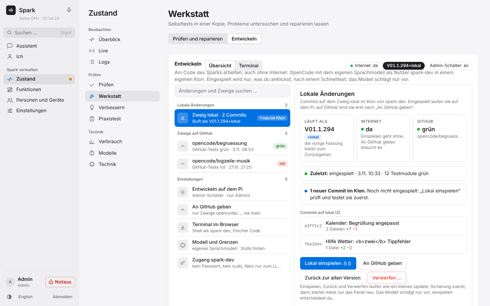
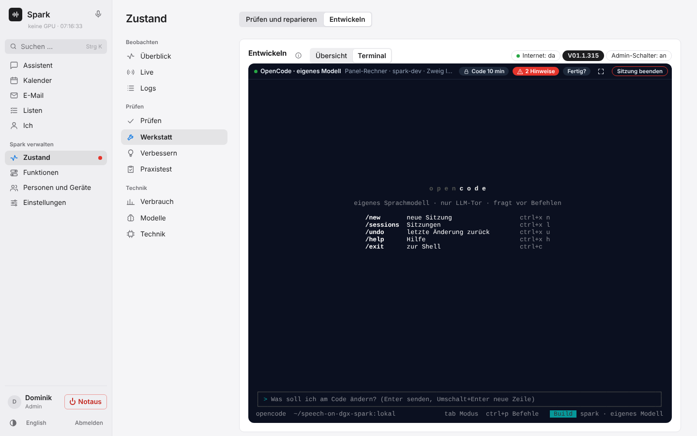
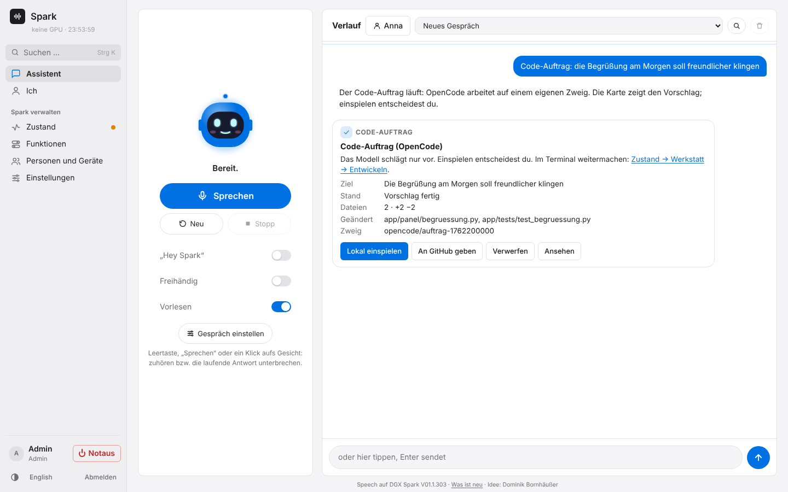
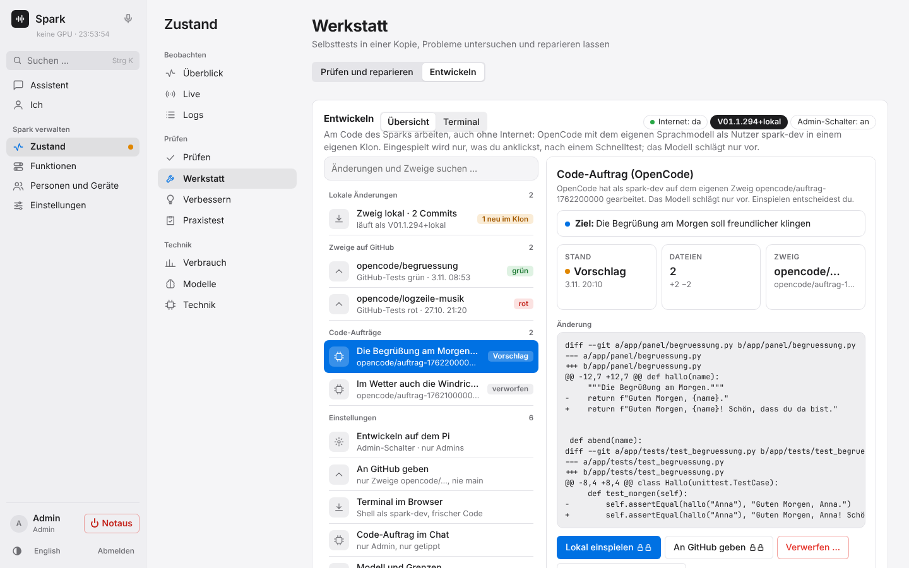

# Installation im Detail

← [README](../../README.de.md)

Geteilt installieren (Panel auf einem eigenen Rechner wie einem Raspberry Pi 5), umziehen und zurückholen: [Spark teilen](spark-teilen.md).

## Nur die Modelle bereitstellen (ohne Webportal)

Die erste Installation fragt im Terminal, was installiert werden soll:

1. **Komplett:** Modelle, APIs und das Webportal mit dem Assistenten (wie bisher).
2. **Nur die Modelle mit ihren APIs:** für andere Dienste (Open WebUI, eigene Apps, Home Assistant …), ohne Webportal, Passwort und Zertifikat.

Danach fragt sie, welche Modelle es sein sollen (Spracherkennung Qwen3-ASR 1.7B, 0.6B, Parakeet oder keine; Sprachausgabe Qwen3-TTS 0.6B, 1.7B oder keine; VoiceDesign ja oder nein, jeweils mit grob geschätztem Speicherbedarf) und ob die APIs im Netz erreichbar sein sollen oder nur auf der Spark selbst (`127.0.0.1`, z. B. hinter einem eigenen Reverse-Proxy). Ein API-Schlüssel wird immer erzeugt und ist Pflicht. Spätere Aufrufe und Updates fragen nicht noch einmal. Ohne Fragen geht es mit Optionen:

```bash
sudo ./install.sh --mode api --asr 1.7b --tts 0.6b --yes   # nur Modelle, im Netz erreichbar
sudo ./install.sh --mode api --asr parakeet --tts none --local --yes
```

Am Ende stehen Adressen, Schlüssel und fertige `curl`-Beispiele auf dem Bildschirm und in `/etc/speech-spark/connection.txt` (nur für root lesbar). Ohne Portal übernimmt der Befehl `speech-spark` dessen Aufgaben:

| Befehl | Wirkung |
|---|---|
| `sudo speech-spark status` | Dienste, Modelle, freier Speicher, letztes Update |
| `sudo speech-spark info` | Adressen, API-Schlüssel, Beispiele, Werte für Open WebUI |
| `sudo speech-spark key new` | neuer API-Schlüssel (der alte gilt sofort nicht mehr) |
| `sudo speech-spark models` | Modelle neu wählen, gleiche Fragen wie bei der Installation |
| `sudo speech-spark update` | Update wie der Knopf im Portal (`--check` zeigt nur, was neu ist) |
| `sudo speech-spark logs tts -n 100` | letzte Log-Zeilen (asr, tts, asr-engine, tts-engine, tts-design, bild, watch, update, messen, all) |
| `sudo speech-spark panel enable` | Webportal nachrüsten; Modelle und API-Schlüssel bleiben |
| `sudo speech-spark panel disable` | Webportal entfernen; Profile und Daten bleiben auf der Platte |
| `sudo speech-spark notzugang` | ausgesperrt: neues Panel-Passwort (einmal angezeigt), zweiter Schritt des Notzugangs aus (alte Datei als `.bak`), Haupt-Admin gelöst (Rollen bleiben); fragt vorher, steht im Änderungsprotokoll, Push an die Admins. Danach `https://…/#admin` ohne Code, zweiten Schritt neu einrichten, Haupt-Admin wieder wählen |
| `sudo speech-spark modelle liste` | der Modell-Katalog (`app/modelle.json`): Modelle, Art, Speicher, ob die Revision festgelegt ist |
| `sudo speech-spark modelle messen` | misst die Katalog-Modelle auf diesem Spark (Standard: Qwen3.6 35B A3B NVFP4 mit MTP und Qwen3-VL 8B; dazu auf Wunsch `qwen36` Qwen3.6 mit und ohne MTP, `helfer` das kleine Hilfsmodell Qwen3 4B Instruct 2507 FP8, `flash` Qwen3.8 Flash Next in Docker mit Anteil 0,70, ein eigenes Modell mit seiner Kennung). Im Katalog stehen seit V01.1.370 nur Modelle, die laufen oder gemessen wurden. Lädt fehlende Modelle und prüft jede Datei, stoppt das laufende Sprachmodell mit Wartungspause, misst je Modell Tempo, erstes Wort kalt und warm, Zwischenspeicher, 2 und 4 Fragen gleichzeitig, eine Frage mit rund 60 000 Tokens, Platz im Gesprächsspeicher, Speicher, Werkzeugaufruf und Testbilder und startet es danach immer wieder. Schaltet nichts um, löscht nichts. Ergebnis in *Zustand → Logs* (Bereich System) oder `sudo speech-spark logs messen`. Seit V01.0.719 auch im Panel: *Zustand → Modelle* „Messen“ beim Modell (mit Funktionen → Modelle wechseln) |
| `sudo speech-spark wissen messen [synth [anzahl] [--ohne-grenzen] \| profil <name>] [--json]` | misst Zeiten und Speicher von Dokumentsuche, Wissensbuch, Wissenskarte (seit V01.1.270) und dem Suchindex von Finden (Messteil „fund“, seit V01.1.285) in einem eigenen Messprozess mit niedriger Priorität; hört auf, sobald jemand spricht. Erfunden (Standard 5000 Dokumente, für Finden dazu 50 000 versiegelte Mails) in einem Wegwerf-Ordner unter `state/wissensmessung-tmp`, der danach gelöscht wird, oder ein Profil nur lesend. Für Finden: Suchzeit p50/p95, Einlesen je 1000 Mails, Größe von `fund.db`, RAM; Ziel auf dem Pi: 95 % der Suchen unter 150 ms. Ergebnis im Terminal, unter *Zustand → Prüfen → Wissen messen*, in *Zustand → Logs* (Bereich Wissen) und in *Zustand → Live*, Kasten „Wissen messen“ |
| `sudo speech-spark teilen [status]` | geteilte Installation (Panel auf einem anderen Rechner, seit V01.0.608): ob die Tür (TLS-Tor) offen ist, für wie viele Panel-Rechner, ob die Firewall steht, und der Fingerabdruck des Zertifikats |
| `sudo speech-spark teilen modelle-update` | Auf dem Panel-Rechner: das eigene Update des Modell-Rechners anstoßen und darauf warten (macht `update.sh` von selbst zuerst) |
| `sudo speech-spark teilen code` | Auf dem Modell-Rechner: Kopplungscode zeigen (10 Minuten, einmal nutzbar) und auf den Panel-Rechner warten |
| `sudo speech-spark teilen koppeln <name-oder-ip>` | Auf dem Panel-Rechner: mit dem Modell-Rechner koppeln (fragt nach dem Code, merkt sich sein Zertifikat) |
| `sudo speech-spark teilen rundlauf` | Auf dem Panel-Rechner: Wärter fragen, TTS spricht einen Satz, ASR hört ihn, alles über die Tür |
| `sudo speech-spark umziehen --code` | Auf dem Rechner, der das Panel jetzt hat: Umzug anbieten (Code, Umzugs-Sicherung mit Tresor-Schlüssel und Panel-Zertifikat); erst nach „fertig“ vom anderen Rechner wechselt er die Rolle |
| `sudo speech-spark umziehen --von <name-oder-ip>` | Auf dem neuen Panel-Rechner: Umzug holen, einspielen, prüfen (geht auch beim Koppeln mit `install.sh --mode panel`) |
| `sudo speech-spark zurueckholen --von <name-oder-ip>` | Auf dem Modell-Rechner: das Panel zurückholen, danach läuft wieder alles auf einem Rechner |
| `sudo speech-spark teilen firewall [aus]` | die Ports der Tür nur vom Panel-Rechner (`api.tls_from`) erreichbar machen (nftables, Tabelle `speech_spark_teilen`), oder wieder aus |

Den Wächter für hängende Dienste, der sonst im Portal läuft, übernimmt ohne Portal der Dienst `speech-spark-watch` mit denselben Regeln. Nach einem Update spricht die Sprachausgabe einen Satz, und die Spracherkennung muss ihn verstehen; klappt das nicht, spielt das Update die vorige Version wieder ein. Die Selbsttests laufen in beiden Arten vor jedem Update. Das eigene Sprachmodell aktualisiert sich mit. Läuft Open WebUI in Docker auf derselben Spark, müssen die APIs im Netz erreichbar sein (`127.0.0.1` im Container ist der Container selbst).

## Aktualisieren

Im Panel unter **System**: Dort steht die installierte Version, und es wird angezeigt, wenn auf GitHub eine neuere liegt (mit der Liste der Änderungen). **Update installieren** holt den neuen Stand und installiert ihn. Einstellungen, Modelle und Stimmen bleiben, das Protokoll läuft live mit. Schon installierte Pakete werden dabei nicht aktualisiert; nachgeladen wird nur, was die neue Version braucht. Bevor die neue Version live geht, läuft der Selbsttest. Schlägt er oder ein Schritt davor fehl (Download, Pakete), bricht das Update ab, und die Dienste laufen unverändert mit der alten Version weiter. Geht nach dem Umschalten etwas schief, spielt `update.sh` die vorige Version wieder ein und sagt das im Protokoll. Während das Update läuft, sperrt ein Fortschrittsfenster das Panel (auch andere Tabs und Handys: der Server nimmt keine Änderungen an, der Assistent antwortet weiter); Frage, Fortschritt und Neustart stehen in diesem einen Fenster: dahinter steht die Seite still (kein Band „Spark antwortet nicht“, keine Versionsleiste), der Balken läuft nur vorwärts, und über den Neustart des Panels wartet das Fenster ruhig. Am Ende lädt die Seite einmal und kommt an dieselbe Stelle zurück (Einstellungen → Update). Jeder Zustand zeigt nur seine Knöpfe: die Frage „Installieren“ und „Abbrechen“, ein laufendes Update keine; ist es nach 45 Minuten nicht fertig, gibt es „Neu laden“ und „Update abbrechen“, schlägt es fehl, „Schließen“ und „Protokoll kopieren“. Das Protokoll steht eingeklappt darunter. Die Sperre beginnt mit dem Klick auf „Installieren“ (seit V01.0.878, `update.begin`): Der Server hält sie selbst, während er vorher sichert, und alle Seiten, die iPhone-App, Live und das Gehäuse-Display zeigen dieselben Schritte: „Sicherung vor dem Update“, „Update startet“, „Lädt und prüft die neue Version“, „Neue Version geladen“, bei geteiltem Spark „Modell-Rechner wird zuerst aktualisiert“, dann die Schritte der Installation bis „Dienste neu starten“ und „Fertig“. Jedes Ende, auch ein frühes (GitHub nicht erreichbar, keine geprüfte Version, falsche Signatur, Dienst startet nicht), schreibt „fertig“ mit dem Grund; damit endet die Sperre, und das Fenster nennt den Grund. Ein zweiter Start während der Sperre wird abgelehnt. Der Spark-Begleiter am PC und Mac zeigt im Zustand dieselbe Zeile „Spark-Update läuft: 40 % · Schritt“ und während des Neustarts „Spark startet für das Update neu …“ statt „nicht erreichbar“ (seit V01.0.883, `begleiter.spark_update` in `/api/desk/poll`, braucht den neuen Begleiter-Build).

**Was ist neu (Changelog)**: Alle Änderungen bis zur installierten Version, eine Zeile pro Version, neueste oben, mit Suche. Zu öffnen über „Was ist neu“ unten neben der Versionsnummer oder unter *Einstellungen → Update und Sicherung → Was ist neu (Changelog) → Ansehen*. Sehen kann es der Admin und jedes Profil in seiner eigenen Anmeldung im Browser (nicht Gäste, nicht Geräteschlüssel). Versionen, die neuer sind als beim letzten Öffnen in diesem Browser, tragen „neu“. Die Liste kommt aus `CHANGELOG.md` der installierten Version (das Update legt eine Kopie nach `app/`).

Auf der Konsole geht dasselbe mit:

```bash
sudo speech-spark update                       # aktualisieren (oder: sudo /opt/speech-spark/src/update.sh)
sudo /opt/speech-spark/src/update.sh --check   # nur anzeigen, was neu ist
```

Der Installer legt dafür eine eigene Git-Kopie unter `/opt/speech-spark/src` an. Wo du das Repo ursprünglich geklont hast, spielt danach keine Rolle mehr.

**Einmalig für Installationen vor dem Update-Button:** im geklonten Repo `git pull` und `sudo ./install.sh`. Danach geht es per Button.

| Option | Wirkung |
|---|---|
| `--mode full` / `--mode api` | komplett mit Webportal / nur die Modelle mit ihren APIs (siehe oben) |
| `--mode api --teilen` | Spark teilen, Modell-Rechner: nur die Modelle, Dienste nur auf 127.0.0.1, dazu TLS-Tor, Wärter, Firewall und ein eigenes Zertifikat der Tür (`tor-cert.pem`); zeigt am Ende den Kopplungscode |
| `--mode panel --modelle <name-oder-ip>` | Spark teilen, Panel-Rechner (z. B. Raspberry Pi 5): nur das Panel mit `venv-panel` und coturn, kein Modell, keine Engine; prüft 64 Bit und Python ≥ 3.11, fragt nach dem Code (oder `SPEECH_SPARK_CODE`) und macht danach den Rundlauf |
| `--asr 1.7b\|0.6b\|parakeet\|none`, `--tts 0.6b\|1.7b\|none`, `--voicedesign` | Modelle ohne Rückfrage wählen |
| `--local` / `--network` | APIs nur auf `127.0.0.1` / im ganzen Netz (Standard) |
| `--yes` | nichts fragen; was nicht angegeben ist, bleibt wie es ist (neu: komplett) |
| `--small` | 0.6B-Modelle statt 1.7B (weniger Speicher) |
| `--tts-backend transformers` | TTS ohne Streaming über `qwen-tts` statt vllm-omni (Standard: `vllm-omni`) |
| `--asr-backend transformers` | ASR über `qwen-asr` statt vLLM, eine Anfrage nach der anderen (Standard: `vllm`) |
| `--no-asr` / `--no-tts` | nur einen der beiden Dienste installieren |
| `--password XYZ` | Panel-Passwort setzen (sonst wird eins erzeugt) |
| `--no-download` | Modelle erst beim ersten Start laden |
| `--no-smoke` | Rundlauf-Test am Ende überspringen |
| `--entwickeln` | Panel-Rechner: Entwickeln auf dem Pi mit OpenCode (Nutzer `spark-dev`, eigener Klon, siehe unten) |
| `--uninstall` | wie `./uninstall.sh` (siehe unten) |

Ein erneuter Aufruf aktualisiert den Code und ergänzt in den Python-Umgebungen, was fehlt; schon installierte Pakete bleiben, wie sie sind. Die bestehende Konfiguration bleibt erhalten, neue Einstellungen werden ergänzt.

## Bilder malen (optional)

Mit `--bild` installiert die Installation zusätzlich das Bildmodell FLUX.2 [klein] (nur mit dem Webportal; die erste Installation fragt danach, Standard ist keins, `sudo speech-spark models` fragt erneut):

```bash
sudo ./install.sh --bild 4b-q8   # 4B, Q8: ~9 GB Platte, ~11 GiB beim Malen, Apache 2.0 (empfohlen)
sudo ./install.sh --bild 4b-q4   # 4B, Q4: weniger Speicher (~12 GiB)
sudo ./install.sh --bild 9b-q8   # 9B (auch 9b-q4): FLUX Non-Commercial, nur privat
sudo ./install.sh --bild none    # wieder aus (die Dateien bleiben in /var/lib/speech-spark/models/bild)
```

**Eigenes Sprachmodell (ab V01.0.590):** `sudo ./install.sh --llm` legt `venv-llm` mit vLLM für das eigene Sprachmodell an und bleibt bei jedem Update aktuell. Beim ersten `--llm` schaltet es das eigene Sprachmodell ein und richtet das Gespräch auf das LLM-Tor (`http://127.0.0.1:31006/v1`); bei einer geteilten Installation zieht es die Firewall der Tür gleich nach. Die Dienste `speech-spark-llm`, `speech-spark-llmtor` und `speech-spark-sehen` laufen danach. Den früheren Rückfall auf dgx-spark-qwen38 (`modelle llm uebernehmen|zurueck`, `qwen38-aufraeumen`) und Kolibri (`--kolibri`) gibt es seit V01.1.370 nicht mehr (Dominik 2026-11-11). Logs: `sudo speech-spark logs llm`, `llmtor`, `sehen`.

Sie baut einmal stable-diffusion.cpp (`sd-server`, fester Commit, CUDA für den GB10, braucht `nvcc` und `cmake`) nach `/opt/speech-spark/sdcpp`, lädt die Modelldateien mit SHA-256-Prüfung nach `/var/lib/speech-spark/models/bild` und richtet den Dienst `speech-spark-bild` ein (nur `127.0.0.1`, Ports `image.port` 31005 und `image.engine_port` 31015). Das Modell belegt nur beim Malen Speicher. Danach im Portal Funktionen → Bilder malen einschalten und „Bild testen“ drücken. Einzelheiten: [Assistent](assistent.md).

## Musik machen (optional)

Mit `--musik` installiert die Installation zusätzlich das Musikmodell ACE-Step 1.5 (MIT-Lizenz; auf dem Modell-Rechner, beim Teilen mit `--teilen`; die erste Installation fragt danach, Standard ist keins, `sudo speech-spark models` fragt erneut):

```bash
sudo ./install.sh --musik 2b         # 2B turbo + 1,7B-Planer: ~5,6 GB Platte, ~14 GiB beim Musikmachen (empfohlen)
sudo ./install.sh --musik 2b-klein   # 2B turbo + 0,6B-Planer: weniger Speicher
sudo ./install.sh --musik xl         # XL turbo (4B) + 1,7B: klingt besser, ~5,3 GB mehr Platte, ~20 GiB
sudo ./install.sh --musik none       # wieder aus (die Dateien bleiben in /var/lib/speech-spark/models/musik)
```

Sie baut einmal acestep.cpp (`ace-server`, fester Commit, ggml fest eingebunden, CUDA für den GB10, ohne torch und ohne Docker, braucht `nvcc` und `cmake`) nach `/opt/speech-spark/acestep`, lädt die GGUF-Dateien mit SHA-256-Prüfung nach `/var/lib/speech-spark/models/musik` und richtet den Dienst `speech-spark-musik` ein (nur `127.0.0.1`, beim Teilen über das TLS-Tor; Ports `music.port` 31004 und `music.engine_port` 31014). Die Engine lädt nur für ein Lied und gibt den Speicher nach 10 Minuten ohne Lied wieder frei; fehlt Speicher, lädt sie nicht. Mehrere Modelle nacheinander installieren geht, die Dateien bleiben alle. Zustand → Prüfen → „Musik testen“ misst jedes installierte Modell mit zwei festen Probestücken (30 s Klavier, 60 s mit deutschem Gesang) und zeigt Zeit, Speicher und die Stücke zum Anhören. Danach Funktionen → Musik machen einschalten und dort das Modell wählen; jedes freigegebene Profil macht dann Lieder im Gespräch und unter Ich → Musik. Logs: `sudo speech-spark logs musik`, Wartungspause: `sudo speech-spark pause musik 30`.

Mit `--werkstatt` (auf dem Modell-Rechner) kommt die Werkstatt dazu: OpenCode als eine Datei aus der npm-Registry, Version und SHA-512 fest in `app/werkstatt.py`, nach `/opt/speech-spark/werkstatt`; dazu der Nutzer `spark-werkstatt` mit dem Ordner `/var/lib/spark-werkstatt/arbeit` und die Einheit `speech-spark-werkstatt`. Ohne die Option wird nichts davon geladen; einmal da, behält ein Update sie. Danach Funktionen → Werkstatt einschalten.

```bash
sudo ./install.sh --werkstatt
sudo speech-spark werkstatt status
```

Für Fernzugang → Bildschirm baut der Rechner mit dem Panel guacd selbst aus dem Quelltext von Apache (seit V01.1.278; Debian 12 und 13 und Raspberry Pi OS haben kein guacd-Paket mehr): `app/guacd-bauen.sh` lädt genau die Version aus `fernbild.GUACD_VERSION` (guacamole-server 1.6.0, Apache-2.0) nur von downloads.apache.org oder archive.apache.org, prüft sie gegen `fernbild.GUACD_SHA256`, baut als `nobody` in einem frischen Ordner unter `/var/tmp` nur mit VNC und RDP (FreeRDP 3, wo es das gibt, sonst 2) und legt das Ergebnis nach `/opt/speech-spark/guacd`. Zum Bauen installiert es `build-essential pkg-config libtool-bin libcairo2-dev libjpeg-dev libpng-dev libwebp-dev uuid-dev libvncserver-dev` und `freerdp3-dev` (oder `freerdp2-dev`); das dauert einmal einige Minuten (Pakete laden und bauen; das Bauen selbst dauerte auf einem ARM-Rechner mit 4 Kernen im GitHub-Test etwa 5 Sekunden), der Fortschritt steht im Update-Log. Neu gebaut wird nur, wenn sich die Version ändert. Gebaut wird mit `--fernbild`, bei jedem Update, sobald Funktionen → Fernzugang zu Servern und darunter Bildschirm eingeschaltet sind, und solange guacd schon da ist. Ein Fehler hält das Update nie auf: das Panel sagt dann beim Bildschirm-Knopf, woran es lag („guacd auf dem Spark nicht installiert: …“), und das nächste Update versucht es wieder. Eine guacd-Einheit der Distribution bleibt gesperrt; es läuft nur `speech-spark-guacd` auf 127.0.0.1:4822, die das Panel startet, wenn ein Bildschirm aufgeht. Ausschalten deinstalliert nichts. Danach auf dem System einmal `sudo spark-anker bildschirm`.

```bash
sudo ./install.sh --fernbild
```

Für Funktionen → YouTube-Links abschreiben legt `--youtube` (auf dem Panel-Rechner) yt-dlp (Lizenz Unlicense) in eine eigene Umgebung `/opt/speech-spark/venv-ytdlp`: genau die Version und die SHA-256 des Wheels aus `app/requirements-ytdlp.lock`, ohne seine optionalen Pakete (`pip --no-deps --require-hashes --only-binary :all:`). Ohne die Option wird nichts davon geladen; einmal da, hält jedes Update es auf der Version der Datei. Das Panel startet es nur mit festen Optionen und nur über seinen netguard-Proxy (`app/panel/netproxy.py`, feste Host-Liste). Danach Funktionen → Eigene Dokumente → Aufnahmen abschreiben → YouTube-Links abschreiben einschalten (Links als Dokument muss an sein).

```bash
sudo ./install.sh --youtube
```

## Entwickeln auf dem Pi mit OpenCode

Eine Anleitung für Einsteiger: Du änderst den Spark auf dem Panel-Rechner (etwa dem Raspberry Pi) selbst, mit OpenCode im Terminal und dem eigenen Sprachmodell des Sparks, ohne Cloud und ohne GitHub. OpenCode arbeitet als eigener Nutzer `spark-dev` in einem eigenen Klon; der laufende Spark, seine Daten und Schlüssel bleiben unerreichbar. Eingespielt wird erst, wenn ein Admin es will, nach einem Schnelltest und wie ein Update.

1. **Einmal installieren** (auf dem Panel-Rechner, braucht Internet): `sudo ./install.sh --entwickeln`. Das legt den Nutzer `spark-dev` (ohne Passwort, ohne sudo) mit dem Klon `/home/spark-dev/speech-on-dgx-spark` und dem Zweig `lokal` an, lädt OpenCode (Version und SHA-512 fest in `app/werkstatt.py`, dieselbe Datei wie bei der Werkstatt) nach `/opt/speech-spark/opencode`, schreibt die Einstellungen von OpenCode (nur das eigene LLM-Tor, eigener Schlüssel, die Regeln aus `CLAUDE.md` und der Richtlinie), sperrt per Firewall jedes Netz außer dem LLM-Tor und baut die Testumgebung des Schnelltests.
2. **Einschalten**: als Admin *Funktionen → Entwickeln auf dem Pi* an. Erst dann gilt der Schlüssel von `spark-dev` am LLM-Tor.
3. **Terminal öffnen**: am einfachsten im Browser. Als Admin *Funktionen → Entwickeln auf dem Pi → Terminal im Browser* an, dann *Zustand → Werkstatt → Entwickeln*, Reiter *Terminal*, „Terminal öffnen“ und deinen Code eingeben (jedes Mal ein frischer; zweiter Anmeldeschritt nötig). Die Shell läuft als `spark-dev` im Klon. Wer lieber SSH nimmt: deinen öffentlichen SSH-Schlüssel für `spark-dev` eintragen und von deinem Rechner aus anmelden (siehe unten).
4. **Ohne Internet arbeiten**: Im Browser-Terminal läuft OpenCode sofort (seit V01.1.328); beendet (ctrl+c) bleibt die Shell, `opencode` (oder `spark-opencode`) startet es neu. In eigenen Worten sagen, was sich ändern soll. `sudo` geht dort nicht: Update und Installation als dein Admin-Nutzer per SSH oder unter *Fernzugang*. OpenCode fragt nur das Sprachmodell im Heimnetz und vor jedem Befehl dich. Testen geht im Klon wie auf GitHub, nur ohne Browser-Tests. Jede fertige Änderung ist ein Commit auf `lokal`.
5. **Einspielen**: im Reiter *Übersicht* steht der Commit bei „Lokale Änderungen“ mit Titel und Zahl der Dateien; „Lokal einspielen“ (frischer Code) oder `sudo speech-spark lokal einspielen`. Der Spark prüft die Commits, testet sie im Sandkasten und spielt sie wie ein Update ein; die Version zeigt dann „+lokal“. „Zurück zur alten Version“ und „Verwerfen …“ stehen daneben.
6. **Code-Auftrag im Chat** (eigener Unterschalter *Funktionen → Entwickeln auf dem Pi → Code-Auftrag im Chat*, aus): Statt selbst im Terminal zu tippen, schreibst du im Chat des Panels oder der App etwa „Code-Auftrag: die Begrüßung soll freundlicher klingen“. OpenCode arbeitet dann einmal als `spark-dev` auf einem eigenen Zweig `opencode/auftrag-<Nummer>`, und die Karte „Code-Auftrag (OpenCode)“ zeigt, was herauskam: Ziel, Dateien, die ersten Zeilen der Änderung. Das Modell schlägt nur vor. Einspielen entscheidest du: „Lokal einspielen“ und „An GitHub geben“ öffnen *Zustand → Werkstatt → Entwickeln* (dort die ganze Änderung und ein frischer Code), „Verwerfen“ löscht den Zweig, „Im Terminal weitermachen“ führt zum Reiter *Terminal*. Nur für Admins und nur getippt, nie über Lautsprecher, Auto, Telegram, Begleiter oder für Gäste.

[](../bilder/de-entwickeln.png)

[](../bilder/de-entwickeln-terminal.png)

[](../bilder/de-code-auftrag-karte.png)

[](../bilder/de-entwickeln-auftrag.png)

```bash
# 1. einmal, auf dem Panel-Rechner
sudo ./install.sh --entwickeln
# 3. statt des Terminals im Browser: dein SSH-Schlüssel für spark-dev
sudo install -d -m 700 -o spark-dev -g spark-dev /home/spark-dev/.ssh
sudo install -m 600 -o spark-dev -g spark-dev ~/.ssh/id_ed25519.pub /home/spark-dev/.ssh/authorized_keys
# 4. von deinem Rechner aus
ssh spark-dev@<panel-rechner>
opencode                            # OpenCode im Klon, Zweig lokal (= spark-opencode)
cd app && python3 selftest.py discover -s tests -p 'test_live.py'
git commit -am "Meine Änderung"
# 5. als Admin auf dem Panel-Rechner (oder Knöpfe unter Zustand → Werkstatt → Entwickeln)
sudo speech-spark lokal einspielen  # prüfen, Schnelltest, einspielen wie ein Update
sudo speech-spark lokal status      # lokale Änderungen, letztes Ergebnis
sudo speech-spark lokal zurueck     # einen Schritt zurück (gleiche Version)
sudo speech-spark lokal verwerfen   # Version ohne lokale Änderungen (bleiben im Klon)
```

Eingespielt wird nur, was unter `app/panel/`, `app/tests/` und `docs/` liegt, dazu die beiden README und `CHANGELOG.md`, als normale Dateien: was root ausführt (`install.sh`, `update.sh`, `app/*.py` außerhalb von `app/panel`, die Paketlisten), kommt nur über GitHub. Ein normales Update verliert lokale Arbeit nie: Es setzt die lokalen Commits auf die neue Version und testet sie; passt etwas nicht oder ist der Schnelltest rot, läuft die bisherige Version weiter, und das Panel zeigt oben den Grund. Den Schlüssel von `spark-dev` neu machen oder zurückziehen: `sudo speech-spark entwickeln schluessel neu|weg`; nach einem Wechsel des Modell-Rechners `sudo speech-spark entwickeln einrichten`. Fehlt die Testumgebung, einmal mit Internet `sudo speech-spark lokal testumgebung` (danach erneuert sie sich jede Nacht, nur wenn sich die Paketliste ändert). Logs: `sudo speech-spark logs entwickeln`. Den Klon von `spark-dev` macht `spark-dev` selbst aus einem Bündel, das root von der installierten Version schreibt; `spark-dev` liest den Klon unter `/opt/speech-spark/src` nie (neueres git bricht dort mit „dubious ownership“ ab). Ist der Klon fehlgeschlagen („could not make the clone of spark-dev“), einfach `sudo ./install.sh --entwickeln` noch einmal: ein halb angelegter Klon wird aufgefüllt, Arbeit von `spark-dev` bleibt.

### Weg A: an GitHub geben

Was nicht über Weg B darf (etwa `install.sh` oder `app/*.py`) oder was in die offizielle Version soll, gibt ein Admin als eigenen Zweig `opencode/<thema>` an GitHub. Dort laufen die vollen Tests, und ein Claude-Thread prüft ihn und bringt ihn auf main. `spark-dev` bekommt dabei nie Internet: root nimmt den Zweig als Bündel und schiebt ihn mit einem eigenen Deploy-Schlüssel, nie an main und nie mit `--force`.

1. **Schlüssel machen**: `sudo speech-spark entwickeln github-schluessel neu` zeigt eine Zeile, die mit `ssh-ed25519` beginnt. Den geheimen Teil (`/etc/speech-spark-github-key`) liest nur root.
2. **Auf GitHub eintragen**: im Repository den Reiter „Settings“, links „Deploy keys“, „Add deploy key“. Titel etwa „Spark Pi opencode“, die Zeile einfügen, **„Allow write access“** anhaken, „Add key“. Nimm keinen persönlichen Token: der handelt als dein Admin-Konto und käme an der Regel für main vorbei.
3. **main schützen** (einmal, auf GitHub): Reiter „Settings“, links „Rules“, „Rulesets“, „New ruleset“, „New branch ruleset“. Name „main schützen“, Enforcement status „Active“, bei „Target branches“ „Add target“ und „Include default branch“. Anhaken: „Restrict deletions“, „Restrict updates“, „Block force pushes“. Bei „Bypass list“ „Add bypass“ und „Repository admin“ (dein Konto, damit du und die Claude-Threads weiter auf main pushen). „Create“. Den Deploy-Schlüssel nie auf die Bypass-Liste setzen.
4. **Einschalten**: als Admin *Funktionen → Entwickeln auf dem Pi → An GitHub geben* an. Nach dem Update auf diese Version einmal `sudo ./install.sh --entwickeln`, damit der Dienst `speech-spark-github` und sein Zeitgeber da sind.
5. **Weitergeben**: *Zustand → Werkstatt → Entwickeln*, „Lokale Änderungen“, „An GitHub geben“ mit einem Thema, oder `sudo speech-spark lokal an-github mein-thema`. Ohne Internet wartet der Auftrag und geht alle 15 Minuten von selbst los (`--abbrechen` verwirft ihn).
6. **Übergeben**: die Seite zeigt den Zweig links unter „Zweige auf GitHub“ mit dem Stand der Tests, rechts mit Link und dem Satz zum Kopieren; `sudo speech-spark lokal zweige` zeigt den Zweig, seinen Link und den Stand der GitHub-Tests. Dann einem Claude-Thread: „Gib den Zweig opencode/mein-thema einem Claude-Thread zum Prüfen“. Ist er auf main, fallen beim nächsten Update eingespielte lokale Commits, die schon drin sind, von selbst weg; im Klon danach `git rebase spark/main`.

```bash
sudo speech-spark entwickeln github-schluessel neu   # 1. Zeile als Deploy-Schlüssel mit Schreibrecht eintragen
sudo speech-spark lokal an-github mein-thema          # 5. als opencode/mein-thema an GitHub
sudo speech-spark lokal zweige                        # 6. Zweige, Links, GitHub-Tests (gruen, laeuft, rot)
sudo speech-spark entwickeln github-schluessel weg    # Schlüssel zurückziehen (auch auf GitHub löschen)
```

## Deinstallieren

```bash
sudo ./uninstall.sh            # Dienste, Code, venvs und sudoers-Regel entfernen; Konfig, Modelle und Stimmen bleiben
sudo ./uninstall.sh --purge    # zusätzlich Konfig, Modelle, Stimmen und den Benutzer speech löschen
sudo ./uninstall.sh --yes      # ohne Rückfrage
```

Das eigene Sprachmodell (`venv-llm`) entfernt `uninstall.sh` mit.
