# Architecture and data flow

← [README](../../README.md) · [Technical details and troubleshooting](technical.md) · [Security and operation](security-and-operation.md)

This page describes how the Spark is built: which parts exist, which way a request takes and where which data lies. The panel shows the same to click through under **Status → Architecture** (admins only). There the picture uses the whole width with the detail below it; "⛶ Full screen" lays the overview or the data flow over the whole screen, with ＋/− to zoom and Escape to close. How to build is set by the [coding guideline](guidelines.md).

The sections between the markers `<!-- technik:… -->` are generated from the code (`app/panel/technik.py`, plus `speicher.AREAS`/`LOCAL` and `backup.STATE_FILES`/`STATE_LOCAL`). `python3 app/panel/hilfe.py --docs` writes them again. A self-test (`test_technik`) turns red when a module, a file or a step is missing or the docs were not written again. Only the text outside the markers is kept by hand.

## Overview

Devices and programs only talk to the panel. The panel checks every request, asks the language model, calls tools through the guard and writes into the folders under `/var/lib/speech-spark`. Speech recognition and speech output are services of their own. The language model belongs to `dgx-spark-qwen38` and is not part of this repo.

<!-- technik:bild -->
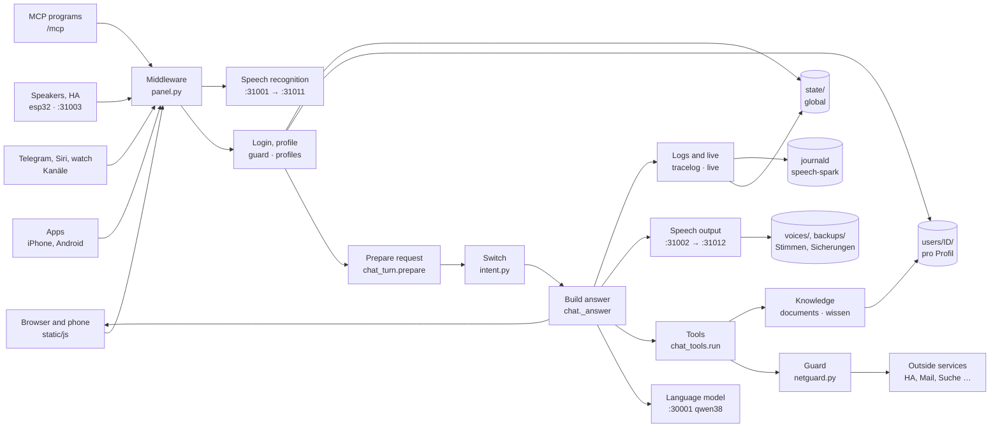
<!-- /technik:bild -->

## Processes and ports

| Service | Port | Task |
|---|---|---|
| `speech-spark-panel` | 31080, HTTPS 31443 | Web portal, all endpoints, background jobs |
| `speech-spark-asr` → `speech-spark-asr-engine` | 31001 → 31011 (local only) | Speech recognition |
| `speech-spark-tts` → `speech-spark-tts-engine` | 31002 → 31012 (local only) | Speech output; optional VoiceDesign on 31013 |
| Wyoming in the panel | 31003 | Home Assistant Assist |
| `dgx-spark-qwen38` (other project) | 30001 | Language model; ports 30000–30099 belong to it |
| `speech-spark-watch` | – | Watchdog, only without the panel |
| `speech-spark-update` | – | Update, only on request |

All services run as the system user `speech` and log into the journald namespace `speech-spark`. The panel starts its background jobs itself (`panel.py`: samples, stability, inbox tidy, reading documents, reMarkable sync, learning from conversations). Background work waits while someone speaks (`vorrang.py`).

## Data flow of a request

The way of a spoken question in the browser, from input to storage:

<!-- technik:datenfluss -->
1. **Input**: The microphone records, the panel hands the sound to speech recognition. In the code: `POST /api/test/asr`
2. **Access**: Kill switch, origin and size, then rate limit, login and profile. In the code: `POST /api/chat · guard.limit · profiles.current`
3. **Prepare**: Speech first (vorrang), other devices see "answering", then rights, locks, system prompt. In the code: `chat_turn.prepare()`
4. **Switch**: Fixed rules narrow the tools; a clear reading request runs directly. In the code: `intent.classify_cfg() · intent.narrow()`
5. **Model**: Instant sentence, request trace, then rounds with the language model, streamed. In the code: `chat._answer()`
6. **Tools**: Tool call, guard, outside service or own knowledge; the result comes back as data. In the code: `chat_tools.run() · netguard`
7. **Answer**: Sentences go to speech output; text and sound reach the device as one stream. In the code: `SSE · /v1/audio/speech`
8. **Store**: The device stores the history, the panel the tool log, memory, diary, request trace and journal. In the code: `PUT /api/profile/convos · tracelog.finish`
<!-- /technik:datenfluss -->

Branches:

- **Telegram, Siri and the watch** send text (or a voice message) to their own endpoint. The panel stores the history itself (`verlauf.keep`), not the device.
- **ESP32 speakers and Home Assistant Assist** talk to `esp32.py` and `wyoming.py`. A stranger's voice at a shared speaker gets guest rights only.
- **MCP programs** ask through `/mcp` (`mcpserver.py`) with their own token, stored only as a hash.
- **Guests** get only question and answer from the language model, without tools, personal data or history on the Spark.

Everywhere: everything from outside (web, mail, documents, tool results, model output) is data, never a command. The panel decides by fixed rules.

## Building blocks

Every module under `app/panel/` and `app/` belongs to exactly one group. A new module without an entry in `technik.MODULE` turns `test_technik` red. The English lines are the first sentence of each module's docstring.

<!-- technik:bausteine -->
### Access and rights

Every request passes here first: size, origin, kill switch, login, profile and releases.

| Module | Task |
|---|---|
| `app/panel/account.py` | What a browser or device can do for itself: login, whoami and the profile's own data (memory, conversations, documents, reminders, calendar, e-mail, Home Ass … |
| `app/panel/coadmin.py` | Profiles as admins. |
| `app/panel/core.py` | Shared panel helpers: paths, logins (admin password, profiles) and small system calls. |
| `app/panel/features.py` | One description per function. |
| `app/panel/guard.py` | Protection of the logins: lockout after wrong passwords or PINs, requests from foreign pages, and the change log (who changed what, from where). |
| `app/panel/join.py` | New people by invitation. |
| `app/panel/mfa.py` | Second login step: a six-digit code from an authenticator app (TOTP, RFC 6238), or a one-time recovery code when the phone is gone. |
| `app/panel/netguard.py` | Outbound connections to addresses that people or outside text choose: web pages from search results, calendars, address books, task lists, mail servers and H … |
| `app/panel/notaus.py` | Notaus: three stages that stop the Spark from the outside in. |
| `app/panel/notzugang.py` | Back in when locked out: sudo speech-spark notzugang. |
| `app/panel/panel.py` | Speech on DGX Spark: web panel for config and monitoring. |
| `app/panel/passkey.py` | Passkeys (Face ID, Touch ID, Windows Hello; WebAuthn) instead of typing the six-digit code. |
| `app/panel/profiles.py` | User profiles for the assistant: who is talking, and what the assistant remembers about them. |
| `app/panel/signatur.py` | Signed update manifests (Ed25519), optional until a key exists. |
| `app/panel/stufen.py` | Wann fragt der Spark nach dem Code? |
| `app/panel/vault.py` | Secrets at rest: calendar and mail passwords and Home Assistant tokens are stored encrypted, so a copy of the profile folders (a backup, a look into the file … |
| `app/panel/zertpin.py` | Zertifikat festpinnen: a NAS in the home network often has a certificate that does not fit its address (made for itself, or for a name such as nas.local or x … |

### Conversation

Prepares a request, asks the language model in rounds and checks what is said.

| Module | Task |
|---|---|
| `app/panel/ack.py` | Instant acknowledgement. |
| `app/panel/answercheck.py` | Answer check: the panel, not the model, decides whether a sentence may be said. |
| `app/panel/chat.py` | The voice assistant: /api/chat with its tools (search, memory, documents, reminders, calendar, e-mail, Home Assistant, earlier conversations), learning from … |
| `app/panel/chat_tools.py` | The tools of one chat turn: what runs when the model calls web search, Home Assistant, mail, calendar, reminders ... |
| `app/panel/chat_turn.py` | One chat turn, before the model is asked: who is speaking and what they may use (profile, voice, device key, Telegram, iPhone app), the system prompt, answer … |
| `app/panel/echo.py` | The assistant does not answer its own voice (admin chat.no_self_echo, per profile "echo"; off by default). |
| `app/panel/fixes.py` | Learning from corrections: when a profile corrects the assistant by voice ("Nein, mein Bruder heißt Tim", "Du sollst bei Terminen immer nachsehen"), the mode … |
| `app/panel/fremdstimme.py` | Background voices never become a question (fixed rule, no switch). |
| `app/panel/images.py` | Pictures for the assistant: the person attaches a photo (panel, iPhone app, Telegram) and the language model looks at it itself. |
| `app/panel/klaeren.py` | Rückfrage, Korrektur und Merken. |
| `app/panel/roles.py` | Roles: each profile keeps a few ways the assistant should answer ("Butler: höflich und trocken", "Erklärbär: erklär alles wie für Kinder") and switches betwe … |
| `app/panel/schreib.py` | Schreibhilfe: the Spark corrects, smooths, shortens, translates or drafts a text, for mails and anything else the person writes (Word, Excel, Pages ...). |
| `app/panel/stille.py` | Silence never becomes words (fixed rule, no switch). |
| `app/panel/stufe.py` | Priority for people: a profile the admin gives "Vorrang" gets its answer first when several people talk to the Spark at once. |
| `app/panel/systemone.py` | Einordnung mit Wahrscheinlichkeit: qwen38's POST /v1/systemone for a few fixed questions. |
| `app/panel/taten.py` | Handlungs-Prüfung: what the Spark did in this answer, and whether a sentence claims a deed that no tool did. |
| `app/panel/tipps.py` | Funktionen vorschlagen: the assistant points out a function that is not on yet when it would help, and helps setting it up. |
| `app/panel/vorab.py` | Vorab holen bei Rückfrage. |

### Switch and tool names

Fixed rules for which tools the model sees for a question. Never gives more than the rights.

| Module | Task |
|---|---|
| `app/panel/intent.py` | The switch ("Weiche"): what the person asks for in their own latest message, by fixed rules. |
| `app/panel/intent_alltag.py` | The Weiche's everyday check: sentences as people say them, never used to set the rules up. |
| `app/panel/intent_bench.py` | The Weiche's test bench (intent.py): sentence -> expected group ("" = no rule fits, "+" = two at once). |
| `app/panel/weiche.py` | Features → Switch: the switch of intent.py, shown and set up in the panel. |
| `app/panel/werkzeug_abdeckung.py` | Which function the assistant reaches how. |
| `app/panel/werkzeuge.py` | The readable name of every tool. |

### Knowledge and documents

Own documents, memory, earlier conversations, Kiwix and Wikipedia, created documents.

| Module | Task |
|---|---|
| `app/panel/docembed.py` | Meaning vectors for the document search. |
| `app/panel/doclingdienst.py` | Docling-Server anbinden: the admin connects a docling-serve in the home network (Docker on another machine), and uploaded documents are read a second time, b … |
| `app/panel/docmake.py` | Dokumente erstellen: the Spark writes letters, reports, minutes, notes, presentations and tables for a profile, as Word, PowerPoint, Excel, PDF, Markdown, te … |
| `app/panel/docrender.py` | Dokumente erstellen: the files themselves, built by fixed code. |
| `app/panel/documents.py` | Documents per profile: text extraction, chunking and search. |
| `app/panel/embed_worker.py` | The embedding model in its own process (started by docembed.py with python -I, never by hand). |
| `app/panel/folien.py` | Slide types and the fixed rules for documents the Spark writes. |
| `app/panel/gedaechtnis.py` | Gedächtnis mit Beleg und Prüfung. |
| `app/panel/kiwix.py` | The person's own Kiwix (kiwix-serve with ZIM files: Wikipedia, Wikivoyage, handbooks ...) as a knowledge source that works without the internet. |
| `app/panel/lokal.py` | Erst lokal suchen: before anything goes outside, the panel looks in the person's own sources itself. |
| `app/panel/memtidy.py` | Weekly memory cleanup per profile: the language model looks at the remembered facts and proposes which ones to merge (duplicates, the same thing said twice) … |
| `app/panel/nachsortieren.py` | Treffer nachsortieren: a cross-encoder reads the question and each of the mixed search's candidates together and gives a score; the best come first, the ones … |
| `app/panel/recall.py` | What a profile talked about before: search in its saved conversations, and facts learned from them automatically (profiles only; guests keep their conversati … |
| `app/panel/suchpruefung.py` | Suchprüfung: how often does the document search find the right passage? |
| `app/panel/symbole.py` | Symbols for slides and documents. |
| `app/panel/tagebuch.py` | Spark-Tagebuch: what the Spark itself did for a profile. |
| `app/panel/wiki.py` | Wikipedia straight away: for "Was ist ...?" or "Wer war ...?" the panel asks Wikipedia for the best matching article and hands its short intro to the model, … |
| `app/panel/wissen.py` | Knowledge from one's own uploads. |

### Connections

Home Assistant, mail, calendar, tasks, weather, reMarkable, MCP and what the Spark does by itself.

| Module | Task |
|---|---|
| `app/panel/aendern.py` | Ändern per Sprache: what so far only had a button on a page. |
| `app/panel/agent.py` | Agent functions: the assistant works on a task in the background and reports later, runs tasks on a schedule, keeps routines of smart home steps, and uses ou … |
| `app/panel/beobachten.py` | Eigene Aufgaben, die beobachten: „Sag mir Bescheid, wenn es eine neue Firmware für meine FRITZ!Box gibt“, „Erinnere mich, wenn der Flug nach Rom unter 100 Eu … |
| `app/panel/calendars.py` | Calendar and daily briefing per profile (guests have neither). |
| `app/panel/contacts.py` | Contacts per profile, read only (CardDAV: iCloud, Nextcloud, others). |
| `app/panel/extras.py` | Small services the assistant can use besides the big ones in chat.py (weather, contacts, parcels ...). |
| `app/panel/hamelden.py` | Home Assistant tells the Spark. |
| `app/panel/homeassistant.py` | Home Assistant per profile: each profile connects its own Home Assistant (address and long-lived access token); only that profile's requests can use it, gues … |
| `app/panel/mail.py` | Reading e-mail per profile over IMAP (read only; guests have none). |
| `app/panel/mcp.py` | Outside tools over MCP (Model Context Protocol): the admin adds a tool server (Paperless, Nextcloud, GitHub ...) by its address, and the panel offers single … |
| `app/panel/mcpserver.py` | The Spark as an MCP server: other programs (Open WebUI, n8n, Home Assistant, Claude, ...) use the Spark's abilities over the Model Context Protocol at /mcp. |
| `app/panel/meinmcp.py` | Eigene MCP-Dienste pro Profil. |
| `app/panel/parcels.py` | Parcels from the profile's own e-mail: shipping mails of DHL, Hermes, DPD, GLS, UPS and Amazon are recognised by their sender, the status is taken from the m … |
| `app/panel/proactive.py` | The assistant speaks up by itself: a short note or question when something real happens. |
| `app/panel/remarkable.py` | reMarkable notebooks as knowledge. |
| `app/panel/rmaufgaben.py` | Das Aufgabenblatt aufs reMarkable: one living PDF "Aufgaben" with what the profile could do in the app, each point with answers to tick. |
| `app/panel/rmliste.py` | „Was liegt auf meinem reMarkable?“ and „Welche Aufgaben hast du dort gefunden?“: the tool remarkable_library. |
| `app/panel/rmpapier.py` | Paper for the reMarkable: folders by kind, designed sheets in the device's own page format, ticked boxes read back. |
| `app/panel/rmplus.py` | More with the reMarkable. |
| `app/panel/tasks.py` | Tasks and the shopping list per profile: "Setz Milch auf die Einkaufsliste", "Was steht auf meiner Liste?". |
| `app/panel/tidy.py` | Tidying the inbox per profile: obvious advertising, newsletters and the like are moved into folders under a main folder ("Spark/" unless the profile names an … |
| `app/panel/transit.py` | Bus und Bahn: departures from the profile's home stop and connections, from a transport.rest service (https://v6.db.transport.rest by default, the admin can … |
| `app/panel/weather.py` | Weather straight from Open-Meteo (no key): the panel turns the numbers into fixed German sentences, the language model only reads them out. |
| `app/panel/zustand_wz.py` | Zustand per Sprache: the tool spark_zustand. |

### Devices and channels

Apps, Telegram, watch, speakers, room mode, chats and the history on all devices.

| Module | Task |
|---|---|
| `app/panel/android.py` | The Android app "Spark": a thin shell around the page. |
| `app/panel/apns.py` | Push notifications to the iPhone app over Apple's push service (APNs), also while the app is closed. |
| `app/panel/appupdate.py` | Spark updates from the iPhone app: a notice when a new tested version is ready, and starting it. |
| `app/panel/begleiter.py` | Spark-Begleiter: a small program in the Windows notification area and the Mac menu bar (tools/begleiter/windows, tools/begleiter/mac) with these parts, each … |
| `app/panel/chats.py` | Chats between the people of this Spark. |
| `app/panel/chatsec.py` | Private chats with end-to-end encryption. |
| `app/panel/esp32.py` | Own speakers: small ESP32-S3 boards (microphone, amplifier, maybe a small display) with the open XiaoZhi firmware, talking to this Spark instead of a cloud. |
| `app/panel/geraeteupdate.py` | Geräte-Updates: an overview of what the Spark keeps for the devices, a note when a new version is there, the speakers updated at night and a note when XiaoZh … |
| `app/panel/hintergrund.py` | Me → My status. |
| `app/panel/iphone.py` | The iPhone app "Spark" (ios/ in the repo): pairing and what the app may do. |
| `app/panel/messages.py` | The assistant's way into the chats (chats.py) and what the chats bring along from the old "Nachrichten": "Sag Anna, das Essen ist fertig", "Habe ich neue Nac … |
| `app/panel/onboard.py` | Einrichten an der Hand. |
| `app/panel/pebblewatch.py` | Pairing the Pebble watch app "Spark" (pebble/ in the repo) with a profile. |
| `app/panel/push.py` | Reminders as push notifications, also while no page of the panel is open (Web Push, RFC 8030/ 8291/8292, without extra libraries: the encryption comes from t … |
| `app/panel/room.py` | Room mode: the assistant listens to the conversation in the room and helps in a pause. |
| `app/panel/roomfar.py` | Room mode on another device of the profile, by voice or chat: "Raummodus im Wohnzimmer an". |
| `app/panel/roomlive.py` | Where room mode listens right now. |
| `app/panel/speakers.py` | Speaker identification for profiles (optional; off unless the admin enables it). |
| `app/panel/spkcode.py` | Code word at an own speaker in a room. |
| `app/panel/telegram.py` | Telegram bot: profiles talk to the assistant by text or voice message from anywhere, without the web page and without an open port (the panel asks Telegram f … |
| `app/panel/today.py` | Ich starts with "Heute". |
| `app/panel/verbund.py` | Spark-Verbund: chats with people on other Sparks. |
| `app/panel/verlauf.py` | Verlauf auf allen Geräten: what keeps a profile's conversations alike everywhere. |
| `app/panel/watch.py` | Answers for the Pebble watch app: the chat runs here, the phone polls for text and audio. |
| `app/panel/wyoming.py` | Wyoming for Home Assistant Assist: HA (Voice PE, the HA app, ESPHome speakers) uses the Spark's speech recognition and voice. |

### Operation

Live overview, logs, watchers, backup, update, help and the admin pages.

| Module | Task |
|---|---|
| `app/panel/admin.py` | Admin pages: status, configuration, services, logs, tests, cloned voices, benchmark, profiles and devices. |
| `app/panel/backup.py` | Backups of everything the panel keeps: profiles (memory, conversations, documents, calendars, mail, Home Assistant, voices of speaker ID), cloned voices, set … |
| `app/panel/befund.py` | Befund: the cause of a case, worked out before any proposal. |
| `app/panel/berater.py` | Einstellungs-Assistent: cases become proposals. |
| `app/panel/berater_katalog.py` | The Einstellungs-Assistent's catalog: everything it may ever propose. |
| `app/panel/dienstwacht.py` | Dienst-Wächter: the Spark looks at its services by itself and tells the admins when one is gone and when it is back. |
| `app/panel/faelle.py` | Fälle: every problem becomes a case the moment it happens. |
| `app/panel/ghtoken.py` | A read-only GitHub token for the Spark's own questions to api.github.com (Settings → Update). |
| `app/panel/health.py` | Stability: a watchdog for hung speech services, a warning before memory runs out, and a live check of the real services (LLM answers, TTS speaks, ASR underst … |
| `app/panel/hilfe.py` | Spark-Hilfe: the assistant answers questions about the Spark itself ("Wie bekomme ich schnellere Antworten?", "Was macht dieser Schalter?", "Was sollte ich h … |
| `app/panel/latency.py` | How long people wait: the time from the question to the first sound of the answer, for every answer of the assistant (chat.py), kept for two weeks in STATE/l … |
| `app/panel/live.py` | Status → Live: what the Spark does right now, for the admin and for a wall monitor. |
| `app/panel/logfilter.py` | Diagnose filters for Status → Logs: the journal lines threads usually ask for ("room:", "esp32:", "chat: web search", ...), so nobody has to type journalctl … |
| `app/panel/meldung.py` | Probleme melden: a problem report from the panel, the phone apps, Telegram, the voice and the speakers as an issue on GitHub, with anonymized log lines. |
| `app/panel/monitor.py` | Monitoring: GPU, memory and CPU samples, and the health of the speech services. |
| `app/panel/nas.py` | NAS-Verbindung. |
| `app/panel/nasablage.py` | Ablage-Ordner. |
| `app/panel/nashilfe.py` | Synology-Komfort: find a NAS in the home network and show what the Spark's user may do on a connected place. |
| `app/panel/nasquelle.py` | Wissensordner. |
| `app/panel/naszustand.py` | Zustand der NAS. |
| `app/panel/offsite.py` | Sicherung nach außen: once a day an encrypted copy of the backup goes to a WebDAV folder (NAS, Nextcloud, Synology), off unless the main admin switches it on. |
| `app/panel/quality.py` | Quality test of the assistant against the real language model: fixed questions with prepared tool results (a sandbox, nothing of a profile is read or changed … |
| `app/panel/speicher.py` | Eigener Speicher. |
| `app/panel/system.py` | System page: backups, the live check of the real services and the alerts shown on top. |
| `app/panel/technik.py` | Status → Architecture: how the Spark is built, as a page to click through and as docs/de/architektur.md + docs/en/architecture.md. |
| `app/panel/technik_knoten.py` | Status → Architecture, Knoten-Seiten: for every box of the picture one page that says exactly how it works: what it does and why, its way as a picture with n … |
| `app/panel/technik_seiten.py` | Status → Architecture, Knoten-Seiten: the texts of every box's page. |
| `app/panel/tracelog.py` | Status → Logs → Requests: the way of each request through the panel, step by step, for the admin: arrival, preparation, the switch (intent.py), every round o … |
| `app/panel/undo.py` | Rückgängig im Admin-Protokoll. |
| `app/panel/update.py` | Updates from GitHub: version check, start/stop, progress and the lock while an update runs. |
| `app/panel/wege.py` | Ways into the panel in texts that leave it ("Einschalten unter Me → Telegram"): Telegram messages, push notes. |

### Speech services

Speech recognition and speech output as their own services, ahead of everything else.

| Module | Task |
|---|---|
| `app/api_watchdog.py` | The watchdog without the web panel (install mode "api"): the same rules the panel uses (panel/health.py), run as the unit speech-spark-watch. |
| `app/asr_proxy.py` | Qwen3-ASR front end for the vLLM engine (backend "vllm"). |
| `app/asr_server.py` | Qwen3-ASR as a small HTTP service (OpenAI-style /v1/audio/transcriptions). |
| `app/bench.py` | Measures speech on this box: time to first audio, speed and memory. |
| `app/common.py` | Shared helpers for the ASR and TTS services: config, model state, request stats. |
| `app/parakeet.py` | Second recognizer: parakeet-primeline (German fine-tune of NVIDIA Parakeet TDT 0.6B v3), int8 ONNX on the CPU via sherpa-onnx. |
| `app/tempo.py` | Speaking tempo for streamed speech: WSOLA time stretching that keeps the pitch. |
| `app/textnorm.py` | Text clean-up before speech synthesis. |
| `app/tts_proxy.py` | Qwen3-TTS front end for the vllm-omni engine (backend "vllm-omni"). |
| `app/tts_server.py` | Qwen3-TTS as a small HTTP service (OpenAI-style /v1/audio/speech). |
| `app/panel/vorrang.py` | Speech first: speech recognition and speech output always go before the panel's background work. |
<!-- /technik:bausteine -->

## Data storage

All files belong to the user `speech` (folders 0700, files 0600) and are written atomically (`.tmp`, then renamed). "Backup" means the file is in the backup under Status → System → Backup. "Own storage" means a profile can copy the file encrypted to its own storage.

<!-- technik:speicher -->
### System

| Path | Content | Protection | Backup |
|---|---|---|---|
| `/etc/speech-spark/config.json` | All settings (secrets sealed) | partly | yes |
| `/etc/speech-spark/panel.env, mode, connection.txt` | Start password, install mode, API access | – | no |
| `/etc/speech-spark/tls/` | Panel HTTPS certificate | – | no |
| `/opt/speech-spark/` | Code, venvs, installed version | – | no |
| `/var/lib/speech-spark/hf/` | Model cache (HuggingFace) | – | no |
| `/var/lib/speech-spark/firmware/` | ESP32 firmware | signed | no |
| `/var/lib/speech-spark/voices/` | Cloned voices (WAV and text) | – | yes |
| `/var/lib/speech-spark/backups/` | Backups: newest 7 plus 5 event backups | – | – |
| `journald (Namespace speech-spark)` | Logs of all services, time and size as set | – | no |

### users/ (all profiles)

| Path | Content | Protection | Backup |
|---|---|---|---|
| `users/profiles.json` | Profiles and devices | – | yes |
| `users/sessions.json` | Logins | – | yes |
| `users/seen.json` | Last seen | – | yes |
| `users/secret` | Profile login key | is a key | no |
| `users/_chats/` | Chats between profiles | AES-256-GCM | yes |
| `users/_verbund/` | Spark network: other Sparks, contacts, queue | – | yes |
| `users/begleiter.json` | Companion devices | – | yes |

### users/ID/ (per profile)

| Path | Content | Kind | Protection | Backup | Copy of my data |
|---|---|---|---|---|---|
| `users/ID/convos.json` | Conversations |  | – | yes | Conversations |
| `users/ID/toollog.json` | Tool log |  | – | yes | Conversations |
| `users/ID/room-history.json` | Room mode history |  | – | yes | Conversations |
| `users/ID/memory.json` | Memory |  | – | yes | Memory |
| `users/ID/learned.json` | Learned facts |  | – | yes | Memory |
| `users/ID/zuordnungen.json` | Remembered matches |  | – | yes | Memory |
| `users/ID/tasks.json` | Tasks |  | – | yes | Tasks and reminders |
| `users/ID/reminders.json` | Reminders |  | – | yes | Tasks and reminders |
| `users/ID/wissen.db` | Documents: text, sections with context line, search, vectors (SQLite) |  | – | yes | Documents (text, search, originals) |
| `users/ID/docs/files/` | Originals of uploads |  | – | yes | Documents (text, search, originals) |
| `users/ID/suchpruefung.json` | Test questions and runs of the search check |  | – | yes | Documents (text, search, originals) |
| `users/ID/erstellt/` | Created documents |  | – | yes | Created documents |
| `users/ID/settings.json` | Settings | Settings | – | yes | – |
| `users/ID/setup.json` | Setup | Settings | – | yes | – |
| `users/ID/speicher.json` | Own storage targets | Settings | key sealed | yes | – |
| `users/ID/speicher-stand.json` | Sync state | State | – | yes | – |
| `users/ID/transit.json` | Stop | Settings | – | yes | – |
| `users/ID/weather.json` | Weather place | Settings | – | yes | – |
| `users/ID/proactive.json` | Speak up by itself | Settings | – | yes | – |
| `users/ID/proactive-rules.json` | Own notice rules | Settings | – | yes | – |
| `users/ID/hintergrund.json` | My status | Settings | – | yes | – |
| `users/ID/mail.json` | Mail account | Login | password sealed | yes | – |
| `users/ID/nas.json` | Storage places of the profile (NAS, cloud) | Login | password sealed | yes | – |
| `users/ID/nasquelle.json` | Knowledge folders of the profile | Settings | – | yes | – |
| `users/ID/nasquelle-stand.json` | What was read from the knowledge folders | State | – | yes | – |
| `users/ID/nasablage.json` | Filing folder of the profile | Settings | – | yes | – |
| `users/ID/speicher.vor-nas.json` | Copy of my data before the move to storage places | Login | – | yes | – |
| `users/ID/mail-tidy.json` | Inbox tidy | Settings | – | yes | – |
| `users/ID/calendar.json` | Calendar account | Login | password sealed | yes | – |
| `users/ID/homeassistant.json` | Home Assistant account | Login | token sealed | yes | – |
| `users/ID/telegram.json` | Telegram link | Login | – | yes | – |
| `users/ID/push.json` | Browser push subscriptions | Device | – | yes | – |
| `users/ID/remarkable.json` | reMarkable account | Login | token sealed | yes | – |
| `users/ID/remarkable-lib.json` | reMarkable library | State | – | yes | – |
| `users/ID/mcp-dienste.json` | Own MCP services | Login | tokens sealed | yes | – |
| `users/ID/mcp-actions.json` | MCP actions | State | – | yes | – |
| `users/ID/agent.json` | Jobs and routines | Settings | – | yes | – |
| `users/ID/voice.json` | Voiceprint | Voiceprint | sealed | yes | – |
| `users/ID/speaker-code.json` | Speaker code word | Key | sealed | yes | – |
| `users/ID/chatkeys.json` | Devices' public keys | Key | – | yes | – |
| `users/ID/contacts.json` | Contacts account | not offered yet | password sealed | yes | – |
| `users/ID/ha-events.json` | Home Assistant events | State | – | yes | – |
| `users/ID/briefing-sent` | Briefing sent | State | – | yes | – |
| `users/ID/messages.json` | Message settings | Settings | partly sealed | yes | – |
| `users/ID/messages/` | Old voice messages | old voice messages (until moved into the chats) | – | no | – |
| `users/ID/agent-pending.json` | Waiting for yes | Queue | – | yes | – |
| `users/ID/calendar-pending.json` | Waiting for yes | Queue | – | yes | – |
| `users/ID/fix-pending.json` | Waiting for yes | Queue | – | yes | – |
| `users/ID/memory-ask.json` | Open memory question | Queue | – | yes | – |
| `users/ID/mail-pending.json` | Waiting for yes | Queue | – | yes | – |
| `users/ID/mcp-dienste-pending.json` | Waiting for yes | Queue | – | yes | – |
| `users/ID/messages-pending.json` | Waiting for yes | Queue | – | no | – |
| `users/ID/tasks-pending.json` | Waiting for yes | Queue | – | yes | – |
| `users/ID/tagebuch.json` | Spark diary | State | – | yes | – |
| `users/ID/docling-wait` | Files until Docling has read them | Queue | – | yes | – |
| `users/ID/mfa.json` | Profile's second step | Key | sealed | yes | – |
| `users/ID/memory-tidy.json` | Tidy proposal | Queue | – | yes | – |
| `users/ID/memory-tidy-checked` | Last tidy check | State | – | yes | – |

### state/ (global)

| Path | Content | Protection | Backup |
|---|---|---|---|
| `state/ack` | Instant sentences as sound | – | no |
| `state/admin-session.key` | Admin session key | is a key | no |
| `state/admins.json` | Profiles as admins | – | yes |
| `state/agent.json` | Agent levels, MCP services | tokens sealed | yes |
| `state/android` | Android app for download | – | no |
| `state/apns-tokens.json` | iPhones for push | – | yes |
| `state/apns.json` | Apple push key | key sealed | yes |
| `state/audit.log` | Admin log, 1 MB | – | no |
| `state/begleiter` | Companion updates | – | no |
| `state/begleiter-inbox` | Phone to PC, 24 h | – | no |
| `state/bench-history.json` | Benchmarks | – | no |
| `state/bench-latest.json` | Last benchmark | – | no |
| `state/berater.json` | Assistant proposals | – | yes |
| `state/bewertungen.json` | Ratings per day | – | no |
| `state/config-undo.json` | Undo (no secrets) | without secrets | no |
| `state/dienste-zustand.json` | Background services | – | no |
| `state/dienstwacht.json` | Service watcher | – | yes |
| `state/doc-embed.json` | Vector model | – | no |
| `state/doc-quotas.json` | Document quotas | – | yes |
| `state/doc-rank.json` | Re-ranking model | – | no |
| `state/docling.json` | Docling server: address, certificate, counts | key sealed | yes |
| `state/esp32.json` | Speakers and firmware | partly sealed | yes |
| `state/faelle.json` | Cases | – | yes |
| `state/features-seen.json` | When functions were released | – | yes |
| `state/geraete-updates.json` | Device updates | – | yes |
| `state/github-token.json` | GitHub read token | sealed | yes |
| `state/guard-xff-hinted.json` | Proxy hint shown | – | no |
| `state/guard.json` | Lockouts | – | no |
| `state/gut-saetze.json` | Questions confirmed with 👍 | – | yes |
| `state/iphone-update.json` | Update from the iPhone app | – | no |
| `state/join.json` | Invitations (hashes) | hashes only | yes |
| `state/latency.json` | Waiting times | – | no |
| `state/live-monitors.json` | Wall monitors | – | no |
| `state/livecheck.json` | Live check | – | no |
| `state/mcp-dienste-admin.json` | Allowed MCP hosts | – | yes |
| `state/mcp-server.json` | MCP programs (token hashes) | hashes only | yes |
| `state/meldung-token.json` | Report token | sealed | no |
| `state/meldungen` | Report drafts | – | no |
| `state/mfa-admin.json` | Admin's second step | sealed | yes |
| `state/migrated-chunk10` | One-time migration done | – | no |
| `state/nas-admin.json` | The Spark's NAS connection | password sealed | yes |
| `state/nasquelle-tmp` | Knowledge folder staging, seconds | – | no |
| `state/naszustand.json` | NAS status: address, SNMP user, newest values | passwords sealed | yes |
| `state/notaus-keys.json` | Kill switch triggers | – | no |
| `state/notaus-mine.json` | My kill switch | – | no |
| `state/notaus.json` | Kill switch | – | no |
| `state/offsite.json` | Offsite backup | sealed | yes |
| `state/panel-password` | Admin password (hash) | hash | yes |
| `state/personen-vorrang.json` | Priority per profile | – | yes |
| `state/quality-cases.json` | Own test questions | – | yes |
| `state/quality-history.json` | Quality test history | – | yes |
| `state/quality.json` | Last quality test | – | no |
| `state/regel-versionen.json` | Rule versions | – | yes |
| `state/revoked.json` | Revoked sessions | – | no |
| `state/secret.key` | Key for everything sealed | is the key | no |
| `state/setup.json` | Setup wizard done | – | yes |
| `state/speech-active` | Time of last speech | – | no |
| `state/speech-spark-asr-engine.json` | ASR engine state | – | no |
| `state/speech-spark-tts-*.json` | TTS engine state | – | no |
| `state/speicher-tmp` | Own storage staging | AES-256-GCM | no |
| `state/telegram.json` | Telegram bot | token sealed | yes |
| `state/tipps.json` | Tips shown | – | no |
| `state/traces.jsonl` | Logs → Requests, 48 h | – | no |
| `state/update-night.json` | Night update | – | no |
| `state/update-progress.json` | Update progress | – | no |
| `state/update-target` | Requested update target | – | no |
| `state/vapid.pem` | Web push key | is a key | yes |
| `state/vision.json` | Picture questions, 10 min | – | no |
| `state/vorrang-key` | Key panel ↔ speech services | is a key | no |
| `state/weiche-history.json` | Switch changes | – | no |
| `state/weiche-stats.json` | Switch statistics | – | no |
<!-- /technik:speicher -->

### Keys and encryption

- `state/secret.key` seals every password and token (Fernet, `vault.py`). The chats' key is derived from it too (HKDF, AES-256-GCM). It goes only into a **move backup**, sealed with the admin's password (`state/move-keys.json`, scrypt). A normal backup restored on another Spark therefore loses chats and every sealed account.
- `users/secret` and `state/admin-session.key` sign logins and never go into a backup. After a move everyone signs in again.
- The voiceprint `users/ID/voice.json` is sealed like a password (`speakers.py`), in the backup too. An older open file is sealed the first time it is read. After a backup restored on another Spark the profile records its voice anew.
- The offsite backup (`offsite.py`) and the own storage (`speicher.py`) are encrypted as a whole (scrypt + AES-GCM, AES-256-GCM in chunks of 1 MiB).

### Caches in memory

These caches are lost on a restart and hold nothing that cannot be fetched again: calendar 300 s, mail 120 s, bus and train 60 s, weather 900 s, parcels 600 s, Wikipedia and Kiwix 24 h, picture questions 600 s (results also in `state/vision.json`), answers for the watch 600 s, the document search vectors per profile, the voices of speech output.

### Logs

All services write into the journald namespace `speech-spark` (persistent, at most `logs.max_mb` = 500 MB, `logs.keep_days` = 14 days). Lines hold only fixed words and numbers, a profile only through `profiles.log_name`. The request trace (`state/traces.jsonl`, 48 h) runs only while the admin switch `logs.trace` is on.

## The boxes in detail

Every box of the picture has its own page (Status → Architecture, click a box, then „In detail“): what it does and why, its way as a picture with numbered steps, rules, numbers, where to set it and see it, and its code. The texts live in `app/panel/technik_knoten.py`; numbers and lists of callers are read from the code.

<!-- technik:knoten -->
### Browser and phone

The page in the browser (static/js/chat.js) is the device: it records the question, sends the sound to speech recognition, sends the text to /api/chat and plays text and sound from one single stream. A profile's conversations live on the Spark, every open page keeps them in step.

**Why:** All the computing happens on the Spark; the page stays thin. Browser, phone browser and the Android app (a WebView) take the same way, so login, limits and rules apply in exactly one place, and a conversation looks the same on every device.

#### Way


1. **„Speak“ tapped**: startListening gets the microphone and remembers how it opened: by hand, after an answer (follow-up), hands-free or by talking over the answer. A microphone the page opened by itself later only takes a known voice.
2. **Secure connection?**: Browsers only hand out the microphone on a secure page. Without https the page shows a note with the panel's https address and records nothing.
3. **Record, find the end of the sentence**: MediaRecorder records, a level meter listens for silence. About every second the recording so far goes to speech recognition and shows as a pale bubble. If the sentence ends with a full stop, question or exclamation mark, the question is done at once; if it ends on „and“, „because“, „uhm“ or a comma, the page waits a little longer.
4. **Sound to /api/test/asr**: The page turns the recording into a plain mono WAV (else the original goes). The Spark checks the rate limit (240 per minute for a profile, guests at most 3 at once), reads at most 50 MB and sends the sound to speech recognition. Alongside it measures on the CPU how much of it is voice and whose voice it is.
5. **Silence, own or foreign voice?**: Fixed rules, no model: a „yes“ out of silence or a click (stille.check), the Spark's own voice from another device (echo.check) and, with a microphone the page opened itself, a foreign voice like the TV (fremdstimme.check) are no question. The answer is then empty text with the reason.
6. **Question to /api/chat**: The page sends the last messages of the open conversation, its id, voice, speed and, when the voice was recognized, a signed one-time token. The Spark checks the rate limit (120 per minute for a profile, guests at most 4 at once), lets background work wait (vorrang) and tells the profile's other open pages „answering“ (only the kind of device).
7. **Text and sound in one stream**: The answer comes as events: pieces of text, pieces of sound, search, sources, questions back, errors. The text is redrawn at most once per frame. The sound plays in its own audio context at the speech output's rate; every piece ends with a short fade so the seams do not click.
8. **Someone talking over it?**: While the answer plays, the microphone keeps listening. If the level stays clearly above the own output and the room (TV) for a moment, the answer stops and the recording already running becomes the next question.
9. **Error in the stream?**: An error shows under the answer in plain words; the admin also sees the technical detail, guests only the kind of error. If only speech output failed, the answer stays as text.
10. **Store the conversation**: For a profile the page sends only the new messages (PUT /api/profile/convos with „add“). The Spark appends them to its copy under a lock, so another device overwrites nothing, and keeps at most 50 conversations of 60 messages each.
11. **Sync with other devices**: When the page comes to the front again, and regularly in between, it asks what changed since last time; a conversation deleted elsewhere closes. With instant sync every page keeps an event stream open that only reports „conversation changed“ and „answering“, never contents (at most 8 per profile, 30 minutes each).
12. **Ready**: The page waits until the answer is spoken. Hands-free, or after a spoken question with a follow-up window, it opens the microphone again.

**Examples:** Spoken question of a profile: Answer heard, stored on the Spark, visible on the other devices. · Panel opened over http: No microphone: the page shows the https address. · TV in the follow-up window: Ignored: a foreign voice, no question goes out. · Talking over the answer: The answer stops, what was said becomes the next question.

#### Rules

| Who | Conversations live | Questions per minute | at once |
|---|---|---|---|
| profile | on the Spark, the same on every device | 120 | no fixed limit |
| guest | in this browser only | 30 | 4 guests together |

#### Numbers (from the code)

- **50 MB** largest recording
- **120** questions per minute and profile
- **4** guests in the chat at once
- **50** conversations per profile
- **4 MB** largest conversation when storing
- **8** open pages with instant sync per profile

#### Settings

- Me → Conversation: the profile's conversation settings, such as hands-free and interrupting.
- Features → Instant history sync: the event stream between the open pages (default off).

#### What you see

- Under every answer: times for recognition, first word, first sound and stalls of speech output.
- Logs → Requests: every question with the input „Browser“ and its steps, without content.
- Status → Live: the running request in the picture.

#### In the code

- `app/panel/admin.py` `test_asr`: rate limit, guest places, then recognition
- `app/panel/admin.py` `_test_asr`: recognition with silence, echo and foreign voice checks
- `app/panel/admin.py` `read_audio`: reads the recording with a size limit
- `app/panel/stille.py` `check`: silence never becomes words
- `app/panel/echo.py` `check`: the Spark's own voice is no question
- `app/panel/chat.py` `chat`: limits, priority, „answering“, then the stream
- `app/panel/account.py` `profile_save_convo`: stores only the new messages
- `app/panel/account.py` `profile_convos`: list and changes since ?since=
- `app/panel/profiles.py` `append_convo`: appends under a lock
- `app/panel/profiles.py` `_clean_convo`: checks and trims a conversation
- `app/panel/verlauf.py` `stream`: instant sync per open page
- `app/panel/verlauf.py` `begin`: „answering“ for the other pages

Self-tests: `test_verlauf_sync`, `test_stille`, `test_echo`, `test_fremdstimme`, `test_follow_up`

### Apps

The iPhone app gets its own device key of the profile when it is paired and uses the same endpoints as the browser with it. The key only opens a fixed list of paths. The Android app has no key of its own: it shows the panel in a WebView and signs in like a browser.

**Why:** A phone gets lost or passed on. That is why an app key can only ask and listen, never change the account, devices or security, and it stops working at once when the device is removed in the panel or the app is switched off.

#### Way

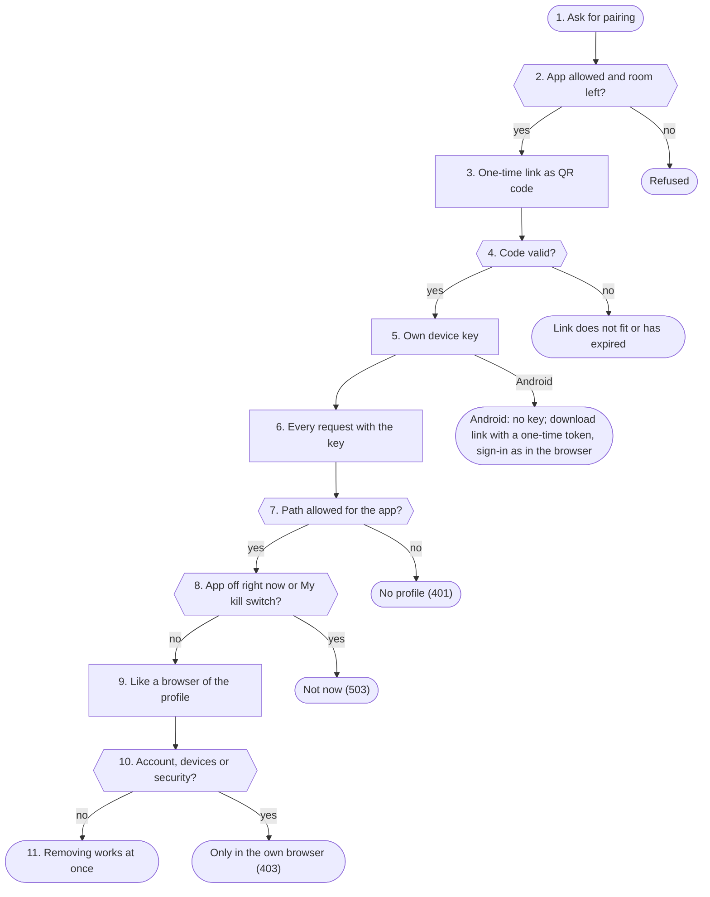

1. **Ask for pairing**: Only the profile's own browser login may pair, never a device key. If the profile has a second sign-in step it needs a code for this, because a new way into the profile is made.
2. **App allowed and room left?**: The app must be switched on by the admin and not blocked for the profile, and the profile may have at most 5 iPhones. The panel address must start with https and have no path.
3. **One-time link as QR code**: new_code makes a random code; only its hash is kept in memory. A profile has at most 3 open codes, the Spark at most 20. The link spark-app://pair opens the app with address and code.
4. **Code valid?**: The app sends the code. The Spark checks the rate limit (10 per minute and address), compares the hash in constant time and deletes the code at the first hit. An expired or used code never fits.
5. **Own device key**: profiles.add_device makes the key and stores only its SHA-256 hash in profiles.json. The app gets it exactly once and keeps it in the keychain.
6. **Every request with the key**: profiles.current looks up the key's hash in the device list. A device key comes before the cookie; the profile always comes from the key, never from what the app writes.
7. **Path allowed for the app?**: An app key only works for the 57 paths in profiles.APP_PATHS (chat, speech recognition, conversations, reminders, chats …), a few read patterns and the panel areas the profile opened for the app one by one. Everything else it sees without a profile.
8. **App off right now or My kill switch?**: If the app is switched off by the admin or blocked for the profile, or the profile has My kill switch on, this request has no profile. The app gets „not now“ (503), keeps its pairing and works again as soon as the switch is back.
9. **Like a browser of the profile**: The app asks through the same endpoints as the page, with the same limits. What it may do on top (smart home, CarPlay, listening, documents, pictures) the Spark tells it in /api/iphone/hello; the app only shows it and follows it.
10. **Account, devices or security?**: Endpoints that change the profile's connections, devices or security only take the own browser login (core.browser_profile). They refuse a device key, except in an area the profile opened for the app; secrets need a fresh code there as well.
11. **Removing works at once**: When the iPhone is removed in the panel, its hash leaves the device list. The app's next request finds no profile any more.

**Examples:** Pair an iPhone and ask: The app has its key and asks like the browser. · Old QR code: Refused: the code was used or has expired. · App wants to change the PIN: Refused: that only works in the own browser. · Admin switches the app off: Not now: the pairing stays for later.

#### Rules

| Key scope | Who has it | What it opens |
|---|---|---|
| app | iPhone app | profiles.APP_PATHS and opened areas |
| watch | Pebble watch | only /api/watch/… |
| desk, write | Spark companion, writing help | only their own paths |
| none | speakers, Siri shortcut, own scripts | asking as the profile, never account or security |
| no key | Android app | sign-in like a browser |

#### Numbers (from the code)

- **10** minutes a pairing code is valid
- **5** iPhones per profile
- **57** fixed paths for the app key
- **30** minutes an Android download link is valid
- **5** downloads per Android link

#### Settings

- Features → iPhone app and Features → Android app: the apps for every profile (default off).
- Features → Who may do what: block the app for single profiles.
- Me → iPhone and Me → Android: pairing, the app's rights, removing devices.

#### What you see

- Status → Live: a line under events when an iPhone is paired or removed.
- Logs → Requests: the app's questions with the input „iPhone-App“ or „CarPlay“.

#### In the code

- `app/panel/iphone.py` `profile_pair`: pairing link only from the own browser
- `app/panel/iphone.py` `new_code`: random one-time code, only the hash
- `app/panel/iphone.py` `take_code`: redeem a code once
- `app/panel/iphone.py` `app_pair`: the app's first contact
- `app/panel/iphone.py` `app_hello`: what the app may, the Spark decides
- `app/panel/profiles.py` `add_device`: make a key, store its hash
- `app/panel/profiles.py` `current`: profile from key or cookie, scopes, switches, kill switch
- `app/panel/profiles.py` `_app_path`: the app's fixed path list
- `app/panel/core.py` `browser_profile`: only the own browser login
- `app/panel/account.py` `profile_remove_device`: remove a device
- `app/panel/android.py` `apk_response`: app file only with a valid link

Self-tests: `test_iphone`, `test_iphone_panel`, `test_android`, `test_app_notaus`

### Telegram, Siri, watch

Telegram, the Siri shortcut and the Pebble watch ask short questions without a browser. Each channel turns them into a request to /api/chat like a device, collects the answer from the stream and hands it back in its own form. The panel itself keeps the history in the profile.

**Why:** The channels should decide nothing of their own: the same rights, locks and limits as in the browser apply, because everything runs through the same chat. What a channel brings on top (forwarded texts of others, Telegram's servers) is settled by fixed rules first.

#### Way


1. **Question through a channel**: Telegram: the panel asks Telegram for new messages itself (long polling), no open port is needed. Siri: a shortcut sends the dictated text with a device key to /api/siri/ask. Watch: the phone sends the question with the watch key to /api/watch/ask.
2. **Telegram: chat linked?**: Groups and channels are never answered. A chat belongs to a profile once it sent „/start CODE“ with a code from Me → Telegram (valid 10 minutes, at most 5 wrong codes per chat and hour). A stranger's chat gets one fixed sentence at most once a day.
3. **Blocked or My kill switch?**: The profile's My kill switch, a block by the admin or a channel switched off end the question. Telegram then answers with a fixed sentence; Siri and the watch find no profile for their key.
4. **Forwarded?**: A message forwarded in Telegram comes from someone else. It is never taken as an order and does not trigger commands like /notaus either.
5. **Voice message to text**: A Telegram voice message is loaded with a size limit, turned into WAV by ffmpeg (length capped) and read by the Spark's speech recognition. With Siri the iPhone dictates, with the watch the phone.
6. **Short history**: For follow-ups the last eight messages go along while the last question is no older than 30 minutes (Telegram) or 10 minutes (Siri). The watch sends its history itself; the panel recognizes answers made from outside text in it again (watch.mark_of).
7. **Request to /api/chat**: The channel calls the chat inside the panel. For Telegram the panel puts the profile into the request, which no request from outside can do; Siri and the watch carry their key. Rights, switch, limits and request history are the same as in the browser.
8. **Collect the answer**: From the stream, pieces of text and retractions count. If the answer came from mail or outside text it is marked so, so the next question starts locked. A question back from the panel becomes buttons in Telegram that come back like a typed answer.
9. **Output per channel**: Telegram gets plain text and, if the profile wants it, a voice message in its voice. Siri gets speakable text without passwords and codes. The watch fetches text and sound (packed for its small speaker, 6000 bytes per fetch) through /api/watch/poll; at most 8 watch answers run at once. The companion gets text without Markdown and also the answer with Markdown (at most 60000 characters) when it hides no fewer secrets.
10. **Black out the code word**: Before storing, the smart home code word is replaced by [Codewort]. In Telegram the bot deletes the message with the code word or asks the person to delete it.
11. **In the profile's history**: verlauf.keep puts question and answer into the channel's conversation of the day („Telegram“, „Siri“, „Uhr“ with the date). With „One conversation for all channels“ they go into the day's main conversation, marked with their channel.

**Examples:** Telegram voice message: Answered and kept in the day's „Telegram“ conversation. · A stranger writes to the bot: One fixed sentence, nothing else. · Forwarded mail with an order: Not carried out: someone else's words are no order. · Siri with My kill switch: No answer: the key finds no profile.

#### Rules

| Channel | How it identifies | History | Output |
|---|---|---|---|
| Telegram | linked private chat | „Telegram“ and date | text, voice message if wanted |
| Siri | the profile's device key | „Siri“ and date | speakable text without secrets |
| watch | watch key, only /api/watch/… | „Uhr“ and date | text without Markdown and sound |

#### Numbers (from the code)

- **10** minutes a Telegram code is valid
- **5** wrong codes per chat and hour
- **5 MB** largest voice message
- **10** minutes earlier questions count for Siri
- **8** watch answers at once
- **10** minutes a watch answer stays fetchable

#### Settings

- Features → Telegram: bot token and switch (default off).
- Me → Telegram: link the own chat; allow voice messages, private data, smart home and notes one by one.
- Me → Pebble watch: pair the watch.
- Features → One conversation for all channels: every channel writes into the day's main conversation.

#### What you see

- Logs → Requests: input „Telegram“, „Siri“ or „Uhr“, without content.
- Status → Live: the running request in the picture.

#### In the code

- `app/panel/telegram.py` `loop`: polls Telegram, rests with the kill switch
- `app/panel/telegram.py` `handle`: one message: link, locks, commands, voice
- `app/panel/telegram.py` `ask`: question to the chat, collect the answer, store
- `app/panel/telegram.py` `transcribe`: voice message through ffmpeg to recognition
- `app/panel/chat.py` `siri_ask`: Siri: profile from the key
- `app/panel/chat.py` `text_ask`: Siri and companion: question, answer, history
- `app/panel/chat.py` `watch_ask`: watch: start the answer as a job
- `app/panel/chat.py` `_watch_run`: watch: the answer into the history
- `app/panel/watch.py` `run`: reads the stream into the watch job
- `app/panel/watch.py` `poll`: text and sound piece by piece
- `app/panel/verlauf.py` `keep`: the channel's day conversation or the main one

Self-tests: `test_telegram_tasks`, `test_pebble`, `test_verlauf_sync`, `test_notaus`

### Speakers, HA

Own speakers are ESP32 boards with the open XiaoZhi firmware. They listen for their wake word, send the sound to the Spark over a WebSocket connection and play the answer. Every speaker is a device key of its profile. Home Assistant Assist only uses the Spark's speech recognition and voice over Wyoming.

**Why:** A speaker stands in the room, anyone can talk to it. That is why personal things only go to the voice that is surely recognized as the profile's (or says the code word), and a board gets its key only once and only at the address that showed the code.

#### Way

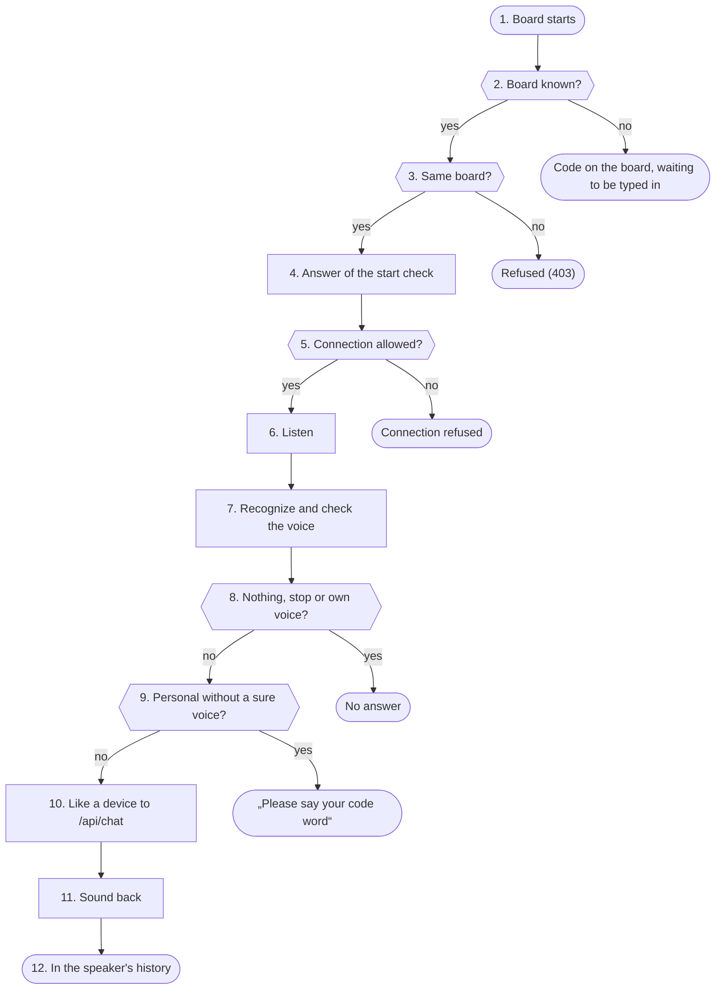

1. **Board starts**: At every start the board asks with its id, MAC address and firmware version which server and which firmware to use. If speakers are off in Features, it gets nothing (403).
2. **Board known?**: An unknown board gets a six-digit code for its display (valid 10 minutes, at most 3 per address and 30 in all). The profile types it in under Me → Speakers.
3. **Same board?**: Once a MAC address is on record for a board id, it must fit. A copied id from another board gets no key and no firmware.
4. **Answer of the start check**: The board gets the time and the WebSocket address. The key comes exactly once, right after the code was typed in, and only to the address that showed the code. A newer firmware is only offered over https, over http only with the admin's switch.
5. **Connection allowed?**: When connecting the Spark checks: kill switch stage 3 off, the key belongs to a speaker (not a watch or another device), speakers on in Features and not blocked for the profile. Then it looks again every 2.0 seconds and ends the connection when something changed.
6. **Listen**: After the wake word the board sends Opus sound. The Spark finds the end of the sentence itself (0.7 seconds of silence after speech) and takes at most 30 seconds per question.
7. **Recognize and check the voice**: Speech recognition makes text of it. At the same time speakers.verify checks whether it is the profile's voice, when speaker ID is on and the profile has taught its voice.
8. **Nothing, stop or own voice?**: No text, a stop word or the Spark's own voice from another device (echo.check) get no answer. The board waits for its wake word again.
9. **Personal without a sure voice?**: With the speaker code word: an unsure voice asking for personal things is asked for the code word, the question waits. After 3 wrong tries the speaker does not ask for 30 minutes. Without a sure voice there are only general things.
10. **Like a device to /api/chat**: The Spark calls the chat with the speaker's key; the profile's voice, memory and room apply. Whose voice it was only the panel itself puts into the request; if it was not surely the profile's, the question counts like a guest's.
11. **Sound back**: The answer goes to the board as Opus at 24000 Hz at playback pace, the text without Markdown for a display. Other devices in the house know the Spark is speaking right now (echo.said).
12. **In the speaker's history**: Question and answer go into the speaker's conversation of the day, the code word blacked out. A voice that was not surely the profile's is marked as outside text: the next question starts locked, and nothing about the profile is learned from it.

**Examples:** The owner asks for appointments: Voice recognized: personal answer, kept in the day's conversation. · New board: Code on the display until the profile types it in. · Copied board id: Refused: the MAC address does not fit. · A guest asks for mail: Code word asked; without the right one nothing personal.

#### Rules

| Way | Who may | What works | Personal things |
|---|---|---|---|
| ESP32 speaker | a speaker's key, profile not blocked | questions as the profile | only with a sure voice or code word |
| Home Assistant Assist | addresses in the admin's allow list | only sound to text and text to sound | never |

#### Home Assistant Assist (Wyoming)

- Its own server listens on the Wyoming port (default 31003) while the switch is on. Wyoming has no password; that is why it only answers addresses from the admin's list, with an empty list nobody.
- Home Assistant only gets „sound in, text out“ and „text in, sound out“, no language model, no profile, nothing personal. At most 8 connections at once; lengths are checked before reading; only sound formats a microphone sends.
- Refused addresses show on Status → Live under input and as a suggestion for the list.

#### Numbers (from the code)

- **10** minutes a pairing code is valid
- **30** seconds of sound per question
- **2.0** seconds, then the rights are checked again
- **10** minutes earlier questions count at a speaker
- **3** wrong code words until the lock
- **8** Wyoming connections at once

#### Settings

- Features → Own speakers: speakers for every profile (default off).
- Me → Speakers: set up, type the code, room, volume, check and the own code word.
- Features → Home Assistant Assist: Wyoming on and the allowed addresses.

#### What you see

- Me → Speakers → Check: what the speaker did lately (memory only, gone after a restart).
- Status → Live: requests from a speaker and from Home Assistant, refused Wyoming addresses under input.

#### In the code

- `app/panel/esp32.py` `ota`: start check: code, key once, update
- `app/panel/esp32.py` `_activation`: six-digit code with limits
- `app/panel/esp32.py` `same_board`: MAC must fit
- `app/panel/esp32.py` `speaker_ws`: accept the connection and keep checking
- `app/panel/esp32.py` `still_allowed`: switches and device still valid
- `app/panel/esp32.py` `Session.run_answer`: recognize, filter, code word, answer
- `app/panel/esp32.py` `Session.code_gate`: code word for an unsure voice
- `app/panel/esp32.py` `Session.speak`: chat with the key, sound back
- `app/panel/esp32.py` `remember`: day conversation, foreign voice marked
- `app/panel/wyoming.py` `settings`: switch, port, allowed addresses
- `app/panel/wyoming.py` `handle`: only allowed addresses, at most so many
- `app/panel/wyoming.py` `_session`: sound to text and text to sound

Self-tests: `test_esp32`, `test_wyoming`, `test_notaus`, `test_echo`

### MCP programs

Other programs (Claude, n8n, Open WebUI, Home Assistant) use the Spark over the Model Context Protocol at /mcp. Every connection belongs to one profile and has its own key and its own tool list. Reading works directly, acting only as a proposal the profile confirms.

**Why:** What a program sends is outside text and never a command. That is why the panel decides with fixed lists which tool may run, and nothing changes without the person's yes in the own browser.

#### Way

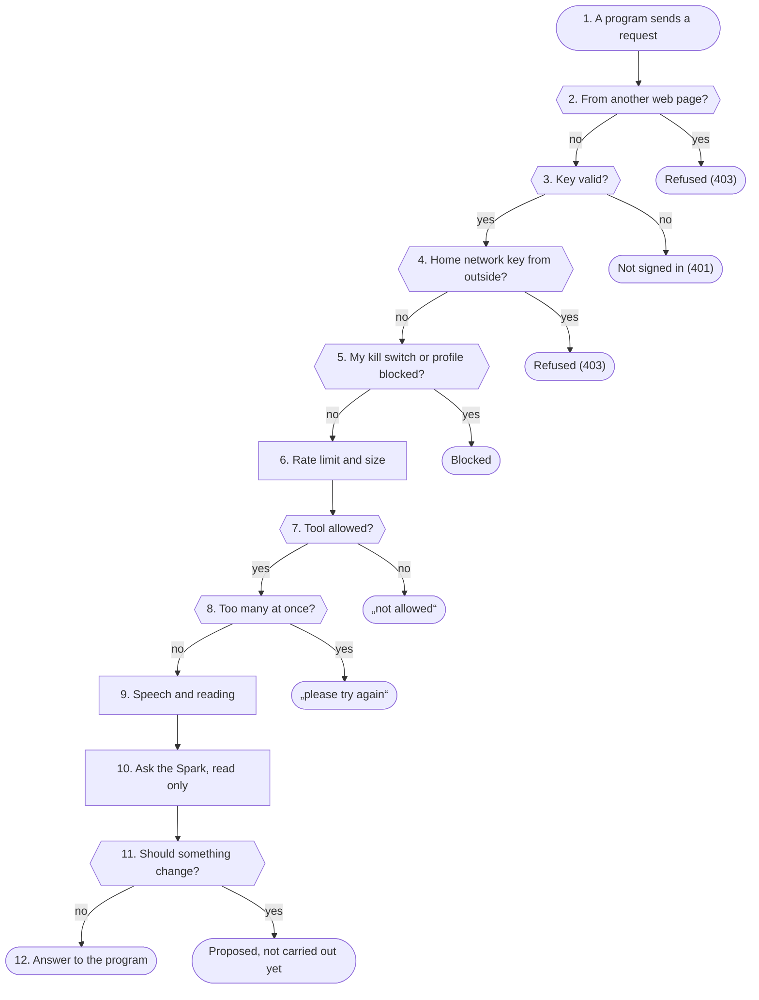

1. **A program sends a request**: Every request is one JSON-RPC message. If the MCP server is off by the admin, the endpoint does not exist (404).
2. **From another web page?**: If a browser sends an Origin, it must be the panel's. So no other page can use the endpoint through DNS rebinding.
3. **Key valid?**: The bearer key is a fixed key or an OAuth access token (valid 60 minutes). Only hashes are stored. A connection ends after 90 days without use.
4. **Home network key from outside?**: A „lokal“ key only works when the peer is a private address, no proxy header is in the request and it is none of the listed reverse proxies. „extern“ only works with the admin's switch.
5. **My kill switch or profile blocked?**: The profile's My kill switch closes every MCP access (503); if the admin blocked the MCP server for the profile, there is nothing (403).
6. **Rate limit and size**: Every connection may send 60 requests per minute; a request is at most 16 MB. Many refused requests from outside count for „Emergency stop by itself“.
7. **Tool allowed?**: Only tools from the fixed list (15), only those given to this connection, and only when the profile may use the function right now, checked again on every call. Mail, memory, earlier conversations, settings and code are never among them (31 names in mcpserver.NEVER).
8. **Too many at once?**: At most 2 calls of one connection and 6 of all connections run at once.
9. **Speech and reading**: Speech recognition (at most 10 MB) and speech output (at most 2000 characters) run at the level „hinten“, so people at the Spark always go first. The reading tools only read this profile's data.
10. **Ask the Spark, read only**: ask_spark (10 per minute) runs as one turn of the assistant for the profile, but only with this connection's reading tools. The question counts as outside text from the start: nothing is switched, stored, learned or sent, no memory, nothing of it in the history. Passwords and codes are removed from the answer.
11. **Should something change?**: Smart home, reminder and appointment are only proposed (at most 10 open). The profile gets a notice and decides under Me → Services over MCP within 15 minutes; only then the panel carries it out. With the kill switch or a smart home code word set, an MCP program switches nothing.
12. **Answer to the program**: The answer is cut to 12000 characters. The journal only gets which program, which tool, whether it worked and how long, never question or answer.

**Examples:** Claude reads the appointments: The profile's appointments as text, cut. · Home network key through the proxy: Refused: this key only works at home. · n8n wants to switch the light: Only proposed; it switches after the yes in the browser. · Program wants to read mail: Not allowed: mail is never offered over MCP.

#### Rules

| Group | Tools | What happens |
|---|---|---|
| speech | transcribe, speak, voices | services at level „hinten“ |
| reading | wikipedia, archive_search, document_search, calendar_events, reminder_list, today, write_text | only reads, stores nothing |
| ask Spark | ask_spark | one turn with reading tools only |
| acting with confirmation | home_assistant, reminder_set, calendar_add | only a proposal, the profile says yes |
| never | mail, memory, history, settings, code | offered under no name |

#### Numbers (from the code)

- **90** days without use, then a connection ends
- **10** connections per profile
- **60** requests per minute per connection
- **2** calls at once per connection
- **12000** characters at most in an answer
- **15** minutes a proposal waits for the yes

#### Settings

- Features → Spark as MCP server: the server for every profile (default off).
- Features → Spark as MCP server → MCP server from outside: connections through the reverse proxy and OAuth.
- Features → Spark as MCP server → MCP: acting with confirmation: the tools that propose something.
- Me → Services over MCP: make connections, pick tools, confirm or decline proposals.

#### What you see

- Status → Live: every tool call as a request of the program, from outside under „Über das Internet“.
- Me → Services over MCP: the latest proposals with their state.

#### In the code

- `app/panel/mcpserver.py` `mcp_post`: the endpoint: origin, key, limit, method
- `app/panel/mcpserver.py` `origin_ok`: no other web page
- `app/panel/mcpserver.py` `check_conn`: key, home network, kill switch, switch
- `app/panel/mcpserver.py` `is_local`: really from the home network
- `app/panel/mcpserver.py` `find`: connection for the key's hash
- `app/panel/mcpserver.py` `tool_ok`: may the profile use this tool now
- `app/panel/mcpserver.py` `call`: calls at once, journal line
- `app/panel/mcpserver.py` `run`: hands out to speech, reading, asking, acting
- `app/panel/mcpserver.py` `ask`: one turn with reading tools only
- `app/panel/mcpserver.py` `propose`: proposal instead of action
- `app/panel/mcpserver.py` `decide`: the profile's yes, then carry out
- `app/panel/mcpserver.py` `carry_out`: carries out confirmed actions only

Self-tests: `test_mcpserver`, `test_notaus`

### Middleware

The middleware is the layer in panel.py every HTTP request passes before an endpoint reads it: kill switch, foreign pages (CSRF), size of the request and update lock. On the way back it sets protective headers, writes changes to the admin log and renews logins.

**Why:** FastAPI reads file, form and JSON parts before an endpoint checks the login. Without this layer anyone could fill memory or disk with a huge upload and would get the „not logged in“ only afterwards. Likewise the kill switch must hold before any endpoint does anything, and a foreign web page must never use the browser's cookies for changes.

#### Way

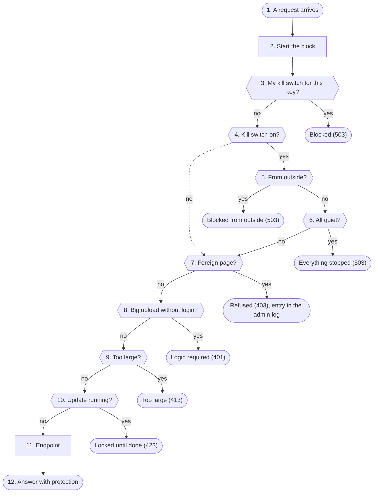

1. **A request arrives**: Every HTTP request to the panel passes this layer, from the outside in, in the order Starlette stacks the middleware (the one added last is outermost). Telegram, „Ask Spark“ over MCP and the speakers build their question inside the panel and call chat.chat directly; their outer request already passed here.
2. **Start the clock**: slow_reads times the whole request. A read under /api/ that takes longer than 1.5 s becomes one journal line, per route at most every 60 s; only the route's pattern and the time, never the query or names.
3. **My kill switch for this key?**: If the request carries a device key and that key's profile has its own kill switch on, it gets nothing but the kill switch state. Otherwise the panel notes which profile this request acts for, so the last line of defence further down knows whose action it would be.
4. **Kill switch on?**: With the kill switch off the request goes straight on to the origin check. The page itself and its files always pass, so the kill switch can be seen and lifted.
5. **From outside?**: In the home network is only who has a private address and does not come through a proxy, or comes through a listed proxy that reports a private address. From kill switch stage 1 everything from outside only gets the page and the kill switch state.
6. **All quiet?**: In stage 3 only logins, the admin mode, lifting the kill switch and reading status, logs and live pass, also at home. In the stages below everything at home goes on; the panel then holds actions off further down.
7. **Foreign page?**: A changing request (POST, PUT, PATCH, DELETE) that carries a login cookie must come from the panel's own page: the browser says so with Sec-Fetch-Site, else Origin is compared with the host. Another port on the same machine counts as foreign. With neither header it is not a browser (scripts) and passes.
8. **Big upload without login?**: The paths for big uploads (backups, voices, sound, documents, pictures, MCP) only accept someone who could be logged in at all: admin cookie, profile, admin mode or an Authorization line. The real check comes later in the endpoint; here no byte of a stranger's upload is read.
9. **Too large?**: Every path has its limit, else a small default of two MB holds. A Content-Length that is too large is refused at once; while reading, BodyLimit also counts and stops as soon as more arrives than allowed.
10. **Update running?**: While an update runs, changes under /api/ are held. The assistant, the devices and logging in stay open (update.UNLOCKED).
11. **Endpoint**: Only now the endpoint reads the request and checks login, profile and rate limit itself (the next box, „Login, profile“).
12. **Answer with protection**: Every answer gets the protective headers (no foreign frames, a strict Content-Security-Policy, on https also HSTS), under /api/ „no-store“. A change goes into the admin log with who, path and status, except normal use from guard.QUIET_WHY. Logins in use are renewed, on https always with Secure.

**Examples:** Setting in the browser at home: Passes: the endpoint checks the login, the change is in the admin log. · Foreign web page sends a form: Refused with 403 before any endpoint acts. · Kill switch stage 1, app on the road: Blocked with 503 and the stage; the app shows the kill switch. · Big upload without login: Refused with 401, not a byte read.

#### Rules

| Kill switch stage | From outside | At home |
|---|---|---|
| off | everything | everything |
| 1 and 2 | only the page and the kill switch state | everything; the panel holds actions off further down |
| 3 | only the page and the kill switch state | logging in, admin mode, lifting, reading status and logs |

#### Why this order

- The kill switch is outermost: with it on, even a foreign page or an oversized upload from outside only hears the stage.
- Origin comes before size: a foreign page is refused without its content being read.
- What the kill switch holds off deep down (NotausAktiv) is answered as a plain sentence with 503, never as a server error.

#### Numbers (from the code)

- **1** kill switch stage from which nothing from outside passes
- **3** kill switch stage in which almost everything stops at home too
- **1.5 s** from here a read counts as slow
- **60 s** at most one line per route

#### Settings

- Settings → Security → Reverse proxy: X-Forwarded-For counts only from these addresses. That decides who counts as „at home“ and which address gets locked.
- Settings → Security → Emergency stop by itself: many wrong logins, MCP requests or blocked connections from outside trigger kill switch stage 1 (default off).

#### What you see

- Status → Live: under events it says „foreign page refused“; the kill switch shows as a banner.
- Logs → Admin log: every change with who, path and status, also refused foreign pages.
- Status → Logs: slow reads as a line „seite: slow GET …“.

#### In the code

- `app/panel/panel.py` `slow_reads`: times every request
- `app/panel/panel.py` `emergency`: kill switch before any endpoint
- `app/panel/notaus.py` `mine_gate`: my kill switch for device keys
- `app/panel/notaus.py` `gate`: what passes at which stage
- `app/panel/notaus.py` `at_home`: at home or from outside
- `app/panel/panel.py` `sessions`: foreign pages, log, renew cookies
- `app/panel/guard.py` `same_origin`: the origin rule
- `app/panel/panel.py` `_may_upload`: big uploads only with a login
- `app/common.py` `BodyLimit`: size limit before reading
- `app/panel/update.py` `update_lock`: changes during an update
- `app/panel/panel.py` `protect`: protective headers

Self-tests: `test_hardening`, `test_panel`, `test_notaus`, `test_seiten_laden`

### Login, profile

Here the panel decides who sends a request and what that person may do: login with password or PIN (with a lock after wrong attempts), cookie or device key, rate limit and the release per function. The profile comes only from the cookie, the key or the panel itself, never from a request's text or from the model.

**Why:** The Spark is reachable in the home network and often through a proxy from the internet. Without a lock a PIN could be guessed, without a rate limit one page or script could take the GPU for itself, and without a fixed binding to a profile a request could pretend to be someone else.

#### Way


1. **Log in or ask**: Logging in gives the browser a cookie; apps, watch and speakers have a device key instead. Steps 2 to 5 run once when logging in, the steps from 6 on with every request.
2. **Locked?**: Locks are kept per address and per name (or the admin password). A name's lock does not hold for a browser that logged in to that name before (cookie speech_known, only its hash is kept). So a stranger guessing cannot lock the owner out.
3. **Password or PIN right?**: The check runs in its own thread. An unknown name costs the same work as a wrong PIN, the answer is the same. A wrong attempt waits a second, counts for the lock and, when it comes from outside, for „Emergency stop by itself“.
4. **Second step?**: If the profile (or the admin) has the second step on and the browser is not trusted, the code from the app or a passkey comes next. A wrong code counts like a wrong PIN.
5. **Set the cookie**: The address's counter is cleared; strangers' wrong attempts for the name keep counting. The profile cookie is signed and stands in the list of signed-in browsers; it holds at most 90 days without use and is renewed while used. The admin cookie is signed with the password, a key of this Spark only and the second step.
6. **Find the profile**: First what only the panel itself sets (Telegram, „Ask Spark“ over MCP), then the device key (only its hash is stored), then the cookie: signature, age, session still in the list and not logged out.
7. **Key free for this path?**: A key with a scope (app, watch, room, Home Assistant, writing help, companion) only reaches its own paths and only while the admin and the profile have the function on. If it is off right now or the profile has its own kill switch on, the panel answers 503 instead of 401, so the app keeps its pairing.
8. **No profile and guest access off?**: Without a profile only the admin passes (cookie or HTTP Basic, whose wrong attempts count like on the login page), or anybody when the admin opened the assistant without password. Guests then only get question and answer.
9. **Too many requests?**: Per profile, else per address, the panel counts the requests of the last minute: in the chat 120 for a profile or the admin, 30 for a guest.
10. **Guest, all places taken?**: Guests share 4 places at once in the chat. A place nobody frees counts as free again after 10 minutes.
11. **Release per function**: For every function the panel asks in a fixed order: the admin's switch (and the one of the function it builds on), guest (never gets one), blocked by the admin for the profile, the profile's own wish, second step needed. It is read anew with every request, so a change holds at once.
12. **On to preparing**: The request goes on with its profile (or as a guest) to chat_turn.prepare. Speech gets priority over background work, and the profile's other open pages see „answering“.

**Examples:** Login with PIN: Logged in: the browser has a signed cookie. · Stranger guesses a PIN: Refused; after 5 wrong attempts the address is locked. · Question from the iPhone app: Passes: profile from the device key, releases per function. · Guest, guest access off: Refused with 401: no assistant without a profile.

#### Rules

| Way in | How checked | What it reaches |
|---|---|---|
| Browser with profile | signed cookie, session in the list | everything of the profile |
| Admin | password cookie or HTTP Basic | admin pages; HTTP Basic only without a second step |
| Device key without scope | hash of the key | the profile's assistant, no changes to connections or security |
| Device key with scope | hash, path, switch | only the paths of its scope |
| Guest | only with assistant without password | question and answer, no tool |

#### Behind a proxy

- X-Forwarded-For only counts from a listed proxy (or one on the Spark itself while none is listed). Otherwise any device could claim another address and get around the lock.

#### Logging out

- A logged-out cookie becomes invalid on the server too, a copy of it no longer works. For the admin this holds for every copy of the same login.

#### Numbers (from the code)

- **5** wrong attempts per address in 15 minutes until the lock
- **10** wrong attempts per name in 15 minutes until the lock
- **60 s** first lock, each further one twice as long up to 60 minutes
- **30** wrong attempts per name in 24 hours at most
- **120** chat requests per minute for a profile
- **4** places at once for guests
- **90** days at most for a sign-in in the browser

#### Settings

- Settings → Security → Assistant without password: guests may ask (default off).
- Settings → Security → Sign-in in the browser: how many days without use a profile stays signed in.
- Features → Who may do what: block a function for single profiles.
- Me → Security: a profile's second step.

#### What you see

- Status → Live: under Eingang accepted access from the internet and refused logins.
- Logs → Admin log: logins, wrong attempts and locks.
- Me → Security: the latest logins of the own profile.

#### In the code

- `app/panel/guard.py` `check`: lock before checking
- `app/panel/guard.py` `failed`: count a wrong attempt, lock
- `app/panel/guard.py` `succeeded`: clear the counter, remember the browser
- `app/panel/account.py` `profile_login`: a profile's login
- `app/panel/account.py` `second_step`: code or passkey
- `app/panel/core.py` `is_main_admin`: admin by cookie or HTTP Basic
- `app/panel/profiles.py` `current`: the profile behind a request
- `app/panel/profiles.py` `_cookie_user`: check a cookie
- `app/panel/core.py` `assistant`: profile, guest access or admin
- `app/panel/guard.py` `limit`: rate limit per minute
- `app/panel/guard.py` `Slot`: places for guests
- `app/panel/features.py` `reason`: why a function is not available

Self-tests: `test_panel`, `test_features`, `test_rechte_sofort`, `test_passkey`, `test_coadmin`

### Prepare request

chat_turn.prepare turns a chat request into a finished turn before the language model is asked: who speaks and what that person may do, the system prompt, answers to questions back and proposals, the locks after outside text and the list of offered tools.

**Why:** The model should only see what it may really use in this turn. Everything that decides (rights, locks, a „yes“ to a proposal, the choice after a question back) the panel does here by fixed rules; the model only says the result afterwards.

#### Way

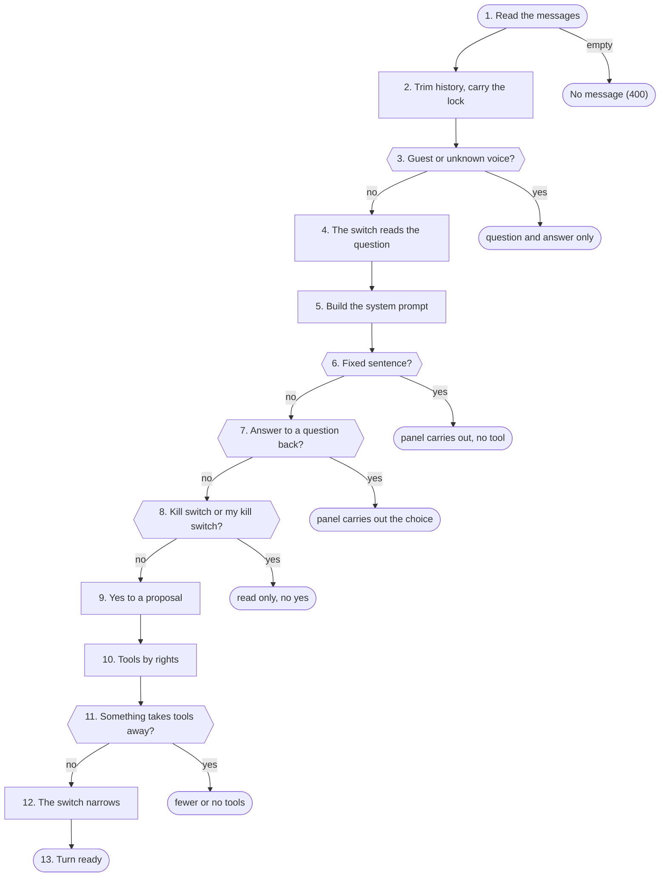

1. **Read the messages**: Only text messages of user and assistant are taken, each cut at 20000 characters. An answer the browser marked as made from mail or outside text keeps that mark.
2. **Trim history, carry the lock**: The history is trimmed to its budget. If an answer from outside text is among the last three messages, this turn starts locked; older ones are not sent at all.
3. **Guest or unknown voice?**: Without a profile, or at an own speaker when speech recognition did not clearly hear the profile's voice, there is only question and answer: no tool, no memory, no history. Whose voice it was only the panel itself sets, never the request.
4. **The switch reads the question**: Fixed rules put the own latest message into a group. A new own request that does not point back at the answer from outside text leaves that answer and its lock out. If no rule knows the question, the model may pick once from a fixed list in parallel (when the admin has that on). A follow-up like „And tomorrow?“ takes the group of the own question before (intent.follow_up); hint words add their groups, also beside the model's pick.
5. **Build the system prompt**: The admin's system prompt, plus the profile's length and style and a note per channel (watch, Siri, speaker, Telegram, app, browser). With „Fast answer start“ what holds for this turn only goes with the question instead of the system prompt, so the server reads it from its cache.
6. **Fixed sentence?**: Sentences like „Spark Notaus“, „report a problem: …“ or „that was wrong“ the panel carries out itself, only from the profile's own words and never over MCP. The model only says the result and gets no tool in this turn.
7. **Answer to a question back?**: If the panel asked which device is meant, a button, a number or the name counts as the answer, only in the same conversation, from the own profile and within 2 minutes. „None of these“ brings the whole list, „No, the other one“ corrects the last choice. The panel carries out the choice and offers to remember it; a „yes“ to that counts for 15 minutes.
8. **Kill switch or my kill switch?**: From kill switch stage 2 or with the profile's own kill switch every waiting proposal is dropped; no „yes“ carries anything out. Reading and answering go on.
9. **Yes to a proposal**: If a proposal of this conversation waits (an appointment, a mail change, a list entry, a correction), the panel decides on the „yes“. One yes confirms exactly one thing; every answer settles all other waiting proposals of this conversation.
10. **Tools by rights**: Each tool group comes only with the admin's switch, the release for the profile and its own data: search, memory, history, documents, smart home, reminders, calendar, mail. Telegram, the iPhone app and CarPlay can only make it narrower, never wider. Another recognized voice at this device gets nothing personal.
11. **Something takes tools away?**: The kill switch takes away tools to the internet or that change things, „Ask Spark“ over MCP keeps only the connection's tools, a picture or a fixed sentence leaves none. For a guest the list is emptied once more, whatever filled it.
12. **The switch narrows**: With „Targeted tool choice“ only the question's group stays. Then the panel decides whether to search locally first, whether it does a clear fetch itself and which tool the first round must call.
13. **Turn ready**: The system prompt goes first, with the tools and the lock rule. The kill switch is read again for every tool call: triggered during an answer, it holds the next call off.

**Examples:** Guest asks for the weather: Answer without a tool: guests only get question and answer. · „The second“ after a question back: The panel switches the chosen device; the model only says the result. · Kill switch stage 2, asking for appointments: Only reading tools; adding appointments is not offered.

#### Rules

| Who speaks | Tools | Personal data | Yes to proposals |
|---|---|---|---|
| Profile, own login or key | by releases | ✓ | ✓ |
| another recognized voice at this device | general ones | ✕ | ✕ |
| Ask Spark over MCP | only the connection's | read only, no memory, no mail | ✕ |
| Guest or unknown voice at a speaker | ✕ | ✕ | ✕ |

#### Numbers (from the code)

- **20000** characters at most per message
- **2** minutes a choice answers a question back
- **15** minutes „Shall I remember that?“ waits
- **4** buttons at most for a question back
- **2** kill switch stage without actions

#### Settings

- Features → Who may do what: what a single profile does not get.
- Features → Ask instead of guessing: the panel asks instead of guessing (default off).
- Features → Switch: the fixed rules that narrow the tools.

#### What you see

- Logs → Requests: per question group, tools „x of y“, required tool and lock, without content.
- Status → Logs: lines like „weiche: Absicht …“, „chat: web search …“ or „notaus: … Werkzeuge nicht angeboten“.

#### In the code

- `app/panel/chat_turn.py` `prepare`: the whole way
- `app/panel/chat_turn.py` `shared_stranger`: unknown voice at a speaker
- `app/panel/chat.py` `trim_history`: trim the history
- `app/panel/chat.py` `left_out`: leave out answers from outside text
- `app/panel/intent.py` `classify_cfg`: the switch's fixed rules
- `app/panel/klaeren.py` `answer`: answer to a question back
- `app/panel/features.py` `allowed`: release per function
- `app/panel/notaus.py` `locked_tools`: what the kill switch takes away
- `app/panel/intent.py` `narrow`: narrow the tools
- `app/panel/chat_turn.py` `notaus_note`: sentence for the model with the kill switch

Self-tests: `test_klaeren`, `test_features`, `test_notaus`, `test_hardening`, `test_weiche`

### Switch

The switch puts the own latest message into a group (smart home, calendar, weather, mail and so on, today 20 groups) and so narrows the tools the language model sees in this turn. It works with fixed word lists; the model may at most pick once from a fixed list when no rule fits, and that too can only narrow.

**Why:** Few fitting tools make the model faster and more accurate: it reads less and misses less often. Because the switch only takes away from what rights and locks left, a wrongly sorted sentence can never allow more, at most leave a tool out.

#### Way

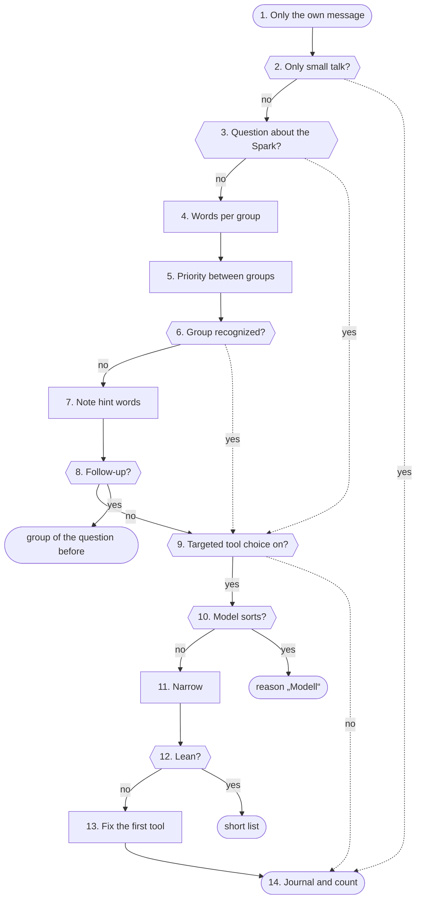

1. **Only the own message**: Only the person's own latest message is read, never an answer before, outside text or what the model wrote. The words the admin saved under Features → Switch are added.
2. **Only small talk?**: If the whole sentence is a greeting or thanks, the group is „plaudern“ (small talk). The answer then gets no tool at all.
3. **Question about the Spark?**: „How do I connect Home Assistant?“ or „Switch on web search“ ask about the Spark itself, not about a device or a search: group „spark“. A question about words or languages never counts. When „Ask Spark“ was used on a page of the panel, the same group holds by a fixed rule about where it was asked.
4. **Words per group**: Each group has its built-in word list (light, appointment, mailbox, umbrella …). A switching word without a device („all off“) only counts as a whole command. The admin's must words and own words per group (at most 20, whole words only) find a group as well, but replace nothing.
5. **Priority between groups**: When several groups match, fixed rules tidy up: weather, list, message, document and „create document“ come before smart home when there is no switching command; parcels before mail; „Do I have new messages?“ is a message, „What is in the news?“ the web search; a job that comes back regularly or watches something is an agent; a question about language or nature is never a device. Last, the admin's „Not with“ words take groups out again.
6. **Group recognized?**: One group or at most 2 count as clear and narrow. More groups at once are not clear enough: then every tool stays.
7. **Note hint words**: If no rule recognizes a group for sure, the switch looks for weaker hint words: „water the plants“ points to the weather, „Friday“ to the calendar. A hint never narrows; it only makes sure its group's tools stay when something narrows later.
8. **Follow-up?**: If the message is short (at most 80 characters), points back („and“, „that“, „it“) and the own question just before had a clear group, that group holds again. Only the own question counts, never the answer. The journal says „weiche: Folgefrage“.
9. **Targeted tool choice on?**: Only with this switch does the switch narrow, and not with a picture or a direct smart home command. Without it the group only goes to the journal and statistics; the model sees every tool the rights allow.
10. **Model sorts?**: If no rule found a group and „Questions no rule recognizes“ is set to the model, the language model picks one group from the fixed list once (JSON only, only the own message). The question already runs beside the preparation from its start; the wait is at most 4 seconds, with „Fast answer start“ only 300 ms after the preparation. With classification with probabilities the pick only counts from the threshold (default 80 %). The hint groups stay beside the pick.
11. **Narrow**: With a clear group its tools stay, plus always 4 fixed ones (remembering something, own documents, PC), the hints' tools, the admin's extra tools for this group (at most 6) and what the own words name explicitly („onto the reMarkable“). All only as far as already offered. If nothing of the group is offered or the group is set to „do not narrow“, all stay.
12. **Lean?**: If the question stays without a group, the setting is „Lean“ and no must word requires a tool, the model only gets the short list: web search, Wikipedia, archive, earlier conversations, the fixed tools and the tools of the hint groups. It reads less and starts sooner.
13. **Fix the first tool**: One single clear group, one required tool and only that one of the group offered: the first round must call exactly that one („What will the weather be?“). A short, clear reading sentence („What is the weather today?“) is fetched by the panel itself with „Fetch clear questions directly“, for tomorrow and the day after with the date the panel works out.
14. **Journal and count**: Every turn writes a line „weiche: Absicht … | Grund … | Hinweis … | Werkzeuge x von y | Pflicht … | gesperrt … | eingrenzen an/aus“; a reason word only shows when it is still in the message. Per day and group only counts are kept (8 days), never a word of the question. Then the list goes to the answer.

**Examples:** „Turn off the living room light“: Group smarthome (word „Licht“): the model only sees the smart home tools and the fixed ones. · „And tomorrow?“ after a weather question: No rule fits, but the follow-up takes „wetter“: only the weather tool is required. · „Do I need to water the plants?“ with „Lean“: Unclear, hint „gießen“ → weather: short list plus the weather tool. · „Thanks!“: Group small talk: answer without a tool.

#### Rules

| Questions no rule recognizes | What the model sees | Time |
|---|---|---|
| All tools (default) | everything the rights allow | none added |
| the model sorts | the picked group and the hint groups | a short model question beside |
| Lean | short list and hint groups | none, starts sooner |
| Classification with probability | the group only from the threshold | a short classification beside |

#### Everyday score

- The test sentences (132) hold every reported wrong turn and must all pass. The everyday sentences (183) were never used for tuning: they measure how many land right, are protected by a hint, stay open or land wrong. A self-test forbids right plus protected going down or wrong going up.

#### Tool names

- Wherever a tool shows, a readable name comes from one table (78 tools), for example „Mailbox overview“ instead of mail_tidy_overview.

#### Numbers (from the code)

- **20** groups of the switch
- **2** groups at most that still narrow
- **80** characters at most for a follow-up
- **4** seconds at most for the model's pick
- **300 ms** waiting with „Fast answer start“
- **80 %** default threshold of the classification
- **132** built-in test sentences
- **183** everyday sentences for measuring
- **20** versions for undo

#### Settings

- Features → Targeted tool choice: without this switch the switch narrows nothing (default off).
- Features → Switch: own words per group, „Not with“, extra tools, groups without narrowing, must words, own test sentences and what questions no rule recognizes get. Every change runs through all test sentences first; if one changes, it is saved only after confirming. Undo keeps the last 20 versions.
- Features → Fetch clear questions directly: the panel fetches short reading questions itself (default off).

#### What you see

- Features → Switch: „Try a sentence“ shows the whole way of a sentence without the model; also test sentences, everyday score and statistics (7 days, counts only).
- Status → Logs: lines „weiche: Absicht …“, „weiche: Folgefrage“, „weiche: Modell-Zuordnung …“ and „weiche: direkt abgerufen“.
- Logs → Requests: per question group, tools „x of y“ and what became of the model's pick.

#### In the code

- `app/panel/intent.py` `classify`: groups by fixed words and priority
- `app/panel/intent.py` `Route`: group, reason, hints; when clear
- `app/panel/intent.py` `hints_of`: hint words
- `app/panel/intent.py` `follow_up`: follow-up
- `app/panel/intent.py` `ask_model`: the model's pick from a fixed list
- `app/panel/intent.py` `pick_in_time`: wait for the pick or stop it
- `app/panel/intent.py` `narrow`: narrow the tools
- `app/panel/intent.py` `lean`: short list with „Lean“
- `app/panel/intent.py` `forced`: required first tool
- `app/panel/weiche.py` `count`: statistics without content
- `app/panel/weiche.py` `trace`: try a sentence
- `app/panel/intent_alltag.py` `measure`: everyday score

Self-tests: `test_intent`, `test_intent_alltag`, `test_weiche`, `test_werkzeuge`, `test_systemone`

### Build answer

This is where the answer is made: the panel asks the language model in rounds, runs offered tools, checks every finished sentence by fixed rules and sends text and sound to the device as one stream. The panel decides the checks, never the model.

**Why:** A language model likes to make up times, amounts or deeds („the light is on“) that never happened. Spoken, that sounds like a fact. So the panel only says sentences that fit what was really read or done, and still starts speaking quickly.

#### Way


1. **Question arrives**: chat() checks the rate limit, sets the mark „speech is running“ (background work waits) and shows the profile's other devices „answering“. Then chat_turn.prepare works out rights, locks, system prompt and the offered tools; _answer takes over.
2. **Open the stream, instant sentence**: Two queues connect everything: one for events to the device, one for sentences to speech output. When the instant acknowledgement is allowed, a recorded sentence plays at once (no GPU); if the answer then stays silent, one bridge sentence follows.
3. **What the panel does itself**: When the preparation decided that the panel acts itself (a switch command, reading states, „search locally first“, a clear reading request), it runs now. The result goes to the model like a tool result, outside text wrapped as data.
4. **Prepare a round**: Offered is the list without locked tools, tools stopped after errors or used too often. When the question needs a tool, the model must choose one (tool_choice), with its own temperature. The fifth round has no list: the model is told to answer now.
5. **Stream and cut into sentences**: The answer comes piece by piece. Thinking and tool calls written as text are never shown or spoken. split_sentences cuts finished sentences off („z. B.“ and „5. Oktober“ are no sentence end); a long first sentence goes at a comma, so the first sound comes early.
6. **Figure without proof?**: For data questions answercheck compares every time, date, score and amount in the sentence with everything the model was given. After a calendar read only figures from this answer count, not from earlier ones; a quoted appointment title must be in the result.
7. **Deed without a tool?**: When a sentence claims a deed („is on now“, „entered it“), a tool of that kind must have worked in this answer (taten.check). Only when a changing tool was offered.
8. **Show and speak**: A checked sentence goes to the device as text and into the speech output queue; code blocks are only shown. A sentence already said in an earlier round is left out. After the first sentence speech output joins everything waiting into one piece, so the voice stays calm.
9. **Data question without looking?**: When the question needs a tool and the model answers without one, the whole round is never said. The model is asked once more, told to use the tool first.
10. **Tool wanted?**: When the model wrote no tool call or hit the length limit, the answer is done. At the length limit it is spoken up to the last sentence end, the rest is dropped.
11. **Run the tools**: Half words before the call are taken back, a finished sentence stays. Every call goes through chat_tools.run; the result comes back as a tool message. A tool that fails twice the same way is stopped for this answer.
12. **Honest closing sentences**: When a sentence fell out because of a figure, the panel says „I have no more precise details on that.“; when a deed fell out, a fixed sentence from taten.sentence. Both come from the panel, never from the model.
13. **The panel's own questions**: Only when nothing from outside was read: offer to remember a learned correction or ask about a fact in memory (by fixed rules). Then the panel puts the answer on the reMarkable when asked and fetches ahead for a question back. The profile's tool log is written.
14. **Stream ends**: The request trace is closed; cases and the background check run only after speaking. When the device aborts (barge-in), model and speech output stop at once.

**Examples:** Small talk without a tool: Spoken from the first sentence, no check steps in. · Tomorrow's appointments: The model calls the calendar, the next round answers from the result. · Made-up time: The sentence with the time is never said, an honest sentence instead. · „Light is on“, switching failed: Instead of the claim: „That did not work: …“.

#### Numbers (from the code)

- **4** tool calls per round, more do not run
- **3** memory notes per answer
- **2** same failures until a tool stops (or 3 of any kind)
- **50** characters after which the first sentence goes at a comma

#### Settings

- Settings → Language model: Answer check, Check deeds and Stop error loops (all three on by default).
- Settings → Language model: Length of an answer, Temperature, Think first; under Advanced the Web searches per answer.

#### What you see

- Status → Logs → Requests: every round, every tool, „answer check“ and „check deeds“ with numbers, never with text.
- Status → Logs → Advanced → Conversation: where the time of an answer went, up to the first sound.
- Status → Improve: how often the built-in rules stepped in today.

#### In the code

- `app/panel/chat.py` `chat`: rate limit, speech first, „answering“
- `app/panel/chat.py` `_answer`: rounds, tools, checks, speech output as one stream
- `app/panel/chat.py` `split_sentences`: cuts finished sentences off
- `app/panel/chat.py` `said_key`: spots a sentence already said
- `app/panel/chat.py` `no_code`: code blocks only shown, never spoken
- `app/panel/chat.py` `loop_count`: counts failures for stop error loops
- `app/panel/answercheck.py` `known`: every figure the model was given
- `app/panel/answercheck.py` `unsupported`: figures in the sentence without proof
- `app/panel/answercheck.py` `fresh`: after the calendar only this answer's figures
- `app/panel/taten.py` `check`: deed claimed, no tool managed it
- `app/panel/taten.py` `sentence`: the fixed honest sentence

Self-tests: `test_panel`, `test_taten`, `test_handlungsregel`, `test_fast_start`, `test_morgen_termine`

### Tools

When the model calls a tool, chat_tools.run carries it out, but only when it was offered in this round and no lock applies. The result goes back to the model as data, never as a command.

**Why:** A server parser passes through any tool name the model writes, also made-up or locked ones. And a web page or mail could ask the model to switch the light or send data away. So the panel checks every call again instead of trusting the model.

#### Way


1. **The model calls a tool**: At most 4 calls per round run, and a tool stopped after errors does not run again. Memory notes are limited to 3 per answer.
2. **Offered in this round?**: Only tools on this round's list run. The list is already cut by the locks; anything else gets „not available, do not call it again“ or, after a mail, the reason of the mail lock.
3. **Kill switch holds it?**: The kill switch is read for every call, so it also applies in the middle of an answer. From stage 1 the tools that go to the internet by themselves are locked; from stage 2 or with the profile's own kill switch every tool that changes something.
4. **Outside text read?**: When this answer already read text from outside, nothing may change the home, the memory, appointments or reminders any more. After a mail web search is closed too, also after own documents (except with „search locally first“, then only with the question's own words).
5. **Service gone right now?**: When the service watch sees this tool's service down (and its switch is on), a fixed sentence with the time of the outage comes at once instead of a try. Web search checks further down and then can fall back to the own archive.
6. **Mark reading**: Tools that bring outside text (web search, documents, calendar, earlier conversations, camera) set the mark before they run. From then on the locks of step 4 hold for the rest of the answer.
7. **Run the tool**: Extensions get profile, device and origin from the panel, never from the model. Smart home changes need the code word in the latest message when one is set. Connections to outside services go through the guard.
8. **Errors as a sentence**: When a service cannot be reached, it becomes a short result text („not reachable“, „search failed, do not guess“). An offered tool without a matching setup answers „unknown“.
9. **Wrap the result as data**: Outside text gets a fixed note in front and stands between markers it cannot close itself. Home Assistant states with free text (titles, lists) count as outside too.
10. **Device marks the answer**: The device learns that the answer rests on outside text. Such answers do not go to the model again later.
11. **Record**: The log line names the tool only when it was offered, else „unbekannt“. What was a deed is noted by taten for the action check. People see the readable names from werkzeuge.py.
12. **Failed twice?**: When a tool fails 2 times with the same details or 3 times at all, it is stopped for this answer and the model is told to say honestly what did not work.
13. **Result back to the model**: The model gets the result as data in the next round. What it says from it is checked again by the answer (answer check, check deeds).

**Examples:** Read appointments: Runs; the result goes back wrapped as data. · Made-up tool name: Not done: the tool was not offered. · Kill switch during the answer: Blocked: the next call reads the kill switch again. · Web search and light in one round: Blocked: after the web search nothing may switch.

#### Rules

| State in this answer | Locked |
|---|---|
| outside text read | 13 changing tools and those of extensions |
| mail read | also web search and new appointments |
| own documents read | web search (with local first only own words) |
| kill switch stage 1 | 7 tools that go to the internet themselves |
| kill switch stage 2 or own kill switch | every tool that changes something |

#### Numbers (from the code)

- **4** calls per round
- **3** memory notes per answer
- **13** tools locked after outside text
- **7** tools without internet with the kill switch
- **79** tools with a readable name

#### Settings

- Settings → Language model: Stop error loops (on by default) and under Advanced the Web searches per answer.
- Features → Switch: which tools the model sees for a question at all.

#### What you see

- Status → Logs → Requests: every call with its readable name, ok or not, length and whether locked.
- Status → Live: which tool runs right now and what the service gave back (only the kind).

#### In the code

- `app/panel/chat_tools.py` `run`: the checks and all built-in tools
- `app/panel/chat.py` `_answer`: calls run_tool, wraps results, stops loops
- `app/panel/chat.py` `wrap_outside`: outside text as a data block
- `app/panel/chat.py` `LOCKED_OUTSIDE`: locked after outside text
- `app/panel/chat.py` `LOCKED_MAIL`: locked after a mail
- `app/panel/chat.py` `READS_OUTSIDE`: tools that bring outside text
- `app/panel/notaus.py` `locked_tools`: what the kill switch locks per stage
- `app/panel/dienstwacht.py` `tool_down`: fixed sentence when a service is gone
- `app/panel/chat.py` `tool_info`: numbers for Logs → Requests
- `app/panel/werkzeuge.py` `label`: readable name of a tool

Self-tests: `test_fast_start`, `test_dienstwacht`, `test_taten`, `test_notaus`, `test_werkzeuge`, `test_werkzeug_abdeckung`

### Knowledge

Knowledge is everything the Spark knows without going to the internet: the uploaded documents of each profile (one SQLite file wissen.db per profile), the memory, earlier conversations, the own Kiwix archive and created documents. This page shows the way a question finds fitting passages in the documents.

**Why:** The language model does not know the own papers. It only gets the few passages the panel picks with fixed rules and two small models on the processor, each with its source. What a document says is outside text: data, never a command.

#### Way


1. **Model calls document_search**: The tool is offered only when the profile has own or shared documents, the function is released for the profile and the voice is recognized. Guests and unknown voices at a shared speaker never get it. The profile comes from the login, never from the model.
2. **Tags or kind allowed?**: The model may narrow the search to tags or a kind of document (at most five tags). With „Document card and tags“ off for the profile these are dropped and every document is searched.
3. **Meaning vector of the question**: With meaning search a small vector model (own process, processor only) computes the question's vector. It starts only with at least 8.5 GiB free memory and ends after 10 minutes without work. Without a vector the Spark searches full text only, without an error.
4. **Narrowed?**: With tags or kind, match_docs first finds the documents that carry all tags and the kind. Only their passages stay in the race; if none fits, there are no hits.
5. **Full text: words and context line**: The question is split into search words (filler words dropped, endings roughly cut). The search looks in each passage's words and in its context line (title, kind, headings), which counts only 0.4. The best 30 get a rank.
6. **Mix in meaning**: If the question has a vector, it is compared with every passage's vector. Below 0.75 similarity nothing counts as related; the best 30 above get a rank too. Both ranks are added, so a passage high in both lists rises.
7. **Newest first?**: With „Newest first“ a passage changed lately gets a small lead, about two places, which shrinks with age. Fit stays more important; each hit then carries its date.
8. **Shared documents of the others**: With „Shared documents“ the same search runs in the other profiles' files, but only over documents marked „for everyone“ there. The hits carry the owner's name; everything is sorted by rank.
9. **Re-rank hits on?**: Without re-ranking the first five of the mix go on. With re-ranking the mix hands over its best 30.
10. **Cross-encoder orders**: A small model on the processor reads question and passage together and gives each a number. Passages below -4.0 do not answer the question and drop out, the best five stay. If the model sleeps, is busy, too slow or broken, the mix's order stays; the answer never waits longer than set.
11. **„What did I note lately?“**: If the person asks in their own words what they noted lately, today or this week, the pages changed last come first. If nothing changed in that time, the tool says so instead of guessing.
12. **No passage found?**: If the search finds nothing but tags or a kind were given, the model gets the card lines of the fitting documents. Otherwise: nothing found, say so, do not guess.
13. **Passages with source to the model**: Each passage goes to the model with document, page and section. From now on the answer counts as one that read outside text: switching, saving to memory and reminders are locked in it. The device shows the sources.

**Examples:** Question about a contract clause: Found: the clause and two neighbouring passages, re-ranked, with page. · Vector model still asleep: Found by full text alone; the answer did not wait. · Invoices with a tag, words do not fit: No passage, but the list of documents with the tag.

#### Rules

| Source | How it is found | Who |
|---|---|---|
| Own documents | document_search: full text, meaning, re-ranking | own profile |
| Shared documents | the same search, only „for everyone“ | other profiles, never guests |
| Memory | not searched: stands in three blocks in the system prompt | own profile |
| Earlier conversations | history_search by words | own profile |
| Kiwix | archive_search and wikipedia via the own Kiwix in the home network | all profiles, never guests |
| Look locally first | full text without waiting for models, before the first round | as the request's tools |

#### Look locally first

- Before the first round the panel itself looks in documents, Kiwix and earlier conversations, at the same time and only briefly. Meaning search only rides along when its model already runs and is free; it is not woken for it.
- A passage only counts when it holds at least 0.6 of the search words. What comes too late is not waited for.

#### Memory

- The memory is not searched. The panel sorts the facts by fixed rules into three blocks (sure, learned, maybe out of date) and gives them to the model in the system prompt.

#### Numbers (from the code)

- **30** candidates for re-ranking
- **-4.0** cross-encoder's lower limit
- **0.4** weight of the context line
- **8 s** longest wait for the question vector
- **8.5 GiB** free memory for the vector model to start
- **3** hits at most with „Look locally first“

#### Settings

- Features → Own documents and below it Meaning search on: passages get a meaning vector (default off).
- Features → Own documents and below it Re-rank hits on: with model size and the longest wait.
- Features → Own documents and below it Document card and tags on: search by tags and kind.
- Features → Own documents and below it Shared documents on: documents „for everyone“.

#### What you see

- Status → Logs → Requests: the step „Nachsortieren“ with the number of candidates, kept passages and the model's state.
- Status → Logs → Diagnosis, area Wissen: lines of wissen, docembed, lokal and kiwix, fixed words and numbers only.

#### In the code

- `app/panel/wissen.py` `search`: own and shared documents, mix, re-ranking
- `app/panel/documents.py` `search`: full text and vectors, rank fusion
- `app/panel/documents.py` `_terms`: search words from the question
- `app/panel/documents.py` `match_docs`: documents with tags and kind
- `app/panel/docembed.py` `query`: question vector or nothing
- `app/panel/docembed.py` `_call`: one job for the model process
- `app/panel/nachsortieren.py` `rank`: cross-encoder or the mix's order
- `app/panel/wissen.py` `recent_window`: „noted lately“ as a fixed rule
- `app/panel/wissen.py` `where`: source of a passage for the model
- `app/panel/lokal.py` `look`: the quick look before the answer
- `app/panel/gedaechtnis.py` `hint_lines`: facts in three blocks

Self-tests: `test_wissen`, `test_nachsortieren`, `test_abschnitte`, `test_lokal`, `test_kiwix`, `test_gedaechtnis`, `test_suchpruefung`

### Guard

The guard decides for every connection a tool opens to the outside whether it may happen: web pages from search, calendars, contacts, mail, Home Assistant, NAS and MCP services. It checks the address that is really asked, by fixed rules; it never asks the language model.

**Why:** Text from outside (a web page, a mail, a calendar entry) could lead the language model to ask addresses in the home network, cloud metadata or the Spark's own services (SSRF). The guard does not let that happen, whatever the text says.

#### Way

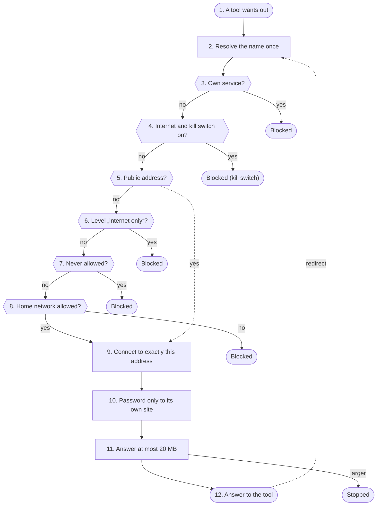

1. **A tool wants out**: Everything that goes to an address from settings or from outside text gets its access through netguard.client with a level (today 27 modules). Fixed own services like the language model go directly; which ones and why is listed in netguard.DIRECT_OK, a self-test keeps that list complete.
2. **Resolve the name once**: resolve() looks the name up exactly once. If it has several addresses, each one must be allowed, else it stops.
3. **Own service?**: The ports of the own services are closed on this machine: on loopback and on every own address in the LAN or VPN (own_addresses reads them again every minute).
4. **Internet and kill switch on?**: If the address is public and the kill switch is at stage 1 or higher, nothing goes to the internet, whatever level the tool has. The home network stays reachable as the level allows.
5. **Public address?**: A public address is allowed at every level.
6. **Level „internet only“?**: What comes from search results or answers may never go to the home network (chat, geraeteupdate, ghtoken, meldung, remarkable, verbund).
7. **Never allowed?**: Link-local addresses (169.254.x, where cloud metadata answers), multicast, unspecified and reserved addresses are allowed at no level.
8. **Home network allowed?**: Home Assistant and other services in the home network (doclingdienst, esp32, hamelden, homeassistant, kiwix, offsite) always may. Calendars, contacts, mail and MCP (calendars, contacts, mail, mcp, meinmcp, tasks, technik_seiten) only when Settings → Security → Allow home network addresses is on.
9. **Connect to exactly this address**: The connection goes to the checked address, not to the name again. A second look-up could answer differently (DNS rebinding). The certificate is still checked for the name.
10. **Password only to its own site**: Login data only goes to the site it was entered for (same host or same parent domain, like the CalDAV servers of icloud.com), never over http when the address was https.
11. **Answer at most 20 MB**: Answers are cut at 20 MB, also after unpacking gzip, so a huge or packed answer cannot fill the memory.
12. **Answer to the tool**: The tool gets the answer as data. A redirect is a new connection and is checked the same way, from step 2.

**Examples:** Web page from search: Allowed: connected to the checked public address. · Home Assistant at home: Allowed: the level home may go to the home network. · Calendar at home, switch off: Blocked: home network addresses are off for user services. · Link to cloud metadata: Blocked: a page from search never goes home, 169.254 never. · Kill switch on, ask weather: Blocked: with the kill switch nothing goes to the internet.

#### Rules

| Level | Who uses it (from the code) | Internet | Home network |
|---|---|---|---|
| internet only | chat, geraeteupdate, ghtoken, meldung, remarkable, verbund | ✓ | ✕ |
| user | calendars, contacts, mail, mcp, meinmcp, tasks, technik_seiten | ✓ | only with switch |
| home | doclingdienst, esp32, hamelden, homeassistant, kiwix, offsite | ✓ | ✓ |
| by target | dienstwacht, nas, nasquelle, speicher, technik_seiten, zertpin | as the target is set | – |
| always | all | ✕ with kill switch | ✕ own services, 169.254, multicast |

#### When blocked

- Instead of an answer the tool gets the error Blocked with the reason; no connection is made.
- The block counts for „Emergency stop by itself“: 15 in 10 minutes raise the kill switch to stage 1 when the switch is on. Blocks by the kill switch itself and probes of the service watch do not count.

#### Numbers (from the code)

- **20 MB** largest answer
- **30000–31099, 31443** closed own ports
- **15** blocks in 10 minutes until kill switch stage 1 (if on)
- **1** kill switch stage without internet

#### Settings

- Settings → Security → Allow home network addresses: calendars, contacts, mail and MCP may also go to the home network (default off).
- Settings → Security → Emergency stop by itself: many blocked connections in a short time trigger kill switch stage 1 (default off).

#### What you see

- Status → Live: a red line ends with ✕ at the wall, with address and reason; the tile „Wächter today“ counts the blocks.
- Me → My status: whether an own service (calendar, mail) answers or refused the login.

#### In the code

- `app/panel/netguard.py` `allowed`: the rule: nothing or the reason
- `app/panel/netguard.py` `resolve`: resolve once, check every address, tell Live
- `app/panel/netguard.py` `client`: the way out for tools
- `app/panel/netguard.py` `_Transport`: password guard, size limit, result for My status
- `app/panel/netguard.py` `_Capped`: cuts the answer, also unpacked
- `app/panel/netguard.py` `same_site`: same site for login data
- `app/panel/netguard.py` `own_addresses`: every address of this machine
- `app/panel/netguard.py` `IMAP4_SSL`: mail over the checked address
- `app/panel/notaus.py` `watch`: counts blocks for the automatic kill switch
- `app/panel/live.py` `outgoing`: shows each decision on Live

Self-tests: `test_hardening`, `test_notaus`, `test_waechter_umgehung`

### Logs and live

Operation records what the Spark does, without contents: the way of each request (Logs → Requests), the live overview, the journal with fixed words, the service watch and the backup. This page shows which traces a request leaves.

**Why:** Whoever looks for a fault must see which way a request took and how long each step lasted. Questions, answers and tool results belong to the person; so only fixed words, tool names and numbers go into the log and the history.

#### Way

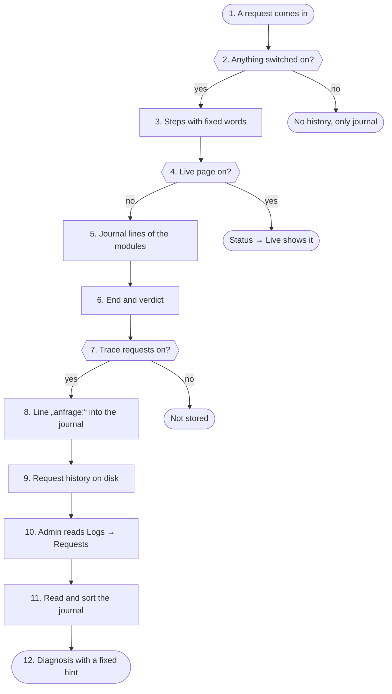

1. **A request comes in**: Chat, writing help, creating documents and what the Spark does by itself create a record at the start: channel, kind (profile, guest, admin, Spark) and device.
2. **Anything switched on?**: If neither „Trace requests“ nor the live page nor the settings assistant is on, there is no record. Only the modules' journal lines remain.
3. **Steps with fixed words**: Each step (switch, model round, tool, check, speech output) is added with kind, name and time. A value goes in only if it is a number or a short fixed word; anything else is dropped. Question, answer, arguments and results never go in.
4. **Live page on?**: With the live page on, live.py sees each step at once: which service is asked, what the guard decides, what comes back. Everything stays in memory and is gone after a restart.
5. **Journal lines of the modules**: Independently each module writes its lines into the Spark's journal. Every line starts with a word from logfilter.AREAS (28 areas), profiles only through profiles.log_name. A self-test checks both.
6. **End and verdict**: At the end the record gets its state: error if an error word is set, slow if the first sound came later than 5.0 s, else good.
7. **Trace requests on?**: If only Live or the settings assistant is on, the record ends here. It is written nowhere.
8. **Line „anfrage:“ into the journal**: One line per request: id, channel, class, tools with ok or not ok, time to the instant reply, to the first sound and to the end. Without names.
9. **Request history on disk**: The record is appended. When the file grows too big, only the last 500 requests of the last 2880 minutes stay. The file is in no backup.
10. **Admin reads Logs → Requests**: Only the admin and co-admins read the history, with a rate limit. A profile's name and device show only when the profile allows it; else it says „Profil“. For one request the panel shows the journal lines from its time.
11. **Read and sort the journal**: logfilter reads at most 20000 lines; only numbers from fixed lists reach journalctl. Each line gets its area from its first word, its level from fixed error words; tokens, keys and passwords are blacked out before the line leaves the panel.
12. **Diagnosis with a fixed hint**: The diagnosis counts lines per area and shows a fixed hint from a list for the newest error, never one from the model.

**Examples:** All on, a question with a tool: Live shows the way, Logs → Requests keeps it, the journal has the line „anfrage:“. · Only the live page on: Visible on Status → Live, then stored nowhere. · Everything off: No record; only the modules' journal lines.

#### Rules

| Trace | Where | How long | In the backup |
|---|---|---|---|
| Live | memory | until restart | ✕ |
| Request history | state/traces.jsonl | 2880 min | ✕ |
| Journal | journald | as journald is set | ✕ |
| Service watch | state/dienstwacht.json | outages 10080 min | ✓ |
| Backups | backups/ | 7 daily, 5 others | – |

#### Service watch

- A loop looks at the language model, listening, speaking, internet, SearXNG, Kiwix, Home Assistant, mail, calendar and NAS, each every minute or every 5 minutes, without login: an HTTP answer below 500 counts as „answers“.
- A service is gone after 3 failed probes over at least 3 minutes, back after 2 good ones. With the internet gone there is one note for everything behind it. During update, start and kill switch stage 2 nothing counts.
- The probes go through the guard but do not count on the live list and never trigger the automatic kill switch.

#### Backup

- Once a day in a pause the panel packs users/, voices/, config.json, the panel password and the files of backup.STATE_FILES. The key state/secret.key and the login keys are not in it; databases are saved as a consistent copy.

#### Numbers (from the code)

- **500** requests in the history at most
- **2880 min** so long a request stays
- **5.0 s** from here a request counts as slow
- **3** failed probes in a row until a service counts as gone
- **30 min** at most one outage note per service
- **7** daily and manual backups kept

#### Settings

- Settings → Spark → Operation → Trace requests: Logs → Requests (default off).
- Settings → Spark → Operation → Logs “Live page”: Status → Live (default off).
- Features → Service watch: look at services and tell the admins about outages (default off).
- Settings → Backup: create a backup by hand or restore one.

#### What you see

- Status → Logs → Requests: the way of every request with tools and times.
- Status → Logs → Diagnosis: lines by area, errors and warnings, with a fixed hint.
- Status → Live: running requests, guard decisions and services as a picture.
- Status → Services: what the service watch looks at and the outages of the last days.

#### In the code

- `app/panel/tracelog.py` `start`: a record when anything is on
- `app/panel/tracelog.py` `safe`: only numbers and short fixed words
- `app/panel/tracelog.py` `Rec`: steps, marks, state
- `app/panel/tracelog.py` `finish`: journal line and request history
- `app/panel/tracelog.py` `shown`: name only with consent
- `app/panel/live.py` `step`: every step on Status → Live
- `app/panel/logfilter.py` `AREAS`: the journal's area words
- `app/panel/logfilter.py` `parse`: area, level, blacking out
- `app/panel/logfilter.py` `summary`: counts and fixed hint
- `app/panel/dienstwacht.py` `round_once`: one round of probes and notes
- `app/panel/backup.py` `create`: pack one backup

Self-tests: `test_tracelog`, `test_live`, `test_logfilter`, `test_log_luecken`, `test_dienstwacht`, `test_hardening`, `test_panel`

### Language model

The language model (qwen38 from dgx-spark-qwen38, not part of this repo) writes the answers. The panel talks to it at the configured address through the OpenAI interface, streamed, and makes sure speech always comes before background work.

**Why:** The GPU is shared between the model and speech output. While a person waits, no learning or tidying in the background may slow the answer. And a hanging or missing model should give a clear sentence, not minutes of silence.

#### Way

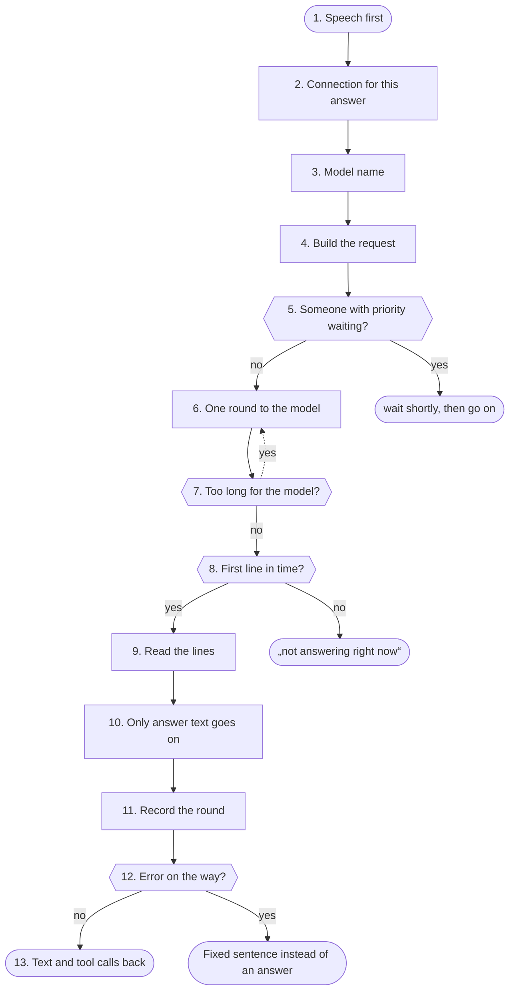

1. **Speech first**: When an answer starts and with every streamed piece the panel sets the mark „speech is running“. Background work on the model waits until 20 seconds after it and is cancelled as soon as somebody speaks; after 3 cancels it gives up for this time.
2. **Connection for this answer**: Every answer has its own connection with the configured time limit (a value outside does not count) and five seconds to connect. When a key is set, it goes along as Bearer. The model is a fixed own service and does not go through the guard.
3. **Model name**: When no model is configured, the panel asks /models once and keeps the first name for this address.
4. **Build the request**: The request streams, with length, temperature, top_p and presence_penalty from the settings. Thinking is off unless „Think first“ is on. While a tool is chosen its own temperature applies. With logs on the server reports how much it read and how much came from its cache.
5. **Someone with priority waiting?**: When another person has priority and their answer has no first sentence yet, this round waits at most the configured time (up to 5 seconds). An answer with priority holds others up for at most 30 seconds.
6. **One round to the model**: The round goes to the configured address. When the server refuses the forced tool choice, the same round goes once without it.
7. **Too long for the model?**: When the server says the request is longer than its context, the panel cuts the history to a quarter of the history budget in the first round and asks once more.
8. **First line in time?**: The first line must come within 90 seconds (or the shorter time limit). A model that stays silent longer hangs: the answer ends with a clear sentence instead of minutes of silence.
9. **Read the lines**: Every line is a piece of JSON. Tool calls come in parts and are put together by their number; thinking the server hands over separately is only counted. Unreadable lines are skipped.
10. **Only answer text goes on**: Thinking inside the text (<think> … </think>) and tool calls that come as text are never shown or spoken. The rest goes piece by piece to „build answer“.
11. **Record the round**: For the request trace only numbers count: tokens read, of them from the cache, size of system prompt, tool list and history, time to the first word, waiting time for priority.
12. **Error on the way?**: An error becomes a fixed code: not reachable, too slow, key refused, model missing. With „not reachable“ and „too slow“ a fixed sentence is also spoken when nothing was said yet. Guests see only the kind of error, never its text.
13. **Text and tool calls back**: The round returns why it ended and which tools the model wants to call. The panel decides what of it runs.

**Examples:** Normal answer: Streamed, the first sentence goes to speech output at once. · Two people, one with priority: The round waits briefly until the answer with priority has its first sentence. · Very long document in the history: History cut, asked once more. · qwen38 hangs: „My language model is not answering right now.“ instead of silence.

#### Numbers (from the code)

- **90 s** until the model's first line
- **60 bis 600 s** allowed time limit
- **20 s** background work still waits after speech
- **3** cancels until background work gives up
- **5 s** longest wait for priority
- **30 s** a priority answer holds up at most this long

#### Settings

- Settings → Language model: Address, Key and Model; also Think first, Temperature and Length of an answer.
- Settings → Language model, under Advanced: Time limit for an answer.
- Features → Priority for people: chosen profiles get their answer first.

#### What you see

- Status → Logs → Advanced → Conversation: per round tokens read, of them from the cache, and the time to the first word.
- Status → Checks → Speech first: whether speech output stays smooth while the model computes.

#### In the code

- `app/panel/chat.py` `chat`: sets „speech is running“ with every piece
- `app/panel/chat.py` `_answer`: connection, request, rounds (llm_round), errors
- `app/panel/chat.py` `llm_model`: model name from settings or /models
- `app/panel/chat.py` `sampling`: top_p and presence_penalty
- `app/panel/chat.py` `first_within`: the first line must come in time
- `app/panel/chat.py` `ContextFull`: request longer than the context
- `app/panel/chat.py` `llm_error_code`: error as a fixed code
- `app/panel/chat.py` `LLM_GONE`: the spoken sentence when the model is gone
- `app/panel/chat.py` `prompt_sizes`: size of the parts of a request
- `app/panel/stufe.py` `wait_turn`: waits for an answer with priority
- `app/panel/vorrang.py` `mark`: mark „speech is running“
- `app/panel/vorrang.py` `run`: background work gives way to speech

Self-tests: `test_panel`, `test_llm_settings`, `test_vorrang`, `test_stufe`, `test_fast_start`

### Speech recognition

Speech recognition turns a recording into text. The panel takes the recording, checks it and hands it to the ASR service. That proxy checks key, size and sample rate, lets requests wait by priority and passes them to the engine, which listens on this machine only.

**Why:** A recording comes from outside: a browser, an app, a speaker. It could be huge, carry a made-up sample rate or be only silence, a click or the Spark's own voice. Fixed rules catch that before the GPU works and before a text counts as a question.

#### Way


1. **A recording arrives**: The browser sends the recording to the panel. Each caller may only so often per minute (profile 240), guests share 3 places at once.
2. **At most 50 MB**: read_audio reads the recording in pieces and stops at 50 MB. Only a signed-in profile may send a wake word; it then goes to the model as a hint.
3. **Alongside on the CPU**: While the GPU recognizes, the CPU already runs speaker identification (when on and a profile asks), the room voice, the check for an unknown voice and the measure of how much of the recording is really voice.
4. **To the ASR service**: The panel sends the recording with the API key to the proxy. stufe.asr_level adds the profile's stage, but not at a shared speaker. Only the panel can set a stage: with the key from vorrang-key and only from this machine, else it is normal.
5. **Key and size fine?**: BodyLimit refuses requests that are too large or lack the right key before anything is read. Without a key set, only this machine itself may ask.
6. **Engine ready?**: engine_status asks the engine's /health. If it does not answer, the proxy reads its state and that of the systemd unit and names the reason.
7. **Wait by priority**: PrioGate lets as many recordings through as the engine takes at once (engine_max_seqs). The others wait by stage, then by arrival. Whoever waits moves up a stage every four seconds; a running request is never stopped.
8. **Sample rate allowed?**: audio_rate_ok reads the sample rate from the file's header (WAV, FLAC, Ogg, WebM) or asks ffprobe. A header with a made-up rate would fill the memory when it is converted.
9. **Recognize**: With Qwen3-ASR the recording goes to the vLLM engine, which listens on this machine only; only prompt, temperature and stream pass through, plus the context words from the settings. With Parakeet the proxy recognizes itself on the CPU, in pieces of at most 90 seconds cut at a quiet spot.
10. **Silence, filler or echo?**: stille.check drops text from almost silent recordings and a lone „Yes“ or „Okay“ with too little voice. For profiles echo.check looks whether the text is the Spark's own voice from another device, and fremdstimme whether a microphone that opened by itself heard an unknown voice.
11. **Voice recognized?**: speakers.identify compares the recording with every taught voiceprint. Only a clear match (above the threshold of the chosen strictness and clearly ahead of the runner-up) counts. Live shows only „voice recognized“, never whose.
12. **Text back**: The text goes to the device, which turns it into the question to the chat. On an error a guest gets only a fixed code, never the service's text.

**Examples:** Question in the browser, profile: Text back with the recognized voice. · Click after the answer: Dropped: too little voice, no question. · File with a made-up sample rate: Refused before the engine sees it. · Engine still loading: Refused with the reason, the device says so.

#### Numbers (from the code)

- **50 MB** largest recording at the panel
- **8000–192000** allowed sample rate in Hz
- **240** recordings per minute and profile
- **3** guests at once
- **0.75** speaker identification threshold at normal strictness
- **120** minutes of audio Parakeet reads at most

#### Settings

- Settings → Speech recognition: Qwen3-ASR on the GPU or Parakeet on the CPU, language and context words.
- Features → Speaker recognition: recognize profiles by their voice and how strictly (default off).

#### What you see

- Status → Monitoring: engine state, requests, failures, average time and the queue.
- Status → Logs → Requests: how long a recording waited and how many it overtook.

#### In the code

- `app/panel/admin.py` `test_asr`: rate limit and places for guests
- `app/panel/admin.py` `_test_asr`: the way in the panel: read, check alongside, pass on
- `app/panel/stufe.py` `asr_level`: the profile's stage, not at a shared speaker
- `app/common.py` `BodyLimit`: size and key before reading
- `app/common.py` `PrioGate`: waiting by priority
- `app/common.py` `audio_rate_ok`: sample rate from the file header
- `app/asr_proxy.py` `transcriptions`: the proxy in front of the engine
- `app/asr_proxy.py` `engine_status`: ready, loading, error or off
- `app/parakeet.py` `Recognizer`: Parakeet on the CPU
- `app/panel/stille.py` `check`: silence and fillers
- `app/panel/echo.py` `check`: the Spark's own voice
- `app/panel/speakers.py` `identify`: whose voice, only on a clear match

Self-tests: `test_units`, `test_hardening`, `test_stufe`, `test_stille`, `test_echo`, `test_stimmabdruck`

### Speech output

Speech output turns text into sound. The TTS service takes a sentence, tidies it, hides secrets, picks language and voice and passes it to the engine (Qwen3-TTS via vllm-omni), which listens on this machine only. The sound comes back streamed.

**Why:** A speaker in the room says out loud whatever it gets. Passwords and codes must never be spoken there, and signs like asterisks, links or emojis sound wrong. So fixed rules run on every sentence, wherever it comes from: chat, speaker, Telegram, reminders.

#### Way


1. **A sentence to speak**: The panel sends every sentence of an answer with the API key and the profile's stage to the TTS service. Other programs may do so too with the API key.
2. **Key and size fine?**: BodyLimit refuses requests that are too large or lack the right key before anything is read.
3. **Text valid?**: The text must not be empty and may have at most 20000 characters. check_reference takes a reference voice only as an embedded data:audio address, never as a link: the engine would otherwise fetch a link itself from the home network.
4. **Engine ready?**: A VoiceDesign request goes to the second engine when it is on; everything else to the main engine. engine_status asks its /health and otherwise names the reason.
5. **Markdown off, secrets hidden**: speech_markdown takes out the formatting signs, then hide_secrets replaces passwords, code words, one-time codes and keys with „shown in writing only“. This runs on every request, also when „Clean text“ is off; the written answer keeps the value.
6. **Clean the text**: clean_text takes out emojis, „haha“, *laughs*, code blocks and links, calms exclamations if wanted and puts a full stop at the end of a line so the voice settles. If nothing is left, no request goes to the engine.
7. **Language, pronunciation, numbers**: When the language is Auto, guess_language guesses German or English from frequent words, so a single English word does not change the tone of the whole answer. Then the own pronunciation list applies, after that speak_numbers writes out date, time, money and numbers.
8. **Pick the voice**: Temperature, top_p and a fixed seed from the settings keep the voice the same from sentence to sentence. A Base model speaks with a cloned voice from voices/ (apply_clone); an unknown name falls back to the default voice.
9. **Streamed at another tempo?**: vllm-omni takes no tempo when streaming. Then tempo.Stretcher stretches the sound piece by piece itself (WSOLA, the pitch stays).
10. **Wait by priority**: PrioGate lets as many sentences through as the engine takes at once (engine_max_seqs); the others wait by stage, then by arrival.
11. **The engine speaks**: The engine makes the sound. Streamed it comes back in pieces; the first piece is small on purpose (initial_chunk_frames) so the sound starts fast, also when several requests run.
12. **Sound back**: The proxy passes the sound on unchanged and counts only time, length and errors for monitoring, never the text.

**Examples:** Answer sentence in the chat: Spoken, streamed, with a steady voice. · Password in the answer: The voice says „shown in writing only“, the written answer keeps the value. · Only an emoji: Nothing to say, nothing goes to the engine. · Speak faster: The proxy stretches the streamed sound.

#### Numbers (from the code)

- **20000** characters per request at most
- **„nur schriftlich sichtbar“** the voice says instead of a secret
- **4** ways to read numbers

#### Settings

- Settings → Speech output: model, default voice, language, clean text, reading numbers and the own pronunciation list.
- Settings → Voices: record, play and save own voices (for a Base model).

#### What you see

- Status → Monitoring: engine state, requests, failures, time to the first sound and the queue.

#### In the code

- `app/tts_proxy.py` `speech`: the way of a sentence through the proxy
- `app/tts_proxy.py` `check_reference`: reference only embedded
- `app/tts_proxy.py` `engine_status`: ready, loading, error or off
- `app/tts_proxy.py` `apply_clone`: cloned voice from voices/
- `app/textnorm.py` `speech_markdown`: markdown signs off
- `app/textnorm.py` `hide_secrets`: never speak secrets
- `app/textnorm.py` `clean_text`: emojis, laughter, links, code
- `app/textnorm.py` `guess_language`: guess German or English
- `app/textnorm.py` `speak_numbers`: write out numbers
- `app/tempo.py` `Stretcher`: tempo while streaming
- `app/common.py` `PrioGate`: waiting by priority

Self-tests: `test_units`, `test_markdown`, `test_hardening`, `test_stufe`, `test_tempo`

### Outside services

Outside services are everything the Spark asks over the network: Home Assistant, calendars, contacts, mail, SearXNG, Kiwix, reMarkable and MCP services. Addresses from settings go through the guard (netguard) with a fixed level; fixed services like SearXNG, weather, transit and Wikipedia go directly.

**Why:** A tool call comes from the model, and the model can be steered by outside text. So the panel checks by fixed rules before every call whether it may happen, and treats every answer from outside as data.

#### Way

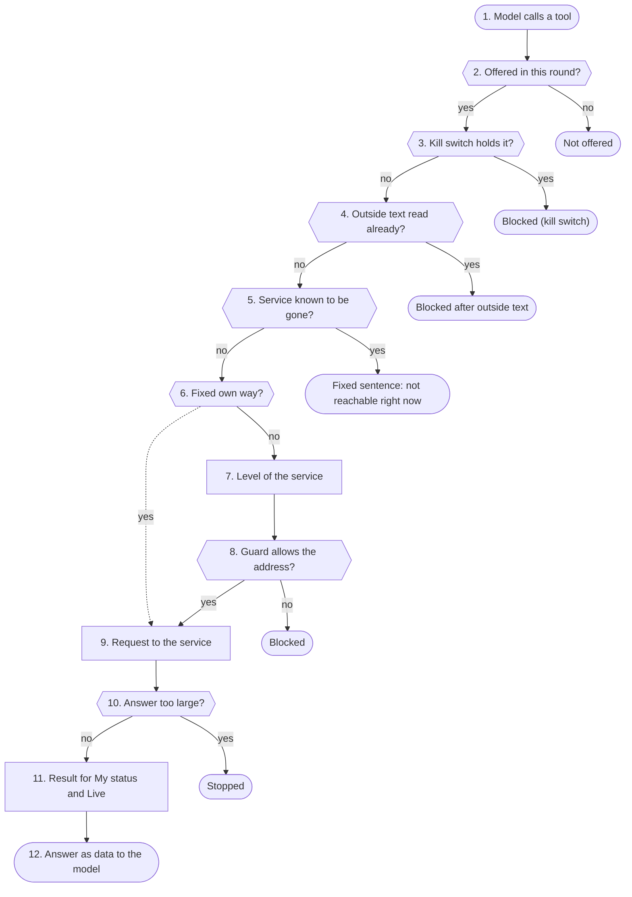

1. **Model calls a tool**: The model names a tool and details. Who asks is already known (login); the service's login data lies sealed with the profile and never goes to the model.
2. **Offered in this round?**: Only tools this round offered run. Another name is not run.
3. **Kill switch holds it?**: The kill switch is read again for every call. From stage 1 the 7 tools that go to the internet by themselves are locked (web search, weather, transit, Wikipedia, parcels, reading pages); from stage 2 or with „My kill switch“ every tool that changes something.
4. **Outside text read already?**: If the answer already read mail, web pages, calendar, documents or an archive, it may no longer switch, save or enter anything. The person has to say so in a new message.
5. **Service known to be gone?**: If the service watch sees this tool's service as gone (and the note is on), the tool answers at once with a fixed sentence instead of waiting. The web search then tries the own Kiwix.
6. **Fixed own way?**: The language model, SearXNG at the entered address, weather, transit, Wikipedia and fixed services like Apple push go directly, without the guard. Which modules may do that and why is listed in netguard.DIRECT_OK; a self-test reports every module that connects directly and is missing there.
7. **Level of the service**: Each module calls the guard with its fixed level: Home Assistant and Kiwix with home; calendars, contacts, tasks, mail and MCP with user; reMarkable and pages from search with internet only. The level is in the code, not in the settings.
8. **Guard allows the address?**: The guard resolves the name once and checks every address: no own services, no 169.254, home network only at level home or with the switch, no internet during the kill switch. Then it connects to exactly the checked address.
9. **Request to the service**: The panel unseals the profile's login (token, password) only now and sends it only to the entered site. Mail goes over IMAP with TLS to the checked address.
10. **Answer too large?**: Through the guard each answer is cut at the module's limit, also after unpacking.
11. **Result for My status and Live**: Whether the service answered or refused the login, the profile sees under Me → My status; the live page counts what the guard allowed or blocked. Contents go nowhere.
12. **Answer as data to the model**: The tool returns the answer as data. If it reads someone else's text (mail, calendar, archive, web page, MCP in read mode), the answer counts from now on as one with outside text; see step 4.

**Examples:** Living room light on: Home Assistant in the home network at level home; switched. · Web search: SearXNG directly; pages from the results then go through the guard. · Kill switch stage 1, ask weather: Blocked before anything goes out. · Switch a light after a mail: Blocked: a mail may not switch anything.

#### Rules

| Service | Way | Level |
|---|---|---|
| Home Assistant | netguard.client | home |
| Kiwix | netguard.client | home |
| Calendars, contacts, tasks | netguard.client | user |
| Mail | netguard.IMAP4_SSL | user |
| MCP services | netguard.client | user |
| reMarkable | netguard.client, allowed hosts only | internet only |
| SearXNG | direct (netguard.DIRECT_OK) | – |
| Weather, transit, Wikipedia | direct, fixed address | – |
| Language model | direct (own service) | – |

#### Numbers (from the code)

- **20 MB** largest answer through the guard
- **2 MB** largest answer of an MCP service
- **7** tools that rest from kill switch stage 1
- **5 s** longest probe of the service watch

#### Settings

- Settings → Security → Allow home network addresses: calendars, contacts, mail and MCP may also go to the home network (default off).
- Features → Agent functions → Services over MCP: which servers and tools are offered.
- Features → Service watch: see outages, below it the note to users when a service is missing.

#### What you see

- Status → Live: every connection to the outside as a line, blocked ones with the reason.
- Me → My status: whether the own calendar, mail or Home Assistant answers.
- Status → Services: what is reachable right now.

#### In the code

- `app/panel/chat_tools.py` `run`: offered, kill switch, outside text, service gone
- `app/panel/notaus.py` `locked_tools`: which tools the kill switch locks
- `app/panel/notaus.py` `INTERNET_TOOLS`: tools that go to the internet by themselves
- `app/panel/dienstwacht.py` `tool_down`: fixed sentence when the service is gone
- `app/panel/netguard.py` `DIRECT_OK`: who may connect directly and why
- `app/panel/netguard.py` `client`: the way through the guard
- `app/panel/netguard.py` `IMAP4_SSL`: mail to the checked address
- `app/panel/homeassistant.py` `_client`: Home Assistant at level home
- `app/panel/mcp.py` `_client`: MCP server at level user
- `app/panel/chat.py` `web_search`: SearXNG directly

Self-tests: `test_waechter_umgehung`, `test_notaus`, `test_sperre_ueberall`, `test_dienstwacht`, `test_kiwix`, `test_meinmcp`, `test_remarkable`

### state/

state/ holds what applies to the whole Spark and belongs to no profile: keys, the admin's accounts, the Telegram bot, push keys, speakers, counters, locks and the state of the services. Secrets in it are sealed with the Spark's key.

**Why:** A copy of the files (a backup, a look into the folder) should not reveal passwords. And what only makes sense on this device (locks, counters, caches, keys) should not travel to another Spark with a backup.

#### Way

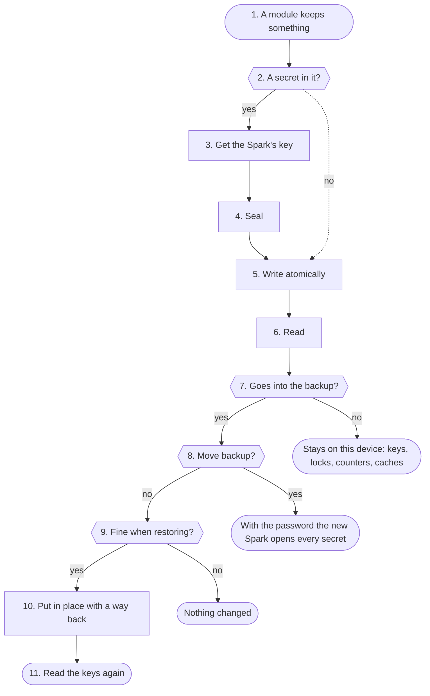

1. **A module keeps something**: The folder state/ belongs to the service user; install.sh creates it. Only the service can read new files in it.
2. **A secret in it?**: Passwords, tokens and keys are sealed before they are stored. Everything else goes straight to writing.
3. **Get the Spark's key**: vault._key reads secret.key. If there is none, it is made once (readable only for the service, never overwritten). After that it stays in the panel's memory.
4. **Seal**: vault.seal turns the value into „enc1:“ and a Fernet token (encrypted and protected against change). A value already sealed stays as it is.
5. **Write atomically**: common.write_json writes into a fresh temporary file next to it, never through a link, gives it the rights of the old file (a new one is readable for the service only) and then swaps it in one step. A crash in the middle leaves the old file whole.
6. **Read**: A sealed value is opened with the key. If the key does not fit (backup from another Spark), an empty value comes back and the account has to be entered again. Older unsealed values are read and sealed the next time they are saved.
7. **Goes into the backup?**: Every file in state/ is in exactly one list: backup.STATE_FILES (28, go into every backup) or backup.STATE_LOCAL (43, with their reason). test_technik finds every name the code writes there and wants it in one of the lists.
8. **Move backup?**: secret.key is in no ordinary backup. Only a move backup carries it, sealed with a password of the admin (scrypt and Fernet, move-keys.json). The Spark's login keys are in no backup.
9. **Fine when restoring?**: _check_state checks every file of the backup: at most 8 MB, valid JSON, the push key a real EC key. An admin second step whose secret cannot be opened here is not taken; the current one stays.
10. **Put in place with a way back**: _swap writes each file through a temporary file (never through a link) and keeps the old content. If a step fails, everything swapped comes back.
11. **Read the keys again**: _forget_cached makes the modules that keep a key in memory (vault, push, apns, chats, verbund) read it again.

**Examples:** Enter the Telegram bot token: Stored sealed, goes into every backup. · Lock after failed attempts: Stored plain, stays on this device. · Move to a new Spark: Every secret opens again, nothing to enter.

#### Numbers (from the code)

- **28** files in every backup
- **43** files and folders that stay out with a reason
- **8 MB** largest file when restoring
- **12** characters the move password has at least

#### Settings

- Settings → Backup: back up now, move backup with a password, restore.

#### What you see

- Status → Architecture: the table of storage places names every file, whether it goes into the backup and whether it is sealed.

#### In the code

- `app/common.py` `write_json`: write atomically, keep the rights
- `app/panel/vault.py` `_key`: get secret.key or make it once
- `app/panel/vault.py` `seal`: seal
- `app/panel/vault.py` `open_`: open, empty with another key
- `app/panel/backup.py` `STATE_FILES`: what goes into the backup
- `app/panel/backup.py` `STATE_LOCAL`: what stays out with a reason
- `app/panel/backup.py` `_seal_keys`: seal secret.key for the move
- `app/panel/backup.py` `_check_state`: check the files of the backup
- `app/panel/backup.py` `_swap`: put in place with a way back
- `app/panel/backup.py` `_forget_cached`: read the keys again

Self-tests: `test_technik`, `test_hardening`, `test_panel`, `test_tempo`

### users/ID/

Every profile has its own folder users/ID/: conversations, memory, tasks, documents, settings, accounts and the voiceprint. Which folder applies comes only from the login. If wanted, an encrypted copy of it goes to an own storage.

**Why:** What belongs to one person must not be seen by another, not even through the language model. Passwords and the voiceprint should not be readable even in a copy of the files.

#### Way

```mermaid
flowchart TD
  s1(["1. A request with a profile"])
  s2["2. Path in its own folder"]
  s3{{"3. A secret in it?"}}
  s4["4. Write for the service only"]
  s5["5. Every file sorted"]
  s6{{"6. Own storage set up?"}}
  s7["7. Only changes of the chosen areas"]
  s8["8. Encrypted, names random"]
  s9["9. Deleted waits in the bin"]
  s10["10. In the backup"]
  s11{{"11. Profile deleted?"}}
  s12(["12. Only for this profile"])
  s1 --> s2
  s2 --> s3
  s3 -->|no| s4
  s4 --> s5
  s5 --> s6
  s6 -->|yes| s7
  s7 --> s8
  s8 --> s9
  s9 --> s10
  s10 --> s11
  s11 -->|no| s12
  s3x(["Sealed with secret.key"])
  s3 -->|yes| s3x
  s6 -.->|no| s10
  s9x(["Again later"])
  s9 -->|target gone| s9x
  s11x(["Folder deleted"])
  s11 -->|yes| s11x
```

1. **A request with a profile**: profiles.current finds the profile from the signed login cookie or the device key. What the language model says never picks a profile.
2. **Path in its own folder**: Every file lies under users/ID/ with a fixed name from the code. The ID comes from step 1, never from a text.
3. **A secret in it?**: Passwords of mail, calendar and storage places, tokens of Home Assistant and MCP and the own storage key are sealed with the Spark's key. The voiceprint (voice.json) is biometric and is sealed whole; an older open file is sealed the first time it is read.
4. **Write for the service only**: profiles._write creates the folder so that only the service looks into it, writes a temporary file only the service can read and swaps it in one step.
5. **Every file sorted**: Every file name is either in an area of speicher.AREAS (may go to the own storage) or in speicher.LOCAL (stays on the Spark, with a reason: keys, accounts, settings, voiceprint, queues). test_technik checks every name the code writes.
6. **Own storage set up?**: Only when the admin allowed the own storage and the profile has a target with at least one area (at most 2 targets).
7. **Only changes of the chosen areas**: local_files takes only files of the chosen areas: real files, no links, at most 5000. copy_once sends only what changed since the last run, at most 2048 MB per run; the next run goes on.
8. **Encrypted, names random**: seal_file encrypts every file in numbered pieces with a key of its own per object (derived from the profile's storage key and the object's name). The names on the target are random; the target sees only noise.
9. **Deleted waits in the bin**: A deleted or replaced object stays 30 days on the target. If the target cannot be reached, nothing changes on the Spark; the owner hears of it once after 60 minutes.
10. **In the backup**: The daily backup takes users/ whole, except users/secret (signs the logins) and the messages between profiles. SQLite files are packed as a consistent copy.
11. **Profile deleted?**: delete_user takes the profile and its devices out of profiles.json and deletes the folder, but only when the ID has exactly the shape of a profile ID.
12. **Only for this profile**: Every function reads only the folder of the signed-in profile. Guests have no folder.

**Examples:** Memory entry, no own storage: Lies in its own folder and in the backup. · Enter a mail password: Sealed, stays on the Spark (account). · Document with own storage: Encrypted copy on the target.

#### Rules

| Area | Files | Own storage |
|---|---|---|
| Conversations | convos.json, toollog.json, room-history.json | ✓ |
| Memory | memory.json, learned.json, zuordnungen.json | ✓ |
| Tasks and reminders | tasks.json, reminders.json | ✓ |
| Documents | wissen.db, docs/files/, suchpruefung.json | ✓ |
| Created documents | erstellt/ | ✓ |
| Accounts, keys, voiceprint | speicher.LOCAL | ✕ |

#### Numbers (from the code)

- **2** targets per profile at most
- **30** minutes between two runs
- **2048 MB** at most per run
- **30** days in the target's bin
- **5000** files per copy at most

#### Settings

- Me → Storage: own targets (NAS, WebDAV, SFTP, SMB) and which areas go there.

#### What you see

- Me → Storage: the own targets with their state and the last runs.
- Status → Architecture: the table of storage places names every file of a profile, whether it is copied and whether it is sealed.

#### In the code

- `app/panel/profiles.py` `current`: the profile from cookie or device key
- `app/panel/profiles.py` `_path`: path in the profile's folder
- `app/panel/profiles.py` `_write`: write for the service only
- `app/panel/profiles.py` `delete_user`: delete profile and folder
- `app/panel/vault.py` `seal`: seal
- `app/panel/speakers.py` `_store`: voiceprint sealed
- `app/panel/speicher.py` `AREAS`: what may go to the own storage
- `app/panel/speicher.py` `_key`: the profile's storage key, sealed
- `app/panel/speicher.py` `local_files`: only the list, no links
- `app/panel/speicher.py` `seal_file`: AES-256-GCM in pieces
- `app/panel/speicher.py` `copy_once`: one run of the copy
- `app/panel/backup.py` `_add_dir`: users/ into the backup

Self-tests: `test_speicher`, `test_technik`, `test_stimmabdruck`, `test_hardening`

### voices/, backups/

voices/ holds the cloned voices (WAV and text), backups/ the Spark's backups. A backup is made once a day by itself, before every update and on request; the oldest ones go.

**Why:** A voice or a whole Spark should come back after a mistake, an update or a move. A backup holds everything about every profile, so only the service can read it and it downloads only with a code.

#### Way

```mermaid
flowchart TD
  s1(["1. The admin records a voice"])
  s2{{"2. Name allowed?"}}
  s3{{"3. Not a WAV?"}}
  s4["4. Store"]
  s5["5. Speak with the voice"]
  s6["6. Voices as a ZIP"]
  s7["7. Once a day"]
  s8["8. Pack"]
  s9{{"9. Move backup?"}}
  s10["10. Remove old ones"]
  s11["11. Download only with a code"]
  s12(["12. Restore"])
  s1 --> s2
  s2 -->|yes| s3
  s3 -->|no| s4
  s4 --> s5
  s5 --> s6
  s6 --> s7
  s7 --> s8
  s8 --> s9
  s9 -->|no| s10
  s10 --> s11
  s11 --> s12
  s2x(["Refused (400)"])
  s2 -->|no| s2x
  s3x(["ffmpeg converts"])
  s3 -->|yes| s3x
  s9x(["secret.key travels along sealed"])
  s9 -->|yes| s9x
  s12x(["Nothing changed"])
  s12 -->|check fails| s12x
```

1. **The admin records a voice**: Under Settings → Voices the admin uploads a recording, with a name and best with the spoken text.
2. **Name allowed?**: The name becomes the file name; so only letters, digits, underscore and hyphen. The recording may be at most sixty MB.
3. **Not a WAV?**: The engine expects WAV. ffmpeg turns anything else into mono WAV, at most two minutes long.
4. **Store**: The recording becomes voices/name.wav, the text voices/name.txt. Without text the engine uses only the timbre.
5. **Speak with the voice**: When a Base model is set, the TTS service reads the voice as an embedded recording (apply_clone) and keeps it until the file changes.
6. **Voices as a ZIP**: An import takes only flat name.wav and name.txt, checks the size of each file before anything is unpacked and renames, overwrites or skips on a clash, as chosen.
7. **Once a day**: The panel looks every hour whether the last backup is older than a day. Then it packs in a pause (vorrang.in_thread), with low priority. Backups before every update, rollback and restore come on top.
8. **Pack**: backup.create writes into backups/ (for the service only) first a .part file, then the final name: backup.json, users/ without users/secret and messages, voices/, config.json, the panel password and the files of STATE_FILES. SQLite files go in as a consistent copy.
9. **Move backup?**: With a password (12 to 200 characters) the backup also carries secret.key, sealed with that password. Only the main admin with a fresh code can make one.
10. **Remove old ones**: _prune keeps the newest 7 daily and manual backups and the newest 5 others (update, restore, move). So a few updates never push the daily ones out.
11. **Download only with a code**: A backup holds every profile. With the code the browser gets a ticket that is valid for a minute and usable once, and downloads the file with it.
12. **Restore**: restore unpacks only known paths, at most 8192 MB and only with enough free space, checks the settings like the settings page, makes a backup of the current state and then swaps users/, voices/, settings and state files, with a way back on an error.

**Examples:** Voice from an m4a file: Stored as WAV, the Base model speaks with it. · Daily backup: New backup, the oldest daily one goes. · Move to a new Spark: Everything comes along, the secrets too. · Broken file uploaded: Refused, nothing changes on the Spark.

#### Rules

| Part | In the backup | Why |
|---|---|---|
| users/ | ✓ | without users/secret and messages between profiles |
| voices/ | ✓ | cloned voices |
| config.json | ✓ | secrets in it sealed |
| state/ | only STATE_FILES and panel-password | the rest only applies here |
| secret.key | move backup only | sealed with a password |

#### Numbers (from the code)

- **7** daily and manual backups kept
- **5** event backups kept
- **2048 MB** largest uploaded backup
- **8192 MB** unpacked at most
- **12–200** characters of the move password

#### Settings

- Settings → Voices: record own voices, play them, save and load them as a ZIP.
- Settings → Backup: back up now, move backup, download, restore and the encrypted copy to the outside.

#### What you see

- Settings → Backup: the list of backups with time, size and reason.
- Status → Logs → Diagnosis, area storage: every daily backup and every failure.

#### In the code

- `app/panel/admin.py` `add_clone_voice`: check, convert, store a voice
- `app/panel/admin.py` `import_clone_voices`: voices from a ZIP
- `app/tts_proxy.py` `apply_clone`: speak with the voice
- `app/panel/panel.py` `stability`: daily backup in a pause
- `app/panel/backup.py` `create`: pack a backup
- `app/panel/backup.py` `_add_dir`: folders without login key
- `app/panel/backup.py` `_prune`: remove old ones
- `app/panel/system.py` `backup_ticket`: one-time ticket to download
- `app/panel/backup.py` `_check`: only known paths, size, space
- `app/panel/backup.py` `restore`: check, back up, swap

Self-tests: `test_panel`, `test_hardening`, `test_offsite`

### journald

All services of the Spark write their lines into their own part of the system journal (namespace speech-spark), with their own limit for space and age. The panel reads these lines only for the admin, blacks out secrets and sorts them by fixed words.

**Why:** Logs should show what happens without revealing what someone asked. And a chatty service must neither fill the disk nor push out the system's other logs.

#### Way

```mermaid
flowchart TD
  s1(["1. A service writes a line"])
  s2["2. Fixed words and numbers"]
  s3{{"3. Detail on?"}}
  s4["4. Polls quiet"]
  s5["5. Own part with a limit"]
  s6["6. The admin opens the diagnosis"]
  s7{{"7. Filter from the fixed list?"}}
  s8["8. Read the journal"]
  s9["9. Black out secrets"]
  s10["10. Area and level by rules"]
  s11["11. Count and hint"]
  s12(["12. Lines to the panel"])
  s1 --> s2
  s2 --> s3
  s3 -->|no| s4
  s4 --> s5
  s5 --> s6
  s6 --> s7
  s7 -->|yes| s8
  s8 --> s9
  s9 --> s10
  s10 --> s11
  s11 --> s12
  s3x(["Extra lines with numbers"])
  s3 -->|yes| s3x
  s7x(["Refused (400)"])
  s7 -->|no| s7x
```

1. **A service writes a line**: Panel, ASR, TTS, engines and watchers write with print. systemd hands the line to the journal; every unit has LogNamespace=speech-spark.
2. **Fixed words and numbers**: Every line of the panel starts with a word from logfilter.AREAS (28 areas) and carries only fixed words and numbers. A profile appears there only through profiles.log_name: its name only with its consent, else „Profil“ and the end of its ID. test_log_luecken wants a line for every outcome of every action.
3. **Detail on?**: For some areas the admin can switch on extra lines, at most 240 minutes. They too carry only numbers and decisions; a restart switches them off.
4. **Polls quiet**: Successful status polls the panel makes every few seconds write no line.
5. **Own part with a limit**: install.sh writes the limit for space and age from logs.max_mb and logs.keep_days. journald deletes older lines itself. A change applies after the next update or install.sh.
6. **The admin opens the diagnosis**: Admin only, at most 60 calls per minute.
7. **Filter from the fixed list?**: Areas, time window (up to 24 hours) and number of lines (up to 1000) come only from fixed lists. Nothing the browser sends reaches a shell.
8. **Read the journal**: read_journal asks journalctl with the namespace, for old installs without it the system journal. At most 20000 lines and 2 MB of text.
9. **Black out secrets**: redact replaces Telegram tokens, Bearer keys, key=, token=, password= and logins in addresses with asterisks before a line leaves the panel.
10. **Area and level by rules**: parse sorts every line into an area by its first word. It spots errors and warnings by fixed words; for web requests only the status code counts, for update lines never the subject.
11. **Count and hint**: summary counts per area and level, draws a small history and adds a fixed hint with a way to the newest error.
12. **Lines to the panel**: The panel shows the newest matching lines. They lie only in this Spark's journal, never in a backup.

**Examples:** Look at a web search error: Line in the search area with a fixed hint. · Time window changed in the browser: Refused, journalctl is not asked. · Storage run of a profile: Line „speicher: lauf …“ with numbers, the profile only as a short form.

#### Numbers (from the code)

- **28** areas of the diagnosis
- **20000** lines read per call at most
- **2 MB** journal text per call at most
- **1000** lines shown at most
- **240** minutes of „detail“ at most

#### Settings

- In the settings under Operation, section Logs: how much space the journal takes at most and how long it keeps lines (applies after the next update).

#### What you see

- Status → Logs → Diagnosis: filter by area, counters, small history and the newest error with a hint.
- Status → Logs: the last lines of each service.

#### In the code

- `app/panel/logfilter.py` `AREAS`: the fixed areas
- `app/panel/logfilter.py` `logfilter`: the call: fixed lists only
- `app/panel/logfilter.py` `read_journal`: namespace first, limits
- `app/panel/logfilter.py` `redact`: black out secrets
- `app/panel/logfilter.py` `parse`: area and level
- `app/panel/logfilter.py` `summary`: counts, history, hint
- `app/panel/logfilter.py` `detail`: detail, numbers only
- `app/common.py` `JOURNAL_NAMESPACE`: the own part
- `app/common.py` `journal`: last lines of a service
- `app/common.py` `quiet_access_log`: status polls quiet
- `app/panel/profiles.py` `log_name`: profile by name only with consent

Self-tests: `test_logfilter`, `test_log_luecken`
<!-- /technik:knoten -->

## Keeping the docs current

With every change (guideline part 1, item "Architecture docs"):

1. A new module gets its group and a line in `technik.MODULE`.
2. A new file under `state/` goes into `backup.STATE_FILES` (backed up) or `backup.STATE_LOCAL` (with the reason why not), plus its line in `technik.INHALT`. A new file under `users/ID/` goes into `speicher.AREAS` or `speicher.LOCAL` and into `technik.INHALT`. If it is sealed, it goes into `technik.VERSCHLUESSELT`.
3. When the way of a request changes, `technik.KNOTEN`, `KANTEN` and `SCHRITTE` are adjusted.
4. Then run `python3 app/panel/hilfe.py --docs`. It writes this page, the German version and the help index again.

5. When the way a box works changes, its page in `technik_knoten.SEITEN_DATEN` is adjusted in the same commit. Every page carries a fingerprint (`stand`) of the code it describes; when that code changes, `test_technik` turns red until the page was checked and the new fingerprint entered. The test names it.

`test_technik` checks all five.
