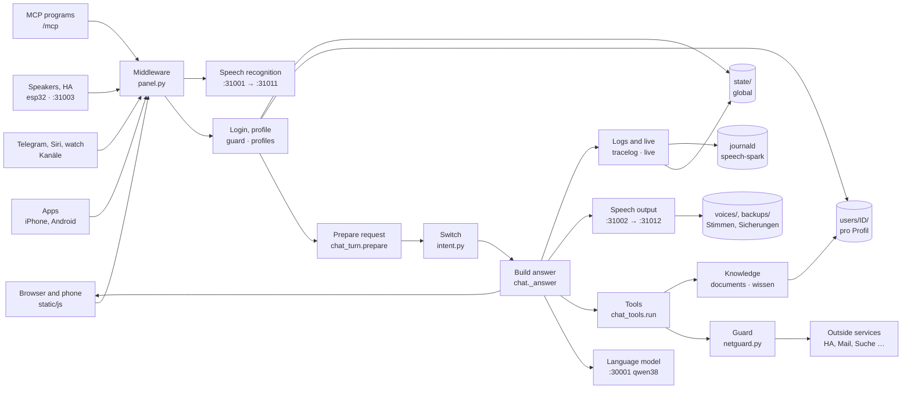

# Architecture and data flow

← [README](../../README.md) · [Technical details and troubleshooting](technical.md) · [Security and operation](security-and-operation.md)

This page describes how the Spark is built: which parts exist, which way a request takes and where which data lies. The panel shows the same to click through under **Status → Architecture** (admins only). How to build is set by the [coding guideline](guidelines.md).

The sections between the markers `<!-- technik:… -->` are generated from the code (`app/panel/technik.py`, plus `speicher.AREAS`/`LOCAL` and `backup.STATE_FILES`/`STATE_LOCAL`). `python3 app/panel/hilfe.py --docs` writes them again. A self-test (`test_technik`) turns red when a module, a file or a step is missing or the docs were not written again. Only the text outside the markers is kept by hand.

## Overview

Devices and programs only talk to the panel. The panel checks every request, asks the language model, calls tools through the guard and writes into the folders under `/var/lib/speech-spark`. Speech recognition and speech output are services of their own. The language model belongs to `dgx-spark-qwen38` and is not part of this repo.

<!-- technik:bild -->

<!-- /technik:bild -->

## Processes and ports

| Service | Port | Task |
|---|---|---|
| `speech-spark-panel` | 31080, HTTPS 31443 | Web portal, all endpoints, background jobs |
| `speech-spark-asr` → `speech-spark-asr-engine` | 31001 → 31011 (local only) | Speech recognition |
| `speech-spark-tts` → `speech-spark-tts-engine` | 31002 → 31012 (local only) | Speech output; optional VoiceDesign on 31013 |
| Wyoming in the panel | 31003 | Home Assistant Assist |
| `dgx-spark-qwen38` (other project) | 30001 | Language model; ports 30000–30099 belong to it |
| `speech-spark-watch` | – | Watchdog, only without the panel |
| `speech-spark-update` | – | Update, only on request |

All services run as the system user `speech` and log into the journald namespace `speech-spark`. The panel starts its background jobs itself (`panel.py`: samples, stability, inbox tidy, reading documents, reMarkable sync, learning from conversations). Background work waits while someone speaks (`vorrang.py`).

## Data flow of a request

The way of a spoken question in the browser, from input to storage:

<!-- technik:datenfluss -->
1. **Input**: The microphone records, the panel hands the sound to speech recognition. In the code: `POST /api/test/asr`
2. **Access**: Size, origin and kill switch, then rate limit, login and profile. In the code: `POST /api/chat · guard.limit · profiles.current`
3. **Prepare**: Speech first (vorrang), other devices see "answering", then rights, locks, system prompt. In the code: `chat_turn.prepare()`
4. **Switch**: Fixed rules narrow the tools; a clear reading request runs directly. In the code: `intent.classify_cfg() · intent.narrow()`
5. **Model**: Instant sentence, request trace, then rounds with the language model, streamed. In the code: `chat._answer()`
6. **Tools**: Tool call, guard, outside service or own knowledge; the result comes back as data. In the code: `chat_tools.run() · netguard`
7. **Answer**: Sentences go to speech output; text and sound reach the device as one stream. In the code: `SSE · /v1/audio/speech`
8. **Store**: The device stores the history, the panel the tool log, memory, diary, request trace and journal. In the code: `PUT /api/profile/convos · tracelog.finish`
<!-- /technik:datenfluss -->

Branches:

- **Telegram, Siri and the watch** send text (or a voice message) to their own endpoint. The panel stores the history itself (`verlauf.keep`), not the device.
- **ESP32 speakers and Home Assistant Assist** talk to `esp32.py` and `wyoming.py`. A stranger's voice at a shared speaker gets guest rights only.
- **MCP programs** ask through `/mcp` (`mcpserver.py`) with their own token, stored only as a hash.
- **Guests** get only question and answer from the language model, without tools, personal data or history on the Spark.

Everywhere: everything from outside (web, mail, documents, tool results, model output) is data, never a command. The panel decides by fixed rules.

## Building blocks

Every module under `app/panel/` and `app/` belongs to exactly one group. A new module without an entry in `technik.MODULE` turns `test_technik` red. The English lines are the first sentence of each module's docstring.

<!-- technik:bausteine -->
### Access and rights

Every request passes here first: size, origin, kill switch, login, profile and releases.

| Module | Task |
|---|---|
| `app/panel/account.py` | What a browser or device can do for itself: login, whoami and the profile's own data (memory, conversations, documents, reminders, calendar, e-mail, Home Ass … |
| `app/panel/coadmin.py` | Profiles as admins. |
| `app/panel/core.py` | Shared panel helpers: paths, logins (admin password, profiles) and small system calls. |
| `app/panel/features.py` | One description per function. |
| `app/panel/guard.py` | Protection of the logins: lockout after wrong passwords or PINs, requests from foreign pages, and the change log (who changed what, from where). |
| `app/panel/join.py` | New people by invitation. |
| `app/panel/mfa.py` | Second login step: a six-digit code from an authenticator app (TOTP, RFC 6238), or a one-time recovery code when the phone is gone. |
| `app/panel/netguard.py` | Outbound connections to addresses that people or outside text choose: web pages from search results, calendars, address books, task lists, mail servers and H … |
| `app/panel/notaus.py` | Notaus: three stages that stop the Spark from the outside in. |
| `app/panel/notzugang.py` | Back in when locked out: sudo speech-spark notzugang. |
| `app/panel/panel.py` | Speech on DGX Spark: web panel for config and monitoring. |
| `app/panel/passkey.py` | Passkeys (Face ID, Touch ID, Windows Hello; WebAuthn) instead of typing the six-digit code. |
| `app/panel/profiles.py` | User profiles for the assistant: who is talking, and what the assistant remembers about them. |
| `app/panel/signatur.py` | Signed update manifests (Ed25519), optional until a key exists. |
| `app/panel/stufen.py` | Wann fragt der Spark nach dem Code? |
| `app/panel/vault.py` | Secrets at rest: calendar and mail passwords and Home Assistant tokens are stored encrypted, so a copy of the profile folders (a backup, a look into the file … |
| `app/panel/zertpin.py` | Zertifikat festpinnen: a NAS in the home network often has a certificate that does not fit its address (made for itself, or for a name such as nas.local or x … |

### Conversation

Prepares a request, asks the language model in rounds and checks what is said.

| Module | Task |
|---|---|
| `app/panel/ack.py` | Instant acknowledgement. |
| `app/panel/answercheck.py` | Answer check: the panel, not the model, decides whether a sentence may be said. |
| `app/panel/chat.py` | The voice assistant: /api/chat with its tools (search, memory, documents, reminders, calendar, e-mail, Home Assistant, earlier conversations), learning from … |
| `app/panel/chat_tools.py` | The tools of one chat turn: what runs when the model calls web search, Home Assistant, mail, calendar, reminders ... |
| `app/panel/chat_turn.py` | One chat turn, before the model is asked: who is speaking and what they may use (profile, voice, device key, Telegram, iPhone app), the system prompt, answer … |
| `app/panel/echo.py` | The assistant does not answer its own voice (admin chat.no_self_echo, per profile "echo"; off by default). |
| `app/panel/fixes.py` | Learning from corrections: when a profile corrects the assistant by voice ("Nein, mein Bruder heißt Tim", "Du sollst bei Terminen immer nachsehen"), the mode … |
| `app/panel/fremdstimme.py` | Background voices never become a question (fixed rule, no switch). |
| `app/panel/images.py` | Pictures for the assistant: the person attaches a photo (panel, iPhone app, Telegram) and the language model looks at it itself. |
| `app/panel/klaeren.py` | Rückfrage, Korrektur und Merken. |
| `app/panel/roles.py` | Roles: each profile keeps a few ways the assistant should answer ("Butler: höflich und trocken", "Erklärbär: erklär alles wie für Kinder") and switches betwe … |
| `app/panel/schreib.py` | Schreibhilfe: the Spark corrects, smooths, shortens, translates or drafts a text, for mails and anything else the person writes (Word, Excel, Pages ...). |
| `app/panel/stille.py` | Silence never becomes words (fixed rule, no switch). |
| `app/panel/stufe.py` | Priority for people: a profile the admin gives "Vorrang" gets its answer first when several people talk to the Spark at once. |
| `app/panel/systemone.py` | Einordnung mit Wahrscheinlichkeit: qwen38's POST /v1/systemone for a few fixed questions. |
| `app/panel/taten.py` | Handlungs-Prüfung: what the Spark did in this answer, and whether a sentence claims a deed that no tool did. |
| `app/panel/tipps.py` | Funktionen vorschlagen: the assistant points out a function that is not on yet when it would help, and helps setting it up. |
| `app/panel/vorab.py` | Vorab holen bei Rückfrage. |

### Switch and tool names

Fixed rules for which tools the model sees for a question. Never gives more than the rights.

| Module | Task |
|---|---|
| `app/panel/intent.py` | The switch ("Weiche"): what the person asks for in their own latest message, by fixed rules. |
| `app/panel/intent_bench.py` | The Weiche's test bench (intent.py): sentence -> expected group ("" = no rule fits, "+" = two at once). |
| `app/panel/weiche.py` | Features → Switch: the switch of intent.py, shown and set up in the panel. |
| `app/panel/werkzeug_abdeckung.py` | Which function the assistant reaches how. |
| `app/panel/werkzeuge.py` | The readable name of every tool. |

### Knowledge and documents

Own documents, memory, earlier conversations, Kiwix and Wikipedia, created documents.

| Module | Task |
|---|---|
| `app/panel/docembed.py` | Meaning vectors for the document search. |
| `app/panel/doclingdienst.py` | Docling-Server anbinden: the admin connects a docling-serve in the home network (Docker on another machine), and uploaded documents are read a second time, b … |
| `app/panel/docmake.py` | Dokumente erstellen: the Spark writes letters, reports, minutes, notes, presentations and tables for a profile, as Word, PowerPoint, Excel, PDF, Markdown, te … |
| `app/panel/docrender.py` | Dokumente erstellen: the files themselves, built by fixed code. |
| `app/panel/documents.py` | Documents per profile: text extraction, chunking and search. |
| `app/panel/embed_worker.py` | The embedding model in its own process (started by docembed.py with python -I, never by hand). |
| `app/panel/folien.py` | Slide types and the fixed rules for documents the Spark writes. |
| `app/panel/gedaechtnis.py` | Gedächtnis mit Beleg und Prüfung. |
| `app/panel/kiwix.py` | The person's own Kiwix (kiwix-serve with ZIM files: Wikipedia, Wikivoyage, handbooks ...) as a knowledge source that works without the internet. |
| `app/panel/lokal.py` | Erst lokal suchen: before anything goes outside, the panel looks in the person's own sources itself. |
| `app/panel/memtidy.py` | Weekly memory cleanup per profile: the language model looks at the remembered facts and proposes which ones to merge (duplicates, the same thing said twice) … |
| `app/panel/recall.py` | What a profile talked about before: search in its saved conversations, and facts learned from them automatically (profiles only; guests keep their conversati … |
| `app/panel/suchpruefung.py` | Suchprüfung: how often does the document search find the right passage? |
| `app/panel/symbole.py` | Symbols for slides and documents. |
| `app/panel/tagebuch.py` | Spark-Tagebuch: what the Spark itself did for a profile. |
| `app/panel/wiki.py` | Wikipedia straight away: for "Was ist ...?" or "Wer war ...?" the panel asks Wikipedia for the best matching article and hands its short intro to the model, … |
| `app/panel/wissen.py` | Knowledge from one's own uploads. |

### Connections

Home Assistant, mail, calendar, tasks, weather, reMarkable, MCP and what the Spark does by itself.

| Module | Task |
|---|---|
| `app/panel/aendern.py` | Ändern per Sprache: what so far only had a button on a page. |
| `app/panel/agent.py` | Agent functions: the assistant works on a task in the background and reports later, runs tasks on a schedule, keeps routines of smart home steps, and uses ou … |
| `app/panel/beobachten.py` | Eigene Aufgaben, die beobachten: „Sag mir Bescheid, wenn es eine neue Firmware für meine FRITZ!Box gibt“, „Erinnere mich, wenn der Flug nach Rom unter 100 Eu … |
| `app/panel/calendars.py` | Calendar and daily briefing per profile (guests have neither). |
| `app/panel/contacts.py` | Contacts per profile, read only (CardDAV: iCloud, Nextcloud, others). |
| `app/panel/extras.py` | Small services the assistant can use besides the big ones in chat.py (weather, contacts, parcels ...). |
| `app/panel/hamelden.py` | Home Assistant tells the Spark. |
| `app/panel/homeassistant.py` | Home Assistant per profile: each profile connects its own Home Assistant (address and long-lived access token); only that profile's requests can use it, gues … |
| `app/panel/mail.py` | Reading e-mail per profile over IMAP (read only; guests have none). |
| `app/panel/mcp.py` | Outside tools over MCP (Model Context Protocol): the admin adds a tool server (Paperless, Nextcloud, GitHub ...) by its address, and the panel offers single … |
| `app/panel/mcpserver.py` | The Spark as an MCP server: other programs (Open WebUI, n8n, Home Assistant, Claude, ...) use the Spark's abilities over the Model Context Protocol at /mcp. |
| `app/panel/meinmcp.py` | Eigene MCP-Dienste pro Profil. |
| `app/panel/parcels.py` | Parcels from the profile's own e-mail: shipping mails of DHL, Hermes, DPD, GLS, UPS and Amazon are recognised by their sender, the status is taken from the m … |
| `app/panel/proactive.py` | The assistant speaks up by itself: a short note or question when something real happens. |
| `app/panel/remarkable.py` | reMarkable notebooks as knowledge. |
| `app/panel/rmaufgaben.py` | Das Aufgabenblatt aufs reMarkable: one living PDF "Aufgaben" with what the profile could do in the app, each point with answers to tick. |
| `app/panel/rmliste.py` | „Was liegt auf meinem reMarkable?“ and „Welche Aufgaben hast du dort gefunden?“: the tool remarkable_library. |
| `app/panel/rmpapier.py` | Paper for the reMarkable: folders by kind, designed sheets in the device's own page format, ticked boxes read back. |
| `app/panel/rmplus.py` | More with the reMarkable. |
| `app/panel/tasks.py` | Tasks and the shopping list per profile: "Setz Milch auf die Einkaufsliste", "Was steht auf meiner Liste?". |
| `app/panel/tidy.py` | Tidying the inbox per profile: obvious advertising, newsletters and the like are moved into folders under a main folder ("Spark/" unless the profile names an … |
| `app/panel/transit.py` | Bus und Bahn: departures from the profile's home stop and connections, from a transport.rest service (https://v6.db.transport.rest by default, the admin can … |
| `app/panel/weather.py` | Weather straight from Open-Meteo (no key): the panel turns the numbers into fixed German sentences, the language model only reads them out. |
| `app/panel/zustand_wz.py` | Zustand per Sprache: the tool spark_zustand. |

### Devices and channels

Apps, Telegram, watch, speakers, room mode, chats and the history on all devices.

| Module | Task |
|---|---|
| `app/panel/android.py` | The Android app "Spark": a thin shell around the page. |
| `app/panel/apns.py` | Push notifications to the iPhone app over Apple's push service (APNs), also while the app is closed. |
| `app/panel/appupdate.py` | Spark updates from the iPhone app: a notice when a new tested version is ready, and starting it. |
| `app/panel/begleiter.py` | Spark-Begleiter: a small program in the Windows notification area and the Mac menu bar (tools/begleiter/windows, tools/begleiter/mac) with these parts, each … |
| `app/panel/chats.py` | Chats between the people of this Spark. |
| `app/panel/chatsec.py` | Private chats with end-to-end encryption. |
| `app/panel/esp32.py` | Own speakers: small ESP32-S3 boards (microphone, amplifier, maybe a small display) with the open XiaoZhi firmware, talking to this Spark instead of a cloud. |
| `app/panel/geraeteupdate.py` | Geräte-Updates: an overview of what the Spark keeps for the devices, a note when a new version is there, the speakers updated at night and a note when XiaoZh … |
| `app/panel/hintergrund.py` | Me → My status. |
| `app/panel/iphone.py` | The iPhone app "Spark" (ios/ in the repo): pairing and what the app may do. |
| `app/panel/messages.py` | The assistant's way into the chats (chats.py) and what the chats bring along from the old "Nachrichten": "Sag Anna, das Essen ist fertig", "Habe ich neue Nac … |
| `app/panel/onboard.py` | Einrichten an der Hand. |
| `app/panel/pebblewatch.py` | Pairing the Pebble watch app "Spark" (pebble/ in the repo) with a profile. |
| `app/panel/push.py` | Reminders as push notifications, also while no page of the panel is open (Web Push, RFC 8030/ 8291/8292, without extra libraries: the encryption comes from t … |
| `app/panel/room.py` | Room mode: the assistant listens to the conversation in the room and helps in a pause. |
| `app/panel/roomfar.py` | Room mode on another device of the profile, by voice or chat: "Raummodus im Wohnzimmer an". |
| `app/panel/roomlive.py` | Where room mode listens right now. |
| `app/panel/speakers.py` | Speaker identification for profiles (optional; off unless the admin enables it). |
| `app/panel/spkcode.py` | Code word at an own speaker in a room. |
| `app/panel/telegram.py` | Telegram bot: profiles talk to the assistant by text or voice message from anywhere, without the web page and without an open port (the panel asks Telegram f … |
| `app/panel/today.py` | Ich starts with "Heute". |
| `app/panel/verbund.py` | Spark-Verbund: chats with people on other Sparks. |
| `app/panel/verlauf.py` | Verlauf auf allen Geräten: what keeps a profile's conversations alike everywhere. |
| `app/panel/watch.py` | Answers for the Pebble watch app: the chat runs here, the phone polls for text and audio. |
| `app/panel/wyoming.py` | Wyoming for Home Assistant Assist: HA (Voice PE, the HA app, ESPHome speakers) uses the Spark's speech recognition and voice. |

### Operation

Live overview, logs, watchers, backup, update, help and the admin pages.

| Module | Task |
|---|---|
| `app/panel/admin.py` | Admin pages: status, configuration, services, logs, tests, cloned voices, benchmark, profiles and devices. |
| `app/panel/backup.py` | Backups of everything the panel keeps: profiles (memory, conversations, documents, calendars, mail, Home Assistant, voices of speaker ID), cloned voices, set … |
| `app/panel/befund.py` | Befund: the cause of a case, worked out before any proposal. |
| `app/panel/berater.py` | Einstellungs-Assistent: cases become proposals. |
| `app/panel/berater_katalog.py` | The Einstellungs-Assistent's catalog: everything it may ever propose. |
| `app/panel/dienstwacht.py` | Dienst-Wächter: the Spark looks at its services by itself and tells the admins when one is gone and when it is back. |
| `app/panel/faelle.py` | Fälle: every problem becomes a case the moment it happens. |
| `app/panel/ghtoken.py` | A read-only GitHub token for the Spark's own questions to api.github.com (Settings → Update). |
| `app/panel/health.py` | Stability: a watchdog for hung speech services, a warning before memory runs out, and a live check of the real services (LLM answers, TTS speaks, ASR underst … |
| `app/panel/hilfe.py` | Spark-Hilfe: the assistant answers questions about the Spark itself ("Wie bekomme ich schnellere Antworten?", "Was macht dieser Schalter?", "Was sollte ich h … |
| `app/panel/latency.py` | How long people wait: the time from the question to the first sound of the answer, for every answer of the assistant (chat.py), kept for two weeks in STATE/l … |
| `app/panel/live.py` | Status → Live: what the Spark does right now, for the admin and for a wall monitor. |
| `app/panel/logfilter.py` | Diagnose filters for Status → Logs: the journal lines threads usually ask for ("room:", "esp32:", "chat: web search", ...), so nobody has to type journalctl … |
| `app/panel/meldung.py` | Probleme melden: a problem report from the panel, the phone apps, Telegram, the voice and the speakers as an issue on GitHub, with anonymized log lines. |
| `app/panel/monitor.py` | Monitoring: GPU, memory and CPU samples, and the health of the speech services. |
| `app/panel/nas.py` | NAS-Verbindung. |
| `app/panel/offsite.py` | Sicherung nach außen: once a day an encrypted copy of the backup goes to a WebDAV folder (NAS, Nextcloud, Synology), off unless the main admin switches it on. |
| `app/panel/quality.py` | Quality test of the assistant against the real language model: fixed questions with prepared tool results (a sandbox, nothing of a profile is read or changed … |
| `app/panel/speicher.py` | Eigener Speicher. |
| `app/panel/system.py` | System page: backups, the live check of the real services and the alerts shown on top. |
| `app/panel/technik.py` | Status → Architecture: how the Spark is built, as a page to click through and as docs/de/architektur.md + docs/en/architecture.md. |
| `app/panel/tracelog.py` | Status → Logs → Requests: the way of each request through the panel, step by step, for the admin: arrival, preparation, the switch (intent.py), every round o … |
| `app/panel/undo.py` | Rückgängig im Admin-Protokoll. |
| `app/panel/update.py` | Updates from GitHub: version check, start/stop, progress and the lock while an update runs. |
| `app/panel/wege.py` | Ways into the panel in texts that leave it ("Einschalten unter Me → Telegram"): Telegram messages, push notes. |

### Speech services

Speech recognition and speech output as their own services, ahead of everything else.

| Module | Task |
|---|---|
| `app/api_watchdog.py` | The watchdog without the web panel (install mode "api"): the same rules the panel uses (panel/health.py), run as the unit speech-spark-watch. |
| `app/asr_proxy.py` | Qwen3-ASR front end for the vLLM engine (backend "vllm"). |
| `app/asr_server.py` | Qwen3-ASR as a small HTTP service (OpenAI-style /v1/audio/transcriptions). |
| `app/bench.py` | Measures speech on this box: time to first audio, speed and memory. |
| `app/common.py` | Shared helpers for the ASR and TTS services: config, model state, request stats. |
| `app/parakeet.py` | Second recognizer: parakeet-primeline (German fine-tune of NVIDIA Parakeet TDT 0.6B v3), int8 ONNX on the CPU via sherpa-onnx. |
| `app/tempo.py` | Speaking tempo for streamed speech: WSOLA time stretching that keeps the pitch. |
| `app/textnorm.py` | Text clean-up before speech synthesis. |
| `app/tts_proxy.py` | Qwen3-TTS front end for the vllm-omni engine (backend "vllm-omni"). |
| `app/tts_server.py` | Qwen3-TTS as a small HTTP service (OpenAI-style /v1/audio/speech). |
| `app/panel/vorrang.py` | Speech first: speech recognition and speech output always go before the panel's background work. |
<!-- /technik:bausteine -->

## Data storage

All files belong to the user `speech` (folders 0700, files 0600) and are written atomically (`.tmp`, then renamed). "Backup" means the file is in the backup under Status → System → Backup. "Own storage" means a profile can copy the file encrypted to its own storage.

<!-- technik:speicher -->
### System

| Path | Content | Protection | Backup |
|---|---|---|---|
| `/etc/speech-spark/config.json` | All settings (secrets sealed) | partly | yes |
| `/etc/speech-spark/panel.env, mode, connection.txt` | Start password, install mode, API access | – | no |
| `/etc/speech-spark/tls/` | Panel HTTPS certificate | – | no |
| `/opt/speech-spark/` | Code, venvs, installed version | – | no |
| `/var/lib/speech-spark/hf/` | Model cache (HuggingFace) | – | no |
| `/var/lib/speech-spark/firmware/` | ESP32 firmware | signed | no |
| `/var/lib/speech-spark/voices/` | Cloned voices (WAV and text) | – | yes |
| `/var/lib/speech-spark/backups/` | Backups: newest 7 plus 5 event backups | – | – |
| `journald (Namespace speech-spark)` | Logs of all services, 14 days, at most 500 MB | – | no |

### users/ (all profiles)

| Path | Content | Protection | Backup |
|---|---|---|---|
| `users/profiles.json` | Profiles and devices | – | yes |
| `users/sessions.json` | Logins | – | yes |
| `users/seen.json` | Last seen | – | yes |
| `users/secret` | Profile login key | is a key | no |
| `users/_chats/` | Chats between profiles | AES-256-GCM | yes |
| `users/_verbund/` | Spark network: other Sparks, contacts, queue | – | yes |
| `users/begleiter.json` | Companion devices | – | yes |

### users/ID/ (per profile)

| Path | Content | Kind | Protection | Backup | Copy of my data |
|---|---|---|---|---|---|
| `users/ID/convos.json` | Conversations |  | – | yes | Conversations |
| `users/ID/toollog.json` | Tool log |  | – | yes | Conversations |
| `users/ID/room-history.json` | Room mode history |  | – | yes | Conversations |
| `users/ID/memory.json` | Memory |  | – | yes | Memory |
| `users/ID/learned.json` | Learned facts |  | – | yes | Memory |
| `users/ID/zuordnungen.json` | Remembered matches |  | – | yes | Memory |
| `users/ID/tasks.json` | Tasks |  | – | yes | Tasks and reminders |
| `users/ID/reminders.json` | Reminders |  | – | yes | Tasks and reminders |
| `users/ID/wissen.db` | Documents: text, search, vectors (SQLite) |  | – | yes | Documents (text, search, originals) |
| `users/ID/docs/files/` | Originals of uploads |  | – | yes | Documents (text, search, originals) |
| `users/ID/suchpruefung.json` | Test questions and runs of the search check |  | – | yes | Documents (text, search, originals) |
| `users/ID/erstellt/` | Created documents |  | – | yes | Created documents |
| `users/ID/settings.json` | Settings | Settings | – | yes | – |
| `users/ID/setup.json` | Setup | Settings | – | yes | – |
| `users/ID/speicher.json` | Own storage targets | Settings | key sealed | yes | – |
| `users/ID/speicher-stand.json` | Sync state | State | – | yes | – |
| `users/ID/transit.json` | Stop | Settings | – | yes | – |
| `users/ID/weather.json` | Weather place | Settings | – | yes | – |
| `users/ID/proactive.json` | Speak up by itself | Settings | – | yes | – |
| `users/ID/proactive-rules.json` | Own notice rules | Settings | – | yes | – |
| `users/ID/hintergrund.json` | My status | Settings | – | yes | – |
| `users/ID/mail.json` | Mail account | Login | password sealed | yes | – |
| `users/ID/nas.json` | Storage places of the profile (NAS, cloud) | Login | password sealed | yes | – |
| `users/ID/speicher.vor-nas.json` | Copy of my data before the move to storage places | Login | – | yes | – |
| `users/ID/mail-tidy.json` | Inbox tidy | Settings | – | yes | – |
| `users/ID/calendar.json` | Calendar account | Login | password sealed | yes | – |
| `users/ID/homeassistant.json` | Home Assistant account | Login | token sealed | yes | – |
| `users/ID/telegram.json` | Telegram link | Login | – | yes | – |
| `users/ID/push.json` | Browser push subscriptions | Device | – | yes | – |
| `users/ID/remarkable.json` | reMarkable account | Login | token sealed | yes | – |
| `users/ID/remarkable-lib.json` | reMarkable library | State | – | yes | – |
| `users/ID/mcp-dienste.json` | Own MCP services | Login | tokens sealed | yes | – |
| `users/ID/mcp-actions.json` | MCP actions | State | – | yes | – |
| `users/ID/agent.json` | Jobs and routines | Settings | – | yes | – |
| `users/ID/voice.json` | Voiceprint | Voiceprint | – | yes | – |
| `users/ID/speaker-code.json` | Speaker code word | Key | sealed | yes | – |
| `users/ID/chatkeys.json` | Devices' public keys | Key | – | yes | – |
| `users/ID/contacts.json` | Contacts account | not offered yet | password sealed | yes | – |
| `users/ID/ha-events.json` | Home Assistant events | State | – | yes | – |
| `users/ID/briefing-sent` | Briefing sent | State | – | yes | – |
| `users/ID/messages.json` | Message settings | Settings | partly sealed | yes | – |
| `users/ID/messages/` | Old voice messages | old voice messages (until moved into the chats) | – | no | – |
| `users/ID/agent-pending.json` | Waiting for yes | Queue | – | yes | – |
| `users/ID/calendar-pending.json` | Waiting for yes | Queue | – | yes | – |
| `users/ID/fix-pending.json` | Waiting for yes | Queue | – | yes | – |
| `users/ID/memory-ask.json` | Open memory question | Queue | – | yes | – |
| `users/ID/mail-pending.json` | Waiting for yes | Queue | – | yes | – |
| `users/ID/mcp-dienste-pending.json` | Waiting for yes | Queue | – | yes | – |
| `users/ID/messages-pending.json` | Waiting for yes | Queue | – | no | – |
| `users/ID/tasks-pending.json` | Waiting for yes | Queue | – | yes | – |
| `users/ID/tagebuch.json` | Spark diary | State | – | yes | – |
| `users/ID/docling-wait` | Files until Docling has read them | Queue | – | yes | – |
| `users/ID/mfa.json` | Profile's second step | Key | sealed | yes | – |
| `users/ID/memory-tidy.json` | Tidy proposal | Queue | – | yes | – |
| `users/ID/memory-tidy-checked` | Last tidy check | State | – | yes | – |

### state/ (global)

| Path | Content | Protection | Backup |
|---|---|---|---|
| `state/ack` | Instant sentences as sound | – | no |
| `state/admin-session.key` | Admin session key | is a key | no |
| `state/admins.json` | Profiles as admins | – | yes |
| `state/agent.json` | Agent levels, MCP services | tokens sealed | yes |
| `state/android` | Android app for download | – | no |
| `state/apns-tokens.json` | iPhones for push | – | yes |
| `state/apns.json` | Apple push key | key sealed | yes |
| `state/audit.log` | Admin log, 1 MB | – | no |
| `state/begleiter` | Companion updates | – | no |
| `state/begleiter-inbox` | Phone to PC, 24 h | – | no |
| `state/bench-history.json` | Benchmarks | – | no |
| `state/bench-latest.json` | Last benchmark | – | no |
| `state/berater.json` | Assistant proposals | – | yes |
| `state/bewertungen.json` | Ratings per day | – | no |
| `state/config-undo.json` | Undo (no secrets) | without secrets | no |
| `state/dienste-zustand.json` | Background services | – | no |
| `state/dienstwacht.json` | Service watcher | – | yes |
| `state/doc-embed.json` | Vector model | – | no |
| `state/doc-quotas.json` | Document quotas | – | yes |
| `state/docling.json` | Docling server: address, certificate, counts | key sealed | yes |
| `state/esp32.json` | Speakers and firmware | partly sealed | yes |
| `state/faelle.json` | Cases | – | yes |
| `state/features-seen.json` | When functions were released | – | yes |
| `state/geraete-updates.json` | Device updates | – | yes |
| `state/github-token.json` | GitHub read token | sealed | yes |
| `state/guard-xff-hinted.json` | Proxy hint shown | – | no |
| `state/guard.json` | Lockouts | – | no |
| `state/gut-saetze.json` | Questions confirmed with 👍 | – | yes |
| `state/iphone-update.json` | Update from the iPhone app | – | no |
| `state/join.json` | Invitations (hashes) | hashes only | yes |
| `state/latency.json` | Waiting times | – | no |
| `state/live-monitors.json` | Wall monitors | – | no |
| `state/livecheck.json` | Live check | – | no |
| `state/mcp-dienste-admin.json` | Allowed MCP hosts | – | yes |
| `state/mcp-server.json` | MCP programs (token hashes) | hashes only | yes |
| `state/meldung-token.json` | Report token | sealed | no |
| `state/meldungen` | Report drafts | – | no |
| `state/mfa-admin.json` | Admin's second step | sealed | yes |
| `state/migrated-chunk10` | One-time migration done | – | no |
| `state/nas-admin.json` | The Spark's NAS connection | password sealed | yes |
| `state/notaus-keys.json` | Kill switch triggers | – | no |
| `state/notaus-mine.json` | My kill switch | – | no |
| `state/notaus.json` | Kill switch | – | no |
| `state/offsite.json` | Offsite backup | sealed | yes |
| `state/panel-password` | Admin password (hash) | hash | yes |
| `state/personen-vorrang.json` | Priority per profile | – | yes |
| `state/quality-cases.json` | Own test questions | – | yes |
| `state/quality-history.json` | Quality test history | – | yes |
| `state/quality.json` | Last quality test | – | no |
| `state/regel-versionen.json` | Rule versions | – | yes |
| `state/revoked.json` | Revoked sessions | – | no |
| `state/secret.key` | Key for everything sealed | is the key | no |
| `state/setup.json` | Setup wizard done | – | yes |
| `state/speech-active` | Time of last speech | – | no |
| `state/speech-spark-asr-engine.json` | ASR engine state | – | no |
| `state/speech-spark-tts-*.json` | TTS engine state | – | no |
| `state/speicher-tmp` | Own storage staging | AES-256-GCM | no |
| `state/telegram.json` | Telegram bot | token sealed | yes |
| `state/tipps.json` | Tips shown | – | no |
| `state/traces.jsonl` | Logs → Requests, 48 h | – | no |
| `state/update-night.json` | Night update | – | no |
| `state/update-progress.json` | Update progress | – | no |
| `state/update-target` | Requested update target | – | no |
| `state/vapid.pem` | Web push key | is a key | yes |
| `state/vision.json` | Picture questions, 10 min | – | no |
| `state/vorrang-key` | Key panel ↔ speech services | is a key | no |
| `state/weiche-history.json` | Switch changes | – | no |
| `state/weiche-stats.json` | Switch statistics | – | no |
<!-- /technik:speicher -->

### Keys and encryption

- `state/secret.key` seals every password and token (Fernet, `vault.py`). The chats' key is derived from it too (HKDF, AES-256-GCM). It goes only into a **move backup**, sealed with the admin's password (`state/move-keys.json`, scrypt). A normal backup restored on another Spark therefore loses chats and every sealed account.
- `users/secret` and `state/admin-session.key` sign logins and never go into a backup. After a move everyone signs in again.
- The voiceprint `users/ID/voice.json` is a row of numbers and lies unencrypted in the backup.
- The offsite backup (`offsite.py`) and the own storage (`speicher.py`) are encrypted as a whole (scrypt + AES-GCM, AES-256-GCM in chunks of 1 MiB).

### Caches in memory

These caches are lost on a restart and hold nothing that cannot be fetched again: calendar 300 s, mail 120 s, bus and train 60 s, weather 900 s, parcels 600 s, Wikipedia and Kiwix 24 h, picture questions 600 s (results also in `state/vision.json`), answers for the watch 600 s, the document search vectors per profile, the voices of speech output.

### Logs

All services write into the journald namespace `speech-spark` (persistent, at most `logs.max_mb` = 500 MB, `logs.keep_days` = 14 days). Lines hold only fixed words and numbers, a profile only through `profiles.log_name`. The request trace (`state/traces.jsonl`, 48 h) runs only while the admin switch `logs.trace` is on.

## Keeping the docs current

With every change (guideline part 1, item "Architecture docs"):

1. A new module gets its group and a line in `technik.MODULE`.
2. A new file under `state/` goes into `backup.STATE_FILES` (backed up) or `backup.STATE_LOCAL` (with the reason why not), plus its line in `technik.INHALT`. A new file under `users/ID/` goes into `speicher.AREAS` or `speicher.LOCAL` and into `technik.INHALT`. If it is sealed, it goes into `technik.VERSCHLUESSELT`.
3. When the way of a request changes, `technik.KNOTEN`, `KANTEN` and `SCHRITTE` are adjusted.
4. Then run `python3 app/panel/hilfe.py --docs`. It writes this page, the German version and the help index again.

`test_technik` checks all four.
