# Architecture and data flow

← [README](../../README.md) · [Technical details and troubleshooting](technical.md) · [Security and operation](security-and-operation.md)

This page describes how the Spark is built: which parts exist, which way a request takes and where which data lies. The panel shows the same to click through under **Status → Architecture** (admins only). There the picture uses the whole width with the detail below it; "⛶ Full screen" lays the overview or the data flow over the whole screen, with ＋/− to zoom and Escape to close. How to build is set by the [coding guideline](guidelines.md).

The sections between the markers `<!-- technik:… -->` are generated from the code (`app/panel/technik.py`, plus `speicher.AREAS`/`LOCAL` and `backup.STATE_FILES`/`STATE_LOCAL`). `python3 app/panel/hilfe.py --docs` writes them again. A self-test (`test_technik`) turns red when a module, a file or a step is missing or the docs were not written again. Only the text outside the markers is kept by hand.

## Overview

Devices and programs only talk to the panel. The panel checks every request, asks the language model, calls tools through the guard and writes into the folders under `/var/lib/speech-spark`. Speech recognition, speech output, pictures and the language model are services of their own.

The picture is split into zones so you can see where a part lives: at the top the devices, which can be at home or on the way (small marks „home“ and „on the way“; they come in directly at :31080/:31443 or through the reverse proxy), in the middle the DGX Spark with panel, models and storage, at the bottom what goes out, split into home network and internet and only through the guard or fixed ways. With the [Spark split](spark-split.md) the panel zone runs with the storage on its own computer, the models stay on the DGX and are reached through the TLS-Tor (box „Spark split“). In the panel the lines stay pale until you click a box; then only its ways light up. Places, zones and lines are in `technik.py` (`ZONEN`, `LINIEN`); `test_technik` checks that no box covers another, every box lies in its zone and every line runs at right angles from box to box.

<!-- technik:bild -->
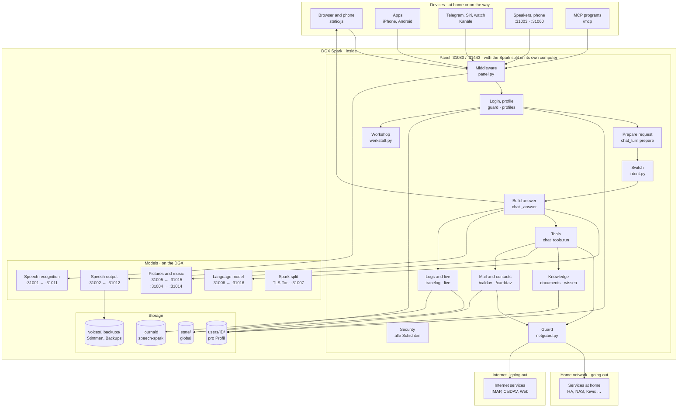
<!-- /technik:bild -->

## Processes and ports

| Service | Port | Task |
|---|---|---|
| `speech-spark-panel` | 31080, HTTPS 31443 | Web portal, all endpoints, background jobs |
| `speech-spark-asr` → `speech-spark-asr-engine` | 31001 → 31011 (local only) | Speech recognition |
| `speech-spark-tts` → `speech-spark-tts-engine` | 31002 → 31012 (local only) | Speech output; optional VoiceDesign on 31013 |
| Wyoming in the panel | 31003 | Home Assistant Assist |
| Phone in the panel | UDP 31060, sound UDP 31062–31068 | Calling the Spark (SIP and RTP only with the telephone system in the home network) |
| `speech-spark-turn` | 3478, relay 49160–49200 | Relay for calls from outside (coturn), only with its switch on |
| `speech-spark-llmtor` → `speech-spark-llm` | 31006 → 31016 (local only) | Own language model (vLLM) behind the LLM-Tor; image understanding `speech-spark-sehen` on 31017 and helper model `speech-spark-helfer` on 31018 on demand |
| `speech-spark-bild` | 31005 → 31015 (local only) | Painting and changing pictures (FLUX.2 klein) |
| `speech-spark-musik` | 31004 → 31014 (local only) | Making music (ACE-Step 1.5), the engine only while making a song |
| `speech-spark-waerter` | 127.0.0.1:31007 | Wärter: fixed commands from the panel computer (only with the Spark split, behind the TLS-Tor) |
| `speech-spark-tlstor` | the same ports with TLS | TLS-Tor of the model computer (only with the Spark split), plus `speech-spark-teilen-fw` |
| `speech-spark-notasr` | 127.0.0.1:31009 | Emergency mode with Parakeet on the panel computer while the model computer is gone |
| `dgx-spark-qwen38` (other project, optional) | 30001 | Language model until the own one is taken over; ports 30000–30099 belong to it |
| `speech-spark-watch` | – | Watchdog, only without the panel |
| `speech-spark-update` | – | Update, only on request |
| `speech-spark-wechsel` | – | Switch one model (Status → Models), only on request |
| `speech-spark-messen-wunsch` | – | Measure one model (Status → Models "Measure"), only on request |
| `speech-spark-gehaeuse` | – | Set up the panel computer's case (Pironman 5: fan, OLED), only with `--gehaeuse` |
| `speech-spark-werkstatt` | – (the sandbox asks only 127.0.0.1:31006) | One order of the workshop (Features → Workshop): test run, code measurement, diagnosis, repair in the sandbox `speech-spark-werkstatt-lauf`, only with `--werkstatt`; plus `speech-spark-werkstatt-fw` (on 127.0.0.1 the sandbox reaches only the LLM-Tor) |
| `speech-spark-schirm` | – (asks only 127.0.0.1:31080) | Control centre as text on the panel computer's screen (tty1), only with the switch on |

**Model computer (V01.0.606, plan "Splitting the Spark" stage B1):** the panel reaches speech recognition, speech output, pictures and the LLM-Tor through one address only: `common.model_url(art, path)` with the setting `models.host`. The default is `127.0.0.1`, and then everything runs on one Spark over `http://127.0.0.1:<port>` as before. With another computer there (a name or IP, never a path or `http://`), every request goes over `https` and the API key is a must (`admin.validate`); a broken entry stays on the Spark. The LLM-Tor on the model computer gets the key like the own one (`llm.own_tor`), and the guard (`netguard.model_addresses`) treats the model computer's ports 30000–31099 like its own: no MCP, calendar or Home Assistant address can point at them. The model computer is set only by the split install (stage B6); the pairing pins the certificate (B3). Self-test `test_modell_rechner`.

**TLS-Tor (V01.0.607, stage B2):** when the panel runs on another computer, the services on the DGX listen only on 127.0.0.1, and `app/tlstor.py` opens the same ports on `api.tls_listen` with TLS 1.3 and the certificate in `/etc/speech-spark/tls`, only for the addresses in `api.tls_from`. The panel trusts exactly the pinned certificate (`models.cert`); `common._pin_models` gives it to every httpx connection to the model computer that brings no transport of its own. Self-test `test_teilen`.

**Wärter (V01.0.609, stage B4a):** on the model computer `app/tarswart.py` (127.0.0.1:31007, behind the TLS-Tor) runs a fixed list of commands: `status` and `einheit start|stop|restart <part>`. The panel talks to it through `steuer.py` (`unit_state`, `active_seconds`, `systemctl`, `gpu`); on the all-in-one install `steuer.py` calls `systemctl` and `nvidia-smi` itself as before. Signed with HMAC-SHA256 and the Wärter key from the pairing. Self-test `test_waerter`. Since V01.0.610 also `einstellen` (speech settings from the panel, `common.model_settings`) and `logs <part> <n>`. Since V01.0.612 the status reports the model choice (`common.MODEL_CHOICE`), which the panel takes over; plus `modelle`, `wechseln <kind> <id|zurueck>`, `eigen_dazu` and `eigen_weg` for Status → Models (`modelle.wechsel_anfragen` is the one source for both ways). The qwen38 lanes (`common.qwen38_lanes`) now live in `common`. The status also reports the model computer's Wartungspause (`common.WARTUNG_FILE`, parts and times only) and per unit when it started (`eintritt`, for the automatic); `weiter` ends it. `wartung.state` merges it with the own pause (`steuer.cached`, never a request on the question path); Live box "Model computer" from `steuer.for_live`. Since V01.0.614 `update` starts the model computer's own update; the status carries `commit` and `update`, the panel computer's `update.sh` waits for it through `speech-spark teilen modelle-update`. `PREFIX` and `installed_version` now live in `common`. Emergency mode: `steuer.weg` (30 s without an answer) makes `wartung.paused` true for every part, `wartung.quiet` not; own sentence `wartung.NOTBETRIEB` and speaker files `notbetrieb-satz-*.pcm`. Pairing (V01.0.616, B6a): `teilen.py warten|koppeln` on port 31008 only while a code is shown; key scrypt(code, SHA-256 of the certificate), proof and answer with HMAC-SHA256; `speech-spark teilen code|koppeln` writes the result with `cfg_put` (the one place that changes the config in the shell) and `STATE/waerter.key`. Install (V01.0.617, B6b): `install.sh --mode api --teilen` (marker `$ETC/teilen`, services on 127.0.0.1, door certificate `common.TOR_CERT`, units `speech-spark-tlstor`, `-waerter`, `-teilen-fw`, both in `restart-map`) and `--mode panel --modelle` (`PANEL_ONLY`: no model, no engine, pairing before the units); `steuer.rundlauf` checks the way afterwards. Moving (V01.0.618, B6c): `panel/umziehen.py packen|auspacken` (move backup through stdin/stdout, `system._check_config`), `teilen.warten(umzug=…)`/`koppeln(umzug_ordner, einspielen)` with a signed "fertig"; `speech-spark umziehen --code|--von`, `zurueckholen --von`; only `speech-spark teilen zertifikat` makes the door's certificate. Emergency mode with Parakeet (V01.0.620, B5c): `panel/notbetrieb.py` with `chat.notbetrieb_asr`; in emergency mode `common.model_url("asr")` goes to `speech-spark-notasr` (`asr_proxy.py` with `SPEECH_SPARK_NOTASR=1`, 127.0.0.1:`common.NOTASR_PORT`, loads when needed, unloads after `common.NOTASR_IDLE`); before the fixed sentence `chat.py` asks `notbetrieb.antwort` (Home Assistant through `chat._ha_panel`, the time, `reminder_list`); `esp32.pause_clip(en, text)` plays files from `STATE/notbetrieb-saetze/` for it (`notbetrieb.ton`, made by `notbetrieb.make_clips` in `wartung.clips_tick`).

All services run as the system user `speech` and log into the journald namespace `speech-spark`. The panel starts its background jobs itself (`panel.py`: samples, stability, inbox tidy, reading documents, reMarkable sync, learning from conversations). Background work waits while someone speaks (`vorrang.py`).

## Data flow of a request

The way of a spoken question in the browser, from input to storage:

<!-- technik:datenfluss -->
1. **Input**: The microphone records, the panel hands the sound to speech recognition. In the code: `POST /api/test/asr`
2. **Access**: Kill switch, origin and size, then rate limit, login and profile. In the code: `POST /api/chat · guard.limit · profiles.current`
3. **Prepare**: Speech first (vorrang), other devices see "answering", then rights, locks, system prompt. In the code: `chat_turn.prepare()`
4. **Switch**: Fixed rules narrow the tools; a clear reading request runs directly. In the code: `intent.classify_cfg() · intent.narrow()`
5. **Model**: Instant sentence, request trace, then rounds with the language model, streamed. In the code: `chat._answer()`
6. **Tools**: Tool call, guard, a service in the home network or on the internet, or own knowledge; the result comes back as data. In the code: `chat_tools.run() · netguard`
7. **Answer**: Sentences go to speech output; text and sound reach the device as one stream. In the code: `SSE · /v1/audio/speech`
8. **Store**: The device stores the history, the panel the tool log, memory, diary, request trace and journal. In the code: `PUT /api/profile/convos · tracelog.finish`
<!-- /technik:datenfluss -->

Branches:

- **Telegram, Siri and the watch** send text (or a voice message) to their own endpoint. The panel stores the history itself (`verlauf.keep`), not the device.
- **ESP32 speakers and Home Assistant Assist** talk to `esp32.py` and `wyoming.py`. A stranger's voice at a shared speaker gets guest rights only.
- **MCP programs** ask through `/mcp` (`mcpserver.py`) with their own token, stored only as a hash.
- **Guests** get only question and answer from the language model, without tools, personal data or history on the Spark.

Everywhere: everything from outside (web, mail, documents, tool results, model output) is data, never a command. The panel decides by fixed rules.

## Building blocks

Every module under `app/panel/` and `app/` belongs to exactly one group. A new module without an entry in `technik.MODULE` turns `test_technik` red. The English lines are the first sentence of each module's docstring.

<!-- technik:bausteine -->
### Access and rights

Every request passes here first: size, origin, kill switch, login, profile and releases.

| Module | Task |
|---|---|
| `app/panel/account.py` | What a browser or device can do for itself: login, whoami and the profile's own data (memory, conversations, documents, reminders, calendar, e-mail, Home Ass … |
| `app/panel/coadmin.py` | Profiles as admins. |
| `app/panel/core.py` | Shared panel helpers: paths, logins (admin password, profiles) and small system calls. |
| `app/panel/features.py` | One description per function. |
| `app/panel/guard.py` | Protection of the logins: lockout after wrong passwords or PINs, requests from foreign pages, and the change log (who changed what, from where). |
| `app/panel/join.py` | New people by invitation. |
| `app/panel/mfa.py` | Second login step: a six-digit code from an authenticator app (TOTP, RFC 6238), or a one-time recovery code when the phone is gone. |
| `app/panel/netguard.py` | Outbound connections to addresses that people or outside text choose: web pages from search results, calendars, address books, task lists, mail servers and H … |
| `app/panel/notaus.py` | Notaus: three stages that stop the Spark from the outside in. |
| `app/panel/notzugang.py` | Back in when locked out: sudo speech-spark notzugang. |
| `app/panel/panel.py` | Speech on DGX Spark: web panel for config and monitoring. |
| `app/panel/passkey.py` | Passkeys (Face ID, Touch ID, Windows Hello; WebAuthn) instead of typing the six-digit code. |
| `app/panel/profiles.py` | User profiles for the assistant: who is talking, and what the assistant remembers about them. |
| `app/panel/signatur.py` | Signed update manifests (Ed25519), optional until a key exists. |
| `app/panel/stufen.py` | Wann fragt der Spark nach dem Code? |
| `app/panel/vault.py` | Secrets at rest: calendar and mail passwords and Home Assistant tokens are stored encrypted, so a copy of the profile folders (a backup, a look into the file … |
| `app/panel/wachposten.py` | Wachposten: the Spark tells its admins by itself when something happens on the doors and locks, so nobody has to read the change log to notice it. |
| `app/panel/zertpin.py` | Zertifikat festpinnen: a NAS in the home network often has a certificate that does not fit its address (made for itself, or for a name such as nas.local or x … |

### Conversation

Prepares a request, asks the language model in rounds and checks what is said.

| Module | Task |
|---|---|
| `app/panel/ablauf.py` | Ablauf und Freigabe zeigen. |
| `app/panel/ack.py` | Instant acknowledgement. |
| `app/panel/answercheck.py` | Answer check: the panel, not the model, decides whether a sentence may be said. |
| `app/panel/chat.py` | The voice assistant: /api/chat with its tools (search, memory, documents, reminders, calendar, e-mail, Home Assistant, earlier conversations), learning from … |
| `app/panel/chat_modell.py` | chat_modell.py: the model side of an answer, cut out of chat._answer. |
| `app/panel/chat_ton.py` | chat_ton.py: the speech output of an answer, cut out of chat._answer. |
| `app/panel/chat_tools.py` | The tools of one chat turn: what runs when the model calls web search, Home Assistant, mail, calendar, reminders ... |
| `app/panel/chat_turn.py` | One chat turn, before the model is asked: who is speaking and what they may use (profile, voice, device key, Telegram, iPhone app), the system prompt, answer … |
| `app/panel/echo.py` | The assistant does not answer its own voice (admin chat.no_self_echo, per profile "echo"; off by default). |
| `app/panel/fixes.py` | Learning from corrections: when a profile corrects the assistant by voice ("Nein, mein Bruder heißt Tim", "Du sollst bei Terminen immer nachsehen"), the mode … |
| `app/panel/fremdstimme.py` | Background voices never become a question (fixed rule, no switch). |
| `app/panel/frisch.py` | Tagesaktuell: fixed rules of the panel, never of the model, that hold every source against today's date. |
| `app/panel/hoerwoerter.py` | Namen fürs Hören: the speech recognition gets the names the profile may use. |
| `app/panel/images.py` | Pictures for the assistant: the person attaches a photo (panel, iPhone app, Telegram) and the language model looks at it itself. |
| `app/panel/klaeren.py` | Rückfrage, Korrektur und Merken. |
| `app/panel/llm.py` | One way to the language model (Große Aufräumaktion step 3, Richtlinie Teil 17): its address, key, model name and the plain call. |
| `app/panel/rechnen.py` | Rechnen mit festem Werkzeug: a language model cannot calculate, so the panel does it. |
| `app/panel/roles.py` | Roles: each profile keeps a few ways the assistant should answer ("Butler: höflich und trocken", "Erklärbär: erklär alles wie für Kinder") and switches betwe … |
| `app/panel/saetze.py` | Das kannst du auch sagen. |
| `app/panel/satzende.py` | Satzende am Tonfall: messen. |
| `app/panel/schreib.py` | Schreibhilfe: the Spark corrects, smooths, shortens, translates or drafts a text, for mails and anything else the person writes (Word, Excel, Pages ...). |
| `app/panel/sofort.py` | Einfaches sofort beantworten: a few plain questions get a fixed sentence from the panel, without the language model, so the first sound comes at once. |
| `app/panel/spickzettel.py` | Spickzettel zum Ausdrucken. |
| `app/panel/stille.py` | Silence never becomes words (fixed rule, no switch). |
| `app/panel/stufe.py` | Priority for people: a profile the admin gives "Vorrang" gets its answer first when several people talk to the Spark at once. |
| `app/panel/systemone.py` | Einordnung mit Wahrscheinlichkeit: qwen38's POST /v1/systemone for a few fixed questions. |
| `app/panel/taten.py` | Handlungs-Prüfung: what the Spark did in this answer, and whether a sentence claims a deed that no tool did. |
| `app/panel/tipps.py` | Funktionen vorschlagen: the assistant points out a function that is not on yet when it would help, and helps setting it up. |
| `app/panel/vorab.py` | Vorab holen bei Rückfrage. |
| `app/panel/zwischenruf.py` | Ins Wort fallen: erst anhalten, dann entscheiden (admin chat.barge_hold, off by default). |

### Switch and tool names

Fixed rules for which tools the model sees for a question. Never gives more than the rights.

| Module | Task |
|---|---|
| `app/panel/intent.py` | The switch ("Weiche"): what the person asks for in their own latest message, by fixed rules. |
| `app/panel/intent_alltag.py` | The Weiche's everyday check: sentences as people say them, never used to set the rules up. |
| `app/panel/intent_bench.py` | The Weiche's test bench (intent.py): sentence -> expected group ("" = no rule fits, "+" = two at once). |
| `app/panel/weiche.py` | Features → Routing: the switch of intent.py, shown and set up in the panel. |
| `app/panel/weiche_abstimmen.py` | Features → Routing → „Weiche abstimmen“: the language model proposes words for the groups, the panel measures every word with fixed rules and keeps only thos … |
| `app/panel/weiche_unklar.py` | Features → Routing → unklar: unclear questions, anonymized. |
| `app/panel/werkzeug_abdeckung.py` | Which function the assistant reaches how. |
| `app/panel/werkzeuge.py` | The readable name of every tool. |

### Knowledge and documents

Own documents, memory, earlier conversations, Kiwix and Wikipedia, created documents.

| Module | Task |
|---|---|
| `app/panel/bilder.py` | Bilder malen: pictures from a wish, painted on the Spark by FLUX.2 [klein] (bild_server.py on 127.0.0.1, image.port). |
| `app/panel/docembed.py` | Meaning vectors for the document search. |
| `app/panel/doclingdienst.py` | Docling-Server anbinden: the admin connects a docling-serve in the home network (Docker on another machine), and uploaded documents are read a second time, b … |
| `app/panel/docmake.py` | Dokumente erstellen: the Spark writes letters, reports, minutes, notes, presentations and tables for a profile, as Word, PowerPoint, Excel, PDF, Markdown, te … |
| `app/panel/docrender.py` | Dokumente erstellen: the files themselves, built by fixed code. |
| `app/panel/documents.py` | Documents per profile: text extraction, chunking and search. |
| `app/panel/embed_worker.py` | The embedding model in its own process (started by docembed.py with python -I as `embed_worker.py embed REPO COMMIT`, never by hand; repository and pinned co … |
| `app/panel/folien.py` | Slide types and the fixed rules for documents the Spark writes. |
| `app/panel/gedaechtnis.py` | Gedächtnis mit Beleg und Prüfung. |
| `app/panel/kiwix.py` | The person's own Kiwix (kiwix-serve with ZIM files: Wikipedia, Wikivoyage, handbooks ...) as a knowledge source that works without the internet. |
| `app/panel/lokal.py` | Erst lokal suchen: before anything goes outside, the panel looks in the person's own sources itself. |
| `app/panel/memtidy.py` | Weekly memory cleanup per profile: the language model looks at the remembered facts and proposes which ones to merge (duplicates, the same thing said twice) … |
| `app/panel/musik.py` | Musik machen: songs from a wish, made on the model computer by ACE-Step 1.5 (musik_server.py, music.port 31004, installed with `install.sh --musik 2b\|xl`). |
| `app/panel/nachsortieren.py` | Treffer nachsortieren: a cross-encoder reads the question and each of the mixed search's candidates together and gives a score; the best come first, the ones … |
| `app/panel/pdftabellen.py` | Tables in PDFs, read row by row. |
| `app/panel/recall.py` | What a profile talked about before: search in its saved conversations, and facts learned from them automatically (profiles only; guests keep their conversati … |
| `app/panel/schwer.py` | Schwere Aufträge: one queue and one place on the model computer for the models that load on demand. |
| `app/panel/suchpruefung.py` | Suchprüfung: how often does the document search find the right passage? |
| `app/panel/symbole.py` | Symbols for slides and documents. |
| `app/panel/tagebuch.py` | Spark-Tagebuch: what the Spark itself did for a profile. |
| `app/panel/wiki.py` | Wikipedia straight away: for "Was ist ...?" or "Wer war ...?" the panel asks Wikipedia for the best matching article and hands its short intro to the model, … |
| `app/panel/wissen.py` | Knowledge from one's own uploads. |
| `app/panel/wissensbuch.py` | Wissensbuch: the language model works each own document once into a few pages ("Auto", "Versicherungen", "Werkstatt Müller"), sentence by sentence and each s … |
| `app/panel/wissenskarte.py` | Wissenskarte: the pages of the Wissensbuch are the points of a map, this module adds the connections between them ("Auto versichert bei HUK", "Parkschaden fü … |

### Connections

Home Assistant, tasks, For you, weather, reMarkable, MCP and what the Spark does by itself.

| Module | Task |
|---|---|
| `app/panel/aendern.py` | Ändern per Sprache: what so far only had a button on a page. |
| `app/panel/agent.py` | Agent functions: the assistant works on a task in the background and reports later, runs tasks on a schedule, keeps routines of smart home steps, and uses ou … |
| `app/panel/auftragsplan.py` | Aufträge mit Plan, Rückfrage und Vorschlag. |
| `app/panel/beobachten.py` | Eigene Aufgaben, die beobachten: „Sag mir Bescheid, wenn es eine neue Firmware für meine FRITZ!Box gibt“, „Erinnere mich, wenn der Flug nach Rom unter 100 Eu … |
| `app/panel/dungeon.py` | KI-Dungeon-Master: a round of a fantasy role-playing game for up to five players, the own language model narrates as Dungeon Master, the panel decides. |
| `app/panel/dungeon_ablage.py` | KI-Dungeon-Master: Ablage der Runden. |
| `app/panel/dungeon_auto.py` | KI-Dungeon-Master im Auto. |
| `app/panel/dungeon_balance.py` | Gleichgewicht of the Dungeon Master's catalog: fixed tables, never the model. |
| `app/panel/dungeon_dingbild.py` | KI-Dungeon-Master: Bilder für Ausrüstung und Zauber. |
| `app/panel/dungeon_echt.py` | KI-Dungeon-Master: echte Würfel am Tisch. |
| `app/panel/dungeon_erzaehler.py` | Better stories for the KI-Dungeon-Master: the chapter's fixed truth (people, groups, secrets), the running summary and the open threads, the world's style ex … |
| `app/panel/dungeon_erzaehlstand.py` | KI-Dungeon-Master: the narrator bench „Erzähler-Prüfstand“. |
| `app/panel/dungeon_fraktionen.py` | KI-Dungeon-Master: Fraktionen mit Uhren. |
| `app/panel/dungeon_gast.py` | KI-Dungeon-Master: Gäste mit E-Mail. |
| `app/panel/dungeon_gesicht.py` | KI-Dungeon-Master: Gleiches Gesicht für NSCs. |
| `app/panel/dungeon_gold.py` | KI-Dungeon-Master: Gold mit Zweck. |
| `app/panel/dungeon_grenzen.py` | KI-Dungeon-Master: Grenzen, Schleier und X-Karte. |
| `app/panel/dungeon_ideen.py` | KI-Dungeon-Master: the tables of the D&D ideas: critical hits and fumbles (idea 2), landscapes with night watches and question cards for a rest (4), travel r … |
| `app/panel/dungeon_import.py` | KI-Dungeon-Master: „Abenteuer-Import“. |
| `app/panel/dungeon_kampf.py` | The fight of the KI-Dungeon-Master: the panel sets the encounter by a budget, rolls every attack and keeps the foes' life; the model only picks foes from the … |
| `app/panel/dungeon_karte.py` | Die Karte des KI-Dungeon-Masters: a net of places per chapter and random vaults as a grid of rooms, rolled and kept by the panel, never by the model. |
| `app/panel/dungeon_legenden.py` | KI-Dungeon-Master: legendäre Einzelstücke je Welt. |
| `app/panel/dungeon_musik.py` | KI-Dungeon-Master: Musik, Geräusche, Würfel. |
| `app/panel/dungeon_mut.py` | KI-Dungeon-Master: Heldenmut. |
| `app/panel/dungeon_nsc.py` | KI-Dungeon-Master: NSC-Gedächtnis, Chronik und Ruf. |
| `app/panel/dungeon_orakel.py` | KI-Dungeon-Master: Orakel. |
| `app/panel/dungeon_pruefstand.py` | KI-Dungeon-Master: the balance bench „Balance-Prüfstand“: the panel plays thousands of fights alone, with the real rules and dice of dungeon_kampf (attacks, … |
| `app/panel/dungeon_quest.py` | KI-Dungeon-Master: Quest-Gegenstände. |
| `app/panel/dungeon_regelseite.py` | KI-Dungeon-Master: the admin's rules page as its own tab „Regeln“. |
| `app/panel/dungeon_schreiber.py` | KI-Dungeon-Master: Schreiber-Abgleich. |
| `app/panel/dungeon_sicht.py` | KI-Dungeon-Master: Sichtfilter. |
| `app/panel/dungeon_stimmen.py` | KI-Dungeon-Master: voices made from descriptions. |
| `app/panel/dungeon_tabellen.py` | KI-Dungeon-Master: the fixed tables of the catalog. |
| `app/panel/dungeon_vorlesen.py` | KI-Dungeon-Master: reading aloud part by part. |
| `app/panel/dungeon_wappen.py` | KI-Dungeon-Master: Wappen für Gruppe und Fraktionen (D&D-Idee 10 of 2026-10-25, Dominik „1-12 reihenfolge bestimmst du wie du alles umsetzten kannst.“, plan … |
| `app/panel/dungeon_warten.py` | KI-Dungeon-Master: the wait between turns made pleasant. |
| `app/panel/dungeon_zufall.py` | KI-Dungeon-Master: Zufallsregeln des Gastgebers. |
| `app/panel/extras.py` | Small services the assistant can use besides the big ones in chat.py (weather, contacts, parcels ...). |
| `app/panel/feeds.py` | Reddit und Feeds: each profile connects its own Reddit inbox (the private RSS link from reddit.com → Settings → RSS-Feeds), subreddits and any other RSS or A … |
| `app/panel/fuerdich.py` | Für dich: the Spark looks through the profile's own mailboxes and finds what needs the person or is good to know: rechnung a bill with an amount, with the da … |
| `app/panel/geteilt.py` | Teilen zwischen Profilen: one way to share for every kind. |
| `app/panel/halive.py` | Home Assistant live: for profiles that used the panel lately, one WebSocket connection to their own Home Assistant keeps a copy of every state in memory, upd … |
| `app/panel/hamelden.py` | Home Assistant tells the Spark. |
| `app/panel/homeassistant.py` | Home Assistant per profile: each profile connects its own Home Assistant (address and long-lived access token); only that profile's requests can use it, gues … |
| `app/panel/ichweiss.py` | Was ich über dich weiß: one page under Ich that shows what the Spark knows about the person and lets it be corrected: Interessen proposed as topics with thei … |
| `app/panel/listendav.py` | Listen in Erinnerungen: the profile's Spark lists (Einkauf, Aufgaben, own lists) as task lists (VTODO) of the Spark's CalDAV server (kalenderserver.py), so t … |
| `app/panel/mcp.py` | Outside tools over MCP (Model Context Protocol): the admin adds a tool server (Paperless, Nextcloud, GitHub ...) by its address, and the panel offers single … |
| `app/panel/mcpserver.py` | The Spark as an MCP server: other programs (Open WebUI, n8n, Home Assistant, Claude, ...) use the Spark's abilities over the Model Context Protocol at /mcp. |
| `app/panel/meinmcp.py` | Eigene MCP-Dienste pro Profil. |
| `app/panel/mitschreiblink.py` | Mitschreib-Link: a link for people without a profile, so a visitor, the cleaner or the grandparents can put something on one list („Bring bitte Milch mit“). |
| `app/panel/parcels.py` | Parcels from the profile's own e-mail: shipping mails of DHL, Hermes, DPD, GLS, UPS and Amazon are recognised by their sender, the status is taken from the m … |
| `app/panel/proactive.py` | The assistant speaks up by itself: a short note or question when something real happens. |
| `app/panel/remarkable.py` | reMarkable notebooks as knowledge. |
| `app/panel/rmaufgaben.py` | Das Aufgabenblatt aufs reMarkable: one living PDF "Aufgaben" with what the profile could do in the app, each point with answers to tick. |
| `app/panel/rmliste.py` | „Was liegt auf meinem reMarkable?“ and „Welche Aufgaben hast du dort gefunden?“: the tool remarkable_library. |
| `app/panel/rmpapier.py` | Paper for the reMarkable: folders by kind, designed sheets in the device's own page format, ticked boxes read back. |
| `app/panel/rmplus.py` | More with the reMarkable. |
| `app/panel/tasks.py` | Lists per profile: the shopping list, the to-do list and own lists („Setz Milch auf die Einkaufsliste“, „Was steht auf der Baumarkt-Liste?“). |
| `app/panel/transit.py` | Bus und Bahn: departures from the profile's home stop and connections, from a transport.rest service (https://v6.db.transport.rest by default, the admin can … |
| `app/panel/vorgaenge.py` | Alles Offene im Assistenten: what needs the person becomes one Vorgang in one place per profile. |
| `app/panel/vorrat.py` | Vorrat: a profile's sealed supply on the disk, the one way to keep what a service read for a profile so it answers at once after a restart and when its sourc … |
| `app/panel/vorwaermen.py` | Vorwärmen: when a profile signs in, or the panel or its app opens (GET /api/whoami with a profile), or one of its devices says it is in use (zustellung.seen) … |
| `app/panel/weather.py` | Weather straight from Open-Meteo (no key): the panel turns the numbers into fixed German sentences, the language model only reads them out. |
| `app/panel/zustand_wz.py` | Zustand per Sprache: the tool spark_zustand. |

### Mail and contacts

The own pages E-mail, Calendar and Contacts, fetching from the provider, the sealed supply and the doors for calendar and contacts apps.

| Module | Task |
|---|---|
| `app/panel/antwortvorschlag.py` | Antwortvorschläge: when a mail is answered on the page E-Mail or in the iPhone app, three short answers in different directions (e.g. |
| `app/panel/calendars.py` | Calendar and daily briefing per profile (guests have neither). |
| `app/panel/contacts.py` | Contacts per profile, read only (CardDAV: iCloud, Nextcloud, others). |
| `app/panel/einladung.py` | Einladungen aus Mails: a mail with an invitation (.ics, iMIP) shows above its text what, when, where and who invites, and with one tap it goes into a calenda … |
| `app/panel/einordnen.py` | Alle Mails eines Ordners einordnen: from the „⋯“ of a folder on the page E-Mail (the inbox, the archive or an own folder) every mail in it, down to the oldes … |
| `app/panel/kalenderserver.py` | Spark-Kalender, Stufe 4: the Spark as a CalDAV server, so the iPhone's own calendar app (or Thunderbird, DAVx5 on Android) shows and changes the profile's Sp … |
| `app/panel/kalenderspiegel.py` | Spark-Kalender, Stufe 1: a copy of every CalDAV calendar on the Spark itself. |
| `app/panel/kalserie.py` | Kalender wie Apple Kalender: the fields of an appointment the page Kalender and the iPhone app set (place, all day, start and end, repeat, alert, people, not … |
| `app/panel/kontaktkarte.py` | Kontakte wie Apple Kontakte: the fields of a contact the page Kontakte and the iPhone app edit, checked, and written into a vCard. |
| `app/panel/kontaktserver.py` | Kontakte wie Apple Kontakte, Stufe 3b: the Spark as a CardDAV server, so the iPhone's own Kontakte app (or Thunderbird, DAVx5 on Android) shows and changes t … |
| `app/panel/mail.py` | Reading e-mail per profile over IMAP (read only; guests have none). |
| `app/panel/mailansicht.py` | Mail formatted like it was sent: the HTML part of a mail as the page E-Mail shows it, made safe here on the Spark before any browser sees it. |
| `app/panel/mailcode.py` | Bestätigungscodes: a new mail with a confirmation code („482913 ist dein Bestätigungscode“) becomes a note on the device in use, with „Code kopieren“. |
| `app/panel/mailidle.py` | Neue Mails sofort: IMAP IDLE for the inboxes of profiles that read their mail lately, so new mail is on the page E-Mail within seconds and the profile's Mail … |
| `app/panel/mailregeln.py` | Mail-Regeln: rules the profile makes on the page E-Mail, like in a mail program. |
| `app/panel/mailstil.py` | Mailstil: the Spark learns from the profile's own sent mails how it writes (greeting, sign-off, du or Sie, length, tone, typical phrases) and writes mail dra … |
| `app/panel/mailvorrat.py` | Mail-Vorrat: the newest of each profile's mailboxes kept on the Spark, so the page, the assistant, the deadlines and „Für dich“ answer at once after a restar … |
| `app/panel/postfach.py` | Mails ordnen auf der Seite E-Mail: the profile marks a message of its inbox as read or unread, archives it or moves it into one of its own folders, and takes … |
| `app/panel/senden.py` | Mails senden auf der Seite E-Mail: a profile writes a new mail or answers one of its inbox, sees the finished mail on a preview sheet and only its „Senden“ t … |
| `app/panel/sparkkalender.py` | Spark-Kalender, Stufe 3: a calendar that lives only on the Spark, without iCloud, Google or Nextcloud. |
| `app/panel/tidy.py` | Tidying the inbox per profile: obvious advertising, newsletters and the like are moved into folders under a main folder ("Spark/" unless the profile names an … |

### Devices and channels

Apps, Telegram, watch, speakers, room mode, chats and the history on all devices.

| Module | Task |
|---|---|
| `app/panel/android.py` | The Android app "Spark": a thin shell around the page. |
| `app/panel/anrufe.py` | Anrufe: Sprache und Video zwischen zwei Profilen. |
| `app/panel/apns.py` | Push notifications to the iPhone app over Apple's push service (APNs), also while the app is closed. |
| `app/panel/appmerken.py` | „Apps merken sich den letzten Stand“. |
| `app/panel/appupdate.py` | Spark updates from the iPhone app: a notice when a new tested version is ready, and starting it. |
| `app/panel/bedienen.py` | Spark bedient den Rechner: on the person's word ("Schreib am PC in Word …") the assistant works on the own PC or Mac step by step, looking at its screen (fer … |
| `app/panel/begleiter.py` | Spark-Begleiter: a small program in the Windows notification area and the Mac menu bar (tools/begleiter/windows, tools/begleiter/mac) with these parts, each … |
| `app/panel/chats.py` | Chats between the people of this Spark. |
| `app/panel/chatsec.py` | Private chats with end-to-end encryption. |
| `app/panel/esp32.py` | Own speakers: small ESP32-S3 boards (microphone, amplifier, maybe a small display) with the open XiaoZhi firmware, talking to this Spark instead of a cloud. |
| `app/panel/fernsicht.py` | Bildschirm zeigen und bedienen: the profile looks at its own PC or Mac from the panel, the iPhone or Android (Me → Begleiter) and, when the person at the com … |
| `app/panel/geraeteupdate.py` | Geräte-Updates: an overview of what the Spark keeps for the devices, a note when a new version is there, the speakers updated at night and a note when XiaoZh … |
| `app/panel/hintergrund.py` | Me → My status. |
| `app/panel/iphone.py` | The iPhone app "Spark" (ios/ in the repo): pairing and what the app may do. |
| `app/panel/kopplung.py` | Pairing codes (Kopplung): the one-time code a profile's own browser login asks for, shown in the panel and typed or scanned on the new device (iPhone app, Pe … |
| `app/panel/messages.py` | The assistant's way into the chats (chats.py) and what the chats bring along from the old "Nachrichten": "Sag Anna, das Essen ist fertig", "Habe ich neue Nac … |
| `app/panel/mitteilungen.py` | Mitteilung antippen öffnet genau diese Meldung. |
| `app/panel/onboard.py` | Einrichten an der Hand. |
| `app/panel/pebblewatch.py` | Pairing the Pebble watch app "Spark" (pebble/ in the repo) with a profile. |
| `app/panel/pruefzugang.py` | Prüfzugang für die iPhone-App: Apple's app review gets in without the 10-minute link. |
| `app/panel/push.py` | Reminders as push notifications, also while no page of the panel is open (Web Push, RFC 8030/ 8291/8292, without extra libraries: the encryption comes from t … |
| `app/panel/room.py` | Room mode: the assistant listens to the conversation in the room and helps in a pause. |
| `app/panel/roomfar.py` | Room mode on another device of the profile, by voice or chat: "Raummodus im Wohnzimmer an". |
| `app/panel/roomlive.py` | Where room mode listens right now. |
| `app/panel/rufen.py` | Anrufe per Assistent: „Ruf Sabine an“, „Videoanruf mit Sabine“, „Ruf Mama übers Telefon an“. |
| `app/panel/speakers.py` | Speaker identification for profiles (optional; off unless the admin enables it). |
| `app/panel/spkcode.py` | Code word at an own speaker in a room. |
| `app/panel/sse.py` | Server-sent events to open pages and apps (one source for chats.py and verlauf.py): per key (a profile) a few streams, each with its own queue on its own eve … |
| `app/panel/telefon.py` | Telefon: den Spark anrufen. |
| `app/panel/telefon_anruf.py` | Der Spark ruft an: the SIP part (telefon.Call.dial) places the call, this module decides with fixed rules whom, when and why; never the model, a mail or the … |
| `app/panel/telefon_ich.py` | Phone → Me: what each profile sets up for itself under Me → Phone. |
| `app/panel/telefon_ton.py` | Telefon: the sound of a call (telefon.py). |
| `app/panel/telegram.py` | Telegram bot: profiles talk to the assistant by text or voice message from anywhere, without the web page and without an open port (the panel asks Telegram f … |
| `app/panel/terminal.py` | Terminal-Client: `spark-tui`, one Python file (app/tui/spark-tui.py, Textual) for a terminal, e.g. |
| `app/panel/today.py` | Ich starts with "Heute". |
| `app/panel/verbund.py` | Spark-Verbund: chats with people on other Sparks. |
| `app/panel/verbundgruppe.py` | Gruppen über Sparks. |
| `app/panel/verlauf.py` | Verlauf auf allen Geräten: what keeps a profile's conversations alike everywhere. |
| `app/panel/watch.py` | Answers for the Pebble watch app: the chat runs here, the phone polls for text and audio. |
| `app/panel/wyoming.py` | Wyoming for Home Assistant Assist: HA (Voice PE, the HA app, ESPHome speakers) uses the Spark's speech recognition and voice. |
| `app/panel/zustellung.py` | Meldung ans gerade genutzte Gerät. |

### Operation

Live overview, logs, watchers, backup, update, help and the admin pages.

| Module | Task |
|---|---|
| `app/panel/admin.py` | Admin pages: status, configuration, services, logs, tests, cloned voices, benchmark, profiles and devices. |
| `app/panel/aktiv.py` | Aktiv in den letzten 10 Minuten: how many people used the Spark lately. |
| `app/panel/angriffsprobe.py` | Angriffsprobe: how often the real language model WOULD follow an order hidden in outside text. |
| `app/panel/auslassen.py` | Ordner auslassen. |
| `app/panel/backup.py` | Backups of everything the panel keeps: profiles (memory, conversations, documents, calendars, mail, Home Assistant, voices of speaker ID), cloned voices, set … |
| `app/panel/befund.py` | Befund: the cause of a case, worked out before any proposal. |
| `app/panel/berater.py` | Einstellungs-Assistent: cases become proposals. |
| `app/panel/berater_katalog.py` | The Einstellungs-Assistent's catalog: everything it may ever propose. |
| `app/panel/dateien.py` | Datei-Register: every file and folder the panel keeps, listed once (Richtlinie Teil 17, Aufräumen Schritt 8). |
| `app/panel/dienstwacht.py` | Dienst-Wächter: the Spark looks at its services by itself and tells the admins when one is gone and when it is back. |
| `app/panel/faelle.py` | Fälle: every problem becomes a case the moment it happens. |
| `app/panel/ghtoken.py` | A read-only GitHub token for the Spark's own questions to api.github.com (Settings → Update). |
| `app/panel/health.py` | Stability: a watchdog for hung speech services, a warning before memory runs out, and a live check of the real services (LLM answers, TTS speaks, ASR underst … |
| `app/panel/hilfe.py` | Spark-Hilfe: the assistant answers questions about the Spark itself ("Wie bekomme ich schnellere Antworten?", "Was macht dieser Schalter?", "Was sollte ich h … |
| `app/panel/klartext.py` | Klartext für Status → Improve. |
| `app/panel/latency.py` | How long people wait: the time from the question to the first sound of the answer, for every answer of the assistant (chat.py), kept for two weeks in STATE/l … |
| `app/panel/live.py` | Status → Live: what the Spark does right now, for the admin and for a wall monitor. |
| `app/panel/logfilter.py` | Diagnose filters for Status → Logs: the journal lines threads usually ask for ("room:", "esp32:", "chat: web search", ...), so nobody has to type journalctl … |
| `app/panel/loopwacht.py` | Hänge-Wächter des Panels: the panel answers every request on one event loop, so one piece of heavy work on it (2026-10-18: Ordner auslassen with thousands of … |
| `app/panel/meldung.py` | Probleme melden: a problem report from the panel, the phone apps, Telegram, the voice and the speakers as an issue on GitHub, with anonymized log lines. |
| `app/panel/modellseite.py` | Status → Models: the model catalog (app/modelle.py) to look at, for admins only. |
| `app/panel/monitor.py` | Monitoring: GPU, memory and CPU samples, and the health of the speech services. |
| `app/panel/nas.py` | NAS-Verbindung. |
| `app/panel/nasablage.py` | Ablage-Ordner. |
| `app/panel/nashilfe.py` | Synology-Komfort: find a NAS in the home network and show what the Spark's user may do on a connected place. |
| `app/panel/nasquelle.py` | Wissensordner. |
| `app/panel/naszustand.py` | Zustand der NAS. |
| `app/panel/offline.py` | Ohne Internet: what the Spark needs to keep running in the home network alone, looked at on demand. |
| `app/panel/offsite.py` | Sicherung nach außen: once a day an encrypted copy of the backup goes to a WebDAV folder (NAS, Nextcloud, Synology), off unless the main admin switches it on. |
| `app/panel/praxistest.py` | Status → Hands-on test: the points of the hands-on test, for admins only. |
| `app/panel/quality.py` | Quality test of the assistant against the real language model: fixed questions with prepared tool results (a sandbox, nothing of a profile is read or changed … |
| `app/panel/rundlauf.py` | Rundlauf-Wächter: a real round trip through the models every few minutes, part of the Dienst-Wächter. |
| `app/panel/speicher.py` | Eigener Speicher. |
| `app/panel/system.py` | System page: backups, the live check of the real services and the alerts shown on top. |
| `app/panel/technik.py` | Status → Architecture: how the Spark is built, as a page to click through and as docs/de/architektur.md + docs/en/architecture.md. |
| `app/panel/technik_knoten.py` | Status → Architecture, Knoten-Seiten: for every box of the picture one page that says exactly how it works: what it does and why, its way as a picture with n … |
| `app/panel/technik_seiten.py` | Status → Architecture, Knoten-Seiten: the step helper S. |
| `app/panel/technik_seiten_anfrage.py` | Status → Architecture, Knoten-Seiten: the pages of preparing, router, answer and tools (vorbereiten, weiche, antwort, werkzeuge). |
| `app/panel/technik_seiten_daten.py` | Status → Architecture, Knoten-Seiten: the pages of state, user data, storage and logs (state, users, ablage, journal). |
| `app/panel/technik_seiten_geraete.py` | Status → Architecture, Knoten-Seiten: the pages of devices, apps, channels, speakers and MCP (geraet, apps, kanaele, lautsprecher, mcpc). |
| `app/panel/technik_seiten_kern.py` | Status → Architecture, Knoten-Seiten: the pages of language model, own knowledge and operation (llm, wissen, betrieb). |
| `app/panel/technik_seiten_modelle.py` | Status → Architecture, Knoten-Seiten: the pages of speech recognition, speech output and pictures (asr, tts, bild). |
| `app/panel/technik_seiten_netz.py` | Status → Architecture, Knoten-Seiten: the pages of outside services, internet and Spark split (aussen, internet, teilen, werkstatt, post). |
| `app/panel/technik_seiten_zugang.py` | Status → Architecture, Knoten-Seiten: the pages of the guard, middleware and access (waechter, middleware, zugang, sicherheit). |
| `app/panel/tracelog.py` | Status → Logs → Requests: the way of each request through the panel, step by step, for the admin: arrival, preparation, the switch (intent.py), every round o … |
| `app/panel/undo.py` | Rückgängig im Admin-Protokoll. |
| `app/panel/update.py` | Updates from GitHub: version check, start/stop, progress and the lock while an update runs. |
| `app/panel/verbrauch.py` | Verbrauchszähler. |
| `app/panel/wartung.py` | Wartungspause: while the language model (own or qwen38), the speech recognition or the speech output is updated, the Spark pauses on purpose instead of failing. |
| `app/panel/wege.py` | Ways into the panel in texts that leave it ("Einschalten unter Me → Telegram"): Telegram messages, push notes. |
| `app/werkstatt.py` | Werkstatt: the model computer's workshop, a copy of the installed code in a sandbox. |
| `app/panel/werkstattseite.py` | Status → Workshop: the panel's side of app/werkstatt.py, for admins only, default off (switch Features → Workshop, chat.werkstatt). |

### Speech services

Speech recognition and speech output as their own services, ahead of everything else.

| Module | Task |
|---|---|
| `app/api_watchdog.py` | The watchdog without the web panel (install mode "api"): the same rules the panel uses (panel/health.py), run as the unit speech-spark-watch. |
| `app/asr_proxy.py` | Qwen3-ASR front end for the vLLM engine (backend "vllm"). |
| `app/asr_server.py` | Qwen3-ASR as a small HTTP service (OpenAI-style /v1/audio/transcriptions). |
| `app/bedarf.py` | An engine that runs only on demand (Bilder malen: bild_server.py, Musik machen: musik_server.py): the service starts it as its child process for the first jo … |
| `app/bench.py` | Measures speech and the language model: time to first audio and first word, speed and memory. |
| `app/bild_server.py` | Bilder malen: the image service. |
| `app/bildmodell.py` | Bilder malen: the one list of the image models, where they lie and how they are fetched and checked. |
| `app/common.py` | Shared helpers for the ASR and TTS services: config, model state, request stats. |
| `app/dockertor.py` | Docker-Tor: puts an engine in Docker on 127.0.0.1. |
| `app/einordnung.py` | Einordnung mit Wahrscheinlichkeit, the shared rules of a question (System One): the panel's systemone.py builds questions with them, and the LLM-Tor (llm_tor … |
| `app/kurzref.py` | A shorter reference for a cloned voice (tts.ref_max_s, 0 = off). |
| `app/llm_tor.py` | LLM-Tor: the one door to the language model this installation runs itself. |
| `app/llmstart.py` | What the own language model is doing while it switches, restarts or loads. |
| `app/modelle.py` | Modell-Katalog: the models this installation runs itself, one line each in modelle.json, read only here. |
| `app/musik_server.py` | Musik machen: the music service. |
| `app/musikmodell.py` | Musik machen: the one list of the music models, where they lie and how they are fetched and checked. |
| `app/parakeet.py` | Second recognizer: parakeet-primeline (German fine-tune of NVIDIA Parakeet TDT 0.6B v3), int8 ONNX on the CPU via sherpa-onnx. |
| `app/smartturn.py` | Satzende am Tonfall (panel satzende.py, admin chat.turn_tone, off by default): Smart Turn v3.2 on the model computer. |
| `app/tempo.py` | Speaking tempo for streamed speech: WSOLA time stretching that keeps the pitch. |
| `app/textnorm.py` | Text clean-up before speech synthesis. |
| `app/tts_proxy.py` | Qwen3-TTS front end for the vllm-omni engine (backend "vllm-omni"). |
| `app/tts_server.py` | Qwen3-TTS as a small HTTP service (OpenAI-style /v1/audio/speech). |
| `app/panel/vorrang.py` | Speech first: speech recognition and speech output always go before the panel's background work. |

### Spark split

Panel on its own computer, models on the DGX: pairing, TLS-Tor, Wärter and the move.

| Module | Task |
|---|---|
| `app/panel/gehaeuse.py` | Gehäuse. |
| `app/panel/notbetrieb.py` | Notbetrieb mit Parakeet. |
| `app/panel/rechenteile.py` | Status → Summary → Computers, „Wer rechnet gerade“: which part inside the panel takes the CPU, next to the services of both computers (rechner.dienste_cpu). |
| `app/rechner.py` | The values of one computer for Status → Summary → Computers: CPU, memory, disk, network, temperature, fan, power flags, running time, device and system name, … |
| `app/panel/rechnerblick.py` | Status → Summary → Computers: when the panel and the models run on two computers (Spark teilen), both side by side: a tile each on top and a card each under … |
| `app/panel/schirm.py` | Steuerzentrale am Bildschirm. |
| `app/panel/steuer.py` | Steuer: the model units and the GPU, here or on the model computer. |
| `app/steuerzentrale.py` | Steuerzentrale am Bildschirm, the screen half. |
| `app/tarswart.py` | Wärter: the model computer's few hands for a panel on another computer. |
| `app/teilen.py` | Spark teilen: what the model computer needs besides the TLS-Tor (tlstor.py). |
| `app/tlstor.py` | TLS-Tor: the door of the model computer for the panel on another computer. |
| `app/panel/umziehen.py` | Umziehen: the panel moves to another computer, or comes back, in one go. |
<!-- /technik:bausteine -->

## Data storage

All files belong to the user `speech` (folders 0700, files 0600) and are written atomically (`.tmp`, then renamed). "Backup" means the file is in the backup under Settings → Backup. "Own storage" means a profile can copy the file encrypted to its own storage.

<!-- technik:speicher -->
### System

| Path | Content | Protection | Backup |
|---|---|---|---|
| `/etc/speech-spark/config.json` | All settings (secrets sealed) | partly | yes |
| `/etc/speech-spark/panel.env, mode, connection.txt` | Start password, install mode, API access | – | no |
| `/etc/speech-spark/tls/` | Panel HTTPS certificate | – | no |
| `/opt/speech-spark/` | Code, venvs, installed version | – | no |
| `/var/lib/speech-spark/hf/` | Model cache (HuggingFace) | – | no |
| `/var/lib/speech-spark/firmware/` | ESP32 firmware | signed | no |
| `/var/lib/speech-spark/voices/` | Cloned voices (WAV and text), shortened references in kurz/ | – | yes |
| `/var/lib/speech-spark/backups/` | Backups: newest 7 plus 5 event backups | – | – |
| `journald (Namespace speech-spark)` | Logs of all services, time and size as set | – | no |

### users/ (all profiles)

| Path | Content | Protection | Backup |
|---|---|---|---|
| `users/profiles.json` | Profiles and devices | – | yes |
| `users/sessions.json` | Logins | – | yes |
| `users/seen.json` | Last seen | – | yes |
| `users/secret` | Profile login key | is a key | no |
| `users/_chats/` | Chats between profiles | AES-256-GCM | yes |
| `users/_verbund/` | Spark network: other Sparks, contacts, queue | – | yes |
| `users/begleiter.json` | Companion devices | – | yes |

### users/ID/ (per profile)

| Path | Content | Kind | Protection | Backup | Copy of my data |
|---|---|---|---|---|---|
| `users/ID/convos.json` | Conversations |  | – | yes | Conversations |
| `users/ID/toollog.json` | Tool log |  | – | yes | Conversations |
| `users/ID/room-history.json` | Room mode history |  | – | yes | Conversations |
| `users/ID/memory.json` | Memory |  | – | yes | Memory |
| `users/ID/learned.json` | Read marks of learning from conversations |  | – | yes | Memory |
| `users/ID/zuordnungen.json` | Remembered matches |  | – | yes | Memory |
| `users/ID/tasks.json` | Tasks |  | – | yes | Tasks and reminders |
| `users/ID/reminders.json` | Reminders |  | – | yes | Tasks and reminders |
| `users/ID/wissen.db` | Documents: text, sections with context line, search, vectors (SQLite) |  | – | yes | Documents (text, search, originals) |
| `users/ID/docs/files/` | Originals of uploads |  | – | yes | Documents (text, search, originals) |
| `users/ID/suchpruefung.json` | Test questions and runs of the search check |  | – | yes | Documents (text, search, originals) |
| `users/ID/erstellt/` | Created documents |  | – | yes | Created documents |
| `users/ID/bilder/` | Painted pictures and their index (prompt, wish, size) |  | – | yes | Painted pictures |
| `users/ID/musik/` | Own songs and their index (wish, description, lyrics, length) |  | – | yes | Own songs |
| `users/ID/geteilt.json` | Shared: which documents with which profiles, since when; when Me → Shared was last open | Settings | – | yes | – |
| `users/ID/settings.json` | Settings | Settings | – | yes | – |
| `users/ID/setup.json` | Setup | Settings | – | yes | – |
| `users/ID/speicher.json` | Own storage targets | Settings | key sealed | yes | – |
| `users/ID/speicher-stand.json` | Sync state | State | – | yes | – |
| `users/ID/transit.json` | Stop | Settings | – | yes | – |
| `users/ID/feeds.json` | Reddit and feeds: sources, keywords, latest titles | Login | feed addresses sealed | yes | – |
| `users/ID/weather.json` | Weather place | Settings | – | yes | – |
| `users/ID/proactive.json` | Speak up by itself | Settings | – | yes | – |
| `users/ID/proactive-rules.json` | Own notice rules | Settings | – | yes | – |
| `users/ID/hintergrund.json` | My status | Settings | – | yes | – |
| `users/ID/mail.json` | Mail account | Login | password sealed | yes | – |
| `users/ID/nas.json` | Storage places of the profile (NAS, cloud) | Login | password sealed | yes | – |
| `users/ID/nasquelle.json` | Knowledge folders of the profile | Settings | – | yes | – |
| `users/ID/nasquelle-stand.json` | What was read from the knowledge folders | State | – | yes | – |
| `users/ID/auslassen.json` | Left-out folders and name rules of the profile | Settings | – | yes | – |
| `users/ID/nasablage.json` | Filing folder of the profile | Settings | – | yes | – |
| `users/ID/speicher.vor-nas.json` | Copy of my data before the move to storage places | Login | – | yes | – |
| `users/ID/mail-vorrat.bin` | Mail supply: the newest headers (300 per mailbox, 30 days) and up to 40 mail texts without attachments | Mails | sealed | yes | – |
| `users/ID/wetter-vorrat.bin` | Weather supply: the last forecast for the own place | State | sealed | yes | – |
| `users/ID/pakete-vorrat.bin` | Parcel supply: the parcels last read from the mails | Mails | sealed | yes | – |
| `users/ID/mail-tidy.json` | Inbox tidy | Settings | – | yes | – |
| `users/ID/fuerdich-vorrat.bin` | For you: the last reading per mailbox (found entries with sender, subject and time, no mail text) | Mails | sealed | yes | – |
| `users/ID/fuerdich.json` | For you: what you marked as done or not interesting (only checksums) | Settings | – | yes | – |
| `users/ID/vorgaenge.json` | Open: what needs you, what you put off for later and what is done (titles and state of the cards); a proposal waiting for your yes, with the mail's text only until it is answered | Queue | – | yes | – |
| `users/ID/dungeon-helden.json` | AI Dungeon Master: your heroes with level, values, equipment and abilities (game data only) | State | – | yes | – |
| `users/ID/dungeon-kampagnen.json` | AI Dungeon Master: your campaigns with the story so far, the last chapter's narrations and the guests' characters | State | – | yes | – |
| `users/ID/dungeon-wappen.json` | AI Dungeon Master: colour and charge you chose as host for your group's arms | State | – | yes | – |
| `users/ID/interessen.json` | What I know about you: confirmed and refused interests with topic and senders and the last web tip (no subject, never a mail) | Settings | – | yes | – |
| `users/ID/mailstil.json` | Mail style (only the summary, never a mail) | Settings | – | yes | – |
| `users/ID/mail-regeln.json` | Mail rules of the E-mail page and rule suggestions (senders, words, folders; never a mail) | Settings | – | yes | – |
| `users/ID/mail-spaeter.bin` | Send later: planned mails until they go out, after that for a day the line without text | Queue | sealed | yes | – |
| `users/ID/mail-einordnen.bin` | Sort every mail here: the last run for "Undo" (folders and Message-IDs, never a mail), 30 days | State | sealed | yes | – |
| `users/ID/spark-kalender.json` | Spark calendar: appointments of the calendars without an account (only here) | Appointments | sealed | yes | – |
| `users/ID/kalender-server.json` | Calendar server: check value of the app password for calendar apps | Login | hash only | yes | – |
| `users/ID/calendar.json` | Calendar account and shares with other profiles | Login | password sealed | yes | – |
| `users/ID/homeassistant.json` | Home Assistant account | Login | token sealed | yes | – |
| `users/ID/telegram.json` | Telegram link | Login | – | yes | – |
| `users/ID/push.json` | Browser push subscriptions | Device | – | yes | – |
| `users/ID/remarkable.json` | reMarkable account | Login | token sealed | yes | – |
| `users/ID/remarkable-lib.json` | reMarkable library | State | – | yes | – |
| `users/ID/mcp-dienste.json` | Own MCP services | Login | tokens sealed | yes | – |
| `users/ID/mcp-actions.json` | MCP actions | State | – | yes | – |
| `users/ID/agent.json` | Jobs and routines | Settings | – | yes | – |
| `users/ID/voice.json` | Voiceprint | Voiceprint | sealed | yes | – |
| `users/ID/speaker-code.json` | Speaker code word | Key | sealed | yes | – |
| `users/ID/telefon.json` | Phone numbers, phone PIN and calls | Settings | numbers and PIN sealed | yes | – |
| `users/ID/chatkeys.json` | Devices' public keys | Key | – | yes | – |
| `users/ID/contacts.json` | Contacts account | not offered yet | password sealed | yes | – |
| `users/ID/ha-events.json` | Home Assistant events | State | – | yes | – |
| `users/ID/briefing-sent` | Briefing sent | State | – | yes | – |
| `users/ID/messages.json` | Message settings | Settings | partly sealed | yes | – |
| `users/ID/messages/` | Old voice messages | old voice messages (until moved into the chats) | – | no | – |
| `users/ID/agent-pending.json` | Waiting for yes | Queue | – | yes | – |
| `users/ID/calendar-pending.json` | Waiting for yes | Queue | – | yes | – |
| `users/ID/fix-pending.json` | Waiting for yes | Queue | – | yes | – |
| `users/ID/memory-ask.json` | Open memory question | Queue | – | yes | – |
| `users/ID/mail-pending.json` | Waiting for yes | Queue | – | yes | – |
| `users/ID/mcp-dienste-pending.json` | Waiting for yes | Queue | – | yes | – |
| `users/ID/messages-pending.json` | Waiting for yes | Queue | – | no | – |
| `users/ID/rufen-pending.json` | Call waiting for yes | Queue | – | yes | – |
| `users/ID/senden-pending.json` | Mail by voice waiting for yes | Queue | – | yes | – |
| `users/ID/tasks-pending.json` | Waiting for yes | Queue | – | yes | – |
| `users/ID/remarkable-pending.json` | Waiting for yes | Queue | – | yes | – |
| `users/ID/rueckfrage-pending.json` | The assistant's last question back (10 minutes, only its buttons) | Queue | – | yes | – |
| `users/ID/tagebuch.json` | Spark diary | State | – | yes | – |
| `users/ID/gesundheit.json` | Steps, pulse and sleep from the Pebble watch (30 days) | Health | sealed | yes | – |
| `users/ID/docling-wait` | Files until Docling has read them | Queue | – | yes | – |
| `users/ID/mfa.json` | Profile's second step | Key | sealed | yes | – |
| `users/ID/memory-tidy.json` | Tidy proposal | Queue | – | yes | – |
| `users/ID/memory-tidy-checked` | Last tidy check | State | – | yes | – |

### state/ (global)

| Path | Content | Protection | Backup |
|---|---|---|---|
| `state/ack` | Instant sentences as sound | – | no |
| `state/admin-session.key` | Admin session key | is a key | no |
| `state/admins.json` | Profiles as admins | – | yes |
| `state/agent.json` | Agent levels, MCP services | tokens sealed | yes |
| `state/android` | Android app for download | – | no |
| `state/angriffsprobe.json` | Attack probe: the last 20 runs with case ids and counts per disguise and tool, never a text | – | no |
| `state/apns-tokens.json` | iPhones for push | – | yes |
| `state/apns.json` | Apple push key | key sealed | yes |
| `state/audit.log` | Change log with hash chain, 1 MB per file, one year (audit.log.1 …) | hash chain (SHA-256) | no |
| `state/audit.log.lock` | Write lock of the change log (empty) | – | no |
| `state/bedarf.lock` | Lock: only one model on demand at a time (pictures or music) | – | no |
| `state/begleiter` | Companion updates | – | no |
| `state/begleiter-inbox` | Phone to PC, 24 h | – | no |
| `state/bench-history.json` | Benchmarks | – | no |
| `state/bench-latest.json` | Last benchmark | – | no |
| `state/berater.json` | Assistant proposals | – | yes |
| `state/bewertungen.json` | Ratings per day | – | no |
| `state/bild-test.json` | Last sample picture (Test a picture) | – | no |
| `state/config-undo.json` | Undo (no secrets) | without secrets | no |
| `state/dienste-zustand.json` | Background services | – | no |
| `state/dienstwacht.json` | Service watcher | – | yes |
| `state/doc-embed.json` | Vector model | – | no |
| `state/doc-quotas.json` | Document quotas | – | yes |
| `state/doc-rank.json` | Re-ranking model | – | no |
| `state/docker-modelle` | Models in Docker: the engine's cache (kernels) and its socket, per model | – | no |
| `state/docling.json` | Docling server: address, certificate, counts | key sealed | yes |
| `state/dungeon-bild` | AI Dungeon Master: scene pictures of a round (at most 12, they go with the round), hero portraits, chapter covers and pictures for gear and spells (PNG) | – | no |
| `state/dungeon-bild-klein` | AI Dungeon Master: small copies of the pictures for lists (96 pixels at most, they go with their picture) | – | no |
| `state/dungeon-dingbilder.json` | AI Dungeon Master: state of the pictures for gear and spells (last run, count of the day, refused entries, painted finds) | – | no |
| `state/dungeon-erzaehlfehler.json` | AI Dungeon Master: narrator errors (turns with 👎 and a fixed reason: actions, dice and narration, heroes with the bench's names, without profile and round) and the bench scenes taken over from them | – | yes |
| `state/dungeon-erzaehlstand.json` | AI Dungeon Master: the narrator bench's result (points, reasons and times per scene and model, without narration text) | – | yes |
| `state/dungeon-figuren.json` | AI Dungeon Master: heroes of guests to take along (hashes of the hero codes) | hashes only | yes |
| `state/dungeon-gaeste.json` | AI Dungeon Master: guest accounts (hash of the address, hashes of the devices, heroes; the address only sealed for turn mails) | sealed | yes |
| `state/dungeon-geschichten.json` | AI Dungeon Master: the admin's stories with acts, turning points and taboos | – | yes |
| `state/dungeon-klone` | AI Dungeon Master: every character's voice as clone reference when the speech output has a Base model (WAV with the sentence spoken, at most 200, for all rounds) | – | no |
| `state/dungeon-musik` | AI Dungeon Master: music pieces per world and mood from the own music model (MP3, for every round, nothing personal) | – | no |
| `state/dungeon-musik.json` | AI Dungeon Master: prepare music on or off, pieces per world and mood, storage | – | yes |
| `state/dungeon-pruefstand.json` | AI Dungeon Master: the balance bench's result (wins, life lost and turns per level and group size) | – | yes |
| `state/dungeon-regeln.json` | AI Dungeon Master: the admin's own rules and catalog entries | – | yes |
| `state/dungeon-runden` | AI Dungeon Master: one file per round with seats (hashes of the links), heroes, actions and narration | hashes only | no |
| `state/dungeon-runden.json` | AI Dungeon Master: shared values of all rounds (pictures of the day, thumbs per world) | – | yes |
| `state/dungeon-ton` | AI Dungeon Master: the last turns of a round read aloud (WAV and MP3, at most 3 per round) | – | no |
| `state/esp32.json` | Speakers and firmware | partly sealed | yes |
| `state/faelle.json` | Cases | – | yes |
| `state/features-seen.json` | When functions were released | – | yes |
| `state/gehaeuse-wunsch.json` | The panel's wish for the case (set up, remove, restart), seconds | – | no |
| `state/geraete-updates.json` | Device updates | – | yes |
| `state/github-token.json` | GitHub read token | sealed | yes |
| `state/guard-xff-hinted.json` | Proxy hint shown | – | no |
| `state/guard.json` | Lockouts | – | no |
| `state/gut-saetze.json` | Questions confirmed with 👍 | – | yes |
| `state/iphone-pruef.json` | Review accesses for the iPhone app (hashes) | hashes only | yes |
| `state/iphone-update.json` | Update from the iPhone app | – | no |
| `state/join.json` | Invitations (hashes) | hashes only | yes |
| `state/kalender-spiegel` | Spark calendar: copy of every CalDAV calendar (one file per calendar entry) | sealed | no |
| `state/latency.json` | Waiting times | – | no |
| `state/live-monitors.json` | Wall monitors | – | no |
| `state/livecheck.json` | Live check | – | no |
| `state/llm-start.json` | What the own language model does while it switches or starts: step, seconds, fixed words | – | no |
| `state/llm-startzeiten.json` | Per model the seconds of its last start (for the expected time) | – | no |
| `state/mail-gesendet.json` | Send mail: mails sent today per profile (numbers only) | – | yes |
| `state/mcp-dienste-admin.json` | Allowed MCP hosts | – | yes |
| `state/mcp-server.json` | MCP programs (token hashes) | hashes only | yes |
| `state/meldung-token.json` | Report token | sealed | no |
| `state/meldungen` | Report drafts | – | no |
| `state/mfa-admin.json` | Admin's second step | sealed | yes |
| `state/migrated-chunk10` | One-time migration done | – | no |
| `state/mitschreib-links.json` | Write links for lists (hashes) | hashes only | yes |
| `state/modelle-eigene.json` | The admin's own models (Hugging Face name, pinned commit, memory need) | – | no |
| `state/modelle-messen-wunsch.json` | The panel's wish for the next measurement (Status → Models "Measure"), seconds | – | no |
| `state/modelle-messung.json` | Model measurement (numbers only) | – | no |
| `state/modelle-probe.json` | Which model is being tried (Status → Models "Try"), seconds | – | no |
| `state/modelle-wechsel.json` | Per kind the model before the last switch (7 days to bring back) | – | no |
| `state/modelle-wunsch.json` | The panel's wish for the next model switch or "Long conversations", seconds | – | no |
| `state/musik-test-2b-1.mp3` | Sample 1 with 2B (Test music) | – | no |
| `state/musik-test-2b-2.mp3` | Sample 2 with 2B (Test music) | – | no |
| `state/musik-test-2b-klein-1.mp3` | Sample 1 with 2B small (Test music) | – | no |
| `state/musik-test-2b-klein-2.mp3` | Sample 2 with 2B small (Test music) | – | no |
| `state/musik-test-xl-1.mp3` | Sample 1 with XL (Test music) | – | no |
| `state/musik-test-xl-2.mp3` | Sample 2 with XL (Test music) | – | no |
| `state/musik-test.json` | Last measurement (Test music) | – | no |
| `state/nas-admin.json` | The Spark's NAS connection | password sealed | yes |
| `state/nasquelle-tmp` | Knowledge folder staging, seconds | – | no |
| `state/naszustand.json` | NAS status: address, SNMP user, newest values | passwords sealed | yes |
| `state/notaus-keys.json` | Kill switch triggers | – | no |
| `state/notaus-mine.json` | My kill switch | – | no |
| `state/notaus.json` | Kill switch | – | no |
| `state/notbetrieb-saetze` | Fixed sentences and building blocks for emergency mode as sound | – | no |
| `state/notbetrieb-satz-de.pcm` | Emergency sentence as sound | – | no |
| `state/notbetrieb-satz-en.pcm` | Emergency sentence as sound (English) | – | no |
| `state/offsite-protokoll.enc.part` | Sealed change log copy on its way to the NAS | – | no |
| `state/offsite.json` | Offsite backup | sealed | yes |
| `state/ohne-tageslimit.json` | Profiles without daily limit | – | yes |
| `state/panel-password` | Admin password (hash) | hash | yes |
| `state/personen-vorrang.json` | Priority per profile | – | yes |
| `state/praxistest-stand.json` | Hands-on test: per point the mark (works, problem, later) and the time | – | yes |
| `state/quality-cases.json` | Own test questions | – | yes |
| `state/quality-history.json` | Quality test history | – | yes |
| `state/quality.json` | Last quality test | – | no |
| `state/qwen38-vorher.json` | Before the move: running qwen38 services and the language model's old address | – | no |
| `state/qwen38-vorher.json.alt` | The last move's note after the way back | – | no |
| `state/regel-versionen.json` | Rule versions | – | yes |
| `state/revoked.json` | Revoked sessions | – | no |
| `state/rundlauf.json` | Test runs of the round-trip check (times in ms, fixed words) | – | no |
| `state/satzende.json` | Turn end by tone: measurement at speaking pauses (numbers only) | – | no |
| `state/schirm.key` | Key of the control centre on the screen (only the service user reads it) | service user only | no |
| `state/secret.key` | Key for everything sealed | is the key | no |
| `state/setup.json` | Setup wizard done | – | yes |
| `state/speech-active` | Time of last speech | – | no |
| `state/speech-spark-asr-engine.json` | ASR engine state | – | no |
| `state/speech-spark-llm.json` | Own language model engine state | – | no |
| `state/speech-spark-tts-*.json` | TTS engine state | – | no |
| `state/speicher-tmp` | Own storage staging | AES-256-GCM | no |
| `state/telefon.json` | Phone: access to the PBX, handsets | password sealed | yes |
| `state/telegram.json` | Telegram bot | token sealed | yes |
| `state/tipps.json` | Tips shown | – | no |
| `state/traces.jsonl` | Logs → Requests, 48 h | – | no |
| `state/umzug-hinweis.json` | Hint after the move (time only) | – | no |
| `state/update-night.json` | Night update | – | no |
| `state/update-progress.json` | Update progress | – | no |
| `state/update-target` | Requested update target | – | no |
| `state/vapid.pem` | Web push key | is a key | yes |
| `state/verbrauch-kontingent.json` | Own quotas and extras | – | yes |
| `state/verbrauch-stand.json` | Running totals of the quotas (day, week, month; numbers only) | – | no |
| `state/verbrauch.json` | Usage per model, task and profile (numbers only) | – | no |
| `state/vision.json` | Picture questions, 10 min | – | no |
| `state/vorrang-key` | Key panel ↔ speech services | is a key | no |
| `state/wachposten.json` | Sentry: waiting notes (rule, fixed words, time) and times of those sent | – | yes |
| `state/waerter.key` | Key for the model computer's Wärter | is a key | no |
| `state/wartung-satz-de.pcm` | Maintenance sentence as sound | – | no |
| `state/wartung-satz-en.pcm` | Maintenance sentence as sound (English) | – | no |
| `state/wartung.json` | Maintenance pause | – | no |
| `state/weiche-history.json` | Switch changes | – | no |
| `state/weiche-stats.json` | Switch statistics | – | no |
| `state/weiche-unklar.json` | Unclear questions of the switch, anonymized (at most 100, 7 days) | sealed | no |
| `state/werkstatt-wunsch.json` | The panel's wish for the Workshop's next order (kind, the admin's text), seconds | – | no |
| `state/werkstatt.json` | The Workshop's results: last 20 orders with answer and patch, code measurement per language model, last test run | – | no |
<!-- /technik:speicher -->

### Keys and encryption

- `state/secret.key` seals every password and token (Fernet, `vault.py`). The chats' key is derived from it too (HKDF, AES-256-GCM). It goes only into a **move backup**, sealed with the admin's password (`state/move-keys.json`, scrypt). A normal backup restored on another Spark therefore loses chats and every sealed account.
- `users/secret` and `state/admin-session.key` sign logins and never go into a backup. After a move everyone signs in again.
- The voiceprint `users/ID/voice.json` is sealed like a password (`speakers.py`), in the backup too. An older open file is sealed the first time it is read. After a backup restored on another Spark the profile records its voice anew.
- The offsite backup (`offsite.py`) and the own storage (`speicher.py`) are encrypted as a whole (scrypt + AES-GCM, AES-256-GCM in chunks of 1 MiB).

### Caches in memory

These caches are lost on a restart and hold nothing that cannot be fetched again: calendar 300 s, mail 120 s, bus and train 60 s, weather 900 s, parcels 600 s, Wikipedia and Kiwix 24 h, picture questions 600 s (results also in `state/vision.json`), answers for the watch 600 s, the document search vectors per profile, the voices of speech output.

### Logs

All services write into the journald namespace `speech-spark` (persistent, at most `logs.max_mb` = 500 MB, `logs.keep_days` = 14 days). Lines hold only fixed words and numbers, a profile only through `profiles.log_name`. The request trace (`state/traces.jsonl`, 48 h) runs only while the admin switch `logs.trace` is on.

## The boxes in detail

Every box of the picture has its own page (Status → Architecture, click a box, then „In detail“): what it does and why, its way as a picture with numbered steps, rules, numbers, where to set it and see it, and its code. The texts live in `app/panel/technik_knoten.py`; numbers and lists of callers are read from the code. A click on a bubble frames its text and makes both blink briefly (on a phone it opens as a card under the bubble), with a mouse pointing is enough. A click on the text, a rule, a number or a code line marks the bubble the other way round; if it is out of sight, it shows up small under the clicked line, with „Show in the way“, and the page stays put. While an example plays, the list beside follows. In this file, „(step N)“ links lead to the step. In the data flow, a clicked box picks its step of the request's way.

<!-- technik:knoten -->
### Browser and phone

The page in the browser (static/js/chat.js) is the device: it records the question, sends the sound to speech recognition, sends the text to /api/chat and plays text and sound from one single stream. A profile's conversations live on the Spark, every open page keeps them in step.

**Why:** All the computing happens on the Spark; the page stays thin. Browser, phone browser and the Android app (a WebView) take the same way, so login, limits and rules apply in exactly one place, and a conversation looks the same on every device. The page stays calm: saving never reloads it, when it must reload (new version, update finished) it comes back to the same place, and during an update one window alone shows the progress.

#### Way

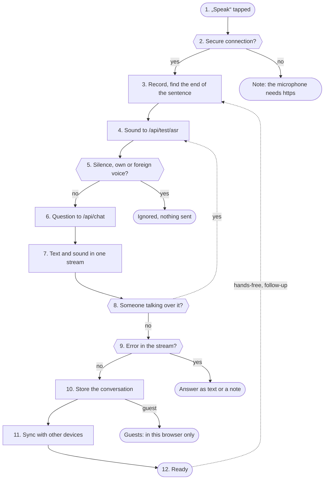

1. <a id="kn-geraet-s1"></a>**„Speak“ tapped**: startListening gets the microphone and remembers how it opened: by hand, after an answer (follow-up), hands-free or by talking over the answer. A microphone the page opened by itself later only takes a known voice.
2. <a id="kn-geraet-s2"></a>**Secure connection?**: Browsers only hand out the microphone on a secure page. Without https the page shows a note with the panel's https address and records nothing.
3. <a id="kn-geraet-s3"></a>**Record, find the end of the sentence**: MediaRecorder records, a level meter listens for silence. About every second the recording so far goes to speech recognition and shows as a pale bubble. If the sentence ends with a full stop, question or exclamation mark, the question is done at once; if it ends on „and“, „because“, „uhm“ or a comma, the page waits a little longer.
4. <a id="kn-geraet-s4"></a>**Sound to /api/test/asr**: The page turns the recording into a plain mono WAV (else the original goes). The Spark checks the rate limit (240 per minute for a profile, guests at most 3 at once), reads at most 50 MB and sends the sound to speech recognition, for the Dungeon Master in the car with the round's names first. Alongside it measures on the CPU how much of it is voice and whose voice it is.
5. <a id="kn-geraet-s5"></a>**Silence, own or foreign voice?**: Fixed rules, no model: a „yes“ out of silence or a click (stille.check), the Spark's own voice from another device (echo.check) and, with a microphone the page opened itself, a foreign voice like the TV (fremdstimme.check) are no question. The answer is then empty text with the reason. When the page or the iPhone app only paused the answer for a barge-in (hold), zwischenruf.decide adds with fixed words: on (nothing, ignored, „mhm“), stop („stop“) or question (anything else); without a decision after 4 s it plays on.
6. <a id="kn-geraet-s6"></a>**Question to /api/chat**: The page sends the last messages of the open conversation, its id, voice, speed and, when the voice was recognized, a signed one-time token. The Spark checks the rate limit (120 per minute for a profile, guests at most 4 at once), lets background work wait (vorrang) and tells the profile's other open pages „answering“ (only the kind of device).
7. <a id="kn-geraet-s7"></a>**Text and sound in one stream**: The answer comes as events: pieces of text, pieces of sound, search, sources, questions back, errors. The text is redrawn at most once per frame. The sound plays in its own audio context at the speech output's rate; every piece ends with a short fade so the seams do not click.
8. <a id="kn-geraet-s8"></a>**Someone talking over it?**: While the answer plays, the microphone keeps listening. If the level stays clearly above the own output and the room (TV) for a moment, the answer stops and the recording already running becomes the next question.
9. <a id="kn-geraet-s9"></a>**Error in the stream?**: An error shows under the answer in plain words; the admin also sees the technical detail, guests only the kind of error. If only speech output failed, the answer stays as text.
10. <a id="kn-geraet-s10"></a>**Store the conversation**: For a profile the page sends only the new messages (PUT /api/profile/convos with „add“). The Spark appends them to its copy under a lock, so another device overwrites nothing, and keeps at most 50 conversations of 60 messages each.
11. <a id="kn-geraet-s11"></a>**Sync with other devices**: When the page comes to the front again, and regularly in between, it asks what changed since last time; a conversation deleted elsewhere closes. With instant sync every visible page keeps an event stream open that only reports „conversation changed“ and „answering“, never contents (at most 8 per profile, 30 minutes each); a hidden page closes it to save the battery and asks again on coming back.
12. <a id="kn-geraet-s12"></a>**Ready**: The page waits until the answer is spoken. Hands-free, or after a spoken question with a follow-up window, it opens the microphone again.

**Examples:** Spoken question of a profile: Answer heard, stored on the Spark, visible on the other devices. · Panel opened over http: No microphone: the page shows the https address. · TV in the follow-up window: Ignored: a foreign voice, no question goes out. · Talking over the answer: The answer stops, what was said becomes the next question.

#### Rules

Applies at: [step 6](#kn-geraet-s6), [step 10](#kn-geraet-s10)

| Who | Conversations live | Questions per minute | at once |
|---|---|---|---|
| profile | on the Spark, the same on every device | 120 | no fixed limit |
| guest | in this browser only | 30 | 4 guests together |

#### Numbers (from the code)

- **50 MB** largest recording ([step 4](#kn-geraet-s4))
- **120** questions per minute and profile ([step 4](#kn-geraet-s4), [step 6](#kn-geraet-s6))
- **4** guests in the chat at once ([step 4](#kn-geraet-s4), [step 6](#kn-geraet-s6))
- **50** conversations per profile ([step 10](#kn-geraet-s10))
- **4 MB** largest conversation when storing ([step 10](#kn-geraet-s10))
- **8** open pages with instant sync per profile ([step 11](#kn-geraet-s11))
- **4 s** how long a paused answer waits for the decision ([step 5](#kn-geraet-s5))

#### Settings

- Me → Conversation: the profile's conversation settings, such as hands-free and interrupting.
- Features → Instant history sync: the event stream between the open pages (default off).

#### What you see

- Under every answer: times for recognition, first word, first sound and stalls of speech output.
- Logs → Requests: every question with the input „Browser“ and its steps, without content.
- Status → Live: the running request in the picture.

#### In the code

- `app/panel/admin.py` `test_asr`: rate limit, guest places, then recognition ([step 4](#kn-geraet-s4))
- `app/panel/admin.py` `_test_asr`: recognition with silence, echo and foreign voice checks ([step 4](#kn-geraet-s4), [step 5](#kn-geraet-s5))
- `app/panel/admin.py` `read_audio`: reads the recording with a size limit ([step 4](#kn-geraet-s4))
- `app/panel/stille.py` `check`: silence never becomes words ([step 5](#kn-geraet-s5))
- `app/panel/echo.py` `check`: the Spark's own voice is no question ([step 5](#kn-geraet-s5))
- `app/panel/zwischenruf.py` `decide`: paused answer: on, stop or new question by fixed words ([step 5](#kn-geraet-s5))
- `app/panel/chat.py` `chat`: limits, priority, „answering“, then the stream ([step 6](#kn-geraet-s6), [step 7](#kn-geraet-s7))
- `app/panel/account.py` `profile_save_convo`: stores only the new messages ([step 10](#kn-geraet-s10))
- `app/panel/account.py` `profile_convos`: list and changes since ?since= ([step 11](#kn-geraet-s11))
- `app/panel/profiles.py` `append_convo`: appends under a lock ([step 10](#kn-geraet-s10))
- `app/panel/profiles.py` `_clean_convo`: checks and trims a conversation; a description of the screen (bedienen.look) is stored only as a note ([step 10](#kn-geraet-s10))
- `app/panel/verlauf.py` `stream`: instant sync per open page ([step 11](#kn-geraet-s11))
- `app/panel/sse.py` `Hub.stream`: one stream per page: queue, keep-alive, cleanup ([step 11](#kn-geraet-s11))
- `app/panel/verlauf.py` `begin`: „answering“ for the other pages ([step 6](#kn-geraet-s6), [step 11](#kn-geraet-s11))

Self-tests: `test_verlauf_sync`, `test_stille`, `test_echo`, `test_fremdstimme`, `test_follow_up`

### Apps

The iPhone app gets its own device key of the profile when it is paired and uses the same endpoints as the browser with it. The key only opens a fixed list of paths. The Android app has no key of its own: it shows the panel in a WebView and signs in like a browser.

**Why:** A phone gets lost or passed on. That is why an app key can only ask and listen, never change the account, devices or security, and it stops working at once when the device is removed in the panel or the app is switched off.

#### Way

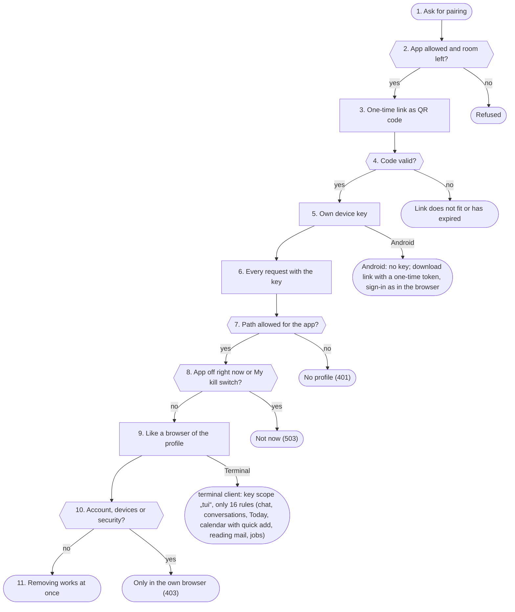

1. <a id="kn-apps-s1"></a>**Ask for pairing**: Only the profile's own browser login may pair, never a device key. If the profile has a second sign-in step it needs a code for this, because a new way into the profile is made.
2. <a id="kn-apps-s2"></a>**App allowed and room left?**: The app must be switched on by the admin and not blocked for the profile, and the profile may have at most 5 iPhones. The panel address must start with https and have no path.
3. <a id="kn-apps-s3"></a>**One-time link as QR code**: kopplung.py makes a random code (144 bits); only its hash is kept in memory. A profile has at most 3 open codes, the Spark at most 20. The link spark-app://pair opens the app with address and code.
4. <a id="kn-apps-s4"></a>**Code valid?**: The app sends the code. The Spark checks the rate limit (10 per minute and address), compares the hash in constant time and deletes the code at the first hit. An expired or used code never fits. If it is no link code, pruefzugang.py checks a typed review code for Apple's review (12 signs, 14 days, at most 5 iPhones, only with the review access on); wrong review codes lock the address like wrong PINs.
5. <a id="kn-apps-s5"></a>**Own device key**: profiles.add_device makes the key and stores only its SHA-256 hash in profiles.json. The app gets it exactly once and keeps it in the keychain.
6. <a id="kn-apps-s6"></a>**Every request with the key**: profiles.current looks up the key's hash in the device list. A device key comes before the cookie; the profile always comes from the key, never from what the app writes.
7. <a id="kn-apps-s7"></a>**Path allowed for the app?**: An app key only works for the 70 paths in profiles.APP_PATHS (chat, speech recognition, conversations, reminders, chats, calls …), a few read patterns, the panel areas (admin switch iPhone app with panel) and "My things" (iphone.THINGS, each part only with the release of its own function). Everything else it sees without a profile.
8. <a id="kn-apps-s8"></a>**App off right now or My kill switch?**: If the app is switched off by the admin or blocked for the profile, or the profile has My kill switch on, this request has no profile. The app gets „not now“ (503), keeps its pairing and works again as soon as the switch is back.
9. <a id="kn-apps-s9"></a>**Like a browser of the profile**: The app asks through the same endpoints as the page, with the same limits. What it may do on top (smart home, CarPlay, listening, documents, pictures) the Spark tells it in /api/iphone/hello; the app only shows it and follows it. Calls between profiles ring through a VoIP push from Apple that carries only the call's random number; the app asks the Spark who calls. For private chats the app makes its own key in the Secure Enclave; the Spark only gets the public half. The Android app's sheet over other apps asks as device „android“ only while „Android: Spark as assistant“ is released (android.assist_gate). Whether the app may keep the pages' last state, hello says with „keep“ (appmerken.keep); on no it deletes it. With „barge_hold“ it only pauses the answer for a barge-in (zwischenruf.py). With „Notes to the device in use“ the app and the pages only say every minute whether they are in use right now (POST /api/zustellung/da, the companion with its idle time); zustellung.pick then sends a note to the device with the last input within the last 120 seconds, else to the phone app at once. If nobody saw it, zustellung.follow sends it once to the phone after 5 minutes; a tapped note says „seen“, and with the answer „zu“ pages and the iPhone take done ones away. Every note stays on the Spark for 24 hours with a random number (mitteilungen.keep, in memory only); only the number goes along. Tapped, it shows as a card above the conversation, with the one button mitteilungen.ziel picks by fixed rules (Open, chat, mail, code, way); only the own profile gets it back.
10. <a id="kn-apps-s10"></a>**Account, devices or security?**: Endpoints that change the profile's connections, devices or security only take the own browser login (core.browser_profile). They refuse a device key, except in an area the profile opened for the app; secrets need a fresh code there as well.
11. <a id="kn-apps-s11"></a>**Removing works at once**: When the iPhone is removed in the panel, its hash leaves the device list. The app's next request finds no profile any more.

**Examples:** Pair an iPhone and ask: The app has its key and asks like the browser. · Old QR code: Refused: the code was used or has expired. · App wants to change the PIN: Refused: that only works in the own browser. · Admin switches the app off: Not now: the pairing stays for later.

#### Rules

Applies at: [step 6](#kn-apps-s6), [step 7](#kn-apps-s7)

| Key scope | Who has it | What it opens |
|---|---|---|
| app | iPhone app | profiles.APP_PATHS and opened areas |
| watch | Pebble watch | only /api/watch/… |
| tui | terminal client spark-tui | terminal.TUI_RULES: chat, conversations, Today, calendar, jobs |
| desk, write | Spark companion, writing help | only their own paths |
| none | speakers, Siri shortcut, own scripts | asking as the profile, never account or security |
| no key | Android app | sign-in like a browser |

#### Numbers (from the code)

- **10** minutes a pairing code is valid ([step 3](#kn-apps-s3))
- **5** iPhones per profile ([step 2](#kn-apps-s2))
- **70** fixed paths for the app key ([step 7](#kn-apps-s7))
- **30** minutes an Android download link is valid ([step 3](#kn-apps-s3))
- **5** downloads per Android link ([step 3](#kn-apps-s3))
- **10** minutes a terminal pairing line is valid ([step 3](#kn-apps-s3))
- **5** terminals per profile ([step 2](#kn-apps-s2))
- **120** seconds after the last input a device counts as in use ([step 9](#kn-apps-s9))
- **5** minutes until an unseen note follows to the phone ([step 9](#kn-apps-s9))

#### Settings

- Features → iPhone app and Features → Android app: the apps for every profile (default off).
- People and devices → Blocked functions: block the app for single profiles.
- Me → iPhone and Me → Android: pairing, the app's rights, removing devices.
- Features → Terminal client and Me → Terminal: get the program, pair (pinned at home, checked as in the browser from outside), remove.

#### What you see

- Status → Live: a line under events when an iPhone is paired or removed.
- Logs → Requests: the app's questions with the input „iPhone-App“ or „CarPlay“, from the Android sheet „Android-App“.
- iPhone → Settings → Ton-Protokoll kopieren: the last 150 steps of sound and CarPlay (voice window, buttons, sound route, interruptions, app start), only fixed words, stays on the iPhone.
- Status → Live: open terminals as a number under connections. Status → Logs: the „terminal:“ lines in the area „Apps“.

#### In the code

- `app/panel/iphone.py` `profile_pair`: pairing link only from the own browser ([step 1](#kn-apps-s1), [step 2](#kn-apps-s2))
- `app/panel/kopplung.py` `Codes.new`: random one-time code, only the hash (also Pebble, writing help, companion) ([step 3](#kn-apps-s3))
- `app/panel/kopplung.py` `Codes.take`: redeem a code once, compared in constant time ([step 4](#kn-apps-s4))
- `app/panel/iphone.py` `app_pair`: the app's first contact ([step 4](#kn-apps-s4), [step 5](#kn-apps-s5))
- `app/panel/iphone.py` `app_hello`: what the app may, the Spark decides ([step 9](#kn-apps-s9))
- `app/panel/profiles.py` `add_device`: make a key, store its hash ([step 5](#kn-apps-s5))
- `app/panel/profiles.py` `current`: profile from key or cookie, scopes, switches, kill switch ([step 6](#kn-apps-s6))
- `app/panel/profiles.py` `_app_path`: the app's fixed path list ([step 7](#kn-apps-s7))
- `app/panel/core.py` `browser_profile`: only the own browser login ([step 10](#kn-apps-s10))
- `app/panel/account.py` `profile_remove_device`: remove a device ([step 11](#kn-apps-s11))
- `app/panel/android.py` `apk_response`: app file only with a valid link ([step 3](#kn-apps-s3))
- `app/panel/android.py` `flags`: what the Android app switches on itself: assistant, fingerprint ([step 9](#kn-apps-s9))
- `app/panel/android.py` `assist_gate`: questions of the Android sheet only when released, never guests ([step 9](#kn-apps-s9))
- `app/panel/zustellung.py` `pick`: note to the device in use, else to the phone app ([step 9](#kn-apps-s9))
- `app/panel/zustellung.py` `api_da`: only „in use“ or „away“, only pages and the apps ([step 9](#kn-apps-s9))
- `app/panel/zustellung.py` `follow`: follow up once to the phone, never a third time ([step 9](#kn-apps-s9))
- `app/panel/mitteilungen.py` `ziel`: what the card of a tapped note offers, fixed rules ([step 9](#kn-apps-s9))
- `app/panel/mitteilungen.py` `opened`: only the own note, one log line without text ([step 9](#kn-apps-s9))
- `app/panel/terminal.py` `profile_pair`: terminal pairing line only from the own browser ([step 1](#kn-apps-s1), [step 2](#kn-apps-s2))
- `app/panel/terminal.py` `setup_base`: pinned at home, outside https only ([step 3](#kn-apps-s3))
- `app/panel/terminal.py` `program_pair`: the terminal's first contact ([step 4](#kn-apps-s4), [step 5](#kn-apps-s5))
- `app/panel/terminal.py` `reaches`: the terminal's fixed rule list ([step 7](#kn-apps-s7))

Self-tests: `test_iphone`, `test_iphone_panel`, `test_android`, `test_app_notaus`, `test_kopplung`, `test_terminal`, `test_zustellung`, `test_mitteilungen`

### Telegram, Siri, watch

Telegram, the Siri shortcut and the Pebble watch ask short questions without a browser. Each channel turns them into a request to /api/chat like a device, collects the answer from the stream and hands it back in its own form. The panel itself keeps the history in the profile.

**Why:** The channels should decide nothing of their own: the same rights, locks and limits as in the browser apply, because everything runs through the same chat. What a channel brings on top (forwarded texts of others, Telegram's servers) is settled by fixed rules first.

#### Way

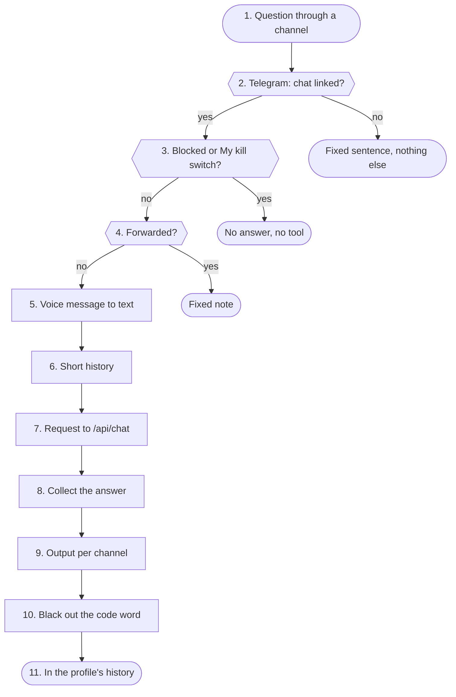

1. <a id="kn-kanaele-s1"></a>**Question through a channel**: Telegram: the panel asks Telegram for new messages itself (long polling), no open port is needed. Siri: a shortcut sends the dictated text with a device key to /api/siri/ask. Watch: the phone sends the question with the watch key to /api/watch/ask.
2. <a id="kn-kanaele-s2"></a>**Telegram: chat linked?**: Groups and channels are never answered. A chat belongs to a profile once it sent „/start CODE“ with a code from Me → Telegram (valid 10 minutes, at most 5 wrong codes per chat and hour). A stranger's chat gets one fixed sentence at most once a day.
3. <a id="kn-kanaele-s3"></a>**Blocked or My kill switch?**: The profile's My kill switch, a block by the admin or a channel switched off end the question. Telegram then answers with a fixed sentence; Siri and the watch find no profile for their key.
4. <a id="kn-kanaele-s4"></a>**Forwarded?**: A message forwarded in Telegram comes from someone else. It is never taken as an order and does not trigger commands like /notaus either.
5. <a id="kn-kanaele-s5"></a>**Voice message to text**: A Telegram voice message is loaded with a size limit, turned into WAV by ffmpeg (length capped) and read by the Spark's speech recognition. With Siri the iPhone dictates, with the watch the phone.
6. <a id="kn-kanaele-s6"></a>**Short history**: For follow-ups the last eight messages go along while the last question is no older than 30 minutes (Telegram) or 10 minutes (Siri). The watch sends its history itself; the panel recognizes answers made from outside text in it again (watch.mark_of).
7. <a id="kn-kanaele-s7"></a>**Request to /api/chat**: The channel calls the chat inside the panel. For Telegram the panel puts the profile into the request, which no request from outside can do; Siri and the watch carry their key. Rights, switch, limits and request history are the same as in the browser.
8. <a id="kn-kanaele-s8"></a>**Collect the answer**: From the stream, pieces of text and retractions count. If the answer came from mail or outside text it is marked so, so the next question starts locked. A question back from the panel becomes buttons in Telegram that come back like a typed answer; without one, the example sentences of „You can also say“ become reply buttons.
9. <a id="kn-kanaele-s9"></a>**Output per channel**: Telegram gets plain text and, if the profile wants it, a voice message in its voice. Siri gets speakable text without passwords and codes. The watch fetches text and sound (packed for its small speaker, 6000 bytes per fetch) through /api/watch/poll, only for the profile that asked (a foreign job number gives 404); at most 8 watch answers run at once. The companion gets text without Markdown and also the answer with Markdown (at most 60000 characters) when it hides no fewer secrets. With its switches the watch also gets up to 3 follow-ups to tap (the model only suggests, watch.follow_clean keeps short questions without yes, no, links or numbers; never after mail, web or a proposal; when the answer ends with a question, its buttons from ablauf.asks are the follow-ups), a proposal as ✓ and ✕, and through /api/watch/sync the quick commands and the next 8 reminders, which it rings itself as wake-ups; push waits for it first. The Spark watchface fetches the next appointment, reminder, weather, a hint and for admins an outage through /api/watch/blick every 15 minutes; /api/watch/brief builds My day and My week from fixed sentences, /api/watch/merken keeps a dictated sentence in memory (with the place to about 100 m only with its own switch). /api/watch/chats and /api/watch/chat show the latest chats (no private ones) and send a tapped or dictated reply through chats.send; up to 3 suggestions of the model pass the fixed check pebblewatch.reply_clean. /api/watch/fern switches only devices on the own list with fixed buttons (never with a smart home code word), /api/watch/gesundheit keeps steps, pulse and sleep sealed in the profile, never for the model.
10. <a id="kn-kanaele-s10"></a>**Black out the code word**: Before storing, the smart home code word is replaced by [Codewort]. In Telegram the bot deletes the message with the code word or asks the person to delete it.
11. <a id="kn-kanaele-s11"></a>**In the profile's history**: verlauf.keep puts question and answer into the channel's conversation of the day („Telegram“, „Siri“, „Uhr“ with the date). With „One conversation for all channels“ they go into the day's main conversation, marked with their channel.

**Examples:** Telegram voice message: Answered and kept in the day's „Telegram“ conversation. · A stranger writes to the bot: One fixed sentence, nothing else. · Forwarded mail with an order: Not carried out: someone else's words are no order. · Siri with My kill switch: No answer: the key finds no profile.

#### Rules

Applies at: [step 1](#kn-kanaele-s1), [step 9](#kn-kanaele-s9), [step 11](#kn-kanaele-s11)

| Channel | How it identifies | History | Output |
|---|---|---|---|
| Telegram | linked private chat | „Telegram“ and date | text, voice message if wanted |
| Siri | the profile's device key | „Siri“ and date | speakable text without secrets |
| watch | watch key, only /api/watch/… | „Uhr“ and date | text without Markdown and sound |

#### Numbers (from the code)

- **10** minutes a Telegram code is valid ([step 2](#kn-kanaele-s2))
- **5** wrong codes per chat and hour ([step 2](#kn-kanaele-s2))
- **5 MB** largest voice message ([step 5](#kn-kanaele-s5))
- **10** minutes earlier questions count for Siri ([step 6](#kn-kanaele-s6))
- **8** watch answers at once ([step 9](#kn-kanaele-s9))
- **10** minutes a watch answer stays fetchable ([step 9](#kn-kanaele-s9))
- **3** follow-ups to tap on the watch ([step 9](#kn-kanaele-s9))
- **8** reminders and timers on the watch ([step 9](#kn-kanaele-s9))

#### Settings

- Features → Telegram: bot token and switch (default off).
- Me → Telegram: link the own chat; allow voice messages, private data, smart home and notes one by one.
- Me → Pebble watch: pair the watch, the address on the road (https only), the quick commands, the devices of the remote and the own steps, pulse and sleep (see, delete).
- Features → Pebble watch: follow-ups, quick commands, reminders on the wrist, Spark watchface, my day and my week, notes for admins, quick notes and place with a note, messages, reply suggestions, remote, steps, pulse and sleep, one switch each (default off).
- Features → One conversation for all channels: every channel writes into the day's main conversation.

#### What you see

- Logs → Requests: input „Telegram“, „Siri“ or „Uhr“, without content.
- Status → Live: the running request in the picture.
- Status → Logs: the lines „watch: sync“, „watch: reminder …“ and „watch: Nachfragen“, without content.

#### In the code

- `app/panel/telegram.py` `loop`: polls Telegram, rests with the kill switch ([step 1](#kn-kanaele-s1))
- `app/panel/telegram.py` `handle`: one message: link, locks, commands, voice ([step 2](#kn-kanaele-s2), [step 3](#kn-kanaele-s3), [step 4](#kn-kanaele-s4))
- `app/panel/telegram.py` `ask`: question to the chat, collect the answer, store ([step 7](#kn-kanaele-s7), [step 8](#kn-kanaele-s8), [step 11](#kn-kanaele-s11))
- `app/panel/telegram.py` `transcribe`: voice message through ffmpeg to recognition ([step 5](#kn-kanaele-s5))
- `app/panel/chat.py` `siri_ask`: Siri: profile from the key ([step 1](#kn-kanaele-s1), [step 3](#kn-kanaele-s3))
- `app/panel/chat.py` `text_ask`: Siri and companion: question, answer, history, for the companion also the cards (desk_cards) ([step 6](#kn-kanaele-s6), [step 7](#kn-kanaele-s7), [step 11](#kn-kanaele-s11))
- `app/panel/chat.py` `watch_ask`: watch: start the answer as a job ([step 1](#kn-kanaele-s1), [step 7](#kn-kanaele-s7))
- `app/panel/chat.py` `_watch_run`: watch: the answer into the history ([step 11](#kn-kanaele-s11))
- `app/panel/watch.py` `run`: reads the stream into the watch job ([step 8](#kn-kanaele-s8))
- `app/panel/watch.py` `poll`: text and sound piece by piece ([step 9](#kn-kanaele-s9))
- `app/panel/watch.py` `follow_ups`: follow-ups from the model, with a time limit ([step 9](#kn-kanaele-s9))
- `app/panel/watch.py` `follow_clean`: fixed check of the follow-ups ([step 9](#kn-kanaele-s9))
- `app/panel/pebblewatch.py` `watch_sync`: quick commands and reminders for the watch ([step 9](#kn-kanaele-s9))
- `app/panel/pebblewatch.py` `watch_reminder`: reminder on the watch: played, later, end, +1, stop ([step 9](#kn-kanaele-s9))
- `app/panel/pebblewatch.py` `watch_blick`: what the Spark watchface shows ([step 9](#kn-kanaele-s9))
- `app/panel/pebblewatch.py` `watch_brief`: My day and My week, fixed sentences ([step 9](#kn-kanaele-s9))
- `app/panel/pebblewatch.py` `watch_note`: quick note into memory ([step 9](#kn-kanaele-s9))
- `app/panel/pebblewatch.py` `watch_chat`: one chat on the watch, with replies ([step 9](#kn-kanaele-s9))
- `app/panel/pebblewatch.py` `watch_chat_send`: reply from the watch into the chat ([step 9](#kn-kanaele-s9))
- `app/panel/pebblewatch.py` `reply_clean`: fixed check of the reply suggestions ([step 9](#kn-kanaele-s9))
- `app/panel/pebblewatch.py` `watch_remote_act`: remote: own list, fixed buttons ([step 9](#kn-kanaele-s9))
- `app/panel/pebblewatch.py` `watch_health`: steps, pulse, sleep sealed into the profile ([step 9](#kn-kanaele-s9))
- `app/panel/verlauf.py` `keep`: the channel's day conversation or the main one ([step 11](#kn-kanaele-s11))

Self-tests: `test_telegram_tasks`, `test_pebble`, `test_verlauf_sync`, `test_notaus`

### Speakers, phone

Own speakers are ESP32 boards with the open XiaoZhi firmware. They listen for their wake word, send the sound to the Spark over a WebSocket connection and play the answer. Every speaker is a device key of its profile. Home Assistant Assist only uses the Spark's speech recognition and voice over Wyoming.

**Why:** A speaker stands in the room, anyone can talk to it. That is why personal things only go to the voice that is surely recognized as the profile's (or says the code word), and a board gets its key only once and only at the address that showed the code.

#### Way


1. <a id="kn-lautsprecher-s1"></a>**Board starts**: At every start the board asks with its id, MAC address and firmware version which server and which firmware to use. If speakers are off in Features, it gets nothing (403).
2. <a id="kn-lautsprecher-s2"></a>**Board known?**: An unknown board gets a six-digit code for its display (valid 10 minutes, at most 3 per address and 30 in all). The profile types it in under Me → Speakers.
3. <a id="kn-lautsprecher-s3"></a>**Same board?**: Once a MAC address is on record for a board id, it must fit. A copied id from another board gets no key and no firmware.
4. <a id="kn-lautsprecher-s4"></a>**Answer of the start check**: The board gets the time and the WebSocket address. The key comes exactly once, right after the code was typed in, and only to the address that showed the code. A newer firmware is only offered over https, over http only with the admin's switch.
5. <a id="kn-lautsprecher-s5"></a>**Connection allowed?**: When connecting the Spark checks: kill switch stage 3 off, the key belongs to a speaker (not a watch or another device), speakers on in Features and not blocked for the profile. Then it looks again every 2.0 seconds and ends the connection when something changed.
6. <a id="kn-lautsprecher-s6"></a>**Listen**: After the wake word the board sends Opus sound. The Spark finds the end of the sentence itself (0.7 seconds of silence after speech) and takes at most 30 seconds per question.
7. <a id="kn-lautsprecher-s7"></a>**Recognize and check the voice**: Speech recognition makes text of it. At the same time speakers.verify checks whether it is the profile's voice, when speaker ID is on and the profile has taught its voice.
8. <a id="kn-lautsprecher-s8"></a>**Nothing, stop or own voice?**: No text, a stop word or the Spark's own voice from another device (echo.check) get no answer. The board waits for its wake word again.
9. <a id="kn-lautsprecher-s9"></a>**Personal without a sure voice?**: With the speaker code word: an unsure voice asking for personal things is asked for the code word, the question waits. After 3 wrong tries the speaker does not ask for 30 minutes. Without a sure voice there are only general things. A sure voice in a short question asking nothing personal gets the owner's rights as without the code word.
10. <a id="kn-lautsprecher-s10"></a>**Like a device to /api/chat**: The Spark calls the chat with the speaker's key; the profile's voice, memory and room apply. Whose voice it was only the panel itself puts into the request; if it was not surely the profile's, the question counts like a guest's.
11. <a id="kn-lautsprecher-s11"></a>**Sound back**: The answer goes to the board as Opus at 24000 Hz at playback pace, the text without Markdown for a display. Other devices in the house know the Spark is speaking right now (echo.said).
12. <a id="kn-lautsprecher-s12"></a>**In the speaker's history**: Question and answer go into the speaker's conversation of the day, the code word blacked out. A voice that was not surely the profile's is marked as outside text: the next question starts locked, and nothing about the profile is learned from it.

**Examples:** The owner asks for appointments: Voice recognized: personal answer, kept in the day's conversation. · New board: Code on the display until the profile types it in. · Copied board id: Refused: the MAC address does not fit. · A guest asks for mail: Code word asked; without the right one nothing personal. · Maintenance pause of the speech output: Answer on the display, the short maintenance sentence from a file to hear (else a tone); with the speech recognition paused the speaker says the sentence right after the wake word. · Emergency mode with Parakeet: Model computer gone: Parakeet on the panel computer hears, a fixed command (“lights on”, “what time is it?”) runs without a model; to hear are sentences and building blocks made before (notbetrieb.ton).

#### Rules

Applies at: [step 5](#kn-lautsprecher-s5), [step 9](#kn-lautsprecher-s9)

| Way | Who may | What works | Personal things |
|---|---|---|---|
| ESP32 speaker | a speaker's key, profile not blocked | questions as the profile | only with a sure voice or code word |
| Home Assistant Assist | addresses in the admin's allow list | only sound to text and text to sound | never |
| phone, a profile's handset | internal number, assigned by the admin | questions as the profile | only with a sure voice |
| phone, shared handset | internal number as shared | the voice picks the profile, else guest | only with a sure voice |
| phone from outside or not assigned | nobody (guest only with the admin switch) | refused or one sentence | never |

#### Home Assistant Assist (Wyoming)

- Its own server listens on the Wyoming port (default 31003) while the switch is on. Wyoming has no password; that is why it only answers addresses from the admin's list, with an empty list nobody.
- Home Assistant only gets „sound in, text out“ and „text in, sound out“, no language model, no profile, nothing personal. At most 8 connections at once; lengths are checked before reading; only sound formats a microphone sends. „describe“ answers at once with the voice list from memory (read again every 10 minutes), because Home Assistant waits only 1 second.
- Refused addresses show on Status → Live under input and as a suggestion for the list.

#### Calling the Spark (phone)

- The Spark signs in at the telephone system in the home network as an IP phone (SIP over UDP, port 31060, digest sign-in, renewed every 10 minutes). It takes messages only from the system's address, at most 4096 bytes and 100 per second; sound (RTP) only from the address in its SDP, which has to be in the home network. The sound out goes from a thread of its own at a 20 ms beat, independent of the panel's event loop; speech starts only once 10 packets are ready or the sentence is complete, after every gap it waits for more (at most 40). The log line at the end names gaps, late packets and the time spent encoding per second of sound.
- A call runs like a question at a speaker: end of sentence with the same level check, speech recognition, voice check, chat with the profile (set only by the panel), answer back in G.722 or G.711. A profile's handset gets personal things only with a sure voice; at the shared phone the voice picks the profile. After 20 seconds of silence „Noch etwas?“, after another 10 it hangs up; at most 15 minutes. A goodbye („Tschüss“, „Danke, das war's“, „Ich lege auf“, also in the middle of an answer) and right after „Noch etwas?“ a „Nein danke“ end the call: „Tschüss!“, then the Spark hangs up itself (fixed word lists BYE_WORDS and NO_MORE, never the model). When the phone hangs up, its BYE ends the call at once; if none arrives (router, line), the Spark hangs up after 8 seconds without any sound packet, unless the phone put the call on hold.
- From outside: an own number waiting for its code under Me → Phone types it (4 digits, 15 minutes, 3 tries), then it hangs up. With „Anrufe von außen“ a confirmed number picks its profile, but personal things only with a sure voice or the PIN, because numbers can be forged; with guests also unknown numbers as a guest, at most 20 a day. Logs and Live never name a number from outside.
- The phone PIN (digits, then #) stands for the voice for the rest of the call: on a handset for its profile, at the shared phone for the profile it belongs to. 3 wrong ones in 15 minutes lock it at that phone for 30 minutes. Stored as a salted hash in the vault; never spoken, shown or logged.
- The Spark calls (switch „Der Spark ruft an“): wake-up call and reminder a profile orders itself (tool anruf_planen, only time, kind and text, never a number), the call back and the alarm. It only calls the assigned handset or, with „also confirmed own numbers“, the profile's confirmed number; at most 5 calls per profile and day, never during „Nicht stören“; not answered once more after 5 minutes, then a note. It reads a reminder only once voice or PIN fit. Call back: whoever calls from outside with an unsure voice and says „Ruf mich zurück“ is called at the stored confirmed number, so a forged number never reaches the forger.
- Alarm on outages: if a service is gone 10 minutes or longer, the Spark calls the admin, at most once in 60 minutes. Never between 10 pm and 7 am (dienstwacht.NIGHT, always for calls), in the admin's quiet hours or during „Nicht stören“; if the service is still gone afterwards, the call comes then.

#### Numbers (from the code)

- **10** minutes a pairing code is valid ([step 2](#kn-lautsprecher-s2))
- **30** seconds of sound per question ([step 6](#kn-lautsprecher-s6))
- **2.0** seconds, then the rights are checked again ([step 5](#kn-lautsprecher-s5))
- **10** minutes earlier questions count at a speaker ([step 12](#kn-lautsprecher-s12))
- **3** wrong code words until the lock ([step 9](#kn-lautsprecher-s9))
- **8** Wyoming connections at once ([step 5](#kn-lautsprecher-s5))
- **2** calls at once at most ([step 5](#kn-lautsprecher-s5))
- **15** minutes a call lasts at most ([step 10](#kn-lautsprecher-s10))
- **3** wrong phone PINs until the lock ([step 9](#kn-lautsprecher-s9))
- **5** calls from the Spark per profile and day ([step 5](#kn-lautsprecher-s5))
- **10** minutes of outage until the alarm call ([step 5](#kn-lautsprecher-s5))

#### Settings

- Features → Own speakers: speakers for every profile (default off).
- Me → Speakers: set up, type the code, room, volume, check and the own code word.
- Features → Home Assistant Assist: Wyoming on and the allowed addresses.
- Features → Phone: wizard with four steps, assign handsets, test call, calls from outside, unknown callers as guests, the Spark calls, call on outages.
- Me → Phone: confirm own phone numbers with a code, phone PIN, allow calls from the Spark and delete planned ones, delete calls.

#### What you see

- Me → Speakers → Check: what the speaker did lately (memory only, gone after a restart).
- Status → Live: requests from a speaker and from Home Assistant, refused Wyoming addresses under input.
- Status → Live: the telephone system with signed in yes/no and today's calls in numbers.
- Status → Live: each call as one "Telefon" card, its questions on it (the call's id, set by the panel only).

#### In the code

- `app/panel/esp32.py` `ota`: start check: code, key once, update ([step 1](#kn-lautsprecher-s1))
- `app/panel/esp32.py` `_activation`: six-digit code with limits ([step 2](#kn-lautsprecher-s2))
- `app/panel/esp32.py` `same_board`: MAC must fit ([step 3](#kn-lautsprecher-s3))
- `app/panel/esp32.py` `speaker_ws`: accept the connection and keep checking ([step 5](#kn-lautsprecher-s5))
- `app/panel/esp32.py` `still_allowed`: switches and device still valid ([step 5](#kn-lautsprecher-s5))
- `app/panel/esp32.py` `Session.run_answer`: recognize, filter, code word, answer ([step 10](#kn-lautsprecher-s10))
- `app/panel/esp32.py` `Session.code_gate`: code word for an unsure voice ([step 9](#kn-lautsprecher-s9))
- `app/panel/esp32.py` `Session.speak`: chat with the key, sound back ([step 11](#kn-lautsprecher-s11))
- `app/panel/esp32.py` `remember`: day conversation, foreign voice marked ([step 12](#kn-lautsprecher-s12))
- `app/panel/wyoming.py` `settings`: switch, port, allowed addresses ([step 5](#kn-lautsprecher-s5))
- `app/panel/wyoming.py` `handle`: only allowed addresses, at most so many ([step 5](#kn-lautsprecher-s5))
- `app/panel/wyoming.py` `_session`: sound to text and text to sound ([step 7](#kn-lautsprecher-s7), [step 11](#kn-lautsprecher-s11))
- `app/panel/telefon.py` `Call.start`: who calls: internal, profile, blocked, busy ([step 5](#kn-lautsprecher-s5))
- `app/panel/telefon.py` `Call.outside`: from outside: code, known number, guest ([step 5](#kn-lautsprecher-s5))
- `app/panel/telefon.py` `Call.pin`: check the phone PIN, lock ([step 9](#kn-lautsprecher-s9))
- `app/panel/telefon_ich.py` `try_code`: code of an own number ([step 5](#kn-lautsprecher-s5))
- `app/panel/telefon_ich.py` `pin_attempt`: count and lock the PIN per phone ([step 9](#kn-lautsprecher-s9))
- `app/panel/telefon.py` `Call.voice_result`: the voice picks or confirms the profile ([step 9](#kn-lautsprecher-s9))
- `app/panel/telefon.py` `Call._chat`: chat with the profile, sound back ([step 10](#kn-lautsprecher-s10), [step 11](#kn-lautsprecher-s11))
- `app/panel/telefon.py` `Call.dial`: the Spark calls: INVITE, digest, cancel ([step 5](#kn-lautsprecher-s5))
- `app/panel/telefon_anruf.py` `target`: whom it calls: handset or confirmed number ([step 5](#kn-lautsprecher-s5))
- `app/panel/telefon_anruf.py` `call_back`: call back only to the confirmed number ([step 9](#kn-lautsprecher-s9))
- `app/panel/telefon_anruf.py` `alarm_tick`: alarm call with quiet hours ([step 5](#kn-lautsprecher-s5))

Self-tests: `test_esp32`, `test_wyoming`, `test_telefon`, `test_notaus`, `test_echo`

### MCP programs

Other programs (Claude, n8n, Open WebUI, Home Assistant) use the Spark over the Model Context Protocol at /mcp. Every connection belongs to one profile and has its own key and its own tool list. Reading works directly, acting only as a proposal the profile confirms.

**Why:** What a program sends is outside text and never a command. That is why the panel decides with fixed lists which tool may run, and nothing changes without the person's yes in the own browser.

#### Way


1. <a id="kn-mcpc-s1"></a>**A program sends a request**: Every request is one JSON-RPC message. If the MCP server is off by the admin, the endpoint does not exist (404).
2. <a id="kn-mcpc-s2"></a>**From another web page?**: If a browser sends an Origin, it must be the panel's. So no other page can use the endpoint through DNS rebinding.
3. <a id="kn-mcpc-s3"></a>**Key valid?**: The bearer key is a fixed key or an OAuth access token (valid 60 minutes). Only hashes are stored. A connection ends after 90 days without use.
4. <a id="kn-mcpc-s4"></a>**Home network key from outside?**: A „lokal“ key only works when the peer is a private address, no proxy header is in the request and it is none of the listed reverse proxies. „extern“ only works with the admin's switch.
5. <a id="kn-mcpc-s5"></a>**My kill switch or profile blocked?**: The profile's My kill switch closes every MCP access (503); if the admin blocked the MCP server for the profile, there is nothing (403).
6. <a id="kn-mcpc-s6"></a>**Rate limit and size**: Every connection may send 60 requests per minute; a request is at most 16 MB. Many refused requests from outside count for „Emergency stop by itself“.
7. <a id="kn-mcpc-s7"></a>**Tool allowed?**: Only tools from the fixed list (15), only those given to this connection, and only when the profile may use the function right now, checked again on every call. Mail, memory, earlier conversations, settings and code are never among them (31 names in mcpserver.NEVER).
8. <a id="kn-mcpc-s8"></a>**Too many at once?**: At most 2 calls of one connection and 6 of all connections run at once.
9. <a id="kn-mcpc-s9"></a>**Speech and reading**: Speech recognition (at most 10 MB) and speech output (at most 2000 characters) run at the level „hinten“, so people at the Spark always go first. The reading tools only read this profile's data.
10. <a id="kn-mcpc-s10"></a>**Ask the Spark, read only**: ask_spark (10 per minute) runs as one turn of the assistant for the profile, but only with this connection's reading tools. The question counts as outside text from the start: nothing is switched, stored, learned or sent, no memory, nothing of it in the history. Passwords and codes are removed from the answer.
11. <a id="kn-mcpc-s11"></a>**Should something change?**: Smart home, reminder and appointment are only proposed (at most 10 open). The profile gets a notice and decides under Me → Spark as MCP server within 15 minutes; only then the panel carries it out. With the kill switch or a smart home code word set, an MCP program switches nothing.
12. <a id="kn-mcpc-s12"></a>**Answer to the program**: The answer is cut to 12000 characters. The journal only gets which program, which tool, whether it worked and how long, never question or answer.

**Examples:** Claude reads the appointments: The profile's appointments as text, cut. · Home network key through the proxy: Refused: this key only works at home. · n8n wants to switch the light: Only proposed; it switches after the yes in the browser. · Program wants to read mail: Not allowed: mail is never offered over MCP.

#### Rules

Applies at: [step 9](#kn-mcpc-s9)

| Group | Tools | What happens |
|---|---|---|
| speech | transcribe, speak, voices | services at level „hinten“ |
| reading | wikipedia, archive_search, document_search, calendar_events, reminder_list, today, write_text | only reads, stores nothing |
| ask Spark | ask_spark | one turn with reading tools only |
| acting with confirmation | home_assistant, reminder_set, calendar_add | only a proposal, the profile says yes |
| never | mail, memory, history, settings, code | offered under no name |

#### Numbers (from the code)

- **90** days without use, then a connection ends ([step 3](#kn-mcpc-s3))
- **10** connections per profile ([step 3](#kn-mcpc-s3))
- **60** requests per minute per connection ([step 6](#kn-mcpc-s6), [step 10](#kn-mcpc-s10))
- **2** calls at once per connection ([step 8](#kn-mcpc-s8))
- **12000** characters at most in an answer ([step 12](#kn-mcpc-s12))
- **15** minutes a proposal waits for the yes ([step 11](#kn-mcpc-s11))

#### Settings

- Features → Spark as MCP server: the server for every profile (default off).
- Features → Spark as MCP server → MCP server from outside: connections through the reverse proxy and OAuth.
- Features → Spark as MCP server → MCP: acting with confirmation: the tools that propose something.
- Me → Spark as MCP server: make connections, pick tools, confirm or decline proposals.

#### What you see

- Status → Live: every tool call as a request of the program, from outside under „Über das Internet“.
- Me → Spark as MCP server: the latest proposals with their state.

#### In the code

- `app/panel/mcpserver.py` `mcp_post`: the endpoint: origin, key, limit, method ([step 1](#kn-mcpc-s1))
- `app/panel/mcpserver.py` `origin_ok`: no other web page ([step 2](#kn-mcpc-s2))
- `app/panel/mcpserver.py` `check_conn`: key, home network, kill switch, switch ([step 3](#kn-mcpc-s3))
- `app/panel/mcpserver.py` `is_local`: really from the home network ([step 4](#kn-mcpc-s4))
- `app/panel/mcpserver.py` `find`: connection for the key's hash ([step 3](#kn-mcpc-s3))
- `app/panel/mcpserver.py` `tool_ok`: may the profile use this tool now ([step 7](#kn-mcpc-s7))
- `app/panel/mcpserver.py` `call`: calls at once, journal line ([step 8](#kn-mcpc-s8))
- `app/panel/mcpserver.py` `run`: hands out to speech, reading, asking, acting ([step 9](#kn-mcpc-s9), [step 10](#kn-mcpc-s10))
- `app/panel/mcpserver.py` `ask`: one turn with reading tools only ([step 10](#kn-mcpc-s10))
- `app/panel/mcpserver.py` `propose`: proposal instead of action ([step 11](#kn-mcpc-s11))
- `app/panel/mcpserver.py` `decide`: the profile's yes, then carry out ([step 11](#kn-mcpc-s11))
- `app/panel/mcpserver.py` `carry_out`: carries out confirmed actions only ([step 11](#kn-mcpc-s11))

Self-tests: `test_mcpserver`, `test_notaus`

### Middleware

The middleware is the layer in panel.py every HTTP request passes before an endpoint reads it: kill switch, foreign pages (CSRF), size of the request and update lock. On the way back it sets protective headers, writes changes to the admin log and renews logins.

**Why:** FastAPI reads file, form and JSON parts before an endpoint checks the login. Without this layer anyone could fill memory or disk with a huge upload and would get the „not logged in“ only afterwards. Likewise the kill switch must hold before any endpoint does anything, and a foreign web page must never use the browser's cookies for changes.

#### Way


1. <a id="kn-middleware-s1"></a>**A request arrives**: Every HTTP request to the panel passes this layer, from the outside in, in the order Starlette stacks the middleware (the one added last is outermost). Telegram, „Ask Spark“ over MCP and the speakers build their question inside the panel and call chat.chat directly; their outer request already passed here.
2. <a id="kn-middleware-s2"></a>**Start the clock**: slow_reads times the whole request. A read under /api/ that takes longer than 1.5 s becomes one journal line, per route at most every 60 s; only the route's pattern and the time, never the query or names.
3. <a id="kn-middleware-s3"></a>**My kill switch for this key?**: If the request carries a device key and that key's profile has its own kill switch on, it gets nothing but the kill switch state. Otherwise the panel notes which profile this request acts for, so the last line of defence further down knows whose action it would be.
4. <a id="kn-middleware-s4"></a>**Kill switch on?**: With the kill switch off the request goes straight on to the origin check. The page itself and its files always pass, so the kill switch can be seen and lifted.
5. <a id="kn-middleware-s5"></a>**From outside?**: In the home network is only who has a private address and does not come through a proxy, or comes through a listed proxy that reports a private address. From kill switch stage 1 everything from outside only gets the page and the kill switch state.
6. <a id="kn-middleware-s6"></a>**All quiet?**: In stage 3 only logins, lifting the kill switch and reading status, logs and live pass, also at home. In the stages below everything at home goes on; the panel then holds actions off further down.
7. <a id="kn-middleware-s7"></a>**Foreign page?**: A changing request (POST, PUT, PATCH, DELETE) that carries a login cookie must come from the panel's own page: the browser says so with Sec-Fetch-Site, else Origin is compared with the host. Another port on the same machine counts as foreign. With neither header it is not a browser (scripts) and passes.
8. <a id="kn-middleware-s8"></a>**Big upload without login?**: The paths for big uploads (backups, voices, sound, documents, pictures, music, MCP) only accept someone who could be logged in at all: admin cookie, profile or an Authorization line. Another Spark's file (/api/verbund/blob) only when Verbund and files are on and the sender is an allowed Spark with a known key. The real check comes later in the endpoint; here no byte of a stranger's upload is read.
9. <a id="kn-middleware-s9"></a>**Too large?**: Every path has its limit, else a small default of two MB holds. A Content-Length that is too large is refused at once; while reading, BodyLimit also counts and stops as soon as more arrives than allowed.
10. <a id="kn-middleware-s10"></a>**Update running?**: While an update runs, changes under /api/ are held. The assistant, the devices and logging in stay open (update.UNLOCKED).
11. <a id="kn-middleware-s11"></a>**Endpoint**: Only now the endpoint reads the request and checks login, profile and rate limit itself (the next box, „Login, profile“). With the usage counter on, the request first notes which profile it runs for: what it asks the models counts for that profile.
12. <a id="kn-middleware-s12"></a>**Answer with protection**: Every answer gets the protective headers (no foreign frames, a strict Content-Security-Policy, on https also HSTS), under /api/ „no-store“. A change goes into the admin log with who, path and status, except normal use from guard.QUIET_WHY. Logins in use are renewed, on https always with Secure.

**Examples:** Setting in the browser at home: Passes: the endpoint checks the login, the change is in the admin log. · Foreign web page sends a form: Refused with 403 before any endpoint acts. · Kill switch stage 1, app on the road: Blocked with 503 and the stage; the app shows the kill switch. · Big upload without login: Refused with 401, not a byte read.

#### Rules

Applies at: [step 4](#kn-middleware-s4), [step 5](#kn-middleware-s5), [step 6](#kn-middleware-s6)

| Kill switch stage | From outside | At home |
|---|---|---|
| off | everything | everything |
| 1 and 2 | only the page and the kill switch state | everything; the panel holds actions off further down |
| 3 | only the page and the kill switch state | logging in, lifting, reading status and logs |

#### Why this order

- The kill switch is outermost: with it on, even a foreign page or an oversized upload from outside only hears the stage.
- Origin comes before size: a foreign page is refused without its content being read.
- What the kill switch holds off deep down (NotausAktiv) is answered as a plain sentence with 503, never as a server error.

#### Numbers (from the code)

- **1** kill switch stage from which nothing from outside passes ([step 5](#kn-middleware-s5), [step 6](#kn-middleware-s6))
- **3** kill switch stage in which almost everything stops at home too ([step 5](#kn-middleware-s5), [step 6](#kn-middleware-s6))
- **1.5 s** from here a read counts as slow ([step 2](#kn-middleware-s2))
- **60 s** at most one line per route ([step 2](#kn-middleware-s2))

#### Settings

- Settings → Security → Reverse proxy: X-Forwarded-For counts only from these addresses. That decides who counts as „at home“ and which address gets locked.
- Settings → Security → Emergency stop by itself: many wrong logins, MCP requests or blocked connections from outside trigger kill switch stage 1 (default off).

#### What you see

- Status → Live: under events it says „foreign page refused“; the kill switch shows as a banner.
- Logs → Admin log: every change with who, path and status, also refused foreign pages.
- Status → Logs: slow reads as a line „seite: slow GET …“.

#### In the code

- `app/panel/panel.py` `slow_reads`: times every request ([step 2](#kn-middleware-s2))
- `app/panel/panel.py` `emergency`: kill switch before any endpoint ([step 3](#kn-middleware-s3), [step 4](#kn-middleware-s4))
- `app/panel/notaus.py` `mine_gate`: my kill switch for device keys ([step 3](#kn-middleware-s3))
- `app/panel/notaus.py` `gate`: what passes at which stage ([step 4](#kn-middleware-s4))
- `app/panel/notaus.py` `at_home`: at home or from outside ([step 5](#kn-middleware-s5))
- `app/panel/panel.py` `sessions`: foreign pages, log, renew cookies ([step 7](#kn-middleware-s7), [step 11](#kn-middleware-s11), [step 12](#kn-middleware-s12))
- `app/panel/guard.py` `same_origin`: the origin rule ([step 7](#kn-middleware-s7))
- `app/panel/panel.py` `_may_upload`: big uploads only with a login ([step 8](#kn-middleware-s8))
- `app/common.py` `BodyLimit`: size limit before reading ([step 9](#kn-middleware-s9))
- `app/panel/update.py` `update_lock`: changes during an update ([step 10](#kn-middleware-s10))
- `app/panel/panel.py` `protect`: protective headers ([step 12](#kn-middleware-s12))

Self-tests: `test_hardening`, `test_panel`, `test_notaus`, `test_seiten_laden`

### Security

How the Spark's layers of protection work together. The principle: the language model proposes, the panel decides. Rights, locks, actions and borders are settled by the panel with fixed rules in the code; what comes from outside (web, mail, calendar, documents, Telegram, Home Assistant, model output) is data and never a command. This page shows one question's way through every layer; the single boxes have their own pages.

**Why:** A language model can be talked into things by text it reads. So it may decide nothing that touches rights, money, devices or other people's data. Every layer can only narrow, none can allow what an earlier one forbade (order: rights, locks, intent).

#### Way

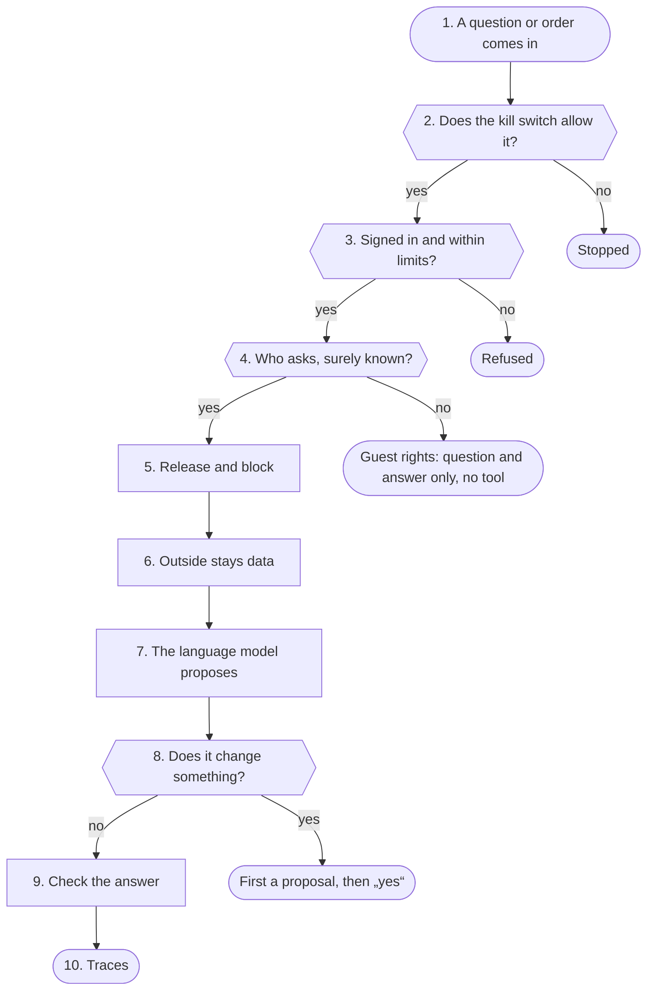

1. <a id="kn-sicherheit-s1"></a>**A question or order comes in**: At home directly, on the way only through the reverse proxy with TLS. Every device has its own key or signs in like the browser. Every way in (panel, device keys, calendar and contacts apps, MCP, other Sparks, Wyoming, phone, Telegram) stands with its protection in the security docs under "Ways in".
2. <a id="kn-sicherheit-s2"></a>**Does the kill switch allow it?**: The kill switch has three stages from the outside in: stage 1 closes the internet, stage 2 every action, stage 3 every conversation. No model, mail or document can trigger or lift it.
3. <a id="kn-sicherheit-s3"></a>**Signed in and within limits?**: Size limit and origin check (CSRF) before reading, then a rate limit per address and a cap on parallel requests for the model, recognition and output (guard.Slot). Secrets, roles and backups also need a fresh code or passkey (core.confirm_code, 10 minutes). The models on tars are reached only through the TLS-Tor; commands there are checked by the Wärter (tarswart.check: signature, time, one-time number, one of 16 fixed commands).
4. <a id="kn-sicherheit-s4"></a>**Who asks, surely known?**: The profile comes from the cookie, the app key or a linked account. At a shared speaker the device key is not enough: chat_turn.shared_stranger allows personal things only when the owner's voice is surely recognised in the same recording.
5. <a id="kn-sicherheit-s5"></a>**Release and block**: Every function is off until the admin releases it; then it counts for every profile, unless the admin blocks single ones (features.blocked). What is not allowed is not even offered as a tool.
6. <a id="kn-sicherheit-s6"></a>**Outside stays data**: What a tool reads from outside reaches the model as a marked block of data (textnorm.defuse: the block's end and the model's own markers such as „<|im_start|>“ or „<tool_call>“ are defused; the LLM-Tor does it once more for every message, llm_tor.entschaerft). From then on 13 acting tools are locked, in the next turn too, and nothing of it is learned into memory; after a mail it is 19, everything that asks the internet among them (web search, Wikipedia, weather, transit), so no search word carries mail content out. Whether this holds is checked by the attack self-test with a model that obeys every order (panel/angriffe.json). Connections to the outside go only through the guard (netguard.allowed). A mail with HTML is shown only as the Spark cleaned it (mailansicht.clean: a fixed list of allowed tags, no script), in a frame without script with its own CSP; pictures from outside only after the own click and through the guard, a link only after the question with its real address.
7. <a id="kn-sicherheit-s7"></a>**The language model proposes**: The model words the answer and picks from what is left after the steps before. If it calls a tool that was not offered, it does not run.
8. <a id="kn-sicherheit-s8"></a>**Does it change something?**: Reading happens at once. Whatever changes something (light, sending mail, appointment, call) leaves a proposal; it runs only after a plain „yes“ to exactly that proposal, from the same device, or the yes button of its card „Waiting for your yes“ (own profile, the same function as the typed yes). Home Assistant only from an allowlist. Only the person deletes mail (into the trash, for good only after a question), never the model. Buttons on cards in the conversation and on the page Open are fixed names (vorgaenge.AKTIONEN); the panel checks every press (owner, kind, state, kill switch, the module's switches), and what would send or enter something without a proposal only opens the page where the person does it.
9. <a id="kn-sicherheit-s9"></a>**Check the answer**: Times, dates and amounts that are nowhere in the sources are dropped (answercheck.unsupported). Passwords, codes and keys are never spoken (textnorm.hide_secrets). The pages never show model text as HTML.
10. <a id="kn-sicherheit-s10"></a>**Traces**: Logs carry only fixed words and numbers. Changes to access and protection are written by guard.log with a SHA-256 chain; the Wachposten tells the admins about anything unusual. Secrets lie sealed in the vault (vault.seal).

**Examples:** A mail demands an action: The mail is read, but nothing is switched: the tools for it are locked. · A web page with a fake system line: „<|im_start|>system“ arrives defused as text, the model sees no new role; it could not act anyway. · A stranger's voice at the speaker: An answer as for a guest, without mails or appointments. · Switch off the light: Switched only after „yes“. · Kill switch stage 3: No conversation, only the kill switch page.

#### Rules

Applies at: [step 4](#kn-sicherheit-s4), [step 5](#kn-sicherheit-s5)

| Who | gets | checked by |
|---|---|---|
| Guest | question and answer, no tools, no personal data, error codes only | rate limit, parallel cap |
| Stranger's voice | like a guest, earlier history stays behind | voice check in the same recording |
| Profile | released functions on own data | sign-in; secrets with a fresh code |
| Other profile | only what the owner shares with it one by one (see), while shared; for the assistant only text | geteilt.put with a fresh code, release „Sharing with profiles“ |
| Someone with a write link | without a profile only entries on exactly one list, optionally see the open texts; no ticking off, no deleting, no tool, no model | mitschreiblink.find: only the hash, expiry, revoke, release „Write link“; wrong tries lock like a PIN |
| Manager | look after people, switch no functions, no logs | role, checked on the server |
| Admin | releases, blocks, kill switch, logs, live | sign-in with the second step; „Change protection“ asks every time |

#### The borders

- A, in from outside: only through the reverse proxy with TLS; every endpoint checks sign-in, profile, CSRF, size and rate limit.
- B, devices at home: one key per device; at a shared speaker the voice counts as well.
- C, the Spark reads outside things: only through the guard, no home network without permission, the checked address pinned; what comes back is data.
- D, panel to the models: TLS 1.3 with the certificate pinned at the pairing; the models listen on 127.0.0.1 only.
- E, handles on tars: only fixed commands of the Wärter, signed, with time and one-time number.

#### Standards

- OWASP ASVS 5.0 level 2 (sign-in and admin level 3), OWASP Top 10 for LLM applications 2025, BSI TR-02102; the security checklist with its part „State of the art“ names what is still missing.

#### Numbers (from the code)

- **13** tools locked after outside text ([step 6](#kn-sicherheit-s6))
- **19** tools locked after a mail ([step 6](#kn-sicherheit-s6))
- **10 min** a right code counts for „Confirm“ ([step 3](#kn-sicherheit-s3))
- **16** fixed commands of the Wärter on tars ([step 3](#kn-sicherheit-s3))
- **3** kill switch stages, the last stops every conversation ([step 2](#kn-sicherheit-s2))

#### In the code

- `app/panel/notaus.py` `blocks`: whether a kill switch stage stops this kind of work ([step 2](#kn-sicherheit-s2))
- `app/panel/guard.py` `limit`: rate limit per address and profile ([step 3](#kn-sicherheit-s3))
- `app/panel/guard.py` `Slot`: cap on parallel requests ([step 3](#kn-sicherheit-s3))
- `app/panel/core.py` `confirm_code`: fresh code or passkey for sensitive ways ([step 3](#kn-sicherheit-s3), [step 8](#kn-sicherheit-s8))
- `app/tarswart.py` `check`: checks every command to the Wärter ([step 3](#kn-sicherheit-s3))
- `app/panel/chat_turn.py` `shared_stranger`: stranger's voice at a shared speaker ([step 4](#kn-sicherheit-s4))
- `app/panel/features.py` `allowed`: the admin's release, for every profile ([step 5](#kn-sicherheit-s5))
- `app/panel/mitschreiblink.py` `find`: checks a write link: hash, expiry, release, list ([step 3](#kn-sicherheit-s3), [step 5](#kn-sicherheit-s5))
- `app/panel/features.py` `blocked`: block of single profiles ([step 5](#kn-sicherheit-s5))
- `app/panel/geteilt.py` `put`: share with another profile, taking back works at once ([step 5](#kn-sicherheit-s5))
- `app/panel/chat.py` `wrap_outside`: outside text as a block of data ([step 6](#kn-sicherheit-s6))
- `app/textnorm.py` `defuse`: defuse the block's end and the model's markers in outside text ([step 6](#kn-sicherheit-s6))
- `app/llm_tor.py` `entschaerft`: take the model's markers out of every message ([step 6](#kn-sicherheit-s6))
- `app/panel/mailansicht.py` `clean`: a mail's HTML only cleaned, without script and without loads from outside ([step 6](#kn-sicherheit-s6))
- `app/panel/netguard.py` `allowed`: whether a connection out may happen ([step 6](#kn-sicherheit-s6))
- `app/panel/answercheck.py` `unsupported`: a figure without a source is dropped ([step 9](#kn-sicherheit-s9))
- `app/textnorm.py` `hide_secrets`: secrets are never spoken ([step 9](#kn-sicherheit-s9))
- `app/panel/guard.py` `log`: change log with its chain ([step 10](#kn-sicherheit-s10))
- `app/panel/vault.py` `seal`: store secrets sealed ([step 10](#kn-sicherheit-s10))

Self-tests: `test_hardening`, `test_angriffe`, `test_gaeste`, `test_kontext_trennung`, `test_scanner`, `test_stufen`, `test_notaus`, `test_waerter`, `test_protokoll`, `test_wachposten`, `test_markdown`

### Login, profile

Here the panel decides who sends a request and what that person may do: login with password or PIN (with a lock after wrong attempts), cookie or device key, rate limit and the release per function. The profile comes only from the cookie, the key or the panel itself, never from a request's text or from the model.

**Why:** The Spark is reachable in the home network and often through a proxy from the internet. Without a lock a PIN could be guessed, without a rate limit one page or script could take the GPU for itself, and without a fixed binding to a profile a request could pretend to be someone else.

#### Way

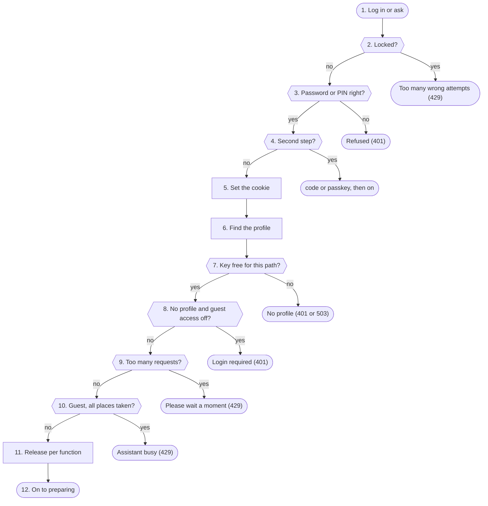

1. <a id="kn-zugang-s1"></a>**Log in or ask**: Logging in gives the browser a cookie; apps, watch and speakers have a device key instead, calendar and contacts apps (kalenderserver.py, kontaktserver.py) an app password that locks like a PIN. Steps 2 to 5 run once when logging in, the steps from 6 on with every request.
2. <a id="kn-zugang-s2"></a>**Locked?**: Locks are kept per address and per name (or the admin password). A name's lock does not hold for a browser that logged in to that name before (cookie speech_known, only its hash is kept). So a stranger guessing cannot lock the owner out.
3. <a id="kn-zugang-s3"></a>**Password or PIN right?**: The check runs in its own thread. An unknown name costs the same work as a wrong PIN, the answer is the same. A wrong attempt waits a second, counts for the lock and, when it comes from outside, for „Emergency stop by itself“.
4. <a id="kn-zugang-s4"></a>**Second step?**: If the profile (or the admin) has the second step on and the browser is not trusted, the code from the app or a passkey comes next. A wrong code counts like a wrong PIN.
5. <a id="kn-zugang-s5"></a>**Set the cookie**: The address's counter is cleared; strangers' wrong attempts for the name keep counting. The profile cookie is signed and stands in the list of signed-in browsers; it holds at most 90 days without use and is renewed while used. The admin cookie is signed with the password, a key of this Spark only and the second step. When the second step was part of it (code, passkey or a trusted browser) the session carries its mark: only then does a profile's admin role count, without an admin sign-in of its own. Then the panel reads the profile's calendars and mail ahead in the background (vorwaermen.py, at most every 600 seconds), so its pages open at once.
6. <a id="kn-zugang-s6"></a>**Find the profile**: First what only the panel itself sets (Telegram, „Ask Spark“ over MCP), then the device key (only its hash is stored), then the cookie: signature, age, session still in the list and not logged out.
7. <a id="kn-zugang-s7"></a>**Key free for this path?**: A key with a scope (app, watch, room, Home Assistant, writing help, companion, terminal) only reaches its own paths and only while the admin and the profile have the function on. If it is off right now or the profile has its own kill switch on, the panel answers 503 instead of 401, so the app keeps its pairing.
8. <a id="kn-zugang-s8"></a>**No profile and guest access off?**: Without a profile only the admin passes (cookie or HTTP Basic, whose wrong attempts count like on the login page), or anybody when the admin opened the assistant without password. Guests then only get question and answer.
9. <a id="kn-zugang-s9"></a>**Too many requests?**: Per profile, else per address, the panel counts the requests of the last minute: in the chat 120 for a profile or the admin, 30 for a guest.
10. <a id="kn-zugang-s10"></a>**Guest, all places taken?**: Guests share 4 places at once in the chat. A place nobody frees counts as free again after 10 minutes.
11. <a id="kn-zugang-s11"></a>**Release per function**: For every function the panel asks in a fixed order: the admin's switch (and the one of the function it builds on), guest (never gets one), blocked by the admin for the profile, the profile's own wish, second step needed. It is read anew with every request, so a change holds at once.
12. <a id="kn-zugang-s12"></a>**On to preparing**: The request goes on with its profile (or as a guest) to chat_turn.prepare. Speech gets priority over background work, and the profile's other open pages see „answering“.

**Examples:** Login with PIN: Logged in: the browser has a signed cookie. · Admin profile signs in with its code: Signed in and admin at once: the session carries the second step's mark. · Stranger guesses a PIN: Refused; after 5 wrong attempts the address is locked. · Question from the iPhone app: Passes: profile from the device key, releases per function. · Guest, guest access off: Refused with 401: no assistant without a profile.

#### Rules

Applies at: [step 6](#kn-zugang-s6), [step 7](#kn-zugang-s7)

| Way in | How checked | What it reaches |
|---|---|---|
| Browser with profile | signed cookie, session in the list | everything of the profile |
| Admin | password cookie or HTTP Basic | admin pages; HTTP Basic only without a second step |
| Profile with an admin role | cookie with the second step's mark or an app key made after it | the admin pages of its role; only „change protection“ asks for the code |
| Device key without scope | hash of the key | the profile's assistant, no changes to connections or security |
| Device key with scope | hash, path, switch | only the paths of its scope |
| Guest | only with assistant without password | question and answer, no tool |

#### Behind a proxy

- X-Forwarded-For only counts from a listed proxy (or one on the Spark itself while none is listed). Otherwise any device could claim another address and get around the lock.

#### Logging out

- A logged-out cookie becomes invalid on the server too, a copy of it no longer works. For the admin this holds for every copy of the same login.

#### Numbers (from the code)

- **5** wrong attempts per address in 15 minutes until the lock ([step 2](#kn-zugang-s2), [step 3](#kn-zugang-s3))
- **10** wrong attempts per name in 15 minutes until the lock ([step 2](#kn-zugang-s2), [step 3](#kn-zugang-s3))
- **60 s** first lock, each further one twice as long up to 60 minutes ([step 2](#kn-zugang-s2))
- **30** wrong attempts per name in 24 hours at most ([step 2](#kn-zugang-s2), [step 3](#kn-zugang-s3))
- **120** chat requests per minute for a profile ([step 9](#kn-zugang-s9))
- **4** places at once for guests ([step 10](#kn-zugang-s10))
- **90** days at most for a sign-in in the browser ([step 5](#kn-zugang-s5))

#### Settings

- Settings → Security → Assistant without password: guests may ask (default off).
- Settings → Security → Sign-in in the browser: how many days without use a profile stays signed in.
- People and devices → Blocked functions: block a function for single profiles.
- Me → Security: a profile's second step.

#### What you see

- Status → Live: under Eingang accepted access from the internet and refused logins.
- Logs → Admin log: logins, wrong attempts and locks.
- Me → Security: the latest logins of the own profile.

#### In the code

- `app/panel/guard.py` `check`: lock before checking ([step 2](#kn-zugang-s2))
- `app/panel/guard.py` `failed`: count a wrong attempt, lock ([step 3](#kn-zugang-s3))
- `app/panel/guard.py` `succeeded`: clear the counter, remember the browser ([step 5](#kn-zugang-s5))
- `app/panel/account.py` `profile_login`: a profile's login ([step 3](#kn-zugang-s3), [step 5](#kn-zugang-s5))
- `app/panel/account.py` `second_step`: code or passkey ([step 4](#kn-zugang-s4))
- `app/panel/core.py` `is_main_admin`: admin by cookie or HTTP Basic ([step 6](#kn-zugang-s6))
- `app/panel/profiles.py` `current`: the profile behind a request ([step 6](#kn-zugang-s6))
- `app/panel/profiles.py` `_cookie_user`: check a cookie ([step 6](#kn-zugang-s6))
- `app/panel/core.py` `assistant`: profile, guest access or admin ([step 8](#kn-zugang-s8))
- `app/panel/guard.py` `limit`: rate limit per minute ([step 9](#kn-zugang-s9))
- `app/panel/guard.py` `Slot`: places for guests ([step 10](#kn-zugang-s10))
- `app/panel/features.py` `reason`: why a function is not available ([step 11](#kn-zugang-s11))

Self-tests: `test_panel`, `test_features`, `test_rechte_sofort`, `test_passkey`, `test_coadmin`

### Prepare request

chat_turn.prepare turns a chat request into a finished turn before the language model is asked: who speaks and what that person may do, the system prompt, answers to questions back and proposals, the locks after outside text and the list of offered tools.

**Why:** The model should only see what it may really use in this turn. Everything that decides (rights, locks, a „yes“ to a proposal, the choice after a question back) the panel does here by fixed rules; the model only says the result afterwards.

#### Way


1. <a id="kn-vorbereiten-s1"></a>**Read the messages**: Only text messages of user and assistant are taken, each cut at 20000 characters. An answer the browser marked as made from mail or outside text keeps that mark. A question from the Android app's assistant sheet only passes when „Android: Spark as assistant“ is released for the profile (else 403).
2. <a id="kn-vorbereiten-s2"></a>**Trim history, carry the lock**: The history is trimmed to its budget. If an answer from outside text is among the last three messages, this turn starts locked; older ones are not sent at all. When the person asks for a song in their own words, such an answer up to 7 messages back stays along as data (chords, style). A screen description only comes along as a fixed note and locks nothing.
3. <a id="kn-vorbereiten-s3"></a>**Guest or unknown voice?**: Without a profile, or at an own speaker or phone when speech recognition did not clearly hear the profile's voice (on the phone: and no phone PIN was typed), there is only question and answer: no tool, no memory, no history. Whose voice it was only the panel itself sets, never the request.
4. <a id="kn-vorbereiten-s4"></a>**The switch reads the question**: Fixed rules put the own latest message into a group. A new own request that does not point back at the answer from outside text leaves that answer and its lock out. If no rule knows the question, the model may pick once from a fixed list in parallel (when the admin has that on). A follow-up like „And tomorrow?“ takes the group of the own question before (intent.follow_up); hint words add their groups, also beside the model's pick. A photo with a wish to change it (bilder.wants_change) is the group pictures, without the model's pick.
5. <a id="kn-vorbereiten-s5"></a>**Build the system prompt**: The admin's system prompt, plus the profile's length and style and a note per channel (watch, Siri, speaker, phone, Telegram, app, browser). With „Fast answer start“ what holds for this turn only goes with the question instead of the system prompt, so the server reads it from its cache. With „Trim a large memory“ a long memory keeps only the newest facts fixed in it (at most 6000 characters), plus up to 5 older ones that share words with the question, for this turn only (chat.memory_split). When the knowledge book is on and has pages, up to 40 page titles that fit the question best come along, as outside text (wissensbuch.hint).
6. <a id="kn-vorbereiten-s6"></a>**Fixed sentence?**: Sentences like „Spark Notaus“, „report a problem: …“ or „that was wrong“ the panel carries out itself, only from the profile's own words and never over MCP. The model only says the result and gets no tool in this turn.
7. <a id="kn-vorbereiten-s7"></a>**Answer to a question back?**: If the panel asked which device is meant, a button, a number or the name counts as the answer, only in the same conversation, from the own profile and within 2 minutes. „None of these“ brings the whole list, „No, the other one“ corrects the last choice. The panel carries out the choice and offers to remember it; a „yes“ to that counts for 15 minutes.
8. <a id="kn-vorbereiten-s8"></a>**Kill switch or my kill switch?**: From kill switch stage 2 or with the profile's own kill switch every waiting proposal is dropped; no „yes“ carries anything out. Reading and answering go on.
9. <a id="kn-vorbereiten-s9"></a>**Yes to a proposal**: If a proposal of this conversation waits (an appointment, a mail change, a list entry, a correction, a call, an answer for the reMarkable), the panel decides on the „yes“. One yes confirms exactly one thing; every answer settles all other waiting proposals of this conversation.
10. <a id="kn-vorbereiten-s10"></a>**Tools by rights**: Each tool group comes only with the admin's switch, the release for the profile and its own data: search, memory, history, documents, smart home, reminders, calendar, mail. Telegram, the iPhone app and CarPlay can only make it narrower, never wider. Another recognized voice at this device gets nothing personal. A message that only asks („Do you know my brother's name?“: one sentence with a question mark, nothing to remember) gets no memory_save (chat.offer_memory), so no made-up fact is saved.
11. <a id="kn-vorbereiten-s11"></a>**Something takes tools away?**: The kill switch takes away tools to the internet or that change things, „Ask Spark“ over MCP keeps only the connection's tools, a picture, a fixed sentence or a fixed panel path (calls by the assistant, rufen.py) leaves none. For a guest the list is emptied once more, whatever filled it.
12. <a id="kn-vorbereiten-s12"></a>**The switch narrows**: With „Targeted tool choice“ only the question's group stays. Then the panel decides whether to search locally first (never for a plain „yes“ or „no“ and never when it already carried out something confirmed in this turn), whether it does a clear fetch itself and which tool the first round must call. With „Fast answer start“ a recognized group always gets the same list in the same order, so the server keeps one start per group in its cache; only an unclear question sees the full list.
13. <a id="kn-vorbereiten-s13"></a>**Turn ready**: The system prompt goes first, with the tools and the lock rule. The kill switch is read again for every tool call: triggered during an answer, it holds the next call off.

**Examples:** Guest asks for the weather: Answer without a tool: guests only get question and answer. · „The second“ after a question back: The panel switches the chosen device; the model only says the result. · Kill switch stage 2, asking for appointments: Only reading tools; adding appointments is not offered.

#### Rules

Applies at: [step 10](#kn-vorbereiten-s10), [step 11](#kn-vorbereiten-s11)

| Who speaks | Tools | Personal data | Yes to proposals |
|---|---|---|---|
| Profile, own login or key | by releases | ✓ | ✓ |
| another recognized voice at this device | general ones | ✕ | ✕ |
| Ask Spark over MCP | only the connection's | read only, no memory, no mail | ✕ |
| Guest or unknown voice at a speaker | ✕ | ✕ | ✕ |

#### Numbers (from the code)

- **20000** characters at most per message ([step 1](#kn-vorbereiten-s1))
- **2** minutes a choice answers a question back ([step 7](#kn-vorbereiten-s7))
- **15** minutes „Shall I remember that?“ waits ([step 7](#kn-vorbereiten-s7))
- **4** buttons at most for a question back ([step 7](#kn-vorbereiten-s7))
- **2** kill switch stage without actions ([step 8](#kn-vorbereiten-s8))

#### Settings

- People and devices → Blocked functions: what a single profile does not get.
- Features → Ask instead of guessing: the panel asks instead of guessing (default off).
- Features → Routing: the fixed rules that narrow the tools.
- Features → Show steps and approvals: tools below the answer, a waiting proposal as a card with Yes and No and a question at the end of the answer with its answers as buttons (yes/no, A or B); a short yes to it keeps the topic of the question before (own profile and device only, default off).

#### What you see

- Logs → Requests: per question group, tools „x of y“, required tool and lock, without content.
- Status → Logs: lines like „weiche: Absicht …“, „chat: web search …“, „chat: memory_save not offered …“ or „notaus: … Werkzeuge nicht angeboten“.

#### In the code

- `app/panel/chat_turn.py` `prepare`: the whole way ([step 1](#kn-vorbereiten-s1), [step 13](#kn-vorbereiten-s13))
- `app/panel/chat_turn.py` `shared_stranger`: unknown voice at a speaker ([step 3](#kn-vorbereiten-s3))
- `app/panel/chat.py` `trim_history`: trim the history ([step 2](#kn-vorbereiten-s2))
- `app/panel/chat.py` `left_out`: leave out answers from outside text ([step 2](#kn-vorbereiten-s2), [step 4](#kn-vorbereiten-s4))
- `app/panel/chat.py` `offer_memory`: no memory_save when the message only asks ([step 10](#kn-vorbereiten-s10))
- `app/panel/intent.py` `classify_cfg`: the switch's fixed rules ([step 4](#kn-vorbereiten-s4))
- `app/panel/klaeren.py` `answer`: answer to a question back ([step 7](#kn-vorbereiten-s7))
- `app/panel/features.py` `allowed`: release per function ([step 10](#kn-vorbereiten-s10))
- `app/panel/notaus.py` `locked_tools`: what the kill switch takes away ([step 11](#kn-vorbereiten-s11))
- `app/panel/intent.py` `narrow`: narrow the tools ([step 12](#kn-vorbereiten-s12))
- `app/panel/chat_turn.py` `notaus_note`: sentence for the model with the kill switch ([step 8](#kn-vorbereiten-s8), [step 11](#kn-vorbereiten-s11))

Self-tests: `test_klaeren`, `test_features`, `test_notaus`, `test_hardening`, `test_weiche`

### Switch

The switch puts the own latest message into a group (smart home, calendar, weather, mail and so on, today 23 groups) and so narrows the tools the language model sees in this turn. It works with fixed word lists; the model may at most pick once from a fixed list when no rule fits, and that too can only narrow.

**Why:** Few fitting tools make the model faster and more accurate: it reads less and misses less often. Because the switch only takes away from what rights and locks left, a wrongly sorted sentence can never allow more, at most leave a tool out.

#### Way


1. <a id="kn-weiche-s1"></a>**Only the own message**: Only the person's own latest message is read, never an answer before, outside text or what the model wrote. The words the admin saved under Features → Routing are added.
2. <a id="kn-weiche-s2"></a>**Only small talk?**: If the whole sentence is a greeting or thanks, the group is „plaudern“ (small talk). The answer then gets no tool at all.
3. <a id="kn-weiche-s3"></a>**Question about the Spark?**: „How do I connect Home Assistant?“ or „Switch on web search“ ask about the Spark itself, not about a device or a search: group „spark“. A question about words or languages never counts. When „Ask Spark“ was used on a page of the panel, the same group holds by a fixed rule about where it was asked.
4. <a id="kn-weiche-s4"></a>**Words per group**: Each group has its built-in word list (light, appointment, mailbox, umbrella …). A switching word without a device („all off“) only counts as a whole command. The admin's must words and own words per group (at most 20, whole words only) find a group as well, but replace nothing.
5. <a id="kn-weiche-s5"></a>**Priority between groups**: When several groups match, fixed rules tidy up: weather, list, message, document and „create document“ come before smart home when there is no switching command; parcels before mail; „Do I have new messages?“ is a message, „What is in the news?“ the web search; a job that comes back regularly or watches something is an agent; a question about language, nature or a difference is never a device; a price or a strike is the web search, not the iPhone or the train; „Call me“ is the Spark calling back, not the iPhone; „a list of …“ in a file is not the own list. Last, the admin's „Not with“ words take groups out again.
6. <a id="kn-weiche-s6"></a>**Group recognized?**: One group or at most 2 count as clear and narrow. More groups at once are not clear enough: then every tool stays.
7. <a id="kn-weiche-s7"></a>**Note hint words**: If no rule recognizes a group for sure, the switch looks for weaker hint words: „water the plants“ points to the weather, „Friday“ to the calendar. A hint never narrows; it only makes sure its group's tools stay when something narrows later.
8. <a id="kn-weiche-s8"></a>**Follow-up?**: If the message is short (at most 80 characters), points back („and“, „that“, „it“) and the own question just before had a clear group, that group holds again. Only the own question counts, never the answer. The journal says „weiche: Folgefrage“. So does a plain „yes“/„no“ or a button of the question card to the question of the answer before (ablauf.was_asked, ten minutes, same conversation): „weiche: Antwort auf Rückfrage“.
9. <a id="kn-weiche-s9"></a>**Targeted tool choice on?**: Only with this switch does the switch narrow, and not with a picture or a direct smart home command. Without it the group only goes to the journal and statistics; the model sees every tool the rights allow.
10. <a id="kn-weiche-s10"></a>**Model sorts?**: If no rule found a group and „Questions no rule recognizes“ is set to the model, the language model picks one group from the fixed list once (JSON only, only the own message). The question already runs beside the preparation from its start; the wait is at most 4 seconds, with „Fast answer start“ only 300 ms after the preparation. With classification with probabilities the pick only counts from the threshold (default 80 %); with Features → Helper model → For routing it asks the small helper model first, and while that is loading or unsure the big one at once, with the same threshold. The hint groups stay beside the pick. During a maintenance pause of the language model it is not asked.
11. <a id="kn-weiche-s11"></a>**Narrow**: With a clear group its tools stay, plus always 5 fixed ones (remembering something, own documents, PC), the hints' tools, the admin's extra tools for this group (at most 6) and what the own words name explicitly („onto the reMarkable“). All only as far as already offered. If nothing of the group is offered or the group is set to „do not narrow“, all stay.
12. <a id="kn-weiche-s12"></a>**Lean?**: If the question stays without a group, the setting is „Lean“ and no must word requires a tool, the model only gets the short list: web search, Wikipedia, archive, earlier conversations, the fixed tools and the tools of the hint groups. It reads less and starts sooner.
13. <a id="kn-weiche-s13"></a>**Fix the first tool**: One single clear group, one required tool and only that one of the group offered: the first round must call exactly that one („What will the weather be?“). A short, clear reading sentence („What is the weather today?“) is fetched by the panel itself with „Fetch clear questions directly“, for tomorrow and the day after with the date the panel works out.
14. <a id="kn-weiche-s14"></a>**Journal and count**: Every turn writes a line „weiche: Absicht … | Grund … | Hinweis … | Werkzeuge x von y | Pflicht … | gesperrt … | eingrenzen an/aus“; a reason word only shows when it is still in the message. Per day and group only counts are kept (8 days), never a word of the question. With „Keep unclear questions anonymously“ an unclear question of a profile (never a guest, never with the code word) also goes redacted onto the switch page: fixed rules as in „Report a problem“, contact names and every number become placeholders, a second check drops what still looks personal (weiche_unklar.anon); without profile, device and time, sealed, at most 100 sentences, 7 days. Then the list goes to the answer.

**Examples:** „Turn off the living room light“: Group smarthome (word „Licht“): the model only sees the smart home tools and the fixed ones. · „And tomorrow?“ after a weather question: No rule fits, but the follow-up takes „wetter“: only the weather tool is required. · „Do I need to water the plants?“ with „Lean“: Unclear, hint „gießen“ → weather: short list plus the weather tool. · „Thanks!“: Group small talk: answer without a tool.

#### Rules

Applies at: [step 9](#kn-weiche-s9)

| Questions no rule recognizes | What the model sees | Time |
|---|---|---|
| All tools (default) | everything the rights allow | none added |
| the model sorts | the picked group and the hint groups | a short model question beside |
| Lean | short list and hint groups | none, starts sooner |
| Classification with probability | the group only from the threshold | a short classification beside |

#### Everyday score

- The test sentences (168) hold every reported wrong turn and must all pass. The everyday sentences (216) were never used for tuning: they measure how many land right, are protected by a hint, stay open or land wrong. A self-test forbids right plus protected going down or wrong going up.

#### Tool names

- Wherever a tool shows, a readable name comes from one table (92 tools), for example „Mailbox overview“ instead of mail_tidy_overview.

#### Numbers (from the code)

- **23** groups of the switch ([step 4](#kn-weiche-s4), [step 6](#kn-weiche-s6))
- **2** groups at most that still narrow ([step 6](#kn-weiche-s6))
- **80** characters at most for a follow-up ([step 8](#kn-weiche-s8))
- **4** seconds at most for the model's pick ([step 10](#kn-weiche-s10))
- **300 ms** waiting with „Fast answer start“ ([step 10](#kn-weiche-s10))
- **80 %** default threshold of the classification ([step 10](#kn-weiche-s10))
- **168** built-in test sentences ([step 4](#kn-weiche-s4), [step 5](#kn-weiche-s5))
- **216** everyday sentences for measuring ([step 14](#kn-weiche-s14))
- **20** versions for undo ([step 4](#kn-weiche-s4))

#### Settings

- Features → Targeted tool choice: without this switch the switch narrows nothing (default off).
- Features → Routing: own words per group, „Not with“, extra tools, groups without narrowing, must words, own test sentences and what questions no rule recognizes get. Every change runs through all test sentences first; if one changes, it is saved only after confirming. Undo keeps the last 20 versions.
- Features → Fetch clear questions directly: the panel fetches short reading questions itself (default off).
- Features → Tune the switch (default off): the language model proposes words per group, the panel keeps a word only when no test sentence flips, the practice half gets better and the check half no worse; it is saved only with "Apply".
- Features → Targeted tool choice → Keep unclear questions anonymously (default off): the profiles' unclear questions show redacted at „unclear“ on the switch, with „Belongs to …“ for tuning; every profile can switch it off for itself under Me → Conversation → Privacy.

#### What you see

- Features → Routing: „Try a sentence“ shows the whole way of a sentence without the model; also test sentences, everyday score and statistics (7 days, counts only).
- Status → Logs: lines „weiche: Absicht …“, „weiche: Folgefrage“, „weiche: Modell-Zuordnung …“ and „weiche: direkt abgerufen“.
- Logs → Requests: per question group, tools „x of y“ and what became of the model's pick.

#### In the code

- `app/panel/intent.py` `classify`: groups by fixed words and priority ([step 1](#kn-weiche-s1))
- `app/panel/intent.py` `Route`: group, reason, hints; when clear ([step 6](#kn-weiche-s6))
- `app/panel/intent.py` `hints_of`: hint words ([step 7](#kn-weiche-s7))
- `app/panel/intent.py` `follow_up`: follow-up ([step 8](#kn-weiche-s8))
- `app/panel/intent.py` `ask_model`: the model's pick from a fixed list ([step 10](#kn-weiche-s10))
- `app/panel/intent.py` `pick_in_time`: wait for the pick or stop it ([step 10](#kn-weiche-s10))
- `app/panel/intent.py` `narrow`: narrow the tools ([step 11](#kn-weiche-s11))
- `app/panel/intent.py` `lean`: short list with „Lean“ ([step 12](#kn-weiche-s12))
- `app/panel/intent.py` `forced`: required first tool ([step 13](#kn-weiche-s13))
- `app/panel/weiche.py` `count`: statistics without content ([step 14](#kn-weiche-s14))
- `app/panel/weiche_unklar.py` `anon`: unclear questions redacted ([step 14](#kn-weiche-s14))
- `app/panel/weiche.py` `trace`: try a sentence ([step 14](#kn-weiche-s14))
- `app/panel/intent_alltag.py` `measure`: everyday score ([step 14](#kn-weiche-s14))

Self-tests: `test_intent`, `test_intent_alltag`, `test_weiche`, `test_weiche_unklar`, `test_werkzeuge`, `test_systemone`

### Build answer

This is where the answer is made: the panel asks the language model in rounds, runs offered tools, checks every finished sentence by fixed rules and sends text and sound to the device as one stream. The panel decides the checks, never the model.

**Why:** A language model likes to make up times, amounts or deeds („the light is on“) that never happened. Spoken, that sounds like a fact. So the panel only says sentences that fit what was really read or done, and still starts speaking quickly.

#### Way

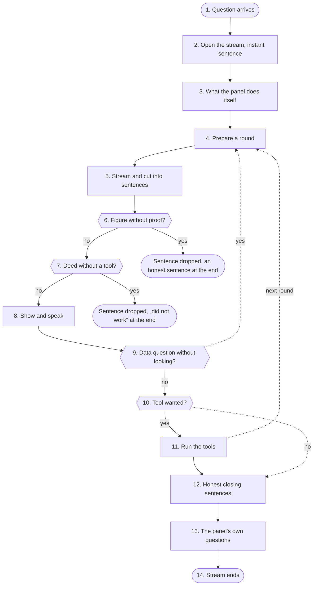

1. <a id="kn-antwort-s1"></a>**Question arrives**: chat() checks the rate limit, sets the mark „speech is running“ (background work waits) and shows the profile's other devices „answering“. Then chat_turn.prepare works out rights, locks, system prompt and the offered tools; _answer takes over. When the language model pauses (maintenance pause, emergency mode), a fixed sentence comes at once; in emergency mode with Parakeet the fixed commands come first, without a model (notbetrieb.antwort: Home Assistant, time, reminders). With „Answer simple things at once“ the time, the date, calculations (rechnen.calc), date calculations and units as a whole short sentence get the panel's fixed sentence, without a model and without an instant sentence before it (sofort.answer, at most 80 characters).
2. <a id="kn-antwort-s2"></a>**Open the stream, instant sentence**: Two queues connect everything: one for events to the device, one for sentences to speech output. When the instant acknowledgement is allowed, a recorded sentence plays at once (no GPU); if the answer then stays silent, one bridge sentence follows.
3. <a id="kn-antwort-s3"></a>**What the panel does itself**: When the preparation decided that the panel acts itself (a switch command, reading states, „search locally first“, a clear reading request), it runs now. The result goes to the model like a tool result, outside text wrapped as data. An article from the own Kiwix then stands as a source under the answer, with its book and the book's date.
4. <a id="kn-antwort-s4"></a>**Prepare a round**: Offered is the list without locked tools, tools stopped after errors or used too often. When the question needs a tool, the model must choose one (tool_choice), with its own temperature. The fifth round has no list: the model is told to answer now. Devices without a screen (speaker, phone, watch, Siri, Android assistant, CarPlay) get at most 700 tokens; a longer answer ends at its last full sentence.
5. <a id="kn-antwort-s5"></a>**Stream and cut into sentences**: The answer comes piece by piece. Thinking and tool calls written as text are never shown or spoken. split_sentences cuts finished sentences off („z. B.“ and „5. Oktober“ are no sentence end); a long first sentence goes at a comma, so the first sound comes early.
6. <a id="kn-antwort-s6"></a>**Figure without proof?**: For data questions answercheck compares every time, date, score and amount in the sentence with everything the model was given. After a calendar read only figures from this answer count, not from earlier ones; a quoted appointment title must be in the result. With „Extended answer check“ also temperatures, km and percentages (rounded counts, answercheck.MORE_SLACK) and every quoted name in every data answer. With „Exact calculations“ rechnen.fix first computes every calculation in the sentence again, number words too („17 times 23 is 381“, „six times six is 35“) and puts in the panel's result; its results count as proven here (answercheck.calc_facts). While that is on, every sentence comes only when it is complete.
7. <a id="kn-antwort-s7"></a>**Deed without a tool?**: When a sentence claims a deed („is on now“, „entered it“), a tool of that kind must have worked in this answer (taten.check). A sentence that only announces a tool call or a deed („I'm calling the timer tool …“) is never said; when no tool follows, the panel says its fixed sentence at the end (taten.announces). When a tool of the claimed kind works later in the same answer („I'm making the song.“ before musik_machen), the sentence is left out silently. Applies when a changing tool or none at all was offered.
8. <a id="kn-antwort-s8"></a>**Show and speak**: A checked sentence goes to the device as text and into the speech output queue; code blocks are only shown. A sentence already said in an earlier round is left out. After the first sentence speech output joins everything waiting into one piece, so the voice stays calm.
9. <a id="kn-antwort-s9"></a>**Data question without looking?**: When the question needs a tool and the model answers without one, the whole round is never said. The model is asked once more, told to use the tool first.
10. <a id="kn-antwort-s10"></a>**Tool wanted?**: When the model wrote no tool call or hit the length limit, the answer is done. At the length limit it is spoken up to the last sentence end, the rest is dropped.
11. <a id="kn-antwort-s11"></a>**Run the tools**: Half words before the call are taken back, a finished sentence stays. Every call goes through chat_tools.run; the result comes back as a tool message. A tool that fails twice the same way is stopped for this answer. When no rule recognized the question, the switch counts the group of the first tool and the fixed hint word (weiche.learn), never a word of the question. Reading tools (calendar, weather, parcels) take their data from their service's memory while it is fresh enough (Vorrat je Profil, vorrat.take); an older reading waits at most 2.0 s for the server and otherwise comes with its time and day („as of yesterday 18:00“, frisch.stand), „look again“ always asks the server. Every answer keeps how long the tools waited and where each service came from (latency, Status → Checks).
12. <a id="kn-antwort-s12"></a>**Honest closing sentences**: When a sentence fell out because of a figure, the panel says „I have no more precise details on that.“; when a deed fell out, a fixed sentence from taten.sentence. When a service came only with an older reading, a search for today found nothing of today or an archive article comes from a Kiwix book older than a year, and the answer does not say so itself, the panel adds „Not quite current: weather: as of yesterday 23:10.“ (frisch.nachsatz, rule „name the stand“ of the answer check). All of them come from the panel, never from the model. When the language model does not answer because it is switching, restarting or being measured, the panel says so with the expected time (llmstart.satz, also during a switch's maintenance pause).
13. <a id="kn-antwort-s13"></a>**The panel's own questions**: Only when nothing from outside was read: offer to remember a learned correction or ask about a fact in memory (by fixed rules). Then the panel puts the answer on the reMarkable when asked; when the answer itself offers to go there, it waits for a „yes“ (remarkable.propose). It fetches ahead for a question back. When „You can also say“ is on, the panel adds fixed example sentences (saetze.row, on a screen as a row before the end; saetze.spoken, while talking at most one sentence a day). The profile's tool log is written.
14. <a id="kn-antwort-s14"></a>**Stream ends**: The request trace is closed; cases and the background check run only after speaking. When the device aborts (barge-in), model and speech output stop at once. When the answer rests on at least two own documents or Kiwix articles, wissensbuch.keep_offer keeps it and the device shows „To the knowledge book“; only the owner's click files it.

**Examples:** Small talk without a tool: Spoken from the first sentence, no check steps in. · Tomorrow's appointments: The model calls the calendar, the next round answers from the result. · Made-up time: The sentence with the time is never said, an honest sentence instead. · „Light is on“, switching failed: Instead of the claim: „That did not work: …“.

#### Numbers (from the code)

- **4** tool calls per round, more do not run ([step 11](#kn-antwort-s11))
- **3** memory notes per answer ([step 11](#kn-antwort-s11))
- **2.0 s** a tool waits at most for the server when an older reading is at hand ([step 11](#kn-antwort-s11))
- **2** same failures until a tool stops (or 3 of any kind) ([step 11](#kn-antwort-s11))
- **50** characters after which the first sentence goes at a comma ([step 5](#kn-antwort-s5))

#### Settings

- Settings → Language model: Answer check, Check deeds and Stop error loops (all three on by default).
- Settings → Language model: Length of an answer, Temperature, Think first; under Advanced the Web searches per answer.

#### What you see

- Status → Logs → Requests: every round, every tool, „answer check“ and „check deeds“ with numbers, never with text.
- Status → Logs → Advanced → Conversation: where the time of an answer went, up to the first sound.
- Status → Improve: how often the built-in rules stepped in today.
- Below the answer (Features → Show steps and approvals): every tool with ✓/⚠ and time, a waiting proposal as a card with Yes and No, else a question at the end with its answers as buttons (ablauf.asks); only names and numbers, never results.

#### In the code

- `app/panel/chat.py` `chat`: rate limit, speech first, „answering“ ([step 1](#kn-antwort-s1))
- `app/panel/chat.py` `_answer`: joins model side, speech output and events into one stream ([step 4](#kn-antwort-s4), [step 5](#kn-antwort-s5), [step 11](#kn-antwort-s11))
- `app/panel/chat_ton.py` `speech_out`: sentences to the speech output, sound as a stream ([step 8](#kn-antwort-s8))
- `app/panel/chat_modell.py` `model_turn`: rounds with the model, tools, checks ([step 4](#kn-antwort-s4), [step 11](#kn-antwort-s11))
- `app/panel/chat.py` `split_sentences`: cuts finished sentences off ([step 5](#kn-antwort-s5))
- `app/panel/chat.py` `said_key`: spots a sentence already said ([step 8](#kn-antwort-s8))
- `app/panel/chat.py` `no_code`: code blocks only shown, never spoken ([step 8](#kn-antwort-s8))
- `app/panel/chat.py` `loop_count`: counts failures for stop error loops ([step 11](#kn-antwort-s11))
- `app/panel/answercheck.py` `known`: every figure the model was given ([step 6](#kn-antwort-s6))
- `app/panel/answercheck.py` `unsupported`: figures in the sentence without proof ([step 6](#kn-antwort-s6))
- `app/panel/answercheck.py` `fresh`: after the calendar only this answer's figures ([step 6](#kn-antwort-s6))
- `app/panel/rechnen.py` `fix`: compute calculations in the sentence again and correct them ([step 6](#kn-antwort-s6))
- `app/panel/taten.py` `check`: deed claimed, no tool managed it ([step 7](#kn-antwort-s7))
- `app/panel/taten.py` `announces`: tool call or deed only announced ([step 7](#kn-antwort-s7), [step 12](#kn-antwort-s12))
- `app/panel/taten.py` `sentence`: the fixed honest sentence ([step 12](#kn-antwort-s12))
- `app/panel/frisch.py` `nachsatz`: stand note when something was not current ([step 12](#kn-antwort-s12))

Self-tests: `test_panel`, `test_taten`, `test_handlungsregel`, `test_fast_start`, `test_morgen_termine`, `test_tagesaktuell`

### Tools

When the model calls a tool, chat_tools.run carries it out, but only when it was offered in this round and no lock applies. The result goes back to the model as data, never as a command.

**Why:** A server parser passes through any tool name the model writes, also made-up or locked ones. And a web page or mail could ask the model to switch the light or send data away. So the panel checks every call again instead of trusting the model.

#### Way

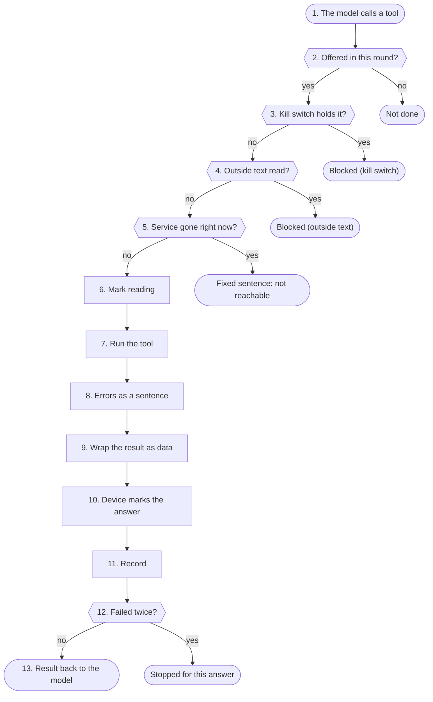

1. <a id="kn-werkzeuge-s1"></a>**The model calls a tool**: At most 4 calls per round run, and a tool stopped after errors does not run again. Memory notes are limited to 3 per answer.
2. <a id="kn-werkzeuge-s2"></a>**Offered in this round?**: Only tools on this round's list run. The list is already cut by the locks; anything else gets „not available, do not call it again“ or, after a mail, the reason of the mail lock.
3. <a id="kn-werkzeuge-s3"></a>**Kill switch holds it?**: The kill switch is read for every call, so it also applies in the middle of an answer. From stage 1 the tools that go to the internet by themselves are locked; from stage 2 or with the profile's own kill switch every tool that changes something.
4. <a id="kn-werkzeuge-s4"></a>**Outside text read?**: When this answer already read text from outside, nothing may change the home, the memory, appointments or reminders any more. After a mail everything that asks the internet is closed too (web search, Wikipedia, weather, transit), after own documents the web search (except with „search locally first“, then only with the question's own words). A song the person asks for stays open after outside text (own), not after mail.
5. <a id="kn-werkzeuge-s5"></a>**Service gone right now?**: When the service watch sees this tool's service down (and its switch is on), a fixed sentence with the time of the outage comes at once instead of a try. Web search checks further down and then can fall back to the own archive.
6. <a id="kn-werkzeuge-s6"></a>**Mark reading**: Tools that bring outside text (web search, documents, calendar, earlier conversations, camera) set the mark before they run. From then on the locks of step 4 hold for the rest of the answer. With the knowledge book document_search brings the fitting page first, then the passages; both are outside text.
7. <a id="kn-werkzeuge-s7"></a>**Run the tool**: Extensions get profile, device and origin from the panel, never from the model. Smart home changes need the code word in the latest message when one is set. Connections to outside services go through the guard. Home Assistant reads states from the live connection's copy (halive.states) while it stands for exactly this address and key, else over HTTP. The period of the web search comes from the question's own words and the query (frisch.zeitraum), never from the panel's time note.
8. <a id="kn-werkzeuge-s8"></a>**Errors as a sentence**: When a service cannot be reached, it becomes a short result text („not reachable“, „search failed, do not guess“). An offered tool without a matching setup answers „unknown“.
9. <a id="kn-werkzeuge-s9"></a>**Wrap the result as data**: Outside text gets a fixed note in front and stands between markers it cannot close itself; the model's own markers („<|im_start|>“, „<tool_call>“) in it are defused (textnorm.defuse). Home Assistant states with free text (titles, lists, a state made of words) count as outside too. With „Faster web search“ the long note stands once per answer, before every further block a short one with the same rule (chat.OUTSIDE_AGAIN); the markers always stay.
10. <a id="kn-werkzeuge-s10"></a>**Device marks the answer**: The device learns that the answer rests on outside text. Such answers do not go to the model again later.
11. <a id="kn-werkzeuge-s11"></a>**Record**: The log line names the tool only when it was offered, else „unbekannt“. What was a deed is noted by taten for the action check. People see the readable names from werkzeuge.py.
12. <a id="kn-werkzeuge-s12"></a>**Failed twice?**: When a tool fails 2 times with the same details or 3 times at all, it is stopped for this answer and the model is told to say honestly what did not work.
13. <a id="kn-werkzeuge-s13"></a>**Result back to the model**: The model gets the result as data in the next round. What it says from it is checked again by the answer (answer check, check deeds).

**Examples:** Read appointments: Runs; the result goes back wrapped as data. · Made-up tool name: Not done: the tool was not offered. · Kill switch during the answer: Blocked: the next call reads the kill switch again. · Web search and light in one round: Blocked: after the web search nothing may switch.

#### Rules

Applies at: [step 4](#kn-werkzeuge-s4)

| State in this answer | Locked |
|---|---|
| outside text read | 13 changing tools and those of extensions |
| mail read | also web search and new appointments |
| own documents read | web search (with local first only own words) |
| kill switch stage 1 | 7 tools that go to the internet themselves |
| kill switch stage 2 or own kill switch | every tool that changes something |

#### Numbers (from the code)

- **4** calls per round ([step 1](#kn-werkzeuge-s1))
- **3** memory notes per answer ([step 1](#kn-werkzeuge-s1))
- **13** tools locked after outside text ([step 4](#kn-werkzeuge-s4))
- **7** tools without internet with the kill switch ([step 3](#kn-werkzeuge-s3))
- **92** tools with a readable name ([step 11](#kn-werkzeuge-s11))

#### Settings

- Settings → Language model: Stop error loops (on by default) and under Advanced the Web searches per answer.
- Features → Routing: which tools the model sees for a question at all.

#### What you see

- Status → Logs → Requests: every call with its readable name, ok or not, length and whether locked.
- Status → Live: which tool runs right now and what the service gave back (only the kind).
- Below the answer (Show steps and approvals): every offered tool with its readable name, ✓/⚠ and time (ablauf.step), never its arguments or its result.

#### In the code

- `app/panel/chat_tools.py` `run`: the checks and all built-in tools ([step 2](#kn-werkzeuge-s2), [step 7](#kn-werkzeuge-s7))
- `app/panel/chat_modell.py` `model_turn`: calls run_tool, wraps results, stops loops ([step 1](#kn-werkzeuge-s1))
- `app/panel/chat.py` `wrap_outside`: outside text as a data block ([step 9](#kn-werkzeuge-s9))
- `app/panel/chat.py` `LOCKED_OUTSIDE`: locked after outside text ([step 4](#kn-werkzeuge-s4))
- `app/panel/chat.py` `LOCKED_AFTER_MAIL`: locked after a mail ([step 4](#kn-werkzeuge-s4))
- `app/panel/chat.py` `READS_OUTSIDE`: tools that bring outside text ([step 4](#kn-werkzeuge-s4), [step 6](#kn-werkzeuge-s6))
- `app/panel/notaus.py` `locked_tools`: what the kill switch locks per stage ([step 3](#kn-werkzeuge-s3))
- `app/panel/dienstwacht.py` `tool_down`: fixed sentence when a service is gone ([step 5](#kn-werkzeuge-s5))
- `app/panel/chat.py` `tool_info`: numbers for Logs → Requests ([step 11](#kn-werkzeuge-s11))
- `app/panel/werkzeuge.py` `label`: readable name of a tool ([step 11](#kn-werkzeuge-s11))

Self-tests: `test_fast_start`, `test_dienstwacht`, `test_taten`, `test_notaus`, `test_werkzeuge`, `test_werkzeug_abdeckung`

### Knowledge

Knowledge is everything the Spark knows without going to the internet: the uploaded documents of each profile (one SQLite file wissen.db per profile), the memory, earlier conversations, the own Kiwix archive and created documents. This page shows the way a question finds fitting passages in the documents.

**Why:** The language model does not know the own papers. It only gets the few passages the panel picks with fixed rules and two small models on the processor, each with its source. What a document says is outside text: data, never a command.

#### Way

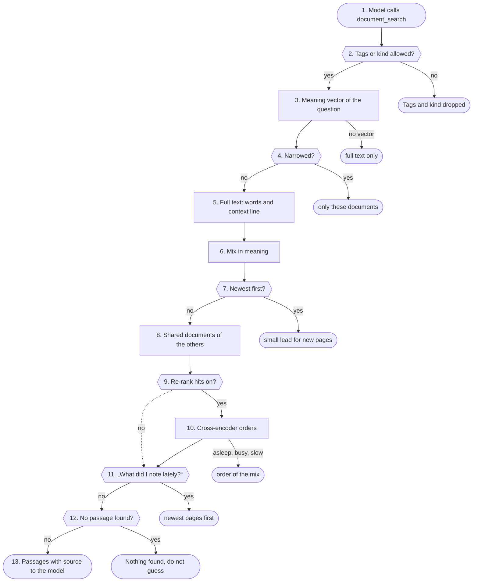

1. <a id="kn-wissen-s1"></a>**Model calls document_search**: The tool is offered only when the profile has own or shared documents, the function is released for the profile and the voice is recognized. Guests and unknown voices at a shared speaker never get it. The profile comes from the login, never from the model.
2. <a id="kn-wissen-s2"></a>**Tags or kind allowed?**: The model may narrow the search to tags or a kind of document (at most five tags). With „Document card and tags“ off for the profile these are dropped and every document is searched.
3. <a id="kn-wissen-s3"></a>**Meaning vector of the question**: With meaning search a small vector model (own process, processor only) computes the question's vector. It starts only with at least 8.5 GiB free memory (on a panel computer 1.5 GiB) and ends after 10 minutes without work. Without a vector the Spark searches full text only, without an error.
4. <a id="kn-wissen-s4"></a>**Narrowed?**: With tags or kind, match_docs first finds the documents that carry all tags and the kind. Only their passages stay in the race; if none fits, there are no hits.
5. <a id="kn-wissen-s5"></a>**Full text: words and context line**: The question is split into search words (filler words dropped, endings roughly cut). The search looks in each passage's words and in its context line (title, kind, headings), which counts only 0.4. The best 30 get a rank.
6. <a id="kn-wissen-s6"></a>**Mix in meaning**: If the question has a vector, it is compared with every passage's vector. Below 0.75 similarity nothing counts as related; the best 30 above get a rank too. Both ranks are added, so a passage high in both lists rises. The vectors are kept in memory as float32 and read again only when passages or used documents change; while vectors are still missing, at most every 30 seconds.
7. <a id="kn-wissen-s7"></a>**Newest first?**: With „Newest first“ a passage changed lately gets a small lead, about two places, which shrinks with age. Fit stays more important; each hit then carries its date.
8. <a id="kn-wissen-s8"></a>**Shared documents of the others**: With „Shared documents“ the same search runs in the other profiles' files, but only over documents marked „for everyone“ there or shared singly with this profile through „Sharing with profiles“ (documents.Offer). With the household folder released for the profile it also runs in the household's store (users/haushalt/). The hits carry the owner's name or „Haushalt“; everything is sorted by rank.
9. <a id="kn-wissen-s9"></a>**Re-rank hits on?**: Without re-ranking the first five of the mix go on. With re-ranking the mix hands over its best 30.
10. <a id="kn-wissen-s10"></a>**Cross-encoder orders**: A small model on the processor reads question and passage together and gives each a number. Passages below -4.0 do not answer the question and drop out, the best five stay. If the model sleeps, is busy, too slow or broken, the mix's order stays; the answer never waits longer than set.
11. <a id="kn-wissen-s11"></a>**„What did I note lately?“**: If the person asks in their own words what they noted lately, today or this week, the pages changed last come first. If nothing changed in that time, the tool says so instead of guessing.
12. <a id="kn-wissen-s12"></a>**No passage found?**: If the search finds nothing but tags or a kind were given, the model gets the card lines of the fitting documents. Otherwise: nothing found, say so, do not guess.
13. <a id="kn-wissen-s13"></a>**Passages with source to the model**: Each passage goes to the model with document, page and section. From now on the answer counts as one that read outside text: switching, saving to memory and reminders are locked in it. The device shows the sources.

**Examples:** Question about a contract clause: Found: the clause and two neighbouring passages, re-ranked, with page. · Vector model still asleep: Found by full text alone; the answer did not wait. · Invoices with a tag, words do not fit: No passage, but the list of documents with the tag.

#### Rules

Applies at: [step 1](#kn-wissen-s1), [step 8](#kn-wissen-s8)

| Source | How it is found | Who |
|---|---|---|
| Own documents | document_search: full text, meaning, re-ranking | own profile |
| Shared documents | the same search, only „for everyone“ or shared singly | other profiles, never guests |
| Memory | not searched: stands in three blocks in the system prompt | own profile |
| Earlier conversations | history_search by words | own profile |
| Kiwix | archive_search and wikipedia via the own Kiwix in the home network | all profiles, never guests |
| Look locally first | full text without waiting for models, before the first round | as the request's tools |
| Knowledge book | document_search: fitting pages before the passages | own profile, own documents only |

#### Knowledge book

- In quiet minutes the language model gets an own document in numbered passages and at most 5 existing pages the panel picks by words shared with title, sender and tags. The model proposes sentences as JSON, each with the number of its passage.
- The panel keeps a sentence only when its passage exists, every number and date in it stands in the passage, it has at most 400 characters and holds neither link nor command. If it says the same as a sentence of the page with another number, both stay as a contradiction. One document changes at most 5 pages.
- On a question document_search puts the best fitting pages before the passages, each sentence with its source. The pages are outside text like the documents.
- At night (in the search check's window, once per profile) the panel checks by fixed rules: a document read again is worked in again, sentences of vanished documents go, gedaechtnis.check marks passed dates and old time words as „out of date?“. Then the model answers for up to 50 sentences only „does the passage say so?“; a no removes the sentence. Deleted or left-out documents take their sentences at once (documents.on_gone).
- When an answer rests on at least 2 sources (documents or Kiwix articles), the panel keeps it in memory for an hour; only the click „To the knowledge book“ files it as a page „Answer“. Every sentence needs a passage from these sources with all its numbers and enough shared words. Export as Obsidian folder (ZIP); at night a copy into the filing folder when the profile files automatically and the book changed.

#### Knowledge map

- When the knowledge map is on, the language model gets the same document again after the knowledge book, with at most 12 pages the panel picks (the document's pages and pages whose title it names). The model proposes connections as JSON, each with a kind from a fixed list and the number of its passage.
- The panel keeps a connection only when both pages were offered, both are named in the passage, every number of the detail stands in the passage and a cause (led to, causes, raises, lowers) has a word of reason in the passage. At most 30 per document; „Not right“ never brings the same connection back from the same document.
- Browser and app draw the map with their own code from names and kinds, never from SVG, Mermaid or DOT of the model. The panel only answers the visible part with at most 150 points; the export as Mermaid or Graphviz text comes from fixed code with cleaned names.

#### Look locally first

- Before the first round the panel itself looks in documents, Kiwix and earlier conversations, at the same time and only briefly. Meaning search only rides along when its model already runs and is free; it is not woken for it.
- A passage only counts when it holds at least 0.6 of the search words (a long word may be mistyped by one or two letters, lokal.same). What comes too late is not waited for. The Kiwix has its own time limit (default 900 ms, the other sources 400 ms) and asks at most 5 books per question: the biggest German Wikipedia and the books whose title or description fits the question (kiwix.pick). An archive article stands as a dated source under the answer.
- From a passage of the documents the model gets at most 500 characters, namely the part with the search words, not the start (lokal.excerpt). From a table that is the head row and the rows with the rarest search words: a word in every row („card“) counts little, „diarrhoea“ in one row a lot; rows with less than half the weight of the best are not added.

#### Tables in PDFs

- pypdf reads a table cell by cell, each cell on its own line; which card belongs to which complaint would be lost. pdftabellen.read therefore looks at every PDF page with pdfium: the drawn lines and boxes give the rows, vertical lines or gaps in the text the columns, and each cell gets the text from its own box. Each row becomes one line „| Diarrhoea | SR 18 … | Note |“. A page without a drawn table stays as pypdf read it. After 20 s per document the remaining pages stay so too.
- A table up to 2400 characters stays one passage. A longer one is cut only between its rows (documents._rows), and every piece starts with its head row.
- PDFs from before are looked at one by one in quiet minutes (documents.due_tables): if the original is kept and has a table, it is read again; otherwise it stays as it is. Without the original only uploading it again helps.

#### Memory

- The memory is not searched. The panel sorts the facts by fixed rules into three blocks (sure, learned, maybe out of date) and gives them to the model in the system prompt.

#### Numbers (from the code)

- **30** candidates for re-ranking ([step 9](#kn-wissen-s9))
- **-4.0** cross-encoder's lower limit ([step 10](#kn-wissen-s10))
- **0.4** weight of the context line ([step 5](#kn-wissen-s5))
- **8 s** longest wait for the question vector ([step 3](#kn-wissen-s3))
- **8.5 GiB** free memory for the vector model to start ([step 3](#kn-wissen-s3))
- **1.5 GiB** the same on a panel computer (Spark teilen) ([step 3](#kn-wissen-s3))
- **3** hits at most with „Look locally first“ ([step 5](#kn-wissen-s5))
- **500** characters per hit with „Look locally first“, around the search words ([step 5](#kn-wissen-s5))
- **2400** characters up to which a table stays one passage ([step 5](#kn-wissen-s5))
- **20 s** longest time per PDF for reading its tables ([step 5](#kn-wissen-s5))
- **5** pages one document may change in the knowledge book ([step 13](#kn-wissen-s13))
- **300** pages in the knowledge book per profile ([step 13](#kn-wissen-s13))
- **50** sentences the model checks against their source at night (default) ([step 13](#kn-wissen-s13))
- **30** connections one document may bring into the knowledge map ([step 13](#kn-wissen-s13))
- **3000** connections in the knowledge map per profile ([step 13](#kn-wissen-s13))
- **150** points the map shows at once ([step 13](#kn-wissen-s13))
- **200** documents a day for the knowledge map (default) ([step 13](#kn-wissen-s13))

#### Settings

- Features → Own documents and below it Meaning search on: passages get a meaning vector (default off).
- Features → Own documents and below it Re-rank hits on: with model size and the longest wait.
- Features → Own documents and below it Document card and tags on: search by tags and kind.
- Features → Own documents and below it Shared documents on: documents „for everyone“.
- Features → Own documents and below it Knowledge book on: pages from the own documents, with how many documents a day.
- Features → Own documents → Knowledge book and below it Knowledge map on: connections between the pages, shown in the menu Knowledge book on the page Map, with how many documents a day (own limit).

#### What you see

- Status → Logs → Requests: the step „Nachsortieren“ with the number of candidates, kept passages and the model's state.
- Status → Logs → Diagnosis, area Wissen: lines of wissen, docembed, lokal and kiwix, fixed words and numbers only.

#### In the code

- `app/panel/wissen.py` `search`: own and shared documents, mix, re-ranking ([step 1](#kn-wissen-s1), [step 8](#kn-wissen-s8), [step 9](#kn-wissen-s9))
- `app/panel/documents.py` `search`: full text and vectors, rank fusion ([step 5](#kn-wissen-s5), [step 6](#kn-wissen-s6))
- `app/panel/documents.py` `_terms`: search words from the question ([step 5](#kn-wissen-s5))
- `app/panel/documents.py` `match_docs`: documents with tags and kind ([step 4](#kn-wissen-s4))
- `app/panel/docembed.py` `query`: question vector or nothing ([step 3](#kn-wissen-s3))
- `app/panel/docembed.py` `_call`: one job for the model process ([step 3](#kn-wissen-s3))
- `app/panel/nachsortieren.py` `rank`: cross-encoder or the mix's order ([step 10](#kn-wissen-s10))
- `app/panel/wissen.py` `recent_window`: „noted lately“ as a fixed rule ([step 11](#kn-wissen-s11))
- `app/panel/wissen.py` `where`: source of a passage for the model ([step 13](#kn-wissen-s13))
- `app/panel/lokal.py` `look`: the quick look before the answer ([step 5](#kn-wissen-s5))
- `app/panel/lokal.py` `excerpt`: the part of a passage with the search words ([step 5](#kn-wissen-s5))
- `app/panel/pdftabellen.py` `read`: read tables in PDFs row by row ([step 5](#kn-wissen-s5))
- `app/panel/documents.py` `_rows`: cut long tables only between rows ([step 5](#kn-wissen-s5))
- `app/panel/documents.py` `due_tables`: read PDFs from before again when they have tables ([step 5](#kn-wissen-s5))
- `app/panel/wissensbuch.py` `answer_block`: fitting pages of the knowledge book with sources ([step 13](#kn-wissen-s13))
- `app/panel/wissenskarte.py` `check_edge`: fixed rules for every proposed connection ([step 13](#kn-wissen-s13))
- `app/panel/wissenskarte.py` `view`: the visible part of the map ([step 13](#kn-wissen-s13))
- `app/panel/gedaechtnis.py` `hint_lines`: facts in three blocks ([step 13](#kn-wissen-s13))

Self-tests: `test_wissen`, `test_nachsortieren`, `test_abschnitte`, `test_lokal`, `test_kiwix`, `test_gedaechtnis`, `test_suchpruefung`, `test_wissensbuch`, `test_wissenskarte`

### Guard

The guard decides for every connection a tool opens to the outside whether it may happen: web pages from search, calendars, contacts, mail, Home Assistant, NAS and MCP services. It checks the address that is really asked, by fixed rules; it never asks the language model.

**Why:** Text from outside (a web page, a mail, a calendar entry) could lead the language model to ask addresses in the home network, cloud metadata or the Spark's own services (SSRF). The guard does not let that happen, whatever the text says.

#### Way


1. <a id="kn-waechter-s1"></a>**A tool wants out**: Everything that goes to an address from settings or from outside text gets its access through netguard.client with a level (today 33 modules). Fixed own services like the language model go directly; which ones and why is listed in netguard.DIRECT_OK, a self-test keeps that list complete.
2. <a id="kn-waechter-s2"></a>**Resolve the name once**: resolve() looks the name up exactly once. If it has several addresses, each one must be allowed, else it stops.
3. <a id="kn-waechter-s3"></a>**Own service?**: The ports of the own services are closed on this machine: on loopback and on every own address in the LAN or VPN (own_addresses reads them again every minute). When the models run on another computer (models.host), its addresses count the same (model_addresses).
4. <a id="kn-waechter-s4"></a>**Internet and kill switch on?**: If the address is public and the kill switch is at stage 1 or higher, nothing goes to the internet, whatever level the tool has. The home network stays reachable as the level allows.
5. <a id="kn-waechter-s5"></a>**Public address?**: A public address is allowed at every level.
6. <a id="kn-waechter-s6"></a>**Level „internet only“?**: What comes from search results or answers may never go to the home network (chat, feeds, geraeteupdate, ghtoken, mailansicht, meldung, modellseite, remarkable, verbund).
7. <a id="kn-waechter-s7"></a>**Never allowed?**: Link-local addresses (169.254.x, where cloud metadata answers), multicast, unspecified and reserved addresses are allowed at no level.
8. <a id="kn-waechter-s8"></a>**Home network allowed?**: Home Assistant and other services in the home network (doclingdienst, esp32, hamelden, homeassistant, kiwix, offsite) always may. Calendars, contacts, mail and MCP (calendars, contacts, mail, mcp, meinmcp, tasks) only when Settings → Security → Allow home network addresses is on.
9. <a id="kn-waechter-s9"></a>**Connect to exactly this address**: The connection goes to the checked address, not to the name again. A second look-up could answer differently (DNS rebinding). The certificate is still checked for the name.
10. <a id="kn-waechter-s10"></a>**Password only to its own site**: Login data only goes to the site it was entered for (same host or same parent domain, like the CalDAV servers of icloud.com), never over http when the address was https.
11. <a id="kn-waechter-s11"></a>**Answer at most 20 MB**: Answers are cut at 20 MB, also after unpacking gzip, so a huge or packed answer cannot fill the memory.
12. <a id="kn-waechter-s12"></a>**Answer to the tool**: The tool gets the answer as data. A redirect is a new connection and is checked the same way, from step 2.

**Examples:** Web page from search: Allowed: connected to the checked public address. · Home Assistant at home: Allowed: the level home may go to the home network. · Calendar at home, switch off: Blocked: home network addresses are off for user services. · Link to cloud metadata: Blocked: a page from search never goes home, 169.254 never. · Kill switch on, ask weather: Blocked: with the kill switch nothing goes to the internet.

#### Rules

Applies at: [step 6](#kn-waechter-s6), [step 8](#kn-waechter-s8)

| Level | Who uses it (from the code) | Internet | Home network |
|---|---|---|---|
| internet only | chat, feeds, geraeteupdate, ghtoken, mailansicht, meldung, modellseite, remarkable, verbund | ✓ | ✕ |
| user | calendars, contacts, mail, mcp, meinmcp, tasks | ✓ | only with switch |
| home | doclingdienst, esp32, hamelden, homeassistant, kiwix, offsite | ✓ | ✓ |
| by target | anrufe, dienstwacht, halive, nas, nasquelle, offline, speicher, telefon, zertpin | as the target is set | – |
| always | all | ✕ with kill switch | ✕ own services, 169.254, multicast |

#### When blocked

- Instead of an answer the tool gets the error Blocked with the reason; no connection is made.
- The block counts for „Emergency stop by itself“: 15 in 10 minutes raise the kill switch to stage 1 when the switch is on. Blocks by the kill switch itself and probes of the service watch do not count.

#### Numbers (from the code)

- **20 MB** largest answer ([step 11](#kn-waechter-s11))
- **30000–31099, 31443** closed own ports ([step 3](#kn-waechter-s3))
- **15** blocks in 10 minutes until kill switch stage 1 (if on) ([step 4](#kn-waechter-s4))
- **1** kill switch stage without internet ([step 4](#kn-waechter-s4))

#### Settings

- Settings → Security → Allow home network addresses: calendars, contacts, mail and MCP may also go to the home network (default off).
- Settings → Security → Emergency stop by itself: many blocked connections in a short time trigger kill switch stage 1 (default off).

#### What you see

- Status → Live: a red line ends with ✕ at the wall, with address and reason; the tile „Wächter today“ counts the blocks.
- Me → My status: whether an own service (calendar, mail) answers or refused the login.

#### In the code

- `app/panel/netguard.py` `allowed`: the rule: nothing or the reason ([step 3](#kn-waechter-s3), [step 7](#kn-waechter-s7), [step 8](#kn-waechter-s8))
- `app/panel/netguard.py` `resolve`: resolve once, check every address, tell Live ([step 2](#kn-waechter-s2))
- `app/panel/netguard.py` `client`: the way out for tools ([step 1](#kn-waechter-s1))
- `app/panel/netguard.py` `_Transport`: password guard, size limit, result for My status ([step 10](#kn-waechter-s10), [step 11](#kn-waechter-s11))
- `app/panel/netguard.py` `_Capped`: cuts the answer, also unpacked ([step 11](#kn-waechter-s11))
- `app/panel/netguard.py` `same_site`: same site for login data ([step 10](#kn-waechter-s10))
- `app/panel/netguard.py` `own_addresses`: every address of this machine ([step 3](#kn-waechter-s3))
- `app/panel/netguard.py` `model_addresses`: the model computer's addresses when it is another one ([step 3](#kn-waechter-s3))
- `app/panel/netguard.py` `IMAP4_SSL`: mail over the checked address ([step 9](#kn-waechter-s9))
- `app/panel/notaus.py` `watch`: counts blocks for the automatic kill switch ([step 2](#kn-waechter-s2))
- `app/panel/live.py` `outgoing`: shows each decision on Live ([step 2](#kn-waechter-s2))

Self-tests: `test_hardening`, `test_notaus`, `test_waechter_umgehung`

### Logs and live

Operation records what the Spark does, without contents: the way of each request (Logs → Requests), the live overview, the journal with fixed words, the service watch and the backup. This page shows which traces a request leaves.

**Why:** Whoever looks for a fault must see which way a request took and how long each step lasted. Questions, answers and tool results belong to the person; so only fixed words, tool names and numbers go into the log and the history.

#### Way


1. <a id="kn-betrieb-s1"></a>**A request comes in**: Chat, writing help, creating documents and what the Spark does by itself create a record at the start: channel, kind (profile, guest, admin, Spark) and device. Before any switch aktiv.py counts the request for „Aktiv 10 min“ (OLED, Monitoring, Live): a profile once, a guest per device as a shortened hash, nothing of the Spark itself, in memory only.
2. <a id="kn-betrieb-s2"></a>**Anything switched on?**: If neither „Trace requests“ nor the live page nor the settings assistant is on, there is no record. Only the modules' journal lines remain.
3. <a id="kn-betrieb-s3"></a>**Steps with fixed words**: Each step (switch, model round, tool, check, speech output) is added with kind, name and time. A value goes in only if it is a number or a short fixed word; anything else is dropped. Question, answer, arguments and results never go in.
4. <a id="kn-betrieb-s4"></a>**Live page on?**: With the live page on, live.py sees each step at once: which service is asked, what the guard decides, what comes back. Everything stays in memory and is gone after a restart.
5. <a id="kn-betrieb-s5"></a>**Journal lines of the modules**: Independently each module writes its lines into the Spark's journal. Every line starts with a word from logfilter.AREAS (33 areas), profiles only through profiles.log_name. A self-test checks both.
6. <a id="kn-betrieb-s6"></a>**End and verdict**: At the end the record gets its state: error if an error word is set, slow if the first sound came later than 5.0 s, else good.
7. <a id="kn-betrieb-s7"></a>**Trace requests on?**: If only Live or the settings assistant is on, the record ends here. It is written nowhere.
8. <a id="kn-betrieb-s8"></a>**Line „anfrage:“ into the journal**: One line per request: id, channel, class, tools with ok or not ok, time to the instant reply, to the first sound and to the end. Without names.
9. <a id="kn-betrieb-s9"></a>**Request history on disk**: The record is appended. When the file grows too big, only the last 500 requests of the last 2880 minutes stay. The file is in no backup.
10. <a id="kn-betrieb-s10"></a>**Admin reads Logs → Requests**: Only the admin and co-admins read the history, with a rate limit. A profile's name and device show only when the profile allows it; else it says „Profil“. For one request the panel shows the journal lines from its time.
11. <a id="kn-betrieb-s11"></a>**Read and sort the journal**: logfilter reads at most 20000 lines; only numbers from fixed lists reach journalctl. Each line gets its area from its first word, its level from fixed error words; tokens, keys and passwords are blacked out before the line leaves the panel.
12. <a id="kn-betrieb-s12"></a>**Diagnosis with a fixed hint**: The diagnosis counts lines per area and shows a fixed hint from a list for the newest error, never one from the model.

**Examples:** All on, a question with a tool: Live shows the way, Logs → Requests keeps it, the journal has the line „anfrage:“. · Only the live page on: Visible on Status → Live, then stored nowhere. · Everything off: No record; only the modules' journal lines.

#### Rules

Applies at: [step 4](#kn-betrieb-s4)

| Trace | Where | How long | In the backup |
|---|---|---|---|
| Live | memory | until restart | ✕ |
| Request history | state/traces.jsonl | 2880 min | ✕ |
| Journal | journald | as journald is set | ✕ |
| Service watch | state/dienstwacht.json | outages 10080 min | ✓ |
| Backups | backups/ | 7 daily, 5 others | – |

#### Service watch

- A loop looks at the language model, listening, speaking, internet, SearXNG, Kiwix, Home Assistant, mail, calendar and NAS, each every minute or every 5 minutes, without login: an HTTP answer below 500 counts as „answers“. Home Assistant is asked for /manifest.json, which it answers without a token; /api/ without a token counted there as a failed login.
- A service is gone after 3 failed probes over at least 3 minutes, back after 2 good ones. With the internet gone there is one note for everything behind it. During update, start and kill switch stage 2 nothing counts, nor for a part in the maintenance pause until its time is up.
- The probes go through the guard but do not count on the live list and never trigger the automatic kill switch.

#### Backup

- Once a day in a pause the panel packs users/, voices/, config.json, the panel password and the files of backup.STATE_FILES. The key state/secret.key and the login keys are not in it; databases are saved as a consistent copy.

#### Numbers (from the code)

- **500** requests in the history at most ([step 9](#kn-betrieb-s9))
- **2880 min** so long a request stays ([step 9](#kn-betrieb-s9))
- **5.0 s** from here a request counts as slow ([step 6](#kn-betrieb-s6))
- **3** failed probes in a row until a service counts as gone ([step 5](#kn-betrieb-s5))
- **30 min** at most one outage note per service ([step 5](#kn-betrieb-s5))
- **7** daily and manual backups kept ([step 9](#kn-betrieb-s9))

#### Settings

- Settings → Spark → Operation → Trace requests: Logs → Requests (default off).
- Settings → Spark → Operation → Logs “Live page”: Status → Live (default off).
- Features → Service watch: look at services and tell the admins about outages (default off).
- Features → Maintenance pause: pause the language model, speech recognition or speech output before an update (default off), then Status → Maintenance pause.
- Settings → Backup: create a backup by hand or restore one.

#### What you see

- Status → Logs → Requests: the way of every request with tools and times.
- Status → Logs → Diagnosis: lines by area, errors and warnings, with a fixed hint.
- Status → Live: running requests, guard decisions and services as a picture.
- Status → Services: what the service watch looks at and the outages of the last days.

#### In the code

- `app/panel/tracelog.py` `start`: a record when anything is on ([step 1](#kn-betrieb-s1))
- `app/panel/tracelog.py` `safe`: only numbers and short fixed words ([step 3](#kn-betrieb-s3))
- `app/panel/tracelog.py` `Rec`: steps, marks, state ([step 3](#kn-betrieb-s3), [step 6](#kn-betrieb-s6))
- `app/panel/tracelog.py` `finish`: journal line and request history ([step 8](#kn-betrieb-s8), [step 9](#kn-betrieb-s9))
- `app/panel/tracelog.py` `shown`: name only with consent ([step 10](#kn-betrieb-s10))
- `app/panel/live.py` `step`: every step on Status → Live ([step 4](#kn-betrieb-s4))
- `app/panel/logfilter.py` `AREAS`: the journal's area words ([step 5](#kn-betrieb-s5))
- `app/panel/logfilter.py` `parse`: area, level, blacking out ([step 11](#kn-betrieb-s11))
- `app/panel/logfilter.py` `summary`: counts and fixed hint ([step 12](#kn-betrieb-s12))
- `app/panel/dienstwacht.py` `round_once`: one round of probes and notes ([step 5](#kn-betrieb-s5))
- `app/panel/backup.py` `create`: pack one backup ([step 9](#kn-betrieb-s9))

Self-tests: `test_tracelog`, `test_live`, `test_logfilter`, `test_log_luecken`, `test_dienstwacht`, `test_hardening`, `test_panel`

### Language model

The language model writes the answers: the own one behind the LLM-Tor or qwen38 from dgx-spark-qwen38 (not part of this repo). The panel talks to it at the configured address through the OpenAI interface, streamed, and makes sure speech always comes before background work. Address, key and model name live only in llm.py; every background job asks through llm.complete.

**Why:** The GPU is shared between the model and speech output. While a person waits, no learning or tidying in the background may slow the answer. And a hanging or missing model should give a clear sentence, not minutes of silence.

#### Way

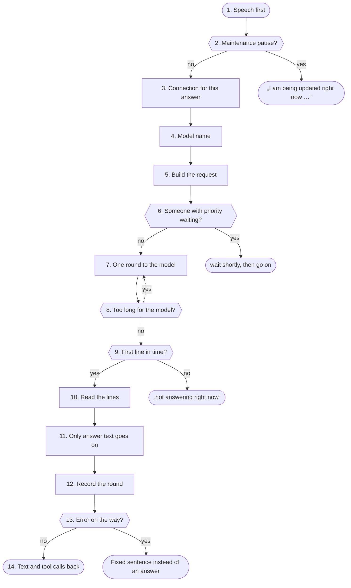

1. <a id="kn-llm-s1"></a>**Speech first**: When an answer starts and with every streamed piece the panel sets the mark „speech is running“. Background work on the model waits until 20 seconds after it and is cancelled as soon as somebody speaks; after 3 cancels it gives up for this time.
2. <a id="kn-llm-s1w"></a>**Maintenance pause?**: When an admin paused the language model for an update, the panel does not ask it at all: the answer is a fixed sentence with the time left at once, the Weiche and System One do not ask either. Background work on the model waits until the pause ends and does not count that as a cancel. At the end of the time the pause only ends once the model answers 2 times in a row. With “Automatically on restart” the panel pauses by itself as soon as a language model service (own or qwen38) restarts or switches (at most 30 min) and goes on once the model answers again. When the model runs on another computer that does not answer (emergency mode, steuer.weg), the same holds with the sentence “The Spark is taking a break right now.”; the Dienst-Wächter still reports the outage. With Features → Emergency mode with Parakeet, Parakeet on the panel computer then hears, and fixed commands (Home Assistant, time, reminders) work without a model (notbetrieb.antwort).
3. <a id="kn-llm-s2"></a>**Connection for this answer**: Every answer has its own connection with the configured time limit (a value outside does not count) and five seconds to connect. When a key is set, it goes along as Bearer. The model is a fixed own service and does not go through the guard.
4. <a id="kn-llm-s3"></a>**Model name**: When no model is configured, the panel asks /models once and keeps the first name for this address.
5. <a id="kn-llm-s4"></a>**Build the request**: The request streams, with length, temperature, top_p, top_k and presence_penalty from the settings (0 = the server's default; the quality test compares with Qwen's recommendation). Thinking is off unless „Think first“ is on. While a tool is chosen its own temperature applies. The server always reports at the end how much it read and wrote and how much came from its cache.
6. <a id="kn-llm-s5"></a>**Someone with priority waiting?**: When another person has priority and their answer has no first sentence yet, this round waits at most the configured time (up to 5 seconds). An answer with priority holds others up for at most 30 seconds. Before that the quota (day, week, month) is checked: a profile over it gets a fixed sentence instead of an answer, fixed commands without a model still work.
7. <a id="kn-llm-s6"></a>**One round to the model**: The round goes to the configured address. When the server refuses the forced tool choice, the same round goes once without it.
8. <a id="kn-llm-s7"></a>**Too long for the model?**: When the server says the request is longer than its context, the panel cuts the history to a quarter of the history budget in the first round and asks once more.
9. <a id="kn-llm-s8"></a>**First line in time?**: The first line must come within 90 seconds (or the shorter time limit). A model that stays silent longer hangs: the answer ends with a clear sentence instead of minutes of silence.
10. <a id="kn-llm-s9"></a>**Read the lines**: Every line is a piece of JSON. Tool calls come in parts and are put together by their number; thinking the server hands over separately is only counted. Unreadable lines are skipped.
11. <a id="kn-llm-s10"></a>**Only answer text goes on**: Thinking inside the text (<think> … </think>) and tool calls that come as text are never shown or spoken. The rest goes piece by piece to „build answer“.
12. <a id="kn-llm-s11"></a>**Record the round**: For the request trace only numbers count: tokens read, of them from the cache, size of system prompt, tool list and history, time to the first word, waiting time for priority. The usage counter counts tokens read and written per task and profile (estimated without the server's report, about 3.5 characters per token).
13. <a id="kn-llm-s12"></a>**Error on the way?**: An error becomes a fixed code: not reachable, too slow, key refused, model missing. With „not reachable“ and „too slow“ a fixed sentence is also spoken when nothing was said yet. Guests see only the kind of error, never its text.
14. <a id="kn-llm-s13"></a>**Text and tool calls back**: The round returns why it ended and which tools the model wants to call. The panel decides what of it runs.

**Examples:** Normal answer: Streamed, the first sentence goes to speech output at once. · Two people, one with priority: The round waits briefly until the answer with priority has its first sentence. · Very long document in the history: History cut, asked once more. · Language model hangs: „My language model is not answering right now.“ instead of silence. · Language model is being updated: „I am being updated right now and will be back in about 20 minutes.“

#### Numbers (from the code)

- **90 s** until the model's first line ([step 9](#kn-llm-s8))
- **60 bis 600 s** allowed time limit ([step 3](#kn-llm-s2))
- **20 s** background work still waits after speech ([step 1](#kn-llm-s1))
- **3** cancels until background work gives up ([step 1](#kn-llm-s1))
- **5 s** longest wait for priority ([step 6](#kn-llm-s5))
- **30 s** a priority answer holds up at most this long ([step 6](#kn-llm-s5))
- **5 bis 240 min** length of a maintenance pause ([step 2](#kn-llm-s1w))
- **30 min** longest automatic pause before it counts as an outage ([step 2](#kn-llm-s1w))

#### Settings

- Settings → Language model: Address, Key and Model; also Think first, Temperature and Length of an answer.
- Settings → Language model, under Advanced: Time limit for an answer.
- Features → Priority for people: chosen profiles get their answer first.
- Status → Maintenance pause: pause the language model before an update (also sudo speech-spark pause llm 30).
- Features → Usage counter: counts tokens per model, task and profile; below it the quota per profile for day, week and month.
- Features → Maintenance pause → Automatically on restart: pauses by itself when the language model restarts.

#### What you see

- Status → Logs → Advanced → Conversation: per round tokens read, of them from the cache, and the time to the first word.
- Status → Usage: tokens per day, model, area and profile.
- Below the answer (Show steps and approvals): the tools of the rounds with name, ✓/⚠ and time.
- Status → Checks → Speech first: whether speech output stays smooth while the model computes.
- Spark split: when the panel runs on another computer, language model, speech recognition, speech output and pictures are on the model computer (Status → Live, box "Model computer"); the panel reaches them only through the TLS-Tor with a pinned certificate and controls them through the Wärter.

#### In the code

- `app/panel/chat.py` `chat`: sets „speech is running“ with every piece ([step 1](#kn-llm-s1))
- `app/panel/chat.py` `_answer`: connection, request, rounds (llm_round), errors ([step 3](#kn-llm-s2), [step 5](#kn-llm-s4), [step 7](#kn-llm-s6))
- `app/panel/llm.py` `model`: model name from settings or /models ([step 4](#kn-llm-s3))
- `app/panel/llm.py` `url`: the one address of the language model ([step 1](#kn-llm-s1))
- `app/panel/llm.py` `complete`: the call of every background job, waits in vorrang ([step 1](#kn-llm-s1))
- `app/panel/chat.py` `sampling`: top_p, top_k and presence_penalty ([step 5](#kn-llm-s4))
- `app/panel/chat.py` `first_within`: the first line must come in time ([step 9](#kn-llm-s8))
- `app/panel/chat.py` `ContextFull`: request longer than the context ([step 8](#kn-llm-s7))
- `app/panel/chat.py` `llm_error_code`: error as a fixed code ([step 13](#kn-llm-s12))
- `app/panel/chat.py` `LLM_GONE`: the spoken sentence when the model is gone ([step 13](#kn-llm-s12))
- `app/panel/chat.py` `prompt_sizes`: size of the parts of a request ([step 12](#kn-llm-s11))
- `app/panel/stufe.py` `wait_turn`: waits for an answer with priority ([step 6](#kn-llm-s5))
- `app/panel/vorrang.py` `mark`: mark „speech is running“ ([step 1](#kn-llm-s1))
- `app/panel/vorrang.py` `run`: background work gives way to speech ([step 1](#kn-llm-s1))
- `app/panel/wartung.py` `paused`: maintenance pause: the model is not asked ([step 2](#kn-llm-s1w))
- `app/panel/wartung.py` `auto_tick`: maintenance pause by itself when the language model restarts ([step 2](#kn-llm-s1w))
- `app/panel/wartung.py` `sentence`: the fixed sentence with the time left ([step 2](#kn-llm-s1w))
- `app/panel/verbrauch.py` `llm`: counts the tokens of a round ([step 12](#kn-llm-s11))
- `app/panel/verbrauch.py` `over`: which limit is full: day, week or month? ([step 6](#kn-llm-s5))
- `app/panel/verbrauch.py` `warn`: the warning under the answer, once per period ([step 12](#kn-llm-s11))

Self-tests: `test_panel`, `test_llm_settings`, `test_vorrang`, `test_stufe`, `test_fast_start`, `test_wartung`

### Speech recognition

Speech recognition turns a recording into text. The panel takes the recording, checks it and hands it to the ASR service. That proxy checks key, size and sample rate, lets requests wait by priority and passes them to the engine, which listens on this machine only.

**Why:** A recording comes from outside: a browser, an app, a speaker. It could be huge, carry a made-up sample rate or be only silence, a click or the Spark's own voice. Fixed rules catch that before the GPU works and before a text counts as a question.

#### Way

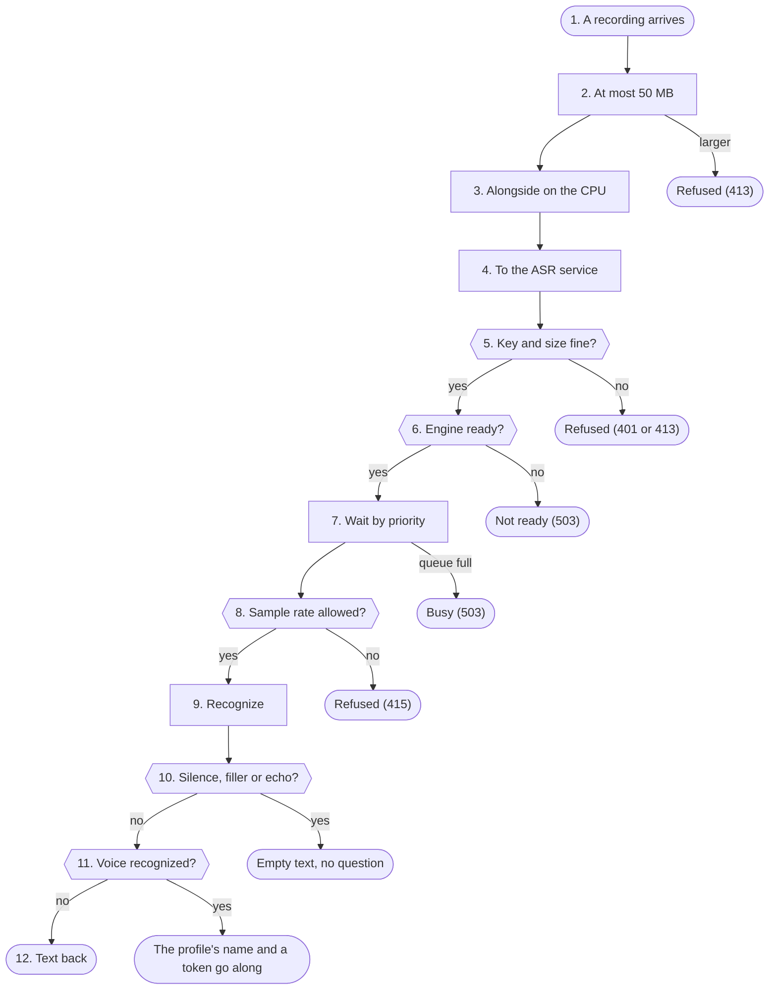

1. <a id="kn-asr-s1"></a>**A recording arrives**: The browser sends the recording to the panel. Each caller may only so often per minute (profile 240), guests share 3 places at once.
2. <a id="kn-asr-s2"></a>**At most 50 MB**: read_audio reads the recording in pieces and stops at 50 MB. Only a signed-in profile may send a wake word; it then goes to the model as a hint. With „Names for listening“ hoerwoerter.prompt adds the names of the profiles and the profile's contacts, rooms and devices (at most 100, shared speakers only profile names). While the profile plays the Dungeon Master in the car, the round's names come first (dungeon_auto.words), never anything from its hidden truth.
3. <a id="kn-asr-s3"></a>**Alongside on the CPU**: While the GPU recognizes, the CPU already runs speaker identification (when on and a profile asks), the room voice, the check for an unknown voice and the measure of how much of the recording is really voice. At a speaking pause with „Turn end by tone“ satzende.start also asks Smart Turn on the model computer (asr_proxy.turn), only for a number to measure.
4. <a id="kn-asr-s4"></a>**To the ASR service**: The panel sends the recording with the API key to the proxy. stufe.asr_level adds the profile's stage, but not at a shared speaker. Only the panel can set a stage: with the key from vorrang-key and only from this machine, else it is normal.
5. <a id="kn-asr-s5"></a>**Key and size fine?**: BodyLimit refuses requests that are too large or lack the right key before anything is read. Without a key set, only this machine itself may ask.
6. <a id="kn-asr-s6"></a>**Engine ready?**: engine_status asks the engine's /health. If it does not answer, the proxy reads its state and that of the systemd unit and names the reason.
7. <a id="kn-asr-s7"></a>**Wait by priority**: PrioGate lets as many recordings through as the engine takes at once (engine_max_seqs). The others wait by stage, then by arrival. Whoever waits moves up a stage every four seconds; a running request is never stopped.
8. <a id="kn-asr-s8"></a>**Sample rate allowed?**: audio_rate_ok reads the sample rate from the file's header (WAV, FLAC, Ogg, WebM) or asks ffprobe. A header with a made-up rate would fill the memory when it is converted.
9. <a id="kn-asr-s9"></a>**Recognize**: With Qwen3-ASR the recording goes to the vLLM engine, which listens on this machine only; only prompt, temperature and stream pass through, plus the context words from the settings. With Parakeet the proxy recognizes itself on the CPU, in pieces of at most 90 seconds cut at a quiet spot. In emergency mode with Parakeet (panel computer, model computer gone) common.model_url takes the recording to speech-spark-notasr on port 31009, only for the computer itself: the same proxy with Parakeet, loaded at the first recording, unloaded after 10 minutes without one.
10. <a id="kn-asr-s10"></a>**Silence, filler or echo?**: stille.check drops text from almost silent recordings and a lone „Yes“ or „Okay“ with too little voice. For profiles echo.check looks whether the text is the Spark's own voice from another device, and fremdstimme whether a microphone that opened by itself heard an unknown voice.
11. <a id="kn-asr-s11"></a>**Voice recognized?**: speakers.identify compares the recording with every taught voiceprint. Only a clear match (above the threshold of the chosen strictness and clearly ahead of the runner-up) counts. Live shows only „voice recognized“, never whose.
12. <a id="kn-asr-s12"></a>**Text back**: The text goes to the device, which turns it into the question to the chat. On an error a guest gets only a fixed code, never the service's text.

**Examples:** Question in the browser, profile: Text back with the recognized voice. · Click after the answer: Dropped: too little voice, no question. · File with a made-up sample rate: Refused before the engine sees it. · Engine still loading: Refused with the reason, the device says so.

#### Numbers (from the code)

- **50 MB** largest recording at the panel ([step 2](#kn-asr-s2))
- **8000–192000** allowed sample rate in Hz ([step 8](#kn-asr-s8))
- **240** recordings per minute and profile ([step 1](#kn-asr-s1))
- **3** guests at once ([step 1](#kn-asr-s1))
- **0.75** speaker identification threshold at normal strictness ([step 11](#kn-asr-s11))
- **120** minutes of audio Parakeet reads at most ([step 9](#kn-asr-s9))
- **31009** port of Parakeet in emergency mode, only 127.0.0.1 ([step 9](#kn-asr-s9))
- **10** minutes without a recording, then Parakeet unloads in emergency mode ([step 9](#kn-asr-s9))

#### Settings

- Settings → Speech recognition: Qwen3-ASR on the GPU or Parakeet on the CPU, language and context words.
- Features → Speaker recognition: recognize profiles by their voice and how strictly (default off).

#### What you see

- Status → Usage: seconds heard per day, task and profile.
- Status → Summary: engine state, requests, failures, average time and the queue.
- Status → Logs → Requests: how long a recording waited and how many it overtook.

#### In the code

- `app/panel/admin.py` `test_asr`: rate limit and places for guests; for a paused answer the decision from zwischenruf.py ([step 1](#kn-asr-s1))
- `app/panel/admin.py` `_test_asr`: the way in the panel: read, check alongside, pass on ([step 2](#kn-asr-s2), [step 4](#kn-asr-s4))
- `app/panel/stufe.py` `asr_level`: the profile's stage, not at a shared speaker ([step 4](#kn-asr-s4))
- `app/common.py` `BodyLimit`: size and key before reading ([step 5](#kn-asr-s5))
- `app/common.py` `PrioGate`: waiting by priority ([step 7](#kn-asr-s7))
- `app/common.py` `audio_rate_ok`: sample rate from the file header ([step 8](#kn-asr-s8))
- `app/asr_proxy.py` `transcriptions`: the proxy in front of the engine ([step 4](#kn-asr-s4))
- `app/asr_proxy.py` `engine_status`: ready, loading, error or off ([step 6](#kn-asr-s6))
- `app/asr_proxy.py` `turn`: Smart Turn: how finished the end sounds, 0 to 1 ([step 3](#kn-asr-s3))
- `app/panel/satzende.py` `start`: measure a pause, numbers only ([step 3](#kn-asr-s3))
- `app/parakeet.py` `Recognizer`: Parakeet on the CPU ([step 9](#kn-asr-s9))
- `app/panel/stille.py` `check`: silence and fillers ([step 10](#kn-asr-s10))
- `app/panel/echo.py` `check`: the Spark's own voice ([step 10](#kn-asr-s10))
- `app/panel/speakers.py` `identify`: whose voice, only on a clear match ([step 11](#kn-asr-s11))

Self-tests: `test_units`, `test_hardening`, `test_stufe`, `test_stille`, `test_echo`, `test_stimmabdruck`

### Speech output

Speech output turns text into sound. The TTS service takes a sentence, tidies it, hides secrets, picks language and voice and passes it to the engine (Qwen3-TTS via vllm-omni), which listens on this machine only. The sound comes back streamed.

**Why:** A speaker in the room says out loud whatever it gets. Passwords and codes must never be spoken there, and signs like asterisks, links or emojis sound wrong. So fixed rules run on every sentence, wherever it comes from: chat, speaker, Telegram, reminders.

#### Way

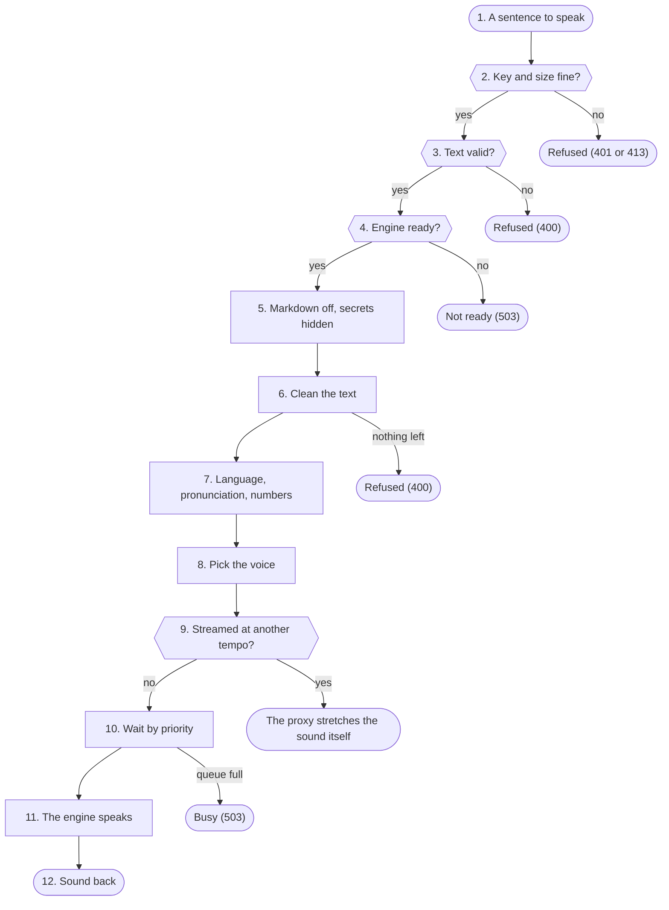

1. <a id="kn-tts-s1"></a>**A sentence to speak**: The panel sends every sentence of an answer with the API key and the profile's stage to the TTS service. Other programs may do so too with the API key.
2. <a id="kn-tts-s2"></a>**Key and size fine?**: BodyLimit refuses requests that are too large or lack the right key before anything is read.
3. <a id="kn-tts-s3"></a>**Text valid?**: The text must not be empty and may have at most 20000 characters. check_reference takes a reference voice only as an embedded data:audio address, never as a link: the engine would otherwise fetch a link itself from the home network.
4. <a id="kn-tts-s4"></a>**Engine ready?**: A VoiceDesign request goes to the second engine when it is on; everything else to the main engine. engine_status asks its /health and otherwise names the reason.
5. <a id="kn-tts-s5"></a>**Markdown off, secrets hidden**: speech_markdown takes out the formatting signs, then hide_secrets replaces passwords, code words, one-time codes and keys with „shown in writing only“. This runs on every request, also when „Clean text“ is off; the written answer keeps the value.
6. <a id="kn-tts-s6"></a>**Clean the text**: clean_text takes out emojis, „haha“, *laughs*, code blocks and links, calms exclamations if wanted and puts a full stop at the end of a line so the voice settles. If nothing is left, no request goes to the engine.
7. <a id="kn-tts-s7"></a>**Language, pronunciation, numbers**: When the language is Auto, guess_language guesses German or English from frequent words, so a single English word does not change the tone of the whole answer. Then the own pronunciation list applies, after that speak_abbreviations writes out abbreviations („z. B.“, „ca.“, „€/Monat“) and speak_numbers date, time, money, numbers and units (km/h, kWh, kg, GB …).
8. <a id="kn-tts-s8"></a>**Pick the voice**: Temperature, top_p and a fixed seed from the settings keep the voice the same from sentence to sentence. A Base model speaks with a cloned voice from voices/ (apply_clone); an unknown name falls back to the default voice. With „Shorten the reference of your own voice“ (tts.ref_max_s) it takes a piece of a long recording instead: kurzref.cut_at cuts once at the quietest point before the limit, speech recognition writes the piece down, kurzref.keep_words keeps the words of the own text (at least 70 % alike, else the whole recording stays). Until the piece is ready, the whole recording applies.
9. <a id="kn-tts-s9"></a>**Streamed at another tempo?**: vllm-omni takes no tempo when streaming. Then tempo.Stretcher stretches the sound piece by piece itself (WSOLA, the pitch stays).
10. <a id="kn-tts-s10"></a>**Wait by priority**: PrioGate lets as many sentences through as the engine takes at once (engine_max_seqs); the others wait by stage, then by arrival.
11. <a id="kn-tts-s11"></a>**The engine speaks**: The engine makes the sound. Streamed it comes back in pieces; the first piece is small on purpose (initial_chunk_frames) so the sound starts fast, also when several requests run. „Several voices at once“ (tts.engine_decode_batch) batches up to 2 or 4 voices in the decoder with CUDA graphs, „Remember the same beginning“ (tts.engine_prefix_cache) lets the engine reuse the same beginning of a voice's sentences; both are off (vllm-omni's default).
12. <a id="kn-tts-s12"></a>**Sound back**: The proxy passes the sound on unchanged and counts only time, length and errors for monitoring, never the text.

**Examples:** Answer sentence in the chat: Spoken, streamed, with a steady voice. · Password in the answer: The voice says „shown in writing only“, the written answer keeps the value. · Only an emoji: Nothing to say, nothing goes to the engine. · Speak faster: The proxy stretches the streamed sound.

#### Numbers (from the code)

- **20000** characters per request at most ([step 3](#kn-tts-s3))
- **„nur schriftlich sichtbar“** the voice says instead of a secret ([step 5](#kn-tts-s5))
- **4** ways to read numbers ([step 7](#kn-tts-s7))
- **3.0 s** a shortened reference keeps at least ([step 8](#kn-tts-s8))
- **2.0 s** longer than the limit before it is cut ([step 8](#kn-tts-s8))

#### Settings

- Settings → Speech output: model, default voice, language, clean text, reading numbers and the own pronunciation list.
- Settings → Voices: record, play and save own voices (for a Base model).
- Settings → Speech output → Advanced: „Shorten the reference of your own voice“, „Several voices at once“ and „Remember the same beginning“ (all off); before and after Status → Checks → Measure performance.

#### What you see

- Status → Usage: seconds spoken per day, task and profile.
- Status → Summary: engine state, requests, failures, time to the first sound and the queue.

#### In the code

- `app/tts_proxy.py` `speech`: the way of a sentence through the proxy ([step 1](#kn-tts-s1))
- `app/tts_proxy.py` `check_reference`: reference only embedded ([step 8](#kn-tts-s8))
- `app/tts_proxy.py` `engine_status`: ready, loading, error or off ([step 4](#kn-tts-s4))
- `app/tts_proxy.py` `apply_clone`: cloned voice from voices/ ([step 8](#kn-tts-s8))
- `app/textnorm.py` `speech_markdown`: markdown signs off ([step 5](#kn-tts-s5))
- `app/textnorm.py` `hide_secrets`: never speak secrets ([step 5](#kn-tts-s5))
- `app/textnorm.py` `clean_text`: emojis, laughter, links, code ([step 6](#kn-tts-s6))
- `app/textnorm.py` `guess_language`: guess German or English ([step 7](#kn-tts-s7))
- `app/textnorm.py` `speak_numbers`: write out numbers ([step 7](#kn-tts-s7))
- `app/tempo.py` `Stretcher`: tempo while streaming ([step 9](#kn-tts-s9))
- `app/tts_proxy.py` `shorten`: shorten the reference once ([step 8](#kn-tts-s8))
- `app/kurzref.py` `cut_at`: quietest point before the limit ([step 8](#kn-tts-s8))
- `app/kurzref.py` `keep_words`: keep the words of the own text ([step 8](#kn-tts-s8))
- `app/common.py` `PrioGate`: waiting by priority ([step 10](#kn-tts-s10))

Self-tests: `test_units`, `test_markdown`, `test_hardening`, `test_stufe`, `test_tempo`, `test_kurzref`

### Pictures and music

Painting pictures turns a wish into a picture, on the Spark itself. The panel checks the wish with fixed rules and hands it to the picture service, which listens on this machine only. It loads FLUX.2 klein only at the first picture, checks the finished picture and frees the memory after a quiet time.

Making music works the same way next to it: a wish under Me → Music or musik_machen in the conversation becomes a song (instrumental and 2 minutes unless asked). The music service on :31004 loads ACE-Step 1.5 only for a song, in the model the admin picked, and frees the memory after a quiet time; "Test music" measures every installed model. Both services share the on-demand engine of bedarf.py. Editing music turns an own song into a new version (part anew, extend, genre, remix, new lyrics) with the same model; cutting, tempo and key the music service does at once with ffmpeg, without a model. Own files only with the rights tick.

Only one of the two models is loaded at a time (Dominik 2026-10-18): pictures and songs stand in one queue in the panel (schwer.py); who waits behind others hears the place and about how long it takes.

**Why:** A picture model can paint anything, also nudity, violence or real people. The language model never decides that; fixed rules before and after painting do. And the model needs a lot of shared memory: it must never push out the language model or the voice.

#### Way

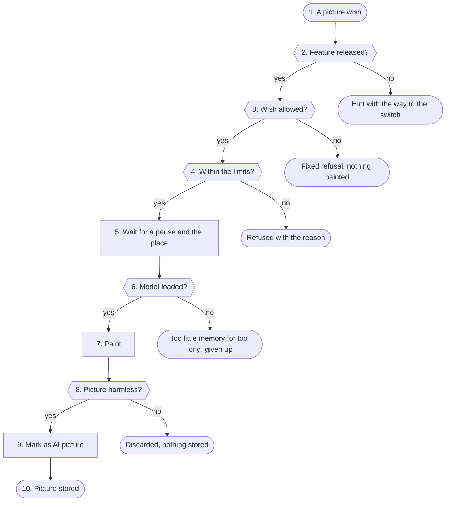

1. <a id="kn-bild-s1"></a>**A picture wish**: A profile writes a wish under Me → Pictures, or the router group "bild" offers the tool bild_malen in the conversation; the model writes an English prompt for it. Changing pictures starts without a tool: bilder.from_turn takes by a fixed rule the photo of this message or the result of the last change, under Me → Pictures an own picture. Everything ends in bilder.start. Quick buttons (rotate, brighter, black and white …) need no model: bilder.quick_png does them at once on the panel. A song wish comes the same way through Me → Music or the group "musik" with musik_machen into musik.start; a change of an own song through Me → Music or musik_bearbeiten into musik.start_edit (the panel picks the song, never the model), cutting and tempo without a model into musik.tone, an own file with the rights tick into musik.upload.
2. <a id="kn-bild-s2"></a>**Feature released?**: features.allowed asks the release: the admin switched painting pictures on and did not block this profile. Guests never get the tool; after outside text and at kill switch stage 2 it is locked.
3. <a id="kn-bild-s3"></a>**Wish allowed?**: bilder.refuse_text checks wish and prompt against a fixed word list (nothing sexual, no violence, no hate symbols) and against the names of profiles and contacts. For songs musik.refuse_text checks wish, description and lyrics against the word list and secrets, wish and description for "in the style of" an artist (in the conversation with a fixed hint to send the description again without names); names are fine. "Write lyrics" (musik.write_lyrics) has the language model write the lyrics from the description and turn artist names into style words; the panel cuts "in the style of …" out and refuses if a name stays. The model cannot get around it.
4. <a id="kn-bild-s4"></a>**Within the limits?**: Per profile there are pictures per day (rolling 24 hours), space and at most 300 pictures; songs: songs per day, space and the longest song (musik.start), at most 10 versions per song, 10 own files a day; musik.plan_edit checks every number of a change. Admin profiles have no daily limits (coadmin.unbegrenzt); space and the queue hold for them too. On the whole Spark at most 10 heavy jobs wait, pictures and songs together.
5. <a id="kn-bild-s5"></a>**Wait for a pause and the place**: The job runs in the background (bilder._work, musik._work): it waits until nobody speaks (vorrang) and joins the one queue for pictures and songs (schwer.run). The fixed rule schwer.pick takes the oldest; while the loaded kind still waits it goes first, but at most 3 times in a row while the other kind waits. When another kind is next, the panel first ends the loaded model. Who stands behind others gets a fixed sentence with the place and about how long (schwer.hint), the card shows "Waiting · place 2 of 3". A picture may take at most 720 seconds.
6. <a id="kn-bild-s6"></a>**Model loaded?**: bild_server.Engine.start first takes the one place (bedarf.OnDemand.claim, lock bedarf.lock: when the music service holds it, it answers "belegt") and starts sd-server as its own process on 127.0.0.1, but only when enough shared memory is free; otherwise everything else stays undisturbed. Too little memory does not end the job: it keeps its place and tries again every 30 seconds, for at most 600 seconds.
7. <a id="kn-bild-s7"></a>**Paint**: The engine paints the picture in 4 steps at the chosen size; its own output never reaches the journal, because it would name the prompt.
8. <a id="kn-bild-s8"></a>**Picture harmless?**: bild_server.nsfw_share lets a classifier on the CPU check the picture. Above 0.5 it is discarded; without the check the panel shows nothing.
9. <a id="kn-bild-s9"></a>**Mark as AI picture**: bild_server.finish re-encodes the picture as PNG and writes into it that it is AI-made, a changed picture AI-edited (also as an IPTC entry).
10. <a id="kn-bild-s10"></a>**Picture stored**: The picture goes into the profile's folder with its job (bilder.keep), the card in the chat and in the iPhone app shows it, also in a conversation opened again; a push goes out through the app or Telegram. After a quiet time the picture service stops the engine and frees the memory. A song is kept as MP3 under users/ID/musik/ (musik.keep), with a player in the chat and under Me → Music.

**Examples:** Cat on a skateboard: Painted, marked, in the gallery. · Picture of the own profile name: Fixed refusal, the model is not asked. · Too little memory free: Nothing loaded, speech keeps running.

#### Numbers (from the code)

- **300** pictures per profile at most ([step 4](#kn-bild-s4))
- **10** pictures and songs wait at most ([step 4](#kn-bild-s4))
- **3** the same kind at most in a row ([step 5](#kn-bild-s5))
- **600** seconds of waiting for memory at most ([step 6](#kn-bild-s6))
- **0.5** image check share above which it is discarded ([step 8](#kn-bild-s8))
- **4** steps per picture ([step 7](#kn-bild-s7))
- **10** versions per song at most ([step 4](#kn-bild-s4))
- **10** own music files a day at most ([step 4](#kn-bild-s4))
- **720** seconds per job at most ([step 5](#kn-bild-s5))

#### Settings

- Installation: sudo ./install.sh --bild 4b-q8 (or 4b-q4, 9b-q8, 9b-q4, none).
- Features → Painting pictures: switch, pictures per day, space, longest side, unload after minutes, "Bild testen".
- Music: sudo ./install.sh --musik 2b (or 2b-klein, xl, none; several in a row all stay); Features → Making music: switch, model, songs per day, space, longest song; State → Checks → "Test music" measures every installed model.
- Features → Making music → Editing music: switch (off); then under Me → Music "Edit" on a song and "Upload an own file" in the "⋯" menu.

#### What you see

- State → Live: target "Painting pictures" with numbers only; Logs → Diagnosis, area "Bild".
- State → Live: target "Making music" with songs and the last measurement in numbers; Logs → Diagnosis, area "Musik".
- State → Live: under "In the background" every picture and song with "waiting for the place" or "waiting for memory", at the targets "has the place"; Logs → Diagnosis, area "Heavy jobs".

#### In the code

- `app/panel/bilder.py` `start`: accept a wish ([step 1](#kn-bild-s1))
- `app/panel/features.py` `allowed`: release for the profile ([step 2](#kn-bild-s2))
- `app/panel/bilder.py` `refuse_text`: word list and people ([step 3](#kn-bild-s3))
- `app/panel/bilder.py` `_work`: job in the background ([step 5](#kn-bild-s5))
- `app/panel/bilder.py` `keep`: store the picture ([step 10](#kn-bild-s10))
- `app/bild_server.py` `Engine.start`: load the engine ([step 6](#kn-bild-s6))
- `app/bild_server.py` `Engine.paint`: paint ([step 7](#kn-bild-s7))
- `app/bild_server.py` `nsfw_share`: image check ([step 8](#kn-bild-s8))
- `app/bild_server.py` `finish`: mark and re-encode ([step 9](#kn-bild-s9))
- `app/bedarf.py` `OnDemand`: engine on demand, for pictures and music ([step 6](#kn-bild-s6))
- `app/bedarf.py` `OnDemand.claim`: the one place on the Spark ([step 6](#kn-bild-s6))
- `app/panel/schwer.py` `run`: queue: place, switch, memory ([step 5](#kn-bild-s5))
- `app/panel/schwer.py` `pick`: who is next ([step 5](#kn-bild-s5))
- `app/panel/schwer.py` `hint`: fixed sentence with place and time ([step 5](#kn-bild-s5))
- `app/musik_server.py` `Engine.make`: one song in two steps ([step 7](#kn-bild-s7))
- `app/musik_server.py` `finish`: check the MP3 and mark it AI-made ([step 9](#kn-bild-s9))
- `app/panel/musik.py` `start`: accept a song wish ([step 1](#kn-bild-s1), [step 4](#kn-bild-s4))
- `app/panel/musik.py` `refuse_text`: word list, artists, secrets ([step 3](#kn-bild-s3))
- `app/panel/musik.py` `write_lyrics`: lyrics from the description, names to style words ([step 3](#kn-bild-s3))
- `app/panel/musik.py` `_work`: song in the background ([step 5](#kn-bild-s5))
- `app/panel/musik.py` `keep`: store the song ([step 10](#kn-bild-s10))
- `app/panel/musik.py` `_measure`: test music per model ([step 5](#kn-bild-s5))
- `app/panel/musik.py` `start_edit`: accept a change of a song ([step 1](#kn-bild-s1))
- `app/panel/musik.py` `plan_edit`: check every number of the change ([step 4](#kn-bild-s4))
- `app/panel/musik.py` `tone`: cut, tempo, key without a model ([step 1](#kn-bild-s1))
- `app/panel/musik.py` `upload`: own file with the rights tick ([step 1](#kn-bild-s1))
- `app/musik_server.py` `edit_body`: fixed fields for repaint and cover ([step 7](#kn-bild-s7))

Self-tests: `test_bilder`, `test_musik`, `test_musik_liedtext`, `test_schwer`

### Services at home

Services at home are what the Spark asks in the own network: Home Assistant, NAS, Kiwix, SearXNG and MCP services, on request also calendars, contacts and mail. Addresses from settings go through the guard (netguard) with a fixed level; fixed services like SearXNG go directly. The way of a tool call is the same as for the internet services (own box).

**Why:** A tool call comes from the model, and the model can be steered by outside text. So the panel checks by fixed rules before every call whether it may happen, and treats every answer from outside as data.

#### Way

```mermaid
flowchart TD
  s1(["1. Model calls a tool"])
  s2{{"2. Offered in this round?"}}
  s3{{"3. Kill switch holds it?"}}
  s4{{"4. Outside text read already?"}}
  s5{{"5. Service known to be gone?"}}
  s6{{"6. Fixed own way?"}}
  s7["7. Level of the service"]
  s8{{"8. Guard allows the address?"}}
  s9["9. Request to the service"]
  s10{{"10. Answer too large?"}}
  s11["11. Result for My status and Live"]
  s12(["12. Answer as data to the model"])
  s1 --> s2
  s2 -->|yes| s3
  s3 -->|no| s4
  s4 -->|no| s5
  s5 -->|no| s6
  s6 -->|no| s7
  s7 --> s8
  s8 -->|yes| s9
  s9 --> s10
  s10 -->|no| s11
  s11 --> s12
  s2x(["Not offered"])
  s2 -->|no| s2x
  s3x(["Blocked (kill switch)"])
  s3 -->|yes| s3x
  s4x(["Blocked after outside text"])
  s4 -->|yes| s4x
  s5x(["Fixed sentence: not reachable right now"])
  s5 -->|yes| s5x
  s6 -.->|yes| s9
  s8x(["Blocked"])
  s8 -->|no| s8x
  s10x(["Stopped"])
  s10 -->|yes| s10x
```

1. <a id="kn-aussen-s1"></a>**Model calls a tool**: The model names a tool and details. Who asks is already known (login); the service's login data lies sealed with the profile and never goes to the model.
2. <a id="kn-aussen-s2"></a>**Offered in this round?**: Only tools this round offered run. Another name is not run.
3. <a id="kn-aussen-s3"></a>**Kill switch holds it?**: The kill switch is read again for every call. From stage 1 the 7 tools that go to the internet by themselves are locked (web search, weather, transit, Wikipedia, parcels, reading pages); from stage 2 or with „My kill switch“ every tool that changes something.
4. <a id="kn-aussen-s4"></a>**Outside text read already?**: If the answer already read mail, web pages, calendar, documents or an archive, it may no longer switch, save or enter anything. The person has to say so in a new message.
5. <a id="kn-aussen-s5"></a>**Service known to be gone?**: If the service watch sees this tool's service as gone (and the note is on), the tool answers at once with a fixed sentence instead of waiting. The web search then tries the own Kiwix.
6. <a id="kn-aussen-s6"></a>**Fixed own way?**: The language model, SearXNG at the entered address, weather, transit, Wikipedia and fixed services like Apple push go directly, without the guard. Which modules may do that and why is listed in netguard.DIRECT_OK; a self-test reports every module that connects directly and is missing there. When the person asks for today or the last days (fixed words, frisch.zeitraum), SearXNG searches only that period (for news also its news category); every hit carries its date, older ones are dropped.
7. <a id="kn-aussen-s7"></a>**Level of the service**: Each module calls the guard with its fixed level: Home Assistant and Kiwix with home; calendars, contacts, tasks, mail and MCP with user; reMarkable and pages from search with internet only. The live connection to Home Assistant (halive) checks its address with home as well. The level is in the code, not in the settings.
8. <a id="kn-aussen-s8"></a>**Guard allows the address?**: The guard resolves the name once and checks every address: no own services, no 169.254, home network only at level home or with the switch, no internet during the kill switch. Then it connects to exactly the checked address.
9. <a id="kn-aussen-s9"></a>**Request to the service**: The panel unseals the profile's login (token, password) only now and sends it only to the entered site. Mail goes over IMAP with TLS to the checked address. With „Faster web search“ each result page gets at most 3 s, brings the parts that fit the question, and the same search comes from memory for 10 minutes.
10. <a id="kn-aussen-s10"></a>**Answer too large?**: Through the guard each answer is cut at the module's limit, also after unpacking.
11. <a id="kn-aussen-s11"></a>**Result for My status and Live**: Whether the service answered or refused the login, the profile sees under Me → My status; the live page counts what the guard allowed or blocked. Contents go nowhere.
12. <a id="kn-aussen-s12"></a>**Answer as data to the model**: The tool returns the answer as data. If it reads someone else's text (mail, calendar, archive, web page, MCP in read mode), the answer counts from now on as one with outside text; see step 4.

**Examples:** Living room light on: Home Assistant in the home network at level home; switched. · Web search: SearXNG directly; pages from the results then go through the guard. · Kill switch stage 1, ask weather: Blocked before anything goes out. · Switch a light after a mail: Blocked: a mail may not switch anything.

#### Rules

Applies at: [step 7](#kn-aussen-s7), [step 8](#kn-aussen-s8)

| Service | Way | Level |
|---|---|---|
| Home Assistant | netguard.client | home |
| Kiwix | netguard.client | home |
| Calendars, contacts, tasks | netguard.client | user |
| Mail | netguard.IMAP4_SSL | user |
| MCP services | netguard.client | user |
| reMarkable | netguard.client, allowed hosts only | internet only |
| SearXNG | direct (netguard.DIRECT_OK) | – |
| Weather, transit, Wikipedia | direct, fixed address | – |
| Language model | direct (own service) | – |

#### Numbers (from the code)

- **20 MB** largest answer through the guard ([step 10](#kn-aussen-s10))
- **2 MB** largest answer of an MCP service ([step 10](#kn-aussen-s10))
- **7** tools that rest from kill switch stage 1 ([step 3](#kn-aussen-s3))
- **5 s** longest probe of the service watch ([step 5](#kn-aussen-s5))

#### Settings

- Settings → Security → Allow home network addresses: calendars, contacts, mail and MCP may also go to the home network (default off).
- Features → Jobs → Services over MCP: which servers and tools are offered.
- Features → Service watch: see outages, below it the note to users when a service is missing.

#### What you see

- Status → Live: every connection to the outside as a line, blocked ones with the reason.
- Me → My status: whether the own calendar, mail or Home Assistant answers.
- Status → Services: what is reachable right now.

#### In the code

- `app/panel/chat_tools.py` `run`: offered, kill switch, outside text, service gone ([step 1](#kn-aussen-s1))
- `app/panel/notaus.py` `locked_tools`: which tools the kill switch locks ([step 3](#kn-aussen-s3))
- `app/panel/notaus.py` `INTERNET_TOOLS`: tools that go to the internet by themselves ([step 3](#kn-aussen-s3))
- `app/panel/dienstwacht.py` `tool_down`: fixed sentence when the service is gone ([step 5](#kn-aussen-s5))
- `app/panel/netguard.py` `DIRECT_OK`: who may connect directly and why ([step 6](#kn-aussen-s6))
- `app/panel/netguard.py` `client`: the way through the guard ([step 8](#kn-aussen-s8), [step 9](#kn-aussen-s9), [step 10](#kn-aussen-s10))
- `app/panel/netguard.py` `IMAP4_SSL`: mail to the checked address ([step 9](#kn-aussen-s9))
- `app/panel/homeassistant.py` `_client`: Home Assistant at level home ([step 7](#kn-aussen-s7), [step 9](#kn-aussen-s9))
- `app/panel/mcp.py` `_client`: MCP server at level user ([step 7](#kn-aussen-s7), [step 9](#kn-aussen-s9), [step 10](#kn-aussen-s10))
- `app/panel/chat.py` `web_search`: SearXNG directly ([step 6](#kn-aussen-s6), [step 9](#kn-aussen-s9))

Self-tests: `test_waechter_umgehung`, `test_notaus`, `test_sperre_ueberall`, `test_dienstwacht`, `test_kiwix`, `test_meinmcp`, `test_remarkable`

### Internet services

Internet services are everything the Spark asks outside the house: mail and calendars at the provider, pages from search, weather, transit, Wikipedia, reMarkable, plus Telegram, Apple push and the update check. Tools go through the guard or a fixed address; the kill switch turns them off.

**Why:** What goes to the internet leaves the house. So only by fixed rules, only to checked addresses, with a limited answer, and a kill switch that stops all internet at once.

#### Way

```mermaid
flowchart TD
  s1(["1. A tool wants to the internet"])
  s2{{"2. Kill switch stops the internet?"}}
  s3{{"3. Fixed address?"}}
  s4["4. Through the guard"]
  s5{{"5. Address allowed?"}}
  s6(["6. Answer as data"])
  s7["7. What the Spark sends by itself"]
  s1 --> s2
  s2 -->|no| s3
  s3 -->|no| s4
  s4 --> s5
  s5 -->|yes| s6
  s6 --> s7
  s2x(["Blocked (kill switch)"])
  s2 -->|yes| s2x
  s3 -.->|yes| s6
  s5x(["Blocked"])
  s5 -->|no| s5x
```

1. <a id="kn-internet-s1"></a>**A tool wants to the internet**: The model called an offered tool that needs a service on the internet. Which tools are offered at all was decided by the rights and the switch already.
2. <a id="kn-internet-s2"></a>**Kill switch stops the internet?**: From stage 1 the 7 tools that go to the internet by themselves rest (notaus.INTERNET_TOOLS); notaus.locked_tools is read again for every call.
3. <a id="kn-internet-s3"></a>**Fixed address?**: Weather, transit and Wikipedia ask a fixed address from the code or the admin settings, never one from outside text. Which modules may connect directly and why is listed in netguard.DIRECT_OK.
4. <a id="kn-internet-s4"></a>**Through the guard**: Pages from search and reMarkable ask at level internet only (netguard.PUBLIC), mail, calendars and contacts at level user. The level is in the code.
5. <a id="kn-internet-s5"></a>**Address allowed?**: netguard.allowed checks every resolved address: no own services, no 169.254, no home network at level internet only.
6. <a id="kn-internet-s6"></a>**Answer as data**: The answer is cut at the limit and goes to the model as data, never as a command.
7. <a id="kn-internet-s7"></a>**What the Spark sends by itself**: Without a tool only fixed ways go out: the Telegram bot API, Apple and browser push to known services and the update check at GitHub, each with a reason in netguard.DIRECT_OK.

**Examples:** Read a page from search: Through the guard at level internet only; read. · Ask the weather: Fixed address, without the guard. · Kill switch stage 1, web search: Blocked, nothing goes out.

#### Rules

Applies at: [step 4](#kn-internet-s4), [step 5](#kn-internet-s5)

| Service | Way |
|---|---|
| Pages from search | guard, internet only |
| Mail, calendars, contacts | guard, level user |
| reMarkable | guard, allowed hosts only |
| Weather, transit, Wikipedia | fixed address |
| Telegram | fixed address, bot API |
| Update check | GitHub, fixed |
| Apple push | fixed |

#### Numbers (from the code)

- **7** tools that go to the internet by themselves ([step 2](#kn-internet-s2))
- **20 MB** largest answer through the guard ([step 6](#kn-internet-s6))

#### Settings

- Settings → Security, kill switch: stage 1 stops all internet of the tools.

#### What you see

- Status → Live: every way to the internet in amber, blocked ones with the reason.

#### In the code

- `app/panel/notaus.py` `INTERNET_TOOLS`: tools that go to the internet by themselves ([step 2](#kn-internet-s2))
- `app/panel/notaus.py` `locked_tools`: what the kill switch locks ([step 2](#kn-internet-s2))
- `app/panel/netguard.py` `DIRECT_OK`: fixed ways with a reason ([step 3](#kn-internet-s3), [step 7](#kn-internet-s7))
- `app/panel/netguard.py` `client`: the way through the guard ([step 4](#kn-internet-s4))
- `app/panel/netguard.py` `allowed`: allowed address per level ([step 5](#kn-internet-s5))

Self-tests: `test_waechter_umgehung`, `test_notaus`

### Spark split

The Spark split puts the panel on its own computer, for example a Raspberry Pi 5; the models stay on the DGX. Everything between the two goes through the DGX's TLS-Tor, and fixed handles like starting services, switching or measuring models and setting "Long conversations" are done there by the Wärter. Without the split everything runs on the DGX and this box does nothing.

**Why:** Speech, text and pictures then cross the home network. No one in the network should read along, pose as the DGX or give the DGX commands.

#### Way

```mermaid
flowchart TD
  s1(["1. Shared install"])
  s2["2. Pairing code"]
  s3{{"3. Proof fits the certificate?"}}
  s4["4. Certificate pinned, firewall shut"]
  s5{{"5. Connection to the TLS-Tor allowed?"}}
  s6["6. Command to the Wärter"]
  s7{{"7. Signature, time, number, command valid?"}}
  s9["8. Values of both computers"]
  s10["9. Control centre on the screen"]
  s8(["10. Notbetrieb when the DGX is missing"])
  s1 --> s2
  s2 --> s3
  s3 -->|yes| s4
  s4 --> s5
  s5 -->|yes| s6
  s6 --> s7
  s7 -->|yes| s9
  s9 --> s10
  s10 --> s8
  s3x(["Not paired"])
  s3 -->|no| s3x
  s5x(["Refused"])
  s5 -->|no| s5x
  s7x(["Refused"])
  s7 -->|no| s7x
```

1. <a id="kn-teilen-s1"></a>**Shared install**: The DGX gets its own certificate, the TLS-Tor, the Wärter and the firewall. The services then listen on 127.0.0.1 only.
2. <a id="kn-teilen-s2"></a>**Pairing code**: The DGX shows a code and waits on port 31008, only while the code lives; after 3 wrong tries it is gone.
3. <a id="kn-teilen-s3"></a>**Proof fits the certificate?**: The panel computer proves the code with a key from the code and the fingerprint of the certificate it sees. Whoever stands in between shows another certificate, and the proof does not fit.
4. <a id="kn-teilen-s4"></a>**Certificate pinned, firewall shut**: The panel computer keeps exactly this certificate and gets its own Wärter key. The DGX's firewall (teilen.regeln) opens the door's ports for it only.
5. <a id="kn-teilen-s5"></a>**Connection to the TLS-Tor allowed?**: Every request to speech recognition, speech output, the language model, pictures and the Wärter goes through the door. It speaks TLS 1.3 only and lets only the panel computer in; it never reads the content.
6. <a id="kn-teilen-s6"></a>**Command to the Wärter**: steuer.call sends a command with a time stamp and a number that counts only once, signed with the Wärter key.
7. <a id="kn-teilen-s7"></a>**Signature, time, number, command valid?**: tarswart.check checks the signature, a time at most 60 s off, the number only once and a command from the fixed list. No shell, no free names.
8. <a id="kn-teilen-s9"></a>**Values of both computers**: rechner.messen measures CPU, memory, disk, network, temperature and power; the Wärter sends the DGX's values with its status. rechnerblick.warnungen warns by fixed rules: the panel computer from 80 °C, throttled or short of power, less than 0.5 GiB free; on either computer less than 10 % disk free; the DGX not answering. „Who is computing now“: rechner.dienste_cpu takes each service's share of the CPU from systemd's counters, rechenteile.messen the panel's parts from its threads and worker processes; rechnerblick.spitze names the biggest from 5 % on, below that it is idle. rechnerblick.wer keeps the list still: always 6 lines in a fixed order, chosen over 20 minutes, 0 % instead of gone; both cards show the same rows at the same height (mirror cards). Services that start only for a job (rechnerblick.ABRUF: image understanding, Werkstatt, case) rest as „ready“; what is not installed on the DGX is left out.
9. <a id="kn-teilen-s10"></a>**Control centre on the screen**: When Features → Control centre on the screen is on, schirm.abgleich starts the unit and lets it start at boot by itself, without signing in. steuerzentrale.py asks schirm.schirm_zustand every second, only from 127.0.0.1 and with its own key, and draws the flow, both computers, services and curves as text; only kind, place, time and numbers. steuerzentrale.schrift picks the font by the resolution for at enough columns and rows, schirm.an_jetzt makes it dark by the times. Switched off, schirm.anmeldung starts the sign-in on tty1 again; a restart of the screen never stops an update.
10. <a id="kn-teilen-s8"></a>**Notbetrieb when the DGX is missing**: When the DGX no longer answers, chats, reminders and logs go on on the panel computer, and speech questions get a fixed sentence.

**Examples:** Pair a Pi: Paired, certificate pinned. · Wrong computer in between: The proof does not fit, no pairing. · Switch the model from the Pi: The Wärter starts the switch by its own rules. · A stranger asks the door: Refused before the handshake.

#### Numbers (from the code)

- **600 s** a pairing code lives ([step 2](#kn-teilen-s2))
- **60 s** a command's time may be off ([step 7](#kn-teilen-s7))
- **16** fixed commands of the Wärter ([step 7](#kn-teilen-s7))
- **30 s** without an answer until Notbetrieb ([step 10](#kn-teilen-s8))
- **80 °C** note, the panel computer is warm ([step 8](#kn-teilen-s9))
- **10 %** disk free, below it a note ([step 8](#kn-teilen-s9))
- **0.5 GiB** memory free on the panel computer, below it a note ([step 8](#kn-teilen-s9))
- **5 %** CPU from which the biggest service counts as „computing now“ ([step 8](#kn-teilen-s9))
- **15 s** without a question from the control centre, then the screen counts as dark ([step 9](#kn-teilen-s10))

#### Settings

- On the computers themselves: sudo speech-spark teilen code, teilen koppeln, umziehen and zurueckholen (guide „Spark split“).
- Features → Control centre on the screen: on and off, screen on from and off from (hour), font size.

#### What you see

- Status → Live: box „Model computer“ with reachable, services, version and pause.
- Status → Summary → Computers: both computers side by side with curves of the last 20 minutes and „Who is computing now“ (services and the panel's parts with their share of the CPU, strip of the last 20 minutes); Live adds the box „Panel computer“, both boxes with „am meisten …“.
- The screen on the panel computer itself; Status → Live shows in the box „Control centre“ whether it shows right now.

#### In the code

- `app/teilen.py` `CODE_SECS`: life of the code ([step 2](#kn-teilen-s2))
- `app/teilen.py` `schluessel`: key from code and fingerprint ([step 3](#kn-teilen-s3))
- `app/teilen.py` `regeln`: firewall for the panel computer only ([step 4](#kn-teilen-s4))
- `app/tlstor.py` `server_context`: TLS 1.3 with its own certificate ([step 5](#kn-teilen-s5))
- `app/tlstor.py` `allowed`: only the panel computer ([step 5](#kn-teilen-s5))
- `app/panel/steuer.py` `call`: signed command ([step 6](#kn-teilen-s6))
- `app/tarswart.py` `check`: signature, time, number, command ([step 7](#kn-teilen-s7))
- `app/tarswart.py` `COMMANDS`: the fixed commands ([step 7](#kn-teilen-s7))
- `app/panel/steuer.py` `weg`: spot Notbetrieb ([step 10](#kn-teilen-s8))
- `app/rechner.py` `messen`: values of one computer ([step 8](#kn-teilen-s9))
- `app/panel/rechnerblick.py` `warnungen`: notes by fixed rules ([step 8](#kn-teilen-s9))
- `app/rechner.py` `dienste_cpu`: CPU per service from systemd ([step 8](#kn-teilen-s9))
- `app/panel/rechenteile.py` `messen`: CPU per part of the panel ([step 8](#kn-teilen-s9))
- `app/panel/rechnerblick.py` `spitze`: who computes most ([step 8](#kn-teilen-s9))
- `app/panel/schirm.py` `schirm_zustand`: local only and with a key ([step 9](#kn-teilen-s10))
- `app/panel/schirm.py` `abgleich`: unit follows the switch ([step 9](#kn-teilen-s10))
- `app/panel/schirm.py` `an_jetzt`: dark by the times ([step 9](#kn-teilen-s10))
- `app/steuerzentrale.py` `schrift`: font by resolution ([step 9](#kn-teilen-s10))

Self-tests: `test_teilen`, `test_umziehen`, `test_rechner`, `test_steuerzentrale`

### state/

state/ holds what applies to the whole Spark and belongs to no profile: keys, the admin's accounts, the Telegram bot, push keys, speakers, counters, locks and the state of the services. Secrets in it are sealed with the Spark's key.

**Why:** A copy of the files (a backup, a look into the folder) should not reveal passwords. And what only makes sense on this device (locks, counters, caches, keys) should not travel to another Spark with a backup.

#### Way

```mermaid
flowchart TD
  s1(["1. A module keeps something"])
  s2{{"2. A secret in it?"}}
  s3["3. Get the Spark's key"]
  s4["4. Seal"]
  s5["5. Write atomically"]
  s6["6. Read"]
  s7{{"7. Goes into the backup?"}}
  s8{{"8. Move backup?"}}
  s9{{"9. Fine when restoring?"}}
  s10["10. Put in place with a way back"]
  s11(["11. Read the keys again"])
  s1 --> s2
  s2 -->|yes| s3
  s3 --> s4
  s4 --> s5
  s5 --> s6
  s6 --> s7
  s7 -->|yes| s8
  s8 -->|no| s9
  s9 -->|yes| s10
  s10 --> s11
  s2 -.->|no| s5
  s7x(["Stays on this device: keys, locks, counters, caches"])
  s7 -->|no| s7x
  s8x(["With the password the new Spark opens every secret"])
  s8 -->|yes| s8x
  s9x(["Nothing changed"])
  s9 -->|no| s9x
```

1. <a id="kn-state-s1"></a>**A module keeps something**: The folder state/ belongs to the service user; install.sh creates it. Only the service can read new files in it.
2. <a id="kn-state-s2"></a>**A secret in it?**: Passwords, tokens and keys are sealed before they are stored. Everything else goes straight to writing.
3. <a id="kn-state-s3"></a>**Get the Spark's key**: vault._key reads secret.key. If there is none, it is made once (readable only for the service, never overwritten). After that it stays in the panel's memory.
4. <a id="kn-state-s4"></a>**Seal**: vault.seal turns the value into „enc1:“ and a Fernet token (encrypted and protected against change). A value already sealed stays as it is.
5. <a id="kn-state-s5"></a>**Write atomically**: common.write_json writes into a fresh temporary file next to it, never through a link, gives it the rights of the old file (a new one is readable for the service only) and then swaps it in one step. A crash in the middle leaves the old file whole.
6. <a id="kn-state-s6"></a>**Read**: A sealed value is opened with the key. If the key does not fit (backup from another Spark), an empty value comes back and the account has to be entered again. Older unsealed values are read and sealed the next time they are saved.
7. <a id="kn-state-s7"></a>**Goes into the backup?**: Every file in state/ has exactly one line in the file register dateien.py: with its kind it goes into every backup (dateien.STATE_FILES, 45), otherwise the line gives its reason (dateien.STATE_LOCAL, 92). backup.py takes both lists from there. test_technik finds every name the code writes there and wants its line.
8. <a id="kn-state-s8"></a>**Move backup?**: secret.key is in no ordinary backup. Only a move backup carries it, sealed with a password of the admin (scrypt and Fernet, move-keys.json). The Spark's login keys are in no backup.
9. <a id="kn-state-s9"></a>**Fine when restoring?**: _check_state checks every file of the backup: at most 8 MB, valid JSON, the push key a real EC key. An admin second step whose secret cannot be opened here is not taken; the current one stays.
10. <a id="kn-state-s10"></a>**Put in place with a way back**: _swap writes each file through a temporary file (never through a link) and keeps the old content. If a step fails, everything swapped comes back.
11. <a id="kn-state-s11"></a>**Read the keys again**: _forget_cached makes the modules that keep a key in memory (vault, push, apns, chats, verbund, anrufe, vorrat) read it again.

**Examples:** Enter the Telegram bot token: Stored sealed, goes into every backup. · Lock after failed attempts: Stored plain, stays on this device. · Move to a new Spark: Every secret opens again, nothing to enter.

#### Numbers (from the code)

- **45** files in every backup ([step 7](#kn-state-s7))
- **92** files and folders that stay out with a reason ([step 7](#kn-state-s7))
- **8 MB** largest file when restoring ([step 9](#kn-state-s9))
- **12** characters the move password has at least ([step 8](#kn-state-s8))

#### Settings

- Settings → Backup: back up now, move backup with a password, restore.

#### What you see

- Status → Architecture: the table of storage places names every file, whether it goes into the backup and whether it is sealed.

#### In the code

- `app/common.py` `write_json`: write atomically, keep the rights ([step 5](#kn-state-s5))
- `app/panel/vault.py` `_key`: get secret.key or make it once ([step 3](#kn-state-s3))
- `app/panel/vault.py` `seal`: seal ([step 4](#kn-state-s4))
- `app/panel/vault.py` `open_`: open, empty with another key ([step 6](#kn-state-s6))
- `app/panel/dateien.py` `STATE_FILES`: what goes into the backup (from the file register) ([step 7](#kn-state-s7))
- `app/panel/dateien.py` `STATE_LOCAL`: what stays out with a reason ([step 7](#kn-state-s7))
- `app/panel/backup.py` `_seal_keys`: seal secret.key for the move ([step 8](#kn-state-s8))
- `app/panel/backup.py` `_check_state`: check the files of the backup ([step 9](#kn-state-s9))
- `app/panel/backup.py` `_swap`: put in place with a way back ([step 10](#kn-state-s10))
- `app/panel/backup.py` `_forget_cached`: read the keys again ([step 11](#kn-state-s11))

Self-tests: `test_technik`, `test_hardening`, `test_panel`, `test_tempo`

### users/ID/

Every profile has its own folder users/ID/: conversations, memory, tasks, documents, settings, accounts and the voiceprint. Which folder applies comes only from the login. If wanted, an encrypted copy of it goes to an own storage.

**Why:** What belongs to one person must not be seen by another, not even through the language model. Passwords and the voiceprint should not be readable even in a copy of the files.

#### Way

```mermaid
flowchart TD
  s1(["1. A request with a profile"])
  s2["2. Path in its own folder"]
  s3{{"3. A secret in it?"}}
  s4["4. Write for the service only"]
  s5["5. Every file sorted"]
  s6{{"6. Own storage set up?"}}
  s7["7. Only changes of the chosen areas"]
  s8["8. Encrypted, names random"]
  s9["9. Deleted waits in the bin"]
  s10["10. In the backup"]
  s11{{"11. Profile deleted?"}}
  s12(["12. Only for this profile"])
  s1 --> s2
  s2 --> s3
  s3 -->|no| s4
  s4 --> s5
  s5 --> s6
  s6 -->|yes| s7
  s7 --> s8
  s8 --> s9
  s9 --> s10
  s10 --> s11
  s11 -->|no| s12
  s3x(["Sealed with secret.key"])
  s3 -->|yes| s3x
  s6 -.->|no| s10
  s9x(["Again later"])
  s9 -->|target gone| s9x
  s11x(["Folder deleted"])
  s11 -->|yes| s11x
```

1. <a id="kn-users-s1"></a>**A request with a profile**: profiles.current finds the profile from the signed login cookie or the device key. What the language model says never picks a profile.
2. <a id="kn-users-s2"></a>**Path in its own folder**: Every file lies under users/ID/ with a fixed name from the code. The ID comes from step 1, never from a text.
3. <a id="kn-users-s3"></a>**A secret in it?**: Passwords of mail, calendar and storage places, tokens of Home Assistant and MCP and the own storage key are sealed with the Spark's key. The voiceprint (voice.json) is biometric and is sealed whole; an older open file is sealed the first time it is read.
4. <a id="kn-users-s4"></a>**Write for the service only**: profiles._write creates the folder so that only the service looks into it, writes a temporary file only the service can read and swaps it in one step.
5. <a id="kn-users-s5"></a>**Every file sorted**: Every file name has exactly one line in the file register dateien.py: with an area (dateien.AREAS, may go to the own storage) or with its kind (dateien.LOCAL, stays on the Spark: keys, accounts, settings, voiceprint, queues). speicher.py takes both lists from there. test_technik checks every name the code writes.
6. <a id="kn-users-s6"></a>**Own storage set up?**: Only when the admin allowed the own storage and the profile has a target with at least one area (at most 2 targets).
7. <a id="kn-users-s7"></a>**Only changes of the chosen areas**: local_files takes only files of the chosen areas: real files, no links, at most 5000. copy_once sends only what changed since the last run, at most 2048 MB per run; the next run goes on.
8. <a id="kn-users-s8"></a>**Encrypted, names random**: seal_file encrypts every file in numbered pieces with a key of its own per object (derived from the profile's storage key and the object's name). The names on the target are random; the target sees only noise.
9. <a id="kn-users-s9"></a>**Deleted waits in the bin**: A deleted or replaced object stays 30 days on the target. If the target cannot be reached, nothing changes on the Spark; the owner hears of it once after 60 minutes.
10. <a id="kn-users-s10"></a>**In the backup**: The daily backup takes users/ whole, except users/secret (signs the logins) and the messages between profiles. SQLite files are packed as a consistent copy.
11. <a id="kn-users-s11"></a>**Profile deleted?**: delete_user takes the profile and its devices out of profiles.json and deletes the folder, but only when the ID has exactly the shape of a profile ID.
12. <a id="kn-users-s12"></a>**Only for this profile**: Every function reads only the folder of the signed-in profile. Guests have no folder.

**Examples:** Memory entry, no own storage: Lies in its own folder and in the backup. · Enter a mail password: Sealed, stays on the Spark (account). · Document with own storage: Encrypted copy on the target.

#### Rules

Applies at: [step 5](#kn-users-s5), [step 7](#kn-users-s7)

| Area | Files | Own storage |
|---|---|---|
| Conversations | convos.json, toollog.json, room-history.json | ✓ |
| Memory | memory.json, learned.json, zuordnungen.json | ✓ |
| Lists and reminders | tasks.json, reminders.json | ✓ |
| Open (cards, later) | vorgaenge.json | ✓ |
| Documents | wissen.db, docs/files/, suchpruefung.json | ✓ |
| Created documents | erstellt/ | ✓ |
| Painted pictures | bilder/ | ✓ |
| Accounts, keys, voiceprint | dateien.LOCAL | ✕ |

#### Numbers (from the code)

- **2** targets per profile at most ([step 6](#kn-users-s6))
- **30** minutes between two runs ([step 7](#kn-users-s7))
- **2048 MB** at most per run ([step 7](#kn-users-s7))
- **30** days in the target's bin ([step 9](#kn-users-s9))
- **5000** files per copy at most ([step 7](#kn-users-s7))

#### Settings

- Me → Storage: own targets (NAS, WebDAV, SFTP, SMB) and which areas go there.

#### What you see

- Me → Storage: the own targets with their state and the last runs.
- Status → Architecture: the table of storage places names every file of a profile, whether it is copied and whether it is sealed.

#### In the code

- `app/panel/profiles.py` `current`: the profile from cookie or device key ([step 1](#kn-users-s1))
- `app/panel/profiles.py` `_path`: path in the profile's folder ([step 2](#kn-users-s2))
- `app/panel/profiles.py` `_write`: write for the service only ([step 4](#kn-users-s4))
- `app/panel/profiles.py` `delete_user`: delete profile and folder ([step 11](#kn-users-s11))
- `app/panel/vault.py` `seal`: seal ([step 3](#kn-users-s3))
- `app/panel/speakers.py` `_store`: voiceprint sealed ([step 3](#kn-users-s3), [step 4](#kn-users-s4))
- `app/panel/dateien.py` `AREAS`: what may go to the own storage (from the file register) ([step 5](#kn-users-s5))
- `app/panel/speicher.py` `_key`: the profile's storage key, sealed ([step 8](#kn-users-s8))
- `app/panel/speicher.py` `local_files`: only the list, no links ([step 7](#kn-users-s7))
- `app/panel/speicher.py` `seal_file`: AES-256-GCM in pieces ([step 8](#kn-users-s8))
- `app/panel/speicher.py` `copy_once`: one run of the copy ([step 7](#kn-users-s7), [step 8](#kn-users-s8))
- `app/panel/backup.py` `_add_dir`: users/ into the backup ([step 10](#kn-users-s10))

Self-tests: `test_speicher`, `test_technik`, `test_stimmabdruck`, `test_hardening`

### voices/, backups/

voices/ holds the cloned voices (WAV and text), backups/ the Spark's backups. A backup is made once a day by itself, before every update and on request; the oldest ones go.

**Why:** A voice or a whole Spark should come back after a mistake, an update or a move. A backup holds everything about every profile, so only the service can read it and it downloads only with a code.

#### Way

```mermaid
flowchart TD
  s1(["1. The admin records a voice"])
  s2{{"2. Name allowed?"}}
  s3{{"3. Not a WAV?"}}
  s4["4. Store"]
  s5["5. Speak with the voice"]
  s6["6. Voices as a ZIP"]
  s7["7. Once a day"]
  s8["8. Pack"]
  s9{{"9. Move backup?"}}
  s10["10. Remove old ones"]
  s11["11. Download only with a code"]
  s12(["12. Restore"])
  s1 --> s2
  s2 -->|yes| s3
  s3 -->|no| s4
  s4 --> s5
  s5 --> s6
  s6 --> s7
  s7 --> s8
  s8 --> s9
  s9 -->|no| s10
  s10 --> s11
  s11 --> s12
  s2x(["Refused (400)"])
  s2 -->|no| s2x
  s3x(["ffmpeg converts"])
  s3 -->|yes| s3x
  s9x(["secret.key travels along sealed"])
  s9 -->|yes| s9x
  s12x(["Nothing changed"])
  s12 -->|check fails| s12x
```

1. <a id="kn-ablage-s1"></a>**The admin records a voice**: Under Settings → Voices the admin uploads a recording, with a name and best with the spoken text.
2. <a id="kn-ablage-s2"></a>**Name allowed?**: The name becomes the file name; so only letters, digits, underscore and hyphen. The recording may be at most sixty MB.
3. <a id="kn-ablage-s3"></a>**Not a WAV?**: The engine expects WAV. ffmpeg turns anything else into mono WAV, at most two minutes long.
4. <a id="kn-ablage-s4"></a>**Store**: The recording becomes voices/name.wav, the text voices/name.txt. Without text the engine uses only the timbre.
5. <a id="kn-ablage-s5"></a>**Speak with the voice**: When a Base model is set, the TTS service reads the voice as an embedded recording (apply_clone) and keeps it until the file changes. With „Shorten the reference of your own voice“ it keeps a shortened piece with its text in voices/kurz/; the recording stays.
6. <a id="kn-ablage-s6"></a>**Voices as a ZIP**: An import takes only flat name.wav and name.txt, checks the size of each file before anything is unpacked and renames, overwrites or skips on a clash, as chosen.
7. <a id="kn-ablage-s7"></a>**Once a day**: The panel looks every hour whether the last backup is older than a day. Then it packs in a pause (vorrang.in_thread), with low priority. Backups before every update, rollback and restore come on top.
8. <a id="kn-ablage-s8"></a>**Pack**: backup.create writes into backups/ (for the service only) first a .part file, then the final name: backup.json, users/ without users/secret and messages, voices/, config.json, the panel password and the files of STATE_FILES. SQLite files go in as a consistent copy.
9. <a id="kn-ablage-s9"></a>**Move backup?**: With a password (12 to 200 characters) the backup also carries secret.key, sealed with that password. Only the main admin with a fresh code can make one.
10. <a id="kn-ablage-s10"></a>**Remove old ones**: _prune keeps the newest 7 daily and manual backups and the newest 5 others (update, restore, move). So a few updates never push the daily ones out.
11. <a id="kn-ablage-s11"></a>**Download only with a code**: A backup holds every profile. With the code the browser gets a ticket that is valid for a minute and usable once, and downloads the file with it.
12. <a id="kn-ablage-s12"></a>**Restore**: restore unpacks only known paths, at most 8192 MB and only with enough free space, checks the settings like the settings page, makes a backup of the current state and then swaps users/, voices/, settings and state files, with a way back on an error.

**Examples:** Voice from an m4a file: Stored as WAV, the Base model speaks with it. · Daily backup: New backup, the oldest daily one goes. · Move to a new Spark: Everything comes along, the secrets too. · Broken file uploaded: Refused, nothing changes on the Spark.

#### Rules

Applies at: [step 8](#kn-ablage-s8)

| Part | In the backup | Why |
|---|---|---|
| users/ | ✓ | without users/secret and messages between profiles |
| voices/ | ✓ | cloned voices |
| config.json | ✓ | secrets in it sealed |
| state/ | only STATE_FILES and panel-password | the rest only applies here |
| secret.key | move backup only | sealed with a password |

#### Numbers (from the code)

- **7** daily and manual backups kept ([step 10](#kn-ablage-s10))
- **5** event backups kept ([step 10](#kn-ablage-s10))
- **2048 MB** largest uploaded backup ([step 12](#kn-ablage-s12))
- **8192 MB** unpacked at most ([step 12](#kn-ablage-s12))
- **12–200** characters of the move password ([step 9](#kn-ablage-s9))

#### Settings

- Settings → Voices: record own voices, play them, save and load them as a ZIP.
- Settings → Backup: back up now, move backup, download, restore and the encrypted copy to the outside.

#### What you see

- Settings → Backup: the list of backups with time, size and reason.
- Status → Logs → Diagnosis, area storage: every daily backup and every failure.

#### In the code

- `app/panel/admin.py` `add_clone_voice`: check, convert, store a voice ([step 1](#kn-ablage-s1), [step 2](#kn-ablage-s2), [step 4](#kn-ablage-s4))
- `app/panel/admin.py` `import_clone_voices`: voices from a ZIP ([step 6](#kn-ablage-s6))
- `app/tts_proxy.py` `apply_clone`: speak with the voice ([step 5](#kn-ablage-s5))
- `app/panel/panel.py` `stability`: daily backup in a pause ([step 7](#kn-ablage-s7))
- `app/panel/backup.py` `create`: pack a backup ([step 8](#kn-ablage-s8))
- `app/panel/backup.py` `_add_dir`: folders without login key ([step 8](#kn-ablage-s8))
- `app/panel/backup.py` `_prune`: remove old ones ([step 10](#kn-ablage-s10))
- `app/panel/system.py` `backup_ticket`: one-time ticket to download ([step 11](#kn-ablage-s11))
- `app/panel/backup.py` `_check`: only known paths, size, space ([step 12](#kn-ablage-s12))
- `app/panel/backup.py` `restore`: check, back up, swap ([step 12](#kn-ablage-s12))

Self-tests: `test_panel`, `test_hardening`, `test_offsite`

### Workshop

The workshop lets an admin run the full test run on the model computer and, with OpenCode, measure the code, look into a problem or propose a repair. Everything runs in a sealed-off copy of the code; only numbers, an answer and a patch to look at come out. Nothing is ever installed.

**Why:** Code a model writes or starts must never reach the data, the keys or the internet, and never change anything by itself. So the panel decides by fixed rules, and the sandbox can do nothing but its own copy.

#### Way

```mermaid
flowchart TD
  s1(["1. Order or night rule"])
  s2{{"2. Fixed rules met?"}}
  s3["3. Wish to root"]
  s4["4. Sandbox"]
  s5{{"5. Copy of the code made?"}}
  s6{{"6. Only tests?"}}
  s7["7. OpenCode with fixed rights"]
  s8["8. Self-tests"]
  s9["9. Result as data"]
  s10(["10. The admin decides"])
  s1 --> s2
  s2 -->|yes| s3
  s3 --> s4
  s4 --> s5
  s5 -->|yes| s6
  s6 -->|no| s7
  s7 --> s8
  s8 --> s9
  s9 --> s10
  s2x(["Refused with a fixed reason"])
  s2 -->|no| s2x
  s5x(["Code copy missing"])
  s5 -->|no| s5x
  s6 -.->|yes| s8
```

1. <a id="kn-werkstatt-s1"></a>**Order or night rule**: On the page Status → Workshop an admin taps "Test everything", "Look into a problem", "Try a repair" or "Measure the language model" (werkstattseite.auftrag_geben; the three with the language model need the second-step code). "Test only the red ones again" names only the result; werkstattseite.nachtest_namen takes the names from the kept result, never from the page. With "Test every night" on, werkstattseite.nacht_art starts a test run in the first 5 hours after the set hour, and a code measurement after a model switch. The tile "Probe attacks" (its own switch Angriffsprobe) stays in the panel: angriffsprobe.lauf asks the language model once per case of the attack self-test and only counts whether it would have followed the hidden order; no tool runs, only numbers are kept.
2. <a id="kn-werkstatt-s2"></a>**Fixed rules met?**: werkstatt.pruefen takes only a known kind, nothing runs yet, OpenCode and the own language model are there where the kind needs them. The admin's text is cleaned and fenced: it only describes the problem. "Red tests again" takes only test names, each once, at most 30.
3. <a id="kn-werkstatt-s3"></a>**Wish to root**: The panel writes a wish and may start only the fixed unit speech-spark-werkstatt through sudo. werkstatt.wunsch_nehmen reads it as root exactly once and checks everything again.
4. <a id="kn-werkstatt-s4"></a>**Sandbox**: werkstatt.sandbox starts the order with systemd-run as the user spark-werkstatt: only its own folder is writable, the Spark's data, settings and keys are invisible, network only to this computer and there, by nftables, only to the LLM-Tor (it checks the key) and the free ports of its own tests, never an engine or the panel; without this firewall no order starts. A memory and time limit per kind (werkstatt.GRENZE_S).
5. <a id="kn-werkstatt-s5"></a>**Copy of the code made?**: werkstatt.kopie clones the installer's clone, never from GitHub. Because root owns it, werkstatt.git_umgebung names exactly this folder as safe in the sandbox's own git file.
6. <a id="kn-werkstatt-s6"></a>**Only tests?**: Test everything and "Red tests again" need neither OpenCode nor the language model; they go straight to the tests.
7. <a id="kn-werkstatt-s7"></a>**OpenCode with fixed rights**: werkstatt.rechte: diagnosis only reads, repair may change files of the copy and start the self-tests; no web, no git push, every other command refused. OpenCode asks the language model through the LLM-Tor at the very back of the line, so conversations go first.
8. <a id="kn-werkstatt-s8"></a>**Self-tests**: werkstatt.testlauf runs the copy's self-tests like GitHub; whatever turns green on the second try counts as wobbly. Skipped tests (no browser in the copy) count as not run, never as green. For "Red tests again" werkstatt.namen_testen runs each named test alone in its own process: green now, still red or not run.
9. <a id="kn-werkstatt-s9"></a>**Result as data**: werkstatt.pruefe_ergebnis takes only known fields, numbers in range and words from fixed lists; a patch over 200000 characters is cut. The page shows everything as text only, with fixed sentences on what the result means and what can come next.
10. <a id="kn-werkstatt-s10"></a>**The admin decides**: The admin hands the patch to a Claude thread or a person; the workshop never installs or pushes anything.

**Examples:** Test run at night: Green, red and wobbly show under Status → Workshop. · Red tests again: Each red test alone: green now or still red. · Propose a repair: A patch with its test result to look at. · No own language model: Refused before anything starts.

#### Numbers (from the code)

- **600 s** a wish may be old ([step 3](#kn-werkstatt-s3))
- **2000** characters at most in an order ([step 2](#kn-werkstatt-s2))
- **4** parts of the test run at once ([step 8](#kn-werkstatt-s8))
- **30** test names at most per result and "again" ([step 2](#kn-werkstatt-s2))
- **20** results are kept ([step 9](#kn-werkstatt-s9))
- **200000** characters of a patch, more is cut ([step 9](#kn-werkstatt-s9))
- **5 h** after the hour the night may start ([step 1](#kn-werkstatt-s1))

#### Settings

- On the model computer once sudo ./install.sh --werkstatt (OpenCode with a pinned version and checksum).
- Features → Workshop: on and off, "Test every night" with the start hour.
- Status → Workshop: start the four orders, look at results, red tests again, copy for Claude, delete.

#### What you see

- Status → Workshop: the history on the left, one result on the right with big numbers, what it means (such as "What does red mean?"), the red tests by area, the answer or patch and the next steps.
- Status → Live, Monitoring and the control centre: part "Workshop" with kind and status, never contents.

#### In the code

- `app/panel/werkstattseite.py` `auftrag_geben`: order from the panel ([step 1](#kn-werkstatt-s1))
- `app/panel/werkstattseite.py` `nacht_art`: fixed night rule ([step 1](#kn-werkstatt-s1))
- `app/werkstatt.py` `pruefen`: fixed rules of an order ([step 2](#kn-werkstatt-s2))
- `app/werkstatt.py` `wunsch_nehmen`: root takes the wish once ([step 3](#kn-werkstatt-s3))
- `app/werkstatt.py` `sandbox`: limits of the sandbox ([step 4](#kn-werkstatt-s4))
- `app/werkstatt.py` `kopie`: copy from the installer's clone ([step 5](#kn-werkstatt-s5))
- `app/werkstatt.py` `git_umgebung`: only this clone counts as safe ([step 5](#kn-werkstatt-s5))
- `app/werkstatt.py` `rechte`: OpenCode's rights ([step 7](#kn-werkstatt-s7))
- `app/werkstatt.py` `testlauf`: self-tests in parts ([step 8](#kn-werkstatt-s8))
- `app/werkstatt.py` `namen_testen`: red tests alone again ([step 8](#kn-werkstatt-s8))
- `app/panel/werkstattseite.py` `nachtest_namen`: names only from the result ([step 1](#kn-werkstatt-s1))
- `app/werkstatt.py` `pruefe_ergebnis`: result as data ([step 9](#kn-werkstatt-s9))

Self-tests: `test_werkstatt`

### Mail and contacts

The pages E-mail, Calendar and Contacts and the assistant read the same data: mailboxes by IMAP, calendars and address books by CalDAV and CardDAV at the provider, plus the Spark calendars and the address book "On the Spark". What came last lies sealed in the profile, so page and answer are there at once; every answer from the supply names its time. Calendar and contacts apps come through a door of their own.

**Why:** Mail, appointments and contacts are a profile's most private data and come from other people. So they are always data, never commands, lie on the disk only sealed, and everything that goes out (send, change, delete) needs a switch of its own and the person's tap.

#### Way

```mermaid
flowchart TD
  s1(["1. Page, question or app"])
  s2{{"2. A calendar or contacts app?"}}
  s3{{"3. Released and set up?"}}
  s4["4. Fetch from the provider"]
  s5{{"5. Back in time?"}}
  s6["6. Supply sealed"]
  s7["7. Answer with its time"]
  s8{{"8. Change something?"}}
  s9["9. Change with a check"]
  s10["10. Door for apps"]
  s11(["11. Own data only"])
  s1 --> s2
  s2 -->|no| s3
  s3 -->|yes| s4
  s4 --> s5
  s5 -->|yes| s6
  s6 --> s7
  s7 --> s8
  s8 -->|yes| s9
  s9 --> s10
  s10 --> s11
  s2 -.->|yes| s10
  s3x(["Hint with a way"])
  s3 -->|no| s3x
  s5 -.->|no| s7
  s8 -.->|no| s11
  s9 -.->|done| s11
```

1. <a id="kn-post-s1"></a>**Page, question or app**: The profile opens a page of its own (calendars.view for the calendar, mail.lookup for mail) or asks the assistant, which takes the same helpers. Or a calendar or contacts app on the phone signs in.
2. <a id="kn-post-s2"></a>**A calendar or contacts app?**: Apps do not come through the panel's login but through kalenderserver.login: profile id and app password.
3. <a id="kn-post-s3"></a>**Released and set up?**: Every page needs its admin switch, the profile must not be blocked, guests never. Without a mailbox or calendar the page shows a hint with the way to its settings.
4. <a id="kn-post-s4"></a>**Fetch from the provider**: Mail by IMAP through netguard.IMAP4_SSL, which checks the address; calendars through an encrypted copy per calendar that fetches only changes (kalenderspiegel.objects). What comes is other people's text: the model gets it fenced as data.
5. <a id="kn-post-s5"></a>**Back in time?**: The assistant waits only briefly (mail.lookup). If the provider is slow or away, it answers from the last listing or the supply, never with one from days ago.
6. <a id="kn-post-s6"></a>**Supply sealed**: mailvorrat.keep_heads keeps the newest headers, plus the texts read last; vorrat.seal seals them with the Spark's key in the profile's folder.
7. <a id="kn-post-s7"></a>**Answer with its time**: When something is not fresh from the provider, frisch.stand says with a fixed sentence when it is from ("as of yesterday 18:00"). The pages show at once what is there and load the rest behind.
8. <a id="kn-post-s8"></a>**Change something?**: Reading is all that works without further switches. A confirmation code from a new mail becomes, with a switch of its own, only a note on the device in use (mailcode.arrived), never by Telegram, never in a log.
9. <a id="kn-post-s9"></a>**Change with a check**: A mail goes out only after the preview sheet and the tap on Send (senden.preview, senden.send, at most 30 a day). "Send later" keeps it sealed until its time (senden.later); if a sending broke off, it never goes a second time. "Sort every mail here" (einordnen.start) proposes first and moves by fixed rules only after the tap, with Undo. contacts.save writes a card back with If-Match: if it changed meanwhile, nothing is overwritten.
10. <a id="kn-post-s10"></a>**Door for apps**: kalenderserver.login refuses other sites' web pages, locks wrong passwords like a PIN, keeps My emergency stop and the switch and counts the rate limit. Then the app sees only the profile's Spark calendars and the address book "On the Spark"; kontaktserver._write takes one vCard per card, at most 2000, and writes only with "Edit contacts".
11. <a id="kn-post-s11"></a>**Own data only**: No profile sees another one's mail, appointments or contacts, except a calendar its owner shares.

**Examples:** How many unread mails?: Answer from the mailbox, fresh. · Mailbox does not answer: Answer from the supply with its time. · Send a mail: Only after the tap on Send. · The iPhone's Contacts app: Only the address book "On the Spark".

#### Numbers (from the code)

- **4** mailboxes at most per profile ([step 3](#kn-post-s3))
- **15 s** a mailbox is waited for at most ([step 4](#kn-post-s4))
- **300** headers per mailbox in the supply ([step 6](#kn-post-s6))
- **40** mail texts per profile in the supply ([step 6](#kn-post-s6))
- **30** mails at most a day ([step 9](#kn-post-s9))
- **2000** cards in the address book "On the Spark" ([step 10](#kn-post-s10))

#### Settings

- Features → Mail and contacts: reading e-mail, order and send mail, calendar, contacts, edit contacts, calendar server and contacts for contacts apps.
- Each profile sets up mailboxes, calendars and address books on its page under settings.

#### What you see

- The pages E-mail, Calendar and Contacts in the menu, on the iPhone under Assistant.
- Status → Live: fetches, supply and doors only with kind, count and status, never contents.

#### In the code

- `app/panel/mail.py` `lookup`: mail with its time ([step 1](#kn-post-s1), [step 5](#kn-post-s5), [step 7](#kn-post-s7))
- `app/panel/calendars.py` `view`: appointments for the page ([step 1](#kn-post-s1))
- `app/panel/netguard.py` `IMAP4_SSL`: IMAP only to checked addresses ([step 4](#kn-post-s4))
- `app/panel/kalenderspiegel.py` `objects`: calendar copy fetches changes ([step 4](#kn-post-s4))
- `app/panel/mailvorrat.py` `keep_heads`: supply of headers ([step 6](#kn-post-s6))
- `app/panel/vorrat.py` `seal`: sealed on the disk ([step 6](#kn-post-s6))
- `app/panel/frisch.py` `stand`: time with its day ([step 7](#kn-post-s7))
- `app/panel/senden.py` `preview`: preview sheet ([step 9](#kn-post-s9))
- `app/panel/senden.py` `send`: send after the tap ([step 9](#kn-post-s9))
- `app/panel/senden.py` `later`: send later, sealed ([step 9](#kn-post-s9))
- `app/panel/einordnen.py` `start`: sort a folder, a proposal first ([step 9](#kn-post-s9))
- `app/panel/mailcode.py` `arrived`: confirmation code as a note ([step 8](#kn-post-s8))
- `app/panel/contacts.py` `save`: card back with If-Match ([step 9](#kn-post-s9))
- `app/panel/kalenderserver.py` `login`: door for calendar and contacts apps ([step 2](#kn-post-s2), [step 10](#kn-post-s10))
- `app/panel/kontaktserver.py` `_write`: card from a contacts app ([step 10](#kn-post-s10))

Self-tests: `test_mailvorrat`, `test_vorrat`, `test_mails_senden`, `test_kalenderserver`, `test_kontaktserver`, `test_kontakte_seite`, `test_kalenderspiegel`, `test_mailcode`, `test_einordnen`

### journald

All services of the Spark write their lines into their own part of the system journal (namespace speech-spark), with their own limit for space and age. The panel reads these lines only for the admin, blacks out secrets and sorts them by fixed words.

**Why:** Logs should show what happens without revealing what someone asked. And a chatty service must neither fill the disk nor push out the system's other logs.

#### Way

```mermaid
flowchart TD
  s1(["1. A service writes a line"])
  s2["2. Fixed words and numbers"]
  s3{{"3. Detail on?"}}
  s4["4. Polls quiet"]
  s5["5. Own part with a limit"]
  s6["6. The admin opens the diagnosis"]
  s7{{"7. Filter from the fixed list?"}}
  s8["8. Read the journal"]
  s9["9. Black out secrets"]
  s10["10. Area and level by rules"]
  s11["11. Count and hint"]
  s12(["12. Lines to the panel"])
  s1 --> s2
  s2 --> s3
  s3 -->|no| s4
  s4 --> s5
  s5 --> s6
  s6 --> s7
  s7 -->|yes| s8
  s8 --> s9
  s9 --> s10
  s10 --> s11
  s11 --> s12
  s3x(["Extra lines with numbers"])
  s3 -->|yes| s3x
  s7x(["Refused (400)"])
  s7 -->|no| s7x
```

1. <a id="kn-journal-s1"></a>**A service writes a line**: Panel, ASR, TTS, engines and watchers write with print. systemd hands the line to the journal; every unit has LogNamespace=speech-spark.
2. <a id="kn-journal-s2"></a>**Fixed words and numbers**: Every line of the panel starts with a word from logfilter.AREAS (33 areas) and carries only fixed words and numbers. A profile appears there only through profiles.log_name: its name only with its consent, else „Profil“ and the end of its ID. test_log_luecken wants a line for every outcome of every action.
3. <a id="kn-journal-s3"></a>**Detail on?**: For some areas the admin can switch on extra lines, at most 240 minutes. They too carry only numbers and decisions; a restart switches them off.
4. <a id="kn-journal-s4"></a>**Polls quiet**: Successful status polls the panel makes every few seconds write no line.
5. <a id="kn-journal-s5"></a>**Own part with a limit**: install.sh writes the limit for space and age from logs.max_mb and logs.keep_days. journald deletes older lines itself. A change applies after the next update or install.sh.
6. <a id="kn-journal-s6"></a>**The admin opens the diagnosis**: Admin only, at most 60 calls per minute.
7. <a id="kn-journal-s7"></a>**Filter from the fixed list?**: Areas, time window (up to 24 hours) and number of lines (up to 1000) come only from fixed lists. Nothing the browser sends reaches a shell.
8. <a id="kn-journal-s8"></a>**Read the journal**: read_journal asks journalctl with the namespace, for old installs without it the system journal. At most 20000 lines and 2 MB of text.
9. <a id="kn-journal-s9"></a>**Black out secrets**: redact replaces Telegram tokens, Bearer keys, key=, token=, password= and logins in addresses with asterisks before a line leaves the panel.
10. <a id="kn-journal-s10"></a>**Area and level by rules**: parse sorts every line into an area by its first word. It spots errors and warnings by fixed words; for web requests only the status code counts, for update lines never the subject.
11. <a id="kn-journal-s11"></a>**Count and hint**: summary counts per area and level, draws a small history and adds a fixed hint with a way to the newest error.
12. <a id="kn-journal-s12"></a>**Lines to the panel**: The panel shows the newest matching lines. They lie only in this Spark's journal, never in a backup.

**Examples:** Look at a web search error: Line in the search area with a fixed hint. · Time window changed in the browser: Refused, journalctl is not asked. · Storage run of a profile: Line „speicher: lauf …“ with numbers, the profile only as a short form.

#### Numbers (from the code)

- **33** areas of the diagnosis ([step 2](#kn-journal-s2))
- **20000** lines read per call at most ([step 8](#kn-journal-s8))
- **2 MB** journal text per call at most ([step 8](#kn-journal-s8))
- **1000** lines shown at most ([step 7](#kn-journal-s7))
- **240** minutes of „detail“ at most ([step 3](#kn-journal-s3))

#### Settings

- In the settings under Operation, section Logs: how much space the journal takes at most and how long it keeps lines (applies after the next update).

#### What you see

- Status → Logs → Diagnosis: filter by area, counters, small history and the newest error with a hint.
- Status → Logs: the last lines of each service.

#### In the code

- `app/panel/logfilter.py` `AREAS`: the fixed areas ([step 2](#kn-journal-s2))
- `app/panel/logfilter.py` `logfilter`: the call: fixed lists only ([step 6](#kn-journal-s6))
- `app/panel/logfilter.py` `read_journal`: namespace first, limits ([step 8](#kn-journal-s8))
- `app/panel/logfilter.py` `redact`: black out secrets ([step 9](#kn-journal-s9))
- `app/panel/logfilter.py` `parse`: area and level ([step 10](#kn-journal-s10))
- `app/panel/logfilter.py` `summary`: counts, history, hint ([step 11](#kn-journal-s11))
- `app/panel/logfilter.py` `detail`: detail, numbers only ([step 12](#kn-journal-s12))
- `app/common.py` `JOURNAL_NAMESPACE`: the own part ([step 5](#kn-journal-s5))
- `app/common.py` `journal`: last lines of a service ([step 1](#kn-journal-s1))
- `app/common.py` `quiet_access_log`: status polls quiet ([step 4](#kn-journal-s4))
- `app/panel/profiles.py` `log_name`: profile by name only with consent ([step 2](#kn-journal-s2))

Self-tests: `test_logfilter`, `test_log_luecken`
<!-- /technik:knoten -->

## Keeping the docs current

With every change (guideline part 1, item "Architecture docs"):

1. A new module gets its group and a line in `technik.MODULE`.
2. A new file under `state/` goes into `backup.STATE_FILES` (backed up) or `backup.STATE_LOCAL` (with the reason why not), plus its line in `technik.INHALT`. A new file under `users/ID/` goes into `speicher.AREAS` or `speicher.LOCAL` and into `technik.INHALT`. If it is sealed, it goes into `technik.VERSCHLUESSELT`.
3. When the way of a request changes, `technik.KNOTEN`, `KANTEN` and `SCHRITTE` are adjusted.
4. Then run `python3 app/panel/hilfe.py --docs`. It writes this page, the German version and the help index again.

5. When the way a box works changes, its page in `technik_knoten.SEITEN_DATEN` is adjusted in the same commit. Every page carries a fingerprint (`stand`) of the code it describes; when that code changes, `test_technik` turns red until the page was checked and the new fingerprint entered. The test names it.

`test_technik` checks all five.
