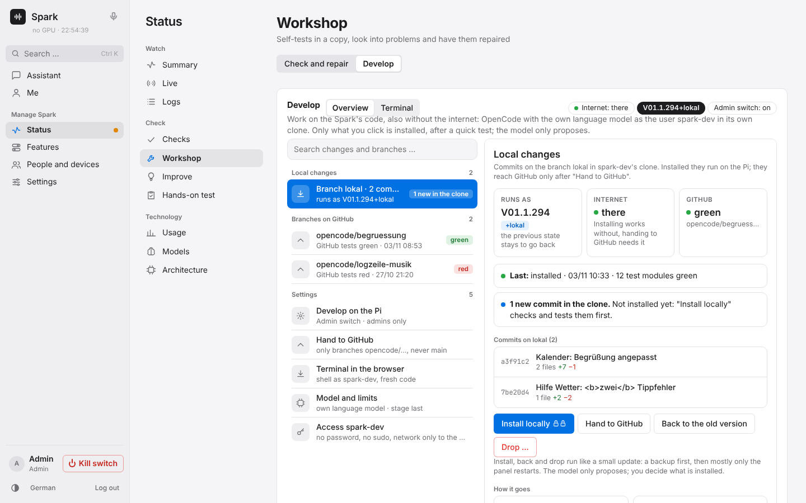
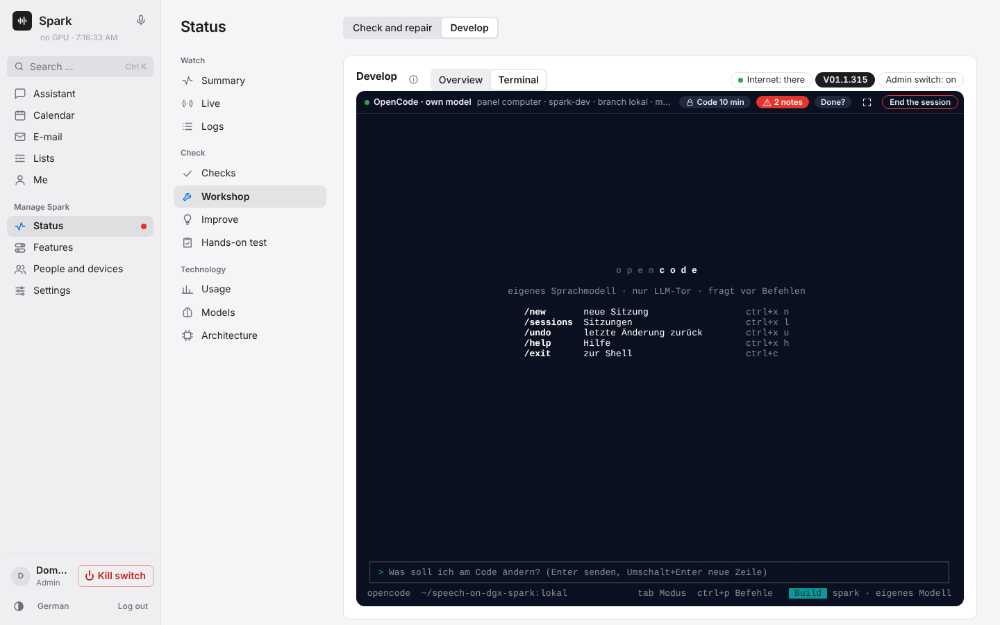
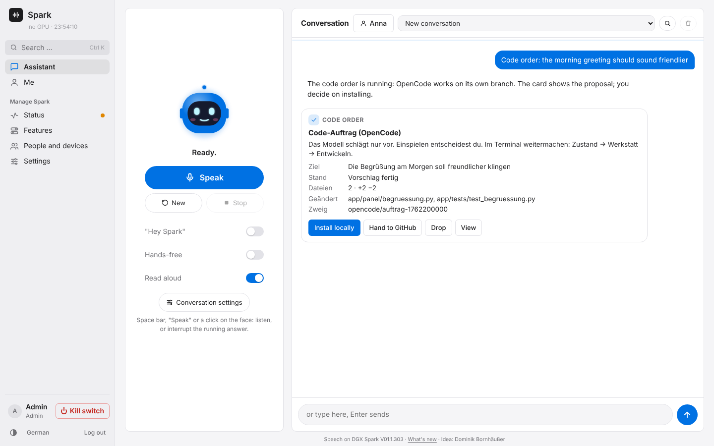
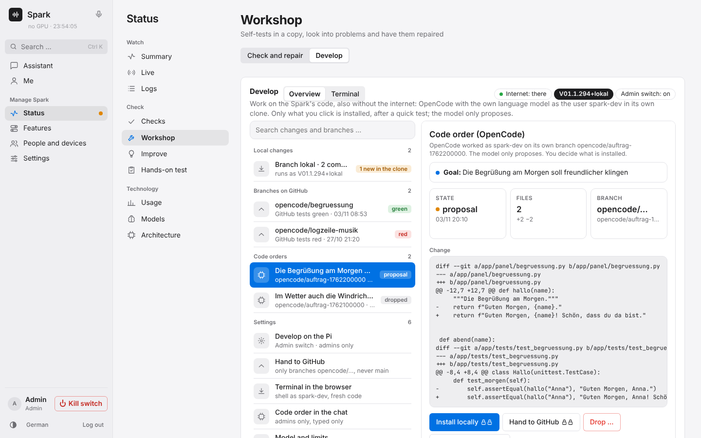

# Installation in detail

← [README](../../README.md)

Split install (the panel on a computer of its own such as a Raspberry Pi 5), moving and taking back: [Spark split](spark-split.md).

## Only the models (without the web panel)

The first install asks in the terminal what to install:

1. **Complete:** models, APIs and the web panel with the assistant (as before).
2. **Only the models with their APIs:** for other services (Open WebUI, your own apps, Home Assistant …), without web panel, password and certificate.

Then it asks which models (speech recognition Qwen3-ASR 1.7B, 0.6B, Parakeet or none; speech output Qwen3-TTS 0.6B, 1.7B or none; VoiceDesign yes or no, each with a rough memory estimate) and whether the APIs should be reachable from the network or only on the Spark itself (`127.0.0.1`, e.g. behind your own reverse proxy). An API key is always generated and required. Later runs and updates do not ask again. Without questions:

```bash
sudo ./install.sh --mode api --asr 1.7b --tts 0.6b --yes   # only the models, reachable in the LAN
sudo ./install.sh --mode api --asr parakeet --tts none --local --yes
```

At the end the addresses, the key and ready-made `curl` examples are printed and kept in `/etc/speech-spark/connection.txt` (readable by root only). Without the panel, the `speech-spark` command does its jobs:

| Command | What it does |
|---|---|
| `sudo speech-spark status` | services, models, free memory, last update |
| `sudo speech-spark info` | addresses, API key, examples, values for Open WebUI |
| `sudo speech-spark key new` | new API key (the old one stops working at once) |
| `sudo speech-spark models` | choose the models again, same questions as the install |
| `sudo speech-spark update` | update like the panel's button (`--check` only shows what is new) |
| `sudo speech-spark logs tts -n 100` | last log lines (asr, tts, asr-engine, tts-engine, tts-design, bild, watch, update, messen, all) |
| `sudo speech-spark panel enable` | add the web panel later; models and API key stay |
| `sudo speech-spark panel disable` | remove the web panel; profiles and data stay on disk |
| `sudo speech-spark notzugang` | locked out: new panel password (shown once), the emergency access's second step off (old file kept as `.bak`), the main admin profile unlinked (roles stay); asks first, noted in the change log, push to the admins. Then `https://…/#admin` without a code, set the second step up again, choose the main admin again |
| `sudo speech-spark modelle liste` | the model catalog (`app/modelle.json`): models, kind, memory, whether the revision is pinned |
| `sudo speech-spark modelle messen` | measures the catalog models on this Spark (default: Qwen3.6 35B A3B NVFP4 with MTP and Qwen3-VL 8B; on request `qwen36` Qwen3.6 with and without MTP, `helfer` the small helper model Qwen3 4B Instruct 2507 FP8, `flash` Qwen3.8 Flash Next in Docker at share 0.70, an own model by its id). Since V01.1.370 the catalog holds only models that run or were measured. Fetches missing models and checks every file, stops the running language model with a maintenance pause, measures speed, first word cold and warm, prefix cache, 2 and 4 questions at once, one question of about 60,000 tokens, room in the context store, memory, a tool call and test pictures per model and always starts it again. Switches nothing, deletes nothing. Result in *Status → Logs* (area System) or `sudo speech-spark logs messen`. Since V01.0.719 also in the panel: *Status → Models* "Measure" next to the model (with Features → Routing models) |
| `sudo speech-spark wissen messen [synth [anzahl] [--ohne-grenzen] \| profil <name>] [--json]` | measures times and memory of the document search, the knowledge book, the knowledge map (since V01.1.270) and Find's search index (measuring part "fund", since V01.1.285) in a measuring process of its own at low priority; stops as soon as somebody speaks. Made up (default 5000 documents, for Find also 50,000 sealed mails) in a throwaway folder under `state/wissensmessung-tmp`, deleted again afterwards, or one profile read only. For Find: search time p50/p95, reading in per 1000 mails, size of `fund.db`, RAM; goal on the Pi: 95 % of the searches below 150 ms. Result in the terminal, under *Status → Checks → Measure knowledge*, in *Status → Logs* (area Wissen) and in *Status → Live*, box "Wissen messen" |
| `sudo speech-spark teilen [status]` | split install (panel on another computer, since V01.0.608): whether the door (TLS-Tor) is open, for how many panel computers, whether the firewall is set, and the certificate's fingerprint |
| `sudo speech-spark teilen modelle-update` | On the panel computer: start the model computer's own update and wait for it (`update.sh` does this first by itself) |
| `sudo speech-spark teilen code` | On the model computer: show a pairing code (10 minutes, one use) and wait for the panel computer |
| `sudo speech-spark teilen koppeln <name-or-ip>` | On the panel computer: pair with the model computer (asks for the code, remembers its certificate) |
| `sudo speech-spark teilen rundlauf` | On the panel computer: ask the Wärter, TTS speaks a sentence, ASR hears it, all through the door |
| `sudo speech-spark umziehen --code` | On the computer that has the panel now: offer the move (code, move backup with the vault key and the panel's certificate); it changes its role only after "fertig" from the other computer |
| `sudo speech-spark umziehen --von <name-or-ip>` | On the new panel computer: fetch the move, restore, check (also happens when pairing with `install.sh --mode panel`) |
| `sudo speech-spark zurueckholen --von <name-or-ip>` | On the model computer: take the panel back; everything runs on one computer again |
| `sudo speech-spark teilen firewall [aus]` | make the door's ports reachable only from the panel computer (`api.tls_from`, nftables table `speech_spark_teilen`), or off again |

The watchdog for hung services, which otherwise runs in the panel, runs as `speech-spark-watch` with the same rules. After an update, TTS speaks a sentence and ASR has to understand it; if that fails, the update puts the previous version back. The self-tests run before every update in both modes. The own language model is updated along. If Open WebUI runs in Docker on the same Spark, the APIs have to be reachable from the network (`127.0.0.1` inside the container is the container itself).

## Updating

In the panel under **System** you see the installed version and, when GitHub has a newer one, the list of changes. **Update installieren** (install update) fetches and installs it. Settings, models and voices are kept, and the log streams live. **Update abbrechen** cancels a running update. Packages that are already installed are not upgraded; only what the new version needs is added. The self-test runs before the new version goes live. If it or an earlier step (download, packages) fails, the update stops and the services keep running the old version unchanged. If something fails after the switch, `update.sh` installs the previous version again and says so in the log. While the update runs, a progress window locks the panel (other tabs and phones too: the server refuses changes, the assistant keeps answering); question, progress and restart stand in this one window: behind it the page keeps still (no band "The Spark is not answering", no version bar), the bar only moves forward, and the window waits calmly across the panel restart. At the end the page loads once and comes back to the same place (Settings → Update). Each state shows only its own buttons: the question Install and Cancel, a running update none; after 45 minutes without finishing it offers Reload and Cancel update, a failed one Close and Copy log. The log stays folded below. The lock begins with the click on Install (since V01.0.878, `update.begin`): the server holds it itself while it backs up first, and every page, the iPhone app, Live and the case's display show the same steps: "Sicherung vor dem Update" (backup), "Update startet", "Lädt und prüft die neue Version" (fetch and check), "Neue Version geladen", on a shared Spark "Modell-Rechner wird zuerst aktualisiert" (model computer first), then the install steps up to restarting the services and "Fertig". Every end, early ones included (GitHub not reachable, no tested version, wrong signature, the unit does not start), writes done with its reason; that ends the lock and the window names the reason. A second start during the lock is refused. The Spark companion on PC and Mac shows the same line "Spark-Update läuft: 40 % · step" in its state and during the restart "Spark startet für das Update neu …" instead of "not reachable" (since V01.0.883, `begleiter.spark_update` in `/api/desk/poll`, needs the new companion build).

**What's new (changelog)**: every change up to the installed version, one line per version, newest first, with a search. Open it with "Was ist neu" (What's new) at the bottom next to the version number or under *Settings → Update und Sicherung (update and backup) → Was ist neu (Changelog) → View*. The admin and every profile in its own browser login can see it (not guests, not device keys). Versions newer than at the last opening in this browser carry "new". The list comes from `CHANGELOG.md` of the installed version (the update puts a copy into `app/`).

On the console:

```bash
sudo speech-spark update                       # update (or: sudo /opt/speech-spark/src/update.sh)
sudo /opt/speech-spark/src/update.sh --check   # only show what is new
```

The installer keeps its own git checkout in `/opt/speech-spark/src`, so it no longer matters where you cloned the repo originally.

**Once, for installs from before the update button:** run `git pull` and `sudo ./install.sh` in the cloned repo. After that the button works.

| Option | Effect |
|---|---|
| `--mode full` / `--mode api` | complete with the web panel / only the models with their APIs (see above) |
| `--mode api --teilen` | Spark split, model computer: only the models, services only on 127.0.0.1, plus the TLS-Tor, the Wärter, the firewall and the door's own certificate (`tor-cert.pem`); shows the pairing code at the end |
| `--mode panel --modelle <name-or-ip>` | Spark split, panel computer (e.g. Raspberry Pi 5): only the panel with `venv-panel` and coturn, no model, no engine; checks 64 bit and Python ≥ 3.11, asks for the code (or `SPEECH_SPARK_CODE`) and runs the round trip afterwards |
| `--asr 1.7b\|0.6b\|parakeet\|none`, `--tts 0.6b\|1.7b\|none`, `--voicedesign` | choose the models without questions |
| `--local` / `--network` | APIs only on `127.0.0.1` / in the whole network (default) |
| `--yes` | ask nothing; what is not given stays as it is (new: complete) |
| `--small` | 0.6B models instead of 1.7B (less memory) |
| `--tts-backend transformers` | TTS via `qwen-tts` without streaming instead of vllm-omni (default: `vllm-omni`) |
| `--asr-backend transformers` | ASR via `qwen-asr`, one request at a time, instead of vLLM (default: `vllm`) |
| `--no-asr` / `--no-tts` | install only one of the two services |
| `--password XYZ` | set the panel password (otherwise one is generated) |
| `--no-download` | download models on first start instead |
| `--no-smoke` | skip the round-trip test at the end |
| `--entwickeln` | panel computer: developing on the Pi with OpenCode (user `spark-dev`, its own clone, see below) |
| `--uninstall` | same as `./uninstall.sh` (see below) |

Running the script again updates the code and adds what is missing to the Python environments; packages already installed stay as they are. The existing configuration is kept and new settings are added.

## Painting pictures (optional)

With `--bild` the installation also installs the picture model FLUX.2 [klein] (only with the web panel; the first install asks, the default is none, `sudo speech-spark models` asks again):

```bash
sudo ./install.sh --bild 4b-q8   # 4B, Q8: ~9 GB disk, ~11 GiB while painting, Apache 2.0 (recommended)
sudo ./install.sh --bild 4b-q4   # 4B, Q4: less memory
sudo ./install.sh --bild 9b-q8   # 9B (also 9b-q4): FLUX Non-Commercial, private use only
sudo ./install.sh --bild none    # off again (the files stay in /var/lib/speech-spark/models/bild)
```

**Own language model (since V01.0.590):** `sudo ./install.sh --llm` creates `venv-llm` with vLLM for the own language model and keeps it current with every update. The first `--llm` switches the own language model on and points the chat at the LLM-Tor (`http://127.0.0.1:31006/v1`); in a split installation it also refreshes the door's firewall. The services `speech-spark-llm`, `speech-spark-llmtor` and `speech-spark-sehen` run after that. The former fallback to dgx-spark-qwen38 (`modelle llm uebernehmen|zurueck`, `qwen38-aufraeumen`) and Kolibri (`--kolibri`) are gone since V01.1.370 (Dominik 2026-11-11). Logs: `sudo speech-spark logs llm`, `llmtor`, `sehen`.

It builds stable-diffusion.cpp once (`sd-server`, pinned commit, CUDA for the GB10, needs `nvcc` and `cmake`) into `/opt/speech-spark/sdcpp`, downloads the model files with a SHA-256 check into `/var/lib/speech-spark/models/bild` and sets up the service `speech-spark-bild` (only `127.0.0.1`, ports `image.port` 31005 and `image.engine_port` 31015). The model takes memory only while painting. Then switch on Features → Painting pictures in the panel and press "Bild testen". Details: [Assistant](assistant.md).

## Making music (optional)

With `--musik` the installation also installs the music model ACE-Step 1.5 (MIT licence; on the model computer, with a split install together with `--teilen`; the first install asks, the default is none, `sudo speech-spark models` asks again):

```bash
sudo ./install.sh --musik 2b         # 2B turbo + 1.7B planner: ~5.6 GB disk, ~14 GiB while making music (recommended)
sudo ./install.sh --musik 2b-klein   # 2B turbo + 0.6B planner: less memory (~12 GiB)
sudo ./install.sh --musik xl         # XL turbo (4B) + 1.7B: sounds better, ~5.3 GB more disk, ~20 GiB
sudo ./install.sh --musik none       # off again (the files stay in /var/lib/speech-spark/models/musik)
```

It builds acestep.cpp once (`ace-server`, pinned commit, ggml linked in, CUDA for the GB10, no torch and no Docker, needs `nvcc` and `cmake`) into `/opt/speech-spark/acestep`, downloads the GGUF files with a SHA-256 check into `/var/lib/speech-spark/models/musik` and sets up the service `speech-spark-musik` (only `127.0.0.1`, with a split install through the TLS-Tor; ports `music.port` 31004 and `music.engine_port` 31014). The engine loads only for a song and frees the memory after 10 minutes without one; without enough free memory it does not load. Several models can be installed one after the other; all files stay. State → Checks → "Test music" measures every installed model with two fixed samples (30 s of piano, 60 s with German vocals) and shows time, memory and the samples to listen to. Then switch on Features → Making music and pick the model there; every released profile then makes songs in the conversation and under Me → Music. Logs: `sudo speech-spark logs musik`, maintenance pause: `sudo speech-spark pause musik 30`.

With `--werkstatt` (on the model computer) the workshop comes along: OpenCode as one file from the npm registry, version and SHA-512 fixed in `app/werkstatt.py`, into `/opt/speech-spark/werkstatt`; plus the user `spark-werkstatt` with the folder `/var/lib/spark-werkstatt/arbeit` and the unit `speech-spark-werkstatt`. Without the option nothing of it is fetched; once there, an update keeps it. Then switch on Features → Workshop.

```bash
sudo ./install.sh --werkstatt
sudo speech-spark werkstatt status
```

For the screen in Remote access the computer with the panel builds guacd itself from Apache's source (since V01.1.278; Debian 12 and 13 and Raspberry Pi OS have no guacd package any more): `app/guacd-bauen.sh` fetches exactly the release in `fernbild.GUACD_VERSION` (guacamole-server 1.6.0, Apache-2.0) only from downloads.apache.org or archive.apache.org, checks it against `fernbild.GUACD_SHA256`, builds it as `nobody` in a fresh folder under `/var/tmp` with VNC and RDP only (FreeRDP 3 where there is one, else 2) and puts the result in `/opt/speech-spark/guacd`. For building it installs `build-essential pkg-config libtool-bin libcairo2-dev libjpeg-dev libpng-dev libwebp-dev uuid-dev libvncserver-dev` and `freerdp3-dev` (or `freerdp2-dev`); that takes a few minutes once (fetching packages and building; the build itself took about 5 seconds on a 4-core ARM machine in the GitHub test), the progress is in the update log. It is built again only when the release changes. It is built with `--fernbild`, on every update once Features → Remote access to servers and Screen under it are on, and while guacd is already there. A failure never stops the update: the panel then says at the Screen button what went wrong ("guacd not installed on the Spark: …"), and the next update tries again. A distribution's guacd unit stays masked; only `speech-spark-guacd` runs, on 127.0.0.1:4822, started by the panel when a screen opens. Switching off uninstalls nothing. Then run `sudo spark-anker bildschirm` once on the system.

```bash
sudo ./install.sh --fernbild
```

For Features → Transcribe YouTube links, `--youtube` (on the panel computer) puts yt-dlp (license Unlicense) into an environment of its own, `/opt/speech-spark/venv-ytdlp`: exactly the version and the SHA-256 of the wheel from `app/requirements-ytdlp.lock`, without its optional packages (`pip --no-deps --require-hashes --only-binary :all:`). Without the option nothing of it is fetched; once there, every update keeps it at the version of that file. The panel starts it only with fixed options and only through its netguard proxy (`app/panel/netproxy.py`, fixed host list). Then switch on Features → Own documents → Transcribe recordings → Transcribe YouTube links (Links as documents must be on).

```bash
sudo ./install.sh --youtube
```

## Developing on the Pi with OpenCode

A guide for beginners: you change the Spark yourself on the panel computer (such as the Raspberry Pi), with OpenCode in the terminal and the Spark's own language model, without a cloud and without GitHub. OpenCode works as its own user `spark-dev` in its own clone; the running Spark, its data and keys stay out of reach. Nothing is installed until an admin wants it, after a quick test and like an update.

1. **Install once** (on the panel computer, needs the internet): `sudo ./install.sh --entwickeln`. This adds the user `spark-dev` (no password, no sudo) with the clone `/home/spark-dev/speech-on-dgx-spark` and the branch `lokal`, downloads OpenCode (version and SHA-512 fixed in `app/werkstatt.py`, the same file as the workshop's) into `/opt/speech-spark/opencode`, writes OpenCode's settings (only the own LLM-Tor, its own key, the rules from `CLAUDE.md` and the guidelines), blocks every network except the LLM-Tor by firewall and builds the quick test's test environment.
2. **Switch on**: as admin *Features → Develop on the Pi* on. Only then does the key of `spark-dev` work at the LLM-Tor.
3. **Open the terminal**: easiest in the browser. As admin *Features → Develop on the Pi → Terminal in the browser* on, then *Status → Workshop → Develop*, tab *Terminal*, "Open the terminal" and enter your code (a fresh one every time; the second sign-in step is needed). The shell runs as `spark-dev` in the clone. If you prefer SSH: add your public SSH key for `spark-dev` and sign in from your computer (see below).
4. **Work without the internet**: in the browser terminal OpenCode runs at once (since V01.1.328); quit (ctrl+c), the shell stays, `opencode` (or `spark-opencode`) starts it again. Say in your own words what should change. `sudo` does not work there: updates and installing as your admin user over SSH or under *Remote access*. OpenCode asks only the language model in the home network and you before every command. Testing works in the clone as on GitHub, only without browser tests. Every finished change is a commit on `lokal`.
5. **Install**: in the tab *Overview* the commit shows under "Local changes" with its title and number of files; "Install locally" (fresh code) or `sudo speech-spark lokal einspielen`. The Spark checks the commits, tests them in a sandbox and installs them like an update; the version then shows "+lokal". "Back to the old version" and "Drop …" sit next to it.
6. **Code order in the chat** (its own sub-switch *Features → Develop on the Pi → Code order in the chat*, off): instead of typing in the terminal yourself, write in the panel's or the app's chat for example "Code-Auftrag: the greeting should sound friendlier". OpenCode then works once as `spark-dev` on its own branch `opencode/auftrag-<number>`, and the card "Code-Auftrag (OpenCode)" shows what came out: goal, files, the first lines of the change. The model only proposes. You decide on installing: "Install locally" and "Hand to GitHub" open *Status → Workshop → Develop* (the whole change there and a fresh code), "Drop" deletes the branch, "Continue in the terminal" leads to the tab *Terminal*. Admins only and typed only, never over speakers, the car, Telegram, the Begleiter or for guests.

[](../bilder/en-entwickeln.png)

[](../bilder/en-entwickeln-terminal.png)

[](../bilder/en-code-auftrag-karte.png)

[](../bilder/en-entwickeln-auftrag.png)

```bash
# 1. once, on the panel computer
sudo ./install.sh --entwickeln
# 3. instead of the terminal in the browser: your SSH key for spark-dev
sudo install -d -m 700 -o spark-dev -g spark-dev /home/spark-dev/.ssh
sudo install -m 600 -o spark-dev -g spark-dev ~/.ssh/id_ed25519.pub /home/spark-dev/.ssh/authorized_keys
# 4. from your computer
ssh spark-dev@<panel-computer>
opencode                            # OpenCode in the clone, branch lokal (= spark-opencode)
cd app && python3 selftest.py discover -s tests -p 'test_live.py'
git commit -am "My change"
# 5. as admin on the panel computer (or the buttons under Status → Workshop → Develop)
sudo speech-spark lokal einspielen  # check, quick test, install like an update
sudo speech-spark lokal status      # local changes, last result
sudo speech-spark lokal zurueck     # one step back (same version)
sudo speech-spark lokal verwerfen   # version without local changes (they stay in the clone)
```

Only what lies under `app/panel/`, `app/tests/` and `docs/` is installed, plus both READMEs and `CHANGELOG.md`, as plain files: what root runs (`install.sh`, `update.sh`, `app/*.py` outside `app/panel`, the package lists) only comes through GitHub. A normal update never loses local work: it puts the local commits on the new version and tests them; if something does not fit or the quick test is red, the running version stays, and the panel shows the reason on top. Make the key of `spark-dev` new or revoke it: `sudo speech-spark entwickeln schluessel neu|weg`; after a change of the model computer `sudo speech-spark entwickeln einrichten`. If the test environment is missing, once with the internet `sudo speech-spark lokal testumgebung` (afterwards it renews itself every night, only when the package list changes). Logs: `sudo speech-spark logs entwickeln`. `spark-dev` makes its clone itself from a bundle root writes of the installed version; `spark-dev` never reads the clone in `/opt/speech-spark/src` (newer git stops there with "dubious ownership"). If the clone failed ("could not make the clone of spark-dev"), simply run `sudo ./install.sh --entwickeln` again: a half-made clone is filled, `spark-dev`'s work stays.

### Way A: hand to GitHub

What way B may not take (such as `install.sh` or `app/*.py`), or what should go into the official version, an admin hands to GitHub as a branch of its own, `opencode/<thema>`. The full tests run there, and a Claude thread reviews it and brings it onto main. `spark-dev` never gets the internet for this: root takes the branch as a bundle and pushes it with a deploy key of its own, never to main and never with `--force`.

1. **Make the key**: `sudo speech-spark entwickeln github-schluessel neu` shows a line starting with `ssh-ed25519`. Only root reads the secret part (`/etc/speech-spark-github-key`).
2. **Add it on GitHub**: in the repository the tab "Settings", on the left "Deploy keys", "Add deploy key". Title for example "Spark Pi opencode", paste the line, tick **"Allow write access"**, "Add key". Take no personal token: it acts as your admin account and would get past the rule for main.
3. **Protect main** (once, on GitHub): tab "Settings", on the left "Rules", "Rulesets", "New ruleset", "New branch ruleset". Name "protect main", Enforcement status "Active", at "Target branches" "Add target" and "Include default branch". Tick: "Restrict deletions", "Restrict updates", "Block force pushes". At "Bypass list" "Add bypass" and "Repository admin" (your account, so you and the Claude threads keep pushing to main). "Create". Never put the deploy key on the bypass list.
4. **Switch on**: as admin *Features → Develop on the Pi → Hand to GitHub* on. After the update to this version run `sudo ./install.sh --entwickeln` once, so the service `speech-spark-github` and its timer are there.
5. **Hand over**: *Status → Workshop → Develop*, "Local changes", "Hand to GitHub" with a topic, or `sudo speech-spark lokal an-github my-topic`. Without the internet the order waits and starts by itself every 15 minutes (`--abbrechen` drops it).
6. **Pass it on**: the page shows the branch on the left under "Branches on GitHub" with the state of the tests, on the right with the link and the sentence to copy; `sudo speech-spark lokal zweige` shows the branch, its link and the state of GitHub's tests. Then to a Claude thread: "Gib den Zweig opencode/my-topic einem Claude-Thread zum Prüfen". Once it is on main, the next update drops installed local commits that are part of it by itself; in the clone afterwards `git rebase spark/main`.

```bash
sudo speech-spark entwickeln github-schluessel neu   # 1. add the line as a deploy key with write access
sudo speech-spark lokal an-github my-topic            # 5. to GitHub as opencode/my-topic
sudo speech-spark lokal zweige                        # 6. branches, links, GitHub tests (gruen, laeuft, rot)
sudo speech-spark entwickeln github-schluessel weg    # revoke the key (delete it on GitHub too)
```

## Uninstalling

```bash
sudo ./uninstall.sh            # remove services, code, venvs and the sudoers rule; config, models and voices stay
sudo ./uninstall.sh --purge    # also delete config, models, voices and the user speech
sudo ./uninstall.sh --yes      # no confirmation prompt
```

The own language model (`venv-llm`) goes with `uninstall.sh`.
